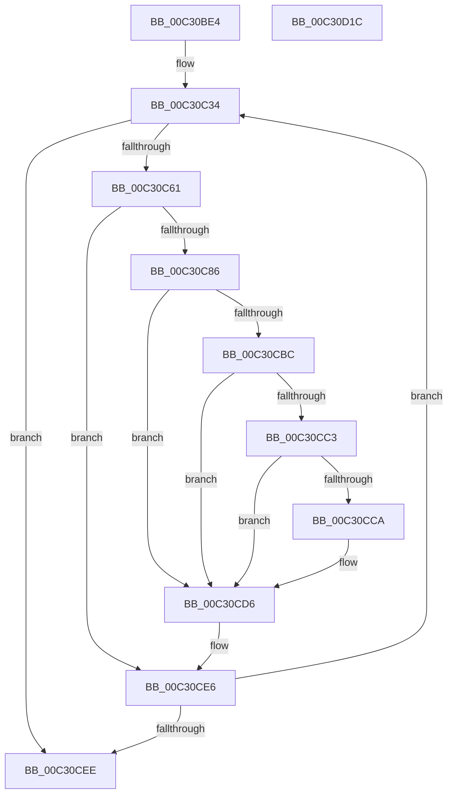

# PipHardwareConfigExists

- RVA: `0x00C30BE4`–`0x00C30D1D` (길이 `313` bytes)
- VA: `0x0000000140C30BE4`
- 실행 섹션: `INIT`
- PDB 이름 있음: `예`; PDB Function 태그: `아니요`
- unwind 정보 RVA: `0x000C8074`
- 디코드: `77`개 명령, `313/313` bytes 표시
- 미해석 바이트: `0` (있으면 어셈블리에 `.byte`로 보존)

> 이 문서는 커널 이미지의 기계어와 PDB 기호를 분석해 생성했습니다. 4번과 5번은 함수 원형과 자료형을 바이너리 사용 방식에서 추정한 C 해석이며 원본 소스 복구 결과는 아닙니다.

## 1. Dependencies

- 직접 호출 지점: **5**; 고유 호출 대상: **5**
- 직접 호출자로 확인된 함수: **1**
- RIP 상대 이미지 참조: **2**

### Outgoing calls
- `0x00C30C51` → [PnpCtxRegEnumKey](../../page/99/PnpCtxRegEnumKey_function_009929C0.md) (function, `0x009929C0`)
- `0x00C30C7D` → [PnpCtxRegOpenKey](../../page/8E/PnpCtxRegOpenKey_function_008EF7B8.md) (function, `0x008EF7B8`)
- `0x00C30CB3` → [PnpCtxRegQueryValue](../../page/99/PnpCtxRegQueryValue_function_009940FC.md) (function, `0x009940FC`)
- `0x00C30CDB` → [ZwClose](../../text/6A/ZwClose_function_006AD2B0.md) (function, `0x006AD2B0`)
- `0x00C30CFA` → [_security_check_cookie](../../text/6A/_security_check_cookie_function_006AC640.md) (function, `0x006AC640`)

### Direct callers
- [PipHardwareConfigInit](PipHardwareConfigInit_function_00C30D24.md) at `0x00C30F78`

### Static image references
- `0x00C30C06` → RVA `0x00E0A740` (`.data`; read)
- `0x00C30CA7` → RVA `0x00C7A5F0` (` ?? ::PBOPGDP::`string'`; read)

## 2. Other-region calls and transfers

- 다른 실행 섹션으로 향하는 call: **5**
  - `0x00C30C51` → [PnpCtxRegEnumKey](../../page/99/PnpCtxRegEnumKey_function_009929C0.md) (`INIT` → `PAGE`)
  - `0x00C30C7D` → [PnpCtxRegOpenKey](../../page/8E/PnpCtxRegOpenKey_function_008EF7B8.md) (`INIT` → `PAGE`)
  - `0x00C30CB3` → [PnpCtxRegQueryValue](../../page/99/PnpCtxRegQueryValue_function_009940FC.md) (`INIT` → `PAGE`)
  - `0x00C30CDB` → [ZwClose](../../text/6A/ZwClose_function_006AD2B0.md) (`INIT` → `.text`)
  - `0x00C30CFA` → [_security_check_cookie](../../text/6A/_security_check_cookie_function_006AC640.md) (`INIT` → `.text`)
- 별도 외부 분기/꼬리 이동을 확인하지 못했습니다.

## 3. Assembly (complete function range)

```asm
00C30BE4  48 8B C4                        mov rax, rsp
00C30BE7  48 89 58 10                     mov qword ptr [rax + 0x10], rbx
00C30BEB  48 89 70 18                     mov qword ptr [rax + 0x18], rsi
00C30BEF  48 89 78 20                     mov qword ptr [rax + 0x20], rdi
00C30BF3  55                              push rbp
00C30BF4  41 54                           push r12
00C30BF6  41 56                           push r14
00C30BF8  48 8D A8 78 FE FF FF            lea rbp, [rax - 0x188]
00C30BFF  48 81 EC 70 02 00 00            sub rsp, 0x270
00C30C06  48 8B 05 33 9B 1D 00            mov rax, qword ptr [rip + 0x1d9b33]
00C30C0D  48 33 C4                        xor rax, rsp
00C30C10  48 89 85 60 01 00 00            mov qword ptr [rbp + 0x160], rax
00C30C17  48 83 64 24 40 00               and qword ptr [rsp + 0x40], 0
00C30C1D  33 FF                           xor edi, edi
00C30C1F  83 64 24 38 00                  and dword ptr [rsp + 0x38], 0
00C30C24  32 DB                           xor bl, bl
00C30C26  21 7C 24 34                     and dword ptr [rsp + 0x34], edi
00C30C2A  44 8B F2                        mov r14d, edx
00C30C2D  48 8B F1                        mov rsi, rcx
00C30C30  44 8D 67 01                     lea r12d, [rdi + 1]
00C30C34  48 8D 44 24 30                  lea rax, [rsp + 0x30]
00C30C39  C7 44 24 30 04 01 00 00         mov dword ptr [rsp + 0x30], 0x104
00C30C41  4C 8D 4C 24 50                  lea r9, [rsp + 0x50]
00C30C46  48 89 44 24 20                  mov qword ptr [rsp + 0x20], rax
00C30C4B  44 8B C7                        mov r8d, edi
00C30C4E  48 8B D6                        mov rdx, rsi
00C30C51  E8 6A 1D D6 FF                  call 0x1409929c0
00C30C56  41 03 FC                        add edi, r12d
00C30C59  85 C0                           test eax, eax
00C30C5B  0F 88 8D 00 00 00               js 0x140c30cee
00C30C61  48 8D 44 24 40                  lea rax, [rsp + 0x40]
00C30C66  45 33 C9                        xor r9d, r9d
00C30C69  48 89 44 24 28                  mov qword ptr [rsp + 0x28], rax
00C30C6E  4C 8D 44 24 50                  lea r8, [rsp + 0x50]
00C30C73  48 8B D6                        mov rdx, rsi
00C30C76  44 89 64 24 20                  mov dword ptr [rsp + 0x20], r12d
00C30C7B  33 C9                           xor ecx, ecx
00C30C7D  E8 36 EB CB FF                  call 0x1408ef7b8
00C30C82  85 C0                           test eax, eax
00C30C84  78 60                           js 0x140c30ce6
00C30C86  48 8B 54 24 40                  mov rdx, qword ptr [rsp + 0x40]
00C30C8B  48 8D 44 24 30                  lea rax, [rsp + 0x30]
00C30C90  48 89 44 24 28                  mov qword ptr [rsp + 0x28], rax
00C30C95  4C 8D 4C 24 34                  lea r9, [rsp + 0x34]
00C30C9A  48 8D 44 24 38                  lea rax, [rsp + 0x38]
00C30C9F  C7 44 24 30 04 00 00 00         mov dword ptr [rsp + 0x30], 4
00C30CA7  4C 8D 05 42 99 04 00            lea r8, [rip + 0x49942]
00C30CAE  48 89 44 24 20                  mov qword ptr [rsp + 0x20], rax
00C30CB3  E8 44 34 D6 FF                  call 0x1409940fc
00C30CB8  85 C0                           test eax, eax
00C30CBA  78 1A                           js 0x140c30cd6
00C30CBC  83 7C 24 34 04                  cmp dword ptr [rsp + 0x34], 4
00C30CC1  75 13                           jne 0x140c30cd6
00C30CC3  83 7C 24 30 04                  cmp dword ptr [rsp + 0x30], 4
00C30CC8  75 0C                           jne 0x140c30cd6
00C30CCA  44 39 74 24 38                  cmp dword ptr [rsp + 0x38], r14d
00C30CCF  0F B6 DB                        movzx ebx, bl
00C30CD2  41 0F 44 DC                     cmove ebx, r12d
00C30CD6  48 8B 4C 24 40                  mov rcx, qword ptr [rsp + 0x40]
00C30CDB  E8 D0 C5 A7 FF                  call 0x1406ad2b0
00C30CE0  48 83 64 24 40 00               and qword ptr [rsp + 0x40], 0
00C30CE6  84 DB                           test bl, bl
00C30CE8  0F 84 46 FF FF FF               je 0x140c30c34
00C30CEE  8A C3                           mov al, bl
00C30CF0  48 8B 8D 60 01 00 00            mov rcx, qword ptr [rbp + 0x160]
00C30CF7  48 33 CC                        xor rcx, rsp
00C30CFA  E8 41 B9 A7 FF                  call 0x1406ac640
00C30CFF  4C 8D 9C 24 70 02 00 00         lea r11, [rsp + 0x270]
00C30D07  49 8B 5B 28                     mov rbx, qword ptr [r11 + 0x28]
00C30D0B  49 8B 73 30                     mov rsi, qword ptr [r11 + 0x30]
00C30D0F  49 8B 7B 38                     mov rdi, qword ptr [r11 + 0x38]
00C30D13  49 8B E3                        mov rsp, r11
00C30D16  41 5E                           pop r14
00C30D18  41 5C                           pop r12
00C30D1A  5D                              pop rbp
00C30D1B  C3                              ret
00C30D1C  CC                              int3
```

## 4. C-style interpretation (structured pseudocode)

```c
__int64 __fastcall PipHardwareConfigExists(__int64 a1, int a2)
{
    __int64 result;
    __int64 v_rbx;
    __int64 v_rdi;
    __int64 v_rsp;
    unsigned __int64 v_stack_m18;
    unsigned __int64 v_stack_m238;
    unsigned __int64 v_stack_m248;
    unsigned int v_stack_m250;
    unsigned int v_stack_m254;
    unsigned __int64 v_stack_m258;
    unsigned __int64 v_stack_m260;
    unsigned __int64 v_stack_m268;

    *(unsigned __int64 *)(v_rsp + 16) = v_rbx;
    *(unsigned __int64 *)(v_rsp + 24) = v_rsi;
    *(unsigned __int64 *)(v_rsp + 32) = v_rdi;
    v_rsp = (v_rsp) - (624);
    result = (*(unsigned __int64 *)(v_rip + 1940275)) ^ (v_rsp);
    *(unsigned __int64 *)(v_rsp - 392 + 352) = result;
    v_rdi = 0;
    v_rbx = 0;
loc_00C30C34:
    v_stack_m258 = 260;
    v_stack_m268 = v_stack_m258;
    result = PnpCtxRegEnumKey(a1, a1, 0, v_stack_m238);
    v_rdi = (unsigned int)((v_rdi) + ((unsigned int)(v_rdi + 1)));
    if (sign_flag) goto loc_00C30CEE;
    a4 = 0;
    v_stack_m260 = v_stack_m248;
    v_stack_m268 = (unsigned int)(v_rdi + 1);
    a1 = 0;
    result = PnpCtxRegOpenKey(a1, a1, v_stack_m238, a4);
    if (sign_flag) goto loc_00C30CE6;
    v_stack_m260 = v_stack_m258;
    v_stack_m258 = 4;
    v_stack_m268 = v_stack_m250;
    result = PnpCtxRegQueryValue(a1, v_stack_m248, v_rip + 301378, v_stack_m254);
    if (sign_flag) goto loc_00C30CD6;
    if (v_stack_m254 != 4) goto loc_00C30CD6;
    if (v_stack_m258 == 4) {
        v_rbx = 0;
        if (v_stack_m250 == ((unsigned int)((unsigned int)(a2)))) { v_rbx = (unsigned int)(v_rdi + 1); }
    }
    result = ZwClose(v_stack_m248, v_stack_m248, v_rip + 301378, v_stack_m254);
loc_00C30CE6:
    if ((unsigned __int8)(v_rbx) == 0) goto loc_00C30C34;
loc_00C30CEE:
    a1 = (*(unsigned __int64 *)(v_rsp - 392 + 352)) ^ (v_rsp);
    result = _security_check_cookie(a1, v_stack_m248, v_rip + 301378, v_stack_m254);
    return result;
}
```

## 5. (Beta) C Style

```c
int64_t PipHardwareConfigExists(int64_t Arg1, int32_t Arg2)
{
    int64_t result;
    int64_t local_rbx;
    int64_t local_rdi;
    int64_t local_rsp;
    uint64_t v_stack_m18;
    uint64_t v_stack_m238;
    uint64_t v_stack_m248;
    uint32_t v_stack_m250;
    uint32_t v_stack_m254;
    uint64_t v_stack_m258;
    uint64_t v_stack_m260;
    uint64_t v_stack_m268;

    *(uint64_t *)(local_rsp + 0x10) = local_rbx;
    *(uint64_t *)(local_rsp + 0x18) = local_rsi;
    *(uint64_t *)(local_rsp + 0x20) = local_rdi;
    local_rsp = (local_rsp) - (624);
    result = (*(uint64_t *)(v_rip + 0x1D9B33)) ^ (local_rsp);
    *(uint64_t *)(local_rsp - 0x188 + 0x160) = result;
    local_rdi = 0;
    local_rbx = 0;
loc_00C30C34:
    v_stack_m258 = 260;
    v_stack_m268 = v_stack_m258;
    result = PnpCtxRegEnumKey(Arg1, Arg1, 0, v_stack_m238);
    local_rdi = (uint32_t)((local_rdi) + ((uint32_t)(local_rdi + 1)));
    if (sign_flag) goto loc_00C30CEE;
    a4 = 0;
    v_stack_m260 = v_stack_m248;
    v_stack_m268 = (uint32_t)(local_rdi + 1);
    Arg1 = 0;
    result = PnpCtxRegOpenKey(Arg1, Arg1, v_stack_m238, a4);
    if (sign_flag) goto loc_00C30CE6;
    v_stack_m260 = v_stack_m258;
    v_stack_m258 = 4;
    v_stack_m268 = v_stack_m250;
    result = PnpCtxRegQueryValue(Arg1, v_stack_m248, v_rip + 301378, v_stack_m254);
    if (sign_flag) goto loc_00C30CD6;
    if (v_stack_m254 != 4) goto loc_00C30CD6;
    if (v_stack_m258 == 4) {
        local_rbx = 0;
        if (v_stack_m250 == ((uint32_t)((uint32_t)(Arg2)))) { local_rbx = (uint32_t)(local_rdi + 1); }
    }
    result = ZwClose(v_stack_m248, v_stack_m248, v_rip + 301378, v_stack_m254);
loc_00C30CE6:
    if ((uint8_t)(local_rbx) == 0) goto loc_00C30C34;
loc_00C30CEE:
    Arg1 = (*(uint64_t *)(local_rsp - 0x188 + 0x160)) ^ (local_rsp);
    result = _security_check_cookie(Arg1, v_stack_m248, v_rip + 301378, v_stack_m254);
    return result;
}
```

## 6. Execution-region graph

[열기: 2D/3D 그래프와 함수 탐색 컨트롤 패널](../../../control-panel.html?section=init&rva=0x00C30BE4&view=graph)

- 2D 그래프는 위에서 아래로 흐르고, 3D 그래프는 빈 공간을 드래그해 회전합니다. Shift+드래그는 이동, 휠은 확대·축소, 함수 노드 선택은 대상 보고서 이동입니다.

### Static fallback


