# PipHardwareConfigInit

- RVA: `0x00C30D24`–`0x00C312C1` (길이 `1,437` bytes)
- VA: `0x0000000140C30D24`
- 실행 섹션: `INIT`
- PDB 이름 있음: `예`; PDB Function 태그: `아니요`
- unwind 정보 RVA: `0x000C809C`
- 디코드: `351`개 명령, `1,437/1,437` bytes 표시
- 미해석 바이트: `0` (있으면 어셈블리에 `.byte`로 보존)

> 이 문서는 커널 이미지의 기계어와 PDB 기호를 분석해 생성했습니다. 4번과 5번은 함수 원형과 자료형을 바이너리 사용 방식에서 추정한 C 해석이며 원본 소스 복구 결과는 아닙니다.

## 1. Dependencies

- 직접 호출 지점: **32**; 고유 호출 대상: **14**
- 직접 호출자로 확인된 함수: **1**
- RIP 상대 이미지 참조: **16**

### Outgoing calls
- `0x00C30DCA` → [IopCreateRegistryKeyEx](../../page/A8/IopCreateRegistryKeyEx_function_00A89038.md) (function, `0x00A89038`)
- `0x00C30DFB` → [ZwDeleteValueKey](../../text/6A/ZwDeleteValueKey_function_006AECB0.md) (function, `0x006AECB0`)
- `0x00C30E10` → [_PnpCtxGetCachedContextBaseKey](../../page/8E/_PnpCtxGetCachedContextBaseKey_function_008EFB2C.md) (function, `0x008EFB2C`)
- `0x00C30E29` → [RtlStringFromGUID](../../page/91/RtlStringFromGUID_function_00914BA0.md) (function, `0x00914BA0`)
- `0x00C30E7B` → [ZwSetValueKey](../../text/6A/ZwSetValueKey_function_006ADCD0.md) (function, `0x006ADCD0`)
- `0x00C30EAA` → [IopCreateRegistryKeyEx](../../page/A8/IopCreateRegistryKeyEx_function_00A89038.md) (function, `0x00A89038`)
- `0x00C30ECF` → [IopGetRegistryValue](../../page/99/IopGetRegistryValue_function_009990EC.md) (function, `0x009990EC`)
- `0x00C30F0D` → [ExFreePoolWithTag](../../poolcode/B8/ExFreePoolWithTag_function_00B82870.md) (function, `0x00B82870`)
- `0x00C30F32` → [IopGetRegistryValue](../../page/99/IopGetRegistryValue_function_009990EC.md) (function, `0x009990EC`)
- `0x00C30F5D` → [ExFreePoolWithTag](../../poolcode/B8/ExFreePoolWithTag_function_00B82870.md) (function, `0x00B82870`)
- `0x00C30F78` → [PipHardwareConfigExists](PipHardwareConfigExists_function_00C30BE4.md) (function, `0x00C30BE4`)
- `0x00C30FCE` → [ZwSetValueKey](../../text/6A/ZwSetValueKey_function_006ADCD0.md) (function, `0x006ADCD0`)
- `0x00C31003` → [ZwSetValueKey](../../text/6A/ZwSetValueKey_function_006ADCD0.md) (function, `0x006ADCD0`)
- `0x00C31029` → [KeQueryBootTimeValues](../../text/49/KeQueryBootTimeValues_function_0049F444.md) (function, `0x0049F444`)
- `0x00C31070` → [ZwSetValueKey](../../text/6A/ZwSetValueKey_function_006ADCD0.md) (function, `0x006ADCD0`)
- `0x00C310A5` → [IopCreateRegistryKeyEx](../../page/A8/IopCreateRegistryKeyEx_function_00A89038.md) (function, `0x00A89038`)
- `0x00C310C8` → [PnpCtxRegQueryKeyPathName](../../page/82/PnpCtxRegQueryKeyPathName_function_00829278.md) (function, `0x00829278`)
- `0x00C31107` → [ZwSetValueKey](../../text/6A/ZwSetValueKey_function_006ADCD0.md) (function, `0x006ADCD0`)
- `0x00C31134` → [IopGetRegistryValue](../../page/99/IopGetRegistryValue_function_009990EC.md) (function, `0x009990EC`)
- `0x00C3115F` → [ExFreePoolWithTag](../../poolcode/B8/ExFreePoolWithTag_function_00B82870.md) (function, `0x00B82870`)
- `0x00C3116D` → [PipHardwareConfigClearStartOverrides](../../page/72/PipHardwareConfigClearStartOverrides_function_007234A4.md) (function, `0x007234A4`)
- `0x00C3118B` → [ZwDeleteValueKey](../../text/6A/ZwDeleteValueKey_function_006AECB0.md) (function, `0x006AECB0`)
- `0x00C311B9` → [IopGetRegistryValue](../../page/99/IopGetRegistryValue_function_009990EC.md) (function, `0x009990EC`)
- `0x00C311E6` → [ExFreePoolWithTag](../../poolcode/B8/ExFreePoolWithTag_function_00B82870.md) (function, `0x00B82870`)
- `0x00C31202` → [IopGetRegistryValue](../../page/99/IopGetRegistryValue_function_009990EC.md) (function, `0x009990EC`)
- `0x00C31229` → [ExFreePoolWithTag](../../poolcode/B8/ExFreePoolWithTag_function_00B82870.md) (function, `0x00B82870`)
- `0x00C31236` → [PipHardwareConfigTriggerRespecialize](../../page/72/PipHardwareConfigTriggerRespecialize_function_0072364C.md) (function, `0x0072364C`)
- `0x00C3125B` → [ZwDeleteValueKey](../../text/6A/ZwDeleteValueKey_function_006AECB0.md) (function, `0x006AECB0`)
- `0x00C3126F` → [ZwClose](../../text/6A/ZwClose_function_006AD2B0.md) (function, `0x006AD2B0`)
- `0x00C3127C` → [ZwClose](../../text/6A/ZwClose_function_006AD2B0.md) (function, `0x006AD2B0`)
- `0x00C31289` → [ZwClose](../../text/6A/ZwClose_function_006AD2B0.md) (function, `0x006AD2B0`)
- `0x00C3129A` → [_security_check_cookie](../../text/6A/_security_check_cookie_function_006AC640.md) (function, `0x006AC640`)

### Direct callers
- [IopInitializePlugPlayServices](../C2/IopInitializePlugPlayServices_function_00C2F298.md) at `0x00C2F8D1`

### Static image references
- `0x00C30D4A` → RVA `0x00E0A740` (`.data`; read)
- `0x00C30D60` → RVA `0x00C79FC0` (` ?? ::PBOPGDP::`string'`; read)
- `0x00C30DD6` → RVA `0x00C7A4B0` (` ?? ::PBOPGDP::`string'`; read)
- `0x00C30E00` → RVA `0x00E66398` (`.data`; read)
- `0x00C30E1F` → RVA `0x00E66258` (`.data`; read)
- `0x00C30E3C` → RVA `0x00C7A5D0` (` ?? ::PBOPGDP::`string'`; read)
- `0x00C30E6C` → RVA `0x00E66260` (`.data`; read)
- `0x00C30EC5` → RVA `0x00C7A5F0` (` ?? ::PBOPGDP::`string'`; read)
- `0x00C30F28` → RVA `0x00C7A600` (` ?? ::PBOPGDP::`string'`; read)
- `0x00C3101F` → RVA `0x00E66268` (`.data`; write)
- `0x00C31041` → RVA `0x00C7A610` (` ?? ::PBOPGDP::`string'`; read)
- `0x00C31075` → RVA `0x00C78D90` (` ?? ::PBOPGDP::`string'`; read)
- `0x00C310DB` → RVA `0x00FD9C00` (`PAGEDATA`; read)
- `0x00C31116` → RVA `0x00FC41C4` (`.data`; read)
- `0x00C3111D` → RVA `0x00C7A590` (` ?? ::PBOPGDP::`string'`; read)
- `0x00C311AC` → RVA `0x00C7A5A0` (` ?? ::PBOPGDP::`string'`; read)

## 2. Other-region calls and transfers

- 다른 실행 섹션으로 향하는 call: **31**
  - `0x00C30DCA` → [IopCreateRegistryKeyEx](../../page/A8/IopCreateRegistryKeyEx_function_00A89038.md) (`INIT` → `PAGE`)
  - `0x00C30DFB` → [ZwDeleteValueKey](../../text/6A/ZwDeleteValueKey_function_006AECB0.md) (`INIT` → `.text`)
  - `0x00C30E10` → [_PnpCtxGetCachedContextBaseKey](../../page/8E/_PnpCtxGetCachedContextBaseKey_function_008EFB2C.md) (`INIT` → `PAGE`)
  - `0x00C30E29` → [RtlStringFromGUID](../../page/91/RtlStringFromGUID_function_00914BA0.md) (`INIT` → `PAGE`)
  - `0x00C30E7B` → [ZwSetValueKey](../../text/6A/ZwSetValueKey_function_006ADCD0.md) (`INIT` → `.text`)
  - `0x00C30EAA` → [IopCreateRegistryKeyEx](../../page/A8/IopCreateRegistryKeyEx_function_00A89038.md) (`INIT` → `PAGE`)
  - `0x00C30ECF` → [IopGetRegistryValue](../../page/99/IopGetRegistryValue_function_009990EC.md) (`INIT` → `PAGE`)
  - `0x00C30F0D` → [ExFreePoolWithTag](../../poolcode/B8/ExFreePoolWithTag_function_00B82870.md) (`INIT` → `POOLCODE`)
  - `0x00C30F32` → [IopGetRegistryValue](../../page/99/IopGetRegistryValue_function_009990EC.md) (`INIT` → `PAGE`)
  - `0x00C30F5D` → [ExFreePoolWithTag](../../poolcode/B8/ExFreePoolWithTag_function_00B82870.md) (`INIT` → `POOLCODE`)
  - `0x00C30FCE` → [ZwSetValueKey](../../text/6A/ZwSetValueKey_function_006ADCD0.md) (`INIT` → `.text`)
  - `0x00C31003` → [ZwSetValueKey](../../text/6A/ZwSetValueKey_function_006ADCD0.md) (`INIT` → `.text`)
  - `0x00C31029` → [KeQueryBootTimeValues](../../text/49/KeQueryBootTimeValues_function_0049F444.md) (`INIT` → `.text`)
  - `0x00C31070` → [ZwSetValueKey](../../text/6A/ZwSetValueKey_function_006ADCD0.md) (`INIT` → `.text`)
  - `0x00C310A5` → [IopCreateRegistryKeyEx](../../page/A8/IopCreateRegistryKeyEx_function_00A89038.md) (`INIT` → `PAGE`)
  - `0x00C310C8` → [PnpCtxRegQueryKeyPathName](../../page/82/PnpCtxRegQueryKeyPathName_function_00829278.md) (`INIT` → `PAGE`)
  - `0x00C31107` → [ZwSetValueKey](../../text/6A/ZwSetValueKey_function_006ADCD0.md) (`INIT` → `.text`)
  - `0x00C31134` → [IopGetRegistryValue](../../page/99/IopGetRegistryValue_function_009990EC.md) (`INIT` → `PAGE`)
  - `0x00C3115F` → [ExFreePoolWithTag](../../poolcode/B8/ExFreePoolWithTag_function_00B82870.md) (`INIT` → `POOLCODE`)
  - `0x00C3116D` → [PipHardwareConfigClearStartOverrides](../../page/72/PipHardwareConfigClearStartOverrides_function_007234A4.md) (`INIT` → `PAGE`)
  - `0x00C3118B` → [ZwDeleteValueKey](../../text/6A/ZwDeleteValueKey_function_006AECB0.md) (`INIT` → `.text`)
  - `0x00C311B9` → [IopGetRegistryValue](../../page/99/IopGetRegistryValue_function_009990EC.md) (`INIT` → `PAGE`)
  - `0x00C311E6` → [ExFreePoolWithTag](../../poolcode/B8/ExFreePoolWithTag_function_00B82870.md) (`INIT` → `POOLCODE`)
  - `0x00C31202` → [IopGetRegistryValue](../../page/99/IopGetRegistryValue_function_009990EC.md) (`INIT` → `PAGE`)
  - `0x00C31229` → [ExFreePoolWithTag](../../poolcode/B8/ExFreePoolWithTag_function_00B82870.md) (`INIT` → `POOLCODE`)
  - `0x00C31236` → [PipHardwareConfigTriggerRespecialize](../../page/72/PipHardwareConfigTriggerRespecialize_function_0072364C.md) (`INIT` → `PAGE`)
  - `0x00C3125B` → [ZwDeleteValueKey](../../text/6A/ZwDeleteValueKey_function_006AECB0.md) (`INIT` → `.text`)
  - `0x00C3126F` → [ZwClose](../../text/6A/ZwClose_function_006AD2B0.md) (`INIT` → `.text`)
  - `0x00C3127C` → [ZwClose](../../text/6A/ZwClose_function_006AD2B0.md) (`INIT` → `.text`)
  - `0x00C31289` → [ZwClose](../../text/6A/ZwClose_function_006AD2B0.md) (`INIT` → `.text`)
  - `0x00C3129A` → [_security_check_cookie](../../text/6A/_security_check_cookie_function_006AC640.md) (`INIT` → `.text`)
- 별도 외부 분기/꼬리 이동을 확인하지 못했습니다.

## 3. Assembly (complete function range)

```asm
00C30D24  48 8B C4                        mov rax, rsp
00C30D27  48 89 58 10                     mov qword ptr [rax + 0x10], rbx
00C30D2B  48 89 70 18                     mov qword ptr [rax + 0x18], rsi
00C30D2F  48 89 78 20                     mov qword ptr [rax + 0x20], rdi
00C30D33  55                              push rbp
00C30D34  41 54                           push r12
00C30D36  41 55                           push r13
00C30D38  41 56                           push r14
00C30D3A  41 57                           push r15
00C30D3C  48 8D A8 18 FE FF FF            lea rbp, [rax - 0x1e8]
00C30D43  48 81 EC C0 02 00 00            sub rsp, 0x2c0
00C30D4A  48 8B 05 EF 99 1D 00            mov rax, qword ptr [rip + 0x1d99ef]
00C30D51  48 33 C4                        xor rax, rsp
00C30D54  48 89 85 B0 01 00 00            mov qword ptr [rbp + 0x1b0], rax
00C30D5B  83 4C 24 30 FF                  or dword ptr [rsp + 0x30], 0xffffffff
00C30D60  48 8D 05 59 92 04 00            lea rax, [rip + 0x49259]
00C30D67  45 33 ED                        xor r13d, r13d
00C30D6A  48 C7 44 24 50 3C 00 3E 00      mov qword ptr [rsp + 0x50], 0x3e003c
00C30D73  48 8B F9                        mov rdi, rcx
00C30D76  4C 89 6C 24 28                  mov qword ptr [rsp + 0x28], r13
00C30D7B  0F 57 C0                        xorps xmm0, xmm0
00C30D7E  44 89 6C 24 20                  mov dword ptr [rsp + 0x20], r13d
00C30D83  41 BE 3F 00 0F 00               mov r14d, 0xf003f
00C30D89  4C 89 6C 24 70                  mov qword ptr [rsp + 0x70], r13
00C30D8E  45 8B CE                        mov r9d, r14d
00C30D91  4C 89 6D 90                     mov qword ptr [rbp - 0x70], r13
00C30D95  4C 8D 44 24 50                  lea r8, [rsp + 0x50]
00C30D9A  44 89 6C 24 68                  mov dword ptr [rsp + 0x68], r13d
00C30D9F  33 D2                           xor edx, edx
00C30DA1  4C 89 6C 24 78                  mov qword ptr [rsp + 0x78], r13
00C30DA6  48 8D 4C 24 60                  lea rcx, [rsp + 0x60]
00C30DAB  4C 89 6D 80                     mov qword ptr [rbp - 0x80], r13
00C30DAF  45 8B FD                        mov r15d, r13d
00C30DB2  4C 89 6D 88                     mov qword ptr [rbp - 0x78], r13
00C30DB6  4C 89 6C 24 60                  mov qword ptr [rsp + 0x60], r13
00C30DBB  4C 89 6C 24 38                  mov qword ptr [rsp + 0x38], r13
00C30DC0  0F 11 44 24 40                  movups xmmword ptr [rsp + 0x40], xmm0
00C30DC5  48 89 44 24 58                  mov qword ptr [rsp + 0x58], rax
00C30DCA  E8 69 82 E5 FF                  call 0x140a89038
00C30DCF  48 8B 74 24 60                  mov rsi, qword ptr [rsp + 0x60]
00C30DD4  85 C0                           test eax, eax
00C30DD6  48 8D 05 D3 96 04 00            lea rax, [rip + 0x496d3]
00C30DDD  49 0F 48 F5                     cmovs rsi, r13
00C30DE1  48 85 F6                        test rsi, rsi
00C30DE4  74 1A                           je 0x140c30e00
00C30DE6  48 8D 54 24 50                  lea rdx, [rsp + 0x50]
00C30DEB  C7 44 24 50 18 00 1A 00         mov dword ptr [rsp + 0x50], 0x1a0018
00C30DF3  48 8B CE                        mov rcx, rsi
00C30DF6  48 89 44 24 58                  mov qword ptr [rsp + 0x58], rax
00C30DFB  E8 B0 DE A7 FF                  call 0x1406aecb0
00C30E00  48 8B 0D 91 55 23 00            mov rcx, qword ptr [rip + 0x235591]
00C30E07  4C 8D 45 88                     lea r8, [rbp - 0x78]
00C30E0B  BA 0F 00 00 00                  mov edx, 0xf
00C30E10  E8 17 ED CB FF                  call 0x1408efb2c
00C30E15  8B D8                           mov ebx, eax
00C30E17  85 C0                           test eax, eax
00C30E19  0F 88 62 04 00 00               js 0x140c31281
00C30E1F  48 8D 15 32 54 23 00            lea rdx, [rip + 0x235432]
00C30E26  48 8B CF                        mov rcx, rdi
00C30E29  E8 72 3D CE FF                  call 0x140914ba0
00C30E2E  8B D8                           mov ebx, eax
00C30E30  85 C0                           test eax, eax
00C30E32  0F 88 49 04 00 00               js 0x140c31281
00C30E38  4C 8B 65 88                     mov r12, qword ptr [rbp - 0x78]
00C30E3C  48 8D 05 8D 97 04 00            lea rax, [rip + 0x4978d]
00C30E43  48 89 44 24 48                  mov qword ptr [rsp + 0x48], rax
00C30E48  48 8D 54 24 40                  lea rdx, [rsp + 0x40]
00C30E4D  0F B7 05 04 54 23 00            movzx eax, word ptr [rip + 0x235404]
00C30E54  41 B9 01 00 00 00               mov r9d, 1
00C30E5A  83 C0 02                        add eax, 2
00C30E5D  C7 44 24 40 14 00 16 00         mov dword ptr [rsp + 0x40], 0x160014
00C30E65  89 44 24 28                     mov dword ptr [rsp + 0x28], eax
00C30E69  45 33 C0                        xor r8d, r8d
00C30E6C  48 8B 05 ED 53 23 00            mov rax, qword ptr [rip + 0x2353ed]
00C30E73  49 8B CC                        mov rcx, r12
00C30E76  48 89 44 24 20                  mov qword ptr [rsp + 0x20], rax
00C30E7B  E8 50 CE A7 FF                  call 0x1406adcd0
00C30E80  8B D8                           mov ebx, eax
00C30E82  85 C0                           test eax, eax
00C30E84  0F 88 F7 03 00 00               js 0x140c31281
00C30E8A  48 8D 44 24 68                  lea rax, [rsp + 0x68]
00C30E8F  45 8B CE                        mov r9d, r14d
00C30E92  48 89 44 24 28                  mov qword ptr [rsp + 0x28], rax
00C30E97  4C 8D 05 BA 53 23 00            lea r8, [rip + 0x2353ba]
00C30E9E  49 8B D4                        mov rdx, r12
00C30EA1  44 89 6C 24 20                  mov dword ptr [rsp + 0x20], r13d
00C30EA6  48 8D 4D 80                     lea rcx, [rbp - 0x80]
00C30EAA  E8 89 81 E5 FF                  call 0x140a89038
00C30EAF  48 8B 7D 80                     mov rdi, qword ptr [rbp - 0x80]
00C30EB3  8B D8                           mov ebx, eax
00C30EB5  85 C0                           test eax, eax
00C30EB7  0F 88 AA 03 00 00               js 0x140c31267
00C30EBD  4C 8D 4C 24 38                  lea r9, [rsp + 0x38]
00C30EC2  45 33 C0                        xor r8d, r8d
00C30EC5  48 8D 15 24 97 04 00            lea rdx, [rip + 0x49724]
00C30ECC  48 8B CF                        mov rcx, rdi
00C30ECF  E8 18 82 D6 FF                  call 0x1409990ec
00C30ED4  44 8B F0                        mov r14d, eax
00C30ED7  BB 01 00 00 C0                  mov ebx, 0xc0000001
00C30EDC  B8 04 00 00 00                  mov eax, 4
00C30EE1  45 85 F6                        test r14d, r14d
00C30EE4  78 35                           js 0x140c30f1b
00C30EE6  4C 8B 44 24 38                  mov r8, qword ptr [rsp + 0x38]
00C30EEB  41 39 40 04                     cmp dword ptr [r8 + 4], eax
00C30EEF  75 14                           jne 0x140c30f05
00C30EF1  41 39 40 0C                     cmp dword ptr [r8 + 0xc], eax
00C30EF5  75 0E                           jne 0x140c30f05
00C30EF7  41 8B 40 08                     mov eax, dword ptr [r8 + 8]
00C30EFB  42 8B 0C 00                     mov ecx, dword ptr [rax + r8]
00C30EFF  89 4C 24 30                     mov dword ptr [rsp + 0x30], ecx
00C30F03  EB 03                           jmp 0x140c30f08
00C30F05  44 8B F3                        mov r14d, ebx
00C30F08  33 D2                           xor edx, edx
00C30F0A  49 8B C8                        mov rcx, r8
00C30F0D  E8 5E 19 F5 FF                  call 0x140b82870
00C30F12  45 85 F6                        test r14d, r14d
00C30F15  0F 89 F7 00 00 00               jns 0x140c31012
00C30F1B  4C 8D 4C 24 38                  lea r9, [rsp + 0x38]
00C30F20  44 89 6C 24 30                  mov dword ptr [rsp + 0x30], r13d
00C30F25  45 33 C0                        xor r8d, r8d
00C30F28  48 8D 15 D1 96 04 00            lea rdx, [rip + 0x496d1]
00C30F2F  49 8B CC                        mov rcx, r12
00C30F32  E8 B5 81 D6 FF                  call 0x1409990ec
00C30F37  85 C0                           test eax, eax
00C30F39  78 27                           js 0x140c30f62
00C30F3B  48 8B 4C 24 38                  mov rcx, qword ptr [rsp + 0x38]
00C30F40  B8 04 00 00 00                  mov eax, 4
00C30F45  39 41 04                        cmp dword ptr [rcx + 4], eax
00C30F48  75 11                           jne 0x140c30f5b
00C30F4A  39 41 0C                        cmp dword ptr [rcx + 0xc], eax
00C30F4D  75 0C                           jne 0x140c30f5b
00C30F4F  8B 41 08                        mov eax, dword ptr [rcx + 8]
00C30F52  8B 14 08                        mov edx, dword ptr [rax + rcx]
00C30F55  FF C2                           inc edx
00C30F57  89 54 24 30                     mov dword ptr [rsp + 0x30], edx
00C30F5B  33 D2                           xor edx, edx
00C30F5D  E8 0E 19 F5 FF                  call 0x140b82870
00C30F62  8B 44 24 30                     mov eax, dword ptr [rsp + 0x30]
00C30F66  44 8D 70 FF                     lea r14d, [rax - 1]
00C30F6A  41 3B C6                        cmp eax, r14d
00C30F6D  0F 84 F4 02 00 00               je 0x140c31267
00C30F73  8B D0                           mov edx, eax
00C30F75  49 8B CC                        mov rcx, r12
00C30F78  E8 67 FC FF FF                  call 0x140c30be4
00C30F7D  84 C0                           test al, al
00C30F7F  8B 44 24 30                     mov eax, dword ptr [rsp + 0x30]
00C30F83  74 0B                           je 0x140c30f90
00C30F85  FF C0                           inc eax
00C30F87  89 44 24 30                     mov dword ptr [rsp + 0x30], eax
00C30F8B  41 3B C6                        cmp eax, r14d
00C30F8E  75 E3                           jne 0x140c30f73
00C30F90  41 3B C6                        cmp eax, r14d
00C30F93  0F 84 CE 02 00 00               je 0x140c31267
00C30F99  48 8D 05 60 96 04 00            lea rax, [rip + 0x49660]
00C30FA0  C7 44 24 40 0C 00 0E 00         mov dword ptr [rsp + 0x40], 0xe000c
00C30FA8  48 89 44 24 48                  mov qword ptr [rsp + 0x48], rax
00C30FAD  48 8D 54 24 40                  lea rdx, [rsp + 0x40]
00C30FB2  BB 04 00 00 00                  mov ebx, 4
00C30FB7  48 8D 44 24 30                  lea rax, [rsp + 0x30]
00C30FBC  89 5C 24 28                     mov dword ptr [rsp + 0x28], ebx
00C30FC0  44 8B CB                        mov r9d, ebx
00C30FC3  45 33 C0                        xor r8d, r8d
00C30FC6  48 89 44 24 20                  mov qword ptr [rsp + 0x20], rax
00C30FCB  49 8B CC                        mov rcx, r12
00C30FCE  E8 FD CC A7 FF                  call 0x1406adcd0
00C30FD3  48 8D 05 16 96 04 00            lea rax, [rip + 0x49616]
00C30FDA  89 5C 24 28                     mov dword ptr [rsp + 0x28], ebx
00C30FDE  48 89 44 24 48                  mov qword ptr [rsp + 0x48], rax
00C30FE3  48 8D 54 24 40                  lea rdx, [rsp + 0x40]
00C30FE8  48 8D 44 24 30                  lea rax, [rsp + 0x30]
00C30FED  C7 44 24 40 04 00 06 00         mov dword ptr [rsp + 0x40], 0x60004
00C30FF5  44 8B CB                        mov r9d, ebx
00C30FF8  48 89 44 24 20                  mov qword ptr [rsp + 0x20], rax
00C30FFD  45 33 C0                        xor r8d, r8d
00C31000  48 8B CF                        mov rcx, rdi
00C31003  E8 C8 CC A7 FF                  call 0x1406adcd0
00C31008  8B D8                           mov ebx, eax
00C3100A  85 C0                           test eax, eax
00C3100C  0F 88 55 02 00 00               js 0x140c31267
00C31012  8B 44 24 30                     mov eax, dword ptr [rsp + 0x30]
00C31016  4C 8D 45 90                     lea r8, [rbp - 0x70]
00C3101A  48 8D 54 24 70                  lea rdx, [rsp + 0x70]
00C3101F  89 05 43 52 23 00               mov dword ptr [rip + 0x235243], eax
00C31025  48 8D 4D 80                     lea rcx, [rbp - 0x80]
00C31029  E8 16 E4 86 FF                  call 0x14049f444
00C3102E  48 8B 45 90                     mov rax, qword ptr [rbp - 0x70]
00C31032  48 8D 54 24 40                  lea rdx, [rsp + 0x40]
00C31037  48 29 44 24 70                  sub qword ptr [rsp + 0x70], rax
00C3103C  BB 03 00 00 00                  mov ebx, 3
00C31041  48 8D 05 C8 95 04 00            lea rax, [rip + 0x495c8]
00C31048  C7 44 24 28 08 00 00 00         mov dword ptr [rsp + 0x28], 8
00C31050  48 89 44 24 48                  mov qword ptr [rsp + 0x48], rax
00C31055  44 8B CB                        mov r9d, ebx
00C31058  48 8D 44 24 70                  lea rax, [rsp + 0x70]
00C3105D  C7 44 24 40 0E 00 10 00         mov dword ptr [rsp + 0x40], 0x10000e
00C31065  45 33 C0                        xor r8d, r8d
00C31068  48 89 44 24 20                  mov qword ptr [rsp + 0x20], rax
00C3106D  48 8B CF                        mov rcx, rdi
00C31070  E8 5B CC A7 FF                  call 0x1406adcd0
00C31075  48 8D 05 14 7D 04 00            lea rax, [rip + 0x47d14]
00C3107C  4C 89 6C 24 28                  mov qword ptr [rsp + 0x28], r13
00C31081  41 B9 3F 00 0F 00               mov r9d, 0xf003f
00C31087  48 89 44 24 48                  mov qword ptr [rsp + 0x48], rax
00C3108C  4C 8D 44 24 40                  lea r8, [rsp + 0x40]
00C31091  C7 44 24 40 0E 00 10 00         mov dword ptr [rsp + 0x40], 0x10000e
00C31099  49 8B D4                        mov rdx, r12
00C3109C  89 5C 24 20                     mov dword ptr [rsp + 0x20], ebx
00C310A0  48 8D 4C 24 78                  lea rcx, [rsp + 0x78]
00C310A5  E8 8E 7F E5 FF                  call 0x140a89038
00C310AA  8B D8                           mov ebx, eax
00C310AC  85 C0                           test eax, eax
00C310AE  0F 88 AE 01 00 00               js 0x140c31262
00C310B4  4C 8D 4C 24 60                  lea r9, [rsp + 0x60]
00C310B9  C7 44 24 60 04 01 00 00         mov dword ptr [rsp + 0x60], 0x104
00C310C1  4C 8D 45 A0                     lea r8, [rbp - 0x60]
00C310C5  48 8B D7                        mov rdx, rdi
00C310C8  E8 AB 81 BF FF                  call 0x140829278
00C310CD  8B D8                           mov ebx, eax
00C310CF  85 C0                           test eax, eax
00C310D1  0F 88 8B 01 00 00               js 0x140c31262
00C310D7  8B 44 24 60                     mov eax, dword ptr [rsp + 0x60]
00C310DB  48 8D 15 1E 8B 3A 00            lea rdx, [rip + 0x3a8b1e]
00C310E2  4C 8B 7C 24 78                  mov r15, qword ptr [rsp + 0x78]
00C310E7  41 B9 06 00 00 00               mov r9d, 6
00C310ED  45 33 C0                        xor r8d, r8d
00C310F0  49 8B CF                        mov rcx, r15
00C310F3  8D 04 45 FE FF FF FF            lea eax, [rax*2 - 2]
00C310FA  89 44 24 28                     mov dword ptr [rsp + 0x28], eax
00C310FE  48 8D 45 A0                     lea rax, [rbp - 0x60]
00C31102  48 89 44 24 20                  mov qword ptr [rsp + 0x20], rax
00C31107  E8 C4 CB A7 FF                  call 0x1406adcd0
00C3110C  8B D8                           mov ebx, eax
00C3110E  85 C0                           test eax, eax
00C31110  0F 88 51 01 00 00               js 0x140c31267
00C31116  44 39 2D A7 30 39 00            cmp dword ptr [rip + 0x3930a7], r13d
00C3111D  4C 8D 25 6C 94 04 00            lea r12, [rip + 0x4946c]
00C31124  75 43                           jne 0x140c31169
00C31126  4C 8D 4C 24 38                  lea r9, [rsp + 0x38]
00C3112B  45 33 C0                        xor r8d, r8d
00C3112E  49 8B D4                        mov rdx, r12
00C31131  48 8B CF                        mov rcx, rdi
00C31134  E8 B3 7F D6 FF                  call 0x1409990ec
00C31139  85 C0                           test eax, eax
00C3113B  78 53                           js 0x140c31190
00C3113D  48 8B 4C 24 38                  mov rcx, qword ptr [rsp + 0x38]
00C31142  B8 04 00 00 00                  mov eax, 4
00C31147  39 41 04                        cmp dword ptr [rcx + 4], eax
00C3114A  75 0E                           jne 0x140c3115a
00C3114C  39 41 0C                        cmp dword ptr [rcx + 0xc], eax
00C3114F  75 09                           jne 0x140c3115a
00C31151  8B 41 08                        mov eax, dword ptr [rcx + 8]
00C31154  44 8B 34 08                     mov r14d, dword ptr [rax + rcx]
00C31158  EB 03                           jmp 0x140c3115d
00C3115A  45 8B F5                        mov r14d, r13d
00C3115D  33 D2                           xor edx, edx
00C3115F  E8 0C 17 F5 FF                  call 0x140b82870
00C31164  45 85 F6                        test r14d, r14d
00C31167  74 27                           je 0x140c31190
00C31169  8B 4C 24 30                     mov ecx, dword ptr [rsp + 0x30]
00C3116D  E8 32 23 AF FF                  call 0x1407234a4
00C31172  85 C0                           test eax, eax
00C31174  78 1A                           js 0x140c31190
00C31176  48 8D 54 24 50                  lea rdx, [rsp + 0x50]
00C3117B  C7 44 24 50 0A 00 0C 00         mov dword ptr [rsp + 0x50], 0xc000a
00C31183  48 8B CF                        mov rcx, rdi
00C31186  4C 89 64 24 58                  mov qword ptr [rsp + 0x58], r12
00C3118B  E8 20 DB A7 FF                  call 0x1406aecb0
00C31190  48 85 F6                        test rsi, rsi
00C31193  0F 84 CE 00 00 00               je 0x140c31267
00C31199  83 7C 24 68 01                  cmp dword ptr [rsp + 0x68], 1
00C3119E  0F 84 8F 00 00 00               je 0x140c31233
00C311A4  4C 8D 4C 24 38                  lea r9, [rsp + 0x38]
00C311A9  45 33 C0                        xor r8d, r8d
00C311AC  48 8D 15 ED 93 04 00            lea rdx, [rip + 0x493ed]
00C311B3  48 8B CE                        mov rcx, rsi
00C311B6  45 8A F5                        mov r14b, r13b
00C311B9  E8 2E 7F D6 FF                  call 0x1409990ec
00C311BE  41 BC 04 00 00 00               mov r12d, 4
00C311C4  85 C0                           test eax, eax
00C311C6  78 28                           js 0x140c311f0
00C311C8  48 8B 4C 24 38                  mov rcx, qword ptr [rsp + 0x38]
00C311CD  44 39 61 04                     cmp dword ptr [rcx + 4], r12d
00C311D1  75 11                           jne 0x140c311e4
00C311D3  44 39 61 0C                     cmp dword ptr [rcx + 0xc], r12d
00C311D7  75 0B                           jne 0x140c311e4
00C311D9  8B 41 08                        mov eax, dword ptr [rcx + 8]
00C311DC  83 3C 08 01                     cmp dword ptr [rax + rcx], 1
00C311E0  41 0F 94 C6                     sete r14b
00C311E4  33 D2                           xor edx, edx
00C311E6  E8 85 16 F5 FF                  call 0x140b82870
00C311EB  45 84 F6                        test r14b, r14b
00C311EE  75 43                           jne 0x140c31233
00C311F0  4C 8D 4C 24 38                  lea r9, [rsp + 0x38]
00C311F5  45 33 C0                        xor r8d, r8d
00C311F8  48 8D 15 B1 92 04 00            lea rdx, [rip + 0x492b1]
00C311FF  48 8B CF                        mov rcx, rdi
00C31202  E8 E5 7E D6 FF                  call 0x1409990ec
00C31207  85 C0                           test eax, eax
00C31209  78 5C                           js 0x140c31267
00C3120B  48 8B 4C 24 38                  mov rcx, qword ptr [rsp + 0x38]
00C31210  44 39 61 04                     cmp dword ptr [rcx + 4], r12d
00C31214  75 11                           jne 0x140c31227
00C31216  44 39 61 0C                     cmp dword ptr [rcx + 0xc], r12d
00C3121A  75 0B                           jne 0x140c31227
00C3121C  8B 41 08                        mov eax, dword ptr [rcx + 8]
00C3121F  83 3C 08 01                     cmp dword ptr [rax + rcx], 1
00C31223  41 0F 94 C6                     sete r14b
00C31227  33 D2                           xor edx, edx
00C31229  E8 42 16 F5 FF                  call 0x140b82870
00C3122E  45 84 F6                        test r14b, r14b
00C31231  74 34                           je 0x140c31267
00C31233  48 8B CE                        mov rcx, rsi
00C31236  E8 11 24 AF FF                  call 0x14072364c
00C3123B  85 C0                           test eax, eax
00C3123D  78 28                           js 0x140c31267
00C3123F  48 8D 05 6A 92 04 00            lea rax, [rip + 0x4926a]
00C31246  C7 44 24 50 18 00 1A 00         mov dword ptr [rsp + 0x50], 0x1a0018
00C3124E  48 8D 54 24 50                  lea rdx, [rsp + 0x50]
00C31253  48 89 44 24 58                  mov qword ptr [rsp + 0x58], rax
00C31258  48 8B CF                        mov rcx, rdi
00C3125B  E8 50 DA A7 FF                  call 0x1406aecb0
00C31260  EB 05                           jmp 0x140c31267
00C31262  4C 8B 7C 24 78                  mov r15, qword ptr [rsp + 0x78]
00C31267  48 85 FF                        test rdi, rdi
00C3126A  74 08                           je 0x140c31274
00C3126C  48 8B CF                        mov rcx, rdi
00C3126F  E8 3C C0 A7 FF                  call 0x1406ad2b0
00C31274  4D 85 FF                        test r15, r15
00C31277  74 08                           je 0x140c31281
00C31279  49 8B CF                        mov rcx, r15
00C3127C  E8 2F C0 A7 FF                  call 0x1406ad2b0
00C31281  48 85 F6                        test rsi, rsi
00C31284  74 08                           je 0x140c3128e
00C31286  48 8B CE                        mov rcx, rsi
00C31289  E8 22 C0 A7 FF                  call 0x1406ad2b0
00C3128E  8B C3                           mov eax, ebx
00C31290  48 8B 8D B0 01 00 00            mov rcx, qword ptr [rbp + 0x1b0]
00C31297  48 33 CC                        xor rcx, rsp
00C3129A  E8 A1 B3 A7 FF                  call 0x1406ac640
00C3129F  4C 8D 9C 24 C0 02 00 00         lea r11, [rsp + 0x2c0]
00C312A7  49 8B 5B 38                     mov rbx, qword ptr [r11 + 0x38]
00C312AB  49 8B 73 40                     mov rsi, qword ptr [r11 + 0x40]
00C312AF  49 8B 7B 48                     mov rdi, qword ptr [r11 + 0x48]
00C312B3  49 8B E3                        mov rsp, r11
00C312B6  41 5F                           pop r15
00C312B8  41 5E                           pop r14
00C312BA  41 5D                           pop r13
00C312BC  41 5C                           pop r12
00C312BE  5D                              pop rbp
00C312BF  C3                              ret
00C312C0  CC                              int3
```

## 4. C-style interpretation (structured pseudocode)

```c
__int64 __fastcall PipHardwareConfigInit(__int64 a1, int a2)
{
    __int64 result;
    __int64 v_r13;
    __int64 v_r14;
    __int64 v_rsi;
    __int64 v_rsp;
    unsigned __int64 v_stack_m270;
    unsigned __int64 v_stack_m278;
    unsigned __int64 v_stack_m28;
    unsigned int v_stack_m280;
    unsigned __int64 v_stack_m288;
    unsigned __int64 v_stack_m290;
    unsigned __int64 v_stack_m298;
    unsigned __int64 v_stack_m2A0;
    unsigned __int64 v_stack_m2A8;
    unsigned __int64 v_stack_m2B0;
    unsigned int v_stack_m2B8;
    unsigned __int64 v_stack_m2C0;
    unsigned int v_stack_m2C8;

    *(unsigned __int64 *)(v_rsp + 16) = v_rbx;
    *(unsigned __int64 *)(v_rsp + 24) = v_rsi;
    *(unsigned __int64 *)(v_rsp + 32) = v_rdi;
    v_rsp = (v_rsp) - (704);
    result = (*(unsigned __int64 *)(v_rip + 1939951)) ^ (v_rsp);
    *(unsigned __int64 *)(v_rsp - 488 + 432) = result;
    v_r13 = 0;
    v_stack_m298 = 0x3E003CULL;
    v_stack_m2C0 = 0;
    v_stack_m2C8 = 0;
    v_stack_m278 = 0;
    *(unsigned __int64 *)(v_rsp - 488 - 112) = 0;
    v_stack_m280 = 0;
    a2 = 0;
    v_stack_m270 = 0;
    *(unsigned __int64 *)(v_rsp - 488 - 128) = 0;
    *(unsigned __int64 *)(v_rsp - 488 - 120) = 0;
    v_stack_m288 = 0;
    v_stack_m2B0 = 0;
    v_stack_m2A8 = v_xmm0;
    v_stack_m290 = v_rip + 299609;
    result = IopCreateRegistryKeyEx(v_stack_m288, a2, v_stack_m298, (unsigned int)((unsigned int)((unsigned int)(0xF003FULL))));
    v_rsi = v_stack_m288;
    if (sign_flag) { v_rsi = 0; }
    result = v_rip + 300755;
    if (v_rsi != 0) {
        a2 = v_stack_m298;
        v_stack_m298 = 0x1A0018ULL;
        a1 = v_rsi;
        v_stack_m290 = v_rip + 300755;
        result = ZwDeleteValueKey(a1, a2, v_stack_m298, (unsigned int)((unsigned int)((unsigned int)(0xF003FULL))));
    }
    result = _PnpCtxGetCachedContextBaseKey(*(unsigned __int64 *)(v_rip + 2315665), 15, v_rsp - 488 - 120, (unsigned int)((unsigned int)((unsigned int)(0xF003FULL))));
    if (sign_flag) goto loc_00C31281;
    result = RtlStringFromGUID(a1, v_rip + 2315314, v_rsp - 488 - 120, (unsigned int)((unsigned int)((unsigned int)(0xF003FULL))));
    if (sign_flag) goto loc_00C31281;
    v_stack_m2A0 = v_rip + 300941;
    result = (unsigned int)((*(unsigned __int16 *)(v_rip + 2315268)) + (2));
    v_stack_m2A8 = 0x160014ULL;
    v_stack_m2C0 = (unsigned int)(result);
    a3 = 0;
    v_stack_m2C8 = *(unsigned __int64 *)(v_rip + 2315245);
    result = ZwSetValueKey(*(unsigned __int64 *)(v_rsp - 488 - 120), v_stack_m2A8, a3, 1);
    if (sign_flag) goto loc_00C31281;
    v_stack_m2C0 = v_stack_m280;
    v_stack_m2C8 = 0;
    result = IopCreateRegistryKeyEx(v_rsp - 488 - 128, *(unsigned __int64 *)(v_rsp - 488 - 120), v_rip + 2315194, (unsigned int)((unsigned int)((unsigned int)(0xF003FULL))));
    if (sign_flag) goto loc_00C31267;
    a3 = 0;
    result = IopGetRegistryValue(*(unsigned __int64 *)(v_rsp - 488 - 128), v_rip + 300836, a3, v_stack_m2B0);
    if (sign_flag) goto loc_00C30F1B;
    if ((*(unsigned int *)(v_stack_m2B0 + 4)) != 4) goto loc_00C30F05;
    if ((*(unsigned int *)(v_stack_m2B0 + 12)) != 4) goto loc_00C30F05;
    v_stack_m2B8 = (unsigned int)((unsigned int)(*(unsigned int *)((unsigned int)(*(unsigned int *)(v_stack_m2B0 + 8)) + v_stack_m2B0 * 1)));
    goto loc_00C30F08;
loc_00C30F05:
loc_00C30F08:
    a2 = 0;
    result = ExFreePoolWithTag(v_stack_m2B0, a2, v_stack_m2B0, v_stack_m2B0);
    if (!sign_flag) goto loc_00C31012;
loc_00C30F1B:
    v_stack_m2B8 = 0;
    a3 = 0;
    result = IopGetRegistryValue(*(unsigned __int64 *)(v_rsp - 488 - 120), v_rip + 300753, a3, v_stack_m2B0);
    if (sign_flag) goto loc_00C30F62;
    if ((*(unsigned int *)(v_stack_m2B0 + 4)) != 4) goto loc_00C30F5B;
    result = 4;
    if ((*(unsigned int *)(v_stack_m2B0 + 12)) == 4) {
        result = *(unsigned int *)(v_stack_m2B0 + 8);
        a2 = *(unsigned int *)(result + v_stack_m2B0 * 1);
        a2 = (unsigned int)((a2) + 1);
        v_stack_m2B8 = a2;
    }
    a2 = 0;
    result = ExFreePoolWithTag(v_stack_m2B0, a2, a3, v_stack_m2B0);
loc_00C30F62:
    if (((unsigned int)((unsigned int)(v_stack_m2B8))) == ((unsigned int)((unsigned int)(v_stack_m2B8) - 1))) goto loc_00C31267;
loc_00C30F73:
    result = PipHardwareConfigExists(*(unsigned __int64 *)(v_rsp - 488 - 120), (unsigned int)((unsigned int)((unsigned int)(v_stack_m2B8))), a3, v_stack_m2B0);
    if ((unsigned __int8)(result) == 0) goto loc_00C30F90;
    result = (unsigned int)(((unsigned int)(v_stack_m2B8)) + 1);
    v_stack_m2B8 = (unsigned int)(result);
    if (((unsigned int)(result)) != ((unsigned int)((unsigned int)(v_stack_m2B8) - 1))) goto loc_00C30F73;
loc_00C30F90:
    if (((unsigned int)(result)) == ((unsigned int)((unsigned int)(v_stack_m2B8) - 1))) goto loc_00C31267;
    v_stack_m2A8 = 0xE000CULL;
    v_stack_m2A0 = v_rip + 300640;
    v_stack_m2C0 = 4;
    a3 = 0;
    v_stack_m2C8 = v_stack_m2B8;
    result = ZwSetValueKey(*(unsigned __int64 *)(v_rsp - 488 - 120), v_stack_m2A8, a3, 4);
    v_stack_m2C0 = 4;
    v_stack_m2A0 = v_rip + 300566;
    v_stack_m2A8 = 0x60004ULL;
    v_stack_m2C8 = v_stack_m2B8;
    a3 = 0;
    result = ZwSetValueKey(*(unsigned __int64 *)(v_rsp - 488 - 128), v_stack_m2A8, a3, 4);
    if (sign_flag) goto loc_00C31267;
loc_00C31012:
    *(unsigned int *)(v_rip + 2314819) = (unsigned int)((unsigned int)(v_stack_m2B8));
    result = KeQueryBootTimeValues(v_rsp - 488 - 128, v_stack_m278, v_rsp - 488 - 112, 4);
    v_stack_m2C0 = 8;
    v_stack_m2A0 = v_rip + 300488;
    v_stack_m2A8 = 0x10000EULL;
    a3 = 0;
    v_stack_m2C8 = v_stack_m278;
    result = ZwSetValueKey(*(unsigned __int64 *)(v_rsp - 488 - 128), v_stack_m2A8, a3, 3);
    v_stack_m2C0 = 0;
    v_stack_m2A0 = v_rip + 294164;
    v_stack_m2A8 = 0x10000EULL;
    v_stack_m2C8 = 3;
    result = IopCreateRegistryKeyEx(v_stack_m270, *(unsigned __int64 *)(v_rsp - 488 - 120), v_stack_m2A8, (unsigned int)(0xF003FULL));
    if (sign_flag) goto loc_00C31262;
    v_stack_m288 = 260;
    result = PnpCtxRegQueryKeyPathName(v_stack_m270, *(unsigned __int64 *)(v_rsp - 488 - 128), v_rsp - 488 - 96, v_stack_m288);
    if (sign_flag) goto loc_00C31262;
    a3 = 0;
    v_stack_m2C0 = (unsigned int)((unsigned int)(v_stack_m288) * 2 - 2);
    v_stack_m2C8 = v_rsp - 488 - 96;
    result = ZwSetValueKey(v_stack_m270, v_rip + 3836702, a3, 6);
    if (sign_flag) goto loc_00C31267;
    if ((*(unsigned int *)(v_rip + 3748007)) != 0) goto loc_00C31169;
    a3 = 0;
    result = IopGetRegistryValue(*(unsigned __int64 *)(v_rsp - 488 - 128), v_rip + 300140, a3, v_stack_m2B0);
    if (sign_flag) goto loc_00C31190;
    if ((*(unsigned int *)(v_stack_m2B0 + 4)) != 4) goto loc_00C3115A;
    if ((*(unsigned int *)(v_stack_m2B0 + 12)) != 4) goto loc_00C3115A;
    goto loc_00C3115D;
loc_00C3115A:
loc_00C3115D:
    a2 = 0;
    result = ExFreePoolWithTag(v_stack_m2B0, a2, a3, v_stack_m2B0);
    if (0 == 0) goto loc_00C31190;
loc_00C31169:
    result = PipHardwareConfigClearStartOverrides((unsigned int)(v_stack_m2B8), a2, a3, v_stack_m2B0);
    if (!(sign_flag)) {
        a2 = v_stack_m298;
        v_stack_m298 = 0xC000AULL;
        a1 = *(unsigned __int64 *)(v_rsp - 488 - 128);
        v_stack_m290 = v_rip + 300140;
        result = ZwDeleteValueKey(a1, a2, a3, v_stack_m2B0);
    }
    if (v_rsi == 0) goto loc_00C31267;
    if (v_stack_m280 == 1) goto loc_00C31233;
    a3 = 0;
    result = IopGetRegistryValue(v_rsi, v_rip + 300013, a3, v_stack_m2B0);
    if (sign_flag) goto loc_00C311F0;
    if ((*(unsigned int *)(v_stack_m2B0 + 4)) != 4) goto loc_00C311E4;
    v_r14 = 0;
    if ((*(unsigned int *)(v_stack_m2B0 + 12)) == 4) {
        result = *(unsigned int *)(v_stack_m2B0 + 8);
        v_r14 = ((*(unsigned int *)(result + v_stack_m2B0 * 1)) == 1) ? 1 : 0;
    }
    a2 = 0;
    result = ExFreePoolWithTag(v_stack_m2B0, a2, a3, v_stack_m2B0);
    if ((unsigned __int8)(v_r14) != 0) goto loc_00C31233;
loc_00C311F0:
    a3 = 0;
    result = IopGetRegistryValue(*(unsigned __int64 *)(v_rsp - 488 - 128), v_rip + 299697, a3, v_stack_m2B0);
    if (sign_flag) goto loc_00C31267;
    if ((*(unsigned int *)(v_stack_m2B0 + 4)) != 4) goto loc_00C31227;
    if ((*(unsigned int *)(v_stack_m2B0 + 12)) == 4) {
        result = *(unsigned int *)(v_stack_m2B0 + 8);
        v_r14 = ((*(unsigned int *)(result + v_stack_m2B0 * 1)) == 1) ? 1 : 0;
    }
    a2 = 0;
    result = ExFreePoolWithTag(v_stack_m2B0, a2, a3, v_stack_m2B0);
    if ((unsigned __int8)(v_r14) == 0) goto loc_00C31267;
loc_00C31233:
    result = PipHardwareConfigTriggerRespecialize(v_rsi, a2, a3, v_stack_m2B0);
    if (sign_flag) goto loc_00C31267;
    v_stack_m298 = 0x1A0018ULL;
    v_stack_m290 = v_rip + 299626;
    result = ZwDeleteValueKey(*(unsigned __int64 *)(v_rsp - 488 - 128), v_stack_m298, a3, v_stack_m2B0);
    goto loc_00C31267;
loc_00C31262:
loc_00C31267:
    if (*(unsigned __int64 *)(v_rsp - 488 - 128) != 0) {
        a1 = *(unsigned __int64 *)(v_rsp - 488 - 128);
        result = ZwClose(a1, v_stack_m298, a3, v_stack_m2B0);
    }
    if (v_stack_m270 != 0) {
        a1 = v_stack_m270;
        result = ZwClose(a1, v_stack_m298, a3, v_stack_m2B0);
    }
    if (v_rsi != 0) {
        a1 = v_rsi;
        result = ZwClose(a1, v_stack_m298, a3, v_stack_m2B0);
    }
    a1 = (*(unsigned __int64 *)(v_rsp - 488 + 432)) ^ (v_rsp);
    result = _security_check_cookie(a1, v_stack_m298, a3, v_stack_m2B0);
    return result;
}
```

## 5. (Beta) C Style

```c
int64_t PipHardwareConfigInit(int64_t Arg1, int32_t Arg2)
{
    int64_t result;
    int64_t local_r13;
    int64_t local_r14;
    int64_t local_rsi;
    int64_t local_rsp;
    uint64_t v_stack_m270;
    uint64_t v_stack_m278;
    uint64_t v_stack_m28;
    uint32_t v_stack_m280;
    uint64_t v_stack_m288;
    uint64_t v_stack_m290;
    uint64_t v_stack_m298;
    uint64_t v_stack_m2A0;
    uint64_t v_stack_m2A8;
    uint64_t v_stack_m2B0;
    uint32_t v_stack_m2B8;
    uint64_t v_stack_m2C0;
    uint32_t v_stack_m2C8;

    *(uint64_t *)(local_rsp + 0x10) = local_rbx;
    *(uint64_t *)(local_rsp + 0x18) = local_rsi;
    *(uint64_t *)(local_rsp + 0x20) = local_rdi;
    local_rsp = (local_rsp) - (704);
    result = (*(uint64_t *)(v_rip + 0x1D99EF)) ^ (local_rsp);
    *(uint64_t *)(local_rsp - 0x1E8 + 0x1B0) = result;
    local_r13 = 0;
    v_stack_m298 = 0x3E003CULL;
    v_stack_m2C0 = 0;
    v_stack_m2C8 = 0;
    v_stack_m278 = 0;
    *(uint64_t *)(local_rsp - 0x1E8 - 0x70) = 0;
    v_stack_m280 = 0;
    Arg2 = 0;
    v_stack_m270 = 0;
    *(uint64_t *)(local_rsp - 0x1E8 - 0x80) = 0;
    *(uint64_t *)(local_rsp - 0x1E8 - 0x78) = 0;
    v_stack_m288 = 0;
    v_stack_m2B0 = 0;
    v_stack_m2A8 = v_xmm0;
    v_stack_m290 = v_rip + 299609;
    result = IopCreateRegistryKeyEx(v_stack_m288, Arg2, v_stack_m298, (uint32_t)((uint32_t)((uint32_t)(0xF003FULL))));
    local_rsi = v_stack_m288;
    if (sign_flag) { local_rsi = 0; }
    result = v_rip + 300755;
    if (local_rsi != 0) {
        Arg2 = v_stack_m298;
        v_stack_m298 = 0x1A0018ULL;
        Arg1 = local_rsi;
        v_stack_m290 = v_rip + 300755;
        result = ZwDeleteValueKey(Arg1, Arg2, v_stack_m298, (uint32_t)((uint32_t)((uint32_t)(0xF003FULL))));
    }
    result = _PnpCtxGetCachedContextBaseKey(*(uint64_t *)(v_rip + 0x235591), 15, local_rsp - 488 - 120, (uint32_t)((uint32_t)((uint32_t)(0xF003FULL))));
    if (sign_flag) goto loc_00C31281;
    result = RtlStringFromGUID(Arg1, v_rip + 2315314, local_rsp - 488 - 120, (uint32_t)((uint32_t)((uint32_t)(0xF003FULL))));
    if (sign_flag) goto loc_00C31281;
    v_stack_m2A0 = v_rip + 300941;
    result = (uint32_t)((*(uint16_t *)(v_rip + 0x235404)) + (2));
    v_stack_m2A8 = 0x160014ULL;
    v_stack_m2C0 = (uint32_t)(result);
    a3 = 0;
    v_stack_m2C8 = *(uint64_t *)(v_rip + 0x2353ED);
    result = ZwSetValueKey(*(uint64_t *)(local_rsp - 0x1E8 - 0x78), v_stack_m2A8, a3, 1);
    if (sign_flag) goto loc_00C31281;
    v_stack_m2C0 = v_stack_m280;
    v_stack_m2C8 = 0;
    result = IopCreateRegistryKeyEx(local_rsp - 488 - 128, *(uint64_t *)(local_rsp - 0x1E8 - 0x78), v_rip + 2315194, (uint32_t)((uint32_t)((uint32_t)(0xF003FULL))));
    if (sign_flag) goto loc_00C31267;
    a3 = 0;
    result = IopGetRegistryValue(*(uint64_t *)(local_rsp - 0x1E8 - 0x80), v_rip + 300836, a3, v_stack_m2B0);
    if (sign_flag) goto loc_00C30F1B;
    if ((*(uint32_t *)(v_stack_m2B0 + 0x4)) != 4) goto loc_00C30F05;
    if ((*(uint32_t *)(v_stack_m2B0 + 0xC)) != 4) goto loc_00C30F05;
    v_stack_m2B8 = (uint32_t)((uint32_t)(*(uint32_t *)((uint32_t)(*(uint32_t *)(v_stack_m2B0 + 0x8)) + v_stack_m2B0 * 1)));
    goto loc_00C30F08;
loc_00C30F05:
loc_00C30F08:
    Arg2 = 0;
    result = ExFreePoolWithTag(v_stack_m2B0, Arg2, v_stack_m2B0, v_stack_m2B0);
    if (!sign_flag) goto loc_00C31012;
loc_00C30F1B:
    v_stack_m2B8 = 0;
    a3 = 0;
    result = IopGetRegistryValue(*(uint64_t *)(local_rsp - 0x1E8 - 0x78), v_rip + 300753, a3, v_stack_m2B0);
    if (sign_flag) goto loc_00C30F62;
    if ((*(uint32_t *)(v_stack_m2B0 + 0x4)) != 4) goto loc_00C30F5B;
    result = 4;
    if ((*(uint32_t *)(v_stack_m2B0 + 0xC)) == 4) {
        result = *(uint32_t *)(v_stack_m2B0 + 0x8);
        Arg2 = *(uint32_t *)(result + v_stack_m2B0 * 1);
        Arg2 = (uint32_t)((Arg2) + 1);
        v_stack_m2B8 = Arg2;
    }
    Arg2 = 0;
    result = ExFreePoolWithTag(v_stack_m2B0, Arg2, a3, v_stack_m2B0);
loc_00C30F62:
    if (((uint32_t)((uint32_t)(v_stack_m2B8))) == ((uint32_t)((uint32_t)(v_stack_m2B8) - 1))) goto loc_00C31267;
loc_00C30F73:
    result = PipHardwareConfigExists(*(uint64_t *)(local_rsp - 0x1E8 - 0x78), (uint32_t)((uint32_t)((uint32_t)(v_stack_m2B8))), a3, v_stack_m2B0);
    if ((uint8_t)(result) == 0) goto loc_00C30F90;
    result = (uint32_t)(((uint32_t)(v_stack_m2B8)) + 1);
    v_stack_m2B8 = (uint32_t)(result);
    if (((uint32_t)(result)) != ((uint32_t)((uint32_t)(v_stack_m2B8) - 1))) goto loc_00C30F73;
loc_00C30F90:
    if (((uint32_t)(result)) == ((uint32_t)((uint32_t)(v_stack_m2B8) - 1))) goto loc_00C31267;
    v_stack_m2A8 = 0xE000CULL;
    v_stack_m2A0 = v_rip + 300640;
    v_stack_m2C0 = 4;
    a3 = 0;
    v_stack_m2C8 = v_stack_m2B8;
    result = ZwSetValueKey(*(uint64_t *)(local_rsp - 0x1E8 - 0x78), v_stack_m2A8, a3, 4);
    v_stack_m2C0 = 4;
    v_stack_m2A0 = v_rip + 300566;
    v_stack_m2A8 = 0x60004ULL;
    v_stack_m2C8 = v_stack_m2B8;
    a3 = 0;
    result = ZwSetValueKey(*(uint64_t *)(local_rsp - 0x1E8 - 0x80), v_stack_m2A8, a3, 4);
    if (sign_flag) goto loc_00C31267;
loc_00C31012:
    *(uint32_t *)(v_rip + 0x235243) = (uint32_t)((uint32_t)(v_stack_m2B8));
    result = KeQueryBootTimeValues(local_rsp - 488 - 128, v_stack_m278, local_rsp - 488 - 112, 4);
    v_stack_m2C0 = 8;
    v_stack_m2A0 = v_rip + 300488;
    v_stack_m2A8 = 0x10000EULL;
    a3 = 0;
    v_stack_m2C8 = v_stack_m278;
    result = ZwSetValueKey(*(uint64_t *)(local_rsp - 0x1E8 - 0x80), v_stack_m2A8, a3, 3);
    v_stack_m2C0 = 0;
    v_stack_m2A0 = v_rip + 294164;
    v_stack_m2A8 = 0x10000EULL;
    v_stack_m2C8 = 3;
    result = IopCreateRegistryKeyEx(v_stack_m270, *(uint64_t *)(local_rsp - 0x1E8 - 0x78), v_stack_m2A8, (uint32_t)(0xF003FULL));
    if (sign_flag) goto loc_00C31262;
    v_stack_m288 = 260;
    result = PnpCtxRegQueryKeyPathName(v_stack_m270, *(uint64_t *)(local_rsp - 0x1E8 - 0x80), local_rsp - 488 - 96, v_stack_m288);
    if (sign_flag) goto loc_00C31262;
    a3 = 0;
    v_stack_m2C0 = (uint32_t)((uint32_t)(v_stack_m288) * 2 - 2);
    v_stack_m2C8 = local_rsp - 488 - 96;
    result = ZwSetValueKey(v_stack_m270, v_rip + 3836702, a3, 6);
    if (sign_flag) goto loc_00C31267;
    if ((*(uint32_t *)(v_rip + 0x3930A7)) != 0) goto loc_00C31169;
    a3 = 0;
    result = IopGetRegistryValue(*(uint64_t *)(local_rsp - 0x1E8 - 0x80), v_rip + 300140, a3, v_stack_m2B0);
    if (sign_flag) goto loc_00C31190;
    if ((*(uint32_t *)(v_stack_m2B0 + 0x4)) != 4) goto loc_00C3115A;
    if ((*(uint32_t *)(v_stack_m2B0 + 0xC)) != 4) goto loc_00C3115A;
    goto loc_00C3115D;
loc_00C3115A:
loc_00C3115D:
    Arg2 = 0;
    result = ExFreePoolWithTag(v_stack_m2B0, Arg2, a3, v_stack_m2B0);
    if (0 == 0) goto loc_00C31190;
loc_00C31169:
    result = PipHardwareConfigClearStartOverrides((uint32_t)(v_stack_m2B8), Arg2, a3, v_stack_m2B0);
    if (!(sign_flag)) {
        Arg2 = v_stack_m298;
        v_stack_m298 = 0xC000AULL;
        Arg1 = *(uint64_t *)(local_rsp - 0x1E8 - 0x80);
        v_stack_m290 = v_rip + 300140;
        result = ZwDeleteValueKey(Arg1, Arg2, a3, v_stack_m2B0);
    }
    if (local_rsi == 0) goto loc_00C31267;
    if (v_stack_m280 == 1) goto loc_00C31233;
    a3 = 0;
    result = IopGetRegistryValue(local_rsi, v_rip + 300013, a3, v_stack_m2B0);
    if (sign_flag) goto loc_00C311F0;
    if ((*(uint32_t *)(v_stack_m2B0 + 0x4)) != 4) goto loc_00C311E4;
    local_r14 = 0;
    if ((*(uint32_t *)(v_stack_m2B0 + 0xC)) == 4) {
        result = *(uint32_t *)(v_stack_m2B0 + 0x8);
        local_r14 = ((*(uint32_t *)(result + v_stack_m2B0 * 1)) == 1) ? 1 : 0;
    }
    Arg2 = 0;
    result = ExFreePoolWithTag(v_stack_m2B0, Arg2, a3, v_stack_m2B0);
    if ((uint8_t)(local_r14) != 0) goto loc_00C31233;
loc_00C311F0:
    a3 = 0;
    result = IopGetRegistryValue(*(uint64_t *)(local_rsp - 0x1E8 - 0x80), v_rip + 299697, a3, v_stack_m2B0);
    if (sign_flag) goto loc_00C31267;
    if ((*(uint32_t *)(v_stack_m2B0 + 0x4)) != 4) goto loc_00C31227;
    if ((*(uint32_t *)(v_stack_m2B0 + 0xC)) == 4) {
        result = *(uint32_t *)(v_stack_m2B0 + 0x8);
        local_r14 = ((*(uint32_t *)(result + v_stack_m2B0 * 1)) == 1) ? 1 : 0;
    }
    Arg2 = 0;
    result = ExFreePoolWithTag(v_stack_m2B0, Arg2, a3, v_stack_m2B0);
    if ((uint8_t)(local_r14) == 0) goto loc_00C31267;
loc_00C31233:
    result = PipHardwareConfigTriggerRespecialize(local_rsi, Arg2, a3, v_stack_m2B0);
    if (sign_flag) goto loc_00C31267;
    v_stack_m298 = 0x1A0018ULL;
    v_stack_m290 = v_rip + 299626;
    result = ZwDeleteValueKey(*(uint64_t *)(local_rsp - 0x1E8 - 0x80), v_stack_m298, a3, v_stack_m2B0);
    goto loc_00C31267;
loc_00C31262:
loc_00C31267:
    if (*(uint64_t *)(local_rsp - 0x1E8 - 0x80) != 0) {
        Arg1 = *(uint64_t *)(local_rsp - 0x1E8 - 0x80);
        result = ZwClose(Arg1, v_stack_m298, a3, v_stack_m2B0);
    }
    if (v_stack_m270 != 0) {
        Arg1 = v_stack_m270;
        result = ZwClose(Arg1, v_stack_m298, a3, v_stack_m2B0);
    }
    if (local_rsi != 0) {
        Arg1 = local_rsi;
        result = ZwClose(Arg1, v_stack_m298, a3, v_stack_m2B0);
    }
    Arg1 = (*(uint64_t *)(local_rsp - 0x1E8 + 0x1B0)) ^ (local_rsp);
    result = _security_check_cookie(Arg1, v_stack_m298, a3, v_stack_m2B0);
    return result;
}
```

## 6. Execution-region graph

[열기: 2D/3D 그래프와 함수 탐색 컨트롤 패널](../../../control-panel.html?section=init&rva=0x00C30D24&view=graph)

- 2D 그래프는 위에서 아래로 흐르고, 3D 그래프는 빈 공간을 드래그해 회전합니다. Shift+드래그는 이동, 휠은 확대·축소, 함수 노드 선택은 대상 보고서 이동입니다.

### Static fallback

```mermaid
flowchart TD
  bb_00C30D24[BB_00C30D24]
  bb_00C30DE6[BB_00C30DE6]
  bb_00C30E00[BB_00C30E00]
  bb_00C30E1F[BB_00C30E1F]
  bb_00C30E38[BB_00C30E38]
  bb_00C30E8A[BB_00C30E8A]
  bb_00C30EBD[BB_00C30EBD]
  bb_00C30EE6[BB_00C30EE6]
  bb_00C30EF1[BB_00C30EF1]
  bb_00C30EF7[BB_00C30EF7]
  bb_00C30F05[BB_00C30F05]
  bb_00C30F08[BB_00C30F08]
  bb_00C30F1B[BB_00C30F1B]
  bb_00C30F3B[BB_00C30F3B]
  bb_00C30F4A[BB_00C30F4A]
  bb_00C30F4F[BB_00C30F4F]
  bb_00C30F5B[BB_00C30F5B]
  bb_00C30F62[BB_00C30F62]
  bb_00C30F73[BB_00C30F73]
  bb_00C30F85[BB_00C30F85]
  bb_00C30F90[BB_00C30F90]
  bb_00C30F99[BB_00C30F99]
  bb_00C31012[BB_00C31012]
  bb_00C310B4[BB_00C310B4]
  bb_00C310D7[BB_00C310D7]
  bb_00C31116[BB_00C31116]
  bb_00C31126[BB_00C31126]
  bb_00C3113D[BB_00C3113D]
  bb_00C3114C[BB_00C3114C]
  bb_00C31151[BB_00C31151]
  bb_00C3115A[BB_00C3115A]
  bb_00C3115D[BB_00C3115D]
  bb_00C31169[BB_00C31169]
  bb_00C31176[BB_00C31176]
  bb_00C31190[BB_00C31190]
  bb_00C31199[BB_00C31199]
  bb_00C311A4[BB_00C311A4]
  bb_00C311C8[BB_00C311C8]
  bb_00C311D3[BB_00C311D3]
  bb_00C311D9[BB_00C311D9]
  bb_00C311E4[BB_00C311E4]
  bb_00C311F0[BB_00C311F0]
  bb_00C3120B[BB_00C3120B]
  bb_00C31216[BB_00C31216]
  bb_00C3121C[BB_00C3121C]
  bb_00C31227[BB_00C31227]
  bb_00C31233[BB_00C31233]
  bb_00C3123F[BB_00C3123F]
  bb_00C31262[BB_00C31262]
  bb_00C31267[BB_00C31267]
  bb_00C3126C[BB_00C3126C]
  bb_00C31274[BB_00C31274]
  bb_00C31279[BB_00C31279]
  bb_00C31281[BB_00C31281]
  bb_00C31286[BB_00C31286]
  bb_00C3128E[BB_00C3128E]
  bb_00C312C0[BB_00C312C0]
  bb_00C30D24 -->|branch| bb_00C30E00
  bb_00C30D24 -->|fallthrough| bb_00C30DE6
  bb_00C30DE6 -->|flow| bb_00C30E00
  bb_00C30E00 -->|branch| bb_00C31281
  bb_00C30E00 -->|fallthrough| bb_00C30E1F
  bb_00C30E1F -->|branch| bb_00C31281
  bb_00C30E1F -->|fallthrough| bb_00C30E38
  bb_00C30E38 -->|branch| bb_00C31281
  bb_00C30E38 -->|fallthrough| bb_00C30E8A
  bb_00C30E8A -->|branch| bb_00C31267
  bb_00C30E8A -->|fallthrough| bb_00C30EBD
  bb_00C30EBD -->|branch| bb_00C30F1B
  bb_00C30EBD -->|fallthrough| bb_00C30EE6
  bb_00C30EE6 -->|branch| bb_00C30F05
  bb_00C30EE6 -->|fallthrough| bb_00C30EF1
  bb_00C30EF1 -->|branch| bb_00C30F05
  bb_00C30EF1 -->|fallthrough| bb_00C30EF7
  bb_00C30EF7 -->|branch| bb_00C30F08
  bb_00C30F05 -->|flow| bb_00C30F08
  bb_00C30F08 -->|branch| bb_00C31012
  bb_00C30F08 -->|fallthrough| bb_00C30F1B
  bb_00C30F1B -->|branch| bb_00C30F62
  bb_00C30F1B -->|fallthrough| bb_00C30F3B
  bb_00C30F3B -->|branch| bb_00C30F5B
  bb_00C30F3B -->|fallthrough| bb_00C30F4A
  bb_00C30F4A -->|branch| bb_00C30F5B
  bb_00C30F4A -->|fallthrough| bb_00C30F4F
  bb_00C30F4F -->|flow| bb_00C30F5B
  bb_00C30F5B -->|flow| bb_00C30F62
  bb_00C30F62 -->|branch| bb_00C31267
  bb_00C30F62 -->|fallthrough| bb_00C30F73
  bb_00C30F73 -->|branch| bb_00C30F90
  bb_00C30F73 -->|fallthrough| bb_00C30F85
  bb_00C30F85 -->|branch| bb_00C30F73
  bb_00C30F85 -->|fallthrough| bb_00C30F90
  bb_00C30F90 -->|branch| bb_00C31267
  bb_00C30F90 -->|fallthrough| bb_00C30F99
  bb_00C30F99 -->|branch| bb_00C31267
  bb_00C30F99 -->|fallthrough| bb_00C31012
  bb_00C31012 -->|branch| bb_00C31262
  bb_00C31012 -->|fallthrough| bb_00C310B4
  bb_00C310B4 -->|branch| bb_00C31262
  bb_00C310B4 -->|fallthrough| bb_00C310D7
  bb_00C310D7 -->|branch| bb_00C31267
  bb_00C310D7 -->|fallthrough| bb_00C31116
  bb_00C31116 -->|branch| bb_00C31169
  bb_00C31116 -->|fallthrough| bb_00C31126
  bb_00C31126 -->|branch| bb_00C31190
  bb_00C31126 -->|fallthrough| bb_00C3113D
  bb_00C3113D -->|branch| bb_00C3115A
  bb_00C3113D -->|fallthrough| bb_00C3114C
  bb_00C3114C -->|branch| bb_00C3115A
  bb_00C3114C -->|fallthrough| bb_00C31151
  bb_00C31151 -->|branch| bb_00C3115D
  bb_00C3115A -->|flow| bb_00C3115D
  bb_00C3115D -->|branch| bb_00C31190
  bb_00C3115D -->|fallthrough| bb_00C31169
  bb_00C31169 -->|branch| bb_00C31190
  bb_00C31169 -->|fallthrough| bb_00C31176
  bb_00C31176 -->|flow| bb_00C31190
  bb_00C31190 -->|branch| bb_00C31267
  bb_00C31190 -->|fallthrough| bb_00C31199
  bb_00C31199 -->|branch| bb_00C31233
  bb_00C31199 -->|fallthrough| bb_00C311A4
  bb_00C311A4 -->|branch| bb_00C311F0
  bb_00C311A4 -->|fallthrough| bb_00C311C8
  bb_00C311C8 -->|branch| bb_00C311E4
  bb_00C311C8 -->|fallthrough| bb_00C311D3
  bb_00C311D3 -->|branch| bb_00C311E4
  bb_00C311D3 -->|fallthrough| bb_00C311D9
  bb_00C311D9 -->|flow| bb_00C311E4
  bb_00C311E4 -->|branch| bb_00C31233
  bb_00C311E4 -->|fallthrough| bb_00C311F0
  bb_00C311F0 -->|branch| bb_00C31267
  bb_00C311F0 -->|fallthrough| bb_00C3120B
  bb_00C3120B -->|branch| bb_00C31227
  bb_00C3120B -->|fallthrough| bb_00C31216
  bb_00C31216 -->|branch| bb_00C31227
  bb_00C31216 -->|fallthrough| bb_00C3121C
  bb_00C3121C -->|flow| bb_00C31227
  bb_00C31227 -->|branch| bb_00C31267
  bb_00C31227 -->|fallthrough| bb_00C31233
  bb_00C31233 -->|branch| bb_00C31267
  bb_00C31233 -->|fallthrough| bb_00C3123F
  bb_00C3123F -->|branch| bb_00C31267
  bb_00C31262 -->|flow| bb_00C31267
  bb_00C31267 -->|branch| bb_00C31274
  bb_00C31267 -->|fallthrough| bb_00C3126C
  bb_00C3126C -->|flow| bb_00C31274
  bb_00C31274 -->|branch| bb_00C31281
  bb_00C31274 -->|fallthrough| bb_00C31279
  bb_00C31279 -->|flow| bb_00C31281
  bb_00C31281 -->|branch| bb_00C3128E
  bb_00C31281 -->|fallthrough| bb_00C31286
  bb_00C31286 -->|flow| bb_00C3128E
```


