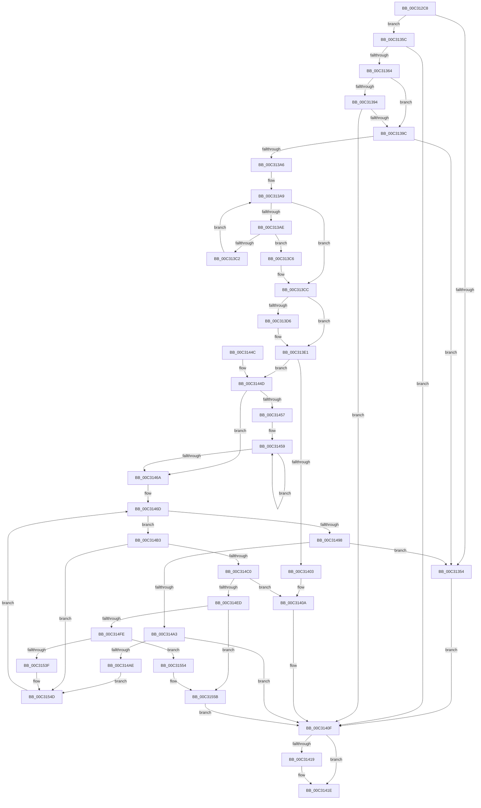

# PipInitDeviceOverrideCache

- RVA: `0x00C312C8`–`0x00C3156F` (길이 `679` bytes)
- VA: `0x0000000140C312C8`
- 실행 섹션: `INIT`
- PDB 이름 있음: `예`; PDB Function 태그: `아니요`
- unwind 정보 RVA: `0x000C80E4`
- 디코드: `169`개 명령, `679/679` bytes 표시
- 미해석 바이트: `0` (있으면 어셈블리에 `.byte`로 보존)

> 이 문서는 커널 이미지의 기계어와 PDB 기호를 분석해 생성했습니다. 4번과 5번은 함수 원형과 자료형을 바이너리 사용 방식에서 추정한 C 해석이며 원본 소스 복구 결과는 아닙니다.

## 1. Dependencies

- 직접 호출 지점: **10**; 고유 호출 대상: **9**
- 직접 호출자로 확인된 함수: **1**
- RIP 상대 이미지 참조: **7**

### Outgoing calls
- `0x00C31346` → [IopOpenRegistryKeyEx](../../page/A5/IopOpenRegistryKeyEx_function_00A51B44.md) (function, `0x00A51B44`)
- `0x00C31382` → [ZwQueryKey](../../text/6A/ZwQueryKey_function_006AD390.md) (function, `0x006AD390`)
- `0x00C313F2` → [ExAllocatePool2](../../poolcode/B8/ExAllocatePool2_function_00B820F0.md) (function, `0x00B820F0`)
- `0x00C31419` → [ZwClose](../../text/6A/ZwClose_function_006AD2B0.md) (function, `0x006AD2B0`)
- `0x00C3142A` → [_security_check_cookie](../../text/6A/_security_check_cookie_function_006AC640.md) (function, `0x006AC640`)
- `0x00C3148D` → [ZwEnumerateKey](../../text/6A/ZwEnumerateKey_function_006AD710.md) (function, `0x006AD710`)
- `0x00C314DC` → [ExAllocatePool2](../../poolcode/B8/ExAllocatePool2_function_00B820F0.md) (function, `0x00B820F0`)
- `0x00C314F5` → [RtlCreateUnicodeString](../../page/9B/RtlCreateUnicodeString_function_009BD860.md) (function, `0x009BD860`)
- `0x00C3150C` → [RtlHashUnicodeString](../../page/97/RtlHashUnicodeString_function_0097A780.md) (function, `0x0097A780`)
- `0x00C31565` → [ExFreePoolWithTag](../../poolcode/B8/ExFreePoolWithTag_function_00B82870.md) (function, `0x00B82870`)

### Direct callers
- [IopInitializePlugPlayServices](../C2/IopInitializePlugPlayServices_function_00C2F298.md) at `0x00C2F4ED`

### Static image references
- `0x00C312EA` → RVA `0x00E0A740` (`.data`; read)
- `0x00C3130A` → RVA `0x00C7A500` (` ?? ::PBOPGDP::`string'`; read)
- `0x00C313B0` → RVA `0x00027B00` (`.rdata`; read)
- `0x00C313C6` → RVA `0x00E66240` (`.data`; write)
- `0x00C313CC` → RVA `0x00E66240` (`.data`; read)
- `0x00C313F7` → RVA `0x00E66238` (`.data`; write)
- `0x00C3152F` → RVA `0x00E66238` (`.data`; read)

## 2. Other-region calls and transfers

- 다른 실행 섹션으로 향하는 call: **10**
  - `0x00C31346` → [IopOpenRegistryKeyEx](../../page/A5/IopOpenRegistryKeyEx_function_00A51B44.md) (`INIT` → `PAGE`)
  - `0x00C31382` → [ZwQueryKey](../../text/6A/ZwQueryKey_function_006AD390.md) (`INIT` → `.text`)
  - `0x00C313F2` → [ExAllocatePool2](../../poolcode/B8/ExAllocatePool2_function_00B820F0.md) (`INIT` → `POOLCODE`)
  - `0x00C31419` → [ZwClose](../../text/6A/ZwClose_function_006AD2B0.md) (`INIT` → `.text`)
  - `0x00C3142A` → [_security_check_cookie](../../text/6A/_security_check_cookie_function_006AC640.md) (`INIT` → `.text`)
  - `0x00C3148D` → [ZwEnumerateKey](../../text/6A/ZwEnumerateKey_function_006AD710.md) (`INIT` → `.text`)
  - `0x00C314DC` → [ExAllocatePool2](../../poolcode/B8/ExAllocatePool2_function_00B820F0.md) (`INIT` → `POOLCODE`)
  - `0x00C314F5` → [RtlCreateUnicodeString](../../page/9B/RtlCreateUnicodeString_function_009BD860.md) (`INIT` → `PAGE`)
  - `0x00C3150C` → [RtlHashUnicodeString](../../page/97/RtlHashUnicodeString_function_0097A780.md) (`INIT` → `PAGE`)
  - `0x00C31565` → [ExFreePoolWithTag](../../poolcode/B8/ExFreePoolWithTag_function_00B82870.md) (`INIT` → `POOLCODE`)
- 별도 외부 분기/꼬리 이동을 확인하지 못했습니다.

## 3. Assembly (complete function range)

```asm
00C312C8  48 8B C4                        mov rax, rsp
00C312CB  48 89 58 08                     mov qword ptr [rax + 8], rbx
00C312CF  48 89 70 10                     mov qword ptr [rax + 0x10], rsi
00C312D3  48 89 78 18                     mov qword ptr [rax + 0x18], rdi
00C312D7  4C 89 70 20                     mov qword ptr [rax + 0x20], r14
00C312DB  55                              push rbp
00C312DC  48 8D A8 48 FE FF FF            lea rbp, [rax - 0x1b8]
00C312E3  48 81 EC B0 02 00 00            sub rsp, 0x2b0
00C312EA  48 8B 05 4F 94 1D 00            mov rax, qword ptr [rip + 0x1d944f]
00C312F1  48 33 C4                        xor rax, rsp
00C312F4  48 89 85 A0 01 00 00            mov qword ptr [rbp + 0x1a0], rax
00C312FB  0F 57 C0                        xorps xmm0, xmm0
00C312FE  48 C7 44 24 40 84 00 86 00      mov qword ptr [rsp + 0x40], 0x860084
00C31307  45 33 F6                        xor r14d, r14d
00C3130A  48 8D 05 EF 91 04 00            lea rax, [rip + 0x491ef]
00C31311  41 B9 19 00 02 00               mov r9d, 0x20019
00C31317  4C 89 74 24 38                  mov qword ptr [rsp + 0x38], r14
00C3131C  4C 8D 44 24 40                  lea r8, [rsp + 0x40]
00C31321  44 89 74 24 34                  mov dword ptr [rsp + 0x34], r14d
00C31326  33 D2                           xor edx, edx
00C31328  44 89 74 24 30                  mov dword ptr [rsp + 0x30], r14d
00C3132D  48 8D 4C 24 38                  lea rcx, [rsp + 0x38]
00C31332  48 89 44 24 48                  mov qword ptr [rsp + 0x48], rax
00C31337  0F 11 44 24 50                  movups xmmword ptr [rsp + 0x50], xmm0
00C3133C  0F 11 44 24 60                  movups xmmword ptr [rsp + 0x60], xmm0
00C31341  0F 11 44 24 70                  movups xmmword ptr [rsp + 0x70], xmm0
00C31346  E8 F9 07 E2 FF                  call 0x140a51b44
00C3134B  8B D8                           mov ebx, eax
00C3134D  3D 34 00 00 C0                  cmp eax, 0xc0000034
00C31352  75 08                           jne 0x140c3135c
00C31354  41 8B DE                        mov ebx, r14d
00C31357  E9 B3 00 00 00                  jmp 0x140c3140f
00C3135C  85 C0                           test eax, eax
00C3135E  0F 88 AB 00 00 00               js 0x140c3140f
00C31364  48 8B 4C 24 38                  mov rcx, qword ptr [rsp + 0x38]
00C31369  48 8D 44 24 34                  lea rax, [rsp + 0x34]
00C3136E  41 B9 30 00 00 00               mov r9d, 0x30
00C31374  48 89 44 24 20                  mov qword ptr [rsp + 0x20], rax
00C31379  4C 8D 44 24 50                  lea r8, [rsp + 0x50]
00C3137E  41 8D 51 D2                     lea edx, [r9 - 0x2e]
00C31382  E8 09 C0 A7 FF                  call 0x1406ad390
00C31387  B9 00 00 00 80                  mov ecx, 0x80000000
00C3138C  8B D8                           mov ebx, eax
00C3138E  03 C1                           add eax, ecx
00C31390  85 C1                           test ecx, eax
00C31392  75 08                           jne 0x140c3139c
00C31394  81 FB 05 00 00 80               cmp ebx, 0x80000005
00C3139A  75 73                           jne 0x140c3140f
00C3139C  44 8B 44 24 64                  mov r8d, dword ptr [rsp + 0x64]
00C313A1  45 85 C0                        test r8d, r8d
00C313A4  74 AE                           je 0x140c31354
00C313A6  41 8B CE                        mov ecx, r14d
00C313A9  83 F9 03                        cmp ecx, 3
00C313AC  73 1E                           jae 0x140c313cc
00C313AE  8B C1                           mov eax, ecx
00C313B0  48 8D 15 49 67 3F FF            lea rdx, [rip - 0xc098b7]
00C313B7  8B 14 82                        mov edx, dword ptr [rdx + rax*4]
00C313BA  8D 04 52                        lea eax, [rdx + rdx*2]
00C313BD  44 3B C0                        cmp r8d, eax
00C313C0  72 04                           jb 0x140c313c6
00C313C2  FF C1                           inc ecx
00C313C4  EB E3                           jmp 0x140c313a9
00C313C6  89 15 74 4E 23 00               mov dword ptr [rip + 0x234e74], edx
00C313CC  8B 05 6E 4E 23 00               mov eax, dword ptr [rip + 0x234e6e]
00C313D2  85 C0                           test eax, eax
00C313D4  75 0B                           jne 0x140c313e1
00C313D6  B8 01 01 00 00                  mov eax, 0x101
00C313DB  89 05 5F 4E 23 00               mov dword ptr [rip + 0x234e5f], eax
00C313E1  8B D0                           mov edx, eax
00C313E3  B9 00 01 00 00                  mov ecx, 0x100
00C313E8  48 C1 E2 04                     shl rdx, 4
00C313EC  41 B8 50 70 69 6E               mov r8d, 0x6e697050
00C313F2  E8 F9 0C F5 FF                  call 0x140b820f0
00C313F7  48 89 05 3A 4E 23 00            mov qword ptr [rip + 0x234e3a], rax
00C313FE  48 85 C0                        test rax, rax
00C31401  75 4A                           jne 0x140c3144d
00C31403  44 89 35 36 4E 23 00            mov dword ptr [rip + 0x234e36], r14d
00C3140A  BB 9A 00 00 C0                  mov ebx, 0xc000009a
00C3140F  48 8B 4C 24 38                  mov rcx, qword ptr [rsp + 0x38]
00C31414  48 85 C9                        test rcx, rcx
00C31417  74 05                           je 0x140c3141e
00C31419  E8 92 BE A7 FF                  call 0x1406ad2b0
00C3141E  8B C3                           mov eax, ebx
00C31420  48 8B 8D A0 01 00 00            mov rcx, qword ptr [rbp + 0x1a0]
00C31427  48 33 CC                        xor rcx, rsp
00C3142A  E8 11 B2 A7 FF                  call 0x1406ac640
00C3142F  4C 8D 9C 24 B0 02 00 00         lea r11, [rsp + 0x2b0]
00C31437  49 8B 5B 10                     mov rbx, qword ptr [r11 + 0x10]
00C3143B  49 8B 73 18                     mov rsi, qword ptr [r11 + 0x18]
00C3143F  49 8B 7B 20                     mov rdi, qword ptr [r11 + 0x20]
00C31443  4D 8B 73 28                     mov r14, qword ptr [r11 + 0x28]
00C31447  49 8B E3                        mov rsp, r11
00C3144A  5D                              pop rbp
00C3144B  C3                              ret
00C3144C  CC                              int3
00C3144D  8B 0D ED 4D 23 00               mov ecx, dword ptr [rip + 0x234ded]
00C31453  85 C9                           test ecx, ecx
00C31455  74 13                           je 0x140c3146a
00C31457  8B D1                           mov edx, ecx
00C31459  48 89 40 08                     mov qword ptr [rax + 8], rax
00C3145D  48 89 00                        mov qword ptr [rax], rax
00C31460  48 83 C0 10                     add rax, 0x10
00C31464  48 83 EA 01                     sub rdx, 1
00C31468  75 EF                           jne 0x140c31459
00C3146A  41 8B F6                        mov esi, r14d
00C3146D  48 8B 4C 24 38                  mov rcx, qword ptr [rsp + 0x38]
00C31472  48 8D 44 24 34                  lea rax, [rsp + 0x34]
00C31477  48 89 44 24 28                  mov qword ptr [rsp + 0x28], rax
00C3147C  4C 8D 4D 80                     lea r9, [rbp - 0x80]
00C31480  45 33 C0                        xor r8d, r8d
00C31483  C7 44 24 20 18 02 00 00         mov dword ptr [rsp + 0x20], 0x218
00C3148B  8B D6                           mov edx, esi
00C3148D  E8 7E C2 A7 FF                  call 0x1406ad710
00C31492  8B D8                           mov ebx, eax
00C31494  85 C0                           test eax, eax
00C31496  79 1B                           jns 0x140c314b3
00C31498  3D 1A 00 00 80                  cmp eax, 0x8000001a
00C3149D  0F 84 B1 FE FF FF               je 0x140c31354
00C314A3  3D 05 00 00 80                  cmp eax, 0x80000005
00C314A8  0F 85 61 FF FF FF               jne 0x140c3140f
00C314AE  E9 9A 00 00 00                  jmp 0x140c3154d
00C314B3  81 7D 8C 00 02 00 00            cmp dword ptr [rbp - 0x74], 0x200
00C314BA  0F 87 8D 00 00 00               ja 0x140c3154d
00C314C0  8B 45 8C                        mov eax, dword ptr [rbp - 0x74]
00C314C3  BA 20 00 00 00                  mov edx, 0x20
00C314C8  48 D1 E8                        shr rax, 1
00C314CB  B9 00 01 00 00                  mov ecx, 0x100
00C314D0  41 B8 50 70 69 6E               mov r8d, 0x6e697050
00C314D6  66 44 89 74 45 90               mov word ptr [rbp + rax*2 - 0x70], r14w
00C314DC  E8 0F 0C F5 FF                  call 0x140b820f0
00C314E1  48 8B F8                        mov rdi, rax
00C314E4  48 85 C0                        test rax, rax
00C314E7  0F 84 1D FF FF FF               je 0x140c3140a
00C314ED  48 8D 55 90                     lea rdx, [rbp - 0x70]
00C314F1  48 8D 48 10                     lea rcx, [rax + 0x10]
00C314F5  E8 66 C3 D8 FF                  call 0x1409bd860
00C314FA  84 C0                           test al, al
00C314FC  74 5D                           je 0x140c3155b
00C314FE  4C 8D 4C 24 30                  lea r9, [rsp + 0x30]
00C31503  45 33 C0                        xor r8d, r8d
00C31506  B2 01                           mov dl, 1
00C31508  48 8D 4F 10                     lea rcx, [rdi + 0x10]
00C3150C  E8 6F 92 D4 FF                  call 0x14097a780
00C31511  8B 4C 24 30                     mov ecx, dword ptr [rsp + 0x30]
00C31515  85 C0                           test eax, eax
00C31517  41 0F 48 CE                     cmovs ecx, r14d
00C3151B  33 D2                           xor edx, edx
00C3151D  8B C1                           mov eax, ecx
00C3151F  89 4C 24 30                     mov dword ptr [rsp + 0x30], ecx
00C31523  F7 35 17 4D 23 00               div dword ptr [rip + 0x234d17]
00C31529  8B CA                           mov ecx, edx
00C3152B  48 C1 E1 04                     shl rcx, 4
00C3152F  48 03 0D 02 4D 23 00            add rcx, qword ptr [rip + 0x234d02]
00C31536  48 8B 41 08                     mov rax, qword ptr [rcx + 8]
00C3153A  48 39 08                        cmp qword ptr [rax], rcx
00C3153D  75 15                           jne 0x140c31554
00C3153F  48 89 0F                        mov qword ptr [rdi], rcx
00C31542  48 89 47 08                     mov qword ptr [rdi + 8], rax
00C31546  48 89 38                        mov qword ptr [rax], rdi
00C31549  48 89 79 08                     mov qword ptr [rcx + 8], rdi
00C3154D  FF C6                           inc esi
00C3154F  E9 19 FF FF FF                  jmp 0x140c3146d
00C31554  B9 03 00 00 00                  mov ecx, 3
00C31559  CD 29                           int 0x29
00C3155B  BB 9A 00 00 C0                  mov ebx, 0xc000009a
00C31560  33 D2                           xor edx, edx
00C31562  48 8B CF                        mov rcx, rdi
00C31565  E8 06 13 F5 FF                  call 0x140b82870
00C3156A  E9 A0 FE FF FF                  jmp 0x140c3140f
```

## 4. C-style interpretation (structured pseudocode)

```c
__int64 __fastcall PipInitDeviceOverrideCache(__int64 a1, int a2)
{
    __int64 result;
    __int64 v_r14;
    __int64 v_rsi;
    __int64 v_rsp;
    unsigned __int64 v_stack_m248;
    unsigned int v_stack_m254;
    unsigned __int64 v_stack_m258;
    unsigned __int64 v_stack_m268;
    unsigned __int64 v_stack_m270;
    unsigned __int64 v_stack_m278;
    unsigned __int64 v_stack_m27C;
    unsigned __int64 v_stack_m280;
    unsigned int v_stack_m284;
    unsigned int v_stack_m288;
    unsigned int v_stack_m290;
    unsigned __int64 v_stack_m298;
    unsigned __int64 v_stack_m8;

    *(unsigned __int64 *)(v_rsp + 8) = v_rbx;
    *(unsigned __int64 *)(v_rsp + 16) = v_rsi;
    *(unsigned __int64 *)(v_rsp + 24) = v_rdi;
    *(unsigned __int64 *)(v_rsp + 32) = v_r14;
    v_rsp = (v_rsp) - (688);
    result = (*(unsigned __int64 *)(v_rip + 1938511)) ^ (v_rsp);
    *(unsigned __int64 *)(v_rsp - 440 + 416) = result;
    v_stack_m278 = 0x860084ULL;
    v_r14 = 0;
    v_stack_m280 = 0;
    v_stack_m284 = 0;
    a2 = 0;
    v_stack_m288 = 0;
    v_stack_m270 = v_rip + 299503;
    v_stack_m268 = v_xmm0;
    v_stack_m258 = v_xmm0;
    v_stack_m248 = v_xmm0;
    result = IopOpenRegistryKeyEx(v_stack_m280, a2, v_stack_m278, (unsigned int)(0x20019ULL));
    if (((unsigned int)(result)) != 0xC0000034ULL) goto loc_00C3135C;
loc_00C31354:
    goto loc_00C3140F;
loc_00C3135C:
    if (sign_flag) goto loc_00C3140F;
    v_stack_m298 = v_stack_m284;
    result = ZwQueryKey(v_stack_m280, 48 - 46, v_stack_m268, 48);
    result = (unsigned int)((result) + ((unsigned int)((unsigned int)(0x80000000ULL))));
    if ((((unsigned int)((unsigned int)(0x80000000ULL))) & ((unsigned int)(result))) != 0) goto loc_00C3139C;
    if (((unsigned int)((unsigned int)((unsigned int)(result)))) != 0x80000005ULL) goto loc_00C3140F;
loc_00C3139C:
    if ((unsigned int)((unsigned int)(v_stack_m254)) == 0) goto loc_00C31354;
loc_00C313A9:
    if (0 >= 3) goto loc_00C313CC;
    if (((unsigned int)((unsigned int)(v_stack_m254))) < ((unsigned int)((unsigned int)(*(unsigned int *)(v_rip - 12622007 + 0 * 4)) + (unsigned int)(*(unsigned int *)(v_rip - 12622007 + 0 * 4)) * 2))) goto loc_00C313C6;
    a1 = (unsigned int)((0) + 1);
    goto loc_00C313A9;
loc_00C313C6:
    *(unsigned int *)(v_rip + 2313844) = (unsigned int)((unsigned int)(*(unsigned int *)(v_rip - 12622007 + 0 * 4)));
loc_00C313CC:
    result = (unsigned int)(*(unsigned int *)(v_rip + 2313838));
    if ((unsigned int)((unsigned int)(*(unsigned int *)(v_rip + 2313838))) == 0) {
        result = 257;
        *(unsigned int *)(v_rip + 2313823) = (unsigned int)(result);
    }
    a2 = ((unsigned int)((unsigned int)(result))) << (4);
    result = ExAllocatePool2(256, a2, (unsigned int)(0x6E697050ULL), 48);
    *(unsigned __int64 *)(v_rip + 2313786) = result;
    if (result != 0) goto loc_00C3144D;
    *(unsigned int *)(v_rip + 2313782) = 0;
loc_00C3140A:
loc_00C3140F:
    if (v_stack_m280 != 0) {
        result = ZwClose(v_stack_m280, a2, (unsigned int)(0x6E697050ULL), 48);
    }
    a1 = (*(unsigned __int64 *)(v_rsp - 440 + 416)) ^ (v_rsp);
    result = _security_check_cookie(a1, a2, (unsigned int)(0x6E697050ULL), 48);
    return result;
loc_00C3144D:
    if ((unsigned int)((unsigned int)(*(unsigned int *)(v_rip + 2313709))) == 0) goto loc_00C3146A;
loc_00C31459:
    *(unsigned __int64 *)(result + 8) = result;
    *(unsigned __int64 *)(result) = result;
    result = (result) + (16);
    a2 = ((unsigned int)((unsigned int)((unsigned int)(*(unsigned int *)(v_rip + 2313709))))) - (1);
    if (condition_is_not_equal) goto loc_00C31459;
loc_00C3146A:
loc_00C3146D:
    v_stack_m288 = v_stack_m27C;
    a3 = 0;
    v_stack_m290 = 536;
    result = ZwEnumerateKey(v_stack_m278, (unsigned int)((unsigned int)((unsigned int)((unsigned int)(*(unsigned __int64 *)(v_stack_m8 + 40))))), a3, v_rsp - 440 - 128);
    if (!sign_flag) goto loc_00C314B3;
    if (((unsigned int)(result)) == 0x8000001AULL) goto loc_00C31354;
    if (((unsigned int)(result)) != 0x80000005ULL) goto loc_00C3140F;
    goto loc_00C3154D;
loc_00C314B3:
    if ((*(unsigned int *)(v_rsp - 440 - 116)) > 512) goto loc_00C3154D;
    result = ((unsigned int)(*(unsigned int *)(v_rsp - 440 - 116))) >> (1);
    *(unsigned __int16 *)(v_rsp - 440 + result * 2 - 112) = (unsigned __int16)(*(unsigned __int64 *)(v_stack_m8 + 40));
    result = ExAllocatePool2(256, 32, (unsigned int)(0x6E697050ULL), v_rsp - 440 - 128);
    if (result == 0) goto loc_00C3140A;
    result = RtlCreateUnicodeString(result + 16, v_rsp - 440 - 112, (unsigned int)(0x6E697050ULL), v_rsp - 440 - 128);
    if ((unsigned __int8)(result) == 0) goto loc_00C3155B;
    a3 = 0;
    result = RtlHashUnicodeString(result + 16, 1, a3, v_stack_m280);
    a1 = (unsigned int)(v_stack_m280);
    if (sign_flag) { a1 = (unsigned int)(*(unsigned __int64 *)(v_stack_m8 + 40)); }
    a2 = 0;
    v_stack_m280 = (unsigned int)(a1);
    a1 = (0) << (4);
    a1 = (a1) + (*(unsigned __int64 *)(v_rip + 2313474));
    if ((*(unsigned __int64 *)(*(unsigned __int64 *)(a1 + 8))) != a1) goto loc_00C31554;
    *(unsigned __int64 *)(result) = a1;
    *(unsigned __int64 *)(result + 8) = *(unsigned __int64 *)(a1 + 8);
    *(unsigned __int64 *)(*(unsigned __int64 *)(a1 + 8)) = result;
    *(unsigned __int64 *)(a1 + 8) = result;
loc_00C3154D:
    v_rsi = (unsigned int)(((unsigned int)((unsigned int)(*(unsigned __int64 *)(v_stack_m8 + 40)))) + 1);
    goto loc_00C3146D;
loc_00C31554:
loc_00C3155B:
    a2 = 0;
    result = ExFreePoolWithTag(result, a2, a3, v_stack_m280);
    goto loc_00C3140F;
}
```

## 5. (Beta) C Style

```c
int64_t PipInitDeviceOverrideCache(int64_t Arg1, int32_t Arg2)
{
    int64_t result;
    int64_t local_r14;
    int64_t local_rsi;
    int64_t local_rsp;
    uint64_t v_stack_m248;
    uint32_t v_stack_m254;
    uint64_t v_stack_m258;
    uint64_t v_stack_m268;
    uint64_t v_stack_m270;
    uint64_t v_stack_m278;
    uint64_t v_stack_m27C;
    uint64_t v_stack_m280;
    uint32_t v_stack_m284;
    uint32_t v_stack_m288;
    uint32_t v_stack_m290;
    uint64_t v_stack_m298;
    uint64_t v_stack_m8;

    *(uint64_t *)(local_rsp + 0x8) = local_rbx;
    *(uint64_t *)(local_rsp + 0x10) = local_rsi;
    *(uint64_t *)(local_rsp + 0x18) = local_rdi;
    *(uint64_t *)(local_rsp + 0x20) = local_r14;
    local_rsp = (local_rsp) - (688);
    result = (*(uint64_t *)(v_rip + 0x1D944F)) ^ (local_rsp);
    *(uint64_t *)(local_rsp - 0x1B8 + 0x1A0) = result;
    v_stack_m278 = 0x860084ULL;
    local_r14 = 0;
    v_stack_m280 = 0;
    v_stack_m284 = 0;
    Arg2 = 0;
    v_stack_m288 = 0;
    v_stack_m270 = v_rip + 299503;
    v_stack_m268 = v_xmm0;
    v_stack_m258 = v_xmm0;
    v_stack_m248 = v_xmm0;
    result = IopOpenRegistryKeyEx(v_stack_m280, Arg2, v_stack_m278, (uint32_t)(0x20019ULL));
    if (((uint32_t)(result)) != 0xC0000034ULL) goto loc_00C3135C;
loc_00C31354:
    goto loc_00C3140F;
loc_00C3135C:
    if (sign_flag) goto loc_00C3140F;
    v_stack_m298 = v_stack_m284;
    result = ZwQueryKey(v_stack_m280, 48 - 46, v_stack_m268, 48);
    result = (uint32_t)((result) + ((uint32_t)((uint32_t)(0x80000000ULL))));
    if ((((uint32_t)((uint32_t)(0x80000000ULL))) & ((uint32_t)(result))) != 0) goto loc_00C3139C;
    if (((uint32_t)((uint32_t)((uint32_t)(result)))) != 0x80000005ULL) goto loc_00C3140F;
loc_00C3139C:
    if ((uint32_t)((uint32_t)(v_stack_m254)) == 0) goto loc_00C31354;
loc_00C313A9:
    if (0 >= 3) goto loc_00C313CC;
    if (((uint32_t)((uint32_t)(v_stack_m254))) < ((uint32_t)((uint32_t)(*(uint32_t *)(v_rip - 0xC098B7 + 0x0 * 4)) + (uint32_t)(*(uint32_t *)(v_rip - 0xC098B7 + 0x0 * 4)) * 2))) goto loc_00C313C6;
    Arg1 = (uint32_t)((0) + 1);
    goto loc_00C313A9;
loc_00C313C6:
    *(uint32_t *)(v_rip + 0x234E74) = (uint32_t)((uint32_t)(*(uint32_t *)(v_rip - 0xC098B7 + 0x0 * 4)));
loc_00C313CC:
    result = (uint32_t)(*(uint32_t *)(v_rip + 0x234E6E));
    if ((uint32_t)((uint32_t)(*(uint32_t *)(v_rip + 0x234E6E))) == 0) {
        result = 257;
        *(uint32_t *)(v_rip + 0x234E5F) = (uint32_t)(result);
    }
    Arg2 = ((uint32_t)((uint32_t)(result))) << (4);
    result = ExAllocatePool2(256, Arg2, (uint32_t)(0x6E697050ULL), 48);
    *(uint64_t *)(v_rip + 0x234E3A) = result;
    if (result != 0) goto loc_00C3144D;
    *(uint32_t *)(v_rip + 0x234E36) = 0;
loc_00C3140A:
loc_00C3140F:
    if (v_stack_m280 != 0) {
        result = ZwClose(v_stack_m280, Arg2, (uint32_t)(0x6E697050ULL), 48);
    }
    Arg1 = (*(uint64_t *)(local_rsp - 0x1B8 + 0x1A0)) ^ (local_rsp);
    result = _security_check_cookie(Arg1, Arg2, (uint32_t)(0x6E697050ULL), 48);
    return result;
loc_00C3144D:
    if ((uint32_t)((uint32_t)(*(uint32_t *)(v_rip + 0x234DED))) == 0) goto loc_00C3146A;
loc_00C31459:
    *(uint64_t *)(result + 0x8) = result;
    *(uint64_t *)(result) = result;
    result = (result) + (16);
    Arg2 = ((uint32_t)((uint32_t)((uint32_t)(*(uint32_t *)(v_rip + 0x234DED))))) - (1);
    if (condition_is_not_equal) goto loc_00C31459;
loc_00C3146A:
loc_00C3146D:
    v_stack_m288 = v_stack_m27C;
    a3 = 0;
    v_stack_m290 = 536;
    result = ZwEnumerateKey(v_stack_m278, (uint32_t)((uint32_t)((uint32_t)((uint32_t)(*(uint64_t *)(v_stack_m8 + 0x28))))), a3, local_rsp - 440 - 128);
    if (!sign_flag) goto loc_00C314B3;
    if (((uint32_t)(result)) == 0x8000001AULL) goto loc_00C31354;
    if (((uint32_t)(result)) != 0x80000005ULL) goto loc_00C3140F;
    goto loc_00C3154D;
loc_00C314B3:
    if ((*(uint32_t *)(local_rsp - 0x1B8 - 0x74)) > 512) goto loc_00C3154D;
    result = ((uint32_t)(*(uint32_t *)(local_rsp - 0x1B8 - 0x74))) >> (1);
    *(uint16_t *)(local_rsp - 0x1B8 + result * 2 - 0x70) = (uint16_t)(*(uint64_t *)(v_stack_m8 + 0x28));
    result = ExAllocatePool2(256, 32, (uint32_t)(0x6E697050ULL), local_rsp - 440 - 128);
    if (result == 0) goto loc_00C3140A;
    result = RtlCreateUnicodeString(result + 16, local_rsp - 440 - 112, (uint32_t)(0x6E697050ULL), local_rsp - 440 - 128);
    if ((uint8_t)(result) == 0) goto loc_00C3155B;
    a3 = 0;
    result = RtlHashUnicodeString(result + 16, 1, a3, v_stack_m280);
    Arg1 = (uint32_t)(v_stack_m280);
    if (sign_flag) { Arg1 = (uint32_t)(*(uint64_t *)(v_stack_m8 + 0x28)); }
    Arg2 = 0;
    v_stack_m280 = (uint32_t)(Arg1);
    Arg1 = (0) << (4);
    Arg1 = (Arg1) + (*(uint64_t *)(v_rip + 0x234D02));
    if ((*(uint64_t *)(*(uint64_t *)(Arg1 + 0x8))) != Arg1) goto loc_00C31554;
    *(uint64_t *)(result) = Arg1;
    *(uint64_t *)(result + 0x8) = *(uint64_t *)(Arg1 + 0x8);
    *(uint64_t *)(*(uint64_t *)(Arg1 + 0x8)) = result;
    *(uint64_t *)(Arg1 + 0x8) = result;
loc_00C3154D:
    local_rsi = (uint32_t)(((uint32_t)((uint32_t)(*(uint64_t *)(v_stack_m8 + 0x28)))) + 1);
    goto loc_00C3146D;
loc_00C31554:
loc_00C3155B:
    Arg2 = 0;
    result = ExFreePoolWithTag(result, Arg2, a3, v_stack_m280);
    goto loc_00C3140F;
}
```

## 6. Execution-region graph

[열기: 2D/3D 그래프와 함수 탐색 컨트롤 패널](../../../control-panel.html?section=init&rva=0x00C312C8&view=graph)

- 2D 그래프는 위에서 아래로 흐르고, 3D 그래프는 빈 공간을 드래그해 회전합니다. Shift+드래그는 이동, 휠은 확대·축소, 함수 노드 선택은 대상 보고서 이동입니다.

### Static fallback


