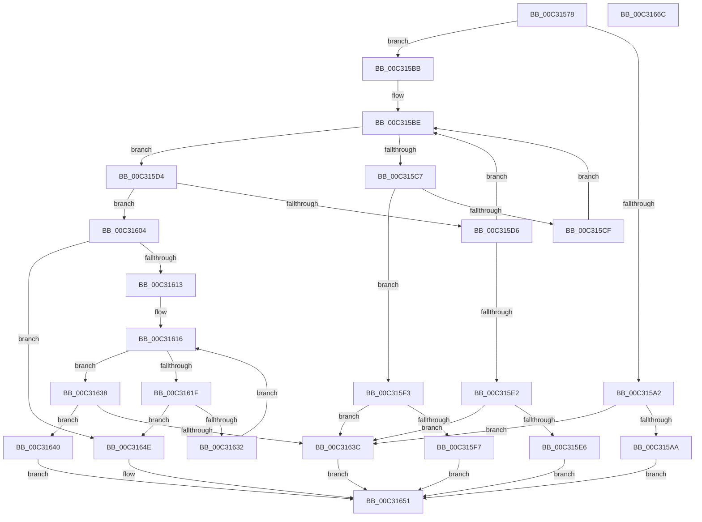

# PipLookupGroupName

- RVA: `0x00C31578`–`0x00C3166D` (길이 `245` bytes)
- VA: `0x0000000140C31578`
- 실행 섹션: `INIT`
- PDB 이름 있음: `예`; PDB Function 태그: `아니요`
- unwind 정보 RVA: `0x0005E6B4`
- 디코드: `77`개 명령, `245/245` bytes 표시
- 미해석 바이트: `0` (있으면 어셈블리에 `.byte`로 보존)

> 이 문서는 커널 이미지의 기계어와 PDB 기호를 분석해 생성했습니다. 4번과 5번은 함수 원형과 자료형을 바이너리 사용 방식에서 추정한 C 해석이며 원본 소스 복구 결과는 아닙니다.

## 1. Dependencies

- 직접 호출 지점: **6**; 고유 호출 대상: **2**
- 직접 호출자로 확인된 함수: **3**
- RIP 상대 이미지 참조: **2**

### Outgoing calls
- `0x00C315AA` → [PipCreateEntry](PipCreateEntry_function_00C30824.md) (function, `0x00C30824`)
- `0x00C315E9` → [PipCreateEntry](PipCreateEntry_function_00C30824.md) (function, `0x00C30824`)
- `0x00C315FA` → [PipCreateEntry](PipCreateEntry_function_00C30824.md) (function, `0x00C30824`)
- `0x00C3160A` → [RtlEqualUnicodeString](../../page/93/RtlEqualUnicodeString_function_00932A20.md) (function, `0x00932A20`)
- `0x00C31629` → [RtlEqualUnicodeString](../../page/93/RtlEqualUnicodeString_function_00932A20.md) (function, `0x00932A20`)
- `0x00C31643` → [PipCreateEntry](PipCreateEntry_function_00C30824.md) (function, `0x00C30824`)

### Direct callers
- [IopInitializeBootDrivers](../C2/IopInitializeBootDrivers_function_00C2E6F4.md) at `0x00C2EBDB`
- [IopInitializeSystemDrivers](../C7/IopInitializeSystemDrivers_function_00C73590.md) at `0x00C736FF`
- [PipCheckDependencies](../C7/PipCheckDependencies_function_00C77AE0.md) at `0x00C77B54`

### Static image references
- `0x00C31591` → RVA `0x00F8CF10` (`.data`; read)
- `0x00C315AF` → RVA `0x00F8CF10` (`.data`; write)

## 2. Other-region calls and transfers

- 다른 실행 섹션으로 향하는 call: **2**
  - `0x00C3160A` → [RtlEqualUnicodeString](../../page/93/RtlEqualUnicodeString_function_00932A20.md) (`INIT` → `PAGE`)
  - `0x00C31629` → [RtlEqualUnicodeString](../../page/93/RtlEqualUnicodeString_function_00932A20.md) (`INIT` → `PAGE`)
- 별도 외부 분기/꼬리 이동을 확인하지 못했습니다.

## 3. Assembly (complete function range)

```asm
00C31578  48 8B C4                        mov rax, rsp
00C3157B  48 89 58 08                     mov qword ptr [rax + 8], rbx
00C3157F  48 89 68 10                     mov qword ptr [rax + 0x10], rbp
00C31583  48 89 70 18                     mov qword ptr [rax + 0x18], rsi
00C31587  48 89 78 20                     mov qword ptr [rax + 0x20], rdi
00C3158B  41 56                           push r14
00C3158D  48 83 EC 20                     sub rsp, 0x20
00C31591  48 8B 1D 78 B9 35 00            mov rbx, qword ptr [rip + 0x35b978]
00C31598  8B F2                           mov esi, edx
00C3159A  48 8B F9                        mov rdi, rcx
00C3159D  48 85 DB                        test rbx, rbx
00C315A0  75 19                           jne 0x140c315bb
00C315A2  85 D2                           test edx, edx
00C315A4  0F 84 92 00 00 00               je 0x140c3163c
00C315AA  E8 75 F2 FF FF                  call 0x140c30824
00C315AF  48 89 05 5A B9 35 00            mov qword ptr [rip + 0x35b95a], rax
00C315B6  E9 96 00 00 00                  jmp 0x140c31651
00C315BB  0F B7 09                        movzx ecx, word ptr [rcx]
00C315BE  48 8D 53 20                     lea rdx, [rbx + 0x20]
00C315C2  66 3B 0A                        cmp cx, word ptr [rdx]
00C315C5  73 0D                           jae 0x140c315d4
00C315C7  48 8B 03                        mov rax, qword ptr [rbx]
00C315CA  48 85 C0                        test rax, rax
00C315CD  74 24                           je 0x140c315f3
00C315CF  48 8B D8                        mov rbx, rax
00C315D2  EB EA                           jmp 0x140c315be
00C315D4  76 2E                           jbe 0x140c31604
00C315D6  4C 8D 73 08                     lea r14, [rbx + 8]
00C315DA  49 8B 1E                        mov rbx, qword ptr [r14]
00C315DD  48 85 DB                        test rbx, rbx
00C315E0  75 DC                           jne 0x140c315be
00C315E2  85 F6                           test esi, esi
00C315E4  74 56                           je 0x140c3163c
00C315E6  48 8B CF                        mov rcx, rdi
00C315E9  E8 36 F2 FF FF                  call 0x140c30824
00C315EE  49 89 06                        mov qword ptr [r14], rax
00C315F1  EB 5E                           jmp 0x140c31651
00C315F3  85 F6                           test esi, esi
00C315F5  74 45                           je 0x140c3163c
00C315F7  48 8B CF                        mov rcx, rdi
00C315FA  E8 25 F2 FF FF                  call 0x140c30824
00C315FF  48 89 03                        mov qword ptr [rbx], rax
00C31602  EB 4D                           jmp 0x140c31651
00C31604  41 B0 01                        mov r8b, 1
00C31607  48 8B CF                        mov rcx, rdi
00C3160A  E8 11 14 D0 FF                  call 0x140932a20
00C3160F  84 C0                           test al, al
00C31611  75 3B                           jne 0x140c3164e
00C31613  48 8B EB                        mov rbp, rbx
00C31616  48 8B 5B 10                     mov rbx, qword ptr [rbx + 0x10]
00C3161A  48 85 DB                        test rbx, rbx
00C3161D  74 19                           je 0x140c31638
00C3161F  48 8D 53 20                     lea rdx, [rbx + 0x20]
00C31623  41 B0 01                        mov r8b, 1
00C31626  48 8B CF                        mov rcx, rdi
00C31629  E8 F2 13 D0 FF                  call 0x140932a20
00C3162E  84 C0                           test al, al
00C31630  75 1C                           jne 0x140c3164e
00C31632  48 8B 6D 10                     mov rbp, qword ptr [rbp + 0x10]
00C31636  EB DE                           jmp 0x140c31616
00C31638  85 F6                           test esi, esi
00C3163A  75 04                           jne 0x140c31640
00C3163C  33 C0                           xor eax, eax
00C3163E  EB 11                           jmp 0x140c31651
00C31640  48 8B CF                        mov rcx, rdi
00C31643  E8 DC F1 FF FF                  call 0x140c30824
00C31648  48 89 45 10                     mov qword ptr [rbp + 0x10], rax
00C3164C  EB 03                           jmp 0x140c31651
00C3164E  48 8B C3                        mov rax, rbx
00C31651  48 8B 5C 24 30                  mov rbx, qword ptr [rsp + 0x30]
00C31656  48 8B 6C 24 38                  mov rbp, qword ptr [rsp + 0x38]
00C3165B  48 8B 74 24 40                  mov rsi, qword ptr [rsp + 0x40]
00C31660  48 8B 7C 24 48                  mov rdi, qword ptr [rsp + 0x48]
00C31665  48 83 C4 20                     add rsp, 0x20
00C31669  41 5E                           pop r14
00C3166B  C3                              ret
00C3166C  CC                              int3
```

## 4. C-style interpretation (structured pseudocode)

```c
__int64 __fastcall PipLookupGroupName(__int64 a1, int a2)
{
    __int64 result;
    __int64 v_rsp;
    unsigned __int64 v_stack_p10;
    unsigned __int64 v_stack_p18;
    unsigned __int64 v_stack_p20;
    unsigned __int64 v_stack_p8;

    *(unsigned __int64 *)(v_rsp + 8) = v_rbx;
    *(unsigned __int64 *)(v_rsp + 16) = v_rbp;
    *(unsigned __int64 *)(v_rsp + 24) = v_rsi;
    *(unsigned __int64 *)(v_rsp + 32) = v_rdi;
    v_rsp = (v_rsp) - (32);
    if (*(unsigned __int64 *)(v_rip + 3520888) != 0) goto loc_00C315BB;
    if (a2 == 0) goto loc_00C3163C;
    result = PipCreateEntry(a1, a2, a3, a4);
    *(unsigned __int64 *)(v_rip + 3520858) = result;
    goto loc_00C31651;
loc_00C315BB:
loc_00C315BE:
    if (((unsigned __int16)(*(unsigned __int16 *)(a1))) >= (*(unsigned __int16 *)(*(unsigned __int64 *)(v_rip + 3520888) + 32))) goto loc_00C315D4;
    if (*(unsigned __int64 *)(*(unsigned __int64 *)(v_rip + 3520888)) == 0) goto loc_00C315F3;
    goto loc_00C315BE;
loc_00C315D4:
    if (condition_is_below_or_equal) goto loc_00C31604;
    if (*(unsigned __int64 *)(*(unsigned __int64 *)(*(unsigned __int64 *)(v_rip + 3520888)) + 8) != 0) goto loc_00C315BE;
    if ((unsigned int)((unsigned int)(a2)) == 0) goto loc_00C3163C;
    result = PipCreateEntry(a1, *(unsigned __int64 *)(v_rip + 3520888) + 32, a3, a4);
    *(unsigned __int64 *)(*(unsigned __int64 *)(*(unsigned __int64 *)(v_rip + 3520888)) + 8) = result;
    goto loc_00C31651;
loc_00C315F3:
    if ((unsigned int)((unsigned int)(a2)) == 0) goto loc_00C3163C;
    result = PipCreateEntry(a1, *(unsigned __int64 *)(v_rip + 3520888) + 32, a3, a4);
    *(unsigned __int64 *)(*(unsigned __int64 *)(*(unsigned __int64 *)(*(unsigned __int64 *)(v_rip + 3520888)) + 8)) = result;
    goto loc_00C31651;
loc_00C31604:
    result = RtlEqualUnicodeString(a1, *(unsigned __int64 *)(v_rip + 3520888) + 32, 1, a4);
    if ((unsigned __int8)(result) != 0) goto loc_00C3164E;
loc_00C31616:
    if (*(unsigned __int64 *)(*(unsigned __int64 *)(*(unsigned __int64 *)(*(unsigned __int64 *)(v_rip + 3520888)) + 8) + 16) == 0) goto loc_00C31638;
    result = RtlEqualUnicodeString(a1, *(unsigned __int64 *)(*(unsigned __int64 *)(*(unsigned __int64 *)(*(unsigned __int64 *)(v_rip + 3520888)) + 8) + 16) + 32, 1, a4);
    if ((unsigned __int8)(result) != 0) goto loc_00C3164E;
    goto loc_00C31616;
loc_00C31638:
    if ((unsigned int)((unsigned int)(a2)) != 0) goto loc_00C31640;
loc_00C3163C:
    result = 0;
    goto loc_00C31651;
loc_00C31640:
    result = PipCreateEntry(a1, *(unsigned __int64 *)(*(unsigned __int64 *)(*(unsigned __int64 *)(*(unsigned __int64 *)(v_rip + 3520888)) + 8) + 16) + 32, 1, a4);
    *(unsigned __int64 *)(*(unsigned __int64 *)(*(unsigned __int64 *)(*(unsigned __int64 *)(*(unsigned __int64 *)(v_rip + 3520888)) + 8) + 16) + 16) = result;
    goto loc_00C31651;
loc_00C3164E:
loc_00C31651:
    v_rsp = (v_rsp) + (32);
    return *(unsigned __int64 *)(*(unsigned __int64 *)(*(unsigned __int64 *)(*(unsigned __int64 *)(v_rip + 3520888)) + 8) + 16);
}
```

## 5. (Beta) C Style

```c
int64_t PipLookupGroupName(void *Arg1, int32_t Arg2)
{
    uint8_t *arg1 = (uint8_t *)Arg1;

    int64_t result;
    int64_t local_rsp;
    uint64_t v_stack_p10;
    uint64_t v_stack_p18;
    uint64_t v_stack_p20;
    uint64_t v_stack_p8;

    *(uint64_t *)(local_rsp + 0x8) = local_rbx;
    *(uint64_t *)(local_rsp + 0x10) = local_rbp;
    *(uint64_t *)(local_rsp + 0x18) = local_rsi;
    *(uint64_t *)(local_rsp + 0x20) = local_rdi;
    local_rsp = (local_rsp) - (32);
    if (*(uint64_t *)(v_rip + 0x35B978) != 0) goto loc_00C315BB;
    if (Arg2 == 0) goto loc_00C3163C;
    result = PipCreateEntry(Arg1, Arg2, a3, a4);
    *(uint64_t *)(v_rip + 0x35B95A) = result;
    goto loc_00C31651;
loc_00C315BB:
loc_00C315BE:
    if (((uint16_t)(*(uint16_t *)(arg1))) >= (*(uint16_t *)(*(uint64_t *)(v_rip + 0x35B978) + 0x20))) goto loc_00C315D4;
    if (*(uint64_t *)(*(uint64_t *)(v_rip + 0x35B978)) == 0) goto loc_00C315F3;
    goto loc_00C315BE;
loc_00C315D4:
    if (condition_is_below_or_equal) goto loc_00C31604;
    if (*(uint64_t *)(*(uint64_t *)(*(uint64_t *)(v_rip + 0x35B978)) + 0x8) != 0) goto loc_00C315BE;
    if ((uint32_t)((uint32_t)(Arg2)) == 0) goto loc_00C3163C;
    result = PipCreateEntry(Arg1, *(uint64_t *)(v_rip + 0x35B978) + 32, a3, a4);
    *(uint64_t *)(*(uint64_t *)(*(uint64_t *)(v_rip + 0x35B978)) + 0x8) = result;
    goto loc_00C31651;
loc_00C315F3:
    if ((uint32_t)((uint32_t)(Arg2)) == 0) goto loc_00C3163C;
    result = PipCreateEntry(Arg1, *(uint64_t *)(v_rip + 0x35B978) + 32, a3, a4);
    *(uint64_t *)(*(uint64_t *)(*(uint64_t *)(*(uint64_t *)(v_rip + 0x35B978)) + 0x8)) = result;
    goto loc_00C31651;
loc_00C31604:
    result = RtlEqualUnicodeString(Arg1, *(uint64_t *)(v_rip + 0x35B978) + 32, 1, a4);
    if ((uint8_t)(result) != 0) goto loc_00C3164E;
loc_00C31616:
    if (*(uint64_t *)(*(uint64_t *)(*(uint64_t *)(*(uint64_t *)(v_rip + 0x35B978)) + 0x8) + 0x10) == 0) goto loc_00C31638;
    result = RtlEqualUnicodeString(Arg1, *(uint64_t *)(*(uint64_t *)(*(uint64_t *)(*(uint64_t *)(v_rip + 0x35B978)) + 0x8) + 0x10) + 32, 1, a4);
    if ((uint8_t)(result) != 0) goto loc_00C3164E;
    goto loc_00C31616;
loc_00C31638:
    if ((uint32_t)((uint32_t)(Arg2)) != 0) goto loc_00C31640;
loc_00C3163C:
    result = 0;
    goto loc_00C31651;
loc_00C31640:
    result = PipCreateEntry(Arg1, *(uint64_t *)(*(uint64_t *)(*(uint64_t *)(*(uint64_t *)(v_rip + 0x35B978)) + 0x8) + 0x10) + 32, 1, a4);
    *(uint64_t *)(*(uint64_t *)(*(uint64_t *)(*(uint64_t *)(*(uint64_t *)(v_rip + 0x35B978)) + 0x8) + 0x10) + 0x10) = result;
    goto loc_00C31651;
loc_00C3164E:
loc_00C31651:
    local_rsp = (local_rsp) + (32);
    return *(uint64_t *)(*(uint64_t *)(*(uint64_t *)(*(uint64_t *)(v_rip + 0x35B978)) + 0x8) + 0x10);
}
```

### 관측된 메모리 오프셋

구조체 형식이 확인되지 않은 접근은 인자 기준의 오프셋으로만 기록했습니다.

| 기준 인자 | 오프셋 표현 | 폭 (bit) | 접근 |
|---|---:|---:|---|
| `Arg1` | `+ 0x0` | `16` | `R` |

## 6. Execution-region graph

[열기: 2D/3D 그래프와 함수 탐색 컨트롤 패널](../../../control-panel.html?section=init&rva=0x00C31578&view=graph)

- 2D 그래프는 위에서 아래로 흐르고, 3D 그래프는 빈 공간을 드래그해 회전합니다. Shift+드래그는 이동, 휠은 확대·축소, 함수 노드 선택은 대상 보고서 이동입니다.

### Static fallback


