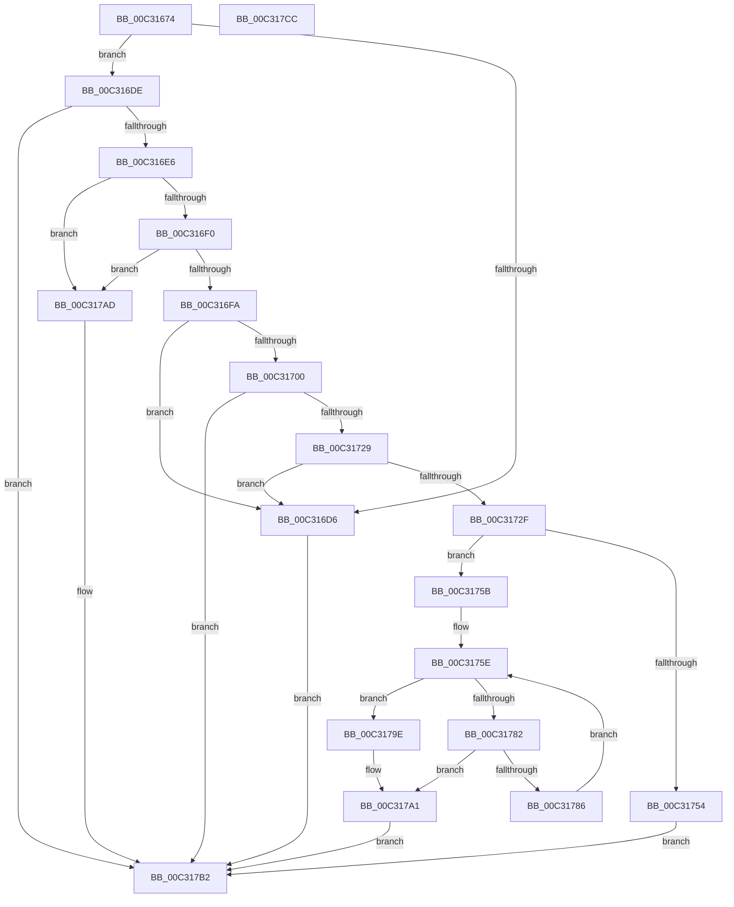

# PipMigrateCleanService

- RVA: `0x00C31674`–`0x00C317CD` (길이 `345` bytes)
- VA: `0x0000000140C31674`
- 실행 섹션: `INIT`
- PDB 이름 있음: `예`; PDB Function 태그: `아니요`
- unwind 정보 RVA: `0x000BD508`
- 디코드: `101`개 명령, `345/345` bytes 표시
- 미해석 바이트: `0` (있으면 어셈블리에 `.byte`로 보존)

> 이 문서는 커널 이미지의 기계어와 PDB 기호를 분석해 생성했습니다. 4번과 5번은 함수 원형과 자료형을 바이너리 사용 방식에서 추정한 C 해석이며 원본 소스 복구 결과는 아닙니다.

## 1. Dependencies

- 직접 호출 지점: **6**; 고유 호출 대상: **6**
- 직접 호출자로 확인된 함수: **1**
- RIP 상대 이미지 참조: **1**

### Outgoing calls
- `0x00C316C8` → [PnpCtxRegQueryValue](../../page/99/PnpCtxRegQueryValue_function_009940FC.md) (function, `0x009940FC`)
- `0x00C3171A` → [PnpCtxRegQueryInfoKey](../../page/99/PnpCtxRegQueryInfoKey_function_009945FC.md) (function, `0x009945FC`)
- `0x00C31747` → [ExAllocatePool2](../../poolcode/B8/ExAllocatePool2_function_00B820F0.md) (function, `0x00B820F0`)
- `0x00C31774` → [PnpCtxRegEnumKey](../../page/99/PnpCtxRegEnumKey_function_009929C0.md) (function, `0x009929C0`)
- `0x00C3178F` → [PnpCtxRegDeleteTree](../../page/96/PnpCtxRegDeleteTree_function_00965CC8.md) (function, `0x00965CC8`)
- `0x00C317A6` → [ExFreePoolWithTag](../../poolcode/B8/ExFreePoolWithTag_function_00B82870.md) (function, `0x00B82870`)

### Direct callers
- [PipMigrateServiceCallback](PipMigrateServiceCallback_function_00C31E60.md) at `0x00C31F4F`

### Static image references
- `0x00C316AE` → RVA `0x00C7ABD0` (` ?? ::PBOPGDP::`string'`; read)

## 2. Other-region calls and transfers

- 다른 실행 섹션으로 향하는 call: **6**
  - `0x00C316C8` → [PnpCtxRegQueryValue](../../page/99/PnpCtxRegQueryValue_function_009940FC.md) (`INIT` → `PAGE`)
  - `0x00C3171A` → [PnpCtxRegQueryInfoKey](../../page/99/PnpCtxRegQueryInfoKey_function_009945FC.md) (`INIT` → `PAGE`)
  - `0x00C31747` → [ExAllocatePool2](../../poolcode/B8/ExAllocatePool2_function_00B820F0.md) (`INIT` → `POOLCODE`)
  - `0x00C31774` → [PnpCtxRegEnumKey](../../page/99/PnpCtxRegEnumKey_function_009929C0.md) (`INIT` → `PAGE`)
  - `0x00C3178F` → [PnpCtxRegDeleteTree](../../page/96/PnpCtxRegDeleteTree_function_00965CC8.md) (`INIT` → `PAGE`)
  - `0x00C317A6` → [ExFreePoolWithTag](../../poolcode/B8/ExFreePoolWithTag_function_00B82870.md) (`INIT` → `POOLCODE`)
- 별도 외부 분기/꼬리 이동을 확인하지 못했습니다.

## 3. Assembly (complete function range)

```asm
00C31674  48 89 5C 24 08                  mov qword ptr [rsp + 8], rbx
00C31679  55                              push rbp
00C3167A  56                              push rsi
00C3167B  57                              push rdi
00C3167C  41 54                           push r12
00C3167E  41 55                           push r13
00C31680  41 56                           push r14
00C31682  41 57                           push r15
00C31684  48 8B EC                        mov rbp, rsp
00C31687  48 83 EC 50                     sub rsp, 0x50
00C3168B  45 33 ED                        xor r13d, r13d
00C3168E  C7 45 58 04 00 00 00            mov dword ptr [rbp + 0x58], 4
00C31695  48 8D 45 58                     lea rax, [rbp + 0x58]
00C31699  44 89 6D 50                     mov dword ptr [rbp + 0x50], r13d
00C3169D  48 89 44 24 28                  mov qword ptr [rsp + 0x28], rax
00C316A2  4C 8D 4D 50                     lea r9, [rbp + 0x50]
00C316A6  48 8D 45 F0                     lea rax, [rbp - 0x10]
00C316AA  44 89 6D F4                     mov dword ptr [rbp - 0xc], r13d
00C316AE  4C 8D 05 1B 95 04 00            lea r8, [rip + 0x4951b]
00C316B5  48 89 44 24 20                  mov qword ptr [rsp + 0x20], rax
00C316BA  4C 8B FA                        mov r15, rdx
00C316BD  44 89 6D F8                     mov dword ptr [rbp - 8], r13d
00C316C1  4C 8B E1                        mov r12, rcx
00C316C4  44 89 6D F0                     mov dword ptr [rbp - 0x10], r13d
00C316C8  E8 2F 2A D6 FF                  call 0x1409940fc
00C316CD  8B D8                           mov ebx, eax
00C316CF  3D 34 00 00 C0                  cmp eax, 0xc0000034
00C316D4  75 08                           jne 0x140c316de
00C316D6  41 8B DD                        mov ebx, r13d
00C316D9  E9 D4 00 00 00                  jmp 0x140c317b2
00C316DE  85 C0                           test eax, eax
00C316E0  0F 88 CC 00 00 00               js 0x140c317b2
00C316E6  83 7D 50 04                     cmp dword ptr [rbp + 0x50], 4
00C316EA  0F 85 BD 00 00 00               jne 0x140c317ad
00C316F0  83 7D 58 04                     cmp dword ptr [rbp + 0x58], 4
00C316F4  0F 85 B3 00 00 00               jne 0x140c317ad
00C316FA  44 39 6D F0                     cmp dword ptr [rbp - 0x10], r13d
00C316FE  74 D6                           je 0x140c316d6
00C31700  4C 89 6C 24 30                  mov qword ptr [rsp + 0x30], r13
00C31705  4C 8D 4D F8                     lea r9, [rbp - 8]
00C31709  4C 89 6C 24 28                  mov qword ptr [rsp + 0x28], r13
00C3170E  4C 8D 45 F4                     lea r8, [rbp - 0xc]
00C31712  49 8B D7                        mov rdx, r15
00C31715  4C 89 6C 24 20                  mov qword ptr [rsp + 0x20], r13
00C3171A  E8 DD 2E D6 FF                  call 0x1409945fc
00C3171F  8B D8                           mov ebx, eax
00C31721  85 C0                           test eax, eax
00C31723  0F 88 89 00 00 00               js 0x140c317b2
00C31729  44 39 6D F4                     cmp dword ptr [rbp - 0xc], r13d
00C3172D  74 A7                           je 0x140c316d6
00C3172F  44 8B 75 F8                     mov r14d, dword ptr [rbp - 8]
00C31733  B9 00 01 00 00                  mov ecx, 0x100
00C31738  41 FF C6                        inc r14d
00C3173B  41 B8 50 70 69 6E               mov r8d, 0x6e697050
00C31741  41 8B D6                        mov edx, r14d
00C31744  48 03 D2                        add rdx, rdx
00C31747  E8 A4 09 F5 FF                  call 0x140b820f0
00C3174C  48 8B F8                        mov rdi, rax
00C3174F  48 85 C0                        test rax, rax
00C31752  75 07                           jne 0x140c3175b
00C31754  BB 9A 00 00 C0                  mov ebx, 0xc000009a
00C31759  EB 57                           jmp 0x140c317b2
00C3175B  41 8B F5                        mov esi, r13d
00C3175E  48 8D 45 50                     lea rax, [rbp + 0x50]
00C31762  44 89 75 50                     mov dword ptr [rbp + 0x50], r14d
00C31766  4C 8B CF                        mov r9, rdi
00C31769  48 89 44 24 20                  mov qword ptr [rsp + 0x20], rax
00C3176E  44 8B C6                        mov r8d, esi
00C31771  49 8B D7                        mov rdx, r15
00C31774  E8 47 12 D6 FF                  call 0x1409929c0
00C31779  8B D8                           mov ebx, eax
00C3177B  3D 1A 00 00 80                  cmp eax, 0x8000001a
00C31780  74 1C                           je 0x140c3179e
00C31782  85 C0                           test eax, eax
00C31784  78 1B                           js 0x140c317a1
00C31786  4C 8B C7                        mov r8, rdi
00C31789  49 8B D7                        mov rdx, r15
00C3178C  49 8B CC                        mov rcx, r12
00C3178F  E8 34 45 D3 FF                  call 0x140965cc8
00C31794  FF C6                           inc esi
00C31796  85 C0                           test eax, eax
00C31798  41 0F 49 F5                     cmovns esi, r13d
00C3179C  EB C0                           jmp 0x140c3175e
00C3179E  41 8B DD                        mov ebx, r13d
00C317A1  33 D2                           xor edx, edx
00C317A3  48 8B CF                        mov rcx, rdi
00C317A6  E8 C5 10 F5 FF                  call 0x140b82870
00C317AB  EB 05                           jmp 0x140c317b2
00C317AD  BB 01 00 00 C0                  mov ebx, 0xc0000001
00C317B2  8B C3                           mov eax, ebx
00C317B4  48 8B 9C 24 90 00 00 00         mov rbx, qword ptr [rsp + 0x90]
00C317BC  48 83 C4 50                     add rsp, 0x50
00C317C0  41 5F                           pop r15
00C317C2  41 5E                           pop r14
00C317C4  41 5D                           pop r13
00C317C6  41 5C                           pop r12
00C317C8  5F                              pop rdi
00C317C9  5E                              pop rsi
00C317CA  5D                              pop rbp
00C317CB  C3                              ret
00C317CC  CC                              int3
```

## 4. C-style interpretation (structured pseudocode)

```c
__int64 __fastcall PipMigrateCleanService(__int64 a1, __int64 a2)
{
    __int64 result;
    __int64 v_r13;
    __int64 v_r14;
    __int64 v_rsi;
    __int64 v_rsp;
    unsigned int v_stack_m40;
    unsigned int v_stack_m44;
    unsigned __int64 v_stack_m48;
    unsigned __int64 v_stack_m58;
    unsigned __int64 v_stack_m60;
    unsigned __int64 v_stack_m68;
    unsigned int v_stack_p18;
    unsigned int v_stack_p20;
    unsigned __int64 v_stack_p8;

    v_stack_p8 = v_rbx;
    v_rsp = (v_rsp) - (80);
    v_r13 = 0;
    v_stack_p20 = 4;
    v_stack_p18 = 0;
    v_stack_m60 = v_stack_p20;
    v_stack_m44 = 0;
    v_stack_m68 = v_stack_m48;
    v_stack_m40 = 0;
    v_stack_m48 = 0;
    result = PnpCtxRegQueryValue(a1, a2, v_rip + 300315, v_stack_p18);
    if (((unsigned int)(result)) != 0xC0000034ULL) goto loc_00C316DE;
loc_00C316D6:
    goto loc_00C317B2;
loc_00C316DE:
    if (sign_flag) goto loc_00C317B2;
    if (v_stack_p18 != 4) goto loc_00C317AD;
    if (v_stack_p20 != 4) goto loc_00C317AD;
    if (v_stack_m48 == 0) goto loc_00C316D6;
    v_stack_m58 = 0;
    v_stack_m60 = 0;
    v_stack_m68 = 0;
    result = PnpCtxRegQueryInfoKey(a1, a2, v_stack_m44, v_stack_m40);
    if (sign_flag) goto loc_00C317B2;
    if (v_stack_m44 == 0) goto loc_00C316D6;
    v_r14 = (unsigned int)(((unsigned int)(v_stack_m40)) + 1);
    a2 = ((unsigned int)((unsigned int)(v_r14))) + ((unsigned int)((unsigned int)(v_r14)));
    result = ExAllocatePool2(256, a2, (unsigned int)(0x6E697050ULL), v_stack_m40);
    if (result != 0) goto loc_00C3175B;
    goto loc_00C317B2;
loc_00C3175B:
loc_00C3175E:
    v_stack_p18 = (unsigned int)(v_r14);
    v_stack_m68 = v_stack_p18;
    result = PnpCtxRegEnumKey(256, a2, 0, result);
    if (((unsigned int)(result)) == 0x8000001AULL) goto loc_00C3179E;
    if (sign_flag) goto loc_00C317A1;
    result = PnpCtxRegDeleteTree(a1, a2, result, result);
    v_rsi = (unsigned int)((0) + 1);
    if (!sign_flag) { v_rsi = 0; }
    goto loc_00C3175E;
loc_00C3179E:
loc_00C317A1:
    a2 = 0;
    result = ExFreePoolWithTag(result, a2, result, result);
    goto loc_00C317B2;
loc_00C317AD:
loc_00C317B2:
    v_rsp = (v_rsp) + (80);
    return (unsigned int)((unsigned int)((unsigned int)(0xC0000001ULL)));
}
```

## 5. (Beta) C Style

```c
int64_t PipMigrateCleanService(int64_t Arg1, int64_t Arg2)
{
    int64_t result;
    int64_t local_r13;
    int64_t local_r14;
    int64_t local_rsi;
    int64_t local_rsp;
    uint32_t v_stack_m40;
    uint32_t v_stack_m44;
    uint64_t v_stack_m48;
    uint64_t v_stack_m58;
    uint64_t v_stack_m60;
    uint64_t v_stack_m68;
    uint32_t v_stack_p18;
    uint32_t v_stack_p20;
    uint64_t v_stack_p8;

    v_stack_p8 = local_rbx;
    local_rsp = (local_rsp) - (80);
    local_r13 = 0;
    v_stack_p20 = 4;
    v_stack_p18 = 0;
    v_stack_m60 = v_stack_p20;
    v_stack_m44 = 0;
    v_stack_m68 = v_stack_m48;
    v_stack_m40 = 0;
    v_stack_m48 = 0;
    result = PnpCtxRegQueryValue(Arg1, Arg2, v_rip + 300315, v_stack_p18);
    if (((uint32_t)(result)) != 0xC0000034ULL) goto loc_00C316DE;
loc_00C316D6:
    goto loc_00C317B2;
loc_00C316DE:
    if (sign_flag) goto loc_00C317B2;
    if (v_stack_p18 != 4) goto loc_00C317AD;
    if (v_stack_p20 != 4) goto loc_00C317AD;
    if (v_stack_m48 == 0) goto loc_00C316D6;
    v_stack_m58 = 0;
    v_stack_m60 = 0;
    v_stack_m68 = 0;
    result = PnpCtxRegQueryInfoKey(Arg1, Arg2, v_stack_m44, v_stack_m40);
    if (sign_flag) goto loc_00C317B2;
    if (v_stack_m44 == 0) goto loc_00C316D6;
    local_r14 = (uint32_t)(((uint32_t)(v_stack_m40)) + 1);
    Arg2 = ((uint32_t)((uint32_t)(local_r14))) + ((uint32_t)((uint32_t)(local_r14)));
    result = ExAllocatePool2(256, Arg2, (uint32_t)(0x6E697050ULL), v_stack_m40);
    if (result != 0) goto loc_00C3175B;
    goto loc_00C317B2;
loc_00C3175B:
loc_00C3175E:
    v_stack_p18 = (uint32_t)(local_r14);
    v_stack_m68 = v_stack_p18;
    result = PnpCtxRegEnumKey(256, Arg2, 0, result);
    if (((uint32_t)(result)) == 0x8000001AULL) goto loc_00C3179E;
    if (sign_flag) goto loc_00C317A1;
    result = PnpCtxRegDeleteTree(Arg1, Arg2, result, result);
    local_rsi = (uint32_t)((0) + 1);
    if (!sign_flag) { local_rsi = 0; }
    goto loc_00C3175E;
loc_00C3179E:
loc_00C317A1:
    Arg2 = 0;
    result = ExFreePoolWithTag(result, Arg2, result, result);
    goto loc_00C317B2;
loc_00C317AD:
loc_00C317B2:
    local_rsp = (local_rsp) + (80);
    return (uint32_t)((uint32_t)((uint32_t)(0xC0000001ULL)));
}
```

## 6. Execution-region graph

[열기: 2D/3D 그래프와 함수 탐색 컨트롤 패널](../../../control-panel.html?section=init&rva=0x00C31674&view=graph)

- 2D 그래프는 위에서 아래로 흐르고, 3D 그래프는 빈 공간을 드래그해 회전합니다. Shift+드래그는 이동, 휠은 확대·축소, 함수 노드 선택은 대상 보고서 이동입니다.

### Static fallback


