# PipMigratePnpState

- RVA: `0x00C317D4`–`0x00C31D36` (길이 `1,378` bytes)
- VA: `0x0000000140C317D4`
- 실행 섹션: `INIT`
- PDB 이름 있음: `예`; PDB Function 태그: `아니요`
- unwind 정보 RVA: `0x000C7F78`
- 디코드: `338`개 명령, `1,378/1,378` bytes 표시
- 미해석 바이트: `0` (있으면 어셈블리에 `.byte`로 보존)

> 이 문서는 커널 이미지의 기계어와 PDB 기호를 분석해 생성했습니다. 4번과 5번은 함수 원형과 자료형을 바이너리 사용 방식에서 추정한 C 해석이며 원본 소스 복구 결과는 아닙니다.

## 1. Dependencies

- 직접 호출 지점: **30**; 고유 호출 대상: **12**
- 직접 호출자로 확인된 함수: **1**
- RIP 상대 이미지 참조: **12**

### Outgoing calls
- `0x00C3185A` → [PnpCtxRegOpenKey](../../page/8E/PnpCtxRegOpenKey_function_008EF7B8.md) (function, `0x008EF7B8`)
- `0x00C318A7` → [PnpCtxRegQueryValue](../../page/99/PnpCtxRegQueryValue_function_009940FC.md) (function, `0x009940FC`)
- `0x00C318F1` → [PnpCtxRegOpenKey](../../page/8E/PnpCtxRegOpenKey_function_008EF7B8.md) (function, `0x008EF7B8`)
- `0x00C3192F` → [PnpCtxRegOpenKey](../../page/8E/PnpCtxRegOpenKey_function_008EF7B8.md) (function, `0x008EF7B8`)
- `0x00C31969` → [PnpCtxRegQueryValue](../../page/99/PnpCtxRegQueryValue_function_009940FC.md) (function, `0x009940FC`)
- `0x00C31990` → [PnpCtxRegCloseKey](../../page/A2/PnpCtxRegCloseKey_function_00A22E0C.md) (function, `0x00A22E0C`)
- `0x00C319A7` → [_PnpCtxGetCachedContextBaseKey](../../page/8E/_PnpCtxGetCachedContextBaseKey_function_008EFB2C.md) (function, `0x008EFB2C`)
- `0x00C319E9` → [PnpCtxRegCreateKey](../../page/A6/PnpCtxRegCreateKey_function_00A692E4.md) (function, `0x00A692E4`)
- `0x00C31A1D` → [PnpCtxRegQueryValue](../../page/99/PnpCtxRegQueryValue_function_009940FC.md) (function, `0x009940FC`)
- `0x00C31A50` → [RtlCompareMemory](../../text/6B/RtlCompareMemory_function_006BA670.md) (function, `0x006BA670`)
- `0x00C31A87` → [PnpCtxRegSetValue](../../page/99/PnpCtxRegSetValue_function_00991B8C.md) (function, `0x00991B8C`)
- `0x00C31AB5` → [PnpCtxRegSetValue](../../page/99/PnpCtxRegSetValue_function_00991B8C.md) (function, `0x00991B8C`)
- `0x00C31AE9` → [PnpCtxRegQueryValue](../../page/99/PnpCtxRegQueryValue_function_009940FC.md) (function, `0x009940FC`)
- `0x00C31B34` → [PnpCtxRegCopyTree](../../page/82/PnpCtxRegCopyTree_function_008291EC.md) (function, `0x008291EC`)
- `0x00C31B6C` → [PnpCtxRegOpenKey](../../page/8E/PnpCtxRegOpenKey_function_008EF7B8.md) (function, `0x008EF7B8`)
- `0x00C31BA6` → [PnpCtxRegCreateKey](../../page/A6/PnpCtxRegCreateKey_function_00A692E4.md) (function, `0x00A692E4`)
- `0x00C31BC5` → [PnpCtxRegCopyTree](../../page/82/PnpCtxRegCopyTree_function_008291EC.md) (function, `0x008291EC`)
- `0x00C31BF7` → [PnpCtxRegOpenKey](../../page/8E/PnpCtxRegOpenKey_function_008EF7B8.md) (function, `0x008EF7B8`)
- `0x00C31C21` → [PnpCtxRegEnumKeyWithCallback](../../page/AA/PnpCtxRegEnumKeyWithCallback_function_00AA146C.md) (function, `0x00AA146C`)
- `0x00C31C3B` → [PnpCtxOpenMachine](../../page/82/PnpCtxOpenMachine_function_00828FB0.md) (function, `0x00828FB0`)
- `0x00C31C6D` → [_CmGetMatchingDeviceList](../../page/A0/_CmGetMatchingDeviceList_function_00A0951C.md) (function, `0x00A0951C`)
- `0x00C31CA4` → [PnpCtxRegSetValue](../../page/99/PnpCtxRegSetValue_function_00991B8C.md) (function, `0x00991B8C`)
- `0x00C31CB1` → [PnpCtxCloseMachine](../../page/82/PnpCtxCloseMachine_function_00828B10.md) (function, `0x00828B10`)
- `0x00C31CC6` → [PnpCtxRegCloseKey](../../page/A2/PnpCtxRegCloseKey_function_00A22E0C.md) (function, `0x00A22E0C`)
- `0x00C31CD4` → [PnpCtxRegCloseKey](../../page/A2/PnpCtxRegCloseKey_function_00A22E0C.md) (function, `0x00A22E0C`)
- `0x00C31CE2` → [PnpCtxRegCloseKey](../../page/A2/PnpCtxRegCloseKey_function_00A22E0C.md) (function, `0x00A22E0C`)
- `0x00C31CF0` → [PnpCtxRegCloseKey](../../page/A2/PnpCtxRegCloseKey_function_00A22E0C.md) (function, `0x00A22E0C`)
- `0x00C31CFE` → [PnpCtxRegCloseKey](../../page/A2/PnpCtxRegCloseKey_function_00A22E0C.md) (function, `0x00A22E0C`)
- `0x00C31D0C` → [PnpCtxRegCloseKey](../../page/A2/PnpCtxRegCloseKey_function_00A22E0C.md) (function, `0x00A22E0C`)
- `0x00C31D1A` → [PnpCtxRegCloseKey](../../page/A2/PnpCtxRegCloseKey_function_00A22E0C.md) (function, `0x00A22E0C`)

### Direct callers
- [IopInitializePlugPlayServices](../C2/IopInitializePlugPlayServices_function_00C2F298.md) at `0x00C2F615`

### Static image references
- `0x00C317ED` → RVA `0x00E66398` (`.data`; read)
- `0x00C31817` → RVA `0x00C7A8C0` (` ?? ::PBOPGDP::`string'`; read)
- `0x00C31897` → RVA `0x00C7A900` (` ?? ::PBOPGDP::`string'`; read)
- `0x00C318DE` → RVA `0x00C7AB30` (` ?? ::PBOPGDP::`string'`; read)
- `0x00C31918` → RVA `0x00C7AB60` (` ?? ::PBOPGDP::`string'`; read)
- `0x00C31959` → RVA `0x00C7AB90` (` ?? ::PBOPGDP::`string'`; read)
- `0x00C31ADD` → RVA `0x00C7ABB0` (` ?? ::PBOPGDP::`string'`; read)
- `0x00C31B52` → RVA `0x00C7AAB0` (` ?? ::PBOPGDP::`string'`; read)
- `0x00C31B85` → RVA `0x00C7AAD0` (` ?? ::PBOPGDP::`string'`; read)
- `0x00C31BE3` → RVA `0x00C7AB10` (` ?? ::PBOPGDP::`string'`; read)
- `0x00C31C16` → RVA `0x00C31E60` (`PipMigrateServiceCallback`; read)
- `0x00C31C58` → RVA `0x00C31D40` (`PipMigrateResetDeviceCallback`; read)

## 2. Other-region calls and transfers

- 다른 실행 섹션으로 향하는 call: **30**
  - `0x00C3185A` → [PnpCtxRegOpenKey](../../page/8E/PnpCtxRegOpenKey_function_008EF7B8.md) (`INIT` → `PAGE`)
  - `0x00C318A7` → [PnpCtxRegQueryValue](../../page/99/PnpCtxRegQueryValue_function_009940FC.md) (`INIT` → `PAGE`)
  - `0x00C318F1` → [PnpCtxRegOpenKey](../../page/8E/PnpCtxRegOpenKey_function_008EF7B8.md) (`INIT` → `PAGE`)
  - `0x00C3192F` → [PnpCtxRegOpenKey](../../page/8E/PnpCtxRegOpenKey_function_008EF7B8.md) (`INIT` → `PAGE`)
  - `0x00C31969` → [PnpCtxRegQueryValue](../../page/99/PnpCtxRegQueryValue_function_009940FC.md) (`INIT` → `PAGE`)
  - `0x00C31990` → [PnpCtxRegCloseKey](../../page/A2/PnpCtxRegCloseKey_function_00A22E0C.md) (`INIT` → `PAGE`)
  - `0x00C319A7` → [_PnpCtxGetCachedContextBaseKey](../../page/8E/_PnpCtxGetCachedContextBaseKey_function_008EFB2C.md) (`INIT` → `PAGE`)
  - `0x00C319E9` → [PnpCtxRegCreateKey](../../page/A6/PnpCtxRegCreateKey_function_00A692E4.md) (`INIT` → `PAGE`)
  - `0x00C31A1D` → [PnpCtxRegQueryValue](../../page/99/PnpCtxRegQueryValue_function_009940FC.md) (`INIT` → `PAGE`)
  - `0x00C31A50` → [RtlCompareMemory](../../text/6B/RtlCompareMemory_function_006BA670.md) (`INIT` → `.text`)
  - `0x00C31A87` → [PnpCtxRegSetValue](../../page/99/PnpCtxRegSetValue_function_00991B8C.md) (`INIT` → `PAGE`)
  - `0x00C31AB5` → [PnpCtxRegSetValue](../../page/99/PnpCtxRegSetValue_function_00991B8C.md) (`INIT` → `PAGE`)
  - `0x00C31AE9` → [PnpCtxRegQueryValue](../../page/99/PnpCtxRegQueryValue_function_009940FC.md) (`INIT` → `PAGE`)
  - `0x00C31B34` → [PnpCtxRegCopyTree](../../page/82/PnpCtxRegCopyTree_function_008291EC.md) (`INIT` → `PAGE`)
  - `0x00C31B6C` → [PnpCtxRegOpenKey](../../page/8E/PnpCtxRegOpenKey_function_008EF7B8.md) (`INIT` → `PAGE`)
  - `0x00C31BA6` → [PnpCtxRegCreateKey](../../page/A6/PnpCtxRegCreateKey_function_00A692E4.md) (`INIT` → `PAGE`)
  - `0x00C31BC5` → [PnpCtxRegCopyTree](../../page/82/PnpCtxRegCopyTree_function_008291EC.md) (`INIT` → `PAGE`)
  - `0x00C31BF7` → [PnpCtxRegOpenKey](../../page/8E/PnpCtxRegOpenKey_function_008EF7B8.md) (`INIT` → `PAGE`)
  - `0x00C31C21` → [PnpCtxRegEnumKeyWithCallback](../../page/AA/PnpCtxRegEnumKeyWithCallback_function_00AA146C.md) (`INIT` → `PAGE`)
  - `0x00C31C3B` → [PnpCtxOpenMachine](../../page/82/PnpCtxOpenMachine_function_00828FB0.md) (`INIT` → `PAGE`)
  - `0x00C31C6D` → [_CmGetMatchingDeviceList](../../page/A0/_CmGetMatchingDeviceList_function_00A0951C.md) (`INIT` → `PAGE`)
  - `0x00C31CA4` → [PnpCtxRegSetValue](../../page/99/PnpCtxRegSetValue_function_00991B8C.md) (`INIT` → `PAGE`)
  - `0x00C31CB1` → [PnpCtxCloseMachine](../../page/82/PnpCtxCloseMachine_function_00828B10.md) (`INIT` → `PAGE`)
  - `0x00C31CC6` → [PnpCtxRegCloseKey](../../page/A2/PnpCtxRegCloseKey_function_00A22E0C.md) (`INIT` → `PAGE`)
  - `0x00C31CD4` → [PnpCtxRegCloseKey](../../page/A2/PnpCtxRegCloseKey_function_00A22E0C.md) (`INIT` → `PAGE`)
  - `0x00C31CE2` → [PnpCtxRegCloseKey](../../page/A2/PnpCtxRegCloseKey_function_00A22E0C.md) (`INIT` → `PAGE`)
  - `0x00C31CF0` → [PnpCtxRegCloseKey](../../page/A2/PnpCtxRegCloseKey_function_00A22E0C.md) (`INIT` → `PAGE`)
  - `0x00C31CFE` → [PnpCtxRegCloseKey](../../page/A2/PnpCtxRegCloseKey_function_00A22E0C.md) (`INIT` → `PAGE`)
  - `0x00C31D0C` → [PnpCtxRegCloseKey](../../page/A2/PnpCtxRegCloseKey_function_00A22E0C.md) (`INIT` → `PAGE`)
  - `0x00C31D1A` → [PnpCtxRegCloseKey](../../page/A2/PnpCtxRegCloseKey_function_00A22E0C.md) (`INIT` → `PAGE`)
- 별도 외부 분기/꼬리 이동을 확인하지 못했습니다.

## 3. Assembly (complete function range)

```asm
00C317D4  40 55                           push rbp
00C317D6  53                              push rbx
00C317D7  56                              push rsi
00C317D8  57                              push rdi
00C317D9  41 54                           push r12
00C317DB  41 55                           push r13
00C317DD  41 56                           push r14
00C317DF  41 57                           push r15
00C317E1  48 8D 6C 24 E1                  lea rbp, [rsp - 0x1f]
00C317E6  48 81 EC B8 00 00 00            sub rsp, 0xb8
00C317ED  48 8B 0D A4 4B 23 00            mov rcx, qword ptr [rip + 0x234ba4]
00C317F4  48 8D 45 AF                     lea rax, [rbp - 0x51]
00C317F8  45 33 F6                        xor r14d, r14d
00C317FB  48 89 44 24 28                  mov qword ptr [rsp + 0x28], rax
00C31800  0F 57 C0                        xorps xmm0, xmm0
00C31803  4C 89 75 AF                     mov qword ptr [rbp - 0x51], r14
00C31807  BE 1F 00 02 00                  mov esi, 0x2001f
00C3180C  4C 89 75 B7                     mov qword ptr [rbp - 0x49], r14
00C31810  45 33 C9                        xor r9d, r9d
00C31813  89 74 24 20                     mov dword ptr [rsp + 0x20], esi
00C31817  4C 8D 05 A2 90 04 00            lea r8, [rip + 0x490a2]
00C3181E  4C 89 75 E7                     mov qword ptr [rbp - 0x19], r14
00C31822  BA 02 00 00 80                  mov edx, 0x80000002
00C31827  4C 89 75 EF                     mov qword ptr [rbp - 0x11], r14
00C3182B  4C 89 75 DF                     mov qword ptr [rbp - 0x21], r14
00C3182F  41 8B FE                        mov edi, r14d
00C31832  44 89 75 6F                     mov dword ptr [rbp + 0x6f], r14d
00C31836  44 89 75 77                     mov dword ptr [rbp + 0x77], r14d
00C3183A  44 89 75 7F                     mov dword ptr [rbp + 0x7f], r14d
00C3183E  4C 89 75 A7                     mov qword ptr [rbp - 0x59], r14
00C31842  4C 89 75 F7                     mov qword ptr [rbp - 9], r14
00C31846  4C 89 75 C7                     mov qword ptr [rbp - 0x39], r14
00C3184A  4C 89 75 D7                     mov qword ptr [rbp - 0x29], r14
00C3184E  4C 89 75 CF                     mov qword ptr [rbp - 0x31], r14
00C31852  44 89 75 BF                     mov dword ptr [rbp - 0x41], r14d
00C31856  0F 11 45 FF                     movups xmmword ptr [rbp - 1], xmm0
00C3185A  E8 59 DF CB FF                  call 0x1408ef7b8
00C3185F  41 BD 34 00 00 C0               mov r13d, 0xc0000034
00C31865  8B D8                           mov ebx, eax
00C31867  41 3B C5                        cmp eax, r13d
00C3186A  75 08                           jne 0x140c31874
00C3186C  41 8B DE                        mov ebx, r14d
00C3186F  E9 49 04 00 00                  jmp 0x140c31cbd
00C31874  85 C0                           test eax, eax
00C31876  0F 88 41 04 00 00               js 0x140c31cbd
00C3187C  48 8B 55 AF                     mov rdx, qword ptr [rbp - 0x51]
00C31880  48 8D 45 67                     lea rax, [rbp + 0x67]
00C31884  48 89 44 24 28                  mov qword ptr [rsp + 0x28], rax
00C31889  4C 8D 4D 6F                     lea r9, [rbp + 0x6f]
00C3188D  48 8D 45 77                     lea rax, [rbp + 0x77]
00C31891  41 BF 04 00 00 00               mov r15d, 4
00C31897  4C 8D 05 62 90 04 00            lea r8, [rip + 0x49062]
00C3189E  48 89 44 24 20                  mov qword ptr [rsp + 0x20], rax
00C318A3  44 89 7D 67                     mov dword ptr [rbp + 0x67], r15d
00C318A7  E8 50 28 D6 FF                  call 0x1409940fc
00C318AC  8B D8                           mov ebx, eax
00C318AE  41 3B C5                        cmp eax, r13d
00C318B1  74 1C                           je 0x140c318cf
00C318B3  85 C0                           test eax, eax
00C318B5  0F 88 02 04 00 00               js 0x140c31cbd
00C318BB  44 39 7D 6F                     cmp dword ptr [rbp + 0x6f], r15d
00C318BF  0F 85 F3 03 00 00               jne 0x140c31cb8
00C318C5  44 39 7D 67                     cmp dword ptr [rbp + 0x67], r15d
00C318C9  0F 85 E9 03 00 00               jne 0x140c31cb8
00C318CF  48 8B 55 AF                     mov rdx, qword ptr [rbp - 0x51]
00C318D3  48 8D 45 B7                     lea rax, [rbp - 0x49]
00C318D7  48 8B 0D BA 4A 23 00            mov rcx, qword ptr [rip + 0x234aba]
00C318DE  4C 8D 05 4B 92 04 00            lea r8, [rip + 0x4924b]
00C318E5  48 89 44 24 28                  mov qword ptr [rsp + 0x28], rax
00C318EA  45 33 C9                        xor r9d, r9d
00C318ED  89 74 24 20                     mov dword ptr [rsp + 0x20], esi
00C318F1  E8 C2 DE CB FF                  call 0x1408ef7b8
00C318F6  8B D8                           mov ebx, eax
00C318F8  41 3B C5                        cmp eax, r13d
00C318FB  0F 84 6B FF FF FF               je 0x140c3186c
00C31901  85 C0                           test eax, eax
00C31903  0F 88 B4 03 00 00               js 0x140c31cbd
00C31909  48 8B 55 B7                     mov rdx, qword ptr [rbp - 0x49]
00C3190D  48 8D 45 A7                     lea rax, [rbp - 0x59]
00C31911  48 8B 0D 80 4A 23 00            mov rcx, qword ptr [rip + 0x234a80]
00C31918  4C 8D 05 41 92 04 00            lea r8, [rip + 0x49241]
00C3191F  48 89 44 24 28                  mov qword ptr [rsp + 0x28], rax
00C31924  45 33 C9                        xor r9d, r9d
00C31927  C7 44 24 20 19 00 02 00         mov dword ptr [rsp + 0x20], 0x20019
00C3192F  E8 84 DE CB FF                  call 0x1408ef7b8
00C31934  8B D8                           mov ebx, eax
00C31936  85 C0                           test eax, eax
00C31938  0F 88 7F 03 00 00               js 0x140c31cbd
00C3193E  48 8B 55 A7                     mov rdx, qword ptr [rbp - 0x59]
00C31942  48 8D 45 67                     lea rax, [rbp + 0x67]
00C31946  48 89 44 24 28                  mov qword ptr [rsp + 0x28], rax
00C3194B  4C 8D 4D 6F                     lea r9, [rbp + 0x6f]
00C3194F  48 8D 45 C7                     lea rax, [rbp - 0x39]
00C31953  41 BC 08 00 00 00               mov r12d, 8
00C31959  4C 8D 05 30 92 04 00            lea r8, [rip + 0x49230]
00C31960  48 89 44 24 20                  mov qword ptr [rsp + 0x20], rax
00C31965  44 89 65 67                     mov dword ptr [rbp + 0x67], r12d
00C31969  E8 8E 27 D6 FF                  call 0x1409940fc
00C3196E  8B D8                           mov ebx, eax
00C31970  85 C0                           test eax, eax
00C31972  0F 88 45 03 00 00               js 0x140c31cbd
00C31978  83 7D 6F 03                     cmp dword ptr [rbp + 0x6f], 3
00C3197C  0F 85 36 03 00 00               jne 0x140c31cb8
00C31982  44 39 65 67                     cmp dword ptr [rbp + 0x67], r12d
00C31986  0F 85 2C 03 00 00               jne 0x140c31cb8
00C3198C  48 8B 55 A7                     mov rdx, qword ptr [rbp - 0x59]
00C31990  E8 77 14 DF FF                  call 0x140a22e0c
00C31995  48 8B 0D FC 49 23 00            mov rcx, qword ptr [rip + 0x2349fc]
00C3199C  4C 8D 45 EF                     lea r8, [rbp - 0x11]
00C319A0  41 8B D7                        mov edx, r15d
00C319A3  4C 89 75 A7                     mov qword ptr [rbp - 0x59], r14
00C319A7  E8 80 E1 CB FF                  call 0x1408efb2c
00C319AC  8B D8                           mov ebx, eax
00C319AE  85 C0                           test eax, eax
00C319B0  0F 88 07 03 00 00               js 0x140c31cbd
00C319B6  48 8B 75 EF                     mov rsi, qword ptr [rbp - 0x11]
00C319BA  48 8D 45 A7                     lea rax, [rbp - 0x59]
00C319BE  48 8B 0D D3 49 23 00            mov rcx, qword ptr [rip + 0x2349d3]
00C319C5  4C 8D 05 94 91 04 00            lea r8, [rip + 0x49194]
00C319CC  4C 89 74 24 38                  mov qword ptr [rsp + 0x38], r14
00C319D1  45 33 C9                        xor r9d, r9d
00C319D4  48 89 44 24 30                  mov qword ptr [rsp + 0x30], rax
00C319D9  48 8B D6                        mov rdx, rsi
00C319DC  4C 89 74 24 28                  mov qword ptr [rsp + 0x28], r14
00C319E1  C7 44 24 20 06 00 02 00         mov dword ptr [rsp + 0x20], 0x20006
00C319E9  E8 F6 78 E3 FF                  call 0x140a692e4
00C319EE  8B D8                           mov ebx, eax
00C319F0  85 C0                           test eax, eax
00C319F2  0F 88 C5 02 00 00               js 0x140c31cbd
00C319F8  48 8B 55 A7                     mov rdx, qword ptr [rbp - 0x59]
00C319FC  48 8D 45 67                     lea rax, [rbp + 0x67]
00C31A00  48 89 44 24 28                  mov qword ptr [rsp + 0x28], rax
00C31A05  4C 8D 4D 6F                     lea r9, [rbp + 0x6f]
00C31A09  48 8D 45 F7                     lea rax, [rbp - 9]
00C31A0D  44 89 65 67                     mov dword ptr [rbp + 0x67], r12d
00C31A11  4C 8D 05 78 91 04 00            lea r8, [rip + 0x49178]
00C31A18  48 89 44 24 20                  mov qword ptr [rsp + 0x20], rax
00C31A1D  E8 DA 26 D6 FF                  call 0x1409940fc
00C31A22  8B D8                           mov ebx, eax
00C31A24  41 3B C5                        cmp eax, r13d
00C31A27  74 3B                           je 0x140c31a64
00C31A29  85 C0                           test eax, eax
00C31A2B  0F 88 8C 02 00 00               js 0x140c31cbd
00C31A31  83 7D 6F 03                     cmp dword ptr [rbp + 0x6f], 3
00C31A35  0F 85 7D 02 00 00               jne 0x140c31cb8
00C31A3B  44 39 65 67                     cmp dword ptr [rbp + 0x67], r12d
00C31A3F  0F 85 73 02 00 00               jne 0x140c31cb8
00C31A45  45 8B C4                        mov r8d, r12d
00C31A48  48 8D 55 C7                     lea rdx, [rbp - 0x39]
00C31A4C  48 8D 4D F7                     lea rcx, [rbp - 9]
00C31A50  E8 1B 8C A8 FF                  call 0x1406ba670
00C31A55  49 3B C4                        cmp rax, r12
00C31A58  75 0A                           jne 0x140c31a64
00C31A5A  BB 21 00 00 C0                  mov ebx, 0xc0000021
00C31A5F  E9 59 02 00 00                  jmp 0x140c31cbd
00C31A64  48 8B 55 AF                     mov rdx, qword ptr [rbp - 0x51]
00C31A68  48 8D 45 77                     lea rax, [rbp + 0x77]
00C31A6C  44 89 7C 24 28                  mov dword ptr [rsp + 0x28], r15d
00C31A71  4C 8D 05 88 8E 04 00            lea r8, [rip + 0x48e88]
00C31A78  45 8B CF                        mov r9d, r15d
00C31A7B  48 89 44 24 20                  mov qword ptr [rsp + 0x20], rax
00C31A80  C7 45 77 03 01 00 00            mov dword ptr [rbp + 0x77], 0x103
00C31A87  E8 00 01 D6 FF                  call 0x140991b8c
00C31A8C  8B D8                           mov ebx, eax
00C31A8E  85 C0                           test eax, eax
00C31A90  0F 88 27 02 00 00               js 0x140c31cbd
00C31A96  48 8B 55 A7                     mov rdx, qword ptr [rbp - 0x59]
00C31A9A  48 8D 45 C7                     lea rax, [rbp - 0x39]
00C31A9E  44 89 64 24 28                  mov dword ptr [rsp + 0x28], r12d
00C31AA3  4C 8D 05 E6 90 04 00            lea r8, [rip + 0x490e6]
00C31AAA  41 B9 03 00 00 00               mov r9d, 3
00C31AB0  48 89 44 24 20                  mov qword ptr [rsp + 0x20], rax
00C31AB5  E8 D2 00 D6 FF                  call 0x140991b8c
00C31ABA  8B D8                           mov ebx, eax
00C31ABC  85 C0                           test eax, eax
00C31ABE  0F 88 F9 01 00 00               js 0x140c31cbd
00C31AC4  48 8B 55 AF                     mov rdx, qword ptr [rbp - 0x51]
00C31AC8  48 8D 45 67                     lea rax, [rbp + 0x67]
00C31ACC  48 89 44 24 28                  mov qword ptr [rsp + 0x28], rax
00C31AD1  4C 8D 4D 6F                     lea r9, [rbp + 0x6f]
00C31AD5  48 8D 45 7F                     lea rax, [rbp + 0x7f]
00C31AD9  44 89 7D 67                     mov dword ptr [rbp + 0x67], r15d
00C31ADD  4C 8D 05 CC 90 04 00            lea r8, [rip + 0x490cc]
00C31AE4  48 89 44 24 20                  mov qword ptr [rsp + 0x20], rax
00C31AE9  E8 0E 26 D6 FF                  call 0x1409940fc
00C31AEE  8B D8                           mov ebx, eax
00C31AF0  85 C0                           test eax, eax
00C31AF2  0F 88 8D 01 00 00               js 0x140c31c85
00C31AF8  44 39 7D 6F                     cmp dword ptr [rbp + 0x6f], r15d
00C31AFC  0F 85 7E 01 00 00               jne 0x140c31c80
00C31B02  44 39 7D 67                     cmp dword ptr [rbp + 0x67], r15d
00C31B06  0F 85 74 01 00 00               jne 0x140c31c80
00C31B0C  8B 45 7F                        mov eax, dword ptr [rbp + 0x7f]
00C31B0F  25 00 00 FF FF                  and eax, 0xffff0000
00C31B14  3D 00 00 00 0A                  cmp eax, 0xa000000
00C31B19  74 0A                           je 0x140c31b25
00C31B1B  BB 59 00 00 C0                  mov ebx, 0xc0000059
00C31B20  E9 60 01 00 00                  jmp 0x140c31c85
00C31B25  48 8B 55 B7                     mov rdx, qword ptr [rbp - 0x49]
00C31B29  4C 8B CE                        mov r9, rsi
00C31B2C  45 33 C0                        xor r8d, r8d
00C31B2F  4C 89 74 24 20                  mov qword ptr [rsp + 0x20], r14
00C31B34  E8 B3 76 BF FF                  call 0x1408291ec
00C31B39  8B D8                           mov ebx, eax
00C31B3B  85 C0                           test eax, eax
00C31B3D  0F 88 42 01 00 00               js 0x140c31c85
00C31B43  48 8B 55 AF                     mov rdx, qword ptr [rbp - 0x51]
00C31B47  48 8D 45 E7                     lea rax, [rbp - 0x19]
00C31B4B  48 8B 0D 46 48 23 00            mov rcx, qword ptr [rip + 0x234846]
00C31B52  4C 8D 05 57 8F 04 00            lea r8, [rip + 0x48f57]
00C31B59  48 89 44 24 28                  mov qword ptr [rsp + 0x28], rax
00C31B5E  41 BC 19 00 02 00               mov r12d, 0x20019
00C31B64  45 33 C9                        xor r9d, r9d
00C31B67  44 89 64 24 20                  mov dword ptr [rsp + 0x20], r12d
00C31B6C  E8 47 DC CB FF                  call 0x1408ef7b8
00C31B71  85 C0                           test eax, eax
00C31B73  78 5F                           js 0x140c31bd4
00C31B75  48 8B 0D 1C 48 23 00            mov rcx, qword ptr [rip + 0x23481c]
00C31B7C  48 8D 45 DF                     lea rax, [rbp - 0x21]
00C31B80  4C 89 74 24 38                  mov qword ptr [rsp + 0x38], r14
00C31B85  4C 8D 05 44 8F 04 00            lea r8, [rip + 0x48f44]
00C31B8C  48 89 44 24 30                  mov qword ptr [rsp + 0x30], rax
00C31B91  45 33 C9                        xor r9d, r9d
00C31B94  4C 89 74 24 28                  mov qword ptr [rsp + 0x28], r14
00C31B99  BA 02 00 00 80                  mov edx, 0x80000002
00C31B9E  C7 44 24 20 06 00 02 00         mov dword ptr [rsp + 0x20], 0x20006
00C31BA6  E8 39 77 E3 FF                  call 0x140a692e4
00C31BAB  8B D8                           mov ebx, eax
00C31BAD  85 C0                           test eax, eax
00C31BAF  0F 88 D0 00 00 00               js 0x140c31c85
00C31BB5  4C 8B 4D DF                     mov r9, qword ptr [rbp - 0x21]
00C31BB9  45 33 C0                        xor r8d, r8d
00C31BBC  48 8B 55 E7                     mov rdx, qword ptr [rbp - 0x19]
00C31BC0  4C 89 74 24 20                  mov qword ptr [rsp + 0x20], r14
00C31BC5  E8 22 76 BF FF                  call 0x1408291ec
00C31BCA  8B D8                           mov ebx, eax
00C31BCC  85 C0                           test eax, eax
00C31BCE  0F 88 B1 00 00 00               js 0x140c31c85
00C31BD4  48 8B 55 B7                     mov rdx, qword ptr [rbp - 0x49]
00C31BD8  48 8D 45 D7                     lea rax, [rbp - 0x29]
00C31BDC  48 8B 0D B5 47 23 00            mov rcx, qword ptr [rip + 0x2347b5]
00C31BE3  4C 8D 05 26 8F 04 00            lea r8, [rip + 0x48f26]
00C31BEA  48 89 44 24 28                  mov qword ptr [rsp + 0x28], rax
00C31BEF  45 33 C9                        xor r9d, r9d
00C31BF2  44 89 64 24 20                  mov dword ptr [rsp + 0x20], r12d
00C31BF7  E8 BC DB CB FF                  call 0x1408ef7b8
00C31BFC  8B D8                           mov ebx, eax
00C31BFE  41 3B C5                        cmp eax, r13d
00C31C01  74 29                           je 0x140c31c2c
00C31C03  85 C0                           test eax, eax
00C31C05  78 7E                           js 0x140c31c85
00C31C07  48 8B 55 D7                     mov rdx, qword ptr [rbp - 0x29]
00C31C0B  4C 8D 4D FF                     lea r9, [rbp - 1]
00C31C0F  48 8B 0D 82 47 23 00            mov rcx, qword ptr [rip + 0x234782]
00C31C16  4C 8D 05 43 02 00 00            lea r8, [rip + 0x243]
00C31C1D  48 89 75 FF                     mov qword ptr [rbp - 1], rsi
00C31C21  E8 46 F8 E6 FF                  call 0x140aa146c
00C31C26  8B D8                           mov ebx, eax
00C31C28  85 C0                           test eax, eax
00C31C2A  78 59                           js 0x140c31c85
00C31C2C  48 8D 45 CF                     lea rax, [rbp - 0x31]
00C31C30  49 83 C9 FF                     or r9, 0xffffffffffffffff
00C31C34  33 D2                           xor edx, edx
00C31C36  48 89 44 24 30                  mov qword ptr [rsp + 0x30], rax
00C31C3B  E8 70 73 BF FF                  call 0x140828fb0
00C31C40  48 8B 7D CF                     mov rdi, qword ptr [rbp - 0x31]
00C31C44  8B D8                           mov ebx, eax
00C31C46  85 C0                           test eax, eax
00C31C48  78 3B                           js 0x140c31c85
00C31C4A  48 8D 45 BF                     lea rax, [rbp - 0x41]
00C31C4E  44 89 74 24 30                  mov dword ptr [rsp + 0x30], r14d
00C31C53  48 89 44 24 28                  mov qword ptr [rsp + 0x28], rax
00C31C58  48 8D 15 E1 00 00 00            lea rdx, [rip + 0xe1]
00C31C5F  45 33 C9                        xor r9d, r9d
00C31C62  44 89 74 24 20                  mov dword ptr [rsp + 0x20], r14d
00C31C67  45 33 C0                        xor r8d, r8d
00C31C6A  48 8B CF                        mov rcx, rdi
00C31C6D  E8 AA 78 DD FF                  call 0x140a0951c
00C31C72  8B D8                           mov ebx, eax
00C31C74  3D 23 00 00 C0                  cmp eax, 0xc0000023
00C31C79  75 0A                           jne 0x140c31c85
00C31C7B  41 8B DE                        mov ebx, r14d
00C31C7E  EB 05                           jmp 0x140c31c85
00C31C80  BB 01 00 00 C0                  mov ebx, 0xc0000001
00C31C85  48 8B 55 AF                     mov rdx, qword ptr [rbp - 0x51]
00C31C89  48 8D 45 77                     lea rax, [rbp + 0x77]
00C31C8D  44 89 7C 24 28                  mov dword ptr [rsp + 0x28], r15d
00C31C92  4C 8D 05 67 8C 04 00            lea r8, [rip + 0x48c67]
00C31C99  45 8B CF                        mov r9d, r15d
00C31C9C  48 89 44 24 20                  mov qword ptr [rsp + 0x20], rax
00C31CA1  89 5D 77                        mov dword ptr [rbp + 0x77], ebx
00C31CA4  E8 E3 FE D5 FF                  call 0x140991b8c
00C31CA9  48 85 FF                        test rdi, rdi
00C31CAC  74 0F                           je 0x140c31cbd
00C31CAE  48 8B CF                        mov rcx, rdi
00C31CB1  E8 5A 6E BF FF                  call 0x140828b10
00C31CB6  EB 05                           jmp 0x140c31cbd
00C31CB8  BB 01 00 00 C0                  mov ebx, 0xc0000001
00C31CBD  48 8B 55 D7                     mov rdx, qword ptr [rbp - 0x29]
00C31CC1  48 85 D2                        test rdx, rdx
00C31CC4  74 05                           je 0x140c31ccb
00C31CC6  E8 41 11 DF FF                  call 0x140a22e0c
00C31CCB  48 8B 55 DF                     mov rdx, qword ptr [rbp - 0x21]
00C31CCF  48 85 D2                        test rdx, rdx
00C31CD2  74 05                           je 0x140c31cd9
00C31CD4  E8 33 11 DF FF                  call 0x140a22e0c
00C31CD9  48 8B 55 E7                     mov rdx, qword ptr [rbp - 0x19]
00C31CDD  48 85 D2                        test rdx, rdx
00C31CE0  74 05                           je 0x140c31ce7
00C31CE2  E8 25 11 DF FF                  call 0x140a22e0c
00C31CE7  48 8B 55 A7                     mov rdx, qword ptr [rbp - 0x59]
00C31CEB  48 85 D2                        test rdx, rdx
00C31CEE  74 05                           je 0x140c31cf5
00C31CF0  E8 17 11 DF FF                  call 0x140a22e0c
00C31CF5  48 8B 55 B7                     mov rdx, qword ptr [rbp - 0x49]
00C31CF9  48 85 D2                        test rdx, rdx
00C31CFC  74 05                           je 0x140c31d03
00C31CFE  E8 09 11 DF FF                  call 0x140a22e0c
00C31D03  48 8B 55 AF                     mov rdx, qword ptr [rbp - 0x51]
00C31D07  48 85 D2                        test rdx, rdx
00C31D0A  74 05                           je 0x140c31d11
00C31D0C  E8 FB 10 DF FF                  call 0x140a22e0c
00C31D11  48 8B 55 07                     mov rdx, qword ptr [rbp + 7]
00C31D15  48 85 D2                        test rdx, rdx
00C31D18  74 05                           je 0x140c31d1f
00C31D1A  E8 ED 10 DF FF                  call 0x140a22e0c
00C31D1F  8B C3                           mov eax, ebx
00C31D21  48 81 C4 B8 00 00 00            add rsp, 0xb8
00C31D28  41 5F                           pop r15
00C31D2A  41 5E                           pop r14
00C31D2C  41 5D                           pop r13
00C31D2E  41 5C                           pop r12
00C31D30  5F                              pop rdi
00C31D31  5E                              pop rsi
00C31D32  5B                              pop rbx
00C31D33  5D                              pop rbp
00C31D34  C3                              ret
00C31D35  CC                              int3
```

## 4. C-style interpretation (structured pseudocode)

```c
__int64 __fastcall PipMigratePnpState(__int64 a1, __int64 a2, __int64 a3, int a4)
{
    __int64 result;
    __int64 v_r14;
    __int64 v_rsp;
    unsigned __int64 v_stack_m58;
    unsigned __int64 v_stack_m5F;
    unsigned __int64 v_stack_m60;
    unsigned __int64 v_stack_m68;
    unsigned __int64 v_stack_m70;
    unsigned __int64 v_stack_m78;
    unsigned __int64 v_stack_m80;
    unsigned __int64 v_stack_m88;
    unsigned __int64 v_stack_m90;
    unsigned __int64 v_stack_m98;
    unsigned int v_stack_mA0;
    unsigned __int64 v_stack_mA8;
    unsigned __int64 v_stack_mB0;
    unsigned __int64 v_stack_mB8;
    unsigned __int64 v_stack_mC0;
    unsigned __int64 v_stack_mC8;
    unsigned __int64 v_stack_mD0;
    unsigned int v_stack_mD8;
    unsigned int v_stack_p10;
    unsigned int v_stack_p18;
    unsigned int v_stack_p20;
    unsigned __int64 v_stack_p8;

    v_rsp = (v_rsp) - (184);
    v_r14 = 0;
    v_stack_mD0 = v_stack_mB0;
    v_stack_mB0 = 0;
    v_stack_mA8 = 0;
    a4 = 0;
    v_stack_mD8 = (unsigned int)((unsigned int)(0x2001FULL));
    v_stack_m78 = 0;
    v_stack_m70 = 0;
    v_stack_m80 = 0;
    v_stack_p10 = 0;
    v_stack_p18 = 0;
    v_stack_p20 = 0;
    v_stack_mB8 = 0;
    v_stack_m68 = 0;
    v_stack_m98 = 0;
    v_stack_m88 = 0;
    v_stack_m90 = 0;
    v_stack_mA0 = 0;
    v_stack_m60 = v_xmm0;
    result = PnpCtxRegOpenKey(*(unsigned __int64 *)(v_rip + 2313124), (unsigned int)(0x80000002ULL), v_rip + 299170, a4);
    if (((unsigned int)(result)) != ((unsigned int)((unsigned int)(0xC0000034ULL)))) goto loc_00C31874;
loc_00C3186C:
    goto loc_00C31CBD;
loc_00C31874:
    if (sign_flag) goto loc_00C31CBD;
    v_stack_mD0 = v_stack_p8;
    v_stack_mD8 = v_stack_p18;
    v_stack_p8 = 4;
    result = PnpCtxRegQueryValue(*(unsigned __int64 *)(v_rip + 2313124), v_stack_mB0, v_rip + 299106, v_stack_p10);
    if (((unsigned int)(result)) == ((unsigned int)((unsigned int)(0xC0000034ULL)))) goto loc_00C318CF;
    if (sign_flag) goto loc_00C31CBD;
    if (v_stack_p10 != 4) goto loc_00C31CB8;
    if (v_stack_p8 != 4) goto loc_00C31CB8;
loc_00C318CF:
    v_stack_mD0 = v_stack_mA8;
    a4 = 0;
    v_stack_mD8 = (unsigned int)((unsigned int)(0x2001FULL));
    result = PnpCtxRegOpenKey(*(unsigned __int64 *)(v_rip + 2312890), v_stack_mB0, v_rip + 299595, a4);
    if (((unsigned int)(result)) == ((unsigned int)((unsigned int)(0xC0000034ULL)))) goto loc_00C3186C;
    if (sign_flag) goto loc_00C31CBD;
    v_stack_mD0 = v_stack_mB8;
    a4 = 0;
    v_stack_mD8 = 0x20019ULL;
    result = PnpCtxRegOpenKey(*(unsigned __int64 *)(v_rip + 2312832), v_stack_mA8, v_rip + 299585, a4);
    if (sign_flag) goto loc_00C31CBD;
    v_stack_mD0 = v_stack_p8;
    v_stack_mD8 = v_stack_m98;
    v_stack_p8 = 8;
    result = PnpCtxRegQueryValue(*(unsigned __int64 *)(v_rip + 2312832), v_stack_mB8, v_rip + 299568, v_stack_p10);
    if (sign_flag) goto loc_00C31CBD;
    if (v_stack_p10 != 3) goto loc_00C31CB8;
    if (v_stack_p8 != 8) goto loc_00C31CB8;
    result = PnpCtxRegCloseKey(*(unsigned __int64 *)(v_rip + 2312832), v_stack_mB8, v_rip + 299568, v_stack_p10);
    v_stack_mB8 = 0;
    result = _PnpCtxGetCachedContextBaseKey(*(unsigned __int64 *)(v_rip + 2312700), 4, v_stack_m70, v_stack_p10);
    if (sign_flag) goto loc_00C31CBD;
    v_stack_mC0 = 0;
    a4 = 0;
    v_stack_mC8 = v_stack_mB8;
    v_stack_mD0 = 0;
    v_stack_mD8 = 0x20006ULL;
    result = PnpCtxRegCreateKey(*(unsigned __int64 *)(v_rip + 2312659), v_stack_m70, v_rip + 299412, a4);
    if (sign_flag) goto loc_00C31CBD;
    v_stack_mD0 = v_stack_p8;
    v_stack_p8 = 8;
    v_stack_mD8 = v_stack_m68;
    result = PnpCtxRegQueryValue(*(unsigned __int64 *)(v_rip + 2312659), v_stack_mB8, v_rip + 299384, v_stack_p10);
    if (((unsigned int)(result)) == ((unsigned int)((unsigned int)(0xC0000034ULL)))) goto loc_00C31A64;
    if (sign_flag) goto loc_00C31CBD;
    if (v_stack_p10 != 3) goto loc_00C31CB8;
    if (v_stack_p8 != 8) goto loc_00C31CB8;
    result = RtlCompareMemory(v_stack_m68, v_stack_m98, 8, v_stack_p10);
    if (result != 8) goto loc_00C31A64;
    goto loc_00C31CBD;
loc_00C31A64:
    v_stack_mD0 = 4;
    v_stack_mD8 = v_stack_p18;
    v_stack_p18 = 259;
    result = PnpCtxRegSetValue(v_stack_m68, v_stack_mB0, v_rip + 298632, 4);
    if (sign_flag) goto loc_00C31CBD;
    v_stack_mD0 = 8;
    v_stack_mD8 = v_stack_m98;
    result = PnpCtxRegSetValue(v_stack_m68, v_stack_mB8, v_rip + 299238, 3);
    if (sign_flag) goto loc_00C31CBD;
    v_stack_mD0 = v_stack_p8;
    v_stack_p8 = 4;
    v_stack_mD8 = v_stack_p20;
    result = PnpCtxRegQueryValue(v_stack_m68, v_stack_mB0, v_rip + 299212, v_stack_p10);
    if (sign_flag) goto loc_00C31C85;
    if (v_stack_p10 != 4) goto loc_00C31C80;
    if (v_stack_p8 != 4) goto loc_00C31C80;
    result = (unsigned int)(((unsigned int)(v_stack_p20)) & (0xFFFF0000ULL));
    if (((unsigned int)(result)) == 0xA000000ULL) goto loc_00C31B25;
    goto loc_00C31C85;
loc_00C31B25:
    a3 = 0;
    v_stack_mD8 = 0;
    result = PnpCtxRegCopyTree(v_stack_m68, v_stack_mA8, a3, v_stack_m70);
    if (sign_flag) goto loc_00C31C85;
    v_stack_mD0 = v_stack_m78;
    a4 = 0;
    v_stack_mD8 = (unsigned int)((unsigned int)(0x20019ULL));
    result = PnpCtxRegOpenKey(*(unsigned __int64 *)(v_rip + 2312262), v_stack_mB0, v_rip + 298839, a4);
    if (sign_flag) goto loc_00C31BD4;
    v_stack_mC0 = 0;
    v_stack_mC8 = v_stack_m80;
    a4 = 0;
    v_stack_mD0 = 0;
    v_stack_mD8 = 0x20006ULL;
    result = PnpCtxRegCreateKey(*(unsigned __int64 *)(v_rip + 2312220), (unsigned int)(0x80000002ULL), v_rip + 298820, a4);
    if (sign_flag) goto loc_00C31C85;
    a3 = 0;
    v_stack_mD8 = 0;
    result = PnpCtxRegCopyTree(*(unsigned __int64 *)(v_rip + 2312220), v_stack_m78, a3, v_stack_m80);
    if (sign_flag) goto loc_00C31C85;
loc_00C31BD4:
    v_stack_mD0 = v_stack_m88;
    a4 = 0;
    v_stack_mD8 = (unsigned int)((unsigned int)(0x20019ULL));
    result = PnpCtxRegOpenKey(*(unsigned __int64 *)(v_rip + 2312117), v_stack_mA8, v_rip + 298790, a4);
    if (((unsigned int)(result)) == ((unsigned int)((unsigned int)(0xC0000034ULL)))) goto loc_00C31C2C;
    if (sign_flag) goto loc_00C31C85;
    v_stack_m60 = v_stack_m70;
    result = PnpCtxRegEnumKeyWithCallback(*(unsigned __int64 *)(v_rip + 2312066), v_stack_m88, v_rip + 579, v_stack_m60);
    if (sign_flag) goto loc_00C31C85;
loc_00C31C2C:
    a4 = (v_stack_m60) | (-1);
    a2 = 0;
    v_stack_mC8 = v_stack_m90;
    result = PnpCtxOpenMachine(*(unsigned __int64 *)(v_rip + 2312066), a2, v_rip + 579, a4);
    if (sign_flag) goto loc_00C31C85;
    v_stack_mC8 = 0;
    v_stack_mD0 = v_stack_mA0;
    a4 = 0;
    v_stack_mD8 = 0;
    a3 = 0;
    result = _CmGetMatchingDeviceList(v_stack_m90, v_rip + 225, a3, a4);
    if (((unsigned int)(result)) != 0xC0000023ULL) goto loc_00C31C85;
    goto loc_00C31C85;
loc_00C31C80:
loc_00C31C85:
    v_stack_mD0 = 4;
    v_stack_mD8 = v_stack_p18;
    v_stack_p18 = (unsigned int)((unsigned int)(0xC0000001ULL));
    result = PnpCtxRegSetValue(v_stack_m90, v_stack_mB0, v_rip + 298087, 4);
    if (v_stack_m90 == 0) goto loc_00C31CBD;
    result = PnpCtxCloseMachine(v_stack_m90, v_stack_mB0, v_rip + 298087, 4);
    goto loc_00C31CBD;
loc_00C31CB8:
loc_00C31CBD:
    if (v_stack_m88 != 0) {
        result = PnpCtxRegCloseKey(v_stack_m90, v_stack_m88, v_rip + 298087, 4);
    }
    if (v_stack_m80 != 0) {
        result = PnpCtxRegCloseKey(v_stack_m90, v_stack_m80, v_rip + 298087, 4);
    }
    if (v_stack_m78 != 0) {
        result = PnpCtxRegCloseKey(v_stack_m90, v_stack_m78, v_rip + 298087, 4);
    }
    if (v_stack_mB8 != 0) {
        result = PnpCtxRegCloseKey(v_stack_m90, v_stack_mB8, v_rip + 298087, 4);
    }
    if (v_stack_mA8 != 0) {
        result = PnpCtxRegCloseKey(v_stack_m90, v_stack_mA8, v_rip + 298087, 4);
    }
    if (v_stack_mB0 != 0) {
        result = PnpCtxRegCloseKey(v_stack_m90, v_stack_mB0, v_rip + 298087, 4);
    }
    if (v_stack_m58 != 0) {
        result = PnpCtxRegCloseKey(v_stack_m90, v_stack_m58, v_rip + 298087, 4);
    }
    v_rsp = (v_rsp) + (184);
    return (unsigned int)((unsigned int)((unsigned int)(0xC0000001ULL)));
}
```

## 5. (Beta) C Style

```c
int64_t PipMigratePnpState(int64_t Arg1, int64_t Arg2, int64_t Arg3, int32_t Arg4)
{
    int64_t result;
    int64_t local_r14;
    int64_t local_rsp;
    uint64_t v_stack_m58;
    uint64_t v_stack_m5F;
    uint64_t v_stack_m60;
    uint64_t v_stack_m68;
    uint64_t v_stack_m70;
    uint64_t v_stack_m78;
    uint64_t v_stack_m80;
    uint64_t v_stack_m88;
    uint64_t v_stack_m90;
    uint64_t v_stack_m98;
    uint32_t v_stack_mA0;
    uint64_t v_stack_mA8;
    uint64_t v_stack_mB0;
    uint64_t v_stack_mB8;
    uint64_t v_stack_mC0;
    uint64_t v_stack_mC8;
    uint64_t v_stack_mD0;
    uint32_t v_stack_mD8;
    uint32_t v_stack_p10;
    uint32_t v_stack_p18;
    uint32_t v_stack_p20;
    uint64_t v_stack_p8;

    local_rsp = (local_rsp) - (184);
    local_r14 = 0;
    v_stack_mD0 = v_stack_mB0;
    v_stack_mB0 = 0;
    v_stack_mA8 = 0;
    Arg4 = 0;
    v_stack_mD8 = (uint32_t)((uint32_t)(0x2001FULL));
    v_stack_m78 = 0;
    v_stack_m70 = 0;
    v_stack_m80 = 0;
    v_stack_p10 = 0;
    v_stack_p18 = 0;
    v_stack_p20 = 0;
    v_stack_mB8 = 0;
    v_stack_m68 = 0;
    v_stack_m98 = 0;
    v_stack_m88 = 0;
    v_stack_m90 = 0;
    v_stack_mA0 = 0;
    v_stack_m60 = v_xmm0;
    result = PnpCtxRegOpenKey(*(uint64_t *)(v_rip + 0x234BA4), (uint32_t)(0x80000002ULL), v_rip + 299170, Arg4);
    if (((uint32_t)(result)) != ((uint32_t)((uint32_t)(0xC0000034ULL)))) goto loc_00C31874;
loc_00C3186C:
    goto loc_00C31CBD;
loc_00C31874:
    if (sign_flag) goto loc_00C31CBD;
    v_stack_mD0 = v_stack_p8;
    v_stack_mD8 = v_stack_p18;
    v_stack_p8 = 4;
    result = PnpCtxRegQueryValue(*(uint64_t *)(v_rip + 0x234BA4), v_stack_mB0, v_rip + 299106, v_stack_p10);
    if (((uint32_t)(result)) == ((uint32_t)((uint32_t)(0xC0000034ULL)))) goto loc_00C318CF;
    if (sign_flag) goto loc_00C31CBD;
    if (v_stack_p10 != 4) goto loc_00C31CB8;
    if (v_stack_p8 != 4) goto loc_00C31CB8;
loc_00C318CF:
    v_stack_mD0 = v_stack_mA8;
    Arg4 = 0;
    v_stack_mD8 = (uint32_t)((uint32_t)(0x2001FULL));
    result = PnpCtxRegOpenKey(*(uint64_t *)(v_rip + 0x234ABA), v_stack_mB0, v_rip + 299595, Arg4);
    if (((uint32_t)(result)) == ((uint32_t)((uint32_t)(0xC0000034ULL)))) goto loc_00C3186C;
    if (sign_flag) goto loc_00C31CBD;
    v_stack_mD0 = v_stack_mB8;
    Arg4 = 0;
    v_stack_mD8 = 0x20019ULL;
    result = PnpCtxRegOpenKey(*(uint64_t *)(v_rip + 0x234A80), v_stack_mA8, v_rip + 299585, Arg4);
    if (sign_flag) goto loc_00C31CBD;
    v_stack_mD0 = v_stack_p8;
    v_stack_mD8 = v_stack_m98;
    v_stack_p8 = 8;
    result = PnpCtxRegQueryValue(*(uint64_t *)(v_rip + 0x234A80), v_stack_mB8, v_rip + 299568, v_stack_p10);
    if (sign_flag) goto loc_00C31CBD;
    if (v_stack_p10 != 3) goto loc_00C31CB8;
    if (v_stack_p8 != 8) goto loc_00C31CB8;
    result = PnpCtxRegCloseKey(*(uint64_t *)(v_rip + 0x234A80), v_stack_mB8, v_rip + 299568, v_stack_p10);
    v_stack_mB8 = 0;
    result = _PnpCtxGetCachedContextBaseKey(*(uint64_t *)(v_rip + 0x2349FC), 4, v_stack_m70, v_stack_p10);
    if (sign_flag) goto loc_00C31CBD;
    v_stack_mC0 = 0;
    Arg4 = 0;
    v_stack_mC8 = v_stack_mB8;
    v_stack_mD0 = 0;
    v_stack_mD8 = 0x20006ULL;
    result = PnpCtxRegCreateKey(*(uint64_t *)(v_rip + 0x2349D3), v_stack_m70, v_rip + 299412, Arg4);
    if (sign_flag) goto loc_00C31CBD;
    v_stack_mD0 = v_stack_p8;
    v_stack_p8 = 8;
    v_stack_mD8 = v_stack_m68;
    result = PnpCtxRegQueryValue(*(uint64_t *)(v_rip + 0x2349D3), v_stack_mB8, v_rip + 299384, v_stack_p10);
    if (((uint32_t)(result)) == ((uint32_t)((uint32_t)(0xC0000034ULL)))) goto loc_00C31A64;
    if (sign_flag) goto loc_00C31CBD;
    if (v_stack_p10 != 3) goto loc_00C31CB8;
    if (v_stack_p8 != 8) goto loc_00C31CB8;
    result = RtlCompareMemory(v_stack_m68, v_stack_m98, 8, v_stack_p10);
    if (result != 8) goto loc_00C31A64;
    goto loc_00C31CBD;
loc_00C31A64:
    v_stack_mD0 = 4;
    v_stack_mD8 = v_stack_p18;
    v_stack_p18 = 259;
    result = PnpCtxRegSetValue(v_stack_m68, v_stack_mB0, v_rip + 298632, 4);
    if (sign_flag) goto loc_00C31CBD;
    v_stack_mD0 = 8;
    v_stack_mD8 = v_stack_m98;
    result = PnpCtxRegSetValue(v_stack_m68, v_stack_mB8, v_rip + 299238, 3);
    if (sign_flag) goto loc_00C31CBD;
    v_stack_mD0 = v_stack_p8;
    v_stack_p8 = 4;
    v_stack_mD8 = v_stack_p20;
    result = PnpCtxRegQueryValue(v_stack_m68, v_stack_mB0, v_rip + 299212, v_stack_p10);
    if (sign_flag) goto loc_00C31C85;
    if (v_stack_p10 != 4) goto loc_00C31C80;
    if (v_stack_p8 != 4) goto loc_00C31C80;
    result = (uint32_t)(((uint32_t)(v_stack_p20)) & (0xFFFF0000ULL));
    if (((uint32_t)(result)) == 0xA000000ULL) goto loc_00C31B25;
    goto loc_00C31C85;
loc_00C31B25:
    Arg3 = 0;
    v_stack_mD8 = 0;
    result = PnpCtxRegCopyTree(v_stack_m68, v_stack_mA8, Arg3, v_stack_m70);
    if (sign_flag) goto loc_00C31C85;
    v_stack_mD0 = v_stack_m78;
    Arg4 = 0;
    v_stack_mD8 = (uint32_t)((uint32_t)(0x20019ULL));
    result = PnpCtxRegOpenKey(*(uint64_t *)(v_rip + 0x234846), v_stack_mB0, v_rip + 298839, Arg4);
    if (sign_flag) goto loc_00C31BD4;
    v_stack_mC0 = 0;
    v_stack_mC8 = v_stack_m80;
    Arg4 = 0;
    v_stack_mD0 = 0;
    v_stack_mD8 = 0x20006ULL;
    result = PnpCtxRegCreateKey(*(uint64_t *)(v_rip + 0x23481C), (uint32_t)(0x80000002ULL), v_rip + 298820, Arg4);
    if (sign_flag) goto loc_00C31C85;
    Arg3 = 0;
    v_stack_mD8 = 0;
    result = PnpCtxRegCopyTree(*(uint64_t *)(v_rip + 0x23481C), v_stack_m78, Arg3, v_stack_m80);
    if (sign_flag) goto loc_00C31C85;
loc_00C31BD4:
    v_stack_mD0 = v_stack_m88;
    Arg4 = 0;
    v_stack_mD8 = (uint32_t)((uint32_t)(0x20019ULL));
    result = PnpCtxRegOpenKey(*(uint64_t *)(v_rip + 0x2347B5), v_stack_mA8, v_rip + 298790, Arg4);
    if (((uint32_t)(result)) == ((uint32_t)((uint32_t)(0xC0000034ULL)))) goto loc_00C31C2C;
    if (sign_flag) goto loc_00C31C85;
    v_stack_m60 = v_stack_m70;
    result = PnpCtxRegEnumKeyWithCallback(*(uint64_t *)(v_rip + 0x234782), v_stack_m88, v_rip + 579, v_stack_m60);
    if (sign_flag) goto loc_00C31C85;
loc_00C31C2C:
    Arg4 = (v_stack_m60) | (-1);
    Arg2 = 0;
    v_stack_mC8 = v_stack_m90;
    result = PnpCtxOpenMachine(*(uint64_t *)(v_rip + 0x234782), Arg2, v_rip + 579, Arg4);
    if (sign_flag) goto loc_00C31C85;
    v_stack_mC8 = 0;
    v_stack_mD0 = v_stack_mA0;
    Arg4 = 0;
    v_stack_mD8 = 0;
    Arg3 = 0;
    result = _CmGetMatchingDeviceList(v_stack_m90, v_rip + 225, Arg3, Arg4);
    if (((uint32_t)(result)) != 0xC0000023ULL) goto loc_00C31C85;
    goto loc_00C31C85;
loc_00C31C80:
loc_00C31C85:
    v_stack_mD0 = 4;
    v_stack_mD8 = v_stack_p18;
    v_stack_p18 = (uint32_t)((uint32_t)(0xC0000001ULL));
    result = PnpCtxRegSetValue(v_stack_m90, v_stack_mB0, v_rip + 298087, 4);
    if (v_stack_m90 == 0) goto loc_00C31CBD;
    result = PnpCtxCloseMachine(v_stack_m90, v_stack_mB0, v_rip + 298087, 4);
    goto loc_00C31CBD;
loc_00C31CB8:
loc_00C31CBD:
    if (v_stack_m88 != 0) {
        result = PnpCtxRegCloseKey(v_stack_m90, v_stack_m88, v_rip + 298087, 4);
    }
    if (v_stack_m80 != 0) {
        result = PnpCtxRegCloseKey(v_stack_m90, v_stack_m80, v_rip + 298087, 4);
    }
    if (v_stack_m78 != 0) {
        result = PnpCtxRegCloseKey(v_stack_m90, v_stack_m78, v_rip + 298087, 4);
    }
    if (v_stack_mB8 != 0) {
        result = PnpCtxRegCloseKey(v_stack_m90, v_stack_mB8, v_rip + 298087, 4);
    }
    if (v_stack_mA8 != 0) {
        result = PnpCtxRegCloseKey(v_stack_m90, v_stack_mA8, v_rip + 298087, 4);
    }
    if (v_stack_mB0 != 0) {
        result = PnpCtxRegCloseKey(v_stack_m90, v_stack_mB0, v_rip + 298087, 4);
    }
    if (v_stack_m58 != 0) {
        result = PnpCtxRegCloseKey(v_stack_m90, v_stack_m58, v_rip + 298087, 4);
    }
    local_rsp = (local_rsp) + (184);
    return (uint32_t)((uint32_t)((uint32_t)(0xC0000001ULL)));
}
```

## 6. Execution-region graph

[열기: 2D/3D 그래프와 함수 탐색 컨트롤 패널](../../../control-panel.html?section=init&rva=0x00C317D4&view=graph)

- 2D 그래프는 위에서 아래로 흐르고, 3D 그래프는 빈 공간을 드래그해 회전합니다. Shift+드래그는 이동, 휠은 확대·축소, 함수 노드 선택은 대상 보고서 이동입니다.

### Static fallback

```mermaid
flowchart TD
  bb_00C317D4[BB_00C317D4]
  bb_00C3186C[BB_00C3186C]
  bb_00C31874[BB_00C31874]
  bb_00C3187C[BB_00C3187C]
  bb_00C318B3[BB_00C318B3]
  bb_00C318BB[BB_00C318BB]
  bb_00C318C5[BB_00C318C5]
  bb_00C318CF[BB_00C318CF]
  bb_00C31901[BB_00C31901]
  bb_00C31909[BB_00C31909]
  bb_00C3193E[BB_00C3193E]
  bb_00C31978[BB_00C31978]
  bb_00C31982[BB_00C31982]
  bb_00C3198C[BB_00C3198C]
  bb_00C319B6[BB_00C319B6]
  bb_00C319F8[BB_00C319F8]
  bb_00C31A29[BB_00C31A29]
  bb_00C31A31[BB_00C31A31]
  bb_00C31A3B[BB_00C31A3B]
  bb_00C31A45[BB_00C31A45]
  bb_00C31A5A[BB_00C31A5A]
  bb_00C31A64[BB_00C31A64]
  bb_00C31A96[BB_00C31A96]
  bb_00C31AC4[BB_00C31AC4]
  bb_00C31AF8[BB_00C31AF8]
  bb_00C31B02[BB_00C31B02]
  bb_00C31B0C[BB_00C31B0C]
  bb_00C31B1B[BB_00C31B1B]
  bb_00C31B25[BB_00C31B25]
  bb_00C31B43[BB_00C31B43]
  bb_00C31B75[BB_00C31B75]
  bb_00C31BB5[BB_00C31BB5]
  bb_00C31BD4[BB_00C31BD4]
  bb_00C31C03[BB_00C31C03]
  bb_00C31C07[BB_00C31C07]
  bb_00C31C2C[BB_00C31C2C]
  bb_00C31C4A[BB_00C31C4A]
  bb_00C31C7B[BB_00C31C7B]
  bb_00C31C80[BB_00C31C80]
  bb_00C31C85[BB_00C31C85]
  bb_00C31CAE[BB_00C31CAE]
  bb_00C31CB8[BB_00C31CB8]
  bb_00C31CBD[BB_00C31CBD]
  bb_00C31CC6[BB_00C31CC6]
  bb_00C31CCB[BB_00C31CCB]
  bb_00C31CD4[BB_00C31CD4]
  bb_00C31CD9[BB_00C31CD9]
  bb_00C31CE2[BB_00C31CE2]
  bb_00C31CE7[BB_00C31CE7]
  bb_00C31CF0[BB_00C31CF0]
  bb_00C31CF5[BB_00C31CF5]
  bb_00C31CFE[BB_00C31CFE]
  bb_00C31D03[BB_00C31D03]
  bb_00C31D0C[BB_00C31D0C]
  bb_00C31D11[BB_00C31D11]
  bb_00C31D1A[BB_00C31D1A]
  bb_00C31D1F[BB_00C31D1F]
  bb_00C31D35[BB_00C31D35]
  bb_00C317D4 -->|branch| bb_00C31874
  bb_00C317D4 -->|fallthrough| bb_00C3186C
  bb_00C3186C -->|branch| bb_00C31CBD
  bb_00C31874 -->|branch| bb_00C31CBD
  bb_00C31874 -->|fallthrough| bb_00C3187C
  bb_00C3187C -->|branch| bb_00C318CF
  bb_00C3187C -->|fallthrough| bb_00C318B3
  bb_00C318B3 -->|branch| bb_00C31CBD
  bb_00C318B3 -->|fallthrough| bb_00C318BB
  bb_00C318BB -->|branch| bb_00C31CB8
  bb_00C318BB -->|fallthrough| bb_00C318C5
  bb_00C318C5 -->|branch| bb_00C31CB8
  bb_00C318C5 -->|fallthrough| bb_00C318CF
  bb_00C318CF -->|branch| bb_00C3186C
  bb_00C318CF -->|fallthrough| bb_00C31901
  bb_00C31901 -->|branch| bb_00C31CBD
  bb_00C31901 -->|fallthrough| bb_00C31909
  bb_00C31909 -->|branch| bb_00C31CBD
  bb_00C31909 -->|fallthrough| bb_00C3193E
  bb_00C3193E -->|branch| bb_00C31CBD
  bb_00C3193E -->|fallthrough| bb_00C31978
  bb_00C31978 -->|branch| bb_00C31CB8
  bb_00C31978 -->|fallthrough| bb_00C31982
  bb_00C31982 -->|branch| bb_00C31CB8
  bb_00C31982 -->|fallthrough| bb_00C3198C
  bb_00C3198C -->|branch| bb_00C31CBD
  bb_00C3198C -->|fallthrough| bb_00C319B6
  bb_00C319B6 -->|branch| bb_00C31CBD
  bb_00C319B6 -->|fallthrough| bb_00C319F8
  bb_00C319F8 -->|branch| bb_00C31A64
  bb_00C319F8 -->|fallthrough| bb_00C31A29
  bb_00C31A29 -->|branch| bb_00C31CBD
  bb_00C31A29 -->|fallthrough| bb_00C31A31
  bb_00C31A31 -->|branch| bb_00C31CB8
  bb_00C31A31 -->|fallthrough| bb_00C31A3B
  bb_00C31A3B -->|branch| bb_00C31CB8
  bb_00C31A3B -->|fallthrough| bb_00C31A45
  bb_00C31A45 -->|branch| bb_00C31A64
  bb_00C31A45 -->|fallthrough| bb_00C31A5A
  bb_00C31A5A -->|branch| bb_00C31CBD
  bb_00C31A64 -->|branch| bb_00C31CBD
  bb_00C31A64 -->|fallthrough| bb_00C31A96
  bb_00C31A96 -->|branch| bb_00C31CBD
  bb_00C31A96 -->|fallthrough| bb_00C31AC4
  bb_00C31AC4 -->|branch| bb_00C31C85
  bb_00C31AC4 -->|fallthrough| bb_00C31AF8
  bb_00C31AF8 -->|branch| bb_00C31C80
  bb_00C31AF8 -->|fallthrough| bb_00C31B02
  bb_00C31B02 -->|branch| bb_00C31C80
  bb_00C31B02 -->|fallthrough| bb_00C31B0C
  bb_00C31B0C -->|branch| bb_00C31B25
  bb_00C31B0C -->|fallthrough| bb_00C31B1B
  bb_00C31B1B -->|branch| bb_00C31C85
  bb_00C31B25 -->|branch| bb_00C31C85
  bb_00C31B25 -->|fallthrough| bb_00C31B43
  bb_00C31B43 -->|branch| bb_00C31BD4
  bb_00C31B43 -->|fallthrough| bb_00C31B75
  bb_00C31B75 -->|branch| bb_00C31C85
  bb_00C31B75 -->|fallthrough| bb_00C31BB5
  bb_00C31BB5 -->|branch| bb_00C31C85
  bb_00C31BB5 -->|fallthrough| bb_00C31BD4
  bb_00C31BD4 -->|branch| bb_00C31C2C
  bb_00C31BD4 -->|fallthrough| bb_00C31C03
  bb_00C31C03 -->|branch| bb_00C31C85
  bb_00C31C03 -->|fallthrough| bb_00C31C07
  bb_00C31C07 -->|branch| bb_00C31C85
  bb_00C31C07 -->|fallthrough| bb_00C31C2C
  bb_00C31C2C -->|branch| bb_00C31C85
  bb_00C31C2C -->|fallthrough| bb_00C31C4A
  bb_00C31C4A -->|branch| bb_00C31C85
  bb_00C31C4A -->|fallthrough| bb_00C31C7B
  bb_00C31C7B -->|branch| bb_00C31C85
  bb_00C31C80 -->|flow| bb_00C31C85
  bb_00C31C85 -->|branch| bb_00C31CBD
  bb_00C31C85 -->|fallthrough| bb_00C31CAE
  bb_00C31CAE -->|branch| bb_00C31CBD
  bb_00C31CB8 -->|flow| bb_00C31CBD
  bb_00C31CBD -->|branch| bb_00C31CCB
  bb_00C31CBD -->|fallthrough| bb_00C31CC6
  bb_00C31CC6 -->|flow| bb_00C31CCB
  bb_00C31CCB -->|branch| bb_00C31CD9
  bb_00C31CCB -->|fallthrough| bb_00C31CD4
  bb_00C31CD4 -->|flow| bb_00C31CD9
  bb_00C31CD9 -->|branch| bb_00C31CE7
  bb_00C31CD9 -->|fallthrough| bb_00C31CE2
  bb_00C31CE2 -->|flow| bb_00C31CE7
  bb_00C31CE7 -->|branch| bb_00C31CF5
  bb_00C31CE7 -->|fallthrough| bb_00C31CF0
  bb_00C31CF0 -->|flow| bb_00C31CF5
  bb_00C31CF5 -->|branch| bb_00C31D03
  bb_00C31CF5 -->|fallthrough| bb_00C31CFE
  bb_00C31CFE -->|flow| bb_00C31D03
  bb_00C31D03 -->|branch| bb_00C31D11
  bb_00C31D03 -->|fallthrough| bb_00C31D0C
  bb_00C31D0C -->|flow| bb_00C31D11
  bb_00C31D11 -->|branch| bb_00C31D1F
  bb_00C31D11 -->|fallthrough| bb_00C31D1A
  bb_00C31D1A -->|flow| bb_00C31D1F
```


