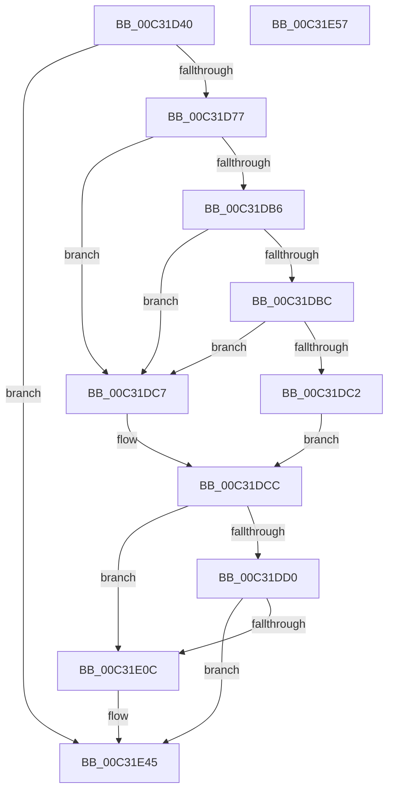

# PipMigrateResetDeviceCallback

- RVA: `0x00C31D40`–`0x00C31E58` (길이 `280` bytes)
- VA: `0x0000000140C31D40`
- 실행 섹션: `INIT`
- PDB 이름 있음: `예`; PDB Function 태그: `아니요`
- unwind 정보 RVA: `0x000BE5B4`
- 디코드: `72`개 명령, `280/280` bytes 표시
- 미해석 바이트: `0` (있으면 어셈블리에 `.byte`로 보존)

> 이 문서는 커널 이미지의 기계어와 PDB 기호를 분석해 생성했습니다. 4번과 5번은 함수 원형과 자료형을 바이너리 사용 방식에서 추정한 C 해석이며 원본 소스 복구 결과는 아닙니다.

## 1. Dependencies

- 직접 호출 지점: **4**; 고유 호출 대상: **4**
- 직접 호출자로 확인된 함수: **0**
- RIP 상대 이미지 참조: **2**

### Outgoing calls
- `0x00C31D6A` → [wcsicmp](../../text/50/wcsicmp_function_00500080.md) (function, `0x00500080`)
- `0x00C31DAD` → [CmGetDeviceRegProp](../../page/8E/CmGetDeviceRegProp_function_008ED870.md) (function, `0x008ED870`)
- `0x00C31E03` → [CmSetDeviceRegProp](../../page/8F/CmSetDeviceRegProp_function_008FD68C.md) (function, `0x008FD68C`)
- `0x00C31E40` → [PnpSetObjectProperty](../../page/8F/PnpSetObjectProperty_function_008F66E8.md) (function, `0x008F66E8`)

### Direct callers
- 이 함수 시작 RVA로 연결되는 직접 call은 확인되지 않았습니다. 간접 호출은 완전히 역산할 수 없습니다.

### Static image references
- `0x00C31D5D` → RVA `0x00C79EE0` (` ?? ::PBOPGDP::`string'`; read)
- `0x00C31E11` → RVA `0x000129F0` (`.rdata`; read)

## 2. Other-region calls and transfers

- 다른 실행 섹션으로 향하는 call: **4**
  - `0x00C31D6A` → [wcsicmp](../../text/50/wcsicmp_function_00500080.md) (`INIT` → `.text`)
  - `0x00C31DAD` → [CmGetDeviceRegProp](../../page/8E/CmGetDeviceRegProp_function_008ED870.md) (`INIT` → `PAGE`)
  - `0x00C31E03` → [CmSetDeviceRegProp](../../page/8F/CmSetDeviceRegProp_function_008FD68C.md) (`INIT` → `PAGE`)
  - `0x00C31E40` → [PnpSetObjectProperty](../../page/8F/PnpSetObjectProperty_function_008F66E8.md) (`INIT` → `PAGE`)
- 별도 외부 분기/꼬리 이동을 확인하지 못했습니다.

## 3. Assembly (complete function range)

```asm
00C31D40  48 89 5C 24 08                  mov qword ptr [rsp + 8], rbx
00C31D45  48 89 7C 24 10                  mov qword ptr [rsp + 0x10], rdi
00C31D4A  55                              push rbp
00C31D4B  48 8B EC                        mov rbp, rsp
00C31D4E  48 83 EC 60                     sub rsp, 0x60
00C31D52  83 65 F0 00                     and dword ptr [rbp - 0x10], 0
00C31D56  48 8B DA                        mov rbx, rdx
00C31D59  83 65 F4 00                     and dword ptr [rbp - 0xc], 0
00C31D5D  48 8D 15 7C 81 04 00            lea rdx, [rip + 0x4817c]
00C31D64  48 8B F9                        mov rdi, rcx
00C31D67  48 8B CB                        mov rcx, rbx
00C31D6A  E8 11 E3 8C FF                  call 0x140500080
00C31D6F  85 C0                           test eax, eax
00C31D71  0F 84 CE 00 00 00               je 0x140c31e45
00C31D77  83 64 24 38 00                  and dword ptr [rsp + 0x38], 0
00C31D7C  48 8D 45 F8                     lea rax, [rbp - 8]
00C31D80  48 89 44 24 30                  mov qword ptr [rsp + 0x30], rax
00C31D85  41 B9 0B 00 00 00               mov r9d, 0xb
00C31D8B  48 8D 45 F0                     lea rax, [rbp - 0x10]
00C31D8F  C7 45 F8 04 00 00 00            mov dword ptr [rbp - 8], 4
00C31D96  48 89 44 24 28                  mov qword ptr [rsp + 0x28], rax
00C31D9B  45 33 C0                        xor r8d, r8d
00C31D9E  48 8D 45 F4                     lea rax, [rbp - 0xc]
00C31DA2  48 8B D3                        mov rdx, rbx
00C31DA5  48 8B CF                        mov rcx, rdi
00C31DA8  48 89 44 24 20                  mov qword ptr [rsp + 0x20], rax
00C31DAD  E8 BE BA CB FF                  call 0x1408ed870
00C31DB2  85 C0                           test eax, eax
00C31DB4  78 11                           js 0x140c31dc7
00C31DB6  83 7D F4 04                     cmp dword ptr [rbp - 0xc], 4
00C31DBA  75 0B                           jne 0x140c31dc7
00C31DBC  83 7D F8 04                     cmp dword ptr [rbp - 8], 4
00C31DC0  75 05                           jne 0x140c31dc7
00C31DC2  8B 45 F0                        mov eax, dword ptr [rbp - 0x10]
00C31DC5  EB 05                           jmp 0x140c31dcc
00C31DC7  33 C0                           xor eax, eax
00C31DC9  89 45 F0                        mov dword ptr [rbp - 0x10], eax
00C31DCC  A8 20                           test al, 0x20
00C31DCE  75 3C                           jne 0x140c31e0c
00C31DD0  83 64 24 38 00                  and dword ptr [rsp + 0x38], 0
00C31DD5  83 C8 20                        or eax, 0x20
00C31DD8  89 45 F0                        mov dword ptr [rbp - 0x10], eax
00C31DDB  41 B9 0B 00 00 00               mov r9d, 0xb
00C31DE1  48 8D 45 F0                     lea rax, [rbp - 0x10]
00C31DE5  C7 44 24 30 04 00 00 00         mov dword ptr [rsp + 0x30], 4
00C31DED  48 89 44 24 28                  mov qword ptr [rsp + 0x28], rax
00C31DF2  45 33 C0                        xor r8d, r8d
00C31DF5  48 8B D3                        mov rdx, rbx
00C31DF8  C7 44 24 20 04 00 00 00         mov dword ptr [rsp + 0x20], 4
00C31E00  48 8B CF                        mov rcx, rdi
00C31E03  E8 84 B8 CC FF                  call 0x1408fd68c
00C31E08  85 C0                           test eax, eax
00C31E0A  78 39                           js 0x140c31e45
00C31E0C  83 64 24 48 00                  and dword ptr [rsp + 0x48], 0
00C31E11  48 8D 0D D8 0B 3E FF            lea rcx, [rip - 0xc1f428]
00C31E18  83 64 24 40 00                  and dword ptr [rsp + 0x40], 0
00C31E1D  45 33 C9                        xor r9d, r9d
00C31E20  48 83 64 24 38 00               and qword ptr [rsp + 0x38], 0
00C31E26  48 8B D3                        mov rdx, rbx
00C31E29  83 64 24 30 00                  and dword ptr [rsp + 0x30], 0
00C31E2E  48 89 4C 24 28                  mov qword ptr [rsp + 0x28], rcx
00C31E33  48 8B CF                        mov rcx, rdi
00C31E36  48 83 64 24 20 00               and qword ptr [rsp + 0x20], 0
00C31E3C  45 8D 41 01                     lea r8d, [r9 + 1]
00C31E40  E8 A3 48 CC FF                  call 0x1408f66e8
00C31E45  48 8B 5C 24 70                  mov rbx, qword ptr [rsp + 0x70]
00C31E4A  B0 01                           mov al, 1
00C31E4C  48 8B 7C 24 78                  mov rdi, qword ptr [rsp + 0x78]
00C31E51  48 83 C4 60                     add rsp, 0x60
00C31E55  5D                              pop rbp
00C31E56  C3                              ret
00C31E57  CC                              int3
```

## 4. C-style interpretation (structured pseudocode)

```c
__int64 __fastcall PipMigrateResetDeviceCallback(__int64 a1, __int64 a2, int a3)
{
    __int64 result;
    __int64 v_rsp;
    unsigned __int64 v_stack_m10;
    unsigned int v_stack_m14;
    unsigned int v_stack_m18;
    unsigned int v_stack_m20;
    unsigned int v_stack_m28;
    unsigned int v_stack_m30;
    unsigned __int64 v_stack_m38;
    unsigned __int64 v_stack_m40;
    unsigned __int64 v_stack_m48;
    unsigned __int64 v_stack_p10;
    unsigned __int64 v_stack_p8;

    v_stack_p8 = v_rbx;
    v_stack_p10 = v_rdi;
    v_rsp = (v_rsp) - (96);
    result = wcsicmp(a2, v_rip + 295292, a3, a4);
    if ((unsigned int)(result) == 0) goto loc_00C31E45;
    v_stack_m38 = v_stack_m10;
    v_stack_m10 = 4;
    v_stack_m40 = v_stack_m18;
    a3 = 0;
    v_stack_m48 = v_stack_m14;
    result = CmGetDeviceRegProp(a1, a2, a3, 11);
    if (sign_flag) goto loc_00C31DC7;
    if (v_stack_m14 != 4) goto loc_00C31DC7;
    if (v_stack_m10 != 4) goto loc_00C31DC7;
    goto loc_00C31DCC;
loc_00C31DC7:
    result = 0;
    v_stack_m18 = 0;
loc_00C31DCC:
    if (((0) & (32)) != 0) goto loc_00C31E0C;
    result = (unsigned int)((result) | (32));
    v_stack_m18 = (unsigned int)(result);
    v_stack_m38 = 4;
    v_stack_m40 = v_stack_m18;
    a3 = 0;
    v_stack_m48 = 4;
    result = CmSetDeviceRegProp(a1, a2, a3, 11);
    if (!(sign_flag)) {
        a1 = v_rip - 12710952;
        a4 = 0;
        a2 = a2;
        v_stack_m40 = a1;
        a1 = a1;
        a3 = a4 + 1;
        result = PnpSetObjectProperty(a1, a2, a3, a4);
    }
    v_rsp = (v_rsp) + (96);
    return 1;
}
```

## 5. (Beta) C Style

```c
int64_t PipMigrateResetDeviceCallback(int64_t Arg1, int64_t Arg2, int32_t Arg3)
{
    int64_t result;
    int64_t local_rsp;
    uint64_t v_stack_m10;
    uint32_t v_stack_m14;
    uint32_t v_stack_m18;
    uint32_t v_stack_m20;
    uint32_t v_stack_m28;
    uint32_t v_stack_m30;
    uint64_t v_stack_m38;
    uint64_t v_stack_m40;
    uint64_t v_stack_m48;
    uint64_t v_stack_p10;
    uint64_t v_stack_p8;

    v_stack_p8 = local_rbx;
    v_stack_p10 = local_rdi;
    local_rsp = (local_rsp) - (96);
    result = wcsicmp(Arg2, v_rip + 295292, Arg3, a4);
    if ((uint32_t)(result) == 0) goto loc_00C31E45;
    v_stack_m38 = v_stack_m10;
    v_stack_m10 = 4;
    v_stack_m40 = v_stack_m18;
    Arg3 = 0;
    v_stack_m48 = v_stack_m14;
    result = CmGetDeviceRegProp(Arg1, Arg2, Arg3, 11);
    if (sign_flag) goto loc_00C31DC7;
    if (v_stack_m14 != 4) goto loc_00C31DC7;
    if (v_stack_m10 != 4) goto loc_00C31DC7;
    goto loc_00C31DCC;
loc_00C31DC7:
    result = 0;
    v_stack_m18 = 0;
loc_00C31DCC:
    if (((0) & (32)) != 0) goto loc_00C31E0C;
    result = (uint32_t)((result) | (32));
    v_stack_m18 = (uint32_t)(result);
    v_stack_m38 = 4;
    v_stack_m40 = v_stack_m18;
    Arg3 = 0;
    v_stack_m48 = 4;
    result = CmSetDeviceRegProp(Arg1, Arg2, Arg3, 11);
    if (!(sign_flag)) {
        Arg1 = v_rip - 12710952;
        a4 = 0;
        Arg2 = Arg2;
        v_stack_m40 = Arg1;
        Arg1 = Arg1;
        Arg3 = a4 + 1;
        result = PnpSetObjectProperty(Arg1, Arg2, Arg3, a4);
    }
    local_rsp = (local_rsp) + (96);
    return 1;
}
```

## 6. Execution-region graph

[열기: 2D/3D 그래프와 함수 탐색 컨트롤 패널](../../../control-panel.html?section=init&rva=0x00C31D40&view=graph)

- 2D 그래프는 위에서 아래로 흐르고, 3D 그래프는 빈 공간을 드래그해 회전합니다. Shift+드래그는 이동, 휠은 확대·축소, 함수 노드 선택은 대상 보고서 이동입니다.

### Static fallback


