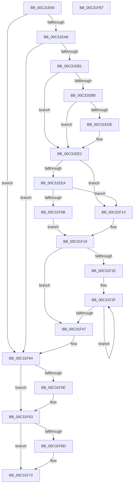

# PipMigrateServiceCallback

- RVA: `0x00C31E60`–`0x00C31F88` (길이 `296` bytes)
- VA: `0x0000000140C31E60`
- 실행 섹션: `INIT`
- PDB 이름 있음: `예`; PDB Function 태그: `아니요`
- unwind 정보 RVA: `0x000AB20C`
- 디코드: `83`개 명령, `296/296` bytes 표시
- 미해석 바이트: `0` (있으면 어셈블리에 `.byte`로 보존)

> 이 문서는 커널 이미지의 기계어와 PDB 기호를 분석해 생성했습니다. 4번과 5번은 함수 원형과 자료형을 바이너리 사용 방식에서 추정한 C 해석이며 원본 소스 복구 결과는 아닙니다.

## 1. Dependencies

- 직접 호출 지점: **7**; 고유 호출 대상: **4**
- 직접 호출자로 확인된 함수: **0**
- RIP 상대 이미지 참조: **2**

### Outgoing calls
- `0x00C31E9B` → [PnpCtxRegOpenKey](../../page/8E/PnpCtxRegOpenKey_function_008EF7B8.md) (function, `0x008EF7B8`)
- `0x00C31ED5` → [PnpCtxRegOpenKey](../../page/8E/PnpCtxRegOpenKey_function_008EF7B8.md) (function, `0x008EF7B8`)
- `0x00C31F02` → [PnpCtxRegOpenKey](../../page/8E/PnpCtxRegOpenKey_function_008EF7B8.md) (function, `0x008EF7B8`)
- `0x00C31F38` → [PnpRegCopyKeySecurityTree](../../page/72/PnpRegCopyKeySecurityTree_function_0072CBF8.md) (function, `0x0072CBF8`)
- `0x00C31F4F` → [PipMigrateCleanService](PipMigrateCleanService_function_00C31674.md) (function, `0x00C31674`)
- `0x00C31F5E` → [PnpCtxRegCloseKey](../../page/A2/PnpCtxRegCloseKey_function_00A22E0C.md) (function, `0x00A22E0C`)
- `0x00C31F6D` → [PnpCtxRegCloseKey](../../page/A2/PnpCtxRegCloseKey_function_00A22E0C.md) (function, `0x00A22E0C`)

### Direct callers
- 이 함수 시작 RVA로 연결되는 직접 call은 확인되지 않았습니다. 간접 호출은 완전히 역산할 수 없습니다.

### Static image references
- `0x00C31EBE` → RVA `0x00C7AB10` (` ?? ::PBOPGDP::`string'`; read)
- `0x00C31F23` → RVA `0x00009F08` (`.rdata`; read)

## 2. Other-region calls and transfers

- 다른 실행 섹션으로 향하는 call: **6**
  - `0x00C31E9B` → [PnpCtxRegOpenKey](../../page/8E/PnpCtxRegOpenKey_function_008EF7B8.md) (`INIT` → `PAGE`)
  - `0x00C31ED5` → [PnpCtxRegOpenKey](../../page/8E/PnpCtxRegOpenKey_function_008EF7B8.md) (`INIT` → `PAGE`)
  - `0x00C31F02` → [PnpCtxRegOpenKey](../../page/8E/PnpCtxRegOpenKey_function_008EF7B8.md) (`INIT` → `PAGE`)
  - `0x00C31F38` → [PnpRegCopyKeySecurityTree](../../page/72/PnpRegCopyKeySecurityTree_function_0072CBF8.md) (`INIT` → `PAGE`)
  - `0x00C31F5E` → [PnpCtxRegCloseKey](../../page/A2/PnpCtxRegCloseKey_function_00A22E0C.md) (`INIT` → `PAGE`)
  - `0x00C31F6D` → [PnpCtxRegCloseKey](../../page/A2/PnpCtxRegCloseKey_function_00A22E0C.md) (`INIT` → `PAGE`)
- 별도 외부 분기/꼬리 이동을 확인하지 못했습니다.

## 3. Assembly (complete function range)

```asm
00C31E60  4C 8B DC                        mov r11, rsp
00C31E63  49 89 5B 08                     mov qword ptr [r11 + 8], rbx
00C31E67  49 89 6B 10                     mov qword ptr [r11 + 0x10], rbp
00C31E6B  56                              push rsi
00C31E6C  57                              push rdi
00C31E6D  41 56                           push r14
00C31E6F  48 83 EC 40                     sub rsp, 0x40
00C31E73  49 83 63 D8 00                  and qword ptr [r11 - 0x28], 0
00C31E78  49 8D 43 20                     lea rax, [r11 + 0x20]
00C31E7C  49 83 63 20 00                  and qword ptr [r11 + 0x20], 0
00C31E81  49 8B F9                        mov rdi, r9
00C31E84  49 89 43 D0                     mov qword ptr [r11 - 0x30], rax
00C31E88  41 BE 3F 00 0F 00               mov r14d, 0xf003f
00C31E8E  45 33 C9                        xor r9d, r9d
00C31E91  45 89 73 C8                     mov dword ptr [r11 - 0x38], r14d
00C31E95  49 8B F0                        mov rsi, r8
00C31E98  48 8B E9                        mov rbp, rcx
00C31E9B  E8 18 D9 CB FF                  call 0x1408ef7b8
00C31EA0  85 C0                           test eax, eax
00C31EA2  0F 88 AC 00 00 00               js 0x140c31f54
00C31EA8  48 85 FF                        test rdi, rdi
00C31EAB  0F 84 A3 00 00 00               je 0x140c31f54
00C31EB1  48 8D 5F 08                     lea rbx, [rdi + 8]
00C31EB5  48 83 3B 00                     cmp qword ptr [rbx], 0
00C31EB9  75 27                           jne 0x140c31ee2
00C31EBB  48 8B 17                        mov rdx, qword ptr [rdi]
00C31EBE  4C 8D 05 4B 8C 04 00            lea r8, [rip + 0x48c4b]
00C31EC5  48 89 5C 24 28                  mov qword ptr [rsp + 0x28], rbx
00C31ECA  45 33 C9                        xor r9d, r9d
00C31ECD  48 8B CD                        mov rcx, rbp
00C31ED0  44 89 74 24 20                  mov dword ptr [rsp + 0x20], r14d
00C31ED5  E8 DE D8 CB FF                  call 0x1408ef7b8
00C31EDA  85 C0                           test eax, eax
00C31EDC  79 04                           jns 0x140c31ee2
00C31EDE  48 83 23 00                     and qword ptr [rbx], 0
00C31EE2  48 8B 13                        mov rdx, qword ptr [rbx]
00C31EE5  48 85 D2                        test rdx, rdx
00C31EE8  74 2A                           je 0x140c31f14
00C31EEA  48 8D 44 24 30                  lea rax, [rsp + 0x30]
00C31EEF  45 33 C9                        xor r9d, r9d
00C31EF2  48 89 44 24 28                  mov qword ptr [rsp + 0x28], rax
00C31EF7  4C 8B C6                        mov r8, rsi
00C31EFA  48 8B CD                        mov rcx, rbp
00C31EFD  44 89 74 24 20                  mov dword ptr [rsp + 0x20], r14d
00C31F02  E8 B1 D8 CB FF                  call 0x1408ef7b8
00C31F07  85 C0                           test eax, eax
00C31F09  79 09                           jns 0x140c31f14
00C31F0B  33 DB                           xor ebx, ebx
00C31F0D  48 89 5C 24 30                  mov qword ptr [rsp + 0x30], rbx
00C31F12  EB 05                           jmp 0x140c31f19
00C31F14  48 8B 5C 24 30                  mov rbx, qword ptr [rsp + 0x30]
00C31F19  48 85 DB                        test rbx, rbx
00C31F1C  74 29                           je 0x140c31f47
00C31F1E  4C 8B 74 24 78                  mov r14, qword ptr [rsp + 0x78]
00C31F23  48 8D 3D DE 7F 3D FF            lea rdi, [rip - 0xc28022]
00C31F2A  BE 02 00 00 00                  mov esi, 2
00C31F2F  4C 8B 07                        mov r8, qword ptr [rdi]
00C31F32  48 8B D3                        mov rdx, rbx
00C31F35  49 8B CE                        mov rcx, r14
00C31F38  E8 BB AC AF FF                  call 0x14072cbf8
00C31F3D  48 8D 7F 08                     lea rdi, [rdi + 8]
00C31F41  48 83 EE 01                     sub rsi, 1
00C31F45  75 E8                           jne 0x140c31f2f
00C31F47  48 8B 54 24 78                  mov rdx, qword ptr [rsp + 0x78]
00C31F4C  48 8B CD                        mov rcx, rbp
00C31F4F  E8 20 F7 FF FF                  call 0x140c31674
00C31F54  48 8B 54 24 78                  mov rdx, qword ptr [rsp + 0x78]
00C31F59  48 85 D2                        test rdx, rdx
00C31F5C  74 05                           je 0x140c31f63
00C31F5E  E8 A9 0E DF FF                  call 0x140a22e0c
00C31F63  48 8B 54 24 30                  mov rdx, qword ptr [rsp + 0x30]
00C31F68  48 85 D2                        test rdx, rdx
00C31F6B  74 05                           je 0x140c31f72
00C31F6D  E8 9A 0E DF FF                  call 0x140a22e0c
00C31F72  48 8B 5C 24 60                  mov rbx, qword ptr [rsp + 0x60]
00C31F77  33 C0                           xor eax, eax
00C31F79  48 8B 6C 24 68                  mov rbp, qword ptr [rsp + 0x68]
00C31F7E  48 83 C4 40                     add rsp, 0x40
00C31F82  41 5E                           pop r14
00C31F84  5F                              pop rdi
00C31F85  5E                              pop rsi
00C31F86  C3                              ret
00C31F87  CC                              int3
```

## 4. C-style interpretation (structured pseudocode)

```c
__int64 __fastcall PipMigrateServiceCallback(__int64 a1, __int64 a2, __int64 a3, __int64 a4)
{
    __int64 result;
    __int64 v_rbx;
    __int64 v_rsi;
    __int64 v_rsp;
    unsigned __int64 v_stack_m28;
    unsigned __int64 v_stack_m30;
    unsigned int v_stack_m38;
    unsigned __int64 v_stack_p10;
    unsigned __int64 v_stack_p20;
    unsigned __int64 v_stack_p8;

    *(unsigned __int64 *)(v_rsp + 8) = v_rbx;
    *(unsigned __int64 *)(v_rsp + 16) = v_rbp;
    v_rsp = (v_rsp) - (64);
    *(unsigned __int64 *)(v_rsp - 48) = v_rsp + 32;
    a4 = 0;
    *(unsigned int *)(v_rsp - 56) = (unsigned int)((unsigned int)(0xF003FULL));
    result = PnpCtxRegOpenKey(a1, a2, a3, a4);
    if (sign_flag) goto loc_00C31F54;
    if (0 == 0) goto loc_00C31F54;
    if ((*(unsigned __int64 *)(a4 + 8)) != 0) goto loc_00C31EE2;
    v_stack_m30 = a4 + 8;
    a4 = 0;
    v_stack_m38 = (unsigned int)((unsigned int)(0xF003FULL));
    result = PnpCtxRegOpenKey(a1, *(unsigned __int64 *)(a4), v_rip + 298059, a4);
    if (sign_flag) {
    }
    if (*(unsigned __int64 *)(a4 + 8) == 0) goto loc_00C31F14;
    a4 = 0;
    v_stack_m30 = v_stack_m28;
    v_stack_m38 = (unsigned int)((unsigned int)(0xF003FULL));
    result = PnpCtxRegOpenKey(a1, *(unsigned __int64 *)(a4 + 8), a3, a4);
    if (!sign_flag) goto loc_00C31F14;
    v_rbx = 0;
    v_stack_m28 = 0;
    goto loc_00C31F19;
loc_00C31F14:
loc_00C31F19:
    if (v_stack_m28 == 0) goto loc_00C31F47;
loc_00C31F2F:
    result = PnpRegCopyKeySecurityTree(v_stack_p20, v_stack_m28, *(unsigned __int64 *)(v_rip - 12746786), a4);
    v_rsi = (2) - (1);
    if (condition_is_not_equal) goto loc_00C31F2F;
loc_00C31F47:
    result = PipMigrateCleanService(a1, v_stack_p20, *(unsigned __int64 *)(v_rip - 12746786), a4);
loc_00C31F54:
    if (v_stack_p20 != 0) {
        result = PnpCtxRegCloseKey(a1, v_stack_p20, *(unsigned __int64 *)(v_rip - 12746786), a4);
    }
    if (v_stack_m28 != 0) {
        result = PnpCtxRegCloseKey(a1, v_stack_m28, *(unsigned __int64 *)(v_rip - 12746786), a4);
    }
    result = 0;
    v_rsp = (v_rsp) + (64);
    return result;
}
```

## 5. (Beta) C Style

```c
int64_t PipMigrateServiceCallback(int64_t Arg1, int64_t Arg2, int64_t Arg3, int64_t Arg4)
{
    int64_t result;
    int64_t local_rbx;
    int64_t local_rsi;
    int64_t local_rsp;
    uint64_t v_stack_m28;
    uint64_t v_stack_m30;
    uint32_t v_stack_m38;
    uint64_t v_stack_p10;
    uint64_t v_stack_p20;
    uint64_t v_stack_p8;

    *(uint64_t *)(local_rsp + 0x8) = local_rbx;
    *(uint64_t *)(local_rsp + 0x10) = local_rbp;
    local_rsp = (local_rsp) - (64);
    *(uint64_t *)(local_rsp - 0x30) = local_rsp + 32;
    Arg4 = 0;
    *(uint32_t *)(local_rsp - 0x38) = (uint32_t)((uint32_t)(0xF003FULL));
    result = PnpCtxRegOpenKey(Arg1, Arg2, Arg3, Arg4);
    if (sign_flag) goto loc_00C31F54;
    if (0 == 0) goto loc_00C31F54;
    if ((*(uint64_t *)(Arg4 + 0x8)) != 0) goto loc_00C31EE2;
    v_stack_m30 = Arg4 + 8;
    Arg4 = 0;
    v_stack_m38 = (uint32_t)((uint32_t)(0xF003FULL));
    result = PnpCtxRegOpenKey(Arg1, *(uint64_t *)(Arg4), v_rip + 298059, Arg4);
    if (sign_flag) {
    }
    if (*(uint64_t *)(Arg4 + 0x8) == 0) goto loc_00C31F14;
    Arg4 = 0;
    v_stack_m30 = v_stack_m28;
    v_stack_m38 = (uint32_t)((uint32_t)(0xF003FULL));
    result = PnpCtxRegOpenKey(Arg1, *(uint64_t *)(Arg4 + 0x8), Arg3, Arg4);
    if (!sign_flag) goto loc_00C31F14;
    local_rbx = 0;
    v_stack_m28 = 0;
    goto loc_00C31F19;
loc_00C31F14:
loc_00C31F19:
    if (v_stack_m28 == 0) goto loc_00C31F47;
loc_00C31F2F:
    result = PnpRegCopyKeySecurityTree(v_stack_p20, v_stack_m28, *(uint64_t *)(v_rip - 0xC28022), Arg4);
    local_rsi = (2) - (1);
    if (condition_is_not_equal) goto loc_00C31F2F;
loc_00C31F47:
    result = PipMigrateCleanService(Arg1, v_stack_p20, *(uint64_t *)(v_rip - 0xC28022), Arg4);
loc_00C31F54:
    if (v_stack_p20 != 0) {
        result = PnpCtxRegCloseKey(Arg1, v_stack_p20, *(uint64_t *)(v_rip - 0xC28022), Arg4);
    }
    if (v_stack_m28 != 0) {
        result = PnpCtxRegCloseKey(Arg1, v_stack_m28, *(uint64_t *)(v_rip - 0xC28022), Arg4);
    }
    result = 0;
    local_rsp = (local_rsp) + (64);
    return result;
}
```

## 6. Execution-region graph

[열기: 2D/3D 그래프와 함수 탐색 컨트롤 패널](../../../control-panel.html?section=init&rva=0x00C31E60&view=graph)

- 2D 그래프는 위에서 아래로 흐르고, 3D 그래프는 빈 공간을 드래그해 회전합니다. Shift+드래그는 이동, 휠은 확대·축소, 함수 노드 선택은 대상 보고서 이동입니다.

### Static fallback


