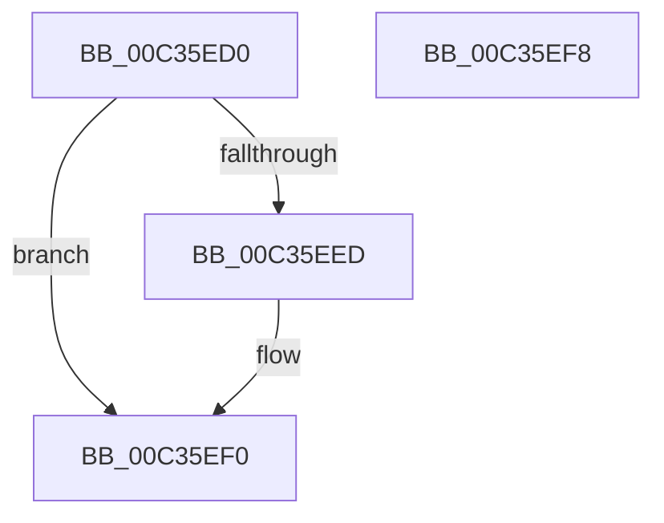

# PipPendingServicesFilter

- RVA: `0x00C35ED0`–`0x00C35EF9` (길이 `41` bytes)
- VA: `0x0000000140C35ED0`
- 실행 섹션: `INIT`
- PDB 이름 있음: `예`; PDB Function 태그: `아니요`
- unwind 정보 RVA: `0x0005CF00`
- 디코드: `14`개 명령, `41/41` bytes 표시
- 미해석 바이트: `0` (있으면 어셈블리에 `.byte`로 보존)

> 이 문서는 커널 이미지의 기계어와 PDB 기호를 분석해 생성했습니다. 4번과 5번은 함수 원형과 자료형을 바이너리 사용 방식에서 추정한 C 해석이며 원본 소스 복구 결과는 아닙니다.

## 1. Dependencies

- 직접 호출 지점: **1**; 고유 호출 대상: **1**
- 직접 호출자로 확인된 함수: **0**
- RIP 상대 이미지 참조: **1**

### Outgoing calls
- `0x00C35EE4` → [wcsicmp](../../text/50/wcsicmp_function_00500080.md) (function, `0x00500080`)

### Direct callers
- 이 함수 시작 RVA로 연결되는 직접 call은 확인되지 않았습니다. 간접 호출은 완전히 역산할 수 없습니다.

### Static image references
- `0x00C35ED6` → RVA `0x00C7B100` (` ?? ::PBOPGDP::`string'`; read)

## 2. Other-region calls and transfers

- 다른 실행 섹션으로 향하는 call: **1**
  - `0x00C35EE4` → [wcsicmp](../../text/50/wcsicmp_function_00500080.md) (`INIT` → `.text`)
- 별도 외부 분기/꼬리 이동을 확인하지 못했습니다.

## 3. Assembly (complete function range)

```asm
00C35ED0  40 53                           push rbx
00C35ED2  48 83 EC 20                     sub rsp, 0x20
00C35ED6  48 8D 15 23 52 04 00            lea rdx, [rip + 0x45223]
00C35EDD  41 C6 01 00                     mov byte ptr [r9], 0
00C35EE1  49 8B D9                        mov rbx, r9
00C35EE4  E8 97 A1 8C FF                  call 0x140500080
00C35EE9  85 C0                           test eax, eax
00C35EEB  75 03                           jne 0x140c35ef0
00C35EED  C6 03 01                        mov byte ptr [rbx], 1
00C35EF0  33 C0                           xor eax, eax
00C35EF2  48 83 C4 20                     add rsp, 0x20
00C35EF6  5B                              pop rbx
00C35EF7  C3                              ret
00C35EF8  CC                              int3
```

## 4. C-style interpretation (structured pseudocode)

```c
__int64 __fastcall PipPendingServicesFilter(__int64 a1, __int64 a2, __int64 a3, __int64 a4)
{
    __int64 result;
    __int64 v_rsp;

    v_rsp = (v_rsp) - (32);
    *(unsigned __int8 *)(a4) = 0;
    result = wcsicmp(a1, v_rip + 283171, a3, a4);
    if ((unsigned int)(result) == 0) {
        *(unsigned __int8 *)(a4) = 1;
    }
    result = 0;
    v_rsp = (v_rsp) + (32);
    return result;
}
```

## 5. (Beta) C Style

```c
int64_t PipPendingServicesFilter(int64_t Arg1, int64_t Arg2, int64_t Arg3, void *Arg4)
{
    uint8_t *arg4 = (uint8_t *)Arg4;

    int64_t result;
    int64_t local_rsp;

    local_rsp = (local_rsp) - (32);
    *(uint8_t *)(arg4) = 0;
    result = wcsicmp(Arg1, v_rip + 283171, Arg3, Arg4);
    if ((uint32_t)(result) == 0) {
        *(uint8_t *)(arg4) = 1;
    }
    result = 0;
    local_rsp = (local_rsp) + (32);
    return result;
}
```

### 관측된 메모리 오프셋

구조체 형식이 확인되지 않은 접근은 인자 기준의 오프셋으로만 기록했습니다.

| 기준 인자 | 오프셋 표현 | 폭 (bit) | 접근 |
|---|---:|---:|---|
| `Arg4` | `+ 0x0` | `8` | `W` |

## 6. Execution-region graph

[열기: 2D/3D 그래프와 함수 탐색 컨트롤 패널](../../../control-panel.html?section=init&rva=0x00C35ED0&view=graph)

- 2D 그래프는 위에서 아래로 흐르고, 3D 그래프는 빈 공간을 드래그해 회전합니다. Shift+드래그는 이동, 휠은 확대·축소, 함수 노드 선택은 대상 보고서 이동입니다.

### Static fallback


