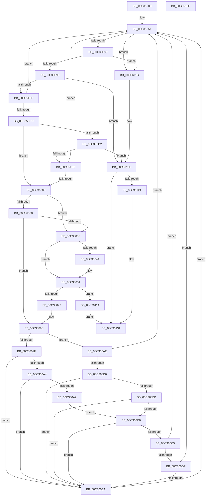

# PipProcessPendingObjects

- RVA: `0x00C35F00`–`0x00C3615E` (길이 `606` bytes)
- VA: `0x0000000140C35F00`
- 실행 섹션: `INIT`
- PDB 이름 있음: `예`; PDB Function 태그: `아니요`
- unwind 정보 RVA: `0x000C9040`
- 디코드: `156`개 명령, `606/606` bytes 표시
- 미해석 바이트: `0` (있으면 어셈블리에 `.byte`로 보존)

> 이 문서는 커널 이미지의 기계어와 PDB 기호를 분석해 생성했습니다. 4번과 5번은 함수 원형과 자료형을 바이너리 사용 방식에서 추정한 C 해석이며 원본 소스 복구 결과는 아닙니다.

## 1. Dependencies

- 직접 호출 지점: **11**; 고유 호출 대상: **8**
- 직접 호출자로 확인된 함수: **2**
- RIP 상대 이미지 참조: **3**

### Outgoing calls
- `0x00C35F71` → [PnpCtxRegEnumKey](../../page/99/PnpCtxRegEnumKey_function_009929C0.md) (function, `0x009929C0`)
- `0x00C35FC2` → [PnpCtxRegOpenKey](../../page/8E/PnpCtxRegOpenKey_function_008EF7B8.md) (function, `0x008EF7B8`)
- `0x00C35FEC` → [guard_dispatch_icall](../../text/6B/guard_dispatch_icall_function_006BAAD0.md) (function, `0x006BAAD0`)
- `0x00C3602C` → [PnpCtxRegQueryValue](../../page/99/PnpCtxRegQueryValue_function_009940FC.md) (function, `0x009940FC`)
- `0x00C3604C` → [ExFreePoolWithTag](../../poolcode/B8/ExFreePoolWithTag_function_00B82870.md) (function, `0x00B82870`)
- `0x00C36062` → [ExAllocatePool2](../../poolcode/B8/ExAllocatePool2_function_00B820F0.md) (function, `0x00B820F0`)
- `0x00C36093` → [PnpCtxRegQueryValue](../../page/99/PnpCtxRegQueryValue_function_009940FC.md) (function, `0x009940FC`)
- `0x00C360D2` → [PnpCheckDriverDependencies](../../page/72/PnpCheckDriverDependencies_function_0072C3C4.md) (function, `0x0072C3C4`)
- `0x00C360FF` → [guard_dispatch_icall](../../text/6B/guard_dispatch_icall_function_006BAAD0.md) (function, `0x006BAAD0`)
- `0x00C3612C` → [ExFreePoolWithTag](../../poolcode/B8/ExFreePoolWithTag_function_00B82870.md) (function, `0x00B82870`)
- `0x00C3613D` → [_security_check_cookie](../../text/6A/_security_check_cookie_function_006AC640.md) (function, `0x006AC640`)

### Direct callers
- [PipProcessPendingOsExtensionResources](PipProcessPendingOsExtensionResources_function_00C36164.md) at `0x00C361E1`
- [PipProcessPendingServices](PipProcessPendingServices_function_00C3620C.md) at `0x00C3628E`

### Static image references
- `0x00C35F1F` → RVA `0x00E0A740` (`.data`; read)
- `0x00C35F9E` → RVA `0x00E66398` (`.data`; read)
- `0x00C3601C` → RVA `0x00C7B0D0` (` ?? ::PBOPGDP::`string'`; read)

## 2. Other-region calls and transfers

- 다른 실행 섹션으로 향하는 call: **11**
  - `0x00C35F71` → [PnpCtxRegEnumKey](../../page/99/PnpCtxRegEnumKey_function_009929C0.md) (`INIT` → `PAGE`)
  - `0x00C35FC2` → [PnpCtxRegOpenKey](../../page/8E/PnpCtxRegOpenKey_function_008EF7B8.md) (`INIT` → `PAGE`)
  - `0x00C35FEC` → [guard_dispatch_icall](../../text/6B/guard_dispatch_icall_function_006BAAD0.md) (`INIT` → `.text`)
  - `0x00C3602C` → [PnpCtxRegQueryValue](../../page/99/PnpCtxRegQueryValue_function_009940FC.md) (`INIT` → `PAGE`)
  - `0x00C3604C` → [ExFreePoolWithTag](../../poolcode/B8/ExFreePoolWithTag_function_00B82870.md) (`INIT` → `POOLCODE`)
  - `0x00C36062` → [ExAllocatePool2](../../poolcode/B8/ExAllocatePool2_function_00B820F0.md) (`INIT` → `POOLCODE`)
  - `0x00C36093` → [PnpCtxRegQueryValue](../../page/99/PnpCtxRegQueryValue_function_009940FC.md) (`INIT` → `PAGE`)
  - `0x00C360D2` → [PnpCheckDriverDependencies](../../page/72/PnpCheckDriverDependencies_function_0072C3C4.md) (`INIT` → `PAGE`)
  - `0x00C360FF` → [guard_dispatch_icall](../../text/6B/guard_dispatch_icall_function_006BAAD0.md) (`INIT` → `.text`)
  - `0x00C3612C` → [ExFreePoolWithTag](../../poolcode/B8/ExFreePoolWithTag_function_00B82870.md) (`INIT` → `POOLCODE`)
  - `0x00C3613D` → [_security_check_cookie](../../text/6A/_security_check_cookie_function_006AC640.md) (`INIT` → `.text`)
- 별도 외부 분기/꼬리 이동을 확인하지 못했습니다.

## 3. Assembly (complete function range)

```asm
00C35F00  48 89 5C 24 18                  mov qword ptr [rsp + 0x18], rbx
00C35F05  55                              push rbp
00C35F06  56                              push rsi
00C35F07  57                              push rdi
00C35F08  41 54                           push r12
00C35F0A  41 55                           push r13
00C35F0C  41 56                           push r14
00C35F0E  41 57                           push r15
00C35F10  48 8D AC 24 80 FE FF FF         lea rbp, [rsp - 0x180]
00C35F18  48 81 EC 80 02 00 00            sub rsp, 0x280
00C35F1F  48 8B 05 1A 48 1D 00            mov rax, qword ptr [rip + 0x1d481a]
00C35F26  48 33 C4                        xor rax, rsp
00C35F29  48 89 85 70 01 00 00            mov qword ptr [rbp + 0x170], rax
00C35F30  33 C0                           xor eax, eax
00C35F32  4C 89 4C 24 50                  mov qword ptr [rsp + 0x50], r9
00C35F37  8B D8                           mov ebx, eax
00C35F39  88 44 24 30                     mov byte ptr [rsp + 0x30], al
00C35F3D  8B F0                           mov esi, eax
00C35F3F  48 89 44 24 40                  mov qword ptr [rsp + 0x40], rax
00C35F44  44 8B F0                        mov r14d, eax
00C35F47  89 44 24 38                     mov dword ptr [rsp + 0x38], eax
00C35F4B  4C 8B E2                        mov r12, rdx
00C35F4E  4C 8B F9                        mov r15, rcx
00C35F51  48 8D 44 24 34                  lea rax, [rsp + 0x34]
00C35F56  C7 44 24 34 04 01 00 00         mov dword ptr [rsp + 0x34], 0x104
00C35F5E  4C 8D 4C 24 60                  lea r9, [rsp + 0x60]
00C35F63  48 89 44 24 20                  mov qword ptr [rsp + 0x20], rax
00C35F68  45 8B C6                        mov r8d, r14d
00C35F6B  49 8B D7                        mov rdx, r15
00C35F6E  45 8B EE                        mov r13d, r14d
00C35F71  E8 4A CA D5 FF                  call 0x1409929c0
00C35F76  41 FF C6                        inc r14d
00C35F79  8B F8                           mov edi, eax
00C35F7B  44 89 74 24 48                  mov dword ptr [rsp + 0x48], r14d
00C35F80  3D 1A 00 00 80                  cmp eax, 0x8000001a
00C35F85  0F 84 90 01 00 00               je 0x140c3611b
00C35F8B  3D 7C 01 00 C0                  cmp eax, 0xc000017c
00C35F90  0F 84 85 01 00 00               je 0x140c3611b
00C35F96  85 C0                           test eax, eax
00C35F98  0F 88 81 01 00 00               js 0x140c3611f
00C35F9E  48 8B 0D F3 03 23 00            mov rcx, qword ptr [rip + 0x2303f3]
00C35FA5  48 8D 44 24 40                  lea rax, [rsp + 0x40]
00C35FAA  48 89 44 24 28                  mov qword ptr [rsp + 0x28], rax
00C35FAF  4C 8D 44 24 60                  lea r8, [rsp + 0x60]
00C35FB4  45 33 C9                        xor r9d, r9d
00C35FB7  C7 44 24 20 01 00 00 00         mov dword ptr [rsp + 0x20], 1
00C35FBF  49 8B D7                        mov rdx, r15
00C35FC2  E8 F1 97 CB FF                  call 0x1408ef7b8
00C35FC7  33 FF                           xor edi, edi
00C35FC9  85 C0                           test eax, eax
00C35FCB  78 84                           js 0x140c35f51
00C35FCD  4D 85 E4                        test r12, r12
00C35FD0  74 36                           je 0x140c36008
00C35FD2  48 8B 54 24 40                  mov rdx, qword ptr [rsp + 0x40]
00C35FD7  4C 8D 4C 24 30                  lea r9, [rsp + 0x30]
00C35FDC  45 33 C0                        xor r8d, r8d
00C35FDF  40 88 7C 24 30                  mov byte ptr [rsp + 0x30], dil
00C35FE4  48 8D 4C 24 60                  lea rcx, [rsp + 0x60]
00C35FE9  49 8B C4                        mov rax, r12
00C35FEC  E8 DF 4A A8 FF                  call 0x1406baad0
00C35FF1  8B F8                           mov edi, eax
00C35FF3  85 C0                           test eax, eax
00C35FF5  0F 88 24 01 00 00               js 0x140c3611f
00C35FFB  33 FF                           xor edi, edi
00C35FFD  40 38 7C 24 30                  cmp byte ptr [rsp + 0x30], dil
00C36002  0F 85 49 FF FF FF               jne 0x140c35f51
00C36008  48 8B 54 24 40                  mov rdx, qword ptr [rsp + 0x40]
00C3600D  48 8D 44 24 34                  lea rax, [rsp + 0x34]
00C36012  48 89 44 24 28                  mov qword ptr [rsp + 0x28], rax
00C36017  4C 8D 4C 24 38                  lea r9, [rsp + 0x38]
00C3601C  4C 8D 05 AD 50 04 00            lea r8, [rip + 0x450ad]
00C36023  48 89 5C 24 20                  mov qword ptr [rsp + 0x20], rbx
00C36028  89 74 24 34                     mov dword ptr [rsp + 0x34], esi
00C3602C  E8 CB E0 D5 FF                  call 0x1409940fc
00C36031  3D 23 00 00 C0                  cmp eax, 0xc0000023
00C36036  74 07                           je 0x140c3603f
00C36038  3D 05 00 00 80                  cmp eax, 0x80000005
00C3603D  75 59                           jne 0x140c36098
00C3603F  48 85 DB                        test rbx, rbx
00C36042  74 0D                           je 0x140c36051
00C36044  BA 50 6E 70 42                  mov edx, 0x42706e50
00C36049  48 8B CB                        mov rcx, rbx
00C3604C  E8 1F C8 F4 FF                  call 0x140b82870
00C36051  8B 74 24 34                     mov esi, dword ptr [rsp + 0x34]
00C36055  B9 00 01 00 00                  mov ecx, 0x100
00C3605A  8B D6                           mov edx, esi
00C3605C  41 B8 50 6E 70 42               mov r8d, 0x42706e50
00C36062  E8 89 C0 F4 FF                  call 0x140b820f0
00C36067  48 8B D8                        mov rbx, rax
00C3606A  48 85 C0                        test rax, rax
00C3606D  0F 84 A1 00 00 00               je 0x140c36114
00C36073  48 8B 54 24 40                  mov rdx, qword ptr [rsp + 0x40]
00C36078  48 8D 44 24 34                  lea rax, [rsp + 0x34]
00C3607D  48 89 44 24 28                  mov qword ptr [rsp + 0x28], rax
00C36082  4C 8D 4C 24 38                  lea r9, [rsp + 0x38]
00C36087  4C 8D 05 42 50 04 00            lea r8, [rip + 0x45042]
00C3608E  48 89 5C 24 20                  mov qword ptr [rsp + 0x20], rbx
00C36093  E8 64 E0 D5 FF                  call 0x1409940fc
00C36098  3D 34 00 00 C0                  cmp eax, 0xc0000034
00C3609D  75 0F                           jne 0x140c360ae
00C3609F  48 85 DB                        test rbx, rbx
00C360A2  74 46                           je 0x140c360ea
00C360A4  83 FE 02                        cmp esi, 2
00C360A7  72 41                           jb 0x140c360ea
00C360A9  66 89 3B                        mov word ptr [rbx], di
00C360AC  EB 12                           jmp 0x140c360c0
00C360AE  85 C0                           test eax, eax
00C360B0  0F 88 9B FE FF FF               js 0x140c35f51
00C360B6  48 85 DB                        test rbx, rbx
00C360B9  74 2F                           je 0x140c360ea
00C360BB  83 FE 02                        cmp esi, 2
00C360BE  72 2A                           jb 0x140c360ea
00C360C0  66 39 3B                        cmp word ptr [rbx], di
00C360C3  74 25                           je 0x140c360ea
00C360C5  48 8D 54 24 31                  lea rdx, [rsp + 0x31]
00C360CA  40 88 7C 24 31                  mov byte ptr [rsp + 0x31], dil
00C360CF  48 8B CB                        mov rcx, rbx
00C360D2  E8 ED 62 AF FF                  call 0x14072c3c4
00C360D7  85 C0                           test eax, eax
00C360D9  0F 88 72 FE FF FF               js 0x140c35f51
00C360DF  40 38 7C 24 31                  cmp byte ptr [rsp + 0x31], dil
00C360E4  0F 84 67 FE FF FF               je 0x140c35f51
00C360EA  4C 8B 44 24 40                  mov r8, qword ptr [rsp + 0x40]
00C360EF  48 8D 4C 24 60                  lea rcx, [rsp + 0x60]
00C360F4  48 8B 44 24 50                  mov rax, qword ptr [rsp + 0x50]
00C360F9  45 33 C9                        xor r9d, r9d
00C360FC  49 8B D7                        mov rdx, r15
00C360FF  E8 CC 49 A8 FF                  call 0x1406baad0
00C36104  85 C0                           test eax, eax
00C36106  45 8B F5                        mov r14d, r13d
00C36109  44 0F 48 74 24 48               cmovs r14d, dword ptr [rsp + 0x48]
00C3610F  E9 3D FE FF FF                  jmp 0x140c35f51
00C36114  BF 9A 00 00 C0                  mov edi, 0xc000009a
00C36119  EB 16                           jmp 0x140c36131
00C3611B  33 C0                           xor eax, eax
00C3611D  8B F8                           mov edi, eax
00C3611F  48 85 DB                        test rbx, rbx
00C36122  74 0D                           je 0x140c36131
00C36124  BA 50 6E 70 42                  mov edx, 0x42706e50
00C36129  48 8B CB                        mov rcx, rbx
00C3612C  E8 3F C7 F4 FF                  call 0x140b82870
00C36131  8B C7                           mov eax, edi
00C36133  48 8B 8D 70 01 00 00            mov rcx, qword ptr [rbp + 0x170]
00C3613A  48 33 CC                        xor rcx, rsp
00C3613D  E8 FE 64 A7 FF                  call 0x1406ac640
00C36142  48 8B 9C 24 D0 02 00 00         mov rbx, qword ptr [rsp + 0x2d0]
00C3614A  48 81 C4 80 02 00 00            add rsp, 0x280
00C36151  41 5F                           pop r15
00C36153  41 5E                           pop r14
00C36155  41 5D                           pop r13
00C36157  41 5C                           pop r12
00C36159  5F                              pop rdi
00C3615A  5E                              pop rsi
00C3615B  5D                              pop rbp
00C3615C  C3                              ret
00C3615D  CC                              int3
```

## 4. C-style interpretation (structured pseudocode)

```c
__int64 __fastcall PipProcessPendingObjects(__int64 a1, __int64 a2, __int64 a3, __int64 a4)
{
    __int64 result;
    __int64 v_r14;
    __int64 v_rdi;
    __int64 v_rsp;
    unsigned __int64 v_stack_m1B8;
    unsigned __int64 v_stack_m258;
    unsigned __int64 v_stack_m268;
    unsigned int v_stack_m270;
    unsigned __int64 v_stack_m278;
    unsigned int v_stack_m280;
    unsigned __int64 v_stack_m284;
    unsigned __int64 v_stack_m287;
    unsigned __int8 v_stack_m288;
    unsigned __int64 v_stack_m290;
    unsigned __int64 v_stack_m298;
    unsigned __int64 v_stack_m48;
    unsigned __int64 v_stack_p18;

    v_stack_p18 = v_rbx;
    v_rsp = (v_rsp) - (640);
    result = (*(unsigned __int64 *)(v_rip + 1919002)) ^ (v_rsp);
    v_stack_m48 = result;
    result = 0;
    v_stack_m268 = a4;
    v_stack_m288 = 0;
    v_stack_m278 = 0;
    v_stack_m280 = 0;
loc_00C35F51:
    v_stack_m284 = 260;
    v_stack_m298 = v_stack_m284;
    result = PnpCtxRegEnumKey(a1, a1, 0, v_stack_m258);
    v_r14 = (unsigned int)((0) + 1);
    v_stack_m270 = (unsigned int)(v_r14);
    if (((unsigned int)(result)) == 0x8000001AULL) goto loc_00C3611B;
    if (((unsigned int)(result)) == 0xC000017CULL) goto loc_00C3611B;
    if (sign_flag) goto loc_00C3611F;
    v_stack_m290 = v_stack_m278;
    a4 = 0;
    v_stack_m298 = 1;
    result = PnpCtxRegOpenKey(*(unsigned __int64 *)(v_rip + 2294771), a1, v_stack_m258, a4);
    v_rdi = 0;
    if (sign_flag) goto loc_00C35F51;
    if (a2 == 0) goto loc_00C36008;
    a3 = 0;
    v_stack_m288 = 0;
    result = guard_dispatch_icall(v_stack_m258, v_stack_m278, a3, v_stack_m288);
    if (sign_flag) goto loc_00C3611F;
    v_rdi = 0;
    if (v_stack_m288 != 0) goto loc_00C35F51;
loc_00C36008:
    v_stack_m290 = v_stack_m284;
    v_stack_m298 = 0;
    v_stack_m284 = 0;
    result = PnpCtxRegQueryValue(v_stack_m258, v_stack_m278, v_rip + 282797, v_stack_m280);
    if (((unsigned int)(result)) == 0xC0000023ULL) goto loc_00C3603F;
    if (((unsigned int)(result)) != 0x80000005ULL) goto loc_00C36098;
loc_00C3603F:
    if (0 != 0) {
        a2 = 0x42706E50ULL;
        a1 = 0;
        result = ExFreePoolWithTag(a1, a2, v_rip + 282797, v_stack_m280);
    }
    result = ExAllocatePool2(256, (unsigned int)((unsigned int)((unsigned int)(v_stack_m284))), (unsigned int)(0x42706E50ULL), v_stack_m280);
    if (result == 0) goto loc_00C36114;
    v_stack_m290 = v_stack_m284;
    v_stack_m298 = result;
    result = PnpCtxRegQueryValue(256, v_stack_m278, v_rip + 282690, v_stack_m280);
loc_00C36098:
    if (((unsigned int)(result)) != 0xC0000034ULL) goto loc_00C360AE;
    if (result == 0) goto loc_00C360EA;
    if (((unsigned int)((unsigned int)(v_stack_m284))) < 2) goto loc_00C360EA;
    *(unsigned __int16 *)(result) = 0;
    goto loc_00C360C0;
loc_00C360AE:
    if (sign_flag) goto loc_00C35F51;
    if (result == 0) goto loc_00C360EA;
    if (((unsigned int)((unsigned int)(v_stack_m284))) < 2) goto loc_00C360EA;
loc_00C360C0:
    if ((*(unsigned __int16 *)(result)) == 0) goto loc_00C360EA;
    v_stack_m287 = 0;
    result = PnpCheckDriverDependencies(result, v_stack_m287, v_rip + 282690, v_stack_m280);
    if (sign_flag) goto loc_00C35F51;
    if (v_stack_m287 == 0) goto loc_00C35F51;
loc_00C360EA:
    a4 = 0;
    result = guard_dispatch_icall(v_stack_m258, a1, v_stack_m278, a4);
    v_r14 = 0;
    if (sign_flag) { v_r14 = v_stack_m270; }
    goto loc_00C35F51;
loc_00C36114:
    goto loc_00C36131;
loc_00C3611B:
    result = 0;
loc_00C3611F:
    if (0 != 0) {
        a2 = 0x42706E50ULL;
        a1 = 0;
        result = ExFreePoolWithTag(a1, a2, v_stack_m278, a4);
    }
    a1 = (v_stack_m48) ^ (v_rsp);
    result = _security_check_cookie(a1, a2, v_stack_m278, a4);
    v_rsp = (v_rsp) + (640);
    return result;
}
```

## 5. (Beta) C Style

```c
int64_t PipProcessPendingObjects(int64_t Arg1, int64_t Arg2, int64_t Arg3, int64_t Arg4)
{
    int64_t result;
    int64_t local_r14;
    int64_t local_rdi;
    int64_t local_rsp;
    uint64_t v_stack_m1B8;
    uint64_t v_stack_m258;
    uint64_t v_stack_m268;
    uint32_t v_stack_m270;
    uint64_t v_stack_m278;
    uint32_t v_stack_m280;
    uint64_t v_stack_m284;
    uint64_t v_stack_m287;
    uint8_t v_stack_m288;
    uint64_t v_stack_m290;
    uint64_t v_stack_m298;
    uint64_t v_stack_m48;
    uint64_t v_stack_p18;

    v_stack_p18 = local_rbx;
    local_rsp = (local_rsp) - (640);
    result = (*(uint64_t *)(v_rip + 0x1D481A)) ^ (local_rsp);
    v_stack_m48 = result;
    result = 0;
    v_stack_m268 = Arg4;
    v_stack_m288 = 0;
    v_stack_m278 = 0;
    v_stack_m280 = 0;
loc_00C35F51:
    v_stack_m284 = 260;
    v_stack_m298 = v_stack_m284;
    result = PnpCtxRegEnumKey(Arg1, Arg1, 0, v_stack_m258);
    local_r14 = (uint32_t)((0) + 1);
    v_stack_m270 = (uint32_t)(local_r14);
    if (((uint32_t)(result)) == 0x8000001AULL) goto loc_00C3611B;
    if (((uint32_t)(result)) == 0xC000017CULL) goto loc_00C3611B;
    if (sign_flag) goto loc_00C3611F;
    v_stack_m290 = v_stack_m278;
    Arg4 = 0;
    v_stack_m298 = 1;
    result = PnpCtxRegOpenKey(*(uint64_t *)(v_rip + 0x2303F3), Arg1, v_stack_m258, Arg4);
    local_rdi = 0;
    if (sign_flag) goto loc_00C35F51;
    if (Arg2 == 0) goto loc_00C36008;
    Arg3 = 0;
    v_stack_m288 = 0;
    result = guard_dispatch_icall(v_stack_m258, v_stack_m278, Arg3, v_stack_m288);
    if (sign_flag) goto loc_00C3611F;
    local_rdi = 0;
    if (v_stack_m288 != 0) goto loc_00C35F51;
loc_00C36008:
    v_stack_m290 = v_stack_m284;
    v_stack_m298 = 0;
    v_stack_m284 = 0;
    result = PnpCtxRegQueryValue(v_stack_m258, v_stack_m278, v_rip + 282797, v_stack_m280);
    if (((uint32_t)(result)) == 0xC0000023ULL) goto loc_00C3603F;
    if (((uint32_t)(result)) != 0x80000005ULL) goto loc_00C36098;
loc_00C3603F:
    if (0 != 0) {
        Arg2 = 0x42706E50ULL;
        Arg1 = 0;
        result = ExFreePoolWithTag(Arg1, Arg2, v_rip + 282797, v_stack_m280);
    }
    result = ExAllocatePool2(256, (uint32_t)((uint32_t)((uint32_t)(v_stack_m284))), (uint32_t)(0x42706E50ULL), v_stack_m280);
    if (result == 0) goto loc_00C36114;
    v_stack_m290 = v_stack_m284;
    v_stack_m298 = result;
    result = PnpCtxRegQueryValue(256, v_stack_m278, v_rip + 282690, v_stack_m280);
loc_00C36098:
    if (((uint32_t)(result)) != 0xC0000034ULL) goto loc_00C360AE;
    if (result == 0) goto loc_00C360EA;
    if (((uint32_t)((uint32_t)(v_stack_m284))) < 2) goto loc_00C360EA;
    *(uint16_t *)(result) = 0;
    goto loc_00C360C0;
loc_00C360AE:
    if (sign_flag) goto loc_00C35F51;
    if (result == 0) goto loc_00C360EA;
    if (((uint32_t)((uint32_t)(v_stack_m284))) < 2) goto loc_00C360EA;
loc_00C360C0:
    if ((*(uint16_t *)(result)) == 0) goto loc_00C360EA;
    v_stack_m287 = 0;
    result = PnpCheckDriverDependencies(result, v_stack_m287, v_rip + 282690, v_stack_m280);
    if (sign_flag) goto loc_00C35F51;
    if (v_stack_m287 == 0) goto loc_00C35F51;
loc_00C360EA:
    Arg4 = 0;
    result = guard_dispatch_icall(v_stack_m258, Arg1, v_stack_m278, Arg4);
    local_r14 = 0;
    if (sign_flag) { local_r14 = v_stack_m270; }
    goto loc_00C35F51;
loc_00C36114:
    goto loc_00C36131;
loc_00C3611B:
    result = 0;
loc_00C3611F:
    if (0 != 0) {
        Arg2 = 0x42706E50ULL;
        Arg1 = 0;
        result = ExFreePoolWithTag(Arg1, Arg2, v_stack_m278, Arg4);
    }
    Arg1 = (v_stack_m48) ^ (local_rsp);
    result = _security_check_cookie(Arg1, Arg2, v_stack_m278, Arg4);
    local_rsp = (local_rsp) + (640);
    return result;
}
```

## 6. Execution-region graph

[열기: 2D/3D 그래프와 함수 탐색 컨트롤 패널](../../../control-panel.html?section=init&rva=0x00C35F00&view=graph)

- 2D 그래프는 위에서 아래로 흐르고, 3D 그래프는 빈 공간을 드래그해 회전합니다. Shift+드래그는 이동, 휠은 확대·축소, 함수 노드 선택은 대상 보고서 이동입니다.

### Static fallback


