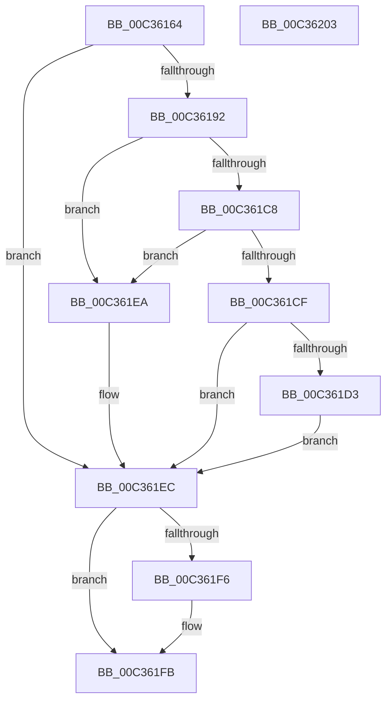

# PipProcessPendingOsExtensionResources

- RVA: `0x00C36164`–`0x00C36204` (길이 `160` bytes)
- VA: `0x0000000140C36164`
- 실행 섹션: `INIT`
- PDB 이름 있음: `예`; PDB Function 태그: `아니요`
- unwind 정보 RVA: `0x00064C80`
- 디코드: `42`개 명령, `160/160` bytes 표시
- 미해석 바이트: `0` (있으면 어셈블리에 `.byte`로 보존)

> 이 문서는 커널 이미지의 기계어와 PDB 기호를 분석해 생성했습니다. 4번과 5번은 함수 원형과 자료형을 바이너리 사용 방식에서 추정한 C 해석이며 원본 소스 복구 결과는 아닙니다.

## 1. Dependencies

- 직접 호출 지점: **4**; 고유 호출 대상: **4**
- 직접 호출자로 확인된 함수: **1**
- RIP 상대 이미지 참조: **3**

### Outgoing calls
- `0x00C36187` → [_PnpCtxGetCachedContextBaseKey](../../page/8E/_PnpCtxGetCachedContextBaseKey_function_008EFB2C.md) (function, `0x008EFB2C`)
- `0x00C361BA` → [PnpCtxRegOpenKey](../../page/8E/PnpCtxRegOpenKey_function_008EF7B8.md) (function, `0x008EF7B8`)
- `0x00C361E1` → [PipProcessPendingObjects](PipProcessPendingObjects_function_00C35F00.md) (function, `0x00C35F00`)
- `0x00C361F6` → [PnpCtxRegCloseKey](../../page/A2/PnpCtxRegCloseKey_function_00A22E0C.md) (function, `0x00A22E0C`)

### Direct callers
- [IopInitializePlugPlayServices](../C2/IopInitializePlugPlayServices_function_00C2F298.md) at `0x00C2FEA6`

### Static image references
- `0x00C3616A` → RVA `0x00E66398` (`.data`; read)
- `0x00C361A3` → RVA `0x00C7B180` (` ?? ::PBOPGDP::`string'`; read)
- `0x00C361D8` → RVA `0x00C35960` (`PipCommitPendingOsExtensionResource`; read)

## 2. Other-region calls and transfers

- 다른 실행 섹션으로 향하는 call: **3**
  - `0x00C36187` → [_PnpCtxGetCachedContextBaseKey](../../page/8E/_PnpCtxGetCachedContextBaseKey_function_008EFB2C.md) (`INIT` → `PAGE`)
  - `0x00C361BA` → [PnpCtxRegOpenKey](../../page/8E/PnpCtxRegOpenKey_function_008EF7B8.md) (`INIT` → `PAGE`)
  - `0x00C361F6` → [PnpCtxRegCloseKey](../../page/A2/PnpCtxRegCloseKey_function_00A22E0C.md) (`INIT` → `PAGE`)
- 별도 외부 분기/꼬리 이동을 확인하지 못했습니다.

## 3. Assembly (complete function range)

```asm
00C36164  40 53                           push rbx
00C36166  48 83 EC 30                     sub rsp, 0x30
00C3616A  48 8B 0D 27 02 23 00            mov rcx, qword ptr [rip + 0x230227]
00C36171  4C 8D 44 24 48                  lea r8, [rsp + 0x48]
00C36176  48 83 64 24 48 00               and qword ptr [rsp + 0x48], 0
00C3617C  BA 04 00 00 00                  mov edx, 4
00C36181  48 83 64 24 40 00               and qword ptr [rsp + 0x40], 0
00C36187  E8 A0 99 CB FF                  call 0x1408efb2c
00C3618C  8B D8                           mov ebx, eax
00C3618E  85 C0                           test eax, eax
00C36190  78 5A                           js 0x140c361ec
00C36192  48 8B 54 24 48                  mov rdx, qword ptr [rsp + 0x48]
00C36197  48 8D 44 24 40                  lea rax, [rsp + 0x40]
00C3619C  48 8B 0D F5 01 23 00            mov rcx, qword ptr [rip + 0x2301f5]
00C361A3  4C 8D 05 D6 4F 04 00            lea r8, [rip + 0x44fd6]
00C361AA  48 89 44 24 28                  mov qword ptr [rsp + 0x28], rax
00C361AF  45 33 C9                        xor r9d, r9d
00C361B2  C7 44 24 20 1F 00 02 00         mov dword ptr [rsp + 0x20], 0x2001f
00C361BA  E8 F9 95 CB FF                  call 0x1408ef7b8
00C361BF  8B D8                           mov ebx, eax
00C361C1  3D 34 00 00 C0                  cmp eax, 0xc0000034
00C361C6  74 22                           je 0x140c361ea
00C361C8  3D 7C 01 00 C0                  cmp eax, 0xc000017c
00C361CD  74 1B                           je 0x140c361ea
00C361CF  85 C0                           test eax, eax
00C361D1  78 19                           js 0x140c361ec
00C361D3  48 8B 4C 24 40                  mov rcx, qword ptr [rsp + 0x40]
00C361D8  4C 8D 0D 81 F7 FF FF            lea r9, [rip - 0x87f]
00C361DF  33 D2                           xor edx, edx
00C361E1  E8 1A FD FF FF                  call 0x140c35f00
00C361E6  8B D8                           mov ebx, eax
00C361E8  EB 02                           jmp 0x140c361ec
00C361EA  33 DB                           xor ebx, ebx
00C361EC  48 8B 54 24 40                  mov rdx, qword ptr [rsp + 0x40]
00C361F1  48 85 D2                        test rdx, rdx
00C361F4  74 05                           je 0x140c361fb
00C361F6  E8 11 CC DE FF                  call 0x140a22e0c
00C361FB  8B C3                           mov eax, ebx
00C361FD  48 83 C4 30                     add rsp, 0x30
00C36201  5B                              pop rbx
00C36202  C3                              ret
00C36203  CC                              int3
```

## 4. C-style interpretation (structured pseudocode)

```c
__int64 __fastcall PipProcessPendingOsExtensionResources(__int64 a1, __int64 a2, __int64 a3, int a4)
{
    __int64 result;
    __int64 v_rbx;
    __int64 v_rsp;
    unsigned __int64 v_stack_m10;
    unsigned int v_stack_m18;
    unsigned __int64 v_stack_p10;
    unsigned __int64 v_stack_p8;

    v_rsp = (v_rsp) - (48);
    result = _PnpCtxGetCachedContextBaseKey(*(unsigned __int64 *)(v_rip + 2294311), 4, v_stack_p10, a4);
    if (sign_flag) goto loc_00C361EC;
    v_stack_m10 = v_stack_p8;
    a4 = 0;
    v_stack_m18 = 0x2001FULL;
    result = PnpCtxRegOpenKey(*(unsigned __int64 *)(v_rip + 2294261), v_stack_p10, v_rip + 282582, a4);
    if (((unsigned int)(result)) == 0xC0000034ULL) goto loc_00C361EA;
    if (((unsigned int)(result)) == 0xC000017CULL) goto loc_00C361EA;
    if (sign_flag) goto loc_00C361EC;
    a2 = 0;
    result = PipProcessPendingObjects(v_stack_p8, a2, v_rip + 282582, v_rip - 2175);
    goto loc_00C361EC;
loc_00C361EA:
    v_rbx = 0;
loc_00C361EC:
    if (v_stack_p8 != 0) {
        result = PnpCtxRegCloseKey(v_stack_p8, v_stack_p8, v_rip + 282582, v_rip - 2175);
    }
    v_rsp = (v_rsp) + (48);
    return 0;
}
```

## 5. (Beta) C Style

```c
int64_t PipProcessPendingOsExtensionResources(int64_t Arg1, int64_t Arg2, int64_t Arg3, int32_t Arg4)
{
    int64_t result;
    int64_t local_rbx;
    int64_t local_rsp;
    uint64_t v_stack_m10;
    uint32_t v_stack_m18;
    uint64_t v_stack_p10;
    uint64_t v_stack_p8;

    local_rsp = (local_rsp) - (48);
    result = _PnpCtxGetCachedContextBaseKey(*(uint64_t *)(v_rip + 0x230227), 4, v_stack_p10, Arg4);
    if (sign_flag) goto loc_00C361EC;
    v_stack_m10 = v_stack_p8;
    Arg4 = 0;
    v_stack_m18 = 0x2001FULL;
    result = PnpCtxRegOpenKey(*(uint64_t *)(v_rip + 0x2301F5), v_stack_p10, v_rip + 282582, Arg4);
    if (((uint32_t)(result)) == 0xC0000034ULL) goto loc_00C361EA;
    if (((uint32_t)(result)) == 0xC000017CULL) goto loc_00C361EA;
    if (sign_flag) goto loc_00C361EC;
    Arg2 = 0;
    result = PipProcessPendingObjects(v_stack_p8, Arg2, v_rip + 282582, v_rip - 2175);
    goto loc_00C361EC;
loc_00C361EA:
    local_rbx = 0;
loc_00C361EC:
    if (v_stack_p8 != 0) {
        result = PnpCtxRegCloseKey(v_stack_p8, v_stack_p8, v_rip + 282582, v_rip - 2175);
    }
    local_rsp = (local_rsp) + (48);
    return 0;
}
```

## 6. Execution-region graph

[열기: 2D/3D 그래프와 함수 탐색 컨트롤 패널](../../../control-panel.html?section=init&rva=0x00C36164&view=graph)

- 2D 그래프는 위에서 아래로 흐르고, 3D 그래프는 빈 공간을 드래그해 회전합니다. Shift+드래그는 이동, 휠은 확대·축소, 함수 노드 선택은 대상 보고서 이동입니다.

### Static fallback


