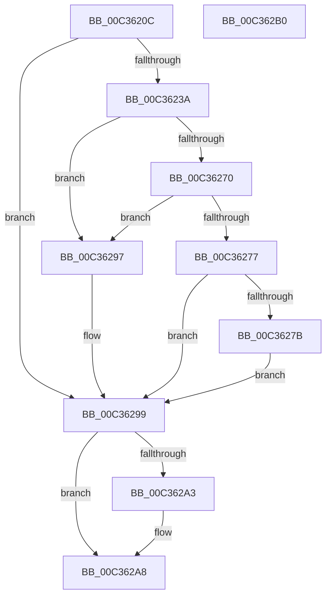

# PipProcessPendingServices

- RVA: `0x00C3620C`–`0x00C362B1` (길이 `165` bytes)
- VA: `0x0000000140C3620C`
- 실행 섹션: `INIT`
- PDB 이름 있음: `예`; PDB Function 태그: `아니요`
- unwind 정보 RVA: `0x00064C80`
- 디코드: `42`개 명령, `165/165` bytes 표시
- 미해석 바이트: `0` (있으면 어셈블리에 `.byte`로 보존)

> 이 문서는 커널 이미지의 기계어와 PDB 기호를 분석해 생성했습니다. 4번과 5번은 함수 원형과 자료형을 바이너리 사용 방식에서 추정한 C 해석이며 원본 소스 복구 결과는 아닙니다.

## 1. Dependencies

- 직접 호출 지점: **4**; 고유 호출 대상: **4**
- 직접 호출자로 확인된 함수: **1**
- RIP 상대 이미지 참조: **4**

### Outgoing calls
- `0x00C3622F` → [_PnpCtxGetCachedContextBaseKey](../../page/8E/_PnpCtxGetCachedContextBaseKey_function_008EFB2C.md) (function, `0x008EFB2C`)
- `0x00C36262` → [PnpCtxRegOpenKey](../../page/8E/PnpCtxRegOpenKey_function_008EF7B8.md) (function, `0x008EF7B8`)
- `0x00C3628E` → [PipProcessPendingObjects](PipProcessPendingObjects_function_00C35F00.md) (function, `0x00C35F00`)
- `0x00C362A3` → [PnpCtxRegCloseKey](../../page/A2/PnpCtxRegCloseKey_function_00A22E0C.md) (function, `0x00A22E0C`)

### Direct callers
- [IopInitializePlugPlayServices](../C2/IopInitializePlugPlayServices_function_00C2F298.md) at `0x00C2FE9D`

### Static image references
- `0x00C36212` → RVA `0x00E66398` (`.data`; read)
- `0x00C3624B` → RVA `0x00C7B120` (` ?? ::PBOPGDP::`string'`; read)
- `0x00C36280` → RVA `0x00C35B70` (`PipCommitPendingService`; read)
- `0x00C36287` → RVA `0x00C35ED0` (`PipPendingServicesFilter`; read)

## 2. Other-region calls and transfers

- 다른 실행 섹션으로 향하는 call: **3**
  - `0x00C3622F` → [_PnpCtxGetCachedContextBaseKey](../../page/8E/_PnpCtxGetCachedContextBaseKey_function_008EFB2C.md) (`INIT` → `PAGE`)
  - `0x00C36262` → [PnpCtxRegOpenKey](../../page/8E/PnpCtxRegOpenKey_function_008EF7B8.md) (`INIT` → `PAGE`)
  - `0x00C362A3` → [PnpCtxRegCloseKey](../../page/A2/PnpCtxRegCloseKey_function_00A22E0C.md) (`INIT` → `PAGE`)
- 별도 외부 분기/꼬리 이동을 확인하지 못했습니다.

## 3. Assembly (complete function range)

```asm
00C3620C  40 53                           push rbx
00C3620E  48 83 EC 30                     sub rsp, 0x30
00C36212  48 8B 0D 7F 01 23 00            mov rcx, qword ptr [rip + 0x23017f]
00C36219  4C 8D 44 24 48                  lea r8, [rsp + 0x48]
00C3621E  48 83 64 24 48 00               and qword ptr [rsp + 0x48], 0
00C36224  BA 04 00 00 00                  mov edx, 4
00C36229  48 83 64 24 40 00               and qword ptr [rsp + 0x40], 0
00C3622F  E8 F8 98 CB FF                  call 0x1408efb2c
00C36234  8B D8                           mov ebx, eax
00C36236  85 C0                           test eax, eax
00C36238  78 5F                           js 0x140c36299
00C3623A  48 8B 54 24 48                  mov rdx, qword ptr [rsp + 0x48]
00C3623F  48 8D 44 24 40                  lea rax, [rsp + 0x40]
00C36244  48 8B 0D 4D 01 23 00            mov rcx, qword ptr [rip + 0x23014d]
00C3624B  4C 8D 05 CE 4E 04 00            lea r8, [rip + 0x44ece]
00C36252  48 89 44 24 28                  mov qword ptr [rsp + 0x28], rax
00C36257  45 33 C9                        xor r9d, r9d
00C3625A  C7 44 24 20 1F 00 02 00         mov dword ptr [rsp + 0x20], 0x2001f
00C36262  E8 51 95 CB FF                  call 0x1408ef7b8
00C36267  8B D8                           mov ebx, eax
00C36269  3D 34 00 00 C0                  cmp eax, 0xc0000034
00C3626E  74 27                           je 0x140c36297
00C36270  3D 7C 01 00 C0                  cmp eax, 0xc000017c
00C36275  74 20                           je 0x140c36297
00C36277  85 C0                           test eax, eax
00C36279  78 1E                           js 0x140c36299
00C3627B  48 8B 4C 24 40                  mov rcx, qword ptr [rsp + 0x40]
00C36280  4C 8D 0D E9 F8 FF FF            lea r9, [rip - 0x717]
00C36287  48 8D 15 42 FC FF FF            lea rdx, [rip - 0x3be]
00C3628E  E8 6D FC FF FF                  call 0x140c35f00
00C36293  8B D8                           mov ebx, eax
00C36295  EB 02                           jmp 0x140c36299
00C36297  33 DB                           xor ebx, ebx
00C36299  48 8B 54 24 40                  mov rdx, qword ptr [rsp + 0x40]
00C3629E  48 85 D2                        test rdx, rdx
00C362A1  74 05                           je 0x140c362a8
00C362A3  E8 64 CB DE FF                  call 0x140a22e0c
00C362A8  8B C3                           mov eax, ebx
00C362AA  48 83 C4 30                     add rsp, 0x30
00C362AE  5B                              pop rbx
00C362AF  C3                              ret
00C362B0  CC                              int3
```

## 4. C-style interpretation (structured pseudocode)

```c
__int64 __fastcall PipProcessPendingServices(__int64 a1, __int64 a2, __int64 a3, int a4)
{
    __int64 result;
    __int64 v_rbx;
    __int64 v_rsp;
    unsigned __int64 v_stack_m10;
    unsigned int v_stack_m18;
    unsigned __int64 v_stack_p10;
    unsigned __int64 v_stack_p8;

    v_rsp = (v_rsp) - (48);
    result = _PnpCtxGetCachedContextBaseKey(*(unsigned __int64 *)(v_rip + 2294143), 4, v_stack_p10, a4);
    if (sign_flag) goto loc_00C36299;
    v_stack_m10 = v_stack_p8;
    a4 = 0;
    v_stack_m18 = 0x2001FULL;
    result = PnpCtxRegOpenKey(*(unsigned __int64 *)(v_rip + 2294093), v_stack_p10, v_rip + 282318, a4);
    if (((unsigned int)(result)) == 0xC0000034ULL) goto loc_00C36297;
    if (((unsigned int)(result)) == 0xC000017CULL) goto loc_00C36297;
    if (sign_flag) goto loc_00C36299;
    result = PipProcessPendingObjects(v_stack_p8, v_rip - 958, v_rip + 282318, v_rip - 1815);
    goto loc_00C36299;
loc_00C36297:
    v_rbx = 0;
loc_00C36299:
    if (v_stack_p8 != 0) {
        result = PnpCtxRegCloseKey(v_stack_p8, v_stack_p8, v_rip + 282318, v_rip - 1815);
    }
    v_rsp = (v_rsp) + (48);
    return 0;
}
```

## 5. (Beta) C Style

```c
int64_t PipProcessPendingServices(int64_t Arg1, int64_t Arg2, int64_t Arg3, int32_t Arg4)
{
    int64_t result;
    int64_t local_rbx;
    int64_t local_rsp;
    uint64_t v_stack_m10;
    uint32_t v_stack_m18;
    uint64_t v_stack_p10;
    uint64_t v_stack_p8;

    local_rsp = (local_rsp) - (48);
    result = _PnpCtxGetCachedContextBaseKey(*(uint64_t *)(v_rip + 0x23017F), 4, v_stack_p10, Arg4);
    if (sign_flag) goto loc_00C36299;
    v_stack_m10 = v_stack_p8;
    Arg4 = 0;
    v_stack_m18 = 0x2001FULL;
    result = PnpCtxRegOpenKey(*(uint64_t *)(v_rip + 0x23014D), v_stack_p10, v_rip + 282318, Arg4);
    if (((uint32_t)(result)) == 0xC0000034ULL) goto loc_00C36297;
    if (((uint32_t)(result)) == 0xC000017CULL) goto loc_00C36297;
    if (sign_flag) goto loc_00C36299;
    result = PipProcessPendingObjects(v_stack_p8, v_rip - 958, v_rip + 282318, v_rip - 1815);
    goto loc_00C36299;
loc_00C36297:
    local_rbx = 0;
loc_00C36299:
    if (v_stack_p8 != 0) {
        result = PnpCtxRegCloseKey(v_stack_p8, v_stack_p8, v_rip + 282318, v_rip - 1815);
    }
    local_rsp = (local_rsp) + (48);
    return 0;
}
```

## 6. Execution-region graph

[열기: 2D/3D 그래프와 함수 탐색 컨트롤 패널](../../../control-panel.html?section=init&rva=0x00C3620C&view=graph)

- 2D 그래프는 위에서 아래로 흐르고, 3D 그래프는 빈 공간을 드래그해 회전합니다. Shift+드래그는 이동, 휠은 확대·축소, 함수 노드 선택은 대상 보고서 이동입니다.

### Static fallback


