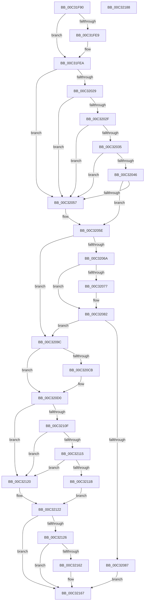

# PipResetDevice

- RVA: `0x00C31F90`–`0x00C32189` (길이 `505` bytes)
- VA: `0x0000000140C31F90`
- 실행 섹션: `INIT`
- PDB 이름 있음: `예`; PDB Function 태그: `아니요`
- unwind 정보 RVA: `0x000C7F94`
- 디코드: `141`개 명령, `505/505` bytes 표시
- 미해석 바이트: `0` (있으면 어셈블리에 `.byte`로 보존)

> 이 문서는 커널 이미지의 기계어와 PDB 기호를 분석해 생성했습니다. 4번과 5번은 함수 원형과 자료형을 바이너리 사용 방식에서 추정한 C 해석이며 원본 소스 복구 결과는 아닙니다.

## 1. Dependencies

- 직접 호출 지점: **11**; 고유 호출 대상: **9**
- 직접 호출자로 확인된 함수: **1**
- RIP 상대 이미지 참조: **5**

### Outgoing calls
- `0x00C31FDA` → [DbgPrintEx](../../text/35/DbgPrintEx_function_00359290.md) (function, `0x00359290`)
- `0x00C32020` → [CmGetDeviceRegProp](../../page/8E/CmGetDeviceRegProp_function_008ED870.md) (function, `0x008ED870`)
- `0x00C3203D` → [RtlInitUnicodeStringEx](../../text/46/RtlInitUnicodeStringEx_function_00463960.md) (function, `0x00463960`)
- `0x00C3204E` → [RtlGUIDFromString](../../page/8F/RtlGUIDFromString_function_008F1EF0.md) (function, `0x008F1EF0`)
- `0x00C32061` → [CmIsRootEnumeratedDevice](../../page/8F/CmIsRootEnumeratedDevice_function_008F6E08.md) (function, `0x008F6E08`)
- `0x00C32090` → [CmDeleteDevice](../../page/82/CmDeleteDevice_function_00829BB8.md) (function, `0x00829BB8`)
- `0x00C320A9` → [_CmDeleteDeviceRegKey](../../page/A0/_CmDeleteDeviceRegKey_function_00A09A2C.md) (function, `0x00A09A2C`)
- `0x00C320C2` → [_CmDeleteDeviceRegKey](../../page/A0/_CmDeleteDeviceRegKey_function_00A09A2C.md) (function, `0x00A09A2C`)
- `0x00C32106` → [CmGetDeviceRegProp](../../page/8E/CmGetDeviceRegProp_function_008ED870.md) (function, `0x008ED870`)
- `0x00C32159` → [CmSetDeviceRegProp](../../page/8F/CmSetDeviceRegProp_function_008FD68C.md) (function, `0x008FD68C`)
- `0x00C32170` → [_security_check_cookie](../../text/6A/_security_check_cookie_function_006AC640.md) (function, `0x006AC640`)

### Direct callers
- [PipResetMatchingFilteredDevices](PipResetMatchingFilteredDevices_function_00C32260.md) at `0x00C32492`

### Static image references
- `0x00C31FA4` → RVA `0x00E0A740` (`.data`; read)
- `0x00C31FB6` → RVA `0x00C7AA60` (` ?? ::PBOPGDP::`string'`; read)
- `0x00C31FDF` → RVA `0x00E66234` (`.data`; read)
- `0x00C3206E` → RVA `0x00027AC8` (`.rdata`; read)
- `0x00C3207B` → RVA `0x00027AD0` (`.rdata`; read)

## 2. Other-region calls and transfers

- 다른 실행 섹션으로 향하는 call: **11**
  - `0x00C31FDA` → [DbgPrintEx](../../text/35/DbgPrintEx_function_00359290.md) (`INIT` → `.text`)
  - `0x00C32020` → [CmGetDeviceRegProp](../../page/8E/CmGetDeviceRegProp_function_008ED870.md) (`INIT` → `PAGE`)
  - `0x00C3203D` → [RtlInitUnicodeStringEx](../../text/46/RtlInitUnicodeStringEx_function_00463960.md) (`INIT` → `.text`)
  - `0x00C3204E` → [RtlGUIDFromString](../../page/8F/RtlGUIDFromString_function_008F1EF0.md) (`INIT` → `PAGE`)
  - `0x00C32061` → [CmIsRootEnumeratedDevice](../../page/8F/CmIsRootEnumeratedDevice_function_008F6E08.md) (`INIT` → `PAGE`)
  - `0x00C32090` → [CmDeleteDevice](../../page/82/CmDeleteDevice_function_00829BB8.md) (`INIT` → `PAGE`)
  - `0x00C320A9` → [_CmDeleteDeviceRegKey](../../page/A0/_CmDeleteDeviceRegKey_function_00A09A2C.md) (`INIT` → `PAGE`)
  - `0x00C320C2` → [_CmDeleteDeviceRegKey](../../page/A0/_CmDeleteDeviceRegKey_function_00A09A2C.md) (`INIT` → `PAGE`)
  - `0x00C32106` → [CmGetDeviceRegProp](../../page/8E/CmGetDeviceRegProp_function_008ED870.md) (`INIT` → `PAGE`)
  - `0x00C32159` → [CmSetDeviceRegProp](../../page/8F/CmSetDeviceRegProp_function_008FD68C.md) (`INIT` → `PAGE`)
  - `0x00C32170` → [_security_check_cookie](../../text/6A/_security_check_cookie_function_006AC640.md) (`INIT` → `.text`)
- 별도 외부 분기/꼬리 이동을 확인하지 못했습니다.

## 3. Assembly (complete function range)

```asm
00C31F90  48 89 5C 24 18                  mov qword ptr [rsp + 0x18], rbx
00C31F95  55                              push rbp
00C31F96  56                              push rsi
00C31F97  57                              push rdi
00C31F98  48 8D 6C 24 B9                  lea rbp, [rsp - 0x47]
00C31F9D  48 81 EC D0 00 00 00            sub rsp, 0xd0
00C31FA4  48 8B 05 95 87 1D 00            mov rax, qword ptr [rip + 0x1d8795]
00C31FAB  48 33 C4                        xor rax, rsp
00C31FAE  48 89 45 37                     mov qword ptr [rbp + 0x37], rax
00C31FB2  83 65 BF 00                     and dword ptr [rbp - 0x41], 0
00C31FB6  4C 8D 05 A3 8A 04 00            lea r8, [rip + 0x48aa3]
00C31FBD  83 65 BB 00                     and dword ptr [rbp - 0x45], 0
00C31FC1  0F 57 C0                        xorps xmm0, xmm0
00C31FC4  48 8B FA                        mov rdi, rdx
00C31FC7  4C 8B CA                        mov r9, rdx
00C31FCA  33 D2                           xor edx, edx
00C31FCC  48 8B F1                        mov rsi, rcx
00C31FCF  0F 11 45 D7                     movups xmmword ptr [rbp - 0x29], xmm0
00C31FD3  0F 11 45 C7                     movups xmmword ptr [rbp - 0x39], xmm0
00C31FD7  8D 4A 20                        lea ecx, [rdx + 0x20]
00C31FDA  E8 B1 72 72 FF                  call 0x140359290
00C31FDF  8A 05 4F 42 23 00               mov al, byte ptr [rip + 0x23424f]
00C31FE5  84 C0                           test al, al
00C31FE7  74 01                           je 0x140c31fea
00C31FE9  CC                              int3
00C31FEA  83 64 24 38 00                  and dword ptr [rsp + 0x38], 0
00C31FEF  48 8D 45 B7                     lea rax, [rbp - 0x49]
00C31FF3  48 89 44 24 30                  mov qword ptr [rsp + 0x30], rax
00C31FF8  41 B9 09 00 00 00               mov r9d, 9
00C31FFE  48 8D 45 E7                     lea rax, [rbp - 0x19]
00C32002  C7 45 B7 4E 00 00 00            mov dword ptr [rbp - 0x49], 0x4e
00C32009  48 89 44 24 28                  mov qword ptr [rsp + 0x28], rax
00C3200E  45 33 C0                        xor r8d, r8d
00C32011  48 8D 45 BB                     lea rax, [rbp - 0x45]
00C32015  48 8B D7                        mov rdx, rdi
00C32018  48 8B CE                        mov rcx, rsi
00C3201B  48 89 44 24 20                  mov qword ptr [rsp + 0x20], rax
00C32020  E8 4B B8 CB FF                  call 0x1408ed870
00C32025  85 C0                           test eax, eax
00C32027  78 2E                           js 0x140c32057
00C32029  83 7D BB 01                     cmp dword ptr [rbp - 0x45], 1
00C3202D  75 28                           jne 0x140c32057
00C3202F  83 7D B7 02                     cmp dword ptr [rbp - 0x49], 2
00C32033  72 22                           jb 0x140c32057
00C32035  48 8D 55 E7                     lea rdx, [rbp - 0x19]
00C32039  48 8D 4D C7                     lea rcx, [rbp - 0x39]
00C3203D  E8 1E 19 83 FF                  call 0x140463960
00C32042  85 C0                           test eax, eax
00C32044  78 11                           js 0x140c32057
00C32046  48 8D 55 D7                     lea rdx, [rbp - 0x29]
00C3204A  48 8D 4D C7                     lea rcx, [rbp - 0x39]
00C3204E  E8 9D FE CB FF                  call 0x1408f1ef0
00C32053  85 C0                           test eax, eax
00C32055  79 07                           jns 0x140c3205e
00C32057  0F 57 C0                        xorps xmm0, xmm0
00C3205A  0F 11 45 D7                     movups xmmword ptr [rbp - 0x29], xmm0
00C3205E  48 8B CF                        mov rcx, rdi
00C32061  E8 A2 4D CC FF                  call 0x1408f6e08
00C32066  84 C0                           test al, al
00C32068  75 32                           jne 0x140c3209c
00C3206A  48 8B 45 D7                     mov rax, qword ptr [rbp - 0x29]
00C3206E  48 2B 05 53 5A 3F FF            sub rax, qword ptr [rip - 0xc0a5ad]
00C32075  75 0B                           jne 0x140c32082
00C32077  48 8B 45 DF                     mov rax, qword ptr [rbp - 0x21]
00C3207B  48 2B 05 4E 5A 3F FF            sub rax, qword ptr [rip - 0xc0a5b2]
00C32082  48 85 C0                        test rax, rax
00C32085  74 15                           je 0x140c3209c
00C32087  45 33 C0                        xor r8d, r8d
00C3208A  48 8B D7                        mov rdx, rdi
00C3208D  48 8B CE                        mov rcx, rsi
00C32090  E8 23 7B BF FF                  call 0x140829bb8
00C32095  8B D8                           mov ebx, eax
00C32097  E9 CB 00 00 00                  jmp 0x140c32167
00C3209C  45 33 C9                        xor r9d, r9d
00C3209F  48 8B D7                        mov rdx, rdi
00C320A2  48 8B CE                        mov rcx, rsi
00C320A5  45 8D 41 11                     lea r8d, [r9 + 0x11]
00C320A9  E8 7E 79 DD FF                  call 0x140a09a2c
00C320AE  33 DB                           xor ebx, ebx
00C320B0  48 8B D7                        mov rdx, rdi
00C320B3  85 C0                           test eax, eax
00C320B5  48 8B CE                        mov rcx, rsi
00C320B8  0F 48 D8                        cmovs ebx, eax
00C320BB  45 33 C9                        xor r9d, r9d
00C320BE  45 8D 41 12                     lea r8d, [r9 + 0x12]
00C320C2  E8 65 79 DD FF                  call 0x140a09a2c
00C320C7  85 DB                           test ebx, ebx
00C320C9  78 05                           js 0x140c320d0
00C320CB  85 C0                           test eax, eax
00C320CD  0F 48 D8                        cmovs ebx, eax
00C320D0  83 64 24 38 00                  and dword ptr [rsp + 0x38], 0
00C320D5  48 8D 45 B7                     lea rax, [rbp - 0x49]
00C320D9  48 89 44 24 30                  mov qword ptr [rsp + 0x30], rax
00C320DE  41 B9 0B 00 00 00               mov r9d, 0xb
00C320E4  48 8D 45 BF                     lea rax, [rbp - 0x41]
00C320E8  C7 45 B7 04 00 00 00            mov dword ptr [rbp - 0x49], 4
00C320EF  48 89 44 24 28                  mov qword ptr [rsp + 0x28], rax
00C320F4  45 33 C0                        xor r8d, r8d
00C320F7  48 8D 45 BB                     lea rax, [rbp - 0x45]
00C320FB  48 8B D7                        mov rdx, rdi
00C320FE  48 8B CE                        mov rcx, rsi
00C32101  48 89 44 24 20                  mov qword ptr [rsp + 0x20], rax
00C32106  E8 65 B7 CB FF                  call 0x1408ed870
00C3210B  85 C0                           test eax, eax
00C3210D  78 11                           js 0x140c32120
00C3210F  83 7D BB 04                     cmp dword ptr [rbp - 0x45], 4
00C32113  75 0B                           jne 0x140c32120
00C32115  83 7D B7 04                     cmp dword ptr [rbp - 0x49], 4
00C32119  75 05                           jne 0x140c32120
00C3211B  8B 45 BF                        mov eax, dword ptr [rbp - 0x41]
00C3211E  EB 02                           jmp 0x140c32122
00C32120  33 C0                           xor eax, eax
00C32122  A8 20                           test al, 0x20
00C32124  75 41                           jne 0x140c32167
00C32126  83 64 24 38 00                  and dword ptr [rsp + 0x38], 0
00C3212B  83 C8 20                        or eax, 0x20
00C3212E  89 45 BF                        mov dword ptr [rbp - 0x41], eax
00C32131  41 B9 0B 00 00 00               mov r9d, 0xb
00C32137  48 8D 45 BF                     lea rax, [rbp - 0x41]
00C3213B  C7 44 24 30 04 00 00 00         mov dword ptr [rsp + 0x30], 4
00C32143  48 89 44 24 28                  mov qword ptr [rsp + 0x28], rax
00C32148  45 33 C0                        xor r8d, r8d
00C3214B  48 8B D7                        mov rdx, rdi
00C3214E  C7 44 24 20 04 00 00 00         mov dword ptr [rsp + 0x20], 4
00C32156  48 8B CE                        mov rcx, rsi
00C32159  E8 2E B5 CC FF                  call 0x1408fd68c
00C3215E  85 DB                           test ebx, ebx
00C32160  78 05                           js 0x140c32167
00C32162  85 C0                           test eax, eax
00C32164  0F 48 D8                        cmovs ebx, eax
00C32167  8B C3                           mov eax, ebx
00C32169  48 8B 4D 37                     mov rcx, qword ptr [rbp + 0x37]
00C3216D  48 33 CC                        xor rcx, rsp
00C32170  E8 CB A4 A7 FF                  call 0x1406ac640
00C32175  48 8B 9C 24 00 01 00 00         mov rbx, qword ptr [rsp + 0x100]
00C3217D  48 81 C4 D0 00 00 00            add rsp, 0xd0
00C32184  5F                              pop rdi
00C32185  5E                              pop rsi
00C32186  5D                              pop rbp
00C32187  C3                              ret
00C32188  CC                              int3
```

## 4. C-style interpretation (structured pseudocode)

```c
__int64 __fastcall PipResetDevice(__int64 a1, __int64 a2)
{
    __int64 result;
    __int64 v_rbx;
    __int64 v_rsp;
    unsigned __int64 v_stack_m28;
    unsigned __int64 v_stack_m5F;
    unsigned __int64 v_stack_m78;
    unsigned __int64 v_stack_m80;
    unsigned __int64 v_stack_m88;
    unsigned __int64 v_stack_m98;
    unsigned int v_stack_mA0;
    unsigned int v_stack_mA4;
    unsigned __int64 v_stack_mA8;
    unsigned int v_stack_mB0;
    unsigned __int64 v_stack_mB8;
    unsigned __int64 v_stack_mC0;
    unsigned __int64 v_stack_mC8;
    unsigned __int64 v_stack_p18;

    v_stack_p18 = v_rbx;
    v_rsp = (v_rsp) - (208);
    result = (*(unsigned __int64 *)(v_rip + 1935253)) ^ (v_rsp);
    v_stack_m28 = result;
    a2 = 0;
    v_stack_m88 = v_xmm0;
    v_stack_m98 = v_xmm0;
    result = DbgPrintEx(a2 + 32, a2, v_rip + 297635, a2);
    if ((unsigned __int8)(*(unsigned __int8 *)(v_rip + 2310735)) != 0) {
    }
    v_stack_mB8 = v_stack_mA8;
    v_stack_mA8 = 78;
    v_stack_mC0 = v_stack_m78;
    a3 = 0;
    v_stack_mC8 = v_stack_mA4;
    result = CmGetDeviceRegProp(a1, 0, a3, 9);
    if (sign_flag) goto loc_00C32057;
    if (v_stack_mA4 != 1) goto loc_00C32057;
    if (v_stack_mA8 < 2) goto loc_00C32057;
    result = RtlInitUnicodeStringEx(v_stack_m98, v_stack_m78, a3, 9);
    if (sign_flag) goto loc_00C32057;
    result = RtlGUIDFromString(v_stack_m98, v_stack_m88, a3, 9);
    if (sign_flag) {
        v_stack_m88 = v_xmm0;
    }
    result = CmIsRootEnumeratedDevice(0, v_stack_m88, a3, 9);
    if ((unsigned __int8)(result) != 0) goto loc_00C3209C;
    result = (v_stack_m88) - (*(unsigned __int64 *)(v_rip - 12625325));
    if (!(condition_is_not_equal)) {
        result = v_stack_m80;
        result = (result) - (*(unsigned __int64 *)(v_rip - 12625330));
    }
    if (result == 0) goto loc_00C3209C;
    a3 = 0;
    result = CmDeleteDevice(a1, 0, a3, 9);
    goto loc_00C32167;
loc_00C3209C:
    a4 = 0;
    result = _CmDeleteDeviceRegKey(a1, 0, a4 + 17, a4);
    v_rbx = 0;
    if (sign_flag) { v_rbx = (unsigned int)(result); }
    a4 = 0;
    result = _CmDeleteDeviceRegKey(a1, 0, a4 + 18, a4);
    if (!(sign_flag)) {
        if (sign_flag) { v_rbx = (unsigned int)(result); }
    }
    v_stack_mB8 = v_stack_mA8;
    v_stack_mA8 = 4;
    v_stack_mC0 = v_stack_mA0;
    a3 = 0;
    v_stack_mC8 = v_stack_mA4;
    result = CmGetDeviceRegProp(a1, 0, a3, 11);
    if (sign_flag) goto loc_00C32120;
    if (v_stack_mA4 != 4) goto loc_00C32120;
    if (v_stack_mA8 != 4) goto loc_00C32120;
    goto loc_00C32122;
loc_00C32120:
    result = 0;
loc_00C32122:
    if (((0) & (32)) != 0) goto loc_00C32167;
    result = (unsigned int)((result) | (32));
    v_stack_mA0 = (unsigned int)(result);
    v_stack_mB8 = 4;
    v_stack_mC0 = v_stack_mA0;
    a3 = 0;
    v_stack_mC8 = 4;
    result = CmSetDeviceRegProp(a1, 0, a3, 11);
    if (!(sign_flag)) {
        if (sign_flag) { v_rbx = (unsigned int)(result); }
    }
    a1 = (v_stack_m28) ^ (v_rsp);
    result = _security_check_cookie(a1, 0, a3, 11);
    v_rsp = (v_rsp) + (208);
    return result;
}
```

## 5. (Beta) C Style

```c
int64_t PipResetDevice(int64_t Arg1, int64_t Arg2)
{
    int64_t result;
    int64_t local_rbx;
    int64_t local_rsp;
    uint64_t v_stack_m28;
    uint64_t v_stack_m5F;
    uint64_t v_stack_m78;
    uint64_t v_stack_m80;
    uint64_t v_stack_m88;
    uint64_t v_stack_m98;
    uint32_t v_stack_mA0;
    uint32_t v_stack_mA4;
    uint64_t v_stack_mA8;
    uint32_t v_stack_mB0;
    uint64_t v_stack_mB8;
    uint64_t v_stack_mC0;
    uint64_t v_stack_mC8;
    uint64_t v_stack_p18;

    v_stack_p18 = local_rbx;
    local_rsp = (local_rsp) - (208);
    result = (*(uint64_t *)(v_rip + 0x1D8795)) ^ (local_rsp);
    v_stack_m28 = result;
    Arg2 = 0;
    v_stack_m88 = v_xmm0;
    v_stack_m98 = v_xmm0;
    result = DbgPrintEx(Arg2 + 32, Arg2, v_rip + 297635, Arg2);
    if ((uint8_t)(*(uint8_t *)(v_rip + 0x23424F)) != 0) {
    }
    v_stack_mB8 = v_stack_mA8;
    v_stack_mA8 = 78;
    v_stack_mC0 = v_stack_m78;
    a3 = 0;
    v_stack_mC8 = v_stack_mA4;
    result = CmGetDeviceRegProp(Arg1, 0, a3, 9);
    if (sign_flag) goto loc_00C32057;
    if (v_stack_mA4 != 1) goto loc_00C32057;
    if (v_stack_mA8 < 2) goto loc_00C32057;
    result = RtlInitUnicodeStringEx(v_stack_m98, v_stack_m78, a3, 9);
    if (sign_flag) goto loc_00C32057;
    result = RtlGUIDFromString(v_stack_m98, v_stack_m88, a3, 9);
    if (sign_flag) {
        v_stack_m88 = v_xmm0;
    }
    result = CmIsRootEnumeratedDevice(0, v_stack_m88, a3, 9);
    if ((uint8_t)(result) != 0) goto loc_00C3209C;
    result = (v_stack_m88) - (*(uint64_t *)(v_rip - 0xC0A5AD));
    if (!(condition_is_not_equal)) {
        result = v_stack_m80;
        result = (result) - (*(uint64_t *)(v_rip - 0xC0A5B2));
    }
    if (result == 0) goto loc_00C3209C;
    a3 = 0;
    result = CmDeleteDevice(Arg1, 0, a3, 9);
    goto loc_00C32167;
loc_00C3209C:
    a4 = 0;
    result = _CmDeleteDeviceRegKey(Arg1, 0, a4 + 17, a4);
    local_rbx = 0;
    if (sign_flag) { local_rbx = (uint32_t)(result); }
    a4 = 0;
    result = _CmDeleteDeviceRegKey(Arg1, 0, a4 + 18, a4);
    if (!(sign_flag)) {
        if (sign_flag) { local_rbx = (uint32_t)(result); }
    }
    v_stack_mB8 = v_stack_mA8;
    v_stack_mA8 = 4;
    v_stack_mC0 = v_stack_mA0;
    a3 = 0;
    v_stack_mC8 = v_stack_mA4;
    result = CmGetDeviceRegProp(Arg1, 0, a3, 11);
    if (sign_flag) goto loc_00C32120;
    if (v_stack_mA4 != 4) goto loc_00C32120;
    if (v_stack_mA8 != 4) goto loc_00C32120;
    goto loc_00C32122;
loc_00C32120:
    result = 0;
loc_00C32122:
    if (((0) & (32)) != 0) goto loc_00C32167;
    result = (uint32_t)((result) | (32));
    v_stack_mA0 = (uint32_t)(result);
    v_stack_mB8 = 4;
    v_stack_mC0 = v_stack_mA0;
    a3 = 0;
    v_stack_mC8 = 4;
    result = CmSetDeviceRegProp(Arg1, 0, a3, 11);
    if (!(sign_flag)) {
        if (sign_flag) { local_rbx = (uint32_t)(result); }
    }
    Arg1 = (v_stack_m28) ^ (local_rsp);
    result = _security_check_cookie(Arg1, 0, a3, 11);
    local_rsp = (local_rsp) + (208);
    return result;
}
```

## 6. Execution-region graph

[열기: 2D/3D 그래프와 함수 탐색 컨트롤 패널](../../../control-panel.html?section=init&rva=0x00C31F90&view=graph)

- 2D 그래프는 위에서 아래로 흐르고, 3D 그래프는 빈 공간을 드래그해 회전합니다. Shift+드래그는 이동, 휠은 확대·축소, 함수 노드 선택은 대상 보고서 이동입니다.

### Static fallback


