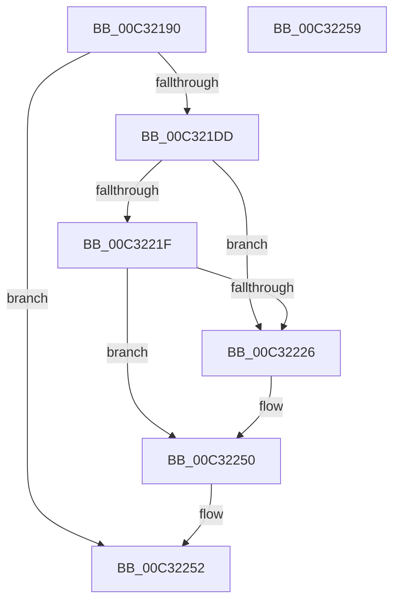

# PipResetDevices

- RVA: `0x00C32190`–`0x00C3225A` (길이 `202` bytes)
- VA: `0x0000000140C32190`
- 실행 섹션: `INIT`
- PDB 이름 있음: `예`; PDB Function 태그: `아니요`
- unwind 정보 RVA: `0x000C7FB4`
- 디코드: `49`개 명령, `202/202` bytes 표시
- 미해석 바이트: `0` (있으면 어셈블리에 `.byte`로 보존)

> 이 문서는 커널 이미지의 기계어와 PDB 기호를 분석해 생성했습니다. 4번과 5번은 함수 원형과 자료형을 바이너리 사용 방식에서 추정한 C 해석이며 원본 소스 복구 결과는 아닙니다.

## 1. Dependencies

- 직접 호출 지점: **5**; 고유 호출 대상: **4**
- 직접 호출자로 확인된 함수: **1**
- RIP 상대 이미지 참조: **5**

### Outgoing calls
- `0x00C321D4` → [PnpCtxRegOpenKey](../../page/8E/PnpCtxRegOpenKey_function_008EF7B8.md) (function, `0x008EF7B8`)
- `0x00C3220A` → [PnpCtxRegQueryValue](../../page/99/PnpCtxRegQueryValue_function_009940FC.md) (function, `0x009940FC`)
- `0x00C32216` → [PnpCtxRegCloseKey](../../page/A2/PnpCtxRegCloseKey_function_00A22E0C.md) (function, `0x00A22E0C`)
- `0x00C32236` → [PipResetMatchingFilteredDevices](PipResetMatchingFilteredDevices_function_00C32260.md) (function, `0x00C32260`)
- `0x00C3224B` → [PipResetMatchingFilteredDevices](PipResetMatchingFilteredDevices_function_00C32260.md) (function, `0x00C32260`)

### Direct callers
- [IopInitializePlugPlayServices](../C2/IopInitializePlugPlayServices_function_00C2F298.md) at `0x00C2F962`

### Static image references
- `0x00C321A9` → RVA `0x00C7A7A0` (` ?? ::PBOPGDP::`string'`; read)
- `0x00C321B8` → RVA `0x00E66398` (`.data`; read)
- `0x00C321FE` → RVA `0x00C7A7B0` (` ?? ::PBOPGDP::`string'`; read)
- `0x00C3222C` → RVA `0x00C7A920` (` ?? ::PBOPGDP::`string'`; read)
- `0x00C32241` → RVA `0x00C7A9C0` (` ?? ::PBOPGDP::`string'`; read)

## 2. Other-region calls and transfers

- 다른 실행 섹션으로 향하는 call: **3**
  - `0x00C321D4` → [PnpCtxRegOpenKey](../../page/8E/PnpCtxRegOpenKey_function_008EF7B8.md) (`INIT` → `PAGE`)
  - `0x00C3220A` → [PnpCtxRegQueryValue](../../page/99/PnpCtxRegQueryValue_function_009940FC.md) (`INIT` → `PAGE`)
  - `0x00C32216` → [PnpCtxRegCloseKey](../../page/A2/PnpCtxRegCloseKey_function_00A22E0C.md) (`INIT` → `PAGE`)
- 별도 외부 분기/꼬리 이동을 확인하지 못했습니다.

## 3. Assembly (complete function range)

```asm
00C32190  48 8B C4                        mov rax, rsp
00C32193  48 89 48 08                     mov qword ptr [rax + 8], rcx
00C32197  53                              push rbx
00C32198  57                              push rdi
00C32199  48 83 EC 38                     sub rsp, 0x38
00C3219D  48 83 60 20 00                  and qword ptr [rax + 0x20], 0
00C321A2  45 33 C9                        xor r9d, r9d
00C321A5  83 60 18 00                     and dword ptr [rax + 0x18], 0
00C321A9  4C 8D 05 F0 85 04 00            lea r8, [rip + 0x485f0]
00C321B0  83 60 08 00                     and dword ptr [rax + 8], 0
00C321B4  48 8D 40 20                     lea rax, [rax + 0x20]
00C321B8  48 8B 3D D9 41 23 00            mov rdi, qword ptr [rip + 0x2341d9]
00C321BF  BA 02 00 00 80                  mov edx, 0x80000002
00C321C4  48 89 44 24 28                  mov qword ptr [rsp + 0x28], rax
00C321C9  48 8B CF                        mov rcx, rdi
00C321CC  C7 44 24 20 01 00 00 00         mov dword ptr [rsp + 0x20], 1
00C321D4  E8 DF D5 CB FF                  call 0x1408ef7b8
00C321D9  85 C0                           test eax, eax
00C321DB  78 75                           js 0x140c32252
00C321DD  48 8B 54 24 68                  mov rdx, qword ptr [rsp + 0x68]
00C321E2  48 8D 44 24 58                  lea rax, [rsp + 0x58]
00C321E7  48 89 44 24 28                  mov qword ptr [rsp + 0x28], rax
00C321EC  4C 8D 4C 24 60                  lea r9, [rsp + 0x60]
00C321F1  48 8D 44 24 50                  lea rax, [rsp + 0x50]
00C321F6  C7 44 24 58 04 00 00 00         mov dword ptr [rsp + 0x58], 4
00C321FE  4C 8D 05 AB 85 04 00            lea r8, [rip + 0x485ab]
00C32205  48 89 44 24 20                  mov qword ptr [rsp + 0x20], rax
00C3220A  E8 ED 1E D6 FF                  call 0x1409940fc
00C3220F  48 8B 54 24 68                  mov rdx, qword ptr [rsp + 0x68]
00C32214  8B D8                           mov ebx, eax
00C32216  E8 F1 0B DF FF                  call 0x140a22e0c
00C3221B  85 DB                           test ebx, ebx
00C3221D  78 07                           js 0x140c32226
00C3221F  83 7C 24 50 00                  cmp dword ptr [rsp + 0x50], 0
00C32224  75 2A                           jne 0x140c32250
00C32226  41 B8 80 00 00 00               mov r8d, 0x80
00C3222C  48 8D 15 ED 86 04 00            lea rdx, [rip + 0x486ed]
00C32233  48 8B CF                        mov rcx, rdi
00C32236  E8 25 00 00 00                  call 0x140c32260
00C3223B  41 B8 02 00 00 00               mov r8d, 2
00C32241  48 8D 15 78 87 04 00            lea rdx, [rip + 0x48778]
00C32248  48 8B CF                        mov rcx, rdi
00C3224B  E8 10 00 00 00                  call 0x140c32260
00C32250  8B C3                           mov eax, ebx
00C32252  48 83 C4 38                     add rsp, 0x38
00C32256  5F                              pop rdi
00C32257  5B                              pop rbx
00C32258  C3                              ret
00C32259  CC                              int3
```

## 4. C-style interpretation (structured pseudocode)

```c
__int64 __fastcall PipResetDevices(__int64 a1, __int64 a2, __int64 a3, int a4)
{
    __int64 result;
    __int64 v_rsp;
    unsigned __int64 v_stack_m20;
    unsigned int v_stack_m28;
    unsigned __int64 v_stack_p10;
    unsigned __int64 v_stack_p18;
    unsigned __int64 v_stack_p20;
    unsigned __int64 v_stack_p8;

    *(unsigned __int64 *)(v_rsp + 8) = a1;
    v_rsp = (v_rsp) - (56);
    a4 = 0;
    v_stack_m20 = v_rsp + 32;
    v_stack_m28 = 1;
    result = PnpCtxRegOpenKey(*(unsigned __int64 *)(v_rip + 2310617), (unsigned int)(0x80000002ULL), v_rip + 296432, a4);
    if (sign_flag) goto loc_00C32252;
    v_stack_m20 = v_stack_p10;
    v_stack_p10 = 4;
    v_stack_m28 = v_stack_p8;
    result = PnpCtxRegQueryValue(*(unsigned __int64 *)(v_rip + 2310617), v_stack_p20, v_rip + 296363, v_stack_p18);
    result = PnpCtxRegCloseKey(*(unsigned __int64 *)(v_rip + 2310617), v_stack_p20, v_rip + 296363, v_stack_p18);
    if (sign_flag) goto loc_00C32226;
    if (v_stack_p8 == 0) {
        a3 = 128;
        a2 = v_rip + 296685;
        a1 = *(unsigned __int64 *)(v_rip + 2310617);
        result = PipResetMatchingFilteredDevices(a1, a2, a3, v_stack_p18);
        a3 = 2;
        a2 = v_rip + 296824;
        a1 = *(unsigned __int64 *)(v_rip + 2310617);
        result = PipResetMatchingFilteredDevices(a1, a2, a3, v_stack_p18);
    }
loc_00C32252:
    v_rsp = (v_rsp) + (56);
    return (unsigned int)((unsigned int)((unsigned int)((unsigned int)(result))));
}
```

## 5. (Beta) C Style

```c
int64_t PipResetDevices(int64_t Arg1, int64_t Arg2, int64_t Arg3, int32_t Arg4)
{
    int64_t result;
    int64_t local_rsp;
    uint64_t v_stack_m20;
    uint32_t v_stack_m28;
    uint64_t v_stack_p10;
    uint64_t v_stack_p18;
    uint64_t v_stack_p20;
    uint64_t v_stack_p8;

    *(uint64_t *)(local_rsp + 0x8) = Arg1;
    local_rsp = (local_rsp) - (56);
    Arg4 = 0;
    v_stack_m20 = local_rsp + 32;
    v_stack_m28 = 1;
    result = PnpCtxRegOpenKey(*(uint64_t *)(v_rip + 0x2341D9), (uint32_t)(0x80000002ULL), v_rip + 296432, Arg4);
    if (sign_flag) goto loc_00C32252;
    v_stack_m20 = v_stack_p10;
    v_stack_p10 = 4;
    v_stack_m28 = v_stack_p8;
    result = PnpCtxRegQueryValue(*(uint64_t *)(v_rip + 0x2341D9), v_stack_p20, v_rip + 296363, v_stack_p18);
    result = PnpCtxRegCloseKey(*(uint64_t *)(v_rip + 0x2341D9), v_stack_p20, v_rip + 296363, v_stack_p18);
    if (sign_flag) goto loc_00C32226;
    if (v_stack_p8 == 0) {
        Arg3 = 128;
        Arg2 = v_rip + 296685;
        Arg1 = *(uint64_t *)(v_rip + 0x2341D9);
        result = PipResetMatchingFilteredDevices(Arg1, Arg2, Arg3, v_stack_p18);
        Arg3 = 2;
        Arg2 = v_rip + 296824;
        Arg1 = *(uint64_t *)(v_rip + 0x2341D9);
        result = PipResetMatchingFilteredDevices(Arg1, Arg2, Arg3, v_stack_p18);
    }
loc_00C32252:
    local_rsp = (local_rsp) + (56);
    return (uint32_t)((uint32_t)((uint32_t)((uint32_t)(result))));
}
```

## 6. Execution-region graph

[열기: 2D/3D 그래프와 함수 탐색 컨트롤 패널](../../../control-panel.html?section=init&rva=0x00C32190&view=graph)

- 2D 그래프는 위에서 아래로 흐르고, 3D 그래프는 빈 공간을 드래그해 회전합니다. Shift+드래그는 이동, 휠은 확대·축소, 함수 노드 선택은 대상 보고서 이동입니다.

### Static fallback


