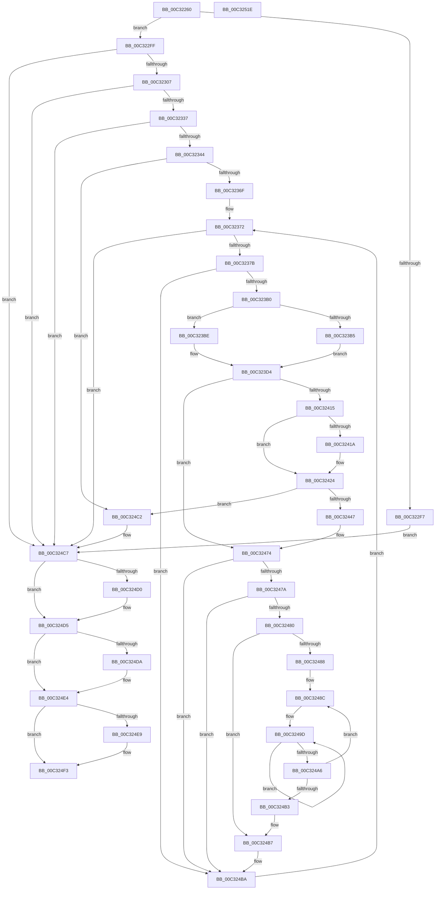

# PipResetMatchingFilteredDevices

- RVA: `0x00C32260`–`0x00C3251F` (길이 `703` bytes)
- VA: `0x0000000140C32260`
- 실행 섹션: `INIT`
- PDB 이름 있음: `예`; PDB Function 태그: `아니요`
- unwind 정보 RVA: `0x00081478`
- 디코드: `193`개 명령, `703/703` bytes 표시
- 미해석 바이트: `0` (있으면 어셈블리에 `.byte`로 보존)

> 이 문서는 커널 이미지의 기계어와 PDB 기호를 분석해 생성했습니다. 4번과 5번은 함수 원형과 자료형을 바이너리 사용 방식에서 추정한 C 해석이며 원본 소스 복구 결과는 아닙니다.

## 1. Dependencies

- 직접 호출 지점: **16**; 고유 호출 대상: **12**
- 직접 호출자로 확인된 함수: **1**
- RIP 상대 이미지 참조: **4**

### Outgoing calls
- `0x00C322C5` → [ExAcquireResourceExclusiveLite](../../text/21/ExAcquireResourceExclusiveLite_function_00214E20.md) (function, `0x00214E20`)
- `0x00C322E9` → [PnpCtxRegOpenKey](../../page/8E/PnpCtxRegOpenKey_function_008EF7B8.md) (function, `0x008EF7B8`)
- `0x00C32328` → [PnpCtxRegQueryInfoKey](../../page/99/PnpCtxRegQueryInfoKey_function_009945FC.md) (function, `0x009945FC`)
- `0x00C3235C` → [ExAllocatePool2](../../poolcode/B8/ExAllocatePool2_function_00B820F0.md) (function, `0x00B820F0`)
- `0x00C323A1` → [PnpCtxRegEnumValue](../../page/99/PnpCtxRegEnumValue_function_0099364C.md) (function, `0x0099364C`)
- `0x00C323DC` → [DbgPrintEx](../../text/35/DbgPrintEx_function_00359290.md) (function, `0x00359290`)
- `0x00C32409` → [CmGetMatchingFilteredDeviceList](../../page/A2/CmGetMatchingFilteredDeviceList_function_00A2C11C.md) (function, `0x00A2C11C`)
- `0x00C3241F` → [ExFreePoolWithTag](../../poolcode/B8/ExFreePoolWithTag_function_00B82870.md) (function, `0x00B82870`)
- `0x00C3243A` → [ExAllocatePool2](../../poolcode/B8/ExAllocatePool2_function_00B820F0.md) (function, `0x00B820F0`)
- `0x00C3246F` → [CmGetMatchingFilteredDeviceList](../../page/A2/CmGetMatchingFilteredDeviceList_function_00A2C11C.md) (function, `0x00A2C11C`)
- `0x00C32492` → [PipResetDevice](PipResetDevice_function_00C31F90.md) (function, `0x00C31F90`)
- `0x00C324D0` → [PnpCtxRegCloseKey](../../page/A2/PnpCtxRegCloseKey_function_00A22E0C.md) (function, `0x00A22E0C`)
- `0x00C324DF` → [ExFreePoolWithTag](../../poolcode/B8/ExFreePoolWithTag_function_00B82870.md) (function, `0x00B82870`)
- `0x00C324EE` → [ExFreePoolWithTag](../../poolcode/B8/ExFreePoolWithTag_function_00B82870.md) (function, `0x00B82870`)
- `0x00C324FA` → [ExReleaseResourceLite](../../text/25/ExReleaseResourceLite_function_0025FA10.md) (function, `0x0025FA10`)
- `0x00C324FF` → [KeLeaveCriticalRegion](../../text/25/KeLeaveCriticalRegion_function_0025D8B0.md) (function, `0x0025D8B0`)

### Direct callers
- [PipResetDevices](PipResetDevices_function_00C32190.md) at `0x00C32236`
- [PipResetDevices](PipResetDevices_function_00C32190.md) at `0x00C3224B`

### Static image references
- `0x00C322BD` → RVA `0x00F8C600` (`.data`; read)
- `0x00C323B5` → RVA `0x00C7AA80` (` ?? ::PBOPGDP::`string'`; read)
- `0x00C323C2` → RVA `0x00C7A860` (` ?? ::PBOPGDP::`string'`; read)
- `0x00C323C9` → RVA `0x00C7A890` (` ?? ::PBOPGDP::`string'`; read)

## 2. Other-region calls and transfers

- 다른 실행 섹션으로 향하는 call: **15**
  - `0x00C322C5` → [ExAcquireResourceExclusiveLite](../../text/21/ExAcquireResourceExclusiveLite_function_00214E20.md) (`INIT` → `.text`)
  - `0x00C322E9` → [PnpCtxRegOpenKey](../../page/8E/PnpCtxRegOpenKey_function_008EF7B8.md) (`INIT` → `PAGE`)
  - `0x00C32328` → [PnpCtxRegQueryInfoKey](../../page/99/PnpCtxRegQueryInfoKey_function_009945FC.md) (`INIT` → `PAGE`)
  - `0x00C3235C` → [ExAllocatePool2](../../poolcode/B8/ExAllocatePool2_function_00B820F0.md) (`INIT` → `POOLCODE`)
  - `0x00C323A1` → [PnpCtxRegEnumValue](../../page/99/PnpCtxRegEnumValue_function_0099364C.md) (`INIT` → `PAGE`)
  - `0x00C323DC` → [DbgPrintEx](../../text/35/DbgPrintEx_function_00359290.md) (`INIT` → `.text`)
  - `0x00C32409` → [CmGetMatchingFilteredDeviceList](../../page/A2/CmGetMatchingFilteredDeviceList_function_00A2C11C.md) (`INIT` → `PAGE`)
  - `0x00C3241F` → [ExFreePoolWithTag](../../poolcode/B8/ExFreePoolWithTag_function_00B82870.md) (`INIT` → `POOLCODE`)
  - `0x00C3243A` → [ExAllocatePool2](../../poolcode/B8/ExAllocatePool2_function_00B820F0.md) (`INIT` → `POOLCODE`)
  - `0x00C3246F` → [CmGetMatchingFilteredDeviceList](../../page/A2/CmGetMatchingFilteredDeviceList_function_00A2C11C.md) (`INIT` → `PAGE`)
  - `0x00C324D0` → [PnpCtxRegCloseKey](../../page/A2/PnpCtxRegCloseKey_function_00A22E0C.md) (`INIT` → `PAGE`)
  - `0x00C324DF` → [ExFreePoolWithTag](../../poolcode/B8/ExFreePoolWithTag_function_00B82870.md) (`INIT` → `POOLCODE`)
  - `0x00C324EE` → [ExFreePoolWithTag](../../poolcode/B8/ExFreePoolWithTag_function_00B82870.md) (`INIT` → `POOLCODE`)
  - `0x00C324FA` → [ExReleaseResourceLite](../../text/25/ExReleaseResourceLite_function_0025FA10.md) (`INIT` → `.text`)
  - `0x00C324FF` → [KeLeaveCriticalRegion](../../text/25/KeLeaveCriticalRegion_function_0025D8B0.md) (`INIT` → `.text`)
- 별도 외부 분기/꼬리 이동을 확인하지 못했습니다.

## 3. Assembly (complete function range)

```asm
00C32260  48 89 5C 24 10                  mov qword ptr [rsp + 0x10], rbx
00C32265  44 89 44 24 18                  mov dword ptr [rsp + 0x18], r8d
00C3226A  48 89 4C 24 08                  mov qword ptr [rsp + 8], rcx
00C3226F  55                              push rbp
00C32270  56                              push rsi
00C32271  57                              push rdi
00C32272  41 54                           push r12
00C32274  41 55                           push r13
00C32276  41 56                           push r14
00C32278  41 57                           push r15
00C3227A  48 8B EC                        mov rbp, rsp
00C3227D  48 83 EC 70                     sub rsp, 0x70
00C32281  45 33 E4                        xor r12d, r12d
00C32284  4C 8B F9                        mov r15, rcx
00C32287  44 89 65 58                     mov dword ptr [rbp + 0x58], r12d
00C3228B  48 83 C9 FF                     or rcx, 0xffffffffffffffff
00C3228F  4C 89 65 F0                     mov qword ptr [rbp - 0x10], r12
00C32293  48 8B DA                        mov rbx, rdx
00C32296  65 48 8B 04 25 88 01 00 00      mov rax, qword ptr gs:[0x188]
00C3229F  B2 01                           mov dl, 1
00C322A1  41 8B F0                        mov esi, r8d
00C322A4  44 89 65 E0                     mov dword ptr [rbp - 0x20], r12d
00C322A8  41 8B FC                        mov edi, r12d
00C322AB  44 89 65 E8                     mov dword ptr [rbp - 0x18], r12d
00C322AF  44 89 65 E4                     mov dword ptr [rbp - 0x1c], r12d
00C322B3  45 8B F4                        mov r14d, r12d
00C322B6  66 01 88 E4 01 00 00            add word ptr [rax + 0x1e4], cx
00C322BD  48 8D 0D 3C A3 35 00            lea rcx, [rip + 0x35a33c]
00C322C4  90                              nop
00C322C5  E8 56 2B 5E FF                  call 0x140214e20
00C322CA  48 8D 45 F0                     lea rax, [rbp - 0x10]
00C322CE  45 33 C9                        xor r9d, r9d
00C322D1  48 89 44 24 28                  mov qword ptr [rsp + 0x28], rax
00C322D6  4C 8B C3                        mov r8, rbx
00C322D9  BA 02 00 00 80                  mov edx, 0x80000002
00C322DE  C7 44 24 20 19 00 02 00         mov dword ptr [rsp + 0x20], 0x20019
00C322E6  49 8B CF                        mov rcx, r15
00C322E9  E8 CA D4 CB FF                  call 0x1408ef7b8
00C322EE  8B D8                           mov ebx, eax
00C322F0  3D 34 00 00 C0                  cmp eax, 0xc0000034
00C322F5  75 08                           jne 0x140c322ff
00C322F7  41 8B DC                        mov ebx, r12d
00C322FA  E9 C8 01 00 00                  jmp 0x140c324c7
00C322FF  85 C0                           test eax, eax
00C32301  0F 88 C0 01 00 00               js 0x140c324c7
00C32307  48 8B 55 F0                     mov rdx, qword ptr [rbp - 0x10]
00C3230B  48 8D 45 E8                     lea rax, [rbp - 0x18]
00C3230F  4C 89 64 24 30                  mov qword ptr [rsp + 0x30], r12
00C32314  45 33 C9                        xor r9d, r9d
00C32317  48 89 44 24 28                  mov qword ptr [rsp + 0x28], rax
00C3231C  45 33 C0                        xor r8d, r8d
00C3231F  48 8D 45 E4                     lea rax, [rbp - 0x1c]
00C32323  48 89 44 24 20                  mov qword ptr [rsp + 0x20], rax
00C32328  E8 CF 22 D6 FF                  call 0x1409945fc
00C3232D  8B D8                           mov ebx, eax
00C3232F  85 C0                           test eax, eax
00C32331  0F 88 90 01 00 00               js 0x140c324c7
00C32337  44 8B 6D E4                     mov r13d, dword ptr [rbp - 0x1c]
00C3233B  45 85 ED                        test r13d, r13d
00C3233E  0F 84 83 01 00 00               je 0x140c324c7
00C32344  44 8B 65 E8                     mov r12d, dword ptr [rbp - 0x18]
00C32348  B9 00 01 00 00                  mov ecx, 0x100
00C3234D  41 FF C4                        inc r12d
00C32350  41 B8 50 70 69 6E               mov r8d, 0x6e697050
00C32356  41 8B D4                        mov edx, r12d
00C32359  48 03 D2                        add rdx, rdx
00C3235C  E8 8F FD F4 FF                  call 0x140b820f0
00C32361  33 C9                           xor ecx, ecx
00C32363  4C 8B F0                        mov r14, rax
00C32366  48 85 C0                        test rax, rax
00C32369  0F 84 53 01 00 00               je 0x140c324c2
00C3236F  44 8B F9                        mov r15d, ecx
00C32372  45 3B FD                        cmp r15d, r13d
00C32375  0F 83 4C 01 00 00               jae 0x140c324c7
00C3237B  48 8B 55 F0                     mov rdx, qword ptr [rbp - 0x10]
00C3237F  48 8D 45 E8                     lea rax, [rbp - 0x18]
00C32383  48 89 4C 24 38                  mov qword ptr [rsp + 0x38], rcx
00C32388  4D 8B CE                        mov r9, r14
00C3238B  48 89 4C 24 30                  mov qword ptr [rsp + 0x30], rcx
00C32390  45 8B C7                        mov r8d, r15d
00C32393  48 89 4C 24 28                  mov qword ptr [rsp + 0x28], rcx
00C32398  48 89 44 24 20                  mov qword ptr [rsp + 0x20], rax
00C3239D  44 89 65 E8                     mov dword ptr [rbp - 0x18], r12d
00C323A1  E8 A6 12 D6 FF                  call 0x14099364c
00C323A6  33 C9                           xor ecx, ecx
00C323A8  85 C0                           test eax, eax
00C323AA  0F 88 0A 01 00 00               js 0x140c324ba
00C323B0  40 84 F6                        test sil, sil
00C323B3  79 09                           jns 0x140c323be
00C323B5  4C 8D 05 C4 86 04 00            lea r8, [rip + 0x486c4]
00C323BC  EB 16                           jmp 0x140c323d4
00C323BE  40 F6 C6 02                     test sil, 2
00C323C2  4C 8D 05 97 84 04 00            lea r8, [rip + 0x48497]
00C323C9  48 8D 05 C0 84 04 00            lea rax, [rip + 0x484c0]
00C323D0  4C 0F 44 C0                     cmove r8, rax
00C323D4  33 D2                           xor edx, edx
00C323D6  4D 8B CE                        mov r9, r14
00C323D9  8D 4A 20                        lea ecx, [rdx + 0x20]
00C323DC  E8 AF 6E 72 FF                  call 0x140359290
00C323E1  48 8B 4D 40                     mov rcx, qword ptr [rbp + 0x40]
00C323E5  48 8D 45 58                     lea rax, [rbp + 0x58]
00C323E9  48 89 44 24 38                  mov qword ptr [rsp + 0x38], rax
00C323EE  45 33 C9                        xor r9d, r9d
00C323F1  8B 45 E0                        mov eax, dword ptr [rbp - 0x20]
00C323F4  44 8B C6                        mov r8d, esi
00C323F7  89 44 24 30                     mov dword ptr [rsp + 0x30], eax
00C323FB  49 8B D6                        mov rdx, r14
00C323FE  48 89 7C 24 28                  mov qword ptr [rsp + 0x28], rdi
00C32403  48 83 64 24 20 00               and qword ptr [rsp + 0x20], 0
00C32409  E8 0E 9D DF FF                  call 0x140a2c11c
00C3240E  3D 23 00 00 C0                  cmp eax, 0xc0000023
00C32413  75 5F                           jne 0x140c32474
00C32415  48 85 FF                        test rdi, rdi
00C32418  74 0A                           je 0x140c32424
00C3241A  33 D2                           xor edx, edx
00C3241C  48 8B CF                        mov rcx, rdi
00C3241F  E8 4C 04 F5 FF                  call 0x140b82870
00C32424  8B 45 58                        mov eax, dword ptr [rbp + 0x58]
00C32427  B9 00 01 00 00                  mov ecx, 0x100
00C3242C  8B D0                           mov edx, eax
00C3242E  89 45 E0                        mov dword ptr [rbp - 0x20], eax
00C32431  48 03 D2                        add rdx, rdx
00C32434  41 B8 50 70 69 6E               mov r8d, 0x6e697050
00C3243A  E8 B1 FC F4 FF                  call 0x140b820f0
00C3243F  48 8B F8                        mov rdi, rax
00C32442  48 85 C0                        test rax, rax
00C32445  74 7B                           je 0x140c324c2
00C32447  48 8B 4D 40                     mov rcx, qword ptr [rbp + 0x40]
00C3244B  48 8D 45 58                     lea rax, [rbp + 0x58]
00C3244F  48 89 44 24 38                  mov qword ptr [rsp + 0x38], rax
00C32454  45 33 C9                        xor r9d, r9d
00C32457  8B 45 E0                        mov eax, dword ptr [rbp - 0x20]
00C3245A  44 8B C6                        mov r8d, esi
00C3245D  89 44 24 30                     mov dword ptr [rsp + 0x30], eax
00C32461  49 8B D6                        mov rdx, r14
00C32464  48 89 7C 24 28                  mov qword ptr [rsp + 0x28], rdi
00C32469  48 83 64 24 20 00               and qword ptr [rsp + 0x20], 0
00C3246F  E8 A8 9C DF FF                  call 0x140a2c11c
00C32474  33 C9                           xor ecx, ecx
00C32476  85 C0                           test eax, eax
00C32478  78 40                           js 0x140c324ba
00C3247A  83 7D 58 01                     cmp dword ptr [rbp + 0x58], 1
00C3247E  72 3A                           jb 0x140c324ba
00C32480  48 8B F7                        mov rsi, rdi
00C32483  66 39 0F                        cmp word ptr [rdi], cx
00C32486  74 2F                           je 0x140c324b7
00C32488  4C 8B 6D 40                     mov r13, qword ptr [rbp + 0x40]
00C3248C  48 8B D6                        mov rdx, rsi
00C3248F  49 8B CD                        mov rcx, r13
00C32492  E8 F9 FA FF FF                  call 0x140c31f90
00C32497  48 83 C8 FF                     or rax, 0xffffffffffffffff
00C3249B  33 C9                           xor ecx, ecx
00C3249D  48 FF C0                        inc rax
00C324A0  66 39 0C 46                     cmp word ptr [rsi + rax*2], cx
00C324A4  75 F7                           jne 0x140c3249d
00C324A6  48 8D 34 46                     lea rsi, [rsi + rax*2]
00C324AA  48 83 C6 02                     add rsi, 2
00C324AE  66 39 0E                        cmp word ptr [rsi], cx
00C324B1  75 D9                           jne 0x140c3248c
00C324B3  44 8B 6D E4                     mov r13d, dword ptr [rbp - 0x1c]
00C324B7  8B 75 50                        mov esi, dword ptr [rbp + 0x50]
00C324BA  41 FF C7                        inc r15d
00C324BD  E9 B0 FE FF FF                  jmp 0x140c32372
00C324C2  BB 9A 00 00 C0                  mov ebx, 0xc000009a
00C324C7  48 8B 55 F0                     mov rdx, qword ptr [rbp - 0x10]
00C324CB  48 85 D2                        test rdx, rdx
00C324CE  74 05                           je 0x140c324d5
00C324D0  E8 37 09 DF FF                  call 0x140a22e0c
00C324D5  4D 85 F6                        test r14, r14
00C324D8  74 0A                           je 0x140c324e4
00C324DA  33 D2                           xor edx, edx
00C324DC  49 8B CE                        mov rcx, r14
00C324DF  E8 8C 03 F5 FF                  call 0x140b82870
00C324E4  48 85 FF                        test rdi, rdi
00C324E7  74 0A                           je 0x140c324f3
00C324E9  33 D2                           xor edx, edx
00C324EB  48 8B CF                        mov rcx, rdi
00C324EE  E8 7D 03 F5 FF                  call 0x140b82870
00C324F3  48 8D 0D 06 A1 35 00            lea rcx, [rip + 0x35a106]
00C324FA  E8 11 D5 62 FF                  call 0x14025fa10
00C324FF  E8 AC B3 62 FF                  call 0x14025d8b0
00C32504  8B C3                           mov eax, ebx
00C32506  48 8B 9C 24 B8 00 00 00         mov rbx, qword ptr [rsp + 0xb8]
00C3250E  48 83 C4 70                     add rsp, 0x70
00C32512  41 5F                           pop r15
00C32514  41 5E                           pop r14
00C32516  41 5D                           pop r13
00C32518  41 5C                           pop r12
00C3251A  5F                              pop rdi
00C3251B  5E                              pop rsi
00C3251C  5D                              pop rbp
00C3251D  C3                              ret
00C3251E  CC                              int3
```

## 4. C-style interpretation (structured pseudocode)

```c
__int64 __fastcall PipResetMatchingFilteredDevices(__int64 a1, __int64 a2, int a3, int a4)
{
    __int64 result;
    __int64 v_r12;
    __int64 v_r15;
    __int64 v_rsi;
    __int64 v_rsp;
    unsigned __int64 v_stack_m48;
    unsigned int v_stack_m50;
    unsigned int v_stack_m54;
    unsigned int v_stack_m58;
    unsigned __int64 v_stack_m70;
    unsigned __int64 v_stack_m78;
    unsigned __int64 v_stack_m80;
    unsigned int v_stack_m88;
    unsigned __int64 v_stack_p10;
    unsigned int v_stack_p18;
    unsigned int v_stack_p20;
    unsigned __int64 v_stack_p8;

    v_stack_p10 = v_rbx;
    v_stack_p18 = a3;
    v_stack_p8 = a1;
    v_rsp = (v_rsp) - (112);
    v_r12 = 0;
    v_stack_p20 = 0;
    a1 = (a1) | (-1);
    v_stack_m48 = 0;
    v_stack_m58 = 0;
    v_stack_m50 = 0;
    v_stack_m54 = 0;
    result = ExAcquireResourceExclusiveLite(v_rip + 3515196, 1, a3, a4);
    a4 = 0;
    v_stack_m80 = v_stack_m48;
    v_stack_m88 = 0x20019ULL;
    result = PnpCtxRegOpenKey(a1, (unsigned int)(0x80000002ULL), a2, a4);
    if (((unsigned int)(result)) != 0xC0000034ULL) goto loc_00C322FF;
    goto loc_00C324C7;
loc_00C322FF:
    if (sign_flag) goto loc_00C324C7;
    v_stack_m78 = 0;
    a4 = 0;
    v_stack_m80 = v_stack_m50;
    a3 = 0;
    v_stack_m88 = v_stack_m54;
    result = PnpCtxRegQueryInfoKey(a1, v_stack_m48, a3, a4);
    if (sign_flag) goto loc_00C324C7;
    if ((unsigned int)((unsigned int)(v_stack_m54)) == 0) goto loc_00C324C7;
    v_r12 = (unsigned int)(((unsigned int)(v_stack_m50)) + 1);
    a2 = ((unsigned int)((unsigned int)(v_r12))) + ((unsigned int)((unsigned int)(v_r12)));
    result = ExAllocatePool2(256, a2, (unsigned int)(0x6E697050ULL), a4);
    a1 = 0;
    if (result == 0) goto loc_00C324C2;
loc_00C32372:
    if (0 >= ((unsigned int)((unsigned int)(v_stack_m54)))) goto loc_00C324C7;
    v_stack_m70 = 0;
    v_stack_m78 = 0;
    v_stack_m80 = 0;
    v_stack_m88 = v_stack_m50;
    v_stack_m50 = (unsigned int)(v_r12);
    result = PnpCtxRegEnumValue(a1, v_stack_m48, 0, result);
    a1 = 0;
    if (sign_flag) goto loc_00C324BA;
    if (!sign_flag) goto loc_00C323BE;
    goto loc_00C323D4;
loc_00C323BE:
    a3 = v_rip + 296087;
    if ((((unsigned __int8)((unsigned int)(a3))) & (2)) == 0) { a3 = v_rip + 296128; }
loc_00C323D4:
    a2 = 0;
    result = DbgPrintEx(a2 + 32, a2, a3, result);
    v_stack_m70 = v_stack_p20;
    a4 = 0;
    v_stack_m78 = (unsigned int)((unsigned int)(v_stack_m58));
    v_stack_m80 = 0;
    result = CmGetMatchingFilteredDeviceList(v_stack_p8, result, (unsigned int)((unsigned int)((unsigned int)(a3))), a4);
    if (((unsigned int)(result)) != 0xC0000023ULL) goto loc_00C32474;
    if (0 != 0) {
        a2 = 0;
        a1 = 0;
        result = ExFreePoolWithTag(a1, a2, (unsigned int)((unsigned int)((unsigned int)(a3))), a4);
    }
    v_stack_m58 = (unsigned int)((unsigned int)(v_stack_p20));
    a2 = ((unsigned int)((unsigned int)((unsigned int)(v_stack_p20)))) + ((unsigned int)((unsigned int)((unsigned int)(v_stack_p20))));
    result = ExAllocatePool2(256, a2, (unsigned int)(0x6E697050ULL), a4);
    if (result == 0) goto loc_00C324C2;
    v_stack_m70 = v_stack_p20;
    a4 = 0;
    v_stack_m78 = (unsigned int)((unsigned int)(v_stack_m58));
    v_stack_m80 = result;
    result = CmGetMatchingFilteredDeviceList(v_stack_p8, result, (unsigned int)((unsigned int)((unsigned int)(a3))), a4);
loc_00C32474:
    a1 = 0;
    if (sign_flag) goto loc_00C324BA;
    if (v_stack_p20 < 1) goto loc_00C324BA;
    if ((*(unsigned __int16 *)(result)) == 0) goto loc_00C324B7;
loc_00C3248C:
    result = PipResetDevice(v_stack_p8, result, (unsigned int)((unsigned int)((unsigned int)(a3))), a4);
    result = (result) | (-1);
    a1 = 0;
loc_00C3249D:
    result = (result) + 1;
    if ((*(unsigned __int16 *)(result + result * 2)) != 0) goto loc_00C3249D;
    v_rsi = (result + result * 2) + (2);
    if ((*(unsigned __int16 *)(v_rsi)) != 0) goto loc_00C3248C;
loc_00C324B7:
loc_00C324BA:
    v_r15 = (unsigned int)((0) + 1);
    goto loc_00C32372;
loc_00C324C2:
loc_00C324C7:
    if (v_stack_m48 != 0) {
        result = PnpCtxRegCloseKey(a1, v_stack_m48, (unsigned int)((unsigned int)((unsigned int)(a3))), a4);
    }
    if (result != 0) {
        a2 = 0;
        a1 = result;
        result = ExFreePoolWithTag(a1, a2, (unsigned int)((unsigned int)((unsigned int)(a3))), a4);
    }
    if (result != 0) {
        a2 = 0;
        a1 = result;
        result = ExFreePoolWithTag(a1, a2, (unsigned int)((unsigned int)((unsigned int)(a3))), a4);
    }
    result = ExReleaseResourceLite(v_rip + 3514630, a2, (unsigned int)((unsigned int)((unsigned int)(a3))), a4);
    result = KeLeaveCriticalRegion(v_rip + 3514630, a2, (unsigned int)((unsigned int)((unsigned int)(a3))), a4);
    v_rsp = (v_rsp) + (112);
    return (unsigned int)((unsigned int)((unsigned int)(0xC000009AULL)));
}
```

## 5. (Beta) C Style

```c
int64_t PipResetMatchingFilteredDevices(int64_t Arg1, int64_t Arg2, int32_t Arg3, int32_t Arg4)
{
    int64_t result;
    int64_t local_r12;
    int64_t local_r15;
    int64_t local_rsi;
    int64_t local_rsp;
    uint64_t v_stack_m48;
    uint32_t v_stack_m50;
    uint32_t v_stack_m54;
    uint32_t v_stack_m58;
    uint64_t v_stack_m70;
    uint64_t v_stack_m78;
    uint64_t v_stack_m80;
    uint32_t v_stack_m88;
    uint64_t v_stack_p10;
    uint32_t v_stack_p18;
    uint32_t v_stack_p20;
    uint64_t v_stack_p8;

    v_stack_p10 = local_rbx;
    v_stack_p18 = Arg3;
    v_stack_p8 = Arg1;
    local_rsp = (local_rsp) - (112);
    local_r12 = 0;
    v_stack_p20 = 0;
    Arg1 = (Arg1) | (-1);
    v_stack_m48 = 0;
    v_stack_m58 = 0;
    v_stack_m50 = 0;
    v_stack_m54 = 0;
    result = ExAcquireResourceExclusiveLite(v_rip + 3515196, 1, Arg3, Arg4);
    Arg4 = 0;
    v_stack_m80 = v_stack_m48;
    v_stack_m88 = 0x20019ULL;
    result = PnpCtxRegOpenKey(Arg1, (uint32_t)(0x80000002ULL), Arg2, Arg4);
    if (((uint32_t)(result)) != 0xC0000034ULL) goto loc_00C322FF;
    goto loc_00C324C7;
loc_00C322FF:
    if (sign_flag) goto loc_00C324C7;
    v_stack_m78 = 0;
    Arg4 = 0;
    v_stack_m80 = v_stack_m50;
    Arg3 = 0;
    v_stack_m88 = v_stack_m54;
    result = PnpCtxRegQueryInfoKey(Arg1, v_stack_m48, Arg3, Arg4);
    if (sign_flag) goto loc_00C324C7;
    if ((uint32_t)((uint32_t)(v_stack_m54)) == 0) goto loc_00C324C7;
    local_r12 = (uint32_t)(((uint32_t)(v_stack_m50)) + 1);
    Arg2 = ((uint32_t)((uint32_t)(local_r12))) + ((uint32_t)((uint32_t)(local_r12)));
    result = ExAllocatePool2(256, Arg2, (uint32_t)(0x6E697050ULL), Arg4);
    Arg1 = 0;
    if (result == 0) goto loc_00C324C2;
loc_00C32372:
    if (0 >= ((uint32_t)((uint32_t)(v_stack_m54)))) goto loc_00C324C7;
    v_stack_m70 = 0;
    v_stack_m78 = 0;
    v_stack_m80 = 0;
    v_stack_m88 = v_stack_m50;
    v_stack_m50 = (uint32_t)(local_r12);
    result = PnpCtxRegEnumValue(Arg1, v_stack_m48, 0, result);
    Arg1 = 0;
    if (sign_flag) goto loc_00C324BA;
    if (!sign_flag) goto loc_00C323BE;
    goto loc_00C323D4;
loc_00C323BE:
    Arg3 = v_rip + 296087;
    if ((((uint8_t)((uint32_t)(Arg3))) & (2)) == 0) { Arg3 = v_rip + 296128; }
loc_00C323D4:
    Arg2 = 0;
    result = DbgPrintEx(Arg2 + 32, Arg2, Arg3, result);
    v_stack_m70 = v_stack_p20;
    Arg4 = 0;
    v_stack_m78 = (uint32_t)((uint32_t)(v_stack_m58));
    v_stack_m80 = 0;
    result = CmGetMatchingFilteredDeviceList(v_stack_p8, result, (uint32_t)((uint32_t)((uint32_t)(Arg3))), Arg4);
    if (((uint32_t)(result)) != 0xC0000023ULL) goto loc_00C32474;
    if (0 != 0) {
        Arg2 = 0;
        Arg1 = 0;
        result = ExFreePoolWithTag(Arg1, Arg2, (uint32_t)((uint32_t)((uint32_t)(Arg3))), Arg4);
    }
    v_stack_m58 = (uint32_t)((uint32_t)(v_stack_p20));
    Arg2 = ((uint32_t)((uint32_t)((uint32_t)(v_stack_p20)))) + ((uint32_t)((uint32_t)((uint32_t)(v_stack_p20))));
    result = ExAllocatePool2(256, Arg2, (uint32_t)(0x6E697050ULL), Arg4);
    if (result == 0) goto loc_00C324C2;
    v_stack_m70 = v_stack_p20;
    Arg4 = 0;
    v_stack_m78 = (uint32_t)((uint32_t)(v_stack_m58));
    v_stack_m80 = result;
    result = CmGetMatchingFilteredDeviceList(v_stack_p8, result, (uint32_t)((uint32_t)((uint32_t)(Arg3))), Arg4);
loc_00C32474:
    Arg1 = 0;
    if (sign_flag) goto loc_00C324BA;
    if (v_stack_p20 < 1) goto loc_00C324BA;
    if ((*(uint16_t *)(result)) == 0) goto loc_00C324B7;
loc_00C3248C:
    result = PipResetDevice(v_stack_p8, result, (uint32_t)((uint32_t)((uint32_t)(Arg3))), Arg4);
    result = (result) | (-1);
    Arg1 = 0;
loc_00C3249D:
    result = (result) + 1;
    if ((*(uint16_t *)(result + result * 2)) != 0) goto loc_00C3249D;
    local_rsi = (result + result * 2) + (2);
    if ((*(uint16_t *)(local_rsi)) != 0) goto loc_00C3248C;
loc_00C324B7:
loc_00C324BA:
    local_r15 = (uint32_t)((0) + 1);
    goto loc_00C32372;
loc_00C324C2:
loc_00C324C7:
    if (v_stack_m48 != 0) {
        result = PnpCtxRegCloseKey(Arg1, v_stack_m48, (uint32_t)((uint32_t)((uint32_t)(Arg3))), Arg4);
    }
    if (result != 0) {
        Arg2 = 0;
        Arg1 = result;
        result = ExFreePoolWithTag(Arg1, Arg2, (uint32_t)((uint32_t)((uint32_t)(Arg3))), Arg4);
    }
    if (result != 0) {
        Arg2 = 0;
        Arg1 = result;
        result = ExFreePoolWithTag(Arg1, Arg2, (uint32_t)((uint32_t)((uint32_t)(Arg3))), Arg4);
    }
    result = ExReleaseResourceLite(v_rip + 3514630, Arg2, (uint32_t)((uint32_t)((uint32_t)(Arg3))), Arg4);
    result = KeLeaveCriticalRegion(v_rip + 3514630, Arg2, (uint32_t)((uint32_t)((uint32_t)(Arg3))), Arg4);
    local_rsp = (local_rsp) + (112);
    return (uint32_t)((uint32_t)((uint32_t)(0xC000009AULL)));
}
```

## 6. Execution-region graph

[열기: 2D/3D 그래프와 함수 탐색 컨트롤 패널](../../../control-panel.html?section=init&rva=0x00C32260&view=graph)

- 2D 그래프는 위에서 아래로 흐르고, 3D 그래프는 빈 공간을 드래그해 회전합니다. Shift+드래그는 이동, 휠은 확대·축소, 함수 노드 선택은 대상 보고서 이동입니다.

### Static fallback


