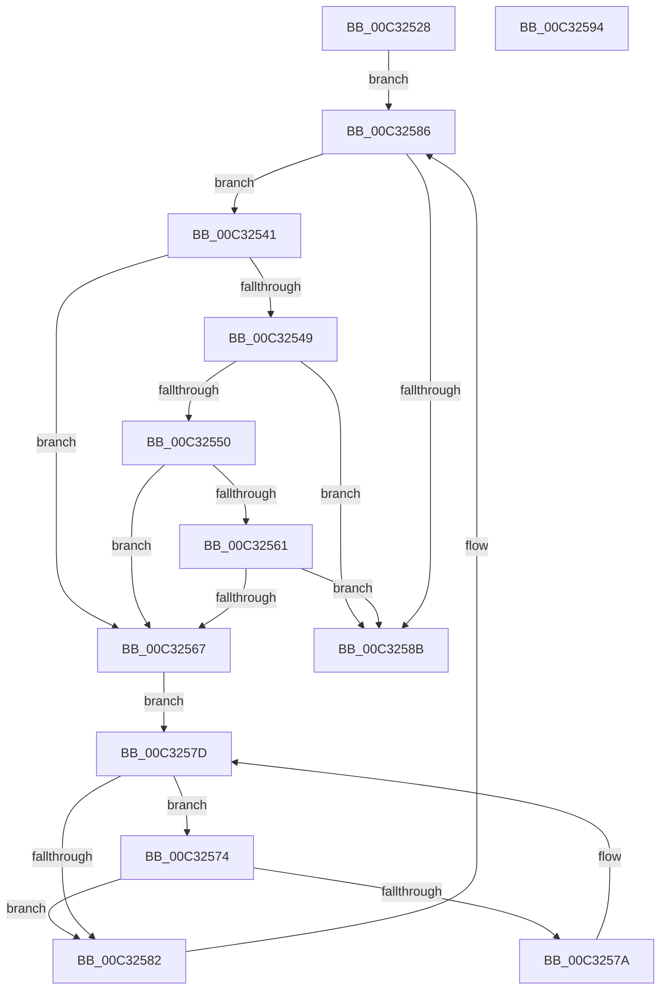

# PipSmBiosFindStruct

- RVA: `0x00C32528`–`0x00C32595` (길이 `109` bytes)
- VA: `0x0000000140C32528`
- 실행 섹션: `INIT`
- PDB 이름 있음: `예`; PDB Function 태그: `아니요`
- unwind 정보 RVA: `0x00071750`
- 디코드: `37`개 명령, `109/109` bytes 표시
- 미해석 바이트: `0` (있으면 어셈블리에 `.byte`로 보존)

> 이 문서는 커널 이미지의 기계어와 PDB 기호를 분석해 생성했습니다. 4번과 5번은 함수 원형과 자료형을 바이너리 사용 방식에서 추정한 C 해석이며 원본 소스 복구 결과는 아닙니다.

## 1. Dependencies

- 직접 호출 지점: **0**; 고유 호출 대상: **0**
- 직접 호출자로 확인된 함수: **1**
- RIP 상대 이미지 참조: **0**

### Outgoing calls
- 직접 디코드된 call 명령이 없습니다.

### Direct callers
- [PipInitComputerIds](../C7/PipInitComputerIds_function_00C74734.md) at `0x00C7494E`
- [PipInitComputerIds](../C7/PipInitComputerIds_function_00C74734.md) at `0x00C74ABA`
- [PipInitComputerIds](../C7/PipInitComputerIds_function_00C74734.md) at `0x00C74B5B`
- [PipInitComputerIds](../C7/PipInitComputerIds_function_00C74734.md) at `0x00C74C64`

### Static image references
- 디코드된 RIP-relative 메모리 참조가 없습니다.

## 2. Other-region calls and transfers

- 다른 실행 섹션으로 향하는 call: **0**
- 별도 외부 분기/꼬리 이동을 확인하지 못했습니다.

## 3. Assembly (complete function range)

```asm
00C32528  48 89 5C 24 08                  mov qword ptr [rsp + 8], rbx
00C3252D  45 8B C9                        mov r9d, r9d
00C32530  33 DB                           xor ebx, ebx
00C32532  49 83 C1 FE                     add r9, -2
00C32536  44 8A D9                        mov r11b, cl
00C32539  4D 03 C8                        add r9, r8
00C3253C  44 8B D3                        mov r10d, ebx
00C3253F  EB 45                           jmp 0x140c32586
00C32541  41 8A 00                        mov al, byte ptr [r8]
00C32544  41 3A C3                        cmp al, r11b
00C32547  75 1E                           jne 0x140c32567
00C32549  4D 8B D0                        mov r10, r8
00C3254C  3C 02                           cmp al, 2
00C3254E  75 3B                           jne 0x140c3258b
00C32550  41 0F B6 48 01                  movzx ecx, byte ptr [r8 + 1]
00C32555  49 8D 40 0E                     lea rax, [r8 + 0xe]
00C32559  49 03 C8                        add rcx, r8
00C3255C  48 3B C1                        cmp rax, rcx
00C3255F  77 06                           ja 0x140c32567
00C32561  41 38 50 0D                     cmp byte ptr [r8 + 0xd], dl
00C32565  74 24                           je 0x140c3258b
00C32567  41 0F B6 40 01                  movzx eax, byte ptr [r8 + 1]
00C3256C  4C 8B D3                        mov r10, rbx
00C3256F  4C 03 C0                        add r8, rax
00C32572  EB 09                           jmp 0x140c3257d
00C32574  66 41 39 18                     cmp word ptr [r8], bx
00C32578  74 08                           je 0x140c32582
00C3257A  49 FF C0                        inc r8
00C3257D  4D 3B C1                        cmp r8, r9
00C32580  72 F2                           jb 0x140c32574
00C32582  49 83 C0 02                     add r8, 2
00C32586  4D 3B C1                        cmp r8, r9
00C32589  72 B6                           jb 0x140c32541
00C3258B  48 8B 5C 24 08                  mov rbx, qword ptr [rsp + 8]
00C32590  49 8B C2                        mov rax, r10
00C32593  C3                              ret
00C32594  CC                              int3
```

## 4. C-style interpretation (structured pseudocode)

```c
__int64 __fastcall PipSmBiosFindStruct(unsigned __int8 a1, unsigned __int8 a2, __int64 a3, int a4)
{
    __int64 v_rbx;
    unsigned __int64 v_stack_p8;

    v_stack_p8 = v_rbx;
    v_rbx = 0;
    a4 = ((unsigned int)(a4)) + (-2);
    a4 = (a4) + (a3);
    goto loc_00C32586;
loc_00C32541:
    if (((unsigned __int8)(*(unsigned __int8 *)(a3))) != a1) goto loc_00C32567;
    if (((unsigned __int8)(*(unsigned __int8 *)(a3))) != 2) goto loc_00C3258B;
    a1 = (*(unsigned __int8 *)(a3 + 1)) + (a3);
    if ((a3 + 14) > a1) goto loc_00C32567;
    if ((*(unsigned __int8 *)(a3 + 13)) == a2) goto loc_00C3258B;
loc_00C32567:
    a3 = (a3) + (*(unsigned __int8 *)(a3 + 1));
    goto loc_00C3257D;
loc_00C32574:
    if ((*(unsigned __int16 *)(a3)) == 0) goto loc_00C32582;
    a3 = (a3) + 1;
loc_00C3257D:
    if (a3 < a4) goto loc_00C32574;
loc_00C32582:
    a3 = (a3) + (2);
loc_00C32586:
    if (a3 < a4) goto loc_00C32541;
loc_00C3258B:
    return 0;
}
```

## 5. (Beta) C Style

```c
int64_t PipSmBiosFindStruct(uint8_t Arg1, uint8_t Arg2, int64_t Arg3, int32_t Arg4)
{
    int64_t local_rbx;
    uint64_t v_stack_p8;

    v_stack_p8 = local_rbx;
    local_rbx = 0;
    Arg4 = ((uint32_t)(Arg4)) + (-2);
    Arg4 = (Arg4) + (Arg3);
    goto loc_00C32586;
loc_00C32541:
    if (((uint8_t)(*(uint8_t *)(Arg3))) != Arg1) goto loc_00C32567;
    if (((uint8_t)(*(uint8_t *)(Arg3))) != 2) goto loc_00C3258B;
    Arg1 = (*(uint8_t *)(Arg3 + 0x1)) + (Arg3);
    if ((Arg3 + 14) > Arg1) goto loc_00C32567;
    if ((*(uint8_t *)(Arg3 + 0xD)) == Arg2) goto loc_00C3258B;
loc_00C32567:
    Arg3 = (Arg3) + (*(uint8_t *)(Arg3 + 0x1));
    goto loc_00C3257D;
loc_00C32574:
    if ((*(uint16_t *)(Arg3)) == 0) goto loc_00C32582;
    Arg3 = (Arg3) + 1;
loc_00C3257D:
    if (Arg3 < Arg4) goto loc_00C32574;
loc_00C32582:
    Arg3 = (Arg3) + (2);
loc_00C32586:
    if (Arg3 < Arg4) goto loc_00C32541;
loc_00C3258B:
    return 0;
}
```

## 6. Execution-region graph

[열기: 2D/3D 그래프와 함수 탐색 컨트롤 패널](../../../control-panel.html?section=init&rva=0x00C32528&view=graph)

- 2D 그래프는 위에서 아래로 흐르고, 3D 그래프는 빈 공간을 드래그해 회전합니다. Shift+드래그는 이동, 휠은 확대·축소, 함수 노드 선택은 대상 보고서 이동입니다.

### Static fallback


