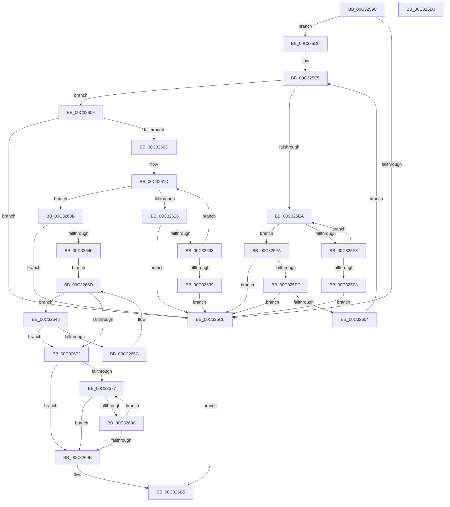

# PipSmBiosGetString

- RVA: `0x00C3259C`–`0x00C326D1` (길이 `309` bytes)
- VA: `0x0000000140C3259C`
- 실행 섹션: `INIT`
- PDB 이름 있음: `예`; PDB Function 태그: `아니요`
- unwind 정보 RVA: `0x0005D7BC`
- 디코드: `93`개 명령, `309/309` bytes 표시
- 미해석 바이트: `0` (있으면 어셈블리에 `.byte`로 보존)

> 이 문서는 커널 이미지의 기계어와 PDB 기호를 분석해 생성했습니다. 4번과 5번은 함수 원형과 자료형을 바이너리 사용 방식에서 추정한 C 해석이며 원본 소스 복구 결과는 아닙니다.

## 1. Dependencies

- 직접 호출 지점: **3**; 고유 호출 대상: **2**
- 직접 호출자로 확인된 함수: **1**
- RIP 상대 이미지 참조: **1**

### Outgoing calls
- `0x00C32652` → [strchr](../../text/50/strchr_function_005014F0.md) (function, `0x005014F0`)
- `0x00C32686` → [strchr](../../text/50/strchr_function_005014F0.md) (function, `0x005014F0`)
- `0x00C326B0` → [RtlAnsiStringToUnicodeString](../../page/90/RtlAnsiStringToUnicodeString_function_0090BEA0.md) (function, `0x0090BEA0`)

### Direct callers
- [PipInitComputerIds](../C7/PipInitComputerIds_function_00C74734.md) at `0x00C74984`
- [PipInitComputerIds](../C7/PipInitComputerIds_function_00C74734.md) at `0x00C749C7`
- [PipInitComputerIds](../C7/PipInitComputerIds_function_00C74734.md) at `0x00C74A06`
- [PipInitComputerIds](../C7/PipInitComputerIds_function_00C74734.md) at `0x00C74A53`
- [PipInitComputerIds](../C7/PipInitComputerIds_function_00C74734.md) at `0x00C74A92`
- [PipInitComputerIds](../C7/PipInitComputerIds_function_00C74734.md) at `0x00C74AF3`
- [PipInitComputerIds](../C7/PipInitComputerIds_function_00C74734.md) at `0x00C74B36`
- [PipInitComputerIds](../C7/PipInitComputerIds_function_00C74734.md) at `0x00C74B94`
- [PipInitComputerIds](../C7/PipInitComputerIds_function_00C74734.md) at `0x00C74BD7`
- [PipInitComputerIds](../C7/PipInitComputerIds_function_00C74734.md) at `0x00C74C1A`

### Static image references
- `0x00C3264B` → RVA `0x00027AD8` (`.rdata`; read)

## 2. Other-region calls and transfers

- 다른 실행 섹션으로 향하는 call: **3**
  - `0x00C32652` → [strchr](../../text/50/strchr_function_005014F0.md) (`INIT` → `.text`)
  - `0x00C32686` → [strchr](../../text/50/strchr_function_005014F0.md) (`INIT` → `.text`)
  - `0x00C326B0` → [RtlAnsiStringToUnicodeString](../../page/90/RtlAnsiStringToUnicodeString_function_0090BEA0.md) (`INIT` → `PAGE`)
- 별도 외부 분기/꼬리 이동을 확인하지 못했습니다.

## 3. Assembly (complete function range)

```asm
00C3259C  48 8B C4                        mov rax, rsp
00C3259F  48 89 58 08                     mov qword ptr [rax + 8], rbx
00C325A3  48 89 68 10                     mov qword ptr [rax + 0x10], rbp
00C325A7  48 89 70 18                     mov qword ptr [rax + 0x18], rsi
00C325AB  48 89 78 20                     mov qword ptr [rax + 0x20], rdi
00C325AF  41 56                           push r14
00C325B1  48 83 EC 30                     sub rsp, 0x30
00C325B5  33 F6                           xor esi, esi
00C325B7  44 0F B6 D2                     movzx r10d, dl
00C325BB  0F 57 C0                        xorps xmm0, xmm0
00C325BE  0F 11 40 E8                     movups xmmword ptr [rax - 0x18], xmm0
00C325C2  84 D2                           test dl, dl
00C325C4  75 0A                           jne 0x140c325d0
00C325C6  B8 25 02 00 C0                  mov eax, 0xc0000225
00C325CB  E9 E5 00 00 00                  jmp 0x140c326b5
00C325D0  0F B6 59 01                     movzx ebx, byte ptr [rcx + 1]
00C325D4  41 8D 51 FF                     lea edx, [r9 - 1]
00C325D8  48 03 D9                        add rbx, rcx
00C325DB  BD 01 00 00 00                  mov ebp, 1
00C325E0  49 03 D0                        add rdx, r8
00C325E3  8B CD                           mov ecx, ebp
00C325E5  41 3B CA                        cmp ecx, r10d
00C325E8  73 1E                           jae 0x140c32608
00C325EA  8A 03                           mov al, byte ptr [rbx]
00C325EC  48 03 DD                        add rbx, rbp
00C325EF  84 C0                           test al, al
00C325F1  74 07                           je 0x140c325fa
00C325F3  48 3B DA                        cmp rbx, rdx
00C325F6  72 F2                           jb 0x140c325ea
00C325F8  EB CC                           jmp 0x140c325c6
00C325FA  48 85 DB                        test rbx, rbx
00C325FD  74 C7                           je 0x140c325c6
00C325FF  40 38 33                        cmp byte ptr [rbx], sil
00C32602  74 C2                           je 0x140c325c6
00C32604  03 CD                           add ecx, ebp
00C32606  EB DD                           jmp 0x140c325e5
00C32608  48 85 DB                        test rbx, rbx
00C3260B  74 B9                           je 0x140c325c6
00C3260D  48 89 5C 24 28                  mov qword ptr [rsp + 0x28], rbx
00C32612  0F B7 FE                        movzx edi, si
00C32615  66 89 74 24 20                  mov word ptr [rsp + 0x20], si
00C3261A  48 8B CB                        mov rcx, rbx
00C3261D  8A 01                           mov al, byte ptr [rcx]
00C3261F  48 03 CD                        add rcx, rbp
00C32622  84 C0                           test al, al
00C32624  74 15                           je 0x140c3263b
00C32626  66 03 FD                        add di, bp
00C32629  66 89 7C 24 20                  mov word ptr [rsp + 0x20], di
00C3262E  48 3B CA                        cmp rcx, rdx
00C32631  73 93                           jae 0x140c325c6
00C32633  66 83 FF 40                     cmp di, 0x40
00C32637  76 E4                           jbe 0x140c3261d
00C32639  EB 8B                           jmp 0x140c325c6
00C3263B  48 85 C9                        test rcx, rcx
00C3263E  74 86                           je 0x140c325c6
00C32640  41 BE FF FF 00 00               mov r14d, 0xffff
00C32646  EB 25                           jmp 0x140c3266d
00C32648  0F BE 13                        movsx edx, byte ptr [rbx]
00C3264B  48 8D 0D 86 54 3F FF            lea rcx, [rip - 0xc0ab7a]
00C32652  E8 99 EE 8C FF                  call 0x1405014f0
00C32657  48 85 C0                        test rax, rax
00C3265A  74 16                           je 0x140c32672
00C3265C  48 03 DD                        add rbx, rbp
00C3265F  66 41 03 FE                     add di, r14w
00C32663  48 89 5C 24 28                  mov qword ptr [rsp + 0x28], rbx
00C32668  66 89 7C 24 20                  mov word ptr [rsp + 0x20], di
00C3266D  40 38 33                        cmp byte ptr [rbx], sil
00C32670  75 D6                           jne 0x140c32648
00C32672  66 85 FF                        test di, di
00C32675  74 24                           je 0x140c3269b
00C32677  0F B7 C7                        movzx eax, di
00C3267A  48 8D 0D 57 54 3F FF            lea rcx, [rip - 0xc0aba9]
00C32681  0F BE 54 18 FF                  movsx edx, byte ptr [rax + rbx - 1]
00C32686  E8 65 EE 8C FF                  call 0x1405014f0
00C3268B  48 85 C0                        test rax, rax
00C3268E  74 0B                           je 0x140c3269b
00C32690  66 41 03 FE                     add di, r14w
00C32694  66 89 7C 24 20                  mov word ptr [rsp + 0x20], di
00C32699  75 DC                           jne 0x140c32677
00C3269B  48 8B 4C 24 60                  mov rcx, qword ptr [rsp + 0x60]
00C326A0  48 8D 54 24 20                  lea rdx, [rsp + 0x20]
00C326A5  66 03 FD                        add di, bp
00C326A8  44 8A C5                        mov r8b, bpl
00C326AB  66 89 7C 24 22                  mov word ptr [rsp + 0x22], di
00C326B0  E8 EB 97 CD FF                  call 0x14090bea0
00C326B5  48 8B 5C 24 40                  mov rbx, qword ptr [rsp + 0x40]
00C326BA  48 8B 6C 24 48                  mov rbp, qword ptr [rsp + 0x48]
00C326BF  48 8B 74 24 50                  mov rsi, qword ptr [rsp + 0x50]
00C326C4  48 8B 7C 24 58                  mov rdi, qword ptr [rsp + 0x58]
00C326C9  48 83 C4 30                     add rsp, 0x30
00C326CD  41 5E                           pop r14
00C326CF  C3                              ret
00C326D0  CC                              int3
```

## 4. C-style interpretation (structured pseudocode)

```c
__int64 __fastcall PipSmBiosGetString(__int64 a1, unsigned __int8 a2, __int64 a3, __int64 a4, __int64 a5)
{
    __int64 result;
    __int64 v_rbx;
    __int64 v_rdi;
    __int64 v_rsi;
    __int64 v_rsp;
    unsigned __int64 v_stack_m10;
    unsigned __int16 v_stack_m16;
    unsigned __int16 v_stack_m18;
    unsigned __int64 v_stack_p10;
    unsigned __int64 v_stack_p18;
    unsigned __int64 v_stack_p20;
    unsigned __int64 v_stack_p8;

    *(unsigned __int64 *)(v_rsp + 8) = v_rbx;
    *(unsigned __int64 *)(v_rsp + 16) = v_rbp;
    *(unsigned __int64 *)(v_rsp + 24) = v_rsi;
    *(unsigned __int64 *)(v_rsp + 32) = v_rdi;
    v_rsp = (v_rsp) - (48);
    v_rsi = 0;
    *(unsigned __int64 *)(v_rsp - 24) = v_xmm0;
    if (a2 != 0) goto loc_00C325D0;
loc_00C325C6:
    goto loc_00C326B5;
loc_00C325D0:
    v_rbx = (*(unsigned __int8 *)(a1 + 1)) + (a1);
    a2 = (a4 - 1) + (a3);
loc_00C325E5:
    if (1 >= a2) goto loc_00C32608;
loc_00C325EA:
    v_rbx = (v_rbx) + (1);
    if ((unsigned __int8)(*(unsigned __int8 *)(v_rbx)) == 0) goto loc_00C325FA;
    if (v_rbx < a2) goto loc_00C325EA;
    goto loc_00C325C6;
loc_00C325FA:
    if (v_rbx == 0) goto loc_00C325C6;
    if ((*(unsigned __int8 *)(v_rbx)) == 0) goto loc_00C325C6;
    a1 = (unsigned int)((1) + (1));
    goto loc_00C325E5;
loc_00C32608:
    if (v_rbx == 0) goto loc_00C325C6;
    v_stack_m10 = v_rbx;
    v_stack_m18 = 0;
loc_00C3261D:
    a1 = (v_rbx) + (1);
    if ((unsigned __int8)(*(unsigned __int8 *)(v_rbx)) == 0) goto loc_00C3263B;
    v_rdi = (unsigned __int16)((0) + (1));
    v_stack_m18 = (unsigned __int16)(v_rdi);
    if (a1 >= a2) goto loc_00C325C6;
    if (((unsigned __int16)(v_rdi)) <= 64) goto loc_00C3261D;
    goto loc_00C325C6;
loc_00C3263B:
    if (a1 == 0) goto loc_00C325C6;
    goto loc_00C3266D;
loc_00C32648:
    result = strchr(v_rip - 12626810, (__int8)(*(unsigned __int8 *)(v_rbx)), a3, a4);
    if (result == 0) goto loc_00C32672;
    v_rbx = (v_rbx) + (1);
    v_rdi = (unsigned __int16)((v_rdi) + ((unsigned __int16)((unsigned int)(0xFFFFULL))));
    v_stack_m10 = v_rbx;
    v_stack_m18 = (unsigned __int16)(v_rdi);
loc_00C3266D:
    if ((*(unsigned __int8 *)(v_rbx)) != 0) goto loc_00C32648;
loc_00C32672:
    if ((unsigned __int16)(v_rdi) == 0) goto loc_00C3269B;
loc_00C32677:
    result = strchr(v_rip - 12626857, (__int8)(*(unsigned __int8 *)((unsigned __int16)(v_rdi) + v_rbx * 1 - 1)), a3, a4);
    if (result == 0) goto loc_00C3269B;
    v_rdi = (unsigned __int16)((v_rdi) + ((unsigned __int16)((unsigned int)(0xFFFFULL))));
    v_stack_m18 = (unsigned __int16)(v_rdi);
    if (condition_is_not_equal) goto loc_00C32677;
loc_00C3269B:
    v_rdi = (unsigned __int16)((v_rdi) + (1));
    v_stack_m16 = (unsigned __int16)(v_rdi);
    result = RtlAnsiStringToUnicodeString(a5, v_stack_m18, 1, a4);
loc_00C326B5:
    v_rsp = (v_rsp) + (48);
    return result;
}
```

## 5. (Beta) C Style

```c
int64_t PipSmBiosGetString(void *Arg1, uint8_t Arg2, int64_t Arg3, void *Arg4, int64_t Arg5)
{
    uint8_t *arg1 = (uint8_t *)Arg1;
    uint8_t *arg4 = (uint8_t *)Arg4;

    int64_t result;
    int64_t local_rbx;
    int64_t local_rdi;
    int64_t local_rsi;
    int64_t local_rsp;
    uint64_t v_stack_m10;
    uint16_t v_stack_m16;
    uint16_t v_stack_m18;
    uint64_t v_stack_p10;
    uint64_t v_stack_p18;
    uint64_t v_stack_p20;
    uint64_t v_stack_p8;

    *(uint64_t *)(local_rsp + 0x8) = local_rbx;
    *(uint64_t *)(local_rsp + 0x10) = local_rbp;
    *(uint64_t *)(local_rsp + 0x18) = local_rsi;
    *(uint64_t *)(local_rsp + 0x20) = local_rdi;
    local_rsp = (local_rsp) - (48);
    local_rsi = 0;
    *(uint64_t *)(local_rsp - 0x18) = v_xmm0;
    if (Arg2 != 0) goto loc_00C325D0;
loc_00C325C6:
    goto loc_00C326B5;
loc_00C325D0:
    local_rbx = (*(uint8_t *)(arg1 + 0x1)) + (Arg1);
    Arg2 = (Arg4 - 1) + (Arg3);
loc_00C325E5:
    if (1 >= Arg2) goto loc_00C32608;
loc_00C325EA:
    local_rbx = (local_rbx) + (1);
    if ((uint8_t)(*(uint8_t *)(local_rbx)) == 0) goto loc_00C325FA;
    if (local_rbx < Arg2) goto loc_00C325EA;
    goto loc_00C325C6;
loc_00C325FA:
    if (local_rbx == 0) goto loc_00C325C6;
    if ((*(uint8_t *)(local_rbx)) == 0) goto loc_00C325C6;
    Arg1 = (uint32_t)((1) + (1));
    goto loc_00C325E5;
loc_00C32608:
    if (local_rbx == 0) goto loc_00C325C6;
    v_stack_m10 = local_rbx;
    v_stack_m18 = 0;
loc_00C3261D:
    Arg1 = (local_rbx) + (1);
    if ((uint8_t)(*(uint8_t *)(local_rbx)) == 0) goto loc_00C3263B;
    local_rdi = (uint16_t)((0) + (1));
    v_stack_m18 = (uint16_t)(local_rdi);
    if (Arg1 >= Arg2) goto loc_00C325C6;
    if (((uint16_t)(local_rdi)) <= 64) goto loc_00C3261D;
    goto loc_00C325C6;
loc_00C3263B:
    if (Arg1 == NULL) goto loc_00C325C6;
    goto loc_00C3266D;
loc_00C32648:
    result = strchr(v_rip - 12626810, (int8_t)(*(uint8_t *)(local_rbx)), Arg3, Arg4);
    if (result == 0) goto loc_00C32672;
    local_rbx = (local_rbx) + (1);
    local_rdi = (uint16_t)((local_rdi) + ((uint16_t)((uint32_t)(0xFFFFULL))));
    v_stack_m10 = local_rbx;
    v_stack_m18 = (uint16_t)(local_rdi);
loc_00C3266D:
    if ((*(uint8_t *)(local_rbx)) != 0) goto loc_00C32648;
loc_00C32672:
    if ((uint16_t)(local_rdi) == 0) goto loc_00C3269B;
loc_00C32677:
    result = strchr(v_rip - 12626857, (int8_t)(*(uint8_t *)((uint16_t)(local_rdi) + local_rbx * 1 - 0x1)), Arg3, Arg4);
    if (result == 0) goto loc_00C3269B;
    local_rdi = (uint16_t)((local_rdi) + ((uint16_t)((uint32_t)(0xFFFFULL))));
    v_stack_m18 = (uint16_t)(local_rdi);
    if (condition_is_not_equal) goto loc_00C32677;
loc_00C3269B:
    local_rdi = (uint16_t)((local_rdi) + (1));
    v_stack_m16 = (uint16_t)(local_rdi);
    result = RtlAnsiStringToUnicodeString(Arg5, v_stack_m18, 1, Arg4);
loc_00C326B5:
    local_rsp = (local_rsp) + (48);
    return result;
}
```

### 관측된 메모리 오프셋

구조체 형식이 확인되지 않은 접근은 인자 기준의 오프셋으로만 기록했습니다.

| 기준 인자 | 오프셋 표현 | 폭 (bit) | 접근 |
|---|---:|---:|---|
| `Arg1` | `+ 0x1` | `8` | `R` |
| `Arg4` | `- 0x1` | `32` | `R` |

## 6. Execution-region graph

[열기: 2D/3D 그래프와 함수 탐색 컨트롤 패널](../../../control-panel.html?section=init&rva=0x00C3259C&view=graph)

- 2D 그래프는 위에서 아래로 흐르고, 3D 그래프는 빈 공간을 드래그해 회전합니다. Shift+드래그는 이동, 휠은 확대·축소, 함수 노드 선택은 대상 보고서 이동입니다.

### Static fallback


