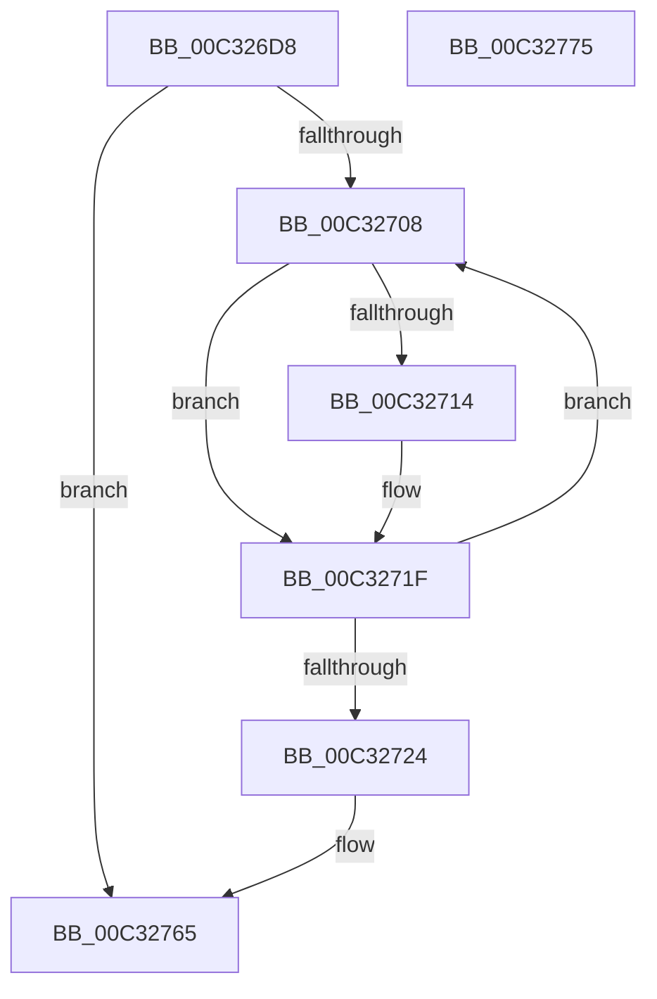

# PipUnloadEarlyLaunchDrivers

- RVA: `0x00C326D8`–`0x00C32776` (길이 `158` bytes)
- VA: `0x0000000140C326D8`
- 실행 섹션: `INIT`
- PDB 이름 있음: `예`; PDB Function 태그: `아니요`
- unwind 정보 RVA: `0x000BE5B4`
- 디코드: `43`개 명령, `158/158` bytes 표시
- 미해석 바이트: `0` (있으면 어셈블리에 `.byte`로 보존)

> 이 문서는 커널 이미지의 기계어와 PDB 기호를 분석해 생성했습니다. 4번과 5번은 함수 원형과 자료형을 바이너리 사용 방식에서 추정한 C 해석이며 원본 소스 복구 결과는 아닙니다.

## 1. Dependencies

- 직접 호출 지점: **3**; 고유 호출 대상: **3**
- 직접 호출자로 확인된 함수: **1**
- RIP 상대 이미지 참조: **1**

### Outgoing calls
- `0x00C3271A` → [IopUnloadDriver](../../page/AB/IopUnloadDriver_function_00ABF868.md) (function, `0x00ABF868`)
- `0x00C3272F` → [RtlInitUnicodeString](../../text/42/RtlInitUnicodeString_function_0042A780.md) (function, `0x0042A780`)
- `0x00C32760` → [ZwUnloadKey2](../../text/6B/ZwUnloadKey2_function_006B0C50.md) (function, `0x006B0C50`)

### Direct callers
- [IopInitializeBootDrivers](../C2/IopInitializeBootDrivers_function_00C2E6F4.md) at `0x00C2ED46`

### Static image references
- `0x00C32724` → RVA `0x00C7A1C0` (` ?? ::PBOPGDP::`string'`; read)

## 2. Other-region calls and transfers

- 다른 실행 섹션으로 향하는 call: **3**
  - `0x00C3271A` → [IopUnloadDriver](../../page/AB/IopUnloadDriver_function_00ABF868.md) (`INIT` → `PAGE`)
  - `0x00C3272F` → [RtlInitUnicodeString](../../text/42/RtlInitUnicodeString_function_0042A780.md) (`INIT` → `.text`)
  - `0x00C32760` → [ZwUnloadKey2](../../text/6B/ZwUnloadKey2_function_006B0C50.md) (`INIT` → `.text`)
- 별도 외부 분기/꼬리 이동을 확인하지 못했습니다.

## 3. Assembly (complete function range)

```asm
00C326D8  48 89 5C 24 08                  mov qword ptr [rsp + 8], rbx
00C326DD  48 89 7C 24 10                  mov qword ptr [rsp + 0x10], rdi
00C326E2  55                              push rbp
00C326E3  48 8B EC                        mov rbp, rsp
00C326E6  48 83 EC 60                     sub rsp, 0x60
00C326EA  33 C0                           xor eax, eax
00C326EC  48 8D 79 40                     lea rdi, [rcx + 0x40]
00C326F0  21 45 EC                        and dword ptr [rbp - 0x14], eax
00C326F3  0F 57 C0                        xorps xmm0, xmm0
00C326F6  48 8B 1F                        mov rbx, qword ptr [rdi]
00C326F9  89 45 D4                        mov dword ptr [rbp - 0x2c], eax
00C326FC  21 45 D4                        and dword ptr [rbp - 0x2c], eax
00C326FF  0F 11 45 C0                     movups xmmword ptr [rbp - 0x40], xmm0
00C32703  48 3B DF                        cmp rbx, rdi
00C32706  74 5D                           je 0x140c32765
00C32708  48 8B CB                        mov rcx, rbx
00C3270B  48 8B 1B                        mov rbx, qword ptr [rbx]
00C3270E  83 79 38 00                     cmp dword ptr [rcx + 0x38], 0
00C32712  7C 0B                           jl 0x140c3271f
00C32714  48 83 C1 20                     add rcx, 0x20
00C32718  B2 01                           mov dl, 1
00C3271A  E8 49 D1 E8 FF                  call 0x140abf868
00C3271F  48 3B DF                        cmp rbx, rdi
00C32722  75 E4                           jne 0x140c32708
00C32724  48 8D 15 95 7A 04 00            lea rdx, [rip + 0x47a95]
00C3272B  48 8D 4D C0                     lea rcx, [rbp - 0x40]
00C3272F  E8 4C 80 7F FF                  call 0x14042a780
00C32734  48 83 65 D8 00                  and qword ptr [rbp - 0x28], 0
00C32739  48 8D 45 C0                     lea rax, [rbp - 0x40]
00C3273D  0F 57 C0                        xorps xmm0, xmm0
00C32740  48 89 45 E0                     mov qword ptr [rbp - 0x20], rax
00C32744  BA 01 00 00 00                  mov edx, 1
00C32749  C7 45 D0 30 00 00 00            mov dword ptr [rbp - 0x30], 0x30
00C32750  48 8D 4D D0                     lea rcx, [rbp - 0x30]
00C32754  C7 45 E8 40 02 00 00            mov dword ptr [rbp - 0x18], 0x240
00C3275B  F3 0F 7F 45 F0                  movdqu xmmword ptr [rbp - 0x10], xmm0
00C32760  E8 EB E4 A7 FF                  call 0x1406b0c50
00C32765  48 8B 5C 24 70                  mov rbx, qword ptr [rsp + 0x70]
00C3276A  48 8B 7C 24 78                  mov rdi, qword ptr [rsp + 0x78]
00C3276F  48 83 C4 60                     add rsp, 0x60
00C32773  5D                              pop rbp
00C32774  C3                              ret
00C32775  CC                              int3
```

## 4. C-style interpretation (structured pseudocode)

```c
__int64 __fastcall PipUnloadEarlyLaunchDrivers(__int64 a1)
{
    __int64 result;
    __int64 v_rsp;
    unsigned __int64 v_stack_m18;
    unsigned int v_stack_m1C;
    unsigned int v_stack_m20;
    unsigned __int64 v_stack_m28;
    unsigned __int64 v_stack_m30;
    unsigned int v_stack_m34;
    unsigned int v_stack_m38;
    unsigned __int64 v_stack_m48;
    unsigned __int64 v_stack_p10;
    unsigned __int64 v_stack_p8;

    v_stack_p8 = v_rbx;
    v_stack_p10 = v_rdi;
    v_rsp = (v_rsp) - (96);
    result = 0;
    v_stack_m34 = 0;
    v_stack_m48 = v_xmm0;
    if ((*(unsigned __int64 *)(a1 + 64)) == (a1 + 64)) goto loc_00C32765;
loc_00C32708:
    if ((*(unsigned int *)(*(unsigned __int64 *)(a1 + 64) + 56)) >= 0) {
        a1 = (*(unsigned __int64 *)(a1 + 64)) + (32);
        a2 = 1;
        result = IopUnloadDriver(a1, a2, a3, a4);
    }
    if ((*(unsigned __int64 *)(*(unsigned __int64 *)(a1 + 64))) != (a1 + 64)) goto loc_00C32708;
    result = RtlInitUnicodeString(v_stack_m48, v_rip + 293525, a3, a4);
    v_stack_m28 = v_stack_m48;
    v_stack_m38 = 48;
    v_stack_m20 = 576;
    v_stack_m18 = v_xmm0;
    result = ZwUnloadKey2(v_stack_m38, 1, a3, a4);
loc_00C32765:
    v_rsp = (v_rsp) + (96);
    return result;
}
```

## 5. (Beta) C Style

```c
int64_t PipUnloadEarlyLaunchDrivers(void *Arg1)
{
    uint8_t *arg1 = (uint8_t *)Arg1;

    int64_t result;
    int64_t local_rsp;
    uint64_t v_stack_m18;
    uint32_t v_stack_m1C;
    uint32_t v_stack_m20;
    uint64_t v_stack_m28;
    uint64_t v_stack_m30;
    uint32_t v_stack_m34;
    uint32_t v_stack_m38;
    uint64_t v_stack_m48;
    uint64_t v_stack_p10;
    uint64_t v_stack_p8;

    v_stack_p8 = local_rbx;
    v_stack_p10 = local_rdi;
    local_rsp = (local_rsp) - (96);
    result = 0;
    v_stack_m34 = 0;
    v_stack_m48 = v_xmm0;
    if ((*(uint64_t *)(arg1 + 0x40)) == (Arg1 + 64)) goto loc_00C32765;
loc_00C32708:
    if ((*(uint32_t *)(*(uint64_t *)(arg1 + 0x40) + 0x38)) >= 0) {
        Arg1 = (*(uint64_t *)(arg1 + 0x40)) + (32);
        a2 = 1;
        result = IopUnloadDriver(Arg1, a2, a3, a4);
    }
    if ((*(uint64_t *)(*(uint64_t *)(arg1 + 0x40))) != (Arg1 + 64)) goto loc_00C32708;
    result = RtlInitUnicodeString(v_stack_m48, v_rip + 293525, a3, a4);
    v_stack_m28 = v_stack_m48;
    v_stack_m38 = 48;
    v_stack_m20 = 576;
    v_stack_m18 = v_xmm0;
    result = ZwUnloadKey2(v_stack_m38, 1, a3, a4);
loc_00C32765:
    local_rsp = (local_rsp) + (96);
    return result;
}
```

### 관측된 메모리 오프셋

구조체 형식이 확인되지 않은 접근은 인자 기준의 오프셋으로만 기록했습니다.

| 기준 인자 | 오프셋 표현 | 폭 (bit) | 접근 |
|---|---:|---:|---|
| `Arg1` | `+ 0x0` | `64` | `R` |
| `Arg1` | `+ 0x40` | `64` | `R` |

## 6. Execution-region graph

[열기: 2D/3D 그래프와 함수 탐색 컨트롤 패널](../../../control-panel.html?section=init&rva=0x00C326D8&view=graph)

- 2D 그래프는 위에서 아래로 흐르고, 3D 그래프는 빈 공간을 드래그해 회전합니다. Shift+드래그는 이동, 휠은 확대·축소, 함수 노드 선택은 대상 보고서 이동입니다.

### Static fallback


