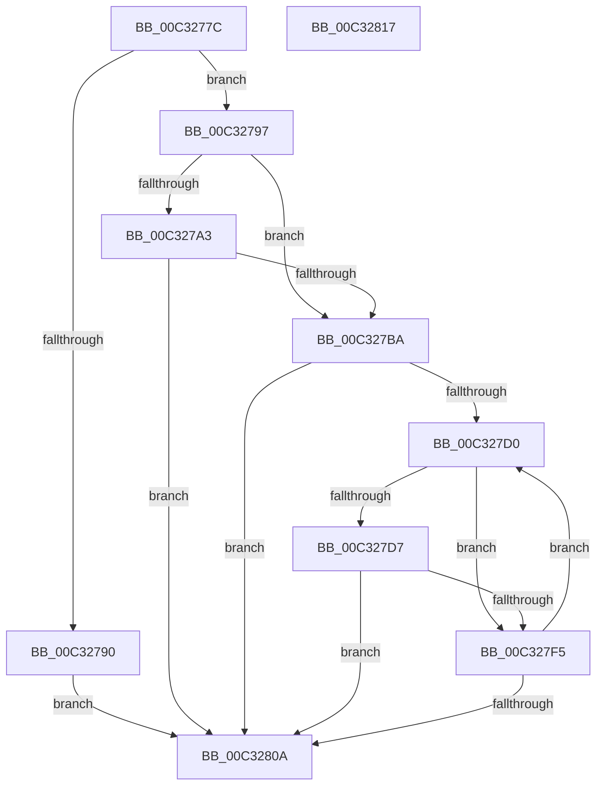

# PipWaitCriticalDevices

- RVA: `0x00C3277C`–`0x00C32818` (길이 `156` bytes)
- VA: `0x0000000140C3277C`
- 실행 섹션: `INIT`
- PDB 이름 있음: `예`; PDB Function 태그: `아니요`
- unwind 정보 RVA: `0x0005CAAC`
- 디코드: `45`개 명령, `156/156` bytes 표시
- 미해석 바이트: `0` (있으면 어셈블리에 `.byte`로 보존)

> 이 문서는 커널 이미지의 기계어와 PDB 기호를 분석해 생성했습니다. 4번과 5번은 함수 원형과 자료형을 바이너리 사용 방식에서 추정한 C 해석이며 원본 소스 복구 결과는 아닙니다.

## 1. Dependencies

- 직접 호출 지점: **2**; 고유 호출 대상: **1**
- 직접 호출자로 확인된 함수: **1**
- RIP 상대 이미지 참조: **1**

### Outgoing calls
- `0x00C327AF` → [PnpBootDeviceWait](../../text/5A/PnpBootDeviceWait_function_005A4D68.md) (function, `0x005A4D68`)
- `0x00C327EA` → [PnpBootDeviceWait](../../text/5A/PnpBootDeviceWait_function_005A4D68.md) (function, `0x005A4D68`)

### Direct callers
- [IopInitializeBootDrivers](../C2/IopInitializeBootDrivers_function_00C2E6F4.md) at `0x00C2EF82`

### Static image references
- `0x00C327A3` → RVA `0x00C30890` (`PipCriticalDeviceWaitCallback`; read)

## 2. Other-region calls and transfers

- 다른 실행 섹션으로 향하는 call: **2**
  - `0x00C327AF` → [PnpBootDeviceWait](../../text/5A/PnpBootDeviceWait_function_005A4D68.md) (`INIT` → `.text`)
  - `0x00C327EA` → [PnpBootDeviceWait](../../text/5A/PnpBootDeviceWait_function_005A4D68.md) (`INIT` → `.text`)
- 별도 외부 분기/꼬리 이동을 확인하지 못했습니다.

## 3. Assembly (complete function range)

```asm
00C3277C  48 89 5C 24 08                  mov qword ptr [rsp + 8], rbx
00C32781  57                              push rdi
00C32782  48 83 EC 20                     sub rsp, 0x20
00C32786  33 D2                           xor edx, edx
00C32788  48 8B D9                        mov rbx, rcx
00C3278B  48 85 C9                        test rcx, rcx
00C3278E  75 07                           jne 0x140c32797
00C32790  BA 0D 00 00 C0                  mov edx, 0xc000000d
00C32795  EB 73                           jmp 0x140c3280a
00C32797  4C 8B 89 50 01 00 00            mov r9, qword ptr [rcx + 0x150]
00C3279E  4D 85 C9                        test r9, r9
00C327A1  74 17                           je 0x140c327ba
00C327A3  4C 8D 05 E6 E0 FF FF            lea r8, [rip - 0x1f1a]
00C327AA  BA 03 00 00 00                  mov edx, 3
00C327AF  E8 B4 25 97 FF                  call 0x1405a4d68
00C327B4  8B D0                           mov edx, eax
00C327B6  85 C0                           test eax, eax
00C327B8  78 50                           js 0x140c3280a
00C327BA  48 8B 8B F0 00 00 00            mov rcx, qword ptr [rbx + 0xf0]
00C327C1  48 81 C1 38 01 00 00            add rcx, 0x138
00C327C8  48 8B 39                        mov rdi, qword ptr [rcx]
00C327CB  48 3B F9                        cmp rdi, rcx
00C327CE  74 3A                           je 0x140c3280a
00C327D0  8B 47 18                        mov eax, dword ptr [rdi + 0x18]
00C327D3  84 C0                           test al, al
00C327D5  79 1E                           jns 0x140c327f5
00C327D7  4C 8B 4F 58                     mov r9, qword ptr [rdi + 0x58]
00C327DB  4C 8D 05 AE E0 FF FF            lea r8, [rip - 0x1f52]
00C327E2  BA 04 00 00 00                  mov edx, 4
00C327E7  48 8B CB                        mov rcx, rbx
00C327EA  E8 79 25 97 FF                  call 0x1405a4d68
00C327EF  8B D0                           mov edx, eax
00C327F1  85 C0                           test eax, eax
00C327F3  78 15                           js 0x140c3280a
00C327F5  48 8B 83 F0 00 00 00            mov rax, qword ptr [rbx + 0xf0]
00C327FC  48 8B 3F                        mov rdi, qword ptr [rdi]
00C327FF  48 05 38 01 00 00               add rax, 0x138
00C32805  48 3B F8                        cmp rdi, rax
00C32808  75 C6                           jne 0x140c327d0
00C3280A  48 8B 5C 24 30                  mov rbx, qword ptr [rsp + 0x30]
00C3280F  8B C2                           mov eax, edx
00C32811  48 83 C4 20                     add rsp, 0x20
00C32815  5F                              pop rdi
00C32816  C3                              ret
00C32817  CC                              int3
```

## 4. C-style interpretation (structured pseudocode)

```c
__int64 __fastcall PipWaitCriticalDevices(__int64 a1, int a2)
{
    __int64 result;
    __int64 v_rsp;
    unsigned __int64 v_stack_p8;

    v_stack_p8 = v_rbx;
    v_rsp = (v_rsp) - (32);
    a2 = 0;
    if (a1 != 0) goto loc_00C32797;
    goto loc_00C3280A;
loc_00C32797:
    if (*(unsigned __int64 *)(a1 + 336) == 0) goto loc_00C327BA;
    result = PnpBootDeviceWait(a1, 3, v_rip - 7962, *(unsigned __int64 *)(a1 + 336));
    if (sign_flag) goto loc_00C3280A;
loc_00C327BA:
    a1 = (*(unsigned __int64 *)(a1 + 240)) + (312);
    if ((*(unsigned __int64 *)(a1)) == a1) goto loc_00C3280A;
loc_00C327D0:
    if (!sign_flag) goto loc_00C327F5;
    result = PnpBootDeviceWait(a1, 4, v_rip - 8018, *(unsigned __int64 *)(*(unsigned __int64 *)(a1) + 88));
    if (sign_flag) goto loc_00C3280A;
loc_00C327F5:
    result = (*(unsigned __int64 *)(a1 + 240)) + (312);
    if ((*(unsigned __int64 *)(*(unsigned __int64 *)(a1))) != result) goto loc_00C327D0;
loc_00C3280A:
    v_rsp = (v_rsp) + (32);
    return (unsigned int)((unsigned int)((unsigned int)((unsigned int)(result))));
}
```

## 5. (Beta) C Style

```c
int64_t PipWaitCriticalDevices(void *Arg1, int32_t Arg2)
{
    uint8_t *arg1 = (uint8_t *)Arg1;

    int64_t result;
    int64_t local_rsp;
    uint64_t v_stack_p8;

    v_stack_p8 = local_rbx;
    local_rsp = (local_rsp) - (32);
    Arg2 = 0;
    if (Arg1 != NULL) goto loc_00C32797;
    goto loc_00C3280A;
loc_00C32797:
    if (*(uint64_t *)(arg1 + 0x150) == 0) goto loc_00C327BA;
    result = PnpBootDeviceWait(Arg1, 3, v_rip - 7962, *(uint64_t *)(arg1 + 0x150));
    if (sign_flag) goto loc_00C3280A;
loc_00C327BA:
    Arg1 = (*(uint64_t *)(arg1 + 0xF0)) + (312);
    if ((*(uint64_t *)(arg1)) == Arg1) goto loc_00C3280A;
loc_00C327D0:
    if (!sign_flag) goto loc_00C327F5;
    result = PnpBootDeviceWait(Arg1, 4, v_rip - 8018, *(uint64_t *)(*(uint64_t *)(arg1) + 0x58));
    if (sign_flag) goto loc_00C3280A;
loc_00C327F5:
    result = (*(uint64_t *)(arg1 + 0xF0)) + (312);
    if ((*(uint64_t *)(*(uint64_t *)(arg1))) != result) goto loc_00C327D0;
loc_00C3280A:
    local_rsp = (local_rsp) + (32);
    return (uint32_t)((uint32_t)((uint32_t)((uint32_t)(result))));
}
```

### 관측된 메모리 오프셋

구조체 형식이 확인되지 않은 접근은 인자 기준의 오프셋으로만 기록했습니다.

| 기준 인자 | 오프셋 표현 | 폭 (bit) | 접근 |
|---|---:|---:|---|
| `Arg1` | `+ 0xF0` | `64` | `R` |

## 6. Execution-region graph

[열기: 2D/3D 그래프와 함수 탐색 컨트롤 패널](../../../control-panel.html?section=init&rva=0x00C3277C&view=graph)

- 2D 그래프는 위에서 아래로 흐르고, 3D 그래프는 빈 공간을 드래그해 회전합니다. Shift+드래그는 이동, 휠은 확대·축소, 함수 노드 선택은 대상 보고서 이동입니다.

### Static fallback


