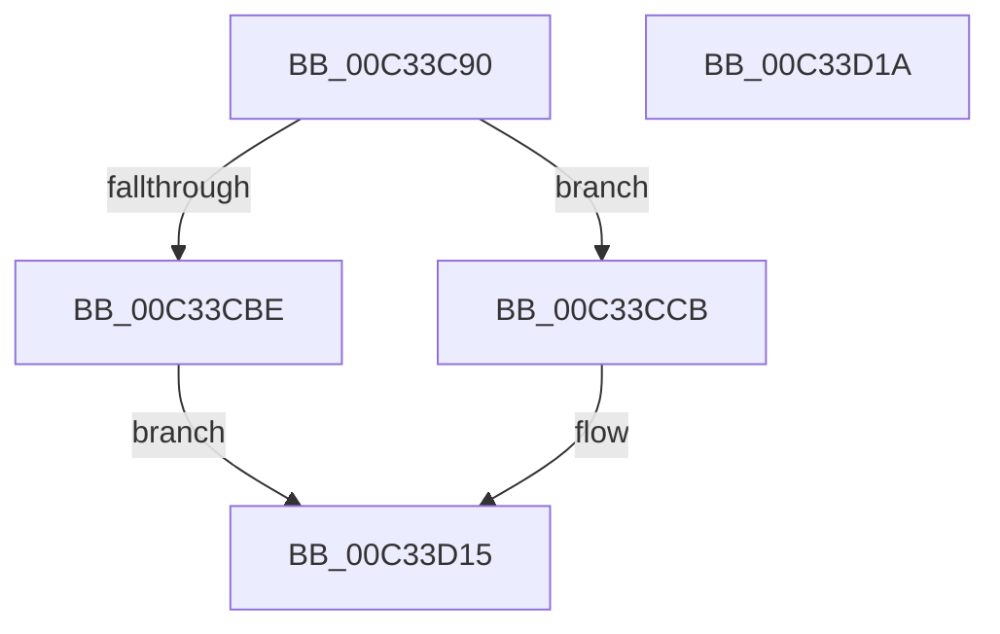

# PnpBusTypeGuidInitialize

- RVA: `0x00C33C90`–`0x00C33D1B` (길이 `139` bytes)
- VA: `0x0000000140C33C90`
- 실행 섹션: `INIT`
- PDB 이름 있음: `예`; PDB Function 태그: `아니요`
- unwind 정보 RVA: `0x0005C788`
- 디코드: `27`개 명령, `139/139` bytes 표시
- 미해석 바이트: `0` (있으면 어셈블리에 `.byte`로 보존)

> 이 문서는 커널 이미지의 기계어와 PDB 기호를 분석해 생성했습니다. 4번과 5번은 함수 원형과 자료형을 바이너리 사용 방식에서 추정한 C 해석이며 원본 소스 복구 결과는 아닙니다.

## 1. Dependencies

- 직접 호출 지점: **1**; 고유 호출 대상: **1**
- 직접 호출자로 확인된 함수: **1**
- RIP 상대 이미지 참조: **12**

### Outgoing calls
- `0x00C33CAB` → [ExAllocatePool2](../../poolcode/B8/ExAllocatePool2_function_00B820F0.md) (function, `0x00B820F0`)

### Direct callers
- [IopInitializePlugPlayServices](../C2/IopInitializePlugPlayServices_function_00C2F298.md) at `0x00C2FE02`

### Static image references
- `0x00C33C99` → RVA `0x00F8CC38` (`.data`; write)
- `0x00C33CB2` → RVA `0x00F8CB30` (`.data`; write)
- `0x00C33CCB` → RVA `0x00F8CC20` (`.data`; read)
- `0x00C33CD2` → RVA `0x00F8CB28` (`.data`; write)
- `0x00C33CD8` → RVA `0x00F8CC28` (`.data`; write)
- `0x00C33CDF` → RVA `0x00F8CC20` (`.data`; write)
- `0x00C33CE8` → RVA `0x00F8CC00` (`.data`; write)
- `0x00C33CF2` → RVA `0x00F8CC08` (`.data`; write)
- `0x00C33CF9` → RVA `0x00F8CC10` (`.data`; write)
- `0x00C33CFF` → RVA `0x00F8CC18` (`.data`; write)
- `0x00C33D08` → RVA `0x00F8CC1A` (`.data`; write)
- `0x00C33D0F` → RVA `0x00F8CC1C` (`.data`; write)

## 2. Other-region calls and transfers

- 다른 실행 섹션으로 향하는 call: **1**
  - `0x00C33CAB` → [ExAllocatePool2](../../poolcode/B8/ExAllocatePool2_function_00B820F0.md) (`INIT` → `POOLCODE`)
- 별도 외부 분기/꼬리 이동을 확인하지 못했습니다.

## 3. Assembly (complete function range)

```asm
00C33C90  48 83 EC 28                     sub rsp, 0x28
00C33C94  B9 00 01 00 00                  mov ecx, 0x100
00C33C99  C7 05 95 8F 35 00 10 00 00 00   mov dword ptr [rip + 0x358f95], 0x10
00C33CA3  8B D1                           mov edx, ecx
00C33CA5  41 B8 50 70 73 75               mov r8d, 0x75737050
00C33CAB  E8 40 E4 F4 FF                  call 0x140b820f0
00C33CB0  33 C9                           xor ecx, ecx
00C33CB2  48 89 05 77 8E 35 00            mov qword ptr [rip + 0x358e77], rax
00C33CB9  48 85 C0                        test rax, rax
00C33CBC  75 0D                           jne 0x140c33ccb
00C33CBE  89 0D 74 8F 35 00               mov dword ptr [rip + 0x358f74], ecx
00C33CC4  B8 9A 00 00 C0                  mov eax, 0xc000009a
00C33CC9  EB 4A                           jmp 0x140c33d15
00C33CCB  48 8D 05 4E 8F 35 00            lea rax, [rip + 0x358f4e]
00C33CD2  89 0D 50 8E 35 00               mov dword ptr [rip + 0x358e50], ecx
00C33CD8  48 89 05 49 8F 35 00            mov qword ptr [rip + 0x358f49], rax
00C33CDF  48 89 05 3A 8F 35 00            mov qword ptr [rip + 0x358f3a], rax
00C33CE6  33 C0                           xor eax, eax
00C33CE8  C7 05 0E 8F 35 00 01 00 00 00   mov dword ptr [rip + 0x358f0e], 1
00C33CF2  48 89 0D 0F 8F 35 00            mov qword ptr [rip + 0x358f0f], rcx
00C33CF9  89 0D 11 8F 35 00               mov dword ptr [rip + 0x358f11], ecx
00C33CFF  66 C7 05 10 8F 35 00 01 00      mov word ptr [rip + 0x358f10], 1
00C33D08  C6 05 0B 8F 35 00 06            mov byte ptr [rip + 0x358f0b], 6
00C33D0F  89 0D 07 8F 35 00               mov dword ptr [rip + 0x358f07], ecx
00C33D15  48 83 C4 28                     add rsp, 0x28
00C33D19  C3                              ret
00C33D1A  CC                              int3
```

## 4. C-style interpretation (structured pseudocode)

```c
__int64 __fastcall PnpBusTypeGuidInitialize(void)
{
    __int64 result;
    __int64 v_rsp;

    v_rsp = (v_rsp) - (40);
    *(unsigned int *)(v_rip + 3510165) = 16;
    result = ExAllocatePool2(256, 256, (unsigned int)(0x75737050ULL), a4);
    a1 = 0;
    *(unsigned __int64 *)(v_rip + 3509879) = result;
    if (result != 0) goto loc_00C33CCB;
    *(unsigned int *)(v_rip + 3510132) = 0;
    goto loc_00C33D15;
loc_00C33CCB:
    *(unsigned int *)(v_rip + 3509840) = 0;
    *(unsigned __int64 *)(v_rip + 3510089) = v_rip + 3510094;
    *(unsigned __int64 *)(v_rip + 3510074) = v_rip + 3510094;
    result = 0;
    *(unsigned int *)(v_rip + 3510030) = 1;
    *(unsigned __int64 *)(v_rip + 3510031) = 0;
    *(unsigned int *)(v_rip + 3510033) = 0;
    *(unsigned __int16 *)(v_rip + 3510032) = 1;
    *(unsigned __int8 *)(v_rip + 3510027) = 6;
    *(unsigned int *)(v_rip + 3510023) = 0;
loc_00C33D15:
    v_rsp = (v_rsp) + (40);
    return result;
}
```

## 5. (Beta) C Style

```c
void PnpBusTypeGuidInitialize(void)
{
    int64_t result;
    int64_t local_rsp;

    local_rsp = (local_rsp) - (40);
    *(uint32_t *)(v_rip + 0x358F95) = 16;
    result = ExAllocatePool2(256, 256, (uint32_t)(0x75737050ULL), a4);
    a1 = 0;
    *(uint64_t *)(v_rip + 0x358E77) = result;
    if (result != 0) goto loc_00C33CCB;
    *(uint32_t *)(v_rip + 0x358F74) = 0;
    goto loc_00C33D15;
loc_00C33CCB:
    *(uint32_t *)(v_rip + 0x358E50) = 0;
    *(uint64_t *)(v_rip + 0x358F49) = v_rip + 3510094;
    *(uint64_t *)(v_rip + 0x358F3A) = v_rip + 3510094;
    result = 0;
    *(uint32_t *)(v_rip + 0x358F0E) = 1;
    *(uint64_t *)(v_rip + 0x358F0F) = 0;
    *(uint32_t *)(v_rip + 0x358F11) = 0;
    *(uint16_t *)(v_rip + 0x358F10) = 1;
    *(uint8_t *)(v_rip + 0x358F0B) = 6;
    *(uint32_t *)(v_rip + 0x358F07) = 0;
loc_00C33D15:
    local_rsp = (local_rsp) + (40);
    return result;
}
```

## 6. Execution-region graph

[열기: 2D/3D 그래프와 함수 탐색 컨트롤 패널](../../../control-panel.html?section=init&rva=0x00C33C90&view=graph)

- 2D 그래프는 위에서 아래로 흐르고, 3D 그래프는 빈 공간을 드래그해 회전합니다. Shift+드래그는 이동, 휠은 확대·축소, 함수 노드 선택은 대상 보고서 이동입니다.

### Static fallback


