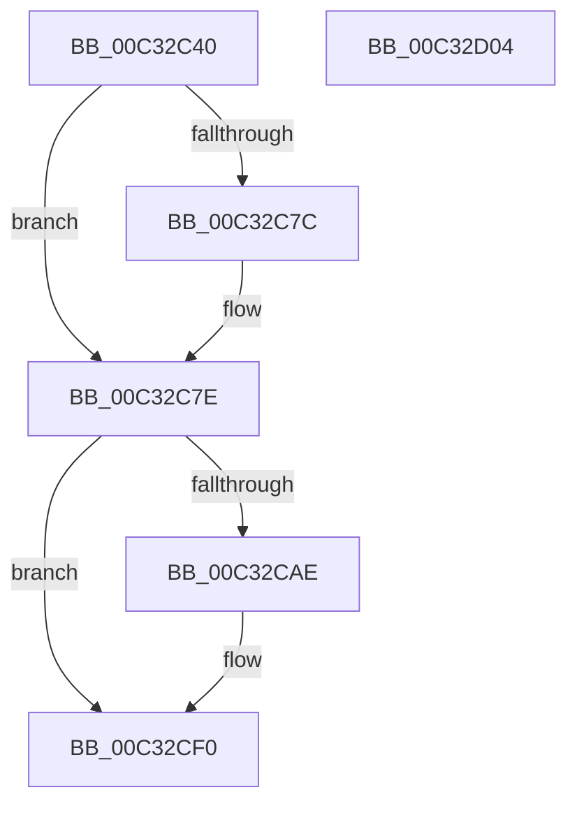

# PnpEarlyLaunchImageNotificationPostProcess

- RVA: `0x00C32C40`–`0x00C32D05` (길이 `197` bytes)
- VA: `0x0000000140C32C40`
- 실행 섹션: `INIT`
- PDB 이름 있음: `예`; PDB Function 태그: `아니요`
- unwind 정보 RVA: `0x0005CAAC`
- 디코드: `48`개 명령, `197/197` bytes 표시
- 미해석 바이트: `0` (있으면 어셈블리에 `.byte`로 보존)

> 이 문서는 커널 이미지의 기계어와 PDB 기호를 분석해 생성했습니다. 4번과 5번은 함수 원형과 자료형을 바이너리 사용 방식에서 추정한 C 해석이며 원본 소스 복구 결과는 아닙니다.

## 1. Dependencies

- 직접 호출 지점: **7**; 고유 호출 대상: **4**
- 직접 호출자로 확인된 함수: **0**
- RIP 상대 이미지 참조: **4**

### Outgoing calls
- `0x00C32C60` → [PnpDiagnosticTraceObject](../../text/26/PnpDiagnosticTraceObject_function_0026E834.md) (function, `0x0026E834`)
- `0x00C32C82` → [RtlFreeAnsiString](../../page/9C/RtlFreeAnsiString_function_009C0800.md) (function, `0x009C0800`)
- `0x00C32C8B` → [RtlFreeAnsiString](../../page/9C/RtlFreeAnsiString_function_009C0800.md) (function, `0x009C0800`)
- `0x00C32C94` → [RtlFreeAnsiString](../../page/9C/RtlFreeAnsiString_function_009C0800.md) (function, `0x009C0800`)
- `0x00C32CD8` → [wil_details_FeatureReporting_ReportUsageToService](../../text/53/wil_details_FeatureReporting_ReportUsageToService_function_0053E6E4.md) (function, `0x0053E6E4`)
- `0x00C32CEB` → [wil_details_FeatureStateCache_TryEnableDeviceUsageFastPath](../../text/53/wil_details_FeatureStateCache_TryEnableDeviceUsageFastPath_function_0053E774.md) (function, `0x0053E774`)
- `0x00C32CF4` → [RtlFreeAnsiString](../../page/9C/RtlFreeAnsiString_function_009C0800.md) (function, `0x009C0800`)

### Direct callers
- 이 함수 시작 RVA로 연결되는 직접 call은 확인되지 않았습니다. 간접 호출은 완전히 역산할 수 없습니다.

### Static image references
- `0x00C32C4F` → RVA `0x00027350` (`.rdata`; read)
- `0x00C32C68` → RVA `0x00C82210` (`PnpClassificationRank`; read)
- `0x00C32C9F` → RVA `0x00FC4838` (`.data`; read)
- `0x00C32CC5` → RVA `0x000DDBA8` (`.rdata`; read)

## 2. Other-region calls and transfers

- 다른 실행 섹션으로 향하는 call: **7**
  - `0x00C32C60` → [PnpDiagnosticTraceObject](../../text/26/PnpDiagnosticTraceObject_function_0026E834.md) (`INIT` → `.text`)
  - `0x00C32C82` → [RtlFreeAnsiString](../../page/9C/RtlFreeAnsiString_function_009C0800.md) (`INIT` → `PAGE`)
  - `0x00C32C8B` → [RtlFreeAnsiString](../../page/9C/RtlFreeAnsiString_function_009C0800.md) (`INIT` → `PAGE`)
  - `0x00C32C94` → [RtlFreeAnsiString](../../page/9C/RtlFreeAnsiString_function_009C0800.md) (`INIT` → `PAGE`)
  - `0x00C32CD8` → [wil_details_FeatureReporting_ReportUsageToService](../../text/53/wil_details_FeatureReporting_ReportUsageToService_function_0053E6E4.md) (`INIT` → `.text`)
  - `0x00C32CEB` → [wil_details_FeatureStateCache_TryEnableDeviceUsageFastPath](../../text/53/wil_details_FeatureStateCache_TryEnableDeviceUsageFastPath_function_0053E774.md) (`INIT` → `.text`)
  - `0x00C32CF4` → [RtlFreeAnsiString](../../page/9C/RtlFreeAnsiString_function_009C0800.md) (`INIT` → `PAGE`)
- 별도 외부 분기/꼬리 이동을 확인하지 못했습니다.

## 3. Assembly (complete function range)

```asm
00C32C40  48 89 5C 24 08                  mov qword ptr [rsp + 8], rbx
00C32C45  57                              push rdi
00C32C46  48 83 EC 20                     sub rsp, 0x20
00C32C4A  48 8B 54 24 50                  mov rdx, qword ptr [rsp + 0x50]
00C32C4F  48 8D 0D FA 46 3F FF            lea rcx, [rip - 0xc0b906]
00C32C56  48 83 C2 08                     add rdx, 8
00C32C5A  49 8B F9                        mov rdi, r9
00C32C5D  49 8B D8                        mov rbx, r8
00C32C60  E8 CF BB 63 FF                  call 0x14026e834
00C32C65  48 63 07                        movsxd rax, dword ptr [rdi]
00C32C68  4C 8D 05 A1 F5 04 00            lea r8, [rip + 0x4f5a1]
00C32C6F  48 63 13                        movsxd rdx, dword ptr [rbx]
00C32C72  41 8B 04 80                     mov eax, dword ptr [r8 + rax*4]
00C32C76  41 39 04 90                     cmp dword ptr [r8 + rdx*4], eax
00C32C7A  76 02                           jbe 0x140c32c7e
00C32C7C  89 17                           mov dword ptr [rdi], edx
00C32C7E  48 8D 4B 08                     lea rcx, [rbx + 8]
00C32C82  E8 79 DB D8 FF                  call 0x1409c0800
00C32C87  48 8D 4B 38                     lea rcx, [rbx + 0x38]
00C32C8B  E8 70 DB D8 FF                  call 0x1409c0800
00C32C90  48 8D 4B 28                     lea rcx, [rbx + 0x28]
00C32C94  E8 67 DB D8 FF                  call 0x1409c0800
00C32C99  48 83 64 24 50 00               and qword ptr [rsp + 0x50], 0
00C32C9F  8B 0D 93 1B 39 00               mov ecx, dword ptr [rip + 0x391b93]
00C32CA5  89 4C 24 50                     mov dword ptr [rsp + 0x50], ecx
00C32CA9  F6 C1 10                        test cl, 0x10
00C32CAC  75 42                           jne 0x140c32cf0
00C32CAE  48 8B 44 24 50                  mov rax, qword ptr [rsp + 0x50]
00C32CB3  41 B9 01 00 00 00               mov r9d, 1
00C32CB9  41 0B C9                        or ecx, r9d
00C32CBC  48 89 44 24 50                  mov qword ptr [rsp + 0x50], rax
00C32CC1  89 4C 24 50                     mov dword ptr [rsp + 0x50], ecx
00C32CC5  48 8D 0D DC AE 4A FF            lea rcx, [rip - 0xb55124]
00C32CCC  48 8B 54 24 50                  mov rdx, qword ptr [rsp + 0x50]
00C32CD1  41 8D 79 02                     lea edi, [r9 + 2]
00C32CD5  44 8B C7                        mov r8d, edi
00C32CD8  E8 07 BA 90 FF                  call 0x14053e6e4
00C32CDD  48 8B 4C 24 50                  mov rcx, qword ptr [rsp + 0x50]
00C32CE2  4C 8D 05 BF AE 4A FF            lea r8, [rip - 0xb55141]
00C32CE9  8B D7                           mov edx, edi
00C32CEB  E8 84 BA 90 FF                  call 0x14053e774
00C32CF0  48 8D 4B 18                     lea rcx, [rbx + 0x18]
00C32CF4  E8 07 DB D8 FF                  call 0x1409c0800
00C32CF9  48 8B 5C 24 30                  mov rbx, qword ptr [rsp + 0x30]
00C32CFE  48 83 C4 20                     add rsp, 0x20
00C32D02  5F                              pop rdi
00C32D03  C3                              ret
00C32D04  CC                              int3
```

## 4. C-style interpretation (structured pseudocode)

```c
__int64 __fastcall PnpEarlyLaunchImageNotificationPostProcess(__int64 a1, __int64 a2, __int64 a3, __int64 a4, __int64 a5)
{
    __int64 result;
    __int64 v_rdi;
    __int64 v_rsp;
    unsigned int v_stack_p28;
    unsigned __int64 v_stack_p8;

    v_stack_p8 = v_rbx;
    v_rsp = (v_rsp) - (32);
    a2 = (a5) + (8);
    result = PnpDiagnosticTraceObject(v_rip - 12630278, a2, a3, a4);
    if ((*(unsigned int *)(v_rip + 325025 + (int)(*(unsigned int *)(a3)) * 4)) >= = ((unsigned int)((unsigned int)(*(unsigned int *)(v_rip + 325025 + (int)(*(unsigned int *)(a4)) * 4))))) {
        *(unsigned int *)(a4) = (unsigned int)((int)(*(unsigned int *)(a3)));
    }
    result = RtlFreeAnsiString(a3 + 8, (int)(*(unsigned int *)(a3)), v_rip + 325025, a4);
    result = RtlFreeAnsiString(a3 + 56, (int)(*(unsigned int *)(a3)), v_rip + 325025, a4);
    result = RtlFreeAnsiString(a3 + 40, (int)(*(unsigned int *)(a3)), v_rip + 325025, a4);
    v_stack_p28 = (unsigned int)((unsigned int)(*(unsigned int *)(v_rip + 3742611)));
    v_rdi = a4;
    if ((((unsigned __int8)((unsigned int)(*(unsigned int *)(v_rip + 3742611)))) & (16)) == 0) {
        result = a5;
        a4 = 1;
        a1 = (unsigned int)(((unsigned int)(*(unsigned int *)(v_rip + 3742611))) | ((unsigned int)(a4)));
        v_stack_p28 = result;
        v_stack_p28 = (unsigned int)(a1);
        a1 = v_rip - 11882788;
        a2 = a5;
        v_rdi = a4 + 2;
        a3 = (unsigned int)(v_rdi);
        result = wil_details_FeatureReporting_ReportUsageToService(a1, a2, a3, a4);
        a1 = a5;
        a3 = v_rip - 11882817;
        a2 = (unsigned int)(v_rdi);
        result = wil_details_FeatureStateCache_TryEnableDeviceUsageFastPath(a1, a2, a3, a4);
    }
    result = RtlFreeAnsiString(a3 + 24, a2, a3, a4);
    v_rsp = (v_rsp) + (32);
    return result;
}
```

## 5. (Beta) C Style

```c
int64_t PnpEarlyLaunchImageNotificationPostProcess(int64_t Arg1, int64_t Arg2, void *Arg3, void *Arg4, int64_t Arg5)
{
    uint8_t *arg3 = (uint8_t *)Arg3;
    uint8_t *arg4 = (uint8_t *)Arg4;

    int64_t result;
    int64_t local_rdi;
    int64_t local_rsp;
    uint32_t v_stack_p28;
    uint64_t v_stack_p8;

    v_stack_p8 = local_rbx;
    local_rsp = (local_rsp) - (32);
    Arg2 = (Arg5) + (8);
    result = PnpDiagnosticTraceObject(v_rip - 12630278, Arg2, Arg3, Arg4);
    if ((*(uint32_t *)(v_rip + 0x4F5A1 + (int32_t)(*(uint32_t *)(arg3)) * 4)) >= = ((uint32_t)((uint32_t)(*(uint32_t *)(v_rip + 0x4F5A1 + (int32_t)(*(uint32_t *)(arg4)) * 4))))) {
        *(uint32_t *)(arg4) = (uint32_t)((int32_t)(*(uint32_t *)(arg3)));
    }
    result = RtlFreeAnsiString(Arg3 + 8, (int32_t)(*(uint32_t *)(arg3)), v_rip + 325025, Arg4);
    result = RtlFreeAnsiString(Arg3 + 56, (int32_t)(*(uint32_t *)(arg3)), v_rip + 325025, Arg4);
    result = RtlFreeAnsiString(Arg3 + 40, (int32_t)(*(uint32_t *)(arg3)), v_rip + 325025, Arg4);
    v_stack_p28 = (uint32_t)((uint32_t)(*(uint32_t *)(v_rip + 0x391B93)));
    local_rdi = Arg4;
    if ((((uint8_t)((uint32_t)(*(uint32_t *)(v_rip + 0x391B93)))) & (16)) == 0) {
        result = Arg5;
        Arg4 = 1;
        Arg1 = (uint32_t)(((uint32_t)(*(uint32_t *)(v_rip + 0x391B93))) | ((uint32_t)(Arg4)));
        v_stack_p28 = result;
        v_stack_p28 = (uint32_t)(Arg1);
        Arg1 = v_rip - 11882788;
        Arg2 = Arg5;
        local_rdi = Arg4 + 2;
        Arg3 = (uint32_t)(local_rdi);
        result = wil_details_FeatureReporting_ReportUsageToService(Arg1, Arg2, Arg3, Arg4);
        Arg1 = Arg5;
        Arg3 = v_rip - 11882817;
        Arg2 = (uint32_t)(local_rdi);
        result = wil_details_FeatureStateCache_TryEnableDeviceUsageFastPath(Arg1, Arg2, Arg3, Arg4);
    }
    result = RtlFreeAnsiString(Arg3 + 24, Arg2, Arg3, Arg4);
    local_rsp = (local_rsp) + (32);
    return result;
}
```

### 관측된 메모리 오프셋

구조체 형식이 확인되지 않은 접근은 인자 기준의 오프셋으로만 기록했습니다.

| 기준 인자 | 오프셋 표현 | 폭 (bit) | 접근 |
|---|---:|---:|---|
| `Arg3` | `+ 0x0` | `32` | `R` |
| `Arg3` | `+ 0x8` | `64` | `R` |
| `Arg3` | `+ 0x18` | `64` | `R` |
| `Arg3` | `+ 0x28` | `64` | `R` |
| `Arg3` | `+ 0x38` | `64` | `R` |
| `Arg4` | `+ 0x0` | `32` | `R` |
| `Arg4` | `+ 0x0` | `32` | `W` |

## 6. Execution-region graph

[열기: 2D/3D 그래프와 함수 탐색 컨트롤 패널](../../../control-panel.html?section=init&rva=0x00C32C40&view=graph)

- 2D 그래프는 위에서 아래로 흐르고, 3D 그래프는 빈 공간을 드래그해 회전합니다. Shift+드래그는 이동, 휠은 확대·축소, 함수 노드 선택은 대상 보고서 이동입니다.

### Static fallback


