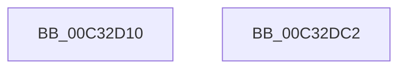

# PnpEarlyLaunchImageNotificationPreProcess

- RVA: `0x00C32D10`–`0x00C32DC3` (길이 `179` bytes)
- VA: `0x0000000140C32D10`
- 실행 섹션: `INIT`
- PDB 이름 있음: `예`; PDB Function 태그: `아니요`
- unwind 정보 RVA: `0x00060BC4`
- 디코드: `45`개 명령, `179/179` bytes 표시
- 미해석 바이트: `0` (있으면 어셈블리에 `.byte`로 보존)

> 이 문서는 커널 이미지의 기계어와 PDB 기호를 분석해 생성했습니다. 4번과 5번은 함수 원형과 자료형을 바이너리 사용 방식에서 추정한 C 해석이며 원본 소스 복구 결과는 아닙니다.

## 1. Dependencies

- 직접 호출 지점: **5**; 고유 호출 대상: **2**
- 직접 호출자로 확인된 함수: **0**
- RIP 상대 이미지 참조: **1**

### Outgoing calls
- `0x00C32D70` → [RtlDuplicateUnicodeString](../../page/93/RtlDuplicateUnicodeString_function_009321F0.md) (function, `0x009321F0`)
- `0x00C32D7F` → [RtlDuplicateUnicodeString](../../page/93/RtlDuplicateUnicodeString_function_009321F0.md) (function, `0x009321F0`)
- `0x00C32D8E` → [RtlDuplicateUnicodeString](../../page/93/RtlDuplicateUnicodeString_function_009321F0.md) (function, `0x009321F0`)
- `0x00C32D9D` → [RtlDuplicateUnicodeString](../../page/93/RtlDuplicateUnicodeString_function_009321F0.md) (function, `0x009321F0`)
- `0x00C32DAD` → [PnpDiagnosticTraceObject](../../text/26/PnpDiagnosticTraceObject_function_0026E834.md) (function, `0x0026E834`)

### Direct callers
- 이 함수 시작 RVA로 연결되는 직접 call은 확인되지 않았습니다. 간접 호출은 완전히 역산할 수 없습니다.

### Static image references
- `0x00C32DA6` → RVA `0x00026F60` (`.rdata`; read)

## 2. Other-region calls and transfers

- 다른 실행 섹션으로 향하는 call: **5**
  - `0x00C32D70` → [RtlDuplicateUnicodeString](../../page/93/RtlDuplicateUnicodeString_function_009321F0.md) (`INIT` → `PAGE`)
  - `0x00C32D7F` → [RtlDuplicateUnicodeString](../../page/93/RtlDuplicateUnicodeString_function_009321F0.md) (`INIT` → `PAGE`)
  - `0x00C32D8E` → [RtlDuplicateUnicodeString](../../page/93/RtlDuplicateUnicodeString_function_009321F0.md) (`INIT` → `PAGE`)
  - `0x00C32D9D` → [RtlDuplicateUnicodeString](../../page/93/RtlDuplicateUnicodeString_function_009321F0.md) (`INIT` → `PAGE`)
  - `0x00C32DAD` → [PnpDiagnosticTraceObject](../../text/26/PnpDiagnosticTraceObject_function_0026E834.md) (`INIT` → `.text`)
- 별도 외부 분기/꼬리 이동을 확인하지 못했습니다.

## 3. Assembly (complete function range)

```asm
00C32D10  48 89 5C 24 08                  mov qword ptr [rsp + 8], rbx
00C32D15  48 89 74 24 10                  mov qword ptr [rsp + 0x10], rsi
00C32D1A  57                              push rdi
00C32D1B  48 83 EC 20                     sub rsp, 0x20
00C32D1F  48 8B 7C 24 50                  mov rdi, qword ptr [rsp + 0x50]
00C32D24  49 8B F0                        mov rsi, r8
00C32D27  33 C9                           xor ecx, ecx
00C32D29  0F 10 07                        movups xmm0, xmmword ptr [rdi]
00C32D2C  48 8D 57 08                     lea rdx, [rdi + 8]
00C32D30  41 0F 11 00                     movups xmmword ptr [r8], xmm0
00C32D34  0F 10 4F 10                     movups xmm1, xmmword ptr [rdi + 0x10]
00C32D38  41 0F 11 48 10                  movups xmmword ptr [r8 + 0x10], xmm1
00C32D3D  0F 10 47 20                     movups xmm0, xmmword ptr [rdi + 0x20]
00C32D41  41 0F 11 40 20                  movups xmmword ptr [r8 + 0x20], xmm0
00C32D46  0F 10 4F 30                     movups xmm1, xmmword ptr [rdi + 0x30]
00C32D4A  41 0F 11 48 30                  movups xmmword ptr [r8 + 0x30], xmm1
00C32D4F  0F 10 47 40                     movups xmm0, xmmword ptr [rdi + 0x40]
00C32D53  41 0F 11 40 40                  movups xmmword ptr [r8 + 0x40], xmm0
00C32D58  0F 10 4F 50                     movups xmm1, xmmword ptr [rdi + 0x50]
00C32D5C  41 0F 11 48 50                  movups xmmword ptr [r8 + 0x50], xmm1
00C32D61  F2 0F 10 47 60                  movsd xmm0, qword ptr [rdi + 0x60]
00C32D66  F2 41 0F 11 40 60               movsd qword ptr [r8 + 0x60], xmm0
00C32D6C  49 83 C0 08                     add r8, 8
00C32D70  E8 7B F4 CF FF                  call 0x1409321f0
00C32D75  4C 8D 46 18                     lea r8, [rsi + 0x18]
00C32D79  33 C9                           xor ecx, ecx
00C32D7B  48 8D 57 18                     lea rdx, [rdi + 0x18]
00C32D7F  E8 6C F4 CF FF                  call 0x1409321f0
00C32D84  4C 8D 46 38                     lea r8, [rsi + 0x38]
00C32D88  33 C9                           xor ecx, ecx
00C32D8A  48 8D 57 38                     lea rdx, [rdi + 0x38]
00C32D8E  E8 5D F4 CF FF                  call 0x1409321f0
00C32D93  4C 8D 46 28                     lea r8, [rsi + 0x28]
00C32D97  33 C9                           xor ecx, ecx
00C32D99  48 8D 57 28                     lea rdx, [rdi + 0x28]
00C32D9D  E8 4E F4 CF FF                  call 0x1409321f0
00C32DA2  48 8D 56 08                     lea rdx, [rsi + 8]
00C32DA6  48 8D 0D B3 41 3F FF            lea rcx, [rip - 0xc0be4d]
00C32DAD  E8 82 BA 63 FF                  call 0x14026e834
00C32DB2  48 8B 5C 24 30                  mov rbx, qword ptr [rsp + 0x30]
00C32DB7  48 8B 74 24 38                  mov rsi, qword ptr [rsp + 0x38]
00C32DBC  48 83 C4 20                     add rsp, 0x20
00C32DC0  5F                              pop rdi
00C32DC1  C3                              ret
00C32DC2  CC                              int3
```

## 4. C-style interpretation (structured pseudocode)

```c
__int64 __fastcall PnpEarlyLaunchImageNotificationPreProcess(int a1, __int64 a2, __int64 a3, __int64 a4, __int64 a5)
{
    __int64 result;
    __int64 v_rsp;
    unsigned __int64 v_stack_p10;
    unsigned __int64 v_stack_p8;

    v_stack_p8 = v_rbx;
    v_stack_p10 = v_rsi;
    v_rsp = (v_rsp) - (32);
    a1 = 0;
    *(unsigned __int64 *)(a3) = v_xmm0;
    *(unsigned __int64 *)(a3 + 16) = v_xmm1;
    *(unsigned __int64 *)(a3 + 32) = v_xmm0;
    *(unsigned __int64 *)(a3 + 48) = v_xmm1;
    *(unsigned __int64 *)(a3 + 64) = v_xmm0;
    *(unsigned __int64 *)(a3 + 80) = v_xmm1;
    *(unsigned __int64 *)(a3 + 96) = v_xmm0;
    a3 = (a3) + (8);
    result = RtlDuplicateUnicodeString(a1, a5 + 8, a3, a4);
    a1 = 0;
    result = RtlDuplicateUnicodeString(a1, a5 + 24, a3 + 24, a4);
    a1 = 0;
    result = RtlDuplicateUnicodeString(a1, a5 + 56, a3 + 56, a4);
    a1 = 0;
    result = RtlDuplicateUnicodeString(a1, a5 + 40, a3 + 40, a4);
    result = PnpDiagnosticTraceObject(v_rip - 12631629, a3 + 8, a3 + 40, a4);
    v_rsp = (v_rsp) + (32);
    return result;
}
```

## 5. (Beta) C Style

```c
int64_t PnpEarlyLaunchImageNotificationPreProcess(int32_t Arg1, int64_t Arg2, void *Arg3, int64_t Arg4, void *Arg5)
{
    uint8_t *arg3 = (uint8_t *)Arg3;
    uint8_t *arg5 = (uint8_t *)Arg5;

    int64_t result;
    int64_t local_rsp;
    uint64_t v_stack_p10;
    uint64_t v_stack_p8;

    v_stack_p8 = local_rbx;
    v_stack_p10 = local_rsi;
    local_rsp = (local_rsp) - (32);
    Arg1 = 0;
    *(uint64_t *)(arg3) = v_xmm0;
    *(uint64_t *)(arg3 + 0x10) = v_xmm1;
    *(uint64_t *)(arg3 + 0x20) = v_xmm0;
    *(uint64_t *)(arg3 + 0x30) = v_xmm1;
    *(uint64_t *)(arg3 + 0x40) = v_xmm0;
    *(uint64_t *)(arg3 + 0x50) = v_xmm1;
    *(uint64_t *)(arg3 + 0x60) = v_xmm0;
    Arg3 = (Arg3) + (8);
    result = RtlDuplicateUnicodeString(Arg1, Arg5 + 8, Arg3, Arg4);
    Arg1 = 0;
    result = RtlDuplicateUnicodeString(Arg1, Arg5 + 24, Arg3 + 24, Arg4);
    Arg1 = 0;
    result = RtlDuplicateUnicodeString(Arg1, Arg5 + 56, Arg3 + 56, Arg4);
    Arg1 = 0;
    result = RtlDuplicateUnicodeString(Arg1, Arg5 + 40, Arg3 + 40, Arg4);
    result = PnpDiagnosticTraceObject(v_rip - 12631629, Arg3 + 8, Arg3 + 40, Arg4);
    local_rsp = (local_rsp) + (32);
    return result;
}
```

### 관측된 메모리 오프셋

구조체 형식이 확인되지 않은 접근은 인자 기준의 오프셋으로만 기록했습니다.

| 기준 인자 | 오프셋 표현 | 폭 (bit) | 접근 |
|---|---:|---:|---|
| `Arg3` | `+ 0x0` | `128` | `R` |
| `Arg3` | `+ 0x8` | `64` | `R` |
| `Arg3` | `+ 0x10` | `128` | `R` |
| `Arg3` | `+ 0x18` | `64` | `R` |
| `Arg3` | `+ 0x20` | `128` | `R` |
| `Arg3` | `+ 0x28` | `64` | `R` |
| `Arg3` | `+ 0x30` | `128` | `R` |
| `Arg3` | `+ 0x38` | `64` | `R` |
| `Arg3` | `+ 0x40` | `128` | `R` |
| `Arg3` | `+ 0x50` | `128` | `R` |
| `Arg3` | `+ 0x60` | `64` | `W` |
| `Arg5` | `+ 0x0` | `128` | `R` |
| `Arg5` | `+ 0x8` | `64` | `R` |
| `Arg5` | `+ 0x10` | `128` | `R` |
| `Arg5` | `+ 0x18` | `64` | `R` |
| `Arg5` | `+ 0x20` | `128` | `R` |
| `Arg5` | `+ 0x28` | `64` | `R` |
| `Arg5` | `+ 0x30` | `128` | `R` |
| `Arg5` | `+ 0x38` | `64` | `R` |
| `Arg5` | `+ 0x40` | `128` | `R` |
| `Arg5` | `+ 0x50` | `128` | `R` |
| `Arg5` | `+ 0x60` | `64` | `R` |

## 6. Execution-region graph

[열기: 2D/3D 그래프와 함수 탐색 컨트롤 패널](../../../control-panel.html?section=init&rva=0x00C32D10&view=graph)

- 2D 그래프는 위에서 아래로 흐르고, 3D 그래프는 빈 공간을 드래그해 회전합니다. Shift+드래그는 이동, 휠은 확대·축소, 함수 노드 선택은 대상 보고서 이동입니다.

### Static fallback


