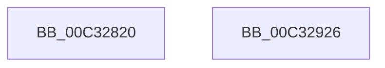

# PnpInitPhase0

- RVA: `0x00C32820`–`0x00C32927` (길이 `263` bytes)
- VA: `0x0000000140C32820`
- 실행 섹션: `INIT`
- PDB 이름 있음: `예`; PDB Function 태그: `아니요`
- unwind 정보 RVA: `0x0005CF00`
- 디코드: `46`개 명령, `263/263` bytes 표시
- 미해석 바이트: `0` (있으면 어셈블리에 `.byte`로 보존)

> 이 문서는 커널 이미지의 기계어와 PDB 기호를 분석해 생성했습니다. 4번과 5번은 함수 원형과 자료형을 바이너리 사용 방식에서 추정한 C 해석이며 원본 소스 복구 결과는 아닙니다.

## 1. Dependencies

- 직접 호출 지점: **3**; 고유 호출 대상: **2**
- 직접 호출자로 확인된 함수: **1**
- RIP 상대 이미지 참조: **29**

### Outgoing calls
- `0x00C32830` → [ExInitializeResourceLite2](../../text/41/ExInitializeResourceLite2_function_0041F710.md) (function, `0x0041F710`)
- `0x00C3288A` → [memset](../../text/6C/memset_function_006C6C40.md) (function, `0x006C6C40`)
- `0x00C328E0` → [memset](../../text/6C/memset_function_006C6C40.md) (function, `0x006C6C40`)

### Direct callers
- [PpInitSystem](PpInitSystem_function_00C32964.md) at `0x00C32996`

### Static image references
- `0x00C32829` → RVA `0x00F8C600` (`.data`; read)
- `0x00C32835` → RVA `0x00F8CB48` (`.data`; read/write)
- `0x00C3283D` → RVA `0x00F8CB60` (`.data`; read)
- `0x00C32844` → RVA `0x00F8CB50` (`.data`; read/write)
- `0x00C3284B` → RVA `0x00F8CB80` (`.data`; read)
- `0x00C32852` → RVA `0x00F8CB5C` (`.data`; read/write)
- `0x00C3285E` → RVA `0x00F8CB40` (`.data`; write)
- `0x00C32868` → RVA `0x00F8CB58` (`.data`; write)
- `0x00C32871` → RVA `0x00F8CB5A` (`.data`; write)
- `0x00C3287C` → RVA `0x00F8CB68` (`.data`; write)
- `0x00C32883` → RVA `0x00F8CB60` (`.data`; write)
- `0x00C3288F` → RVA `0x00F8CBE0` (`.data`; read/write)
- `0x00C32897` → RVA `0x009A9B60` (`PnpCompareInstancePath`; read)
- `0x00C3289E` → RVA `0x00F8A900` (`.data`; read/write)
- `0x00C328A8` → RVA `0x00F8CBC8` (`.data`; write)
- `0x00C328AF` → RVA `0x00AA16A0` (`PnpAllocateGenericTableEntry`; read)
- `0x00C328B6` → RVA `0x00F8CBD0` (`.data`; write)
- `0x00C328BD` → RVA `0x00AB4E50` (`CMFFreeFn`; read)
- `0x00C328C4` → RVA `0x00F8CB80` (`.data`; write)
- `0x00C328CB` → RVA `0x00F8A920` (`.data`; read)
- `0x00C328D6` → RVA `0x00F8CBD8` (`.data`; write)
- `0x00C328E5` → RVA `0x00F8A980` (`.data`; read/write)
- `0x00C328ED` → RVA `0x004BE670` (`PnpCompareActivationThread`; read)
- `0x00C328F4` → RVA `0x00F8A968` (`.data`; write)
- `0x00C328FD` → RVA `0x005A6A10` (`PnpAllocateGenericTableEntryNonPaged`; read)
- `0x00C32904` → RVA `0x00F8A920` (`.data`; write)
- `0x00C3290B` → RVA `0x00F8A970` (`.data`; write)
- `0x00C32912` → RVA `0x0047D140` (`MiFreeProtoPool`; read)
- `0x00C32919` → RVA `0x00F8A978` (`.data`; write)

## 2. Other-region calls and transfers

- 다른 실행 섹션으로 향하는 call: **3**
  - `0x00C32830` → [ExInitializeResourceLite2](../../text/41/ExInitializeResourceLite2_function_0041F710.md) (`INIT` → `.text`)
  - `0x00C3288A` → [memset](../../text/6C/memset_function_006C6C40.md) (`INIT` → `.text`)
  - `0x00C328E0` → [memset](../../text/6C/memset_function_006C6C40.md) (`INIT` → `.text`)
- 별도 외부 분기/꼬리 이동을 확인하지 못했습니다.

## 3. Assembly (complete function range)

```asm
00C32820  40 53                           push rbx
00C32822  48 83 EC 20                     sub rsp, 0x20
00C32826  83 CA FF                        or edx, 0xffffffff
00C32829  48 8D 0D D0 9D 35 00            lea rcx, [rip + 0x359dd0]
00C32830  E8 DB CE 7E FF                  call 0x14041f710
00C32835  48 83 25 0B A3 35 00 00         and qword ptr [rip + 0x35a30b], 0
00C3283D  48 8D 05 1C A3 35 00            lea rax, [rip + 0x35a31c]
00C32844  83 25 05 A3 35 00 00            and dword ptr [rip + 0x35a305], 0
00C3284B  48 8D 1D 2E A3 35 00            lea rbx, [rip + 0x35a32e]
00C32852  83 25 03 A3 35 00 00            and dword ptr [rip + 0x35a303], 0
00C32859  33 D2                           xor edx, edx
00C3285B  48 8B CB                        mov rcx, rbx
00C3285E  C7 05 D8 A2 35 00 01 00 00 00   mov dword ptr [rip + 0x35a2d8], 1
00C32868  66 C7 05 E7 A2 35 00 01 00      mov word ptr [rip + 0x35a2e7], 1
00C32871  C6 05 E2 A2 35 00 06            mov byte ptr [rip + 0x35a2e2], 6
00C32878  44 8D 42 68                     lea r8d, [rdx + 0x68]
00C3287C  48 89 05 E5 A2 35 00            mov qword ptr [rip + 0x35a2e5], rax
00C32883  48 89 05 D6 A2 35 00            mov qword ptr [rip + 0x35a2d6], rax
00C3288A  E8 B1 43 A9 FF                  call 0x1406c6c40
00C3288F  48 83 25 49 A3 35 00 00         and qword ptr [rip + 0x35a349], 0
00C32897  48 8D 05 C2 72 D7 FF            lea rax, [rip - 0x288d3e]
00C3289E  48 83 25 5A 80 35 00 00         and qword ptr [rip + 0x35805a], 0
00C328A6  33 D2                           xor edx, edx
00C328A8  48 89 05 19 A3 35 00            mov qword ptr [rip + 0x35a319], rax
00C328AF  48 8D 05 EA ED E6 FF            lea rax, [rip - 0x191216]
00C328B6  48 89 05 13 A3 35 00            mov qword ptr [rip + 0x35a313], rax
00C328BD  48 8D 05 8C 25 E8 FF            lea rax, [rip - 0x17da74]
00C328C4  48 89 1D B5 A2 35 00            mov qword ptr [rip + 0x35a2b5], rbx
00C328CB  48 8D 1D 4E 80 35 00            lea rbx, [rip + 0x35804e]
00C328D2  44 8D 42 68                     lea r8d, [rdx + 0x68]
00C328D6  48 89 05 FB A2 35 00            mov qword ptr [rip + 0x35a2fb], rax
00C328DD  48 8B CB                        mov rcx, rbx
00C328E0  E8 5B 43 A9 FF                  call 0x1406c6c40
00C328E5  48 83 25 93 80 35 00 00         and qword ptr [rip + 0x358093], 0
00C328ED  48 8D 0D 7C BD 88 FF            lea rcx, [rip - 0x774284]
00C328F4  48 89 0D 6D 80 35 00            mov qword ptr [rip + 0x35806d], rcx
00C328FB  B0 01                           mov al, 1
00C328FD  48 8D 0D 0C 41 97 FF            lea rcx, [rip - 0x68bef4]
00C32904  48 89 1D 15 80 35 00            mov qword ptr [rip + 0x358015], rbx
00C3290B  48 89 0D 5E 80 35 00            mov qword ptr [rip + 0x35805e], rcx
00C32912  48 8D 0D 27 A8 84 FF            lea rcx, [rip - 0x7b57d9]
00C32919  48 89 0D 58 80 35 00            mov qword ptr [rip + 0x358058], rcx
00C32920  48 83 C4 20                     add rsp, 0x20
00C32924  5B                              pop rbx
00C32925  C3                              ret
00C32926  CC                              int3
```

## 4. C-style interpretation (structured pseudocode)

```c
__int64 __fastcall PnpInitPhase0(__int64 a1, int a2)
{
    __int64 result;
    __int64 v_rsp;

    v_rsp = (v_rsp) - (32);
    a2 = (unsigned int)((a2) | (0xFFFFFFFFULL));
    result = ExInitializeResourceLite2(v_rip + 3513808, a2, a3, a4);
    a2 = 0;
    *(unsigned int *)(v_rip + 3515096) = 1;
    *(unsigned __int16 *)(v_rip + 3515111) = 1;
    *(unsigned __int8 *)(v_rip + 3515106) = 6;
    *(unsigned __int64 *)(v_rip + 3515109) = v_rip + 3515164;
    *(unsigned __int64 *)(v_rip + 3515094) = v_rip + 3515164;
    result = memset(v_rip + 3515182, a2, a2 + 104, a4);
    a2 = 0;
    *(unsigned __int64 *)(v_rip + 3515161) = v_rip - 2657598;
    *(unsigned __int64 *)(v_rip + 3515155) = v_rip - 1643030;
    *(unsigned __int64 *)(v_rip + 3515061) = v_rip + 3515182;
    *(unsigned __int64 *)(v_rip + 3515131) = v_rip - 1563252;
    result = memset(v_rip + 3506254, a2, a2 + 104, a4);
    *(unsigned __int64 *)(v_rip + 3506285) = v_rip - 7815812;
    *(unsigned __int64 *)(v_rip + 3506197) = v_rip + 3506254;
    *(unsigned __int64 *)(v_rip + 3506270) = v_rip - 6864628;
    *(unsigned __int64 *)(v_rip + 3506264) = v_rip - 8083417;
    v_rsp = (v_rsp) + (32);
    return 1;
}
```

## 5. (Beta) C Style

```c
int64_t PnpInitPhase0(int64_t Arg1, int32_t Arg2)
{
    int64_t result;
    int64_t local_rsp;

    local_rsp = (local_rsp) - (32);
    Arg2 = (uint32_t)((Arg2) | (0xFFFFFFFFULL));
    result = ExInitializeResourceLite2(v_rip + 3513808, Arg2, a3, a4);
    Arg2 = 0;
    *(uint32_t *)(v_rip + 0x35A2D8) = 1;
    *(uint16_t *)(v_rip + 0x35A2E7) = 1;
    *(uint8_t *)(v_rip + 0x35A2E2) = 6;
    *(uint64_t *)(v_rip + 0x35A2E5) = v_rip + 3515164;
    *(uint64_t *)(v_rip + 0x35A2D6) = v_rip + 3515164;
    result = memset(v_rip + 3515182, Arg2, Arg2 + 104, a4);
    Arg2 = 0;
    *(uint64_t *)(v_rip + 0x35A319) = v_rip - 2657598;
    *(uint64_t *)(v_rip + 0x35A313) = v_rip - 1643030;
    *(uint64_t *)(v_rip + 0x35A2B5) = v_rip + 3515182;
    *(uint64_t *)(v_rip + 0x35A2FB) = v_rip - 1563252;
    result = memset(v_rip + 3506254, Arg2, Arg2 + 104, a4);
    *(uint64_t *)(v_rip + 0x35806D) = v_rip - 7815812;
    *(uint64_t *)(v_rip + 0x358015) = v_rip + 3506254;
    *(uint64_t *)(v_rip + 0x35805E) = v_rip - 6864628;
    *(uint64_t *)(v_rip + 0x358058) = v_rip - 8083417;
    local_rsp = (local_rsp) + (32);
    return 1;
}
```

## 6. Execution-region graph

[열기: 2D/3D 그래프와 함수 탐색 컨트롤 패널](../../../control-panel.html?section=init&rva=0x00C32820&view=graph)

- 2D 그래프는 위에서 아래로 흐르고, 3D 그래프는 빈 공간을 드래그해 회전합니다. Shift+드래그는 이동, 휠은 확대·축소, 함수 노드 선택은 대상 보고서 이동입니다.

### Static fallback


