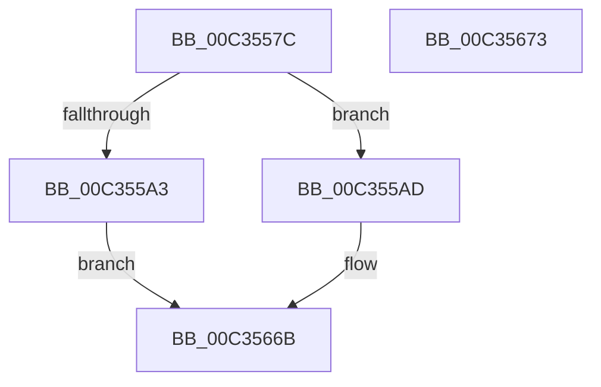

# PnpInitializeDeviceEvents

- RVA: `0x00C3557C`–`0x00C35674` (길이 `248` bytes)
- VA: `0x0000000140C3557C`
- 실행 섹션: `INIT`
- PDB 이름 있음: `예`; PDB Function 태그: `아니요`
- unwind 정보 RVA: `0x0005CF00`
- 디코드: `51`개 명령, `248/248` bytes 표시
- 미해석 바이트: `0` (있으면 어셈블리에 `.byte`로 보존)

> 이 문서는 커널 이미지의 기계어와 PDB 기호를 분석해 생성했습니다. 4번과 5번은 함수 원형과 자료형을 바이너리 사용 방식에서 추정한 C 해석이며 원본 소스 복구 결과는 아닙니다.

## 1. Dependencies

- 직접 호출 지점: **2**; 고유 호출 대상: **2**
- 직접 호출자로 확인된 함수: **1**
- RIP 상대 이미지 참조: **17**

### Outgoing calls
- `0x00C35592` → [ExAllocatePool2](../../poolcode/B8/ExAllocatePool2_function_00B820F0.md) (function, `0x00B820F0`)
- `0x00C355B9` → [KiInitializeMutant](../../text/45/KiInitializeMutant_function_00456E9C.md) (function, `0x00456E9C`)

### Direct callers
- [IopInitializePlugPlayServices](../C2/IopInitializePlugPlayServices_function_00C2F298.md) at `0x00C2FDEE`

### Static image references
- `0x00C35597` → RVA `0x00FD8048` (`PAGEDATA`; write)
- `0x00C355BE` → RVA `0x00FD8048` (`PAGEDATA`; read)
- `0x00C355F6` → RVA `0x00F8AC60` (`.data`; read)
- `0x00C35603` → RVA `0x00F8AC68` (`.data`; write)
- `0x00C3560A` → RVA `0x00F8AC60` (`.data`; write)
- `0x00C35611` → RVA `0x00F8AC88` (`.data`; read)
- `0x00C35618` → RVA `0x00F8AC90` (`.data`; write)
- `0x00C3561F` → RVA `0x00F8AC88` (`.data`; write)
- `0x00C35626` → RVA `0x00F8AC40` (`.data`; write)
- `0x00C35630` → RVA `0x00F8AC48` (`.data`; write)
- `0x00C35637` → RVA `0x00F8AC50` (`.data`; write)
- `0x00C3563D` → RVA `0x00F8AC58` (`.data`; write)
- `0x00C35646` → RVA `0x00F8AC5A` (`.data`; write)
- `0x00C3564D` → RVA `0x00F8AC5C` (`.data`; write)
- `0x00C35653` → RVA `0x00F8AC80` (`.data`; write)
- `0x00C3565A` → RVA `0x00F8AC82` (`.data`; write)
- `0x00C35661` → RVA `0x00F8AC84` (`.data`; write)

## 2. Other-region calls and transfers

- 다른 실행 섹션으로 향하는 call: **2**
  - `0x00C35592` → [ExAllocatePool2](../../poolcode/B8/ExAllocatePool2_function_00B820F0.md) (`INIT` → `POOLCODE`)
  - `0x00C355B9` → [KiInitializeMutant](../../text/45/KiInitializeMutant_function_00456E9C.md) (`INIT` → `.text`)
- 별도 외부 분기/꼬리 이동을 확인하지 못했습니다.

## 3. Assembly (complete function range)

```asm
00C3557C  40 53                           push rbx
00C3557E  48 83 EC 20                     sub rsp, 0x20
00C35582  33 DB                           xor ebx, ebx
00C35584  BA 88 00 00 00                  mov edx, 0x88
00C35589  41 B8 50 6E 70 4A               mov r8d, 0x4a706e50
00C3558F  8D 4B 40                        lea ecx, [rbx + 0x40]
00C35592  E8 59 CB F4 FF                  call 0x140b820f0
00C35597  48 89 05 AA 2A 3A 00            mov qword ptr [rip + 0x3a2aaa], rax
00C3559E  48 85 C0                        test rax, rax
00C355A1  75 0A                           jne 0x140c355ad
00C355A3  BB 9A 00 00 C0                  mov ebx, 0xc000009a
00C355A8  E9 BE 00 00 00                  jmp 0x140c3566b
00C355AD  48 8D 48 08                     lea rcx, [rax + 8]
00C355B1  45 33 C9                        xor r9d, r9d
00C355B4  41 B0 01                        mov r8b, 1
00C355B7  33 D2                           xor edx, edx
00C355B9  E8 DE 18 82 FF                  call 0x140456e9c
00C355BE  48 8B 0D 83 2A 3A 00            mov rcx, qword ptr [rip + 0x3a2a83]
00C355C5  C7 41 40 01 00 00 00            mov dword ptr [rcx + 0x40], 1
00C355CC  48 8D 41 60                     lea rax, [rcx + 0x60]
00C355D0  48 89 59 48                     mov qword ptr [rcx + 0x48], rbx
00C355D4  89 59 50                        mov dword ptr [rcx + 0x50], ebx
00C355D7  66 C7 41 58 01 00               mov word ptr [rcx + 0x58], 1
00C355DD  C6 41 5A 06                     mov byte ptr [rcx + 0x5a], 6
00C355E1  89 59 5C                        mov dword ptr [rcx + 0x5c], ebx
00C355E4  48 89 40 08                     mov qword ptr [rax + 8], rax
00C355E8  48 89 00                        mov qword ptr [rax], rax
00C355EB  48 8D 41 78                     lea rax, [rcx + 0x78]
00C355EF  48 89 40 08                     mov qword ptr [rax + 8], rax
00C355F3  48 89 00                        mov qword ptr [rax], rax
00C355F6  48 8D 05 63 56 35 00            lea rax, [rip + 0x355663]
00C355FD  C7 01 03 01 00 00               mov dword ptr [rcx], 0x103
00C35603  48 89 05 5E 56 35 00            mov qword ptr [rip + 0x35565e], rax
00C3560A  48 89 05 4F 56 35 00            mov qword ptr [rip + 0x35564f], rax
00C35611  48 8D 05 70 56 35 00            lea rax, [rip + 0x355670]
00C35618  48 89 05 71 56 35 00            mov qword ptr [rip + 0x355671], rax
00C3561F  48 89 05 62 56 35 00            mov qword ptr [rip + 0x355662], rax
00C35626  C7 05 10 56 35 00 01 00 00 00   mov dword ptr [rip + 0x355610], 1
00C35630  48 89 1D 11 56 35 00            mov qword ptr [rip + 0x355611], rbx
00C35637  89 1D 13 56 35 00               mov dword ptr [rip + 0x355613], ebx
00C3563D  66 C7 05 12 56 35 00 01 00      mov word ptr [rip + 0x355612], 1
00C35646  C6 05 0D 56 35 00 06            mov byte ptr [rip + 0x35560d], 6
00C3564D  89 1D 09 56 35 00               mov dword ptr [rip + 0x355609], ebx
00C35653  66 89 1D 26 56 35 00            mov word ptr [rip + 0x355626], bx
00C3565A  C6 05 21 56 35 00 06            mov byte ptr [rip + 0x355621], 6
00C35661  C7 05 19 56 35 00 01 00 00 00   mov dword ptr [rip + 0x355619], 1
00C3566B  8B C3                           mov eax, ebx
00C3566D  48 83 C4 20                     add rsp, 0x20
00C35671  5B                              pop rbx
00C35672  C3                              ret
00C35673  CC                              int3
```

## 4. C-style interpretation (structured pseudocode)

```c
__int64 __fastcall PnpInitializeDeviceEvents(__int64 a1, __int64 a2, __int64 a3, int a4)
{
    __int64 result;
    __int64 v_rbx;
    __int64 v_rsp;

    v_rsp = (v_rsp) - (32);
    v_rbx = 0;
    result = ExAllocatePool2(v_rbx + 64, 136, (unsigned int)(0x4A706E50ULL), a4);
    *(unsigned __int64 *)(v_rip + 3812010) = result;
    if (result != 0) goto loc_00C355AD;
    goto loc_00C3566B;
loc_00C355AD:
    a4 = 0;
    a2 = 0;
    result = KiInitializeMutant(result + 8, a2, 1, a4);
    *(unsigned int *)(*(unsigned __int64 *)(v_rip + 3811971) + 64) = 1;
    *(unsigned __int64 *)(*(unsigned __int64 *)(v_rip + 3811971) + 72) = (unsigned int)(0xC000009AULL);
    *(unsigned int *)(*(unsigned __int64 *)(v_rip + 3811971) + 80) = (unsigned int)((unsigned int)(0xC000009AULL));
    *(unsigned __int16 *)(*(unsigned __int64 *)(v_rip + 3811971) + 88) = 1;
    *(unsigned __int8 *)(*(unsigned __int64 *)(v_rip + 3811971) + 90) = 6;
    *(unsigned int *)(*(unsigned __int64 *)(v_rip + 3811971) + 92) = (unsigned int)((unsigned int)(0xC000009AULL));
    *(unsigned __int64 *)(*(unsigned __int64 *)(v_rip + 3811971) + 96 + 8) = *(unsigned __int64 *)(v_rip + 3811971) + 96;
    *(unsigned __int64 *)(*(unsigned __int64 *)(v_rip + 3811971) + 96) = *(unsigned __int64 *)(v_rip + 3811971) + 96;
    *(unsigned __int64 *)(*(unsigned __int64 *)(v_rip + 3811971) + 120 + 8) = *(unsigned __int64 *)(v_rip + 3811971) + 120;
    *(unsigned __int64 *)(*(unsigned __int64 *)(v_rip + 3811971) + 120) = *(unsigned __int64 *)(v_rip + 3811971) + 120;
    *(unsigned int *)(*(unsigned __int64 *)(v_rip + 3811971)) = 259;
    *(unsigned __int64 *)(v_rip + 3495518) = v_rip + 3495523;
    *(unsigned __int64 *)(v_rip + 3495503) = v_rip + 3495523;
    *(unsigned __int64 *)(v_rip + 3495537) = v_rip + 3495536;
    *(unsigned __int64 *)(v_rip + 3495522) = v_rip + 3495536;
    *(unsigned int *)(v_rip + 3495440) = 1;
    *(unsigned __int64 *)(v_rip + 3495441) = (unsigned int)(0xC000009AULL);
    *(unsigned int *)(v_rip + 3495443) = (unsigned int)((unsigned int)(0xC000009AULL));
    *(unsigned __int16 *)(v_rip + 3495442) = 1;
    *(unsigned __int8 *)(v_rip + 3495437) = 6;
    *(unsigned int *)(v_rip + 3495433) = (unsigned int)((unsigned int)(0xC000009AULL));
    *(unsigned __int16 *)(v_rip + 3495462) = (unsigned __int16)((unsigned int)(0xC000009AULL));
    *(unsigned __int8 *)(v_rip + 3495457) = 6;
    *(unsigned int *)(v_rip + 3495449) = 1;
loc_00C3566B:
    v_rsp = (v_rsp) + (32);
    return (unsigned int)((unsigned int)((unsigned int)(0xC000009AULL)));
}
```

## 5. (Beta) C Style

```c
int64_t PnpInitializeDeviceEvents(int64_t Arg1, int64_t Arg2, int64_t Arg3, int32_t Arg4)
{
    int64_t result;
    int64_t local_rbx;
    int64_t local_rsp;

    local_rsp = (local_rsp) - (32);
    local_rbx = 0;
    result = ExAllocatePool2(local_rbx + 64, 136, (uint32_t)(0x4A706E50ULL), Arg4);
    *(uint64_t *)(v_rip + 0x3A2AAA) = result;
    if (result != 0) goto loc_00C355AD;
    goto loc_00C3566B;
loc_00C355AD:
    Arg4 = 0;
    Arg2 = 0;
    result = KiInitializeMutant(result + 8, Arg2, 1, Arg4);
    *(uint32_t *)(*(uint64_t *)(v_rip + 0x3A2A83) + 0x40) = 1;
    *(uint64_t *)(*(uint64_t *)(v_rip + 0x3A2A83) + 0x48) = (uint32_t)(0xC000009AULL);
    *(uint32_t *)(*(uint64_t *)(v_rip + 0x3A2A83) + 0x50) = (uint32_t)((uint32_t)(0xC000009AULL));
    *(uint16_t *)(*(uint64_t *)(v_rip + 0x3A2A83) + 0x58) = 1;
    *(uint8_t *)(*(uint64_t *)(v_rip + 0x3A2A83) + 0x5A) = 6;
    *(uint32_t *)(*(uint64_t *)(v_rip + 0x3A2A83) + 0x5C) = (uint32_t)((uint32_t)(0xC000009AULL));
    *(uint64_t *)(*(uint64_t *)(v_rip + 0x3A2A83) + 0x60 + 0x8) = *(uint64_t *)(v_rip + 0x3A2A83) + 96;
    *(uint64_t *)(*(uint64_t *)(v_rip + 0x3A2A83) + 0x60) = *(uint64_t *)(v_rip + 0x3A2A83) + 96;
    *(uint64_t *)(*(uint64_t *)(v_rip + 0x3A2A83) + 0x78 + 0x8) = *(uint64_t *)(v_rip + 0x3A2A83) + 120;
    *(uint64_t *)(*(uint64_t *)(v_rip + 0x3A2A83) + 0x78) = *(uint64_t *)(v_rip + 0x3A2A83) + 120;
    *(uint32_t *)(*(uint64_t *)(v_rip + 0x3A2A83)) = 259;
    *(uint64_t *)(v_rip + 0x35565E) = v_rip + 3495523;
    *(uint64_t *)(v_rip + 0x35564F) = v_rip + 3495523;
    *(uint64_t *)(v_rip + 0x355671) = v_rip + 3495536;
    *(uint64_t *)(v_rip + 0x355662) = v_rip + 3495536;
    *(uint32_t *)(v_rip + 0x355610) = 1;
    *(uint64_t *)(v_rip + 0x355611) = (uint32_t)(0xC000009AULL);
    *(uint32_t *)(v_rip + 0x355613) = (uint32_t)((uint32_t)(0xC000009AULL));
    *(uint16_t *)(v_rip + 0x355612) = 1;
    *(uint8_t *)(v_rip + 0x35560D) = 6;
    *(uint32_t *)(v_rip + 0x355609) = (uint32_t)((uint32_t)(0xC000009AULL));
    *(uint16_t *)(v_rip + 0x355626) = (uint16_t)((uint32_t)(0xC000009AULL));
    *(uint8_t *)(v_rip + 0x355621) = 6;
    *(uint32_t *)(v_rip + 0x355619) = 1;
loc_00C3566B:
    local_rsp = (local_rsp) + (32);
    return (uint32_t)((uint32_t)((uint32_t)(0xC000009AULL)));
}
```

## 6. Execution-region graph

[열기: 2D/3D 그래프와 함수 탐색 컨트롤 패널](../../../control-panel.html?section=init&rva=0x00C3557C&view=graph)

- 2D 그래프는 위에서 아래로 흐르고, 3D 그래프는 빈 공간을 드래그해 회전합니다. Shift+드래그는 이동, 휠은 확대·축소, 함수 노드 선택은 대상 보고서 이동입니다.

### Static fallback


