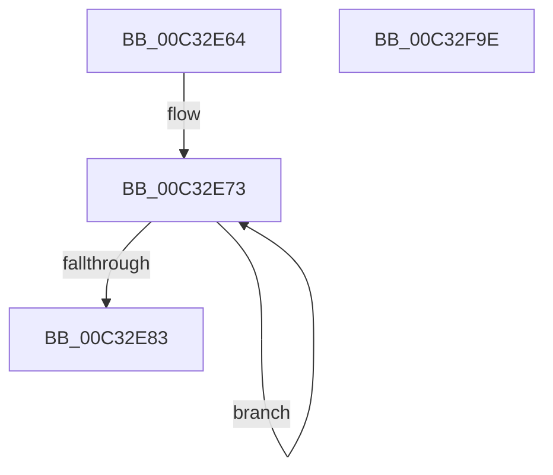

# PnpInitializeNotification

- RVA: `0x00C32E64`–`0x00C32F9F` (길이 `315` bytes)
- VA: `0x0000000140C32E64`
- 실행 섹션: `INIT`
- PDB 이름 있음: `예`; PDB Function 태그: `아니요`
- unwind 정보 RVA: `0x000DB714`
- 디코드: `52`개 명령, `315/315` bytes 표시
- 미해석 바이트: `0` (있으면 어셈블리에 `.byte`로 보존)

> 이 문서는 커널 이미지의 기계어와 PDB 기호를 분석해 생성했습니다. 4번과 5번은 함수 원형과 자료형을 바이너리 사용 방식에서 추정한 C 해석이며 원본 소스 복구 결과는 아닙니다.

## 1. Dependencies

- 직접 호출 지점: **0**; 고유 호출 대상: **0**
- 직접 호출자로 확인된 함수: **1**
- RIP 상대 이미지 참조: **43**

### Outgoing calls
- 직접 디코드된 call 명령이 없습니다.

### Direct callers
- [IopInitializePlugPlayServices](../C2/IopInitializePlugPlayServices_function_00C2F298.md) at `0x00C2FDFD`

### Static image references
- `0x00C32E69` → RVA `0x00FDA7E0` (`PAGEDATA`; read)
- `0x00C32E83` → RVA `0x00FD9FD8` (`PAGEDATA`; read)
- `0x00C32E8A` → RVA `0x00F8CD60` (`.data`; write)
- `0x00C32E90` → RVA `0x00FD9FE0` (`PAGEDATA`; write)
- `0x00C32E97` → RVA `0x00FD9FD8` (`PAGEDATA`; write)
- `0x00C32E9E` → RVA `0x00FD9FA8` (`PAGEDATA`; read)
- `0x00C32EA5` → RVA `0x00FD9FB0` (`PAGEDATA`; write)
- `0x00C32EAC` → RVA `0x00FD9FA8` (`PAGEDATA`; write)
- `0x00C32EB3` → RVA `0x00F8CD80` (`.data`; read)
- `0x00C32EBA` → RVA `0x00F8CD88` (`.data`; write)
- `0x00C32EC1` → RVA `0x00F8CD80` (`.data`; write)
- `0x00C32EC8` → RVA `0x00F8CDC0` (`.data`; read)
- `0x00C32ECF` → RVA `0x00F8CDC8` (`.data`; write)
- `0x00C32ED6` → RVA `0x00F8CDC0` (`.data`; write)
- `0x00C32EDD` → RVA `0x00F8CD00` (`.data`; read)
- `0x00C32EE4` → RVA `0x00F8CD08` (`.data`; write)
- `0x00C32EEB` → RVA `0x00F8CD00` (`.data`; write)
- `0x00C32EF2` → RVA `0x00F8CD40` (`.data`; read)
- `0x00C32EF9` → RVA `0x00F8CD48` (`.data`; write)
- `0x00C32F00` → RVA `0x00F8CD40` (`.data`; write)
- `0x00C32F07` → RVA `0x00F8CD68` (`.data`; write)
- `0x00C32F0E` → RVA `0x00F8CD70` (`.data`; write)
- `0x00C32F14` → RVA `0x00F8CD78` (`.data`; write)
- `0x00C32F1B` → RVA `0x00F8CD7A` (`.data`; write)
- `0x00C32F22` → RVA `0x00F8CD7C` (`.data`; write)
- `0x00C32F28` → RVA `0x00F8CDA0` (`.data`; write)
- `0x00C32F2E` → RVA `0x00F8CDA8` (`.data`; write)
- `0x00C32F35` → RVA `0x00F8CDB0` (`.data`; write)
- `0x00C32F3B` → RVA `0x00F8CDB8` (`.data`; write)
- `0x00C32F42` → RVA `0x00F8CDBA` (`.data`; write)
- `0x00C32F49` → RVA `0x00F8CDBC` (`.data`; write)
- `0x00C32F4F` → RVA `0x00F8CCE0` (`.data`; write)
- `0x00C32F55` → RVA `0x00F8CCE8` (`.data`; write)
- `0x00C32F5C` → RVA `0x00F8CCF0` (`.data`; write)
- `0x00C32F62` → RVA `0x00F8CCF8` (`.data`; write)
- `0x00C32F69` → RVA `0x00F8CCFA` (`.data`; write)
- `0x00C32F70` → RVA `0x00F8CCFC` (`.data`; write)
- `0x00C32F76` → RVA `0x00F8CD20` (`.data`; write)
- `0x00C32F7C` → RVA `0x00F8CD28` (`.data`; write)
- `0x00C32F83` → RVA `0x00F8CD30` (`.data`; write)
- `0x00C32F89` → RVA `0x00F8CD38` (`.data`; write)
- `0x00C32F90` → RVA `0x00F8CD3A` (`.data`; write)
- `0x00C32F97` → RVA `0x00F8CD3C` (`.data`; write)

## 2. Other-region calls and transfers

- 다른 실행 섹션으로 향하는 call: **0**
- 별도 외부 분기/꼬리 이동을 확인하지 못했습니다.

## 3. Assembly (complete function range)

```asm
00C32E64  B9 0D 00 00 00                  mov ecx, 0xd
00C32E69  48 8D 05 70 79 3A 00            lea rax, [rip + 0x3a7970]
00C32E70  8D 51 F4                        lea edx, [rcx - 0xc]
00C32E73  48 89 40 08                     mov qword ptr [rax + 8], rax
00C32E77  48 89 00                        mov qword ptr [rax], rax
00C32E7A  48 83 C0 10                     add rax, 0x10
00C32E7E  48 2B CA                        sub rcx, rdx
00C32E81  75 F0                           jne 0x140c32e73
00C32E83  48 8D 05 4E 71 3A 00            lea rax, [rip + 0x3a714e]
00C32E8A  89 15 D0 9E 35 00               mov dword ptr [rip + 0x359ed0], edx
00C32E90  48 89 05 49 71 3A 00            mov qword ptr [rip + 0x3a7149], rax
00C32E97  48 89 05 3A 71 3A 00            mov qword ptr [rip + 0x3a713a], rax
00C32E9E  48 8D 05 03 71 3A 00            lea rax, [rip + 0x3a7103]
00C32EA5  48 89 05 04 71 3A 00            mov qword ptr [rip + 0x3a7104], rax
00C32EAC  48 89 05 F5 70 3A 00            mov qword ptr [rip + 0x3a70f5], rax
00C32EB3  48 8D 05 C6 9E 35 00            lea rax, [rip + 0x359ec6]
00C32EBA  48 89 05 C7 9E 35 00            mov qword ptr [rip + 0x359ec7], rax
00C32EC1  48 89 05 B8 9E 35 00            mov qword ptr [rip + 0x359eb8], rax
00C32EC8  48 8D 05 F1 9E 35 00            lea rax, [rip + 0x359ef1]
00C32ECF  48 89 05 F2 9E 35 00            mov qword ptr [rip + 0x359ef2], rax
00C32ED6  48 89 05 E3 9E 35 00            mov qword ptr [rip + 0x359ee3], rax
00C32EDD  48 8D 05 1C 9E 35 00            lea rax, [rip + 0x359e1c]
00C32EE4  48 89 05 1D 9E 35 00            mov qword ptr [rip + 0x359e1d], rax
00C32EEB  48 89 05 0E 9E 35 00            mov qword ptr [rip + 0x359e0e], rax
00C32EF2  48 8D 05 47 9E 35 00            lea rax, [rip + 0x359e47]
00C32EF9  48 89 05 48 9E 35 00            mov qword ptr [rip + 0x359e48], rax
00C32F00  48 89 05 39 9E 35 00            mov qword ptr [rip + 0x359e39], rax
00C32F07  48 89 0D 5A 9E 35 00            mov qword ptr [rip + 0x359e5a], rcx
00C32F0E  89 0D 5C 9E 35 00               mov dword ptr [rip + 0x359e5c], ecx
00C32F14  66 89 15 5D 9E 35 00            mov word ptr [rip + 0x359e5d], dx
00C32F1B  C6 05 58 9E 35 00 06            mov byte ptr [rip + 0x359e58], 6
00C32F22  89 0D 54 9E 35 00               mov dword ptr [rip + 0x359e54], ecx
00C32F28  89 15 72 9E 35 00               mov dword ptr [rip + 0x359e72], edx
00C32F2E  48 89 0D 73 9E 35 00            mov qword ptr [rip + 0x359e73], rcx
00C32F35  89 0D 75 9E 35 00               mov dword ptr [rip + 0x359e75], ecx
00C32F3B  66 89 15 76 9E 35 00            mov word ptr [rip + 0x359e76], dx
00C32F42  C6 05 71 9E 35 00 06            mov byte ptr [rip + 0x359e71], 6
00C32F49  89 0D 6D 9E 35 00               mov dword ptr [rip + 0x359e6d], ecx
00C32F4F  89 15 8B 9D 35 00               mov dword ptr [rip + 0x359d8b], edx
00C32F55  48 89 0D 8C 9D 35 00            mov qword ptr [rip + 0x359d8c], rcx
00C32F5C  89 0D 8E 9D 35 00               mov dword ptr [rip + 0x359d8e], ecx
00C32F62  66 89 15 8F 9D 35 00            mov word ptr [rip + 0x359d8f], dx
00C32F69  C6 05 8A 9D 35 00 06            mov byte ptr [rip + 0x359d8a], 6
00C32F70  89 0D 86 9D 35 00               mov dword ptr [rip + 0x359d86], ecx
00C32F76  89 15 A4 9D 35 00               mov dword ptr [rip + 0x359da4], edx
00C32F7C  48 89 0D A5 9D 35 00            mov qword ptr [rip + 0x359da5], rcx
00C32F83  89 0D A7 9D 35 00               mov dword ptr [rip + 0x359da7], ecx
00C32F89  66 89 15 A8 9D 35 00            mov word ptr [rip + 0x359da8], dx
00C32F90  C6 05 A3 9D 35 00 06            mov byte ptr [rip + 0x359da3], 6
00C32F97  89 0D 9F 9D 35 00               mov dword ptr [rip + 0x359d9f], ecx
00C32F9D  C3                              ret
00C32F9E  CC                              int3
```

## 4. C-style interpretation (structured pseudocode)

```c
__int64 __fastcall PnpInitializeNotification(void)
{
    __int64 result;

loc_00C32E73:
    *(unsigned __int64 *)(v_rip + 3832176 + 8) = v_rip + 3832176;
    *(unsigned __int64 *)(v_rip + 3832176) = v_rip + 3832176;
    result = (v_rip + 3832176) + (16);
    a1 = (13) - (13 - 12);
    if (condition_is_not_equal) goto loc_00C32E73;
    *(unsigned int *)(v_rip + 3514064) = (unsigned int)(13 - 12);
    *(unsigned __int64 *)(v_rip + 3830089) = v_rip + 3830094;
    *(unsigned __int64 *)(v_rip + 3830074) = v_rip + 3830094;
    *(unsigned __int64 *)(v_rip + 3830020) = v_rip + 3830019;
    *(unsigned __int64 *)(v_rip + 3830005) = v_rip + 3830019;
    *(unsigned __int64 *)(v_rip + 3514055) = v_rip + 3514054;
    *(unsigned __int64 *)(v_rip + 3514040) = v_rip + 3514054;
    *(unsigned __int64 *)(v_rip + 3514098) = v_rip + 3514097;
    *(unsigned __int64 *)(v_rip + 3514083) = v_rip + 3514097;
    *(unsigned __int64 *)(v_rip + 3513885) = v_rip + 3513884;
    *(unsigned __int64 *)(v_rip + 3513870) = v_rip + 3513884;
    *(unsigned __int64 *)(v_rip + 3513928) = v_rip + 3513927;
    *(unsigned __int64 *)(v_rip + 3513913) = v_rip + 3513927;
    *(unsigned __int64 *)(v_rip + 3513946) = a1;
    *(unsigned int *)(v_rip + 3513948) = (unsigned int)(a1);
    *(unsigned __int16 *)(v_rip + 3513949) = (unsigned __int16)(13 - 12);
    *(unsigned __int8 *)(v_rip + 3513944) = 6;
    *(unsigned int *)(v_rip + 3513940) = (unsigned int)(a1);
    *(unsigned int *)(v_rip + 3513970) = (unsigned int)(13 - 12);
    *(unsigned __int64 *)(v_rip + 3513971) = a1;
    *(unsigned int *)(v_rip + 3513973) = (unsigned int)(a1);
    *(unsigned __int16 *)(v_rip + 3513974) = (unsigned __int16)(13 - 12);
    *(unsigned __int8 *)(v_rip + 3513969) = 6;
    *(unsigned int *)(v_rip + 3513965) = (unsigned int)(a1);
    *(unsigned int *)(v_rip + 3513739) = (unsigned int)(13 - 12);
    *(unsigned __int64 *)(v_rip + 3513740) = a1;
    *(unsigned int *)(v_rip + 3513742) = (unsigned int)(a1);
    *(unsigned __int16 *)(v_rip + 3513743) = (unsigned __int16)(13 - 12);
    *(unsigned __int8 *)(v_rip + 3513738) = 6;
    *(unsigned int *)(v_rip + 3513734) = (unsigned int)(a1);
    *(unsigned int *)(v_rip + 3513764) = (unsigned int)(13 - 12);
    *(unsigned __int64 *)(v_rip + 3513765) = a1;
    *(unsigned int *)(v_rip + 3513767) = (unsigned int)(a1);
    *(unsigned __int16 *)(v_rip + 3513768) = (unsigned __int16)(13 - 12);
    *(unsigned __int8 *)(v_rip + 3513763) = 6;
    *(unsigned int *)(v_rip + 3513759) = (unsigned int)(a1);
    return v_rip + 3513927;
}
```

## 5. (Beta) C Style

```c
void PnpInitializeNotification(void)
{
    int64_t result;

loc_00C32E73:
    *(uint64_t *)(v_rip + 0x3A7970 + 0x8) = v_rip + 3832176;
    *(uint64_t *)(v_rip + 0x3A7970) = v_rip + 3832176;
    result = (v_rip + 3832176) + (16);
    a1 = (13) - (13 - 12);
    if (condition_is_not_equal) goto loc_00C32E73;
    *(uint32_t *)(v_rip + 0x359ED0) = (uint32_t)(13 - 12);
    *(uint64_t *)(v_rip + 0x3A7149) = v_rip + 3830094;
    *(uint64_t *)(v_rip + 0x3A713A) = v_rip + 3830094;
    *(uint64_t *)(v_rip + 0x3A7104) = v_rip + 3830019;
    *(uint64_t *)(v_rip + 0x3A70F5) = v_rip + 3830019;
    *(uint64_t *)(v_rip + 0x359EC7) = v_rip + 3514054;
    *(uint64_t *)(v_rip + 0x359EB8) = v_rip + 3514054;
    *(uint64_t *)(v_rip + 0x359EF2) = v_rip + 3514097;
    *(uint64_t *)(v_rip + 0x359EE3) = v_rip + 3514097;
    *(uint64_t *)(v_rip + 0x359E1D) = v_rip + 3513884;
    *(uint64_t *)(v_rip + 0x359E0E) = v_rip + 3513884;
    *(uint64_t *)(v_rip + 0x359E48) = v_rip + 3513927;
    *(uint64_t *)(v_rip + 0x359E39) = v_rip + 3513927;
    *(uint64_t *)(v_rip + 0x359E5A) = a1;
    *(uint32_t *)(v_rip + 0x359E5C) = (uint32_t)(a1);
    *(uint16_t *)(v_rip + 0x359E5D) = (uint16_t)(13 - 12);
    *(uint8_t *)(v_rip + 0x359E58) = 6;
    *(uint32_t *)(v_rip + 0x359E54) = (uint32_t)(a1);
    *(uint32_t *)(v_rip + 0x359E72) = (uint32_t)(13 - 12);
    *(uint64_t *)(v_rip + 0x359E73) = a1;
    *(uint32_t *)(v_rip + 0x359E75) = (uint32_t)(a1);
    *(uint16_t *)(v_rip + 0x359E76) = (uint16_t)(13 - 12);
    *(uint8_t *)(v_rip + 0x359E71) = 6;
    *(uint32_t *)(v_rip + 0x359E6D) = (uint32_t)(a1);
    *(uint32_t *)(v_rip + 0x359D8B) = (uint32_t)(13 - 12);
    *(uint64_t *)(v_rip + 0x359D8C) = a1;
    *(uint32_t *)(v_rip + 0x359D8E) = (uint32_t)(a1);
    *(uint16_t *)(v_rip + 0x359D8F) = (uint16_t)(13 - 12);
    *(uint8_t *)(v_rip + 0x359D8A) = 6;
    *(uint32_t *)(v_rip + 0x359D86) = (uint32_t)(a1);
    *(uint32_t *)(v_rip + 0x359DA4) = (uint32_t)(13 - 12);
    *(uint64_t *)(v_rip + 0x359DA5) = a1;
    *(uint32_t *)(v_rip + 0x359DA7) = (uint32_t)(a1);
    *(uint16_t *)(v_rip + 0x359DA8) = (uint16_t)(13 - 12);
    *(uint8_t *)(v_rip + 0x359DA3) = 6;
    *(uint32_t *)(v_rip + 0x359D9F) = (uint32_t)(a1);
    return v_rip + 3513927;
}
```

## 6. Execution-region graph

[열기: 2D/3D 그래프와 함수 탐색 컨트롤 패널](../../../control-panel.html?section=init&rva=0x00C32E64&view=graph)

- 2D 그래프는 위에서 아래로 흐르고, 3D 그래프는 빈 공간을 드래그해 회전합니다. Shift+드래그는 이동, 휠은 확대·축소, 함수 노드 선택은 대상 보고서 이동입니다.

### Static fallback


