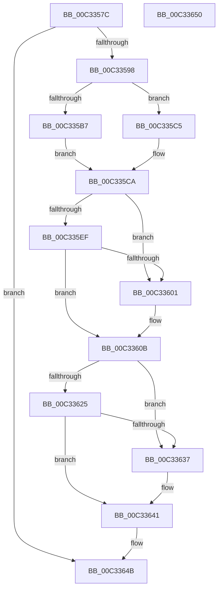

# PnpInitializePnpWatchdogs

- RVA: `0x00C3357C`–`0x00C33651` (길이 `213` bytes)
- VA: `0x0000000140C3357C`
- 실행 섹션: `INIT`
- PDB 이름 있음: `예`; PDB Function 태그: `아니요`
- unwind 정보 RVA: `0x0005C788`
- 디코드: `49`개 명령, `213/213` bytes 표시
- 미해석 바이트: `0` (있으면 어셈블리에 `.byte`로 보존)

> 이 문서는 커널 이미지의 기계어와 PDB 기호를 분석해 생성했습니다. 4번과 5번은 함수 원형과 자료형을 바이너리 사용 방식에서 추정한 C 해석이며 원본 소스 복구 결과는 아닙니다.

## 1. Dependencies

- 직접 호출 지점: **5**; 고유 호출 대상: **3**
- 직접 호출자로 확인된 함수: **1**
- RIP 상대 이미지 참조: **7**

### Outgoing calls
- `0x00C3358B` → [PnpOpenCCSPnpRegKey](PnpOpenCCSPnpRegKey_function_00C33658.md) (function, `0x00C33658`)
- `0x00C335AE` → [PnpGetRegistryDword](../../text/4B/PnpGetRegistryDword_function_004BFDE8.md) (function, `0x004BFDE8`)
- `0x00C335E6` → [PnpGetRegistryDword](../../text/4B/PnpGetRegistryDword_function_004BFDE8.md) (function, `0x004BFDE8`)
- `0x00C3361C` → [PnpGetRegistryDword](../../text/4B/PnpGetRegistryDword_function_004BFDE8.md) (function, `0x004BFDE8`)
- `0x00C33646` → [ZwClose](../../text/6A/ZwClose_function_006AD2B0.md) (function, `0x006AD2B0`)

### Direct callers
- [IopInitializePlugPlayServices](../C2/IopInitializePlugPlayServices_function_00C2F298.md) at `0x00C2FDE9`

### Static image references
- `0x00C335A7` → RVA `0x00027BF0` (`.rdata`; read)
- `0x00C335D9` → RVA `0x00027C20` (`.rdata`; read)
- `0x00C335E0` → RVA `0x00F8CCD8` (`.data`; write)
- `0x00C335F3` → RVA `0x00F8CCD4` (`.data`; write)
- `0x00C33615` → RVA `0x00027BB8` (`.rdata`; read)
- `0x00C33629` → RVA `0x00F8CCD4` (`.data`; read)
- `0x00C3362F` → RVA `0x00F8CCD0` (`.data`; write)

## 2. Other-region calls and transfers

- 다른 실행 섹션으로 향하는 call: **4**
  - `0x00C335AE` → [PnpGetRegistryDword](../../text/4B/PnpGetRegistryDword_function_004BFDE8.md) (`INIT` → `.text`)
  - `0x00C335E6` → [PnpGetRegistryDword](../../text/4B/PnpGetRegistryDword_function_004BFDE8.md) (`INIT` → `.text`)
  - `0x00C3361C` → [PnpGetRegistryDword](../../text/4B/PnpGetRegistryDword_function_004BFDE8.md) (`INIT` → `.text`)
  - `0x00C33646` → [ZwClose](../../text/6A/ZwClose_function_006AD2B0.md) (`INIT` → `.text`)
- 별도 외부 분기/꼬리 이동을 확인하지 못했습니다.

## 3. Assembly (complete function range)

```asm
00C3357C  48 83 EC 28                     sub rsp, 0x28
00C33580  48 83 64 24 38 00               and qword ptr [rsp + 0x38], 0
00C33586  48 8D 4C 24 38                  lea rcx, [rsp + 0x38]
00C3358B  E8 C8 00 00 00                  call 0x140c33658
00C33590  85 C0                           test eax, eax
00C33592  0F 88 B3 00 00 00               js 0x140c3364b
00C33598  48 8B 4C 24 38                  mov rcx, qword ptr [rsp + 0x38]
00C3359D  4C 8D 44 24 30                  lea r8, [rsp + 0x30]
00C335A2  83 64 24 30 00                  and dword ptr [rsp + 0x30], 0
00C335A7  48 8D 15 42 46 3F FF            lea rdx, [rip - 0xc0b9be]
00C335AE  E8 35 C8 88 FF                  call 0x1404bfde8
00C335B3  85 C0                           test eax, eax
00C335B5  78 0E                           js 0x140c335c5
00C335B7  33 C0                           xor eax, eax
00C335B9  39 44 24 30                     cmp dword ptr [rsp + 0x30], eax
00C335BD  8D 48 01                        lea ecx, [rax + 1]
00C335C0  0F 45 C1                        cmovne eax, ecx
00C335C3  EB 05                           jmp 0x140c335ca
00C335C5  B8 02 00 00 00                  mov eax, 2
00C335CA  48 8B 4C 24 38                  mov rcx, qword ptr [rsp + 0x38]
00C335CF  4C 8D 44 24 30                  lea r8, [rsp + 0x30]
00C335D4  83 64 24 30 00                  and dword ptr [rsp + 0x30], 0
00C335D9  48 8D 15 40 46 3F FF            lea rdx, [rip - 0xc0b9c0]
00C335E0  89 05 F2 96 35 00               mov dword ptr [rip + 0x3596f2], eax
00C335E6  E8 FD C7 88 FF                  call 0x1404bfde8
00C335EB  85 C0                           test eax, eax
00C335ED  78 12                           js 0x140c33601
00C335EF  8B 4C 24 30                     mov ecx, dword ptr [rsp + 0x30]
00C335F3  89 0D DB 96 35 00               mov dword ptr [rip + 0x3596db], ecx
00C335F9  8D 41 FF                        lea eax, [rcx - 1]
00C335FC  83 F8 FD                        cmp eax, -3
00C335FF  76 0A                           jbe 0x140c3360b
00C33601  C7 05 C9 96 35 00 B8 0B 00 00   mov dword ptr [rip + 0x3596c9], 0xbb8
00C3360B  48 8B 4C 24 38                  mov rcx, qword ptr [rsp + 0x38]
00C33610  4C 8D 44 24 30                  lea r8, [rsp + 0x30]
00C33615  48 8D 15 9C 45 3F FF            lea rdx, [rip - 0xc0ba64]
00C3361C  E8 C7 C7 88 FF                  call 0x1404bfde8
00C33621  85 C0                           test eax, eax
00C33623  78 12                           js 0x140c33637
00C33625  8B 44 24 30                     mov eax, dword ptr [rsp + 0x30]
00C33629  39 05 A5 96 35 00               cmp dword ptr [rip + 0x3596a5], eax
00C3362F  89 05 9B 96 35 00               mov dword ptr [rip + 0x35969b], eax
00C33635  72 0A                           jb 0x140c33641
00C33637  C7 05 8F 96 35 00 40 7E 05 00   mov dword ptr [rip + 0x35968f], 0x57e40
00C33641  48 8B 4C 24 38                  mov rcx, qword ptr [rsp + 0x38]
00C33646  E8 65 9C A7 FF                  call 0x1406ad2b0
00C3364B  48 83 C4 28                     add rsp, 0x28
00C3364F  C3                              ret
00C33650  CC                              int3
```

## 4. C-style interpretation (structured pseudocode)

```c
__int64 __fastcall PnpInitializePnpWatchdogs(void)
{
    __int64 result;
    __int64 v_rsp;
    unsigned __int64 v_stack_p10;
    unsigned __int64 v_stack_p8;

    v_rsp = (v_rsp) - (40);
    result = PnpOpenCCSPnpRegKey(v_stack_p10, a2, a3, a4);
    if (sign_flag) goto loc_00C3364B;
    result = PnpGetRegistryDword(v_stack_p10, v_rip - 12630462, v_stack_p8, a4);
    if (sign_flag) goto loc_00C335C5;
    result = 0;
    if (v_stack_p8 != 0) { result = (unsigned int)(result + 1); }
    goto loc_00C335CA;
loc_00C335C5:
loc_00C335CA:
    *(unsigned int *)(v_rip + 3512050) = 2;
    result = PnpGetRegistryDword(v_stack_p10, v_rip - 12630464, v_stack_p8, a4);
    if (sign_flag) goto loc_00C33601;
    *(unsigned int *)(v_rip + 3512027) = (unsigned int)((unsigned int)(v_stack_p8));
    if (((unsigned int)((unsigned int)(v_stack_p8) - 1)) >= = -3) {
        *(unsigned int *)(v_rip + 3512009) = 0xBB8ULL;
    }
    result = PnpGetRegistryDword(v_stack_p10, v_rip - 12630628, v_stack_p8, a4);
    if (sign_flag) goto loc_00C33637;
    *(unsigned int *)(v_rip + 3511963) = (unsigned int)((unsigned int)(v_stack_p8));
    if ((*(unsigned int *)(v_rip + 3511973)) >= ((unsigned int)((unsigned int)(v_stack_p8)))) {
        *(unsigned int *)(v_rip + 3511951) = 0x57E40ULL;
    }
    result = ZwClose(v_stack_p10, v_rip - 12630628, v_stack_p8, a4);
loc_00C3364B:
    v_rsp = (v_rsp) + (40);
    return result;
}
```

## 5. (Beta) C Style

```c
void PnpInitializePnpWatchdogs(void)
{
    int64_t result;
    int64_t local_rsp;
    uint64_t v_stack_p10;
    uint64_t v_stack_p8;

    local_rsp = (local_rsp) - (40);
    result = PnpOpenCCSPnpRegKey(v_stack_p10, a2, a3, a4);
    if (sign_flag) goto loc_00C3364B;
    result = PnpGetRegistryDword(v_stack_p10, v_rip - 12630462, v_stack_p8, a4);
    if (sign_flag) goto loc_00C335C5;
    result = 0;
    if (v_stack_p8 != 0) { result = (uint32_t)(result + 1); }
    goto loc_00C335CA;
loc_00C335C5:
loc_00C335CA:
    *(uint32_t *)(v_rip + 0x3596F2) = 2;
    result = PnpGetRegistryDword(v_stack_p10, v_rip - 12630464, v_stack_p8, a4);
    if (sign_flag) goto loc_00C33601;
    *(uint32_t *)(v_rip + 0x3596DB) = (uint32_t)((uint32_t)(v_stack_p8));
    if (((uint32_t)((uint32_t)(v_stack_p8) - 1)) >= = -3) {
        *(uint32_t *)(v_rip + 0x3596C9) = 0xBB8ULL;
    }
    result = PnpGetRegistryDword(v_stack_p10, v_rip - 12630628, v_stack_p8, a4);
    if (sign_flag) goto loc_00C33637;
    *(uint32_t *)(v_rip + 0x35969B) = (uint32_t)((uint32_t)(v_stack_p8));
    if ((*(uint32_t *)(v_rip + 0x3596A5)) >= ((uint32_t)((uint32_t)(v_stack_p8)))) {
        *(uint32_t *)(v_rip + 0x35968F) = 0x57E40ULL;
    }
    result = ZwClose(v_stack_p10, v_rip - 12630628, v_stack_p8, a4);
loc_00C3364B:
    local_rsp = (local_rsp) + (40);
    return result;
}
```

## 6. Execution-region graph

[열기: 2D/3D 그래프와 함수 탐색 컨트롤 패널](../../../control-panel.html?section=init&rva=0x00C3357C&view=graph)

- 2D 그래프는 위에서 아래로 흐르고, 3D 그래프는 빈 공간을 드래그해 회전합니다. Shift+드래그는 이동, 휠은 확대·축소, 함수 노드 선택은 대상 보고서 이동입니다.

### Static fallback


