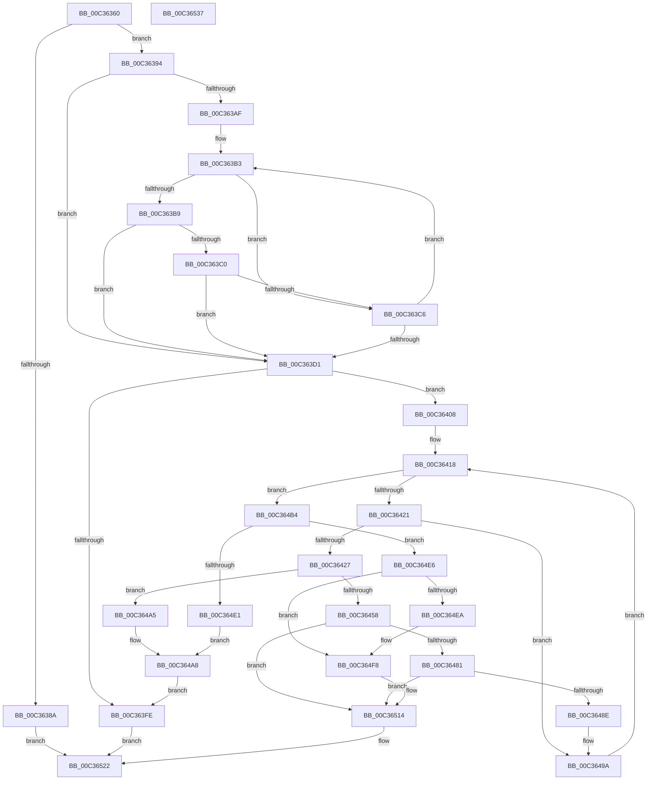

# PnpRegMultiSzToUnicodeStrings

- RVA: `0x00C36360`–`0x00C36538` (길이 `472` bytes)
- VA: `0x0000000140C36360`
- 실행 섹션: `INIT`
- PDB 이름 있음: `예`; PDB Function 태그: `아니요`
- unwind 정보 RVA: `0x000BD538`
- 디코드: `138`개 명령, `472/472` bytes 표시
- 미해석 바이트: `0` (있으면 어셈블리에 `.byte`로 보존)

> 이 문서는 커널 이미지의 기계어와 PDB 기호를 분석해 생성했습니다. 4번과 5번은 함수 원형과 자료형을 바이너리 사용 방식에서 추정한 C 해석이며 원본 소스 복구 결과는 아닙니다.

## 1. Dependencies

- 직접 호출 지점: **6**; 고유 호출 대상: **3**
- 직접 호출자로 확인된 함수: **1**
- RIP 상대 이미지 참조: **0**

### Outgoing calls
- `0x00C363F0` → [ExAllocatePool2](../../poolcode/B8/ExAllocatePool2_function_00B820F0.md) (function, `0x00B820F0`)
- `0x00C3643F` → [ExAllocatePool2](../../poolcode/B8/ExAllocatePool2_function_00B820F0.md) (function, `0x00B820F0`)
- `0x00C36461` → [memcpy](../../text/6C/memcpy_function_006C6840.md) (function, `0x006C6840`)
- `0x00C364AA` → [PnpFreeUnicodeStringList](../../text/5A/PnpFreeUnicodeStringList_function_005AA43C.md) (function, `0x005AA43C`)
- `0x00C364C8` → [ExAllocatePool2](../../poolcode/B8/ExAllocatePool2_function_00B820F0.md) (function, `0x00B820F0`)
- `0x00C364F3` → [memcpy](../../text/6C/memcpy_function_006C6840.md) (function, `0x006C6840`)

### Direct callers
- [PiInitCacheGroupInformation](PiInitCacheGroupInformation_function_00C300E8.md) at `0x00C3017C`

### Static image references
- 디코드된 RIP-relative 메모리 참조가 없습니다.

## 2. Other-region calls and transfers

- 다른 실행 섹션으로 향하는 call: **6**
  - `0x00C363F0` → [ExAllocatePool2](../../poolcode/B8/ExAllocatePool2_function_00B820F0.md) (`INIT` → `POOLCODE`)
  - `0x00C3643F` → [ExAllocatePool2](../../poolcode/B8/ExAllocatePool2_function_00B820F0.md) (`INIT` → `POOLCODE`)
  - `0x00C36461` → [memcpy](../../text/6C/memcpy_function_006C6840.md) (`INIT` → `.text`)
  - `0x00C364AA` → [PnpFreeUnicodeStringList](../../text/5A/PnpFreeUnicodeStringList_function_005AA43C.md) (`INIT` → `.text`)
  - `0x00C364C8` → [ExAllocatePool2](../../poolcode/B8/ExAllocatePool2_function_00B820F0.md) (`INIT` → `POOLCODE`)
  - `0x00C364F3` → [memcpy](../../text/6C/memcpy_function_006C6840.md) (`INIT` → `.text`)
- 별도 외부 분기/꼬리 이동을 확인하지 못했습니다.

## 3. Assembly (complete function range)

```asm
00C36360  48 89 5C 24 20                  mov qword ptr [rsp + 0x20], rbx
00C36365  4C 89 44 24 18                  mov qword ptr [rsp + 0x18], r8
00C3636A  48 89 54 24 10                  mov qword ptr [rsp + 0x10], rdx
00C3636F  55                              push rbp
00C36370  56                              push rsi
00C36371  57                              push rdi
00C36372  41 54                           push r12
00C36374  41 55                           push r13
00C36376  41 56                           push r14
00C36378  41 57                           push r15
00C3637A  48 83 EC 20                     sub rsp, 0x20
00C3637E  83 79 04 07                     cmp dword ptr [rcx + 4], 7
00C36382  4C 8B E2                        mov r12, rdx
00C36385  48 8B D9                        mov rbx, rcx
00C36388  74 0A                           je 0x140c36394
00C3638A  B8 0D 00 00 C0                  mov eax, 0xc000000d
00C3638F  E9 8E 01 00 00                  jmp 0x140c36522
00C36394  8B 49 08                        mov ecx, dword ptr [rcx + 8]
00C36397  45 33 ED                        xor r13d, r13d
00C3639A  8B 7B 0C                        mov edi, dword ptr [rbx + 0xc]
00C3639D  48 03 CB                        add rcx, rbx
00C363A0  48 03 F9                        add rdi, rcx
00C363A3  41 8B D5                        mov edx, r13d
00C363A6  45 8D 75 02                     lea r14d, [r13 + 2]
00C363AA  48 3B CF                        cmp rcx, rdi
00C363AD  74 22                           je 0x140c363d1
00C363AF  48 8D 41 02                     lea rax, [rcx + 2]
00C363B3  66 44 39 29                     cmp word ptr [rcx], r13w
00C363B7  75 0D                           jne 0x140c363c6
00C363B9  FF C2                           inc edx
00C363BB  48 3B C7                        cmp rax, rdi
00C363BE  74 11                           je 0x140c363d1
00C363C0  66 44 39 28                     cmp word ptr [rax], r13w
00C363C4  74 0B                           je 0x140c363d1
00C363C6  49 03 CE                        add rcx, r14
00C363C9  49 03 C6                        add rax, r14
00C363CC  48 3B CF                        cmp rcx, rdi
00C363CF  75 E2                           jne 0x140c363b3
00C363D1  8D 42 01                        lea eax, [rdx + 1]
00C363D4  48 3B CF                        cmp rcx, rdi
00C363D7  B9 00 01 00 00                  mov ecx, 0x100
00C363DC  41 B8 50 70 73 75               mov r8d, 0x75737050
00C363E2  0F 45 C2                        cmovne eax, edx
00C363E5  8B D0                           mov edx, eax
00C363E7  48 89 44 24 60                  mov qword ptr [rsp + 0x60], rax
00C363EC  48 C1 E2 04                     shl rdx, 4
00C363F0  E8 FB BC F4 FF                  call 0x140b820f0
00C363F5  49 89 04 24                     mov qword ptr [r12], rax
00C363F9  48 85 C0                        test rax, rax
00C363FC  75 0A                           jne 0x140c36408
00C363FE  B8 9A 00 00 C0                  mov eax, 0xc000009a
00C36403  E9 1A 01 00 00                  jmp 0x140c36522
00C36408  8B 43 08                        mov eax, dword ptr [rbx + 8]
00C3640B  41 8B ED                        mov ebp, r13d
00C3640E  48 03 D8                        add rbx, rax
00C36411  4C 8B FB                        mov r15, rbx
00C36414  48 8D 73 02                     lea rsi, [rbx + 2]
00C36418  48 3B DF                        cmp rbx, rdi
00C3641B  0F 84 93 00 00 00               je 0x140c364b4
00C36421  66 44 39 2B                     cmp word ptr [rbx], r13w
00C36425  75 73                           jne 0x140c3649a
00C36427  44 8B F3                        mov r14d, ebx
00C3642A  B9 00 01 00 00                  mov ecx, 0x100
00C3642F  45 2B F7                        sub r14d, r15d
00C36432  41 B8 50 70 73 75               mov r8d, 0x75737050
00C36438  41 83 C6 02                     add r14d, 2
00C3643C  41 8B D6                        mov edx, r14d
00C3643F  E8 AC BC F4 FF                  call 0x140b820f0
00C36444  4D 8B 24 24                     mov r12, qword ptr [r12]
00C36448  44 8B ED                        mov r13d, ebp
00C3644B  4D 03 ED                        add r13, r13
00C3644E  4B 89 44 EC 08                  mov qword ptr [r12 + r13*8 + 8], rax
00C36453  48 85 C0                        test rax, rax
00C36456  74 4D                           je 0x140c364a5
00C36458  45 8B C6                        mov r8d, r14d
00C3645B  49 8B D7                        mov rdx, r15
00C3645E  48 8B C8                        mov rcx, rax
00C36461  E8 DA 03 A9 FF                  call 0x1406c6840
00C36466  66 47 89 74 EC 02               mov word ptr [r12 + r13*8 + 2], r14w
00C3646C  FF C5                           inc ebp
00C3646E  66 41 83 EE 02                  sub r14w, 2
00C36473  66 47 89 34 EC                  mov word ptr [r12 + r13*8], r14w
00C36478  48 3B F7                        cmp rsi, rdi
00C3647B  0F 84 93 00 00 00               je 0x140c36514
00C36481  45 33 ED                        xor r13d, r13d
00C36484  66 44 39 2E                     cmp word ptr [rsi], r13w
00C36488  0F 84 86 00 00 00               je 0x140c36514
00C3648E  4C 8B 64 24 68                  mov r12, qword ptr [rsp + 0x68]
00C36493  45 8D 75 02                     lea r14d, [r13 + 2]
00C36497  4C 8B FE                        mov r15, rsi
00C3649A  49 03 DE                        add rbx, r14
00C3649D  49 03 F6                        add rsi, r14
00C364A0  E9 73 FF FF FF                  jmp 0x140c36418
00C364A5  49 8B CC                        mov rcx, r12
00C364A8  8B D5                           mov edx, ebp
00C364AA  E8 8D 3F 97 FF                  call 0x1405aa43c
00C364AF  E9 4A FF FF FF                  jmp 0x140c363fe
00C364B4  41 2B DF                        sub ebx, r15d
00C364B7  B9 00 01 00 00                  mov ecx, 0x100
00C364BC  41 B8 50 70 73 75               mov r8d, 0x75737050
00C364C2  8B F3                           mov esi, ebx
00C364C4  48 8D 53 02                     lea rdx, [rbx + 2]
00C364C8  E8 23 BC F4 FF                  call 0x140b820f0
00C364CD  49 8B 3C 24                     mov rdi, qword ptr [r12]
00C364D1  44 8B F5                        mov r14d, ebp
00C364D4  4D 03 F6                        add r14, r14
00C364D7  4A 89 44 F7 08                  mov qword ptr [rdi + r14*8 + 8], rax
00C364DC  48 85 C0                        test rax, rax
00C364DF  75 05                           jne 0x140c364e6
00C364E1  48 8B CF                        mov rcx, rdi
00C364E4  EB C2                           jmp 0x140c364a8
00C364E6  85 DB                           test ebx, ebx
00C364E8  74 0E                           je 0x140c364f8
00C364EA  4C 8B C6                        mov r8, rsi
00C364ED  49 8B D7                        mov rdx, r15
00C364F0  48 8B C8                        mov rcx, rax
00C364F3  E8 48 03 A9 FF                  call 0x1406c6840
00C364F8  4A 8B 44 F7 08                  mov rax, qword ptr [rdi + r14*8 + 8]
00C364FD  48 D1 EE                        shr rsi, 1
00C36500  66 44 89 2C 70                  mov word ptr [rax + rsi*2], r13w
00C36505  66 42 89 1C F7                  mov word ptr [rdi + r14*8], bx
00C3650A  66 83 C3 02                     add bx, 2
00C3650E  66 42 89 5C F7 02               mov word ptr [rdi + r14*8 + 2], bx
00C36514  48 8B 44 24 60                  mov rax, qword ptr [rsp + 0x60]
00C36519  48 8B 4C 24 70                  mov rcx, qword ptr [rsp + 0x70]
00C3651E  89 01                           mov dword ptr [rcx], eax
00C36520  33 C0                           xor eax, eax
00C36522  48 8B 5C 24 78                  mov rbx, qword ptr [rsp + 0x78]
00C36527  48 83 C4 20                     add rsp, 0x20
00C3652B  41 5F                           pop r15
00C3652D  41 5E                           pop r14
00C3652F  41 5D                           pop r13
00C36531  41 5C                           pop r12
00C36533  5F                              pop rdi
00C36534  5E                              pop rsi
00C36535  5D                              pop rbp
00C36536  C3                              ret
00C36537  CC                              int3
```

## 4. C-style interpretation (structured pseudocode)

```c
__int64 __fastcall PnpRegMultiSzToUnicodeStrings(__int64 a1, __int64 a2, __int64 a3)
{
    __int64 result;
    __int64 v_r13;
    __int64 v_r14;
    __int64 v_rbp;
    __int64 v_rbx;
    __int64 v_rdi;
    __int64 v_rsi;
    __int64 v_rsp;
    unsigned __int64 v_stack_p10;
    unsigned __int64 v_stack_p18;
    unsigned __int64 v_stack_p20;
    unsigned __int64 v_stack_p8;

    v_stack_p20 = v_rbx;
    v_stack_p18 = a3;
    v_stack_p10 = a2;
    v_rsp = (v_rsp) - (32);
    if ((*(unsigned int *)(a1 + 4)) == 7) goto loc_00C36394;
    goto loc_00C36522;
loc_00C36394:
    v_r13 = 0;
    a1 = ((unsigned int)(*(unsigned int *)(a1 + 8))) + (a1);
    v_rdi = ((unsigned int)(*(unsigned int *)(a1 + 12))) + (a1);
    if (a1 == v_rdi) goto loc_00C363D1;
loc_00C363B3:
    if ((*(unsigned __int16 *)(a1)) != 0) goto loc_00C363C6;
    a2 = (unsigned int)((0) + 1);
    if ((a1 + 2) == v_rdi) goto loc_00C363D1;
    if ((*(unsigned __int16 *)(a1 + 2)) == 0) goto loc_00C363D1;
loc_00C363C6:
    a1 = (a1) + (v_r13 + 2);
    result = (a1 + 2) + (v_r13 + 2);
    if (a1 != v_rdi) goto loc_00C363B3;
loc_00C363D1:
    result = a2 + 1;
    if (a1 != v_rdi) { result = (unsigned int)(a2); }
    v_stack_p8 = result;
    a2 = ((unsigned int)((unsigned int)(result))) << (4);
    result = ExAllocatePool2(256, a2, (unsigned int)(0x75737050ULL), a4);
    *(unsigned __int64 *)(a2) = result;
    if (result != 0) goto loc_00C36408;
loc_00C363FE:
    goto loc_00C36522;
loc_00C36408:
    v_rbx = (a1) + ((unsigned int)(*(unsigned int *)(a1 + 8)));
loc_00C36418:
    if (v_rbx == v_rdi) goto loc_00C364B4;
    if ((*(unsigned __int16 *)(v_rbx)) != 0) goto loc_00C3649A;
    v_r14 = (unsigned int)(((unsigned int)((unsigned int)(v_rbx))) - ((unsigned int)(v_rbx)));
    v_r14 = (unsigned int)((v_r14) + (2));
    result = ExAllocatePool2(256, (unsigned int)((unsigned int)(v_r14)), (unsigned int)(0x75737050ULL), a4);
    v_r13 = (0) + (0);
    *(unsigned __int64 *)(*(unsigned __int64 *)(a2) + v_r13 * 8 + 8) = result;
    if (result == 0) goto loc_00C364A5;
    result = memcpy(result, v_rbx, (unsigned int)((unsigned int)(v_r14)), a4);
    *(unsigned __int16 *)(*(unsigned __int64 *)(a2) + v_r13 * 8 + 2) = (unsigned __int16)(v_r14);
    v_rbp = (unsigned int)((0) + 1);
    v_r14 = (unsigned __int16)((v_r14) - (2));
    *(unsigned __int16 *)(*(unsigned __int64 *)(a2) + v_r13 * 8) = (unsigned __int16)(v_r14);
    if ((v_rbx + 2) == v_rdi) goto loc_00C36514;
    v_r13 = 0;
    if ((*(unsigned __int16 *)(v_rbx + 2)) == 0) goto loc_00C36514;
loc_00C3649A:
    v_rbx = (v_rbx) + (v_r13 + 2);
    v_rsi = (v_rbx + 2) + (v_r13 + 2);
    goto loc_00C36418;
loc_00C364A5:
loc_00C364A8:
    result = PnpFreeUnicodeStringList(v_stack_p10, (unsigned int)((unsigned int)(v_rbp)), (unsigned int)((unsigned int)(v_r14)), a4);
    goto loc_00C363FE;
loc_00C364B4:
    v_rbx = (unsigned int)((v_rbx) - ((unsigned int)(v_rbx + 2)));
    result = ExAllocatePool2(256, v_rbx + 2, (unsigned int)(0x75737050ULL), a4);
    v_r14 = ((unsigned int)((unsigned int)(v_rbp))) + ((unsigned int)((unsigned int)(v_rbp)));
    *(unsigned __int64 *)(*(unsigned __int64 *)(v_stack_p10) + v_r14 * 8 + 8) = result;
    if (result != 0) goto loc_00C364E6;
    goto loc_00C364A8;
loc_00C364E6:
    if ((unsigned int)(v_rbx) != 0) {
        a3 = (unsigned int)((unsigned int)(v_rbx));
        a2 = v_rbx + 2;
        a1 = result;
        result = memcpy(a1, a2, a3, a4);
    }
    v_rsi = ((unsigned int)((unsigned int)(v_rbx))) >> (1);
    *(unsigned __int16 *)(*(unsigned __int64 *)(*(unsigned __int64 *)(v_stack_p10) + v_r14 * 8 + 8) + v_rsi * 2) = 0;
    *(unsigned __int16 *)(*(unsigned __int64 *)(v_stack_p10) + v_r14 * 8) = (unsigned __int16)(v_rbx);
    v_rbx = (unsigned __int16)((v_rbx) + (2));
    *(unsigned __int16 *)(*(unsigned __int64 *)(v_stack_p10) + v_r14 * 8 + 2) = (unsigned __int16)(v_rbx);
loc_00C36514:
    *(unsigned int *)(v_stack_p18) = (unsigned int)(v_stack_p8);
    result = 0;
loc_00C36522:
    v_rsp = (v_rsp) + (32);
    return result;
}
```

## 5. (Beta) C Style

```c
int64_t PnpRegMultiSzToUnicodeStrings(void *Arg1, void *Arg2, int64_t Arg3)
{
    uint8_t *arg1 = (uint8_t *)Arg1;
    uint8_t *arg2 = (uint8_t *)Arg2;

    int64_t result;
    int64_t local_r13;
    int64_t local_r14;
    int64_t local_rbp;
    int64_t local_rbx;
    int64_t local_rdi;
    int64_t local_rsi;
    int64_t local_rsp;
    uint64_t v_stack_p10;
    uint64_t v_stack_p18;
    uint64_t v_stack_p20;
    uint64_t v_stack_p8;

    v_stack_p20 = local_rbx;
    v_stack_p18 = Arg3;
    v_stack_p10 = Arg2;
    local_rsp = (local_rsp) - (32);
    if ((*(uint32_t *)(arg1 + 0x4)) == 7) goto loc_00C36394;
    goto loc_00C36522;
loc_00C36394:
    local_r13 = 0;
    Arg1 = ((uint32_t)(*(uint32_t *)(arg1 + 0x8))) + (Arg1);
    local_rdi = ((uint32_t)(*(uint32_t *)(arg1 + 0xC))) + (Arg1);
    if (Arg1 == local_rdi) goto loc_00C363D1;
loc_00C363B3:
    if ((*(uint16_t *)(arg1)) != 0) goto loc_00C363C6;
    Arg2 = (uint32_t)((0) + 1);
    if ((Arg1 + 2) == local_rdi) goto loc_00C363D1;
    if ((*(uint16_t *)(arg1 + 0x2)) == 0) goto loc_00C363D1;
loc_00C363C6:
    Arg1 = (Arg1) + (local_r13 + 2);
    result = (Arg1 + 2) + (local_r13 + 2);
    if (Arg1 != local_rdi) goto loc_00C363B3;
loc_00C363D1:
    result = Arg2 + 1;
    if (Arg1 != local_rdi) { result = (uint32_t)(Arg2); }
    v_stack_p8 = result;
    Arg2 = ((uint32_t)((uint32_t)(result))) << (4);
    result = ExAllocatePool2(256, Arg2, (uint32_t)(0x75737050ULL), a4);
    *(uint64_t *)(arg2) = result;
    if (result != 0) goto loc_00C36408;
loc_00C363FE:
    goto loc_00C36522;
loc_00C36408:
    local_rbx = (Arg1) + ((uint32_t)(*(uint32_t *)(arg1 + 0x8)));
loc_00C36418:
    if (local_rbx == local_rdi) goto loc_00C364B4;
    if ((*(uint16_t *)(local_rbx)) != 0) goto loc_00C3649A;
    local_r14 = (uint32_t)(((uint32_t)((uint32_t)(local_rbx))) - ((uint32_t)(local_rbx)));
    local_r14 = (uint32_t)((local_r14) + (2));
    result = ExAllocatePool2(256, (uint32_t)((uint32_t)(local_r14)), (uint32_t)(0x75737050ULL), a4);
    local_r13 = (0) + (0);
    *(uint64_t *)(*(uint64_t *)(arg2) + local_r13 * 8 + 0x8) = result;
    if (result == 0) goto loc_00C364A5;
    result = memcpy(result, local_rbx, (uint32_t)((uint32_t)(local_r14)), a4);
    *(uint16_t *)(*(uint64_t *)(arg2) + local_r13 * 8 + 0x2) = (uint16_t)(local_r14);
    local_rbp = (uint32_t)((0) + 1);
    local_r14 = (uint16_t)((local_r14) - (2));
    *(uint16_t *)(*(uint64_t *)(arg2) + local_r13 * 8) = (uint16_t)(local_r14);
    if ((local_rbx + 2) == local_rdi) goto loc_00C36514;
    local_r13 = 0;
    if ((*(uint16_t *)(local_rbx + 0x2)) == 0) goto loc_00C36514;
loc_00C3649A:
    local_rbx = (local_rbx) + (local_r13 + 2);
    local_rsi = (local_rbx + 2) + (local_r13 + 2);
    goto loc_00C36418;
loc_00C364A5:
loc_00C364A8:
    result = PnpFreeUnicodeStringList(v_stack_p10, (uint32_t)((uint32_t)(local_rbp)), (uint32_t)((uint32_t)(local_r14)), a4);
    goto loc_00C363FE;
loc_00C364B4:
    local_rbx = (uint32_t)((local_rbx) - ((uint32_t)(local_rbx + 2)));
    result = ExAllocatePool2(256, local_rbx + 2, (uint32_t)(0x75737050ULL), a4);
    local_r14 = ((uint32_t)((uint32_t)(local_rbp))) + ((uint32_t)((uint32_t)(local_rbp)));
    *(uint64_t *)(*(uint64_t *)(v_stack_p10) + local_r14 * 8 + 0x8) = result;
    if (result != 0) goto loc_00C364E6;
    goto loc_00C364A8;
loc_00C364E6:
    if ((uint32_t)(local_rbx) != 0) {
        Arg3 = (uint32_t)((uint32_t)(local_rbx));
        Arg2 = local_rbx + 2;
        Arg1 = result;
        result = memcpy(Arg1, Arg2, Arg3, a4);
    }
    local_rsi = ((uint32_t)((uint32_t)(local_rbx))) >> (1);
    *(uint16_t *)(*(uint64_t *)(*(uint64_t *)(v_stack_p10) + local_r14 * 8 + 0x8) + local_rsi * 2) = 0;
    *(uint16_t *)(*(uint64_t *)(v_stack_p10) + local_r14 * 8) = (uint16_t)(local_rbx);
    local_rbx = (uint16_t)((local_rbx) + (2));
    *(uint16_t *)(*(uint64_t *)(v_stack_p10) + local_r14 * 8 + 0x2) = (uint16_t)(local_rbx);
loc_00C36514:
    *(uint32_t *)(v_stack_p18) = (uint32_t)(v_stack_p8);
    result = 0;
loc_00C36522:
    local_rsp = (local_rsp) + (32);
    return result;
}
```

### 관측된 메모리 오프셋

구조체 형식이 확인되지 않은 접근은 인자 기준의 오프셋으로만 기록했습니다.

| 기준 인자 | 오프셋 표현 | 폭 (bit) | 접근 |
|---|---:|---:|---|
| `Arg1` | `+ 0x2` | `64` | `R` |
| `Arg1` | `+ 0x4` | `32` | `R` |
| `Arg1` | `+ 0x8` | `32` | `R` |
| `Arg1` | `+ 0xC` | `32` | `R` |
| `Arg2` | `+ 0x0` | `64` | `W` |

## 6. Execution-region graph

[열기: 2D/3D 그래프와 함수 탐색 컨트롤 패널](../../../control-panel.html?section=init&rva=0x00C36360&view=graph)

- 2D 그래프는 위에서 아래로 흐르고, 3D 그래프는 빈 공간을 드래그해 회전합니다. Shift+드래그는 이동, 휠은 확대·축소, 함수 노드 선택은 대상 보고서 이동입니다.

### Static fallback


