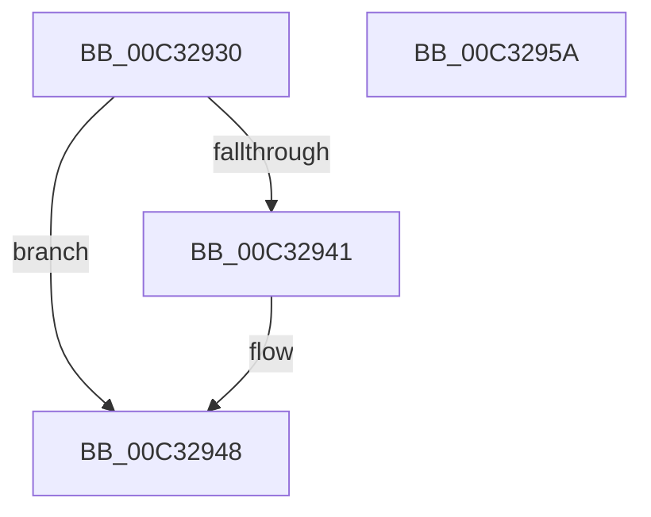

# PnpWaitForDevicesToStart

- RVA: `0x00C32930`–`0x00C3295B` (길이 `43` bytes)
- VA: `0x0000000140C32930`
- 실행 섹션: `INIT`
- PDB 이름 있음: `예`; PDB Function 태그: `아니요`
- unwind 정보 RVA: `0x0005CF00`
- 디코드: `16`개 명령, `43/43` bytes 표시
- 미해석 바이트: `0` (있으면 어셈블리에 `.byte`로 보존)

> 이 문서는 커널 이미지의 기계어와 PDB 기호를 분석해 생성했습니다. 4번과 5번은 함수 원형과 자료형을 바이너리 사용 방식에서 추정한 C 해석이며 원본 소스 복구 결과는 아닙니다.

## 1. Dependencies

- 직접 호출 지점: **3**; 고유 호출 대상: **3**
- 직접 호출자로 확인된 함수: **2**
- RIP 상대 이미지 참조: **0**

### Outgoing calls
- `0x00C32936` → [Feature_Servicing_PnpBootWaitForAsyncBusRelations__private_IsEnabledDeviceUsageNoInline](../../text/4C/Feature_Servicing_PnpBootWaitForAsyncBusRelations__private_IsEnabledDeviceUsageNoInline_function_004C8A70.md) (function, `0x004C8A70`)
- `0x00C32943` → [IopInvalidateBusRelationsWorker](../../text/4C/IopInvalidateBusRelationsWorker_function_004C8900.md) (function, `0x004C8900`)
- `0x00C32948` → [PnpWaitForEmptyDeviceActionQueue](../../page/73/PnpWaitForEmptyDeviceActionQueue_function_007375AC.md) (function, `0x007375AC`)

### Direct callers
- [IopInitializeBootDrivers](../C2/IopInitializeBootDrivers_function_00C2E6F4.md) at `0x00C2ED73`
- [IopInitializeBootDrivers](../C2/IopInitializeBootDrivers_function_00C2E6F4.md) at `0x00C2ED9B`
- [IopInitializeBootDrivers](../C2/IopInitializeBootDrivers_function_00C2E6F4.md) at `0x00C2EDCF`
- [IopInitializeBootDrivers](../C2/IopInitializeBootDrivers_function_00C2E6F4.md) at `0x00C2EE1F`
- [IopInitializeBootDrivers](../C2/IopInitializeBootDrivers_function_00C2E6F4.md) at `0x00C2EE50`
- [IopInitializeBootDrivers](../C2/IopInitializeBootDrivers_function_00C2E6F4.md) at `0x00C2EEC7`
- [IopInitializeSystemDrivers](../C7/IopInitializeSystemDrivers_function_00C73590.md) at `0x00C7379C`

### Static image references
- 디코드된 RIP-relative 메모리 참조가 없습니다.

## 2. Other-region calls and transfers

- 다른 실행 섹션으로 향하는 call: **3**
  - `0x00C32936` → [Feature_Servicing_PnpBootWaitForAsyncBusRelations__private_IsEnabledDeviceUsageNoInline](../../text/4C/Feature_Servicing_PnpBootWaitForAsyncBusRelations__private_IsEnabledDeviceUsageNoInline_function_004C8A70.md) (`INIT` → `.text`)
  - `0x00C32943` → [IopInvalidateBusRelationsWorker](../../text/4C/IopInvalidateBusRelationsWorker_function_004C8900.md) (`INIT` → `.text`)
  - `0x00C32948` → [PnpWaitForEmptyDeviceActionQueue](../../page/73/PnpWaitForEmptyDeviceActionQueue_function_007375AC.md) (`INIT` → `PAGE`)
- 별도 외부 분기/꼬리 이동을 확인하지 못했습니다.

## 3. Assembly (complete function range)

```asm
00C32930  40 53                           push rbx
00C32932  48 83 EC 20                     sub rsp, 0x20
00C32936  E8 35 61 89 FF                  call 0x1404c8a70
00C3293B  33 DB                           xor ebx, ebx
00C3293D  85 C0                           test eax, eax
00C3293F  74 07                           je 0x140c32948
00C32941  33 C9                           xor ecx, ecx
00C32943  E8 B8 5F 89 FF                  call 0x1404c8900
00C32948  E8 5F 4C B0 FF                  call 0x1407375ac
00C3294D  85 C0                           test eax, eax
00C3294F  0F 99 C3                        setns bl
00C32952  8B C3                           mov eax, ebx
00C32954  48 83 C4 20                     add rsp, 0x20
00C32958  5B                              pop rbx
00C32959  C3                              ret
00C3295A  CC                              int3
```

## 4. C-style interpretation (structured pseudocode)

```c
__int64 __fastcall PnpWaitForDevicesToStart(int a1)
{
    __int64 result;
    __int64 v_rbx;
    __int64 v_rsp;

    v_rsp = (v_rsp) - (32);
    result = Feature_Servicing_PnpBootWaitForAsyncBusRelations__private_IsEnabledDeviceUsageNoInline(a1, a2, a3, a4);
    v_rbx = 0;
    if ((unsigned int)(result) != 0) {
        a1 = 0;
        result = IopInvalidateBusRelationsWorker(a1, a2, a3, a4);
    }
    result = PnpWaitForEmptyDeviceActionQueue(a1, a2, a3, a4);
    v_rbx = (!sign_flag) ? 1 : 0;
    v_rsp = (v_rsp) + (32);
    return (unsigned int)((unsigned int)(v_rbx));
}
```

## 5. (Beta) C Style

```c
int64_t PnpWaitForDevicesToStart(int32_t Arg1)
{
    int64_t result;
    int64_t local_rbx;
    int64_t local_rsp;

    local_rsp = (local_rsp) - (32);
    result = Feature_Servicing_PnpBootWaitForAsyncBusRelations__private_IsEnabledDeviceUsageNoInline(Arg1, a2, a3, a4);
    local_rbx = 0;
    if ((uint32_t)(result) != 0) {
        Arg1 = 0;
        result = IopInvalidateBusRelationsWorker(Arg1, a2, a3, a4);
    }
    result = PnpWaitForEmptyDeviceActionQueue(Arg1, a2, a3, a4);
    local_rbx = (!sign_flag) ? 1 : 0;
    local_rsp = (local_rsp) + (32);
    return (uint32_t)((uint32_t)(local_rbx));
}
```

## 6. Execution-region graph

[열기: 2D/3D 그래프와 함수 탐색 컨트롤 패널](../../../control-panel.html?section=init&rva=0x00C32930&view=graph)

- 2D 그래프는 위에서 아래로 흐르고, 3D 그래프는 빈 공간을 드래그해 회전합니다. Shift+드래그는 이동, 휠은 확대·축소, 함수 노드 선택은 대상 보고서 이동입니다.

### Static fallback


