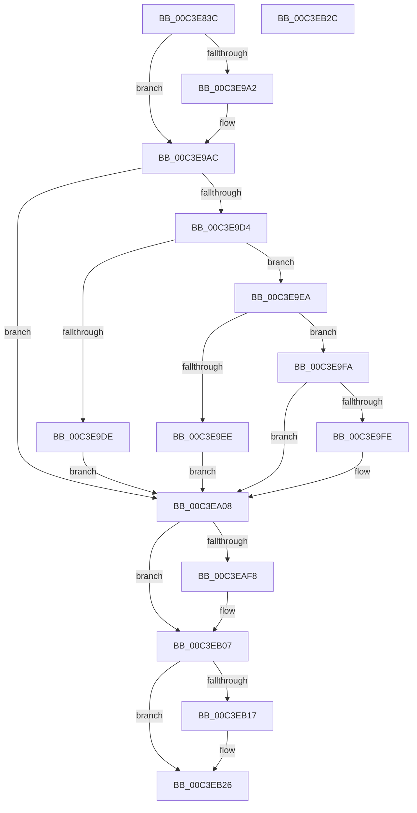

# PoFxInitPowerManagement

- RVA: `0x00C3E83C`–`0x00C3EB2D` (길이 `753` bytes)
- VA: `0x0000000140C3E83C`
- 실행 섹션: `INIT`
- PDB 이름 있음: `예`; PDB Function 태그: `아니요`
- unwind 정보 RVA: `0x0005CF00`
- 디코드: `127`개 명령, `753/753` bytes 표시
- 미해석 바이트: `0` (있으면 어셈블리에 `.byte`로 보존)

> 이 문서는 커널 이미지의 기계어와 PDB 기호를 분석해 생성했습니다. 4번과 5번은 함수 원형과 자료형을 바이너리 사용 방식에서 추정한 C 해석이며 원본 소스 복구 결과는 아닙니다.

## 1. Dependencies

- 직접 호출 지점: **4**; 고유 호출 대상: **3**
- 직접 호출자로 확인된 함수: **1**
- RIP 상대 이미지 참조: **86**

### Outgoing calls
- `0x00C3E842` → [Feature_Sx_PEP_Notification_Synchronization__private_ReportUsage](../../text/5C/Feature_Sx_PEP_Notification_Synchronization__private_ReportUsage_function_005CF03C.md) (function, `0x005CF03C`)
- `0x00C3E9C0` → [memset](../../text/6C/memset_function_006C6C40.md) (function, `0x006C6C40`)
- `0x00C3EA26` → [PopFxInitializeWorkPool](../../page/75/PopFxInitializeWorkPool_function_00759290.md) (function, `0x00759290`)
- `0x00C3EA34` → [PopFxInitializeWorkPool](../../page/75/PopFxInitializeWorkPool_function_00759290.md) (function, `0x00759290`)

### Direct callers
- [PoInitSystem](../C7/PoInitSystem_function_00C72358.md) at `0x00C72BFB`

### Static image references
- `0x00C3E849` → RVA `0x00F0E522` (`.data`; write)
- `0x00C3E850` → RVA `0x00F0E3F0` (`.data`; read)
- `0x00C3E857` → RVA `0x00F0E480` (`.data`; write)
- `0x00C3E85E` → RVA `0x00F0E3F8` (`.data`; write)
- `0x00C3E865` → RVA `0x00F0E410` (`.data`; read)
- `0x00C3E86C` → RVA `0x00F0E3F0` (`.data`; write)
- `0x00C3E873` → RVA `0x00F0E3E0` (`.data`; read)
- `0x00C3E87A` → RVA `0x00F0E3E8` (`.data`; write)
- `0x00C3E881` → RVA `0x00F0E3E0` (`.data`; write)
- `0x00C3E888` → RVA `0x00F0E560` (`.data`; read)
- `0x00C3E88F` → RVA `0x00F0E568` (`.data`; write)
- `0x00C3E896` → RVA `0x00F0E560` (`.data`; write)
- `0x00C3E89D` → RVA `0x00462650` (`PopFxResidentTimeoutRoutine`; read)
- `0x00C3E8A4` → RVA `0x00F0E4F0` (`.data`; write)
- `0x00C3E8AB` → RVA `0x00F0E508` (`.data`; read)
- `0x00C3E8B2` → RVA `0x00F0E510` (`.data`; write)
- `0x00C3E8B9` → RVA `0x00F0E508` (`.data`; write)
- `0x00C3E8C0` → RVA `0x00F0E528` (`.data`; read)
- `0x00C3E8C7` → RVA `0x00F0E530` (`.data`; write)
- `0x00C3E8CE` → RVA `0x00F0E528` (`.data`; write)
- `0x00C3E8D5` → RVA `0x004A54C0` (`PopFxResidentTimeoutDpcRoutine`; read)
- `0x00C3E8DC` → RVA `0x00F0E458` (`.data`; write)
- `0x00C3E8E3` → RVA `0x00F0E488` (`.data`; read)
- `0x00C3E8EA` → RVA `0x00F0E490` (`.data`; write)
- `0x00C3E8F1` → RVA `0x00F0E488` (`.data`; write)
- `0x00C3E8F8` → RVA `0x00E0B3D4` (`.data`; read)
- `0x00C3E902` → RVA `0x00E0B3E4` (`.data`; read)
- `0x00C3E909` → RVA `0x00F0E418` (`.data`; write)
- `0x00C3E910` → RVA `0x00F0E410` (`.data`; write)
- `0x00C3E917` → RVA `0x00F0E400` (`.data`; write)
- `0x00C3E91E` → RVA `0x00E0B3D4` (`.data`; write)
- `0x00C3E924` → RVA `0x00F0E408` (`.data`; write)
- `0x00C3E92B` → RVA `0x00F0E428` (`.data`; write)
- `0x00C3E932` → RVA `0x00F0E550` (`.data`; write)
- `0x00C3E939` → RVA `0x00F0E4F8` (`.data`; write)
- `0x00C3E940` → RVA `0x00F0E4E0` (`.data`; write)
- `0x00C3E947` → RVA `0x00F0E4C0` (`.data`; write)
- `0x00C3E94E` → RVA `0x00F0E500` (`.data`; write)
- `0x00C3E955` → RVA `0x00F0E520` (`.data`; write)
- `0x00C3E95C` → RVA `0x00F0E524` (`.data`; write)
- `0x00C3E966` → RVA `0x00F0E440` (`.data`; write)
- `0x00C3E970` → RVA `0x00F0E460` (`.data`; write)
- `0x00C3E977` → RVA `0x00F0E478` (`.data`; write)
- `0x00C3E97E` → RVA `0x00F0E450` (`.data`; write)
- `0x00C3E98C` → RVA `0x00F0E498` (`.data`; write)
- `0x00C3E993` → RVA `0x00F0E4BC` (`.data`; write)
- `0x00C3E999` → RVA `0x00F0E4B8` (`.data`; write)
- `0x00C3E9A2` → RVA `0x00E0B3E4` (`.data`; write)
- `0x00C3E9AE` → RVA `0x00F0E570` (`.data`; write)
- `0x00C3E9B5` → RVA `0x00F0E6C1` (`.data`; read)
- `0x00C3E9C5` → RVA `0x00F0C6F0` (`.data`; read)
- `0x00C3E9CB` → RVA `0x00F0E6C0` (`.data`; write)
- `0x00C3E9D4` → RVA `0x00E0B574` (`.data`; read)
- `0x00C3E9DE` → RVA `0x00E676B0` (`.data`; write)
- `0x00C3EA08` → RVA `0x00F0E540` (`.data`; read)
- `0x00C3EA11` → RVA `0x00F0E2A0` (`.data`; read)
- `0x00C3EA18` → RVA `0x00F0E548` (`.data`; write)
- `0x00C3EA1F` → RVA `0x00F0E540` (`.data`; write)
- `0x00C3EA2D` → RVA `0x00F0E580` (`.data`; read)
- `0x00C3EA39` → RVA `0x00F07680` (`.data`; read)
- `0x00C3EA40` → RVA `0x00F07700` (`.data`; write)
- `0x00C3EA47` → RVA `0x00F07688` (`.data`; write)
- `0x00C3EA51` → RVA `0x00F07680` (`.data`; write)
- `0x00C3EA58` → RVA `0x00458E10` (`PopPepIdleTimeoutRoutine`; read)
- `0x00C3EA5F` → RVA `0x00F076B0` (`.data`; write)
- `0x00C3EA66` → RVA `0x004A5B60` (`PopPepIdleTimeoutDpcRoutine`; read)
- `0x00C3EA6D` → RVA `0x00F076D8` (`.data`; write)
- `0x00C3EA74` → RVA `0x00F07708` (`.data`; read)
- `0x00C3EA7B` → RVA `0x00F07710` (`.data`; write)
- `0x00C3EA82` → RVA `0x00F07708` (`.data`; write)
- `0x00C3EA8B` → RVA `0x00F070F0` (`.data`; write)
- `0x00C3EA92` → RVA `0x00FC5174` (`ALMOSTRO`; read)
- `0x00C3EA98` → RVA `0x00F07678` (`.data`; write)
- `0x00C3EA9F` → RVA `0x00F076B8` (`.data`; write)
- `0x00C3EAA6` → RVA `0x00F076A0` (`.data`; write)
- `0x00C3EAAD` → RVA `0x00F076C0` (`.data`; write)
- `0x00C3EAB7` → RVA `0x00F076E0` (`.data`; write)
- `0x00C3EABE` → RVA `0x00F076F8` (`.data`; write)
- `0x00C3EAC5` → RVA `0x00F076D0` (`.data`; write)
- `0x00C3EAD3` → RVA `0x00F07718` (`.data`; write)
- `0x00C3EADA` → RVA `0x00F0773C` (`.data`; write)
- `0x00C3EAE0` → RVA `0x00F07738` (`.data`; write)
- `0x00C3EAE7` → RVA `0x00F0E3D4` (`.data`; write)
- `0x00C3EAED` → RVA `0x00F070E0` (`.data`; read)
- `0x00C3EB07` → RVA `0x00FC5090` (`ALMOSTRO`; read)
- `0x00C3EB0D` → RVA `0x00F0E3D0` (`.data`; write)

## 2. Other-region calls and transfers

- 다른 실행 섹션으로 향하는 call: **4**
  - `0x00C3E842` → [Feature_Sx_PEP_Notification_Synchronization__private_ReportUsage](../../text/5C/Feature_Sx_PEP_Notification_Synchronization__private_ReportUsage_function_005CF03C.md) (`INIT` → `.text`)
  - `0x00C3E9C0` → [memset](../../text/6C/memset_function_006C6C40.md) (`INIT` → `.text`)
  - `0x00C3EA26` → [PopFxInitializeWorkPool](../../page/75/PopFxInitializeWorkPool_function_00759290.md) (`INIT` → `PAGE`)
  - `0x00C3EA34` → [PopFxInitializeWorkPool](../../page/75/PopFxInitializeWorkPool_function_00759290.md) (`INIT` → `PAGE`)
- 별도 외부 분기/꼬리 이동을 확인하지 못했습니다.

## 3. Assembly (complete function range)

```asm
00C3E83C  40 53                           push rbx
00C3E83E  48 83 EC 20                     sub rsp, 0x20
00C3E842  E8 F5 07 99 FF                  call 0x1405cf03c
00C3E847  33 DB                           xor ebx, ebx
00C3E849  C6 05 D2 FC 2C 00 06            mov byte ptr [rip + 0x2cfcd2], 6
00C3E850  48 8D 05 99 FB 2C 00            lea rax, [rip + 0x2cfb99]
00C3E857  48 89 1D 22 FC 2C 00            mov qword ptr [rip + 0x2cfc22], rbx
00C3E85E  48 89 05 93 FB 2C 00            mov qword ptr [rip + 0x2cfb93], rax
00C3E865  48 8D 0D A4 FB 2C 00            lea rcx, [rip + 0x2cfba4]
00C3E86C  48 89 05 7D FB 2C 00            mov qword ptr [rip + 0x2cfb7d], rax
00C3E873  48 8D 05 66 FB 2C 00            lea rax, [rip + 0x2cfb66]
00C3E87A  48 89 05 67 FB 2C 00            mov qword ptr [rip + 0x2cfb67], rax
00C3E881  48 89 05 58 FB 2C 00            mov qword ptr [rip + 0x2cfb58], rax
00C3E888  48 8D 05 D1 FC 2C 00            lea rax, [rip + 0x2cfcd1]
00C3E88F  48 89 05 D2 FC 2C 00            mov qword ptr [rip + 0x2cfcd2], rax
00C3E896  48 89 05 C3 FC 2C 00            mov qword ptr [rip + 0x2cfcc3], rax
00C3E89D  48 8D 05 AC 3D 82 FF            lea rax, [rip - 0x7dc254]
00C3E8A4  48 89 05 45 FC 2C 00            mov qword ptr [rip + 0x2cfc45], rax
00C3E8AB  48 8D 05 56 FC 2C 00            lea rax, [rip + 0x2cfc56]
00C3E8B2  48 89 05 57 FC 2C 00            mov qword ptr [rip + 0x2cfc57], rax
00C3E8B9  48 89 05 48 FC 2C 00            mov qword ptr [rip + 0x2cfc48], rax
00C3E8C0  48 8D 05 61 FC 2C 00            lea rax, [rip + 0x2cfc61]
00C3E8C7  48 89 05 62 FC 2C 00            mov qword ptr [rip + 0x2cfc62], rax
00C3E8CE  48 89 05 53 FC 2C 00            mov qword ptr [rip + 0x2cfc53], rax
00C3E8D5  48 8D 05 E4 6B 86 FF            lea rax, [rip - 0x79941c]
00C3E8DC  48 89 05 75 FB 2C 00            mov qword ptr [rip + 0x2cfb75], rax
00C3E8E3  48 8D 05 9E FB 2C 00            lea rax, [rip + 0x2cfb9e]
00C3E8EA  48 89 05 9F FB 2C 00            mov qword ptr [rip + 0x2cfb9f], rax
00C3E8F1  48 89 05 90 FB 2C 00            mov qword ptr [rip + 0x2cfb90], rax
00C3E8F8  69 05 D2 CA 1C 00 10 27 00 00   imul eax, dword ptr [rip + 0x1ccad2], 0x2710
00C3E902  83 3D DB CA 1C 00 03            cmp dword ptr [rip + 0x1ccadb], 3
00C3E909  48 89 0D 08 FB 2C 00            mov qword ptr [rip + 0x2cfb08], rcx
00C3E910  48 89 0D F9 FA 2C 00            mov qword ptr [rip + 0x2cfaf9], rcx
00C3E917  48 89 0D E2 FA 2C 00            mov qword ptr [rip + 0x2cfae2], rcx
00C3E91E  89 05 B0 CA 1C 00               mov dword ptr [rip + 0x1ccab0], eax
00C3E924  48 89 1D DD FA 2C 00            mov qword ptr [rip + 0x2cfadd], rbx
00C3E92B  48 89 1D F6 FA 2C 00            mov qword ptr [rip + 0x2cfaf6], rbx
00C3E932  48 89 1D 17 FC 2C 00            mov qword ptr [rip + 0x2cfc17], rbx
00C3E939  48 89 1D B8 FB 2C 00            mov qword ptr [rip + 0x2cfbb8], rbx
00C3E940  48 89 1D 99 FB 2C 00            mov qword ptr [rip + 0x2cfb99], rbx
00C3E947  48 89 1D 72 FB 2C 00            mov qword ptr [rip + 0x2cfb72], rbx
00C3E94E  48 89 1D AB FB 2C 00            mov qword ptr [rip + 0x2cfbab], rbx
00C3E955  66 89 1D C4 FB 2C 00            mov word ptr [rip + 0x2cfbc4], bx
00C3E95C  C7 05 BE FB 2C 00 01 00 00 00   mov dword ptr [rip + 0x2cfbbe], 1
00C3E966  C7 05 D0 FA 2C 00 13 01 00 00   mov dword ptr [rip + 0x2cfad0], 0x113
00C3E970  48 89 1D E9 FA 2C 00            mov qword ptr [rip + 0x2cfae9], rbx
00C3E977  48 89 1D FA FA 2C 00            mov qword ptr [rip + 0x2cfafa], rbx
00C3E97E  48 89 1D CB FA 2C 00            mov qword ptr [rip + 0x2cfacb], rbx
00C3E985  C6 05 F4 FA 2C 00 09            mov byte ptr [rip + 0x2cfaf4], 9
00C3E98C  48 89 1D 05 FB 2C 00            mov qword ptr [rip + 0x2cfb05], rbx
00C3E993  89 1D 23 FB 2C 00               mov dword ptr [rip + 0x2cfb23], ebx
00C3E999  66 89 1D 18 FB 2C 00            mov word ptr [rip + 0x2cfb18], bx
00C3E9A0  72 0A                           jb 0x140c3e9ac
00C3E9A2  C7 05 38 CA 1C 00 01 00 00 00   mov dword ptr [rip + 0x1cca38], 1
00C3E9AC  33 D2                           xor edx, edx
00C3E9AE  48 89 1D BB FB 2C 00            mov qword ptr [rip + 0x2cfbbb], rbx
00C3E9B5  48 8D 0D 05 FD 2C 00            lea rcx, [rip + 0x2cfd05]
00C3E9BC  44 8D 42 6F                     lea r8d, [rdx + 0x6f]
00C3E9C0  E8 7B 82 A8 FF                  call 0x1406c6c40
00C3E9C5  39 1D 25 DD 2C 00               cmp dword ptr [rip + 0x2cdd25], ebx
00C3E9CB  C6 05 EE FC 2C 00 01            mov byte ptr [rip + 0x2cfcee], 1
00C3E9D2  75 34                           jne 0x140c3ea08
00C3E9D4  8B 05 9A CB 1C 00               mov eax, dword ptr [rip + 0x1ccb9a]
00C3E9DA  A8 01                           test al, 1
00C3E9DC  74 0C                           je 0x140c3e9ea
00C3E9DE  C7 05 C8 8C 22 00 01 00 00 00   mov dword ptr [rip + 0x228cc8], 1
00C3E9E8  EB 1E                           jmp 0x140c3ea08
00C3E9EA  A8 02                           test al, 2
00C3E9EC  74 0C                           je 0x140c3e9fa
00C3E9EE  C7 05 B8 8C 22 00 02 00 00 00   mov dword ptr [rip + 0x228cb8], 2
00C3E9F8  EB 0E                           jmp 0x140c3ea08
00C3E9FA  A8 04                           test al, 4
00C3E9FC  74 0A                           je 0x140c3ea08
00C3E9FE  C7 05 A8 8C 22 00 03 00 00 00   mov dword ptr [rip + 0x228ca8], 3
00C3EA08  48 8D 05 31 FB 2C 00            lea rax, [rip + 0x2cfb31]
00C3EA0F  33 D2                           xor edx, edx
00C3EA11  48 8D 0D 88 F8 2C 00            lea rcx, [rip + 0x2cf888]
00C3EA18  48 89 05 29 FB 2C 00            mov qword ptr [rip + 0x2cfb29], rax
00C3EA1F  48 89 05 1A FB 2C 00            mov qword ptr [rip + 0x2cfb1a], rax
00C3EA26  E8 65 A8 B1 FF                  call 0x140759290
00C3EA2B  33 D2                           xor edx, edx
00C3EA2D  48 8D 0D 4C FB 2C 00            lea rcx, [rip + 0x2cfb4c]
00C3EA34  E8 57 A8 B1 FF                  call 0x140759290
00C3EA39  48 8D 05 40 8C 2C 00            lea rax, [rip + 0x2c8c40]
00C3EA40  48 89 1D B9 8C 2C 00            mov qword ptr [rip + 0x2c8cb9], rbx
00C3EA47  48 89 05 3A 8C 2C 00            mov qword ptr [rip + 0x2c8c3a], rax
00C3EA4E  0F 57 C0                        xorps xmm0, xmm0
00C3EA51  48 89 05 28 8C 2C 00            mov qword ptr [rip + 0x2c8c28], rax
00C3EA58  48 8D 05 B1 A3 81 FF            lea rax, [rip - 0x7e5c4f]
00C3EA5F  48 89 05 4A 8C 2C 00            mov qword ptr [rip + 0x2c8c4a], rax
00C3EA66  48 8D 05 F3 70 86 FF            lea rax, [rip - 0x798f0d]
00C3EA6D  48 89 05 64 8C 2C 00            mov qword ptr [rip + 0x2c8c64], rax
00C3EA74  48 8D 05 8D 8C 2C 00            lea rax, [rip + 0x2c8c8d]
00C3EA7B  48 89 05 8E 8C 2C 00            mov qword ptr [rip + 0x2c8c8e], rax
00C3EA82  48 89 05 7F 8C 2C 00            mov qword ptr [rip + 0x2c8c7f], rax
00C3EA89  33 C0                           xor eax, eax
00C3EA8B  48 89 05 5E 86 2C 00            mov qword ptr [rip + 0x2c865e], rax
00C3EA92  8B 05 DC 66 38 00               mov eax, dword ptr [rip + 0x3866dc]
00C3EA98  48 89 1D D9 8B 2C 00            mov qword ptr [rip + 0x2c8bd9], rbx
00C3EA9F  48 89 1D 12 8C 2C 00            mov qword ptr [rip + 0x2c8c12], rbx
00C3EAA6  48 89 1D F3 8B 2C 00            mov qword ptr [rip + 0x2c8bf3], rbx
00C3EAAD  C7 05 09 8C 2C 00 13 01 00 00   mov dword ptr [rip + 0x2c8c09], 0x113
00C3EAB7  48 89 1D 22 8C 2C 00            mov qword ptr [rip + 0x2c8c22], rbx
00C3EABE  48 89 1D 33 8C 2C 00            mov qword ptr [rip + 0x2c8c33], rbx
00C3EAC5  48 89 1D 04 8C 2C 00            mov qword ptr [rip + 0x2c8c04], rbx
00C3EACC  C6 05 2D 8C 2C 00 09            mov byte ptr [rip + 0x2c8c2d], 9
00C3EAD3  48 89 1D 3E 8C 2C 00            mov qword ptr [rip + 0x2c8c3e], rbx
00C3EADA  89 1D 5C 8C 2C 00               mov dword ptr [rip + 0x2c8c5c], ebx
00C3EAE0  66 89 1D 51 8C 2C 00            mov word ptr [rip + 0x2c8c51], bx
00C3EAE7  89 1D E7 F8 2C 00               mov dword ptr [rip + 0x2cf8e7], ebx
00C3EAED  0F 11 05 EC 85 2C 00            movups xmmword ptr [rip + 0x2c85ec], xmm0
00C3EAF4  85 C0                           test eax, eax
00C3EAF6  74 0F                           je 0x140c3eb07
00C3EAF8  83 C0 78                        add eax, 0x78
00C3EAFB  69 C8 E8 03 00 00               imul ecx, eax, 0x3e8
00C3EB01  89 0D CD F8 2C 00               mov dword ptr [rip + 0x2cf8cd], ecx
00C3EB07  8B 05 83 65 38 00               mov eax, dword ptr [rip + 0x386583]
00C3EB0D  89 1D BD F8 2C 00               mov dword ptr [rip + 0x2cf8bd], ebx
00C3EB13  85 C0                           test eax, eax
00C3EB15  74 0F                           je 0x140c3eb26
00C3EB17  83 C0 78                        add eax, 0x78
00C3EB1A  69 C8 E8 03 00 00               imul ecx, eax, 0x3e8
00C3EB20  89 0D AA F8 2C 00               mov dword ptr [rip + 0x2cf8aa], ecx
00C3EB26  48 83 C4 20                     add rsp, 0x20
00C3EB2A  5B                              pop rbx
00C3EB2B  C3                              ret
00C3EB2C  CC                              int3
```

## 4. C-style interpretation (structured pseudocode)

```c
__int64 __fastcall PoFxInitPowerManagement(__int64 a1, int a2)
{
    __int64 result;
    __int64 v_rbx;
    __int64 v_rsp;

    v_rsp = (v_rsp) - (32);
    result = Feature_Sx_PEP_Notification_Synchronization__private_ReportUsage(a1, a2, a3, a4);
    v_rbx = 0;
    *(unsigned __int8 *)(v_rip + 2948306) = 6;
    *(unsigned __int64 *)(v_rip + 2948130) = 0;
    *(unsigned __int64 *)(v_rip + 2947987) = v_rip + 2947993;
    *(unsigned __int64 *)(v_rip + 2947965) = v_rip + 2947993;
    *(unsigned __int64 *)(v_rip + 2947943) = v_rip + 2947942;
    *(unsigned __int64 *)(v_rip + 2947928) = v_rip + 2947942;
    *(unsigned __int64 *)(v_rip + 2948306) = v_rip + 2948305;
    *(unsigned __int64 *)(v_rip + 2948291) = v_rip + 2948305;
    *(unsigned __int64 *)(v_rip + 2948165) = v_rip - 8241748;
    *(unsigned __int64 *)(v_rip + 2948183) = v_rip + 2948182;
    *(unsigned __int64 *)(v_rip + 2948168) = v_rip + 2948182;
    *(unsigned __int64 *)(v_rip + 2948194) = v_rip + 2948193;
    *(unsigned __int64 *)(v_rip + 2948179) = v_rip + 2948193;
    *(unsigned __int64 *)(v_rip + 2947957) = v_rip - 7967772;
    *(unsigned __int64 *)(v_rip + 2947999) = v_rip + 2947998;
    *(unsigned __int64 *)(v_rip + 2947984) = v_rip + 2947998;
    result = (unsigned int)((v_rip + 2947998) * (*(unsigned int *)(v_rip + 1886930)));
    *(unsigned __int64 *)(v_rip + 2947848) = v_rip + 2948004;
    *(unsigned __int64 *)(v_rip + 2947833) = v_rip + 2948004;
    *(unsigned __int64 *)(v_rip + 2947810) = v_rip + 2948004;
    *(unsigned int *)(v_rip + 1886896) = (unsigned int)(result);
    *(unsigned __int64 *)(v_rip + 2947805) = 0;
    *(unsigned __int64 *)(v_rip + 2947830) = 0;
    *(unsigned __int64 *)(v_rip + 2948119) = 0;
    *(unsigned __int64 *)(v_rip + 2948024) = 0;
    *(unsigned __int64 *)(v_rip + 2947993) = 0;
    *(unsigned __int64 *)(v_rip + 2947954) = 0;
    *(unsigned __int64 *)(v_rip + 2948011) = 0;
    *(unsigned __int16 *)(v_rip + 2948036) = 0;
    *(unsigned int *)(v_rip + 2948030) = 1;
    *(unsigned int *)(v_rip + 2947792) = 275;
    *(unsigned __int64 *)(v_rip + 2947817) = 0;
    *(unsigned __int64 *)(v_rip + 2947834) = 0;
    *(unsigned __int64 *)(v_rip + 2947787) = 0;
    *(unsigned __int8 *)(v_rip + 2947828) = 9;
    *(unsigned __int64 *)(v_rip + 2947845) = 0;
    *(unsigned int *)(v_rip + 2947875) = 0;
    *(unsigned __int16 *)(v_rip + 2947864) = 0;
    if ((*(unsigned int *)(v_rip + 1886939)) >= 3) {
        *(unsigned int *)(v_rip + 1886776) = 1;
    }
    a2 = 0;
    *(unsigned __int64 *)(v_rip + 2948027) = 0;
    result = memset(v_rip + 2948357, a2, a2 + 111, a4);
    *(unsigned __int8 *)(v_rip + 2948334) = 1;
    if ((*(unsigned int *)(v_rip + 2940197)) != 0) goto loc_00C3EA08;
    if ((((unsigned __int8)((unsigned int)(*(unsigned int *)(v_rip + 1887130)))) & (1)) == 0) goto loc_00C3E9EA;
    *(unsigned int *)(v_rip + 2264264) = 1;
    goto loc_00C3EA08;
loc_00C3E9EA:
    if ((((unsigned __int8)((unsigned int)(*(unsigned int *)(v_rip + 1887130)))) & (2)) == 0) goto loc_00C3E9FA;
    *(unsigned int *)(v_rip + 2264248) = 2;
    goto loc_00C3EA08;
loc_00C3E9FA:
    if ((((unsigned __int8)((unsigned int)(*(unsigned int *)(v_rip + 1887130)))) & (4)) != 0) {
        *(unsigned int *)(v_rip + 2264232) = 3;
    }
    a2 = 0;
    *(unsigned __int64 *)(v_rip + 2947881) = v_rip + 2947889;
    *(unsigned __int64 *)(v_rip + 2947866) = v_rip + 2947889;
    result = PopFxInitializeWorkPool(v_rip + 2947208, a2, a2 + 111, a4);
    a2 = 0;
    result = PopFxInitializeWorkPool(v_rip + 2947916, a2, a2 + 111, a4);
    *(unsigned __int64 *)(v_rip + 2919609) = 0;
    *(unsigned __int64 *)(v_rip + 2919482) = v_rip + 2919488;
    *(unsigned __int64 *)(v_rip + 2919464) = v_rip + 2919488;
    *(unsigned __int64 *)(v_rip + 2919498) = v_rip - 8281167;
    *(unsigned __int64 *)(v_rip + 2919524) = v_rip - 7966477;
    *(unsigned __int64 *)(v_rip + 2919566) = v_rip + 2919565;
    *(unsigned __int64 *)(v_rip + 2919551) = v_rip + 2919565;
    result = 0;
    *(unsigned __int64 *)(v_rip + 2917982) = 0;
    *(unsigned __int64 *)(v_rip + 2919385) = 0;
    *(unsigned __int64 *)(v_rip + 2919442) = 0;
    *(unsigned __int64 *)(v_rip + 2919411) = 0;
    *(unsigned int *)(v_rip + 2919433) = 275;
    *(unsigned __int64 *)(v_rip + 2919458) = 0;
    *(unsigned __int64 *)(v_rip + 2919475) = 0;
    *(unsigned __int64 *)(v_rip + 2919428) = 0;
    *(unsigned __int8 *)(v_rip + 2919469) = 9;
    *(unsigned __int64 *)(v_rip + 2919486) = 0;
    *(unsigned int *)(v_rip + 2919516) = 0;
    *(unsigned __int16 *)(v_rip + 2919505) = 0;
    *(unsigned int *)(v_rip + 2947303) = 0;
    *(unsigned __int64 *)(v_rip + 2917868) = v_xmm0;
    result = (unsigned int)(*(unsigned int *)(v_rip + 3696348));
    if ((unsigned int)((unsigned int)(*(unsigned int *)(v_rip + 3696348))) != 0) {
        result = (unsigned int)(((unsigned int)(*(unsigned int *)(v_rip + 3696348))) + (120));
        a1 = (unsigned int)((v_rip + 2947916) * ((unsigned int)(result)));
        *(unsigned int *)(v_rip + 2947277) = (unsigned int)(a1);
    }
    *(unsigned int *)(v_rip + 2947261) = 0;
    result = (unsigned int)(*(unsigned int *)(v_rip + 3696003));
    if ((unsigned int)((unsigned int)(*(unsigned int *)(v_rip + 3696003))) != 0) {
        result = (unsigned int)(((unsigned int)(*(unsigned int *)(v_rip + 3696003))) + (120));
        a1 = (unsigned int)((a1) * ((unsigned int)(result)));
        *(unsigned int *)(v_rip + 2947242) = (unsigned int)(a1);
    }
    v_rsp = (v_rsp) + (32);
    return result;
}
```

## 5. (Beta) C Style

```c
int64_t PoFxInitPowerManagement(int64_t Arg1, int32_t Arg2)
{
    int64_t result;
    int64_t local_rbx;
    int64_t local_rsp;

    local_rsp = (local_rsp) - (32);
    result = Feature_Sx_PEP_Notification_Synchronization__private_ReportUsage(Arg1, Arg2, a3, a4);
    local_rbx = 0;
    *(uint8_t *)(v_rip + 0x2CFCD2) = 6;
    *(uint64_t *)(v_rip + 0x2CFC22) = 0;
    *(uint64_t *)(v_rip + 0x2CFB93) = v_rip + 2947993;
    *(uint64_t *)(v_rip + 0x2CFB7D) = v_rip + 2947993;
    *(uint64_t *)(v_rip + 0x2CFB67) = v_rip + 2947942;
    *(uint64_t *)(v_rip + 0x2CFB58) = v_rip + 2947942;
    *(uint64_t *)(v_rip + 0x2CFCD2) = v_rip + 2948305;
    *(uint64_t *)(v_rip + 0x2CFCC3) = v_rip + 2948305;
    *(uint64_t *)(v_rip + 0x2CFC45) = v_rip - 8241748;
    *(uint64_t *)(v_rip + 0x2CFC57) = v_rip + 2948182;
    *(uint64_t *)(v_rip + 0x2CFC48) = v_rip + 2948182;
    *(uint64_t *)(v_rip + 0x2CFC62) = v_rip + 2948193;
    *(uint64_t *)(v_rip + 0x2CFC53) = v_rip + 2948193;
    *(uint64_t *)(v_rip + 0x2CFB75) = v_rip - 7967772;
    *(uint64_t *)(v_rip + 0x2CFB9F) = v_rip + 2947998;
    *(uint64_t *)(v_rip + 0x2CFB90) = v_rip + 2947998;
    result = (uint32_t)((v_rip + 2947998) * (*(uint32_t *)(v_rip + 0x1CCAD2)));
    *(uint64_t *)(v_rip + 0x2CFB08) = v_rip + 2948004;
    *(uint64_t *)(v_rip + 0x2CFAF9) = v_rip + 2948004;
    *(uint64_t *)(v_rip + 0x2CFAE2) = v_rip + 2948004;
    *(uint32_t *)(v_rip + 0x1CCAB0) = (uint32_t)(result);
    *(uint64_t *)(v_rip + 0x2CFADD) = 0;
    *(uint64_t *)(v_rip + 0x2CFAF6) = 0;
    *(uint64_t *)(v_rip + 0x2CFC17) = 0;
    *(uint64_t *)(v_rip + 0x2CFBB8) = 0;
    *(uint64_t *)(v_rip + 0x2CFB99) = 0;
    *(uint64_t *)(v_rip + 0x2CFB72) = 0;
    *(uint64_t *)(v_rip + 0x2CFBAB) = 0;
    *(uint16_t *)(v_rip + 0x2CFBC4) = 0;
    *(uint32_t *)(v_rip + 0x2CFBBE) = 1;
    *(uint32_t *)(v_rip + 0x2CFAD0) = 275;
    *(uint64_t *)(v_rip + 0x2CFAE9) = 0;
    *(uint64_t *)(v_rip + 0x2CFAFA) = 0;
    *(uint64_t *)(v_rip + 0x2CFACB) = 0;
    *(uint8_t *)(v_rip + 0x2CFAF4) = 9;
    *(uint64_t *)(v_rip + 0x2CFB05) = 0;
    *(uint32_t *)(v_rip + 0x2CFB23) = 0;
    *(uint16_t *)(v_rip + 0x2CFB18) = 0;
    if ((*(uint32_t *)(v_rip + 0x1CCADB)) >= 3) {
        *(uint32_t *)(v_rip + 0x1CCA38) = 1;
    }
    Arg2 = 0;
    *(uint64_t *)(v_rip + 0x2CFBBB) = 0;
    result = memset(v_rip + 2948357, Arg2, Arg2 + 111, a4);
    *(uint8_t *)(v_rip + 0x2CFCEE) = 1;
    if ((*(uint32_t *)(v_rip + 0x2CDD25)) != 0) goto loc_00C3EA08;
    if ((((uint8_t)((uint32_t)(*(uint32_t *)(v_rip + 0x1CCB9A)))) & (1)) == 0) goto loc_00C3E9EA;
    *(uint32_t *)(v_rip + 0x228CC8) = 1;
    goto loc_00C3EA08;
loc_00C3E9EA:
    if ((((uint8_t)((uint32_t)(*(uint32_t *)(v_rip + 0x1CCB9A)))) & (2)) == 0) goto loc_00C3E9FA;
    *(uint32_t *)(v_rip + 0x228CB8) = 2;
    goto loc_00C3EA08;
loc_00C3E9FA:
    if ((((uint8_t)((uint32_t)(*(uint32_t *)(v_rip + 0x1CCB9A)))) & (4)) != 0) {
        *(uint32_t *)(v_rip + 0x228CA8) = 3;
    }
    Arg2 = 0;
    *(uint64_t *)(v_rip + 0x2CFB29) = v_rip + 2947889;
    *(uint64_t *)(v_rip + 0x2CFB1A) = v_rip + 2947889;
    result = PopFxInitializeWorkPool(v_rip + 2947208, Arg2, Arg2 + 111, a4);
    Arg2 = 0;
    result = PopFxInitializeWorkPool(v_rip + 2947916, Arg2, Arg2 + 111, a4);
    *(uint64_t *)(v_rip + 0x2C8CB9) = 0;
    *(uint64_t *)(v_rip + 0x2C8C3A) = v_rip + 2919488;
    *(uint64_t *)(v_rip + 0x2C8C28) = v_rip + 2919488;
    *(uint64_t *)(v_rip + 0x2C8C4A) = v_rip - 8281167;
    *(uint64_t *)(v_rip + 0x2C8C64) = v_rip - 7966477;
    *(uint64_t *)(v_rip + 0x2C8C8E) = v_rip + 2919565;
    *(uint64_t *)(v_rip + 0x2C8C7F) = v_rip + 2919565;
    result = 0;
    *(uint64_t *)(v_rip + 0x2C865E) = 0;
    *(uint64_t *)(v_rip + 0x2C8BD9) = 0;
    *(uint64_t *)(v_rip + 0x2C8C12) = 0;
    *(uint64_t *)(v_rip + 0x2C8BF3) = 0;
    *(uint32_t *)(v_rip + 0x2C8C09) = 275;
    *(uint64_t *)(v_rip + 0x2C8C22) = 0;
    *(uint64_t *)(v_rip + 0x2C8C33) = 0;
    *(uint64_t *)(v_rip + 0x2C8C04) = 0;
    *(uint8_t *)(v_rip + 0x2C8C2D) = 9;
    *(uint64_t *)(v_rip + 0x2C8C3E) = 0;
    *(uint32_t *)(v_rip + 0x2C8C5C) = 0;
    *(uint16_t *)(v_rip + 0x2C8C51) = 0;
    *(uint32_t *)(v_rip + 0x2CF8E7) = 0;
    *(uint64_t *)(v_rip + 0x2C85EC) = v_xmm0;
    result = (uint32_t)(*(uint32_t *)(v_rip + 0x3866DC));
    if ((uint32_t)((uint32_t)(*(uint32_t *)(v_rip + 0x3866DC))) != 0) {
        result = (uint32_t)(((uint32_t)(*(uint32_t *)(v_rip + 0x3866DC))) + (120));
        Arg1 = (uint32_t)((v_rip + 2947916) * ((uint32_t)(result)));
        *(uint32_t *)(v_rip + 0x2CF8CD) = (uint32_t)(Arg1);
    }
    *(uint32_t *)(v_rip + 0x2CF8BD) = 0;
    result = (uint32_t)(*(uint32_t *)(v_rip + 0x386583));
    if ((uint32_t)((uint32_t)(*(uint32_t *)(v_rip + 0x386583))) != 0) {
        result = (uint32_t)(((uint32_t)(*(uint32_t *)(v_rip + 0x386583))) + (120));
        Arg1 = (uint32_t)((Arg1) * ((uint32_t)(result)));
        *(uint32_t *)(v_rip + 0x2CF8AA) = (uint32_t)(Arg1);
    }
    local_rsp = (local_rsp) + (32);
    return result;
}
```

## 6. Execution-region graph

[열기: 2D/3D 그래프와 함수 탐색 컨트롤 패널](../../../control-panel.html?section=init&rva=0x00C3E83C&view=graph)

- 2D 그래프는 위에서 아래로 흐르고, 3D 그래프는 빈 공간을 드래그해 회전합니다. Shift+드래그는 이동, 휠은 확대·축소, 함수 노드 선택은 대상 보고서 이동입니다.

### Static fallback


