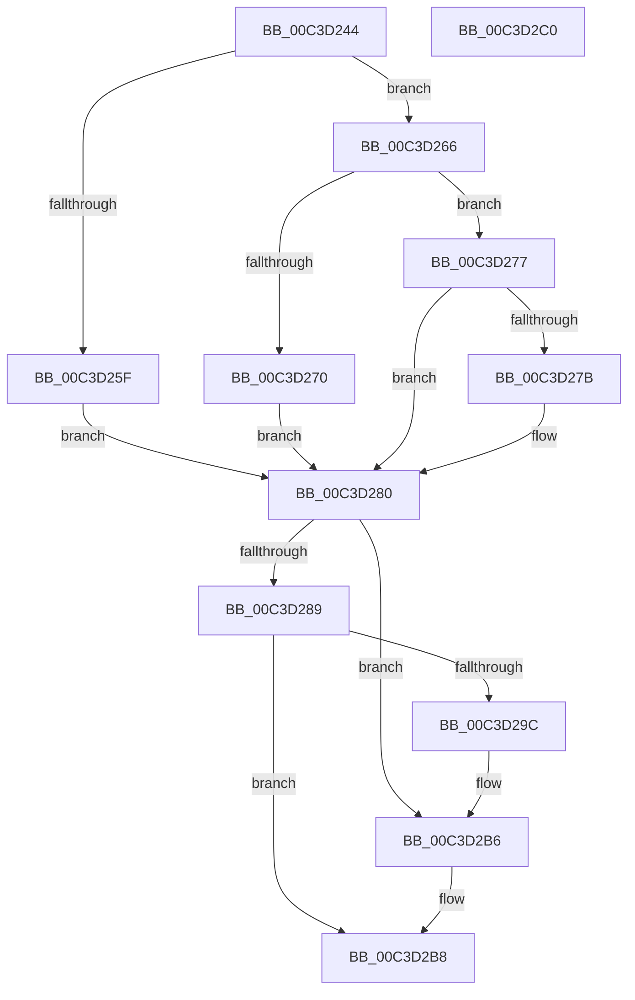

# PoInitHeteroDetection

- RVA: `0x00C3D244`–`0x00C3D2C1` (길이 `125` bytes)
- VA: `0x0000000140C3D244`
- 실행 섹션: `INIT`
- PDB 이름 있음: `예`; PDB Function 태그: `아니요`
- unwind 정보 RVA: `0x00064C80`
- 디코드: `37`개 명령, `125/125` bytes 표시
- 미해석 바이트: `0` (있으면 어셈블리에 `.byte`로 보존)

> 이 문서는 커널 이미지의 기계어와 PDB 기호를 분석해 생성했습니다. 4번과 5번은 함수 원형과 자료형을 바이너리 사용 방식에서 추정한 C 해석이며 원본 소스 복구 결과는 아닙니다.

## 1. Dependencies

- 직접 호출 지점: **8**; 고유 호출 대상: **8**
- 직접 호출자로 확인된 함수: **1**
- RIP 상대 이미지 참조: **1**

### Outgoing calls
- `0x00C3D25F` → [PpmHeteroInitializeWpsSimSupport](../C4/PpmHeteroInitializeWpsSimSupport_function_00C44040.md) (function, `0x00C44040`)
- `0x00C3D270` → [PpmHeteroInitializeIntelWpsSupport](../C4/PpmHeteroInitializeIntelWpsSupport_function_00C440C8.md) (function, `0x00C440C8`)
- `0x00C3D27B` → [PpmHeteroInitializeAmdWpsSupport](../C4/PpmHeteroInitializeAmdWpsSupport_function_00C4448C.md) (function, `0x00C4448C`)
- `0x00C3D280` → [PpmInitHeteroEngine](../C4/PpmInitHeteroEngine_function_00C41AF8.md) (function, `0x00C41AF8`)
- `0x00C3D289` → [PpmUpdateArchitecturalEfficiencyClass](../C4/PpmUpdateArchitecturalEfficiencyClass_function_00C41DC0.md) (function, `0x00C41DC0`)
- `0x00C3D28E` → [KiInitializeWpsWorkloadClasses](../../pagelk/B6/KiInitializeWpsWorkloadClasses_function_00B66B80.md) (function, `0x00B66B80`)
- `0x00C3D293` → [KiAllocateHeteroConfigBuffer](../../pagelk/B6/KiAllocateHeteroConfigBuffer_function_00B65DDC.md) (function, `0x00B65DDC`)
- `0x00C3D2B0` → [KeBugCheckEx](../../text/4F/KeBugCheckEx_function_004FD660.md) (function, `0x004FD660`)

### Direct callers
- [KeStartAllProcessors](KeStartAllProcessors_function_00C36F78.md) at `0x00C376DE`

### Static image references
- `0x00C3D255` → RVA `0x00FC7048` (`ALMOSTRO`; read)

## 2. Other-region calls and transfers

- 다른 실행 섹션으로 향하는 call: **3**
  - `0x00C3D28E` → [KiInitializeWpsWorkloadClasses](../../pagelk/B6/KiInitializeWpsWorkloadClasses_function_00B66B80.md) (`INIT` → `PAGELK`)
  - `0x00C3D293` → [KiAllocateHeteroConfigBuffer](../../pagelk/B6/KiAllocateHeteroConfigBuffer_function_00B65DDC.md) (`INIT` → `PAGELK`)
  - `0x00C3D2B0` → [KeBugCheckEx](../../text/4F/KeBugCheckEx_function_004FD660.md) (`INIT` → `.text`)
- 별도 외부 분기/꼬리 이동을 확인하지 못했습니다.

## 3. Assembly (complete function range)

```asm
00C3D244  40 53                           push rbx
00C3D246  48 83 EC 30                     sub rsp, 0x30
00C3D24A  65 48 8B 04 25 20 00 00 00      mov rax, qword ptr gs:[0x20]
00C3D253  B3 01                           mov bl, 1
00C3D255  48 83 3D EB 9D 38 00 00         cmp qword ptr [rip + 0x389deb], 0
00C3D25D  74 07                           je 0x140c3d266
00C3D25F  E8 DC 6D 00 00                  call 0x140c44040
00C3D264  EB 1A                           jmp 0x140c3d280
00C3D266  8A 80 8D 00 00 00               mov al, byte ptr [rax + 0x8d]
00C3D26C  3C 02                           cmp al, 2
00C3D26E  75 07                           jne 0x140c3d277
00C3D270  E8 53 6E 00 00                  call 0x140c440c8
00C3D275  EB 09                           jmp 0x140c3d280
00C3D277  3A C3                           cmp al, bl
00C3D279  75 05                           jne 0x140c3d280
00C3D27B  E8 0C 72 00 00                  call 0x140c4448c
00C3D280  E8 73 48 00 00                  call 0x140c41af8
00C3D285  85 C0                           test eax, eax
00C3D287  78 2D                           js 0x140c3d2b6
00C3D289  E8 32 4B 00 00                  call 0x140c41dc0
00C3D28E  E8 ED 98 F2 FF                  call 0x140b66b80
00C3D293  E8 44 8B F2 FF                  call 0x140b65ddc
00C3D298  85 C0                           test eax, eax
00C3D29A  79 1C                           jns 0x140c3d2b8
00C3D29C  48 83 64 24 20 00               and qword ptr [rsp + 0x20], 0
00C3D2A2  45 33 C9                        xor r9d, r9d
00C3D2A5  48 63 D0                        movsxd rdx, eax
00C3D2A8  41 8D 49 32                     lea ecx, [r9 + 0x32]
00C3D2AC  45 8D 41 0D                     lea r8d, [r9 + 0xd]
00C3D2B0  E8 AB 03 8C FF                  call 0x1404fd660
00C3D2B5  CC                              int3
00C3D2B6  33 DB                           xor ebx, ebx
00C3D2B8  8A C3                           mov al, bl
00C3D2BA  48 83 C4 30                     add rsp, 0x30
00C3D2BE  5B                              pop rbx
00C3D2BF  C3                              ret
00C3D2C0  CC                              int3
```

## 4. C-style interpretation (structured pseudocode)

```c
__int64 __fastcall PoInitHeteroDetection(__int64 a1, __int64 a2, __int64 a3, int a4)
{
    __int64 result;
    __int64 v_rbx;
    __int64 v_rsp;
    unsigned __int64 v_stack_m18;

    v_rsp = (v_rsp) - (48);
    if ((*(unsigned __int64 *)(v_rip + 3710443)) == 0) goto loc_00C3D266;
    result = PpmHeteroInitializeWpsSimSupport(a1, a2, a3, a4);
    goto loc_00C3D280;
loc_00C3D266:
    if (((unsigned __int8)(*(unsigned __int8 *)(result + 141))) != 2) goto loc_00C3D277;
    result = PpmHeteroInitializeIntelWpsSupport(a1, a2, a3, a4);
    goto loc_00C3D280;
loc_00C3D277:
    if (((unsigned __int8)(result)) == 1) {
        result = PpmHeteroInitializeAmdWpsSupport(a1, a2, a3, a4);
    }
    result = PpmInitHeteroEngine(a1, a2, a3, a4);
    if (sign_flag) goto loc_00C3D2B6;
    result = PpmUpdateArchitecturalEfficiencyClass(a1, a2, a3, a4);
    result = KiInitializeWpsWorkloadClasses(a1, a2, a3, a4);
    result = KiAllocateHeteroConfigBuffer(a1, a2, a3, a4);
    if (!sign_flag) goto loc_00C3D2B8;
    a4 = 0;
    result = KeBugCheckEx(a4 + 50, (int)((unsigned int)(result)), a4 + 13, a4);
loc_00C3D2B6:
    v_rbx = 0;
loc_00C3D2B8:
    v_rsp = (v_rsp) + (48);
    return 0;
}
```

## 5. (Beta) C Style

```c
int64_t PoInitHeteroDetection(int64_t Arg1, int64_t Arg2, int64_t Arg3, int32_t Arg4)
{
    int64_t result;
    int64_t local_rbx;
    int64_t local_rsp;
    uint64_t v_stack_m18;

    local_rsp = (local_rsp) - (48);
    if ((*(uint64_t *)(v_rip + 0x389DEB)) == 0) goto loc_00C3D266;
    result = PpmHeteroInitializeWpsSimSupport(Arg1, Arg2, Arg3, Arg4);
    goto loc_00C3D280;
loc_00C3D266:
    if (((uint8_t)(*(uint8_t *)(result + 0x8D))) != 2) goto loc_00C3D277;
    result = PpmHeteroInitializeIntelWpsSupport(Arg1, Arg2, Arg3, Arg4);
    goto loc_00C3D280;
loc_00C3D277:
    if (((uint8_t)(result)) == 1) {
        result = PpmHeteroInitializeAmdWpsSupport(Arg1, Arg2, Arg3, Arg4);
    }
    result = PpmInitHeteroEngine(Arg1, Arg2, Arg3, Arg4);
    if (sign_flag) goto loc_00C3D2B6;
    result = PpmUpdateArchitecturalEfficiencyClass(Arg1, Arg2, Arg3, Arg4);
    result = KiInitializeWpsWorkloadClasses(Arg1, Arg2, Arg3, Arg4);
    result = KiAllocateHeteroConfigBuffer(Arg1, Arg2, Arg3, Arg4);
    if (!sign_flag) goto loc_00C3D2B8;
    Arg4 = 0;
    result = KeBugCheckEx(Arg4 + 50, (int32_t)((uint32_t)(result)), Arg4 + 13, Arg4);
loc_00C3D2B6:
    local_rbx = 0;
loc_00C3D2B8:
    local_rsp = (local_rsp) + (48);
    return 0;
}
```

## 6. Execution-region graph

[열기: 2D/3D 그래프와 함수 탐색 컨트롤 패널](../../../control-panel.html?section=init&rva=0x00C3D244&view=graph)

- 2D 그래프는 위에서 아래로 흐르고, 3D 그래프는 빈 공간을 드래그해 회전합니다. Shift+드래그는 이동, 휠은 확대·축소, 함수 노드 선택은 대상 보고서 이동입니다.

### Static fallback


