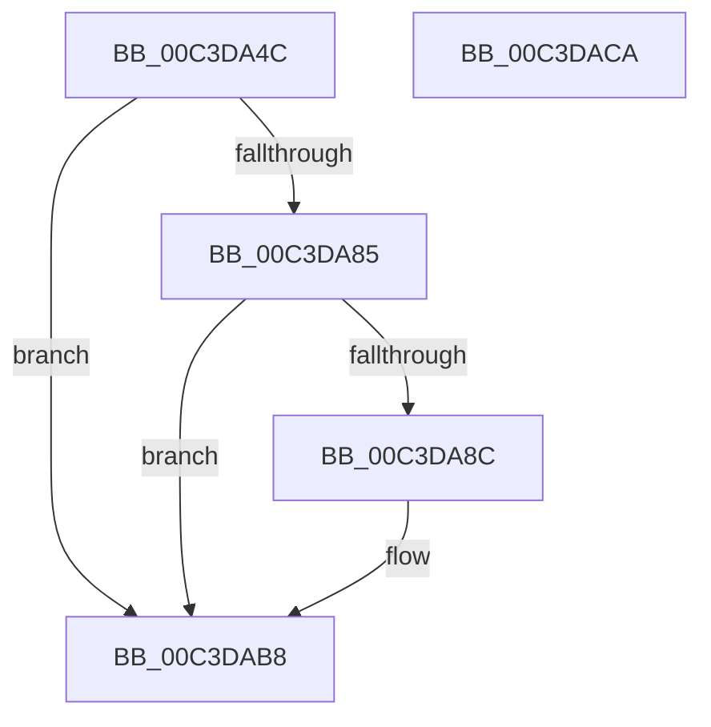

# PopCheckAndClearBootError

- RVA: `0x00C3DA4C`–`0x00C3DACB` (길이 `127` bytes)
- VA: `0x0000000140C3DA4C`
- 실행 섹션: `INIT`
- PDB 이름 있음: `예`; PDB Function 태그: `아니요`
- unwind 정보 RVA: `0x000C4098`
- 디코드: `34`개 명령, `127/127` bytes 표시
- 미해석 바이트: `0` (있으면 어셈블리에 `.byte`로 보존)

> 이 문서는 커널 이미지의 기계어와 PDB 기호를 분석해 생성했습니다. 4번과 5번은 함수 원형과 자료형을 바이너리 사용 방식에서 추정한 C 해석이며 원본 소스 복구 결과는 아닙니다.

## 1. Dependencies

- 직접 호출 지점: **4**; 고유 호출 대상: **4**
- 직접 호출자로 확인된 함수: **1**
- RIP 상대 이미지 참조: **1**

### Outgoing calls
- `0x00C3DA7C` → [RtlGetSystemBootStatus](../../page/79/RtlGetSystemBootStatus_function_00790630.md) (function, `0x00790630`)
- `0x00C3DA91` → [PopTraceBootError](../../text/5D/PopTraceBootError_function_005D775C.md) (function, `0x005D775C`)
- `0x00C3DAB3` → [RtlSetSystemBootStatus](../../page/A8/RtlSetSystemBootStatus_function_00A83230.md) (function, `0x00A83230`)
- `0x00C3DAC0` → [_security_check_cookie](../../text/6A/_security_check_cookie_function_006AC640.md) (function, `0x006AC640`)

### Direct callers
- [PoInitSystem](../C7/PoInitSystem_function_00C72358.md) at `0x00C72FA8`

### Static image references
- `0x00C3DA50` → RVA `0x00E0A740` (`.data`; read)

## 2. Other-region calls and transfers

- 다른 실행 섹션으로 향하는 call: **4**
  - `0x00C3DA7C` → [RtlGetSystemBootStatus](../../page/79/RtlGetSystemBootStatus_function_00790630.md) (`INIT` → `PAGE`)
  - `0x00C3DA91` → [PopTraceBootError](../../text/5D/PopTraceBootError_function_005D775C.md) (`INIT` → `.text`)
  - `0x00C3DAB3` → [RtlSetSystemBootStatus](../../page/A8/RtlSetSystemBootStatus_function_00A83230.md) (`INIT` → `PAGE`)
  - `0x00C3DAC0` → [_security_check_cookie](../../text/6A/_security_check_cookie_function_006AC640.md) (`INIT` → `.text`)
- 별도 외부 분기/꼬리 이동을 확인하지 못했습니다.

## 3. Assembly (complete function range)

```asm
00C3DA4C  48 83 EC 48                     sub rsp, 0x48
00C3DA50  48 8B 05 E9 CC 1C 00            mov rax, qword ptr [rip + 0x1ccce9]
00C3DA57  48 33 C4                        xor rax, rsp
00C3DA5A  48 89 44 24 38                  mov qword ptr [rsp + 0x38], rax
00C3DA5F  33 C0                           xor eax, eax
00C3DA61  48 8D 54 24 20                  lea rdx, [rsp + 0x20]
00C3DA66  0F 57 C0                        xorps xmm0, xmm0
00C3DA69  89 44 24 30                     mov dword ptr [rsp + 0x30], eax
00C3DA6D  45 33 C9                        xor r9d, r9d
00C3DA70  0F 11 44 24 20                  movups xmmword ptr [rsp + 0x20], xmm0
00C3DA75  44 8D 40 14                     lea r8d, [rax + 0x14]
00C3DA79  8D 48 0D                        lea ecx, [rax + 0xd]
00C3DA7C  E8 AF 2B B5 FF                  call 0x140790630
00C3DA81  85 C0                           test eax, eax
00C3DA83  78 33                           js 0x140c3dab8
00C3DA85  83 7C 24 2C 00                  cmp dword ptr [rsp + 0x2c], 0
00C3DA8A  74 2C                           je 0x140c3dab8
00C3DA8C  48 8D 4C 24 20                  lea rcx, [rsp + 0x20]
00C3DA91  E8 C6 9C 99 FF                  call 0x1405d775c
00C3DA96  33 C0                           xor eax, eax
00C3DA98  48 8D 54 24 20                  lea rdx, [rsp + 0x20]
00C3DA9D  0F 57 C0                        xorps xmm0, xmm0
00C3DAA0  89 44 24 30                     mov dword ptr [rsp + 0x30], eax
00C3DAA4  45 33 C9                        xor r9d, r9d
00C3DAA7  0F 11 44 24 20                  movups xmmword ptr [rsp + 0x20], xmm0
00C3DAAC  44 8D 40 14                     lea r8d, [rax + 0x14]
00C3DAB0  8D 48 0D                        lea ecx, [rax + 0xd]
00C3DAB3  E8 78 57 E4 FF                  call 0x140a83230
00C3DAB8  48 8B 4C 24 38                  mov rcx, qword ptr [rsp + 0x38]
00C3DABD  48 33 CC                        xor rcx, rsp
00C3DAC0  E8 7B EB A6 FF                  call 0x1406ac640
00C3DAC5  48 83 C4 48                     add rsp, 0x48
00C3DAC9  C3                              ret
00C3DACA  CC                              int3
```

## 4. C-style interpretation (structured pseudocode)

```c
__int64 __fastcall PopCheckAndClearBootError(__int64 a1, __int64 a2, __int64 a3, int a4)
{
    __int64 result;
    __int64 v_rsp;
    unsigned __int64 v_stack_m10;
    unsigned int v_stack_m18;
    unsigned int v_stack_m1C;
    unsigned __int64 v_stack_m28;

    v_rsp = (v_rsp) - (72);
    result = (*(unsigned __int64 *)(v_rip + 1887465)) ^ (v_rsp);
    v_stack_m10 = result;
    result = 0;
    v_stack_m18 = 0;
    a4 = 0;
    v_stack_m28 = v_xmm0;
    result = RtlGetSystemBootStatus(result + 13, v_stack_m28, result + 20, a4);
    if (sign_flag) goto loc_00C3DAB8;
    if (v_stack_m1C != 0) {
        a1 = v_stack_m28;
        result = PopTraceBootError(a1, v_stack_m28, result + 20, a4);
        result = 0;
        a2 = v_stack_m28;
        v_stack_m18 = 0;
        a4 = 0;
        v_stack_m28 = v_xmm0;
        a3 = result + 20;
        a1 = result + 13;
        result = RtlSetSystemBootStatus(a1, a2, a3, a4);
    }
    a1 = (v_stack_m10) ^ (v_rsp);
    result = _security_check_cookie(a1, a2, a3, a4);
    v_rsp = (v_rsp) + (72);
    return result;
}
```

## 5. (Beta) C Style

```c
int64_t PopCheckAndClearBootError(int64_t Arg1, int64_t Arg2, int64_t Arg3, int32_t Arg4)
{
    int64_t result;
    int64_t local_rsp;
    uint64_t v_stack_m10;
    uint32_t v_stack_m18;
    uint32_t v_stack_m1C;
    uint64_t v_stack_m28;

    local_rsp = (local_rsp) - (72);
    result = (*(uint64_t *)(v_rip + 0x1CCCE9)) ^ (local_rsp);
    v_stack_m10 = result;
    result = 0;
    v_stack_m18 = 0;
    Arg4 = 0;
    v_stack_m28 = v_xmm0;
    result = RtlGetSystemBootStatus(result + 13, v_stack_m28, result + 20, Arg4);
    if (sign_flag) goto loc_00C3DAB8;
    if (v_stack_m1C != 0) {
        Arg1 = v_stack_m28;
        result = PopTraceBootError(Arg1, v_stack_m28, result + 20, Arg4);
        result = 0;
        Arg2 = v_stack_m28;
        v_stack_m18 = 0;
        Arg4 = 0;
        v_stack_m28 = v_xmm0;
        Arg3 = result + 20;
        Arg1 = result + 13;
        result = RtlSetSystemBootStatus(Arg1, Arg2, Arg3, Arg4);
    }
    Arg1 = (v_stack_m10) ^ (local_rsp);
    result = _security_check_cookie(Arg1, Arg2, Arg3, Arg4);
    local_rsp = (local_rsp) + (72);
    return result;
}
```

## 6. Execution-region graph

[열기: 2D/3D 그래프와 함수 탐색 컨트롤 패널](../../../control-panel.html?section=init&rva=0x00C3DA4C&view=graph)

- 2D 그래프는 위에서 아래로 흐르고, 3D 그래프는 빈 공간을 드래그해 회전합니다. Shift+드래그는 이동, 휠은 확대·축소, 함수 노드 선택은 대상 보고서 이동입니다.

### Static fallback


