# PopCheckShutdownMarker

- RVA: `0x00C3DAD4`–`0x00C3E1C4` (길이 `1,776` bytes)
- VA: `0x0000000140C3DAD4`
- 실행 섹션: `INIT`
- PDB 이름 있음: `예`; PDB Function 태그: `아니요`
- unwind 정보 RVA: `0x000BC300`
- 디코드: `359`개 명령, `1,776/1,776` bytes 표시
- 미해석 바이트: `0` (있으면 어셈블리에 `.byte`로 보존)

> 이 문서는 커널 이미지의 기계어와 PDB 기호를 분석해 생성했습니다. 4번과 5번은 함수 원형과 자료형을 바이너리 사용 방식에서 추정한 C 해석이며 원본 소스 복구 결과는 아닙니다.

## 1. Dependencies

- 직접 호출 지점: **20**; 고유 호출 대상: **16**
- 직접 호출자로 확인된 함수: **1**
- RIP 상대 이미지 참조: **96**

### Outgoing calls
- `0x00C3DBAF` → [RtlCheckSystemBootStatusIntegrity](../../page/79/RtlCheckSystemBootStatusIntegrity_function_007905C0.md) (function, `0x007905C0`)
- `0x00C3DBC0` → [RtlGetSystemBootStatusEx](../../page/79/RtlGetSystemBootStatusEx_function_00790670.md) (function, `0x00790670`)
- `0x00C3DC0F` → [PopDiagTraceInvalidBootStat](../C4/PopDiagTraceInvalidBootStat_function_00C40294.md) (function, `0x00C40294`)
- `0x00C3DC8A` → [tlgKeywordOn](../../text/42/tlgKeywordOn_function_0042EAA0.md) (function, `0x0042EAA0`)
- `0x00C3DD90` → [tlgWriteTransfer_EtwWriteTransfer](../../text/42/tlgWriteTransfer_EtwWriteTransfer_function_004260E0.md) (function, `0x004260E0`)
- `0x00C3DEC4` → [ZwUpdateWnfStateData](../../text/6B/ZwUpdateWnfStateData_function_006B0D10.md) (function, `0x006B0D10`)
- `0x00C3DF30` → [ExGetFirmwareEnvironmentVariable](../../page/95/ExGetFirmwareEnvironmentVariable_function_00952080.md) (function, `0x00952080`)
- `0x00C3DF59` → [PopRecordSleepCheckpoint](../../page/AA/PopRecordSleepCheckpoint_function_00AA3EEC.md) (function, `0x00AA3EEC`)
- `0x00C3DF61` → [PopRecordSleepCheckpointSource](../../page/75/PopRecordSleepCheckpointSource_function_007545F4.md) (function, `0x007545F4`)
- `0x00C3DF69` → [PopClearSystemSleepCheckpoint](../../page/AB/PopClearSystemSleepCheckpoint_function_00AB29B4.md) (function, `0x00AB29B4`)
- `0x00C3DF8D` → [PopRecordSleepCheckpointSource](../../page/75/PopRecordSleepCheckpointSource_function_007545F4.md) (function, `0x007545F4`)
- `0x00C3E005` → [PopReadRegKeyValue](../../text/4B/PopReadRegKeyValue_function_004B5F64.md) (function, `0x004B5F64`)
- `0x00C3E030` → [PopReadRegKeyValue](../../text/4B/PopReadRegKeyValue_function_004B5F64.md) (function, `0x004B5F64`)
- `0x00C3E056` → [PopReadRegKeyValue](../../text/4B/PopReadRegKeyValue_function_004B5F64.md) (function, `0x004B5F64`)
- `0x00C3E0F3` → [ZwQuerySystemInformation](../../text/6A/ZwQuerySystemInformation_function_006AD790.md) (function, `0x006AD790`)
- `0x00C3E131` → [ZwQuerySystemInformationEx](../../text/6A/ZwQuerySystemInformationEx_function_006AFEB0.md) (function, `0x006AFEB0`)
- `0x00C3E166` → [ZwQuerySystemInformationEx](../../text/6A/ZwQuerySystemInformationEx_function_006AFEB0.md) (function, `0x006AFEB0`)
- `0x00C3E182` → [PopReadWheaBootErrorCount](PopReadWheaBootErrorCount_function_00C3E1CC.md) (function, `0x00C3E1CC`)
- `0x00C3E18E` → [PopDiagTraceDirtyTransition](PopDiagTraceDirtyTransition_function_00C3F6F0.md) (function, `0x00C3F6F0`)
- `0x00C3E19D` → [_security_check_cookie](../../text/6A/_security_check_cookie_function_006AC640.md) (function, `0x006AC640`)

### Direct callers
- [PoInitSystem](../C7/PoInitSystem_function_00C72358.md) at `0x00C72FA3`

### Static image references
- `0x00C3DAFA` → RVA `0x00E0A740` (`.data`; read)
- `0x00C3DB24` → RVA `0x00E67471` (`.data`; read)
- `0x00C3DB35` → RVA `0x00E673B0` (`.data`; read)
- `0x00C3DB4B` → RVA `0x00E67410` (`.data`; read)
- `0x00C3DB60` → RVA `0x00E673F0` (`.data`; read)
- `0x00C3DB67` → RVA `0x00E67470` (`.data`; write)
- `0x00C3DB71` → RVA `0x00E6747C` (`.data`; read)
- `0x00C3DBDA` → RVA `0x00E67474` (`.data`; read)
- `0x00C3DBE6` → RVA `0x00E67474` (`.data`; write)
- `0x00C3DC1B` → RVA `0x00E67560` (`.data`; read)
- `0x00C3DC22` → RVA `0x00E673C0` (`.data`; read)
- `0x00C3DC2F` → RVA `0x00E673D0` (`.data`; read)
- `0x00C3DC36` → RVA `0x00E67560` (`.data`; write)
- `0x00C3DC47` → RVA `0x00E67570` (`.data`; write)
- `0x00C3DC4E` → RVA `0x00E673E0` (`.data`; read)
- `0x00C3DC55` → RVA `0x00E67580` (`.data`; write)
- `0x00C3DC5C` → RVA `0x00E67590` (`.data`; write)
- `0x00C3DC6C` → RVA `0x00E07748` (`.data`; read)
- `0x00C3DCA3` → RVA `0x00048D27` (`.rdata`; read)
- `0x00C3DCCA` → RVA `0x00E67580` (`.data`; read)
- `0x00C3DCD5` → RVA `0x00E6758C` (`.data`; read)
- `0x00C3DCF2` → RVA `0x00E6758E` (`.data`; read)
- `0x00C3DD95` → RVA `0x00EFF058` (`.data`; reference)
- `0x00C3DDA3` → RVA `0x00E67420` (`.data`; read)
- `0x00C3DDB1` → RVA `0x00E67400` (`.data`; read)
- `0x00C3DDB8` → RVA `0x00E675C0` (`.data`; read)
- `0x00C3DDBF` → RVA `0x00E675D0` (`.data`; read)
- `0x00C3DDC6` → RVA `0x00E67640` (`.data`; read)
- `0x00C3DDD4` → RVA `0x00E67650` (`.data`; read)
- `0x00C3DDE2` → RVA `0x00E675E0` (`.data`; write)
- `0x00C3DDF0` → RVA `0x00E675F0` (`.data`; write)
- `0x00C3DDFE` → RVA `0x00E67600` (`.data`; write)
- `0x00C3DE05` → RVA `0x00E67610` (`.data`; write)
- `0x00C3DE0C` → RVA `0x00E675A0` (`.data`; read)
- `0x00C3DE13` → RVA `0x00E675B0` (`.data`; read)
- `0x00C3DE1A` → RVA `0x00E67620` (`.data`; read)
- `0x00C3DE21` → RVA `0x00E67630` (`.data`; read)
- `0x00C3DE2A` → RVA `0x00E675C8` (`.data`; read/write)
- `0x00C3DE31` → RVA `0x00F0CF0C` (`.data`; read)
- `0x00C3DE44` → RVA `0x00E675CE` (`.data`; read)
- `0x00C3DE4D` → RVA `0x00E67568` (`.data`; read)
- `0x00C3DE53` → RVA `0x00E675CE` (`.data`; write)
- `0x00C3DE5B` → RVA `0x00E6756F` (`.data`; reference)
- `0x00C3DE74` → RVA `0x00E675C0` (`.data`; write)
- `0x00C3DE7B` → RVA `0x00E6741E` (`.data`; read)
- `0x00C3DE95` → RVA `0x00E67464` (`.data`; write)
- `0x00C3DE9E` → RVA `0x00020A28` (`.rdata`; read)
- `0x00C3DEAD` → RVA `0x00E675C8` (`.data`; read)
- `0x00C3DEDD` → RVA `0x00E675CC` (`.data`; write)
- `0x00C3DEE7` → RVA `0x00E675C8` (`.data`; write)
- `0x00C3DEFA` → RVA `0x00E675B8` (`.data`; write)
- `0x00C3DF01` → RVA `0x00E675C8` (`.data`; reference)
- `0x00C3DF22` → RVA `0x000260A8` (`.rdata`; read)
- `0x00C3DF29` → RVA `0x0000B420` (`.rdata`; read)
- `0x00C3DF40` → RVA `0x00E675A2` (`.data`; write)
- `0x00C3DF46` → RVA `0x00E675A1` (`.data`; read)
- `0x00C3DF53` → RVA `0x00E675A1` (`.data`; write)
- `0x00C3DF7B` → RVA `0x00E675A2` (`.data`; read)
- `0x00C3DFAD` → RVA `0x00E67480` (`.data`; write)
- `0x00C3DFB7` → RVA `0x00E67488` (`.data`; write)
- `0x00C3DFC2` → RVA `0x00E67490` (`.data`; write)
- `0x00C3DFCD` → RVA `0x00E67498` (`.data`; write)
- `0x00C3DFD8` → RVA `0x00E674A0` (`.data`; write)
- `0x00C3DFDF` → RVA `0x00E674F8` (`.data`; read)
- `0x00C3DFE6` → RVA `0x00E674F8` (`.data`; write)
- `0x00C3DFF7` → RVA `0x00C7C160` (` ?? ::PBOPGDP::`string'`; read)
- `0x00C3DFFE` → RVA `0x00C7C0E0` (` ?? ::PBOPGDP::`string'`; read)
- `0x00C3E00A` → RVA `0x00E674FC` (`.data`; read)
- `0x00C3E011` → RVA `0x00E674FC` (`.data`; write)
- `0x00C3E022` → RVA `0x00C7C0C0` (` ?? ::PBOPGDP::`string'`; read)
- `0x00C3E038` → RVA `0x00E67500` (`.data`; read)
- `0x00C3E03F` → RVA `0x00C7C0B0` (` ?? ::PBOPGDP::`string'`; read)
- `0x00C3E04B` → RVA `0x00C7C010` (` ?? ::PBOPGDP::`string'`; read)
- `0x00C3E05F` → RVA `0x00E67480` (`.data`; read)
- `0x00C3E067` → RVA `0x00E67508` (`.data`; read)
- `0x00C3E077` → RVA `0x00E67510` (`.data`; read)
- `0x00C3E085` → RVA `0x00E674A8` (`.data`; write)
- `0x00C3E093` → RVA `0x00E674D8` (`.data`; read)
- `0x00C3E09A` → RVA `0x00E67478` (`.data`; write)
- `0x00C3E0AA` → RVA `0x00E674C0` (`.data`; write)
- `0x00C3E0B0` → RVA `0x00E674C8` (`.data`; write)
- `0x00C3E0BE` → RVA `0x00E674B0` (`.data`; write)
- `0x00C3E0CC` → RVA `0x00E674B8` (`.data`; write)
- `0x00C3E0D7` → RVA `0x00E6856C` (`.data`; read)
- `0x00C3E0E1` → RVA `0x00E674D0` (`.data`; write)
- `0x00C3E0E7` → RVA `0x00E68568` (`.data`; read)
- `0x00C3E0ED` → RVA `0x00E674D4` (`.data`; write)
- `0x00C3E0F8` → RVA `0x00E67538` (`.data`; read)
- `0x00C3E104` → RVA `0x00E67430` (`.data`; read)
- `0x00C3E10B` → RVA `0x00E67538` (`.data`; write)
- `0x00C3E11A` → RVA `0x00E67540` (`.data`; write)
- `0x00C3E13A` → RVA `0x00E6753C` (`.data`; read)
- `0x00C3E140` → RVA `0x00E67530` (`.data`; write)
- `0x00C3E175` → RVA `0x00E67534` (`.data`; write)
- `0x00C3E17B` → RVA `0x00E67548` (`.data`; read)
- `0x00C3E187` → RVA `0x00E67470` (`.data`; read)

## 2. Other-region calls and transfers

- 다른 실행 섹션으로 향하는 call: **17**
  - `0x00C3DBAF` → [RtlCheckSystemBootStatusIntegrity](../../page/79/RtlCheckSystemBootStatusIntegrity_function_007905C0.md) (`INIT` → `PAGE`)
  - `0x00C3DBC0` → [RtlGetSystemBootStatusEx](../../page/79/RtlGetSystemBootStatusEx_function_00790670.md) (`INIT` → `PAGE`)
  - `0x00C3DC8A` → [tlgKeywordOn](../../text/42/tlgKeywordOn_function_0042EAA0.md) (`INIT` → `.text`)
  - `0x00C3DD90` → [tlgWriteTransfer_EtwWriteTransfer](../../text/42/tlgWriteTransfer_EtwWriteTransfer_function_004260E0.md) (`INIT` → `.text`)
  - `0x00C3DEC4` → [ZwUpdateWnfStateData](../../text/6B/ZwUpdateWnfStateData_function_006B0D10.md) (`INIT` → `.text`)
  - `0x00C3DF30` → [ExGetFirmwareEnvironmentVariable](../../page/95/ExGetFirmwareEnvironmentVariable_function_00952080.md) (`INIT` → `PAGE`)
  - `0x00C3DF59` → [PopRecordSleepCheckpoint](../../page/AA/PopRecordSleepCheckpoint_function_00AA3EEC.md) (`INIT` → `PAGE`)
  - `0x00C3DF61` → [PopRecordSleepCheckpointSource](../../page/75/PopRecordSleepCheckpointSource_function_007545F4.md) (`INIT` → `PAGE`)
  - `0x00C3DF69` → [PopClearSystemSleepCheckpoint](../../page/AB/PopClearSystemSleepCheckpoint_function_00AB29B4.md) (`INIT` → `PAGE`)
  - `0x00C3DF8D` → [PopRecordSleepCheckpointSource](../../page/75/PopRecordSleepCheckpointSource_function_007545F4.md) (`INIT` → `PAGE`)
  - `0x00C3E005` → [PopReadRegKeyValue](../../text/4B/PopReadRegKeyValue_function_004B5F64.md) (`INIT` → `.text`)
  - `0x00C3E030` → [PopReadRegKeyValue](../../text/4B/PopReadRegKeyValue_function_004B5F64.md) (`INIT` → `.text`)
  - `0x00C3E056` → [PopReadRegKeyValue](../../text/4B/PopReadRegKeyValue_function_004B5F64.md) (`INIT` → `.text`)
  - `0x00C3E0F3` → [ZwQuerySystemInformation](../../text/6A/ZwQuerySystemInformation_function_006AD790.md) (`INIT` → `.text`)
  - `0x00C3E131` → [ZwQuerySystemInformationEx](../../text/6A/ZwQuerySystemInformationEx_function_006AFEB0.md) (`INIT` → `.text`)
  - `0x00C3E166` → [ZwQuerySystemInformationEx](../../text/6A/ZwQuerySystemInformationEx_function_006AFEB0.md) (`INIT` → `.text`)
  - `0x00C3E19D` → [_security_check_cookie](../../text/6A/_security_check_cookie_function_006AC640.md) (`INIT` → `.text`)
- 별도 외부 분기/꼬리 이동을 확인하지 못했습니다.

## 3. Assembly (complete function range)

```asm
00C3DAD4  48 8B C4                        mov rax, rsp
00C3DAD7  48 89 58 08                     mov qword ptr [rax + 8], rbx
00C3DADB  48 89 70 10                     mov qword ptr [rax + 0x10], rsi
00C3DADF  48 89 78 18                     mov qword ptr [rax + 0x18], rdi
00C3DAE3  4C 89 60 20                     mov qword ptr [rax + 0x20], r12
00C3DAE7  55                              push rbp
00C3DAE8  41 56                           push r14
00C3DAEA  41 57                           push r15
00C3DAEC  48 8D A8 38 FF FF FF            lea rbp, [rax - 0xc8]
00C3DAF3  48 81 EC B0 01 00 00            sub rsp, 0x1b0
00C3DAFA  48 8B 05 3F CC 1C 00            mov rax, qword ptr [rip + 0x1ccc3f]
00C3DB01  48 33 C4                        xor rax, rsp
00C3DB04  48 89 85 A0 00 00 00            mov qword ptr [rbp + 0xa0], rax
00C3DB0B  48 8B 81 F0 00 00 00            mov rax, qword ptr [rcx + 0xf0]
00C3DB12  33 F6                           xor esi, esi
00C3DB14  0F 57 C0                        xorps xmm0, xmm0
00C3DB17  40 88 74 24 40                  mov byte ptr [rsp + 0x40], sil
00C3DB1C  0F 11 44 24 70                  movups xmmword ptr [rsp + 0x70], xmm0
00C3DB21  48 8B F9                        mov rdi, rcx
00C3DB24  48 8D 0D 46 99 22 00            lea rcx, [rip + 0x229946]
00C3DB2B  8A 90 84 00 00 00               mov dl, byte ptr [rax + 0x84]
00C3DB31  44 8D 76 01                     lea r14d, [rsi + 1]
00C3DB35  48 8D 05 74 98 22 00            lea rax, [rip + 0x229874]
00C3DB3C  C7 45 40 0E 00 00 00            mov dword ptr [rbp + 0x40], 0xe
00C3DB43  48 89 45 48                     mov qword ptr [rbp + 0x48], rax
00C3DB47  44 8D 7E 04                     lea r15d, [rsi + 4]
00C3DB4B  48 8D 05 BE 98 22 00            lea rax, [rip + 0x2298be]
00C3DB52  C7 45 50 40 00 00 00            mov dword ptr [rbp + 0x50], 0x40
00C3DB59  48 89 45 60                     mov qword ptr [rbp + 0x60], rax
00C3DB5D  41 22 D6                        and dl, r14b
00C3DB60  48 8D 05 89 98 22 00            lea rax, [rip + 0x229889]
00C3DB67  88 15 03 99 22 00               mov byte ptr [rip + 0x229903], dl
00C3DB6D  48 89 45 78                     mov qword ptr [rbp + 0x78], rax
00C3DB71  48 8D 05 04 99 22 00            lea rax, [rip + 0x229904]
00C3DB78  48 89 85 90 00 00 00            mov qword ptr [rbp + 0x90], rax
00C3DB7F  C7 45 58 07 00 00 00            mov dword ptr [rbp + 0x58], 7
00C3DB86  C7 45 68 20 00 00 00            mov dword ptr [rbp + 0x68], 0x20
00C3DB8D  C7 45 70 10 00 00 00            mov dword ptr [rbp + 0x70], 0x10
00C3DB94  C7 85 80 00 00 00 20 00 00 00   mov dword ptr [rbp + 0x80], 0x20
00C3DB9E  C7 85 88 00 00 00 0B 00 00 00   mov dword ptr [rbp + 0x88], 0xb
00C3DBA8  44 89 BD 98 00 00 00            mov dword ptr [rbp + 0x98], r15d
00C3DBAF  E8 0C 2A B5 FF                  call 0x1407905c0
00C3DBB4  4C 8D 44 24 70                  lea r8, [rsp + 0x70]
00C3DBB9  41 8B D7                        mov edx, r15d
00C3DBBC  48 8D 4D 40                     lea rcx, [rbp + 0x40]
00C3DBC0  E8 AB 2A B5 FF                  call 0x140790670
00C3DBC5  85 C0                           test eax, eax
00C3DBC7  79 4B                           jns 0x140c3dc14
00C3DBC9  4C 8D 4D 40                     lea r9, [rbp + 0x40]
00C3DBCD  45 8B D7                        mov r10d, r15d
00C3DBD0  4C 8D 44 24 70                  lea r8, [rsp + 0x70]
00C3DBD5  41 39 30                        cmp dword ptr [r8], esi
00C3DBD8  75 12                           jne 0x140c3dbec
00C3DBDA  8B 15 94 98 22 00               mov edx, dword ptr [rip + 0x229894]
00C3DBE0  41 8B 09                        mov ecx, dword ptr [r9]
00C3DBE3  0F AB CA                        bts edx, ecx
00C3DBE6  89 15 88 98 22 00               mov dword ptr [rip + 0x229888], edx
00C3DBEC  4D 03 C7                        add r8, r15
00C3DBEF  49 83 C1 18                     add r9, 0x18
00C3DBF3  4D 2B D6                        sub r10, r14
00C3DBF6  75 DD                           jne 0x140c3dbd5
00C3DBF8  44 8A 0D 72 98 22 00            mov r9b, byte ptr [rip + 0x229872]
00C3DBFF  44 8B C0                        mov r8d, eax
00C3DC02  8B 15 6C 98 22 00               mov edx, dword ptr [rip + 0x22986c]
00C3DC08  8B 0C 25 C4 02 FE 7F            mov ecx, dword ptr [0x7ffe02c4]
00C3DC0F  E8 80 26 00 00                  call 0x140c40294
00C3DC14  0F 28 15 95 97 22 00            movaps xmm2, xmmword ptr [rip + 0x229795]
00C3DC1B  4C 8D 0D 3E 99 22 00            lea r9, [rip + 0x22993e]
00C3DC22  0F 28 05 97 97 22 00            movaps xmm0, xmmword ptr [rip + 0x229797]
00C3DC29  41 BC 08 00 00 00               mov r12d, 8
00C3DC2F  0F 28 0D 9A 97 22 00            movaps xmm1, xmmword ptr [rip + 0x22979a]
00C3DC36  0F 29 15 23 99 22 00            movaps xmmword ptr [rip + 0x229923], xmm2
00C3DC3D  66 0F 73 DA 08                  psrldq xmm2, 8
00C3DC42  66 49 0F 7E D0                  movq r8, xmm2
00C3DC47  0F 29 05 22 99 22 00            movaps xmmword ptr [rip + 0x229922], xmm0
00C3DC4E  0F 28 05 8B 97 22 00            movaps xmm0, xmmword ptr [rip + 0x22978b]
00C3DC55  0F 29 0D 24 99 22 00            movaps xmmword ptr [rip + 0x229924], xmm1
00C3DC5C  0F 29 05 2D 99 22 00            movaps xmmword ptr [rip + 0x22992d], xmm0
00C3DC63  45 85 C0                        test r8d, r8d
00C3DC66  0F 84 29 01 00 00               je 0x140c3dd95
00C3DC6C  83 3D D5 9A 1C 00 05            cmp dword ptr [rip + 0x1c9ad5], 5
00C3DC73  0F 86 1C 01 00 00               jbe 0x140c3dd95
00C3DC79  48 BA 00 00 00 00 00 20 00 00   movabs rdx, 0x200000000000
00C3DC83  48 8D 0D BE 9A 1C 00            lea rcx, [rip + 0x1c9abe]
00C3DC8A  E8 11 0E 7F FF                  call 0x14042eaa0
00C3DC8F  84 C0                           test al, al
00C3DC91  0F 84 FE 00 00 00               je 0x140c3dd95
00C3DC97  49 8B C0                        mov rax, r8
00C3DC9A  44 89 44 24 48                  mov dword ptr [rsp + 0x48], r8d
00C3DC9F  48 C1 E8 20                     shr rax, 0x20
00C3DCA3  48 8D 15 7D B0 40 FF            lea rdx, [rip - 0xbf4f83]
00C3DCAA  0F B7 C0                        movzx eax, ax
00C3DCAD  48 8D 0D 94 9A 1C 00            lea rcx, [rip + 0x1c9a94]
00C3DCB4  89 44 24 44                     mov dword ptr [rsp + 0x44], eax
00C3DCB8  48 8D 44 24 44                  lea rax, [rsp + 0x44]
00C3DCBD  48 89 45 B0                     mov qword ptr [rbp - 0x50], rax
00C3DCC1  48 8D 44 24 48                  lea rax, [rsp + 0x48]
00C3DCC6  48 89 45 C0                     mov qword ptr [rbp - 0x40], rax
00C3DCCA  48 8D 05 AF 98 22 00            lea rax, [rip + 0x2298af]
00C3DCD1  48 89 45 D0                     mov qword ptr [rbp - 0x30], rax
00C3DCD5  0F B7 05 B0 98 22 00            movzx eax, word ptr [rip + 0x2298b0]
00C3DCDC  89 44 24 4C                     mov dword ptr [rsp + 0x4c], eax
00C3DCE0  48 8D 44 24 4C                  lea rax, [rsp + 0x4c]
00C3DCE5  48 89 45 E0                     mov qword ptr [rbp - 0x20], rax
00C3DCE9  48 8D 44 24 50                  lea rax, [rsp + 0x50]
00C3DCEE  48 89 45 F0                     mov qword ptr [rbp - 0x10], rax
00C3DCF2  0F B7 05 95 98 22 00            movzx eax, word ptr [rip + 0x229895]
00C3DCF9  89 44 24 54                     mov dword ptr [rsp + 0x54], eax
00C3DCFD  48 8D 44 24 54                  lea rax, [rsp + 0x54]
00C3DD02  48 89 45 00                     mov qword ptr [rbp], rax
00C3DD06  49 8B C0                        mov rax, r8
00C3DD09  48 C1 E8 30                     shr rax, 0x30
00C3DD0D  0F B6 C0                        movzx eax, al
00C3DD10  89 44 24 58                     mov dword ptr [rsp + 0x58], eax
00C3DD14  48 8D 44 24 58                  lea rax, [rsp + 0x58]
00C3DD19  48 89 45 10                     mov qword ptr [rbp + 0x10], rax
00C3DD1D  44 89 44 24 50                  mov dword ptr [rsp + 0x50], r8d
00C3DD22  49 C1 E8 38                     shr r8, 0x38
00C3DD26  41 8A C0                        mov al, r8b
00C3DD29  4C 89 4D A0                     mov qword ptr [rbp - 0x60], r9
00C3DD2D  41 22 C6                        and al, r14b
00C3DD30  41 D0 E8                        shr r8b, 1
00C3DD33  88 44 24 41                     mov byte ptr [rsp + 0x41], al
00C3DD37  45 22 C6                        and r8b, r14b
00C3DD3A  48 8D 44 24 41                  lea rax, [rsp + 0x41]
00C3DD3F  44 88 44 24 42                  mov byte ptr [rsp + 0x42], r8b
00C3DD44  48 89 45 20                     mov qword ptr [rbp + 0x20], rax
00C3DD48  45 33 C9                        xor r9d, r9d
00C3DD4B  48 8D 44 24 42                  lea rax, [rsp + 0x42]
00C3DD50  4C 89 65 A8                     mov qword ptr [rbp - 0x58], r12
00C3DD54  48 89 45 30                     mov qword ptr [rbp + 0x30], rax
00C3DD58  45 33 C0                        xor r8d, r8d
00C3DD5B  48 8D 45 80                     lea rax, [rbp - 0x80]
00C3DD5F  4C 89 7D B8                     mov qword ptr [rbp - 0x48], r15
00C3DD63  48 89 44 24 28                  mov qword ptr [rsp + 0x28], rax
00C3DD68  C7 44 24 20 0C 00 00 00         mov dword ptr [rsp + 0x20], 0xc
00C3DD70  4C 89 7D C8                     mov qword ptr [rbp - 0x38], r15
00C3DD74  4C 89 65 D8                     mov qword ptr [rbp - 0x28], r12
00C3DD78  4C 89 7D E8                     mov qword ptr [rbp - 0x18], r15
00C3DD7C  4C 89 7D F8                     mov qword ptr [rbp - 8], r15
00C3DD80  4C 89 7D 08                     mov qword ptr [rbp + 8], r15
00C3DD84  4C 89 7D 18                     mov qword ptr [rbp + 0x18], r15
00C3DD88  4C 89 75 28                     mov qword ptr [rbp + 0x28], r14
00C3DD8C  4C 89 75 38                     mov qword ptr [rbp + 0x38], r14
00C3DD90  E8 4B 83 7E FF                  call 0x1404260e0
00C3DD95  44 84 3D BC 12 2C 00            test byte ptr [rip + 0x2c12bc], r15b
00C3DD9C  0F 10 0D 6D 96 22 00            movups xmm1, xmmword ptr [rip + 0x22966d]
00C3DDA3  0F 10 05 76 96 22 00            movups xmm0, xmmword ptr [rip + 0x229676]
00C3DDAA  0F 10 1D 3F 96 22 00            movups xmm3, xmmword ptr [rip + 0x22963f]
00C3DDB1  0F 10 15 48 96 22 00            movups xmm2, xmmword ptr [rip + 0x229648]
00C3DDB8  0F 11 0D 01 98 22 00            movups xmmword ptr [rip + 0x229801], xmm1
00C3DDBF  0F 11 05 0A 98 22 00            movups xmmword ptr [rip + 0x22980a], xmm0
00C3DDC6  0F 11 0D 73 98 22 00            movups xmmword ptr [rip + 0x229873], xmm1
00C3DDCD  0F 28 0D EC 95 22 00            movaps xmm1, xmmword ptr [rip + 0x2295ec]
00C3DDD4  0F 11 05 75 98 22 00            movups xmmword ptr [rip + 0x229875], xmm0
00C3DDDB  0F 28 05 CE 95 22 00            movaps xmm0, xmmword ptr [rip + 0x2295ce]
00C3DDE2  0F 29 05 F7 97 22 00            movaps xmmword ptr [rip + 0x2297f7], xmm0
00C3DDE9  0F 28 05 E0 95 22 00            movaps xmm0, xmmword ptr [rip + 0x2295e0]
00C3DDF0  0F 29 0D F9 97 22 00            movaps xmmword ptr [rip + 0x2297f9], xmm1
00C3DDF7  0F 28 0D E2 95 22 00            movaps xmm1, xmmword ptr [rip + 0x2295e2]
00C3DDFE  0F 29 05 FB 97 22 00            movaps xmmword ptr [rip + 0x2297fb], xmm0
00C3DE05  0F 29 0D 04 98 22 00            movaps xmmword ptr [rip + 0x229804], xmm1
00C3DE0C  0F 11 1D 8D 97 22 00            movups xmmword ptr [rip + 0x22978d], xmm3
00C3DE13  0F 11 15 96 97 22 00            movups xmmword ptr [rip + 0x229796], xmm2
00C3DE1A  0F 11 1D FF 97 22 00            movups xmmword ptr [rip + 0x2297ff], xmm3
00C3DE21  0F 11 15 08 98 22 00            movups xmmword ptr [rip + 0x229808], xmm2
00C3DE28  74 07                           je 0x140c3de31
00C3DE2A  80 25 97 97 22 00 FE            and byte ptr [rip + 0x229797], 0xfe
00C3DE31  F7 05 D1 F0 2C 00 00 02 00 00   test dword ptr [rip + 0x2cf0d1], 0x200
00C3DE3B  74 07                           je 0x140c3de44
00C3DE3D  44 08 35 84 97 22 00            or byte ptr [rip + 0x229784], r14b
00C3DE44  8A 0D 84 97 22 00               mov cl, byte ptr [rip + 0x229784]
00C3DE4A  80 E1 DF                        and cl, 0xdf
00C3DE4D  39 35 15 97 22 00               cmp dword ptr [rip + 0x229715], esi
00C3DE53  88 0D 75 97 22 00               mov byte ptr [rip + 0x229775], cl
00C3DE59  74 20                           je 0x140c3de7b
00C3DE5B  44 84 3D 0D 97 22 00            test byte ptr [rip + 0x22970d], r15b
00C3DE62  74 17                           je 0x140c3de7b
00C3DE64  48 8B 05 F5 96 22 00            mov rax, qword ptr [rip + 0x2296f5]
00C3DE6B  80 C9 20                        or cl, 0x20
00C3DE6E  88 0D 5A 97 22 00               mov byte ptr [rip + 0x22975a], cl
00C3DE74  48 89 05 45 97 22 00            mov qword ptr [rip + 0x229745], rax
00C3DE7B  8A 05 9D 95 22 00               mov al, byte ptr [rip + 0x22959d]
00C3DE81  48 8D 54 24 5C                  lea rdx, [rsp + 0x5c]
00C3DE86  C0 E8 04                        shr al, 4
00C3DE89  48 8D 4C 24 68                  lea rcx, [rsp + 0x68]
00C3DE8E  41 22 C6                        and al, r14b
00C3DE91  89 74 24 30                     mov dword ptr [rsp + 0x30], esi
00C3DE95  88 05 C9 95 22 00               mov byte ptr [rip + 0x2295c9], al
00C3DE9B  45 33 C9                        xor r9d, r9d
00C3DE9E  48 8B 05 83 2B 3E FF            mov rax, qword ptr [rip - 0xc1d47d]
00C3DEA5  45 8B C7                        mov r8d, r15d
00C3DEA8  48 89 44 24 68                  mov qword ptr [rsp + 0x68], rax
00C3DEAD  0F B6 05 14 97 22 00            movzx eax, byte ptr [rip + 0x229714]
00C3DEB4  41 23 C6                        and eax, r14d
00C3DEB7  89 74 24 28                     mov dword ptr [rsp + 0x28], esi
00C3DEBB  89 44 24 5C                     mov dword ptr [rsp + 0x5c], eax
00C3DEBF  48 89 74 24 20                  mov qword ptr [rsp + 0x20], rsi
00C3DEC4  E8 47 2E A7 FF                  call 0x1406b0d10
00C3DEC9  8B 0D 3D F0 2C 00               mov ecx, dword ptr [rip + 0x2cf03d]
00C3DECF  0F BA E1 0A                     bt ecx, 0xa
00C3DED3  73 18                           jae 0x140c3deed
00C3DED5  8A 05 ED 96 22 00               mov al, byte ptr [rip + 0x2296ed]
00C3DEDB  24 0F                           and al, 0xf
00C3DEDD  66 44 89 35 E7 96 22 00         mov word ptr [rip + 0x2296e7], r14w
00C3DEE5  0C 50                           or al, 0x50
00C3DEE7  88 05 DB 96 22 00               mov byte ptr [rip + 0x2296db], al
00C3DEED  0F BA E1 1D                     bt ecx, 0x1d
00C3DEF1  73 0E                           jae 0x140c3df01
00C3DEF3  80 0D CE 96 22 00 02            or byte ptr [rip + 0x2296ce], 2
00C3DEFA  4C 89 35 B7 96 22 00            mov qword ptr [rip + 0x2296b7], r14
00C3DF01  44 84 35 C0 96 22 00            test byte ptr [rip + 0x2296c0], r14b
00C3DF08  0F 84 85 02 00 00               je 0x140c3e193
00C3DF0E  4C 8D 4C 24 60                  lea r9, [rsp + 0x60]
00C3DF13  44 89 74 24 60                  mov dword ptr [rsp + 0x60], r14d
00C3DF18  4C 8D 44 24 40                  lea r8, [rsp + 0x40]
00C3DF1D  48 89 74 24 20                  mov qword ptr [rsp + 0x20], rsi
00C3DF22  48 8D 15 7F 81 3E FF            lea rdx, [rip - 0xc17e81]
00C3DF29  48 8D 0D F0 D4 3C FF            lea rcx, [rip - 0xc32b10]
00C3DF30  E8 4B 41 D1 FF                  call 0x140952080
00C3DF35  85 C0                           test eax, eax
00C3DF37  78 37                           js 0x140c3df70
00C3DF39  0F B6 44 24 40                  movzx eax, byte ptr [rsp + 0x40]
00C3DF3E  8B D8                           mov ebx, eax
00C3DF40  88 05 5C 96 22 00               mov byte ptr [rip + 0x22965c], al
00C3DF46  8A 05 55 96 22 00               mov al, byte ptr [rip + 0x229655]
00C3DF4C  8B CB                           mov ecx, ebx
00C3DF4E  24 F7                           and al, 0xf7
00C3DF50  41 0A C7                        or al, r15b
00C3DF53  88 05 48 96 22 00               mov byte ptr [rip + 0x229648], al
00C3DF59  E8 8E 5F E6 FF                  call 0x140aa3eec
00C3DF5E  41 8B CE                        mov ecx, r14d
00C3DF61  E8 8E 66 B1 FF                  call 0x1407545f4
00C3DF66  41 8A CE                        mov cl, r14b
00C3DF69  E8 46 4A E7 FF                  call 0x140ab29b4
00C3DF6E  EB 22                           jmp 0x140c3df92
00C3DF70  8A 05 2B 96 22 00               mov al, byte ptr [rip + 0x22962b]
00C3DF76  B9 02 00 00 00                  mov ecx, 2
00C3DF7B  0F B6 1D 20 96 22 00            movzx ebx, byte ptr [rip + 0x229620]
00C3DF82  24 FB                           and al, 0xfb
00C3DF84  41 0A C4                        or al, r12b
00C3DF87  88 05 14 96 22 00               mov byte ptr [rip + 0x229614], al
00C3DF8D  E8 62 66 B1 FF                  call 0x1407545f4
00C3DF92  48 8B 8F F0 00 00 00            mov rcx, qword ptr [rdi + 0xf0]
00C3DF99  48 85 C9                        test rcx, rcx
00C3DF9C  74 41                           je 0x140c3dfdf
00C3DF9E  48 8B 89 18 01 00 00            mov rcx, qword ptr [rcx + 0x118]
00C3DFA5  48 85 C9                        test rcx, rcx
00C3DFA8  74 35                           je 0x140c3dfdf
00C3DFAA  8B 41 38                        mov eax, dword ptr [rcx + 0x38]
00C3DFAD  89 05 CD 94 22 00               mov dword ptr [rip + 0x2294cd], eax
00C3DFB3  48 8B 41 40                     mov rax, qword ptr [rcx + 0x40]
00C3DFB7  48 89 05 CA 94 22 00            mov qword ptr [rip + 0x2294ca], rax
00C3DFBE  48 8B 41 48                     mov rax, qword ptr [rcx + 0x48]
00C3DFC2  48 89 05 C7 94 22 00            mov qword ptr [rip + 0x2294c7], rax
00C3DFC9  48 8B 41 50                     mov rax, qword ptr [rcx + 0x50]
00C3DFCD  48 89 05 C4 94 22 00            mov qword ptr [rip + 0x2294c4], rax
00C3DFD4  48 8B 41 58                     mov rax, qword ptr [rcx + 0x58]
00C3DFD8  48 89 05 C1 94 22 00            mov qword ptr [rip + 0x2294c1], rax
00C3DFDF  48 8D 05 12 95 22 00            lea rax, [rip + 0x229512]
00C3DFE6  89 35 0C 95 22 00               mov dword ptr [rip + 0x22950c], esi
00C3DFEC  45 8B CF                        mov r9d, r15d
00C3DFEF  48 89 44 24 20                  mov qword ptr [rsp + 0x20], rax
00C3DFF4  4D 8B C7                        mov r8, r15
00C3DFF7  48 8D 15 62 E1 03 00            lea rdx, [rip + 0x3e162]
00C3DFFE  48 8D 0D DB E0 03 00            lea rcx, [rip + 0x3e0db]
00C3E005  E8 5A 7F 87 FF                  call 0x1404b5f64
00C3E00A  48 8D 05 EB 94 22 00            lea rax, [rip + 0x2294eb]
00C3E011  89 35 E5 94 22 00               mov dword ptr [rip + 0x2294e5], esi
00C3E017  45 8B CF                        mov r9d, r15d
00C3E01A  48 89 44 24 20                  mov qword ptr [rsp + 0x20], rax
00C3E01F  4D 8B C7                        mov r8, r15
00C3E022  48 8D 15 97 E0 03 00            lea rdx, [rip + 0x3e097]
00C3E029  48 8D 0D B0 E0 03 00            lea rcx, [rip + 0x3e0b0]
00C3E030  E8 2F 7F 87 FF                  call 0x1404b5f64
00C3E035  45 33 C9                        xor r9d, r9d
00C3E038  48 8D 05 C1 94 22 00            lea rax, [rip + 0x2294c1]
00C3E03F  48 8D 15 6A E0 03 00            lea rdx, [rip + 0x3e06a]
00C3E046  48 89 44 24 20                  mov qword ptr [rsp + 0x20], rax
00C3E04B  48 8D 0D BE DF 03 00            lea rcx, [rip + 0x3dfbe]
00C3E052  45 8D 41 30                     lea r8d, [r9 + 0x30]
00C3E056  E8 09 7F 87 FF                  call 0x1404b5f64
00C3E05B  85 C0                           test eax, eax
00C3E05D  78 2D                           js 0x140c3e08c
00C3E05F  39 35 1B 94 22 00               cmp dword ptr [rip + 0x22941b], esi
00C3E065  75 25                           jne 0x140c3e08c
00C3E067  8B 05 9B 94 22 00               mov eax, dword ptr [rip + 0x22949b]
00C3E06D  85 C0                           test eax, eax
00C3E06F  74 1B                           je 0x140c3e08c
00C3E071  89 05 09 94 22 00               mov dword ptr [rip + 0x229409], eax
00C3E077  48 8B 05 92 94 22 00            mov rax, qword ptr [rip + 0x229492]
00C3E07E  48 89 05 03 94 22 00            mov qword ptr [rip + 0x229403], rax
00C3E085  44 89 35 1C 94 22 00            mov dword ptr [rip + 0x22941c], r14d
00C3E08C  8B 04 25 C4 02 FE 7F            mov eax, dword ptr [0x7ffe02c4]
00C3E093  48 8D 15 3E 94 22 00            lea rdx, [rip + 0x22943e]
00C3E09A  89 05 D8 93 22 00               mov dword ptr [rip + 0x2293d8], eax
00C3E0A0  45 33 C9                        xor r9d, r9d
00C3E0A3  48 8D 05 B6 94 22 00            lea rax, [rip + 0x2294b6]
00C3E0AA  88 1D 10 94 22 00               mov byte ptr [rip + 0x229410], bl
00C3E0B0  48 89 05 11 94 22 00            mov qword ptr [rip + 0x229411], rax
00C3E0B7  48 8D 05 02 95 22 00            lea rax, [rip + 0x229502]
00C3E0BE  48 89 05 EB 93 22 00            mov qword ptr [rip + 0x2293eb], rax
00C3E0C5  48 8D 05 D4 94 22 00            lea rax, [rip + 0x2294d4]
00C3E0CC  48 89 05 E5 93 22 00            mov qword ptr [rip + 0x2293e5], rax
00C3E0D3  45 8D 41 20                     lea r8d, [r9 + 0x20]
00C3E0D7  8B 05 8F A4 22 00               mov eax, dword ptr [rip + 0x22a48f]
00C3E0DD  41 8D 49 5A                     lea ecx, [r9 + 0x5a]
00C3E0E1  89 05 E9 93 22 00               mov dword ptr [rip + 0x2293e9], eax
00C3E0E7  8B 05 7B A4 22 00               mov eax, dword ptr [rip + 0x22a47b]
00C3E0ED  89 05 E1 93 22 00               mov dword ptr [rip + 0x2293e1], eax
00C3E0F3  E8 98 F6 A6 FF                  call 0x1406ad790
00C3E0F8  48 8D 1D 39 94 22 00            lea rbx, [rip + 0x229439]
00C3E0FF  48 89 74 24 28                  mov qword ptr [rsp + 0x28], rsi
00C3E104  48 8D 05 25 93 22 00            lea rax, [rip + 0x229325]
00C3E10B  C7 05 23 94 22 00 07 00 00 00   mov dword ptr [rip + 0x229423], 7
00C3E115  BF 48 00 00 00                  mov edi, 0x48
00C3E11A  48 89 05 1F 94 22 00            mov qword ptr [rip + 0x22941f], rax
00C3E121  4C 8B CB                        mov r9, rbx
00C3E124  44 89 64 24 20                  mov dword ptr [rsp + 0x20], r12d
00C3E129  48 8B D3                        mov rdx, rbx
00C3E12C  8B CF                           mov ecx, edi
00C3E12E  45 8B C7                        mov r8d, r15d
00C3E131  E8 7A 1D A7 FF                  call 0x1406afeb0
00C3E136  85 C0                           test eax, eax
00C3E138  78 41                           js 0x140c3e17b
00C3E13A  8B 05 FC 93 22 00               mov eax, dword ptr [rip + 0x2293fc]
00C3E140  89 05 EA 93 22 00               mov dword ptr [rip + 0x2293ea], eax
00C3E146  85 C0                           test eax, eax
00C3E148  74 31                           je 0x140c3e17b
00C3E14A  48 89 74 24 28                  mov qword ptr [rsp + 0x28], rsi
00C3E14F  4C 8B CB                        mov r9, rbx
00C3E152  45 8B C7                        mov r8d, r15d
00C3E155  44 89 64 24 20                  mov dword ptr [rsp + 0x20], r12d
00C3E15A  48 8B D3                        mov rdx, rbx
00C3E15D  44 89 25 D4 93 22 00            mov dword ptr [rip + 0x2293d4], r12d
00C3E164  8B CF                           mov ecx, edi
00C3E166  E8 45 1D A7 FF                  call 0x1406afeb0
00C3E16B  85 C0                           test eax, eax
00C3E16D  78 0C                           js 0x140c3e17b
00C3E16F  8B 05 C7 93 22 00               mov eax, dword ptr [rip + 0x2293c7]
00C3E175  89 05 B9 93 22 00               mov dword ptr [rip + 0x2293b9], eax
00C3E17B  48 8D 0D C6 93 22 00            lea rcx, [rip + 0x2293c6]
00C3E182  E8 45 00 00 00                  call 0x140c3e1cc
00C3E187  48 8D 0D E2 92 22 00            lea rcx, [rip + 0x2292e2]
00C3E18E  E8 5D 15 00 00                  call 0x140c3f6f0
00C3E193  48 8B 8D A0 00 00 00            mov rcx, qword ptr [rbp + 0xa0]
00C3E19A  48 33 CC                        xor rcx, rsp
00C3E19D  E8 9E E4 A6 FF                  call 0x1406ac640
00C3E1A2  4C 8D 9C 24 B0 01 00 00         lea r11, [rsp + 0x1b0]
00C3E1AA  49 8B 5B 20                     mov rbx, qword ptr [r11 + 0x20]
00C3E1AE  49 8B 73 28                     mov rsi, qword ptr [r11 + 0x28]
00C3E1B2  49 8B 7B 30                     mov rdi, qword ptr [r11 + 0x30]
00C3E1B6  4D 8B 63 38                     mov r12, qword ptr [r11 + 0x38]
00C3E1BA  49 8B E3                        mov rsp, r11
00C3E1BD  41 5F                           pop r15
00C3E1BF  41 5E                           pop r14
00C3E1C1  5D                              pop rbp
00C3E1C2  C3                              ret
00C3E1C3  CC                              int3
```

## 4. C-style interpretation (structured pseudocode)

```c
__int64 __fastcall PopCheckShutdownMarker(__int64 a1)
{
    __int64 result;
    __int64 v_r10;
    __int64 v_rsi;
    __int64 v_rsp;
    unsigned __int64 v_stack_m158;
    unsigned __int64 v_stack_m160;
    unsigned __int64 v_stack_m168;
    unsigned __int64 v_stack_m16C;
    unsigned int v_stack_m170;
    unsigned int v_stack_m174;
    unsigned __int64 v_stack_m178;
    unsigned int v_stack_m17C;
    unsigned __int64 v_stack_m18;
    unsigned int v_stack_m180;
    unsigned int v_stack_m184;
    unsigned __int8 v_stack_m186;
    unsigned __int8 v_stack_m187;
    unsigned __int8 v_stack_m188;
    unsigned int v_stack_m198;
    unsigned __int64 v_stack_m1A0;
    unsigned int v_stack_m1A8;

    *(unsigned __int64 *)(v_rsp + 8) = v_rbx;
    *(unsigned __int64 *)(v_rsp + 16) = v_rsi;
    *(unsigned __int64 *)(v_rsp + 24) = v_rdi;
    *(unsigned __int64 *)(v_rsp + 32) = v_r12;
    v_rsp = (v_rsp) - (432);
    result = (*(unsigned __int64 *)(v_rip + 1887295)) ^ (v_rsp);
    *(unsigned __int64 *)(v_rsp - 200 + 160) = result;
    v_rsi = 0;
    v_stack_m188 = 0;
    v_stack_m158 = v_xmm0;
    *(unsigned int *)(v_rsp - 200 + 64) = 14;
    *(unsigned __int64 *)(v_rsp - 200 + 72) = v_rip + 2267252;
    *(unsigned int *)(v_rsp - 200 + 80) = 64;
    *(unsigned __int64 *)(v_rsp - 200 + 96) = v_rip + 2267326;
    a2 = (unsigned __int8)((*(unsigned __int8 *)(*(unsigned __int64 *)(a1 + 240) + 132)) & ((unsigned __int8)(v_rsi + 1)));
    *(unsigned __int8 *)(v_rip + 2267395) = (unsigned __int8)(a2);
    *(unsigned __int64 *)(v_rsp - 200 + 120) = v_rip + 2267273;
    *(unsigned __int64 *)(v_rsp - 200 + 144) = v_rip + 2267396;
    *(unsigned int *)(v_rsp - 200 + 88) = 7;
    *(unsigned int *)(v_rsp - 200 + 104) = 32;
    *(unsigned int *)(v_rsp - 200 + 112) = 16;
    *(unsigned int *)(v_rsp - 200 + 128) = 32;
    *(unsigned int *)(v_rsp - 200 + 136) = 11;
    *(unsigned int *)(v_rsp - 200 + 152) = (unsigned int)(v_rsi + 4);
    result = RtlCheckSystemBootStatusIntegrity(v_rip + 2267462, a2, a3, a4);
    result = RtlGetSystemBootStatusEx(v_rsp - 200 + 64, (unsigned int)((unsigned int)(v_rsi + 4)), v_stack_m158, a4);
    if (!sign_flag) goto loc_00C3DC14;
loc_00C3DBD5:
    if ((*(unsigned int *)(v_stack_m158)) == 0) {
        a2 = *(unsigned int *)(v_rip + 2267284);
        a1 = *(unsigned int *)(v_rsp - 200 + 64);
        *(unsigned int *)(v_rip + 2267272) = (unsigned int)(a2);
    }
    a3 = (v_stack_m158) + (v_rsi + 4);
    a4 = (v_rsp - 200 + 64) + (24);
    v_r10 = ((unsigned int)((unsigned int)(v_rsi + 4))) - (v_rsi + 1);
    if (condition_is_not_equal) goto loc_00C3DBD5;
    result = PopDiagTraceInvalidBootStat((unsigned int)(*(unsigned int *)(0 + 2147353284)), (unsigned int)(*(unsigned int *)(v_rip + 2267244)), (unsigned int)((unsigned int)(result)), *(unsigned __int8 *)(v_rip + 2267250));
loc_00C3DC14:
    *(unsigned __int64 *)(v_rip + 2267427) = v_xmm2;
    *(unsigned __int64 *)(v_rip + 2267426) = v_xmm0;
    *(unsigned __int64 *)(v_rip + 2267428) = v_xmm1;
    *(unsigned __int64 *)(v_rip + 2267437) = v_xmm0;
    if ((unsigned int)((unsigned int)((unsigned int)(result))) == 0) goto loc_00C3DD95;
    if ((*(unsigned int *)(v_rip + 1874645)) <= 5) goto loc_00C3DD95;
    result = tlgKeywordOn(v_rip + 1874622, (unsigned int)(*(unsigned int *)(v_rip + 2267244)), (unsigned int)((unsigned int)(result)), v_rip + 2267454);
    if ((unsigned __int8)(result) != 0) {
        result = (unsigned int)((unsigned int)(result));
        v_stack_m180 = (unsigned int)((unsigned int)((unsigned int)(result)));
        result = (result) >> (32);
        a2 = v_rip - 12537731;
        result = (unsigned __int16)(result);
        a1 = v_rip + 1874580;
        v_stack_m184 = (unsigned int)(result);
        result = v_stack_m184;
        *(unsigned __int64 *)(v_rsp - 200 - 80) = result;
        result = v_stack_m180;
        *(unsigned __int64 *)(v_rsp - 200 - 64) = result;
        result = v_rip + 2267311;
        *(unsigned __int64 *)(v_rsp - 200 - 48) = result;
        result = *(unsigned __int16 *)(v_rip + 2267312);
        v_stack_m17C = (unsigned int)(result);
        result = v_stack_m17C;
        *(unsigned __int64 *)(v_rsp - 200 - 32) = result;
        result = v_stack_m178;
        *(unsigned __int64 *)(v_rsp - 200 - 16) = result;
        result = *(unsigned __int16 *)(v_rip + 2267285);
        v_stack_m174 = (unsigned int)(result);
        result = v_stack_m174;
        *(unsigned __int64 *)(v_rsp - 200) = result;
        result = (unsigned int)((unsigned int)(result));
        result = (result) >> (48);
        result = (unsigned __int8)(result);
        v_stack_m170 = (unsigned int)(result);
        result = v_stack_m170;
        *(unsigned __int64 *)(v_rsp - 200 + 16) = result;
        v_stack_m178 = (unsigned int)((unsigned int)((unsigned int)(result)));
        a3 = ((unsigned int)((unsigned int)(result))) >> (56);
        result = (unsigned __int8)(a3);
        *(unsigned __int64 *)(v_rsp - 200 - 96) = v_rip + 2267454;
        result = (unsigned __int8)((result) & ((unsigned __int8)(v_rsi + 1)));
        a3 = (unsigned __int8)((a3) >> (1));
        v_stack_m187 = (unsigned __int8)(result);
        a3 = (unsigned __int8)((a3) & ((unsigned __int8)(v_rsi + 1)));
        result = v_stack_m187;
        v_stack_m186 = (unsigned __int8)(a3);
        *(unsigned __int64 *)(v_rsp - 200 + 32) = result;
        a4 = 0;
        result = v_stack_m186;
        *(unsigned __int64 *)(v_rsp - 200 - 88) = 8;
        *(unsigned __int64 *)(v_rsp - 200 + 48) = result;
        a3 = 0;
        result = v_rsp - 200 - 128;
        *(unsigned __int64 *)(v_rsp - 200 - 72) = v_rsi + 4;
        v_stack_m1A0 = result;
        v_stack_m1A8 = 12;
        *(unsigned __int64 *)(v_rsp - 200 - 56) = v_rsi + 4;
        *(unsigned __int64 *)(v_rsp - 200 - 40) = 8;
        *(unsigned __int64 *)(v_rsp - 200 - 24) = v_rsi + 4;
        *(unsigned __int64 *)(v_rsp - 200 - 8) = v_rsi + 4;
        *(unsigned __int64 *)(v_rsp - 200 + 8) = v_rsi + 4;
        *(unsigned __int64 *)(v_rsp - 200 + 24) = v_rsi + 4;
        *(unsigned __int64 *)(v_rsp - 200 + 40) = v_rsi + 1;
        *(unsigned __int64 *)(v_rsp - 200 + 56) = v_rsi + 1;
        result = tlgWriteTransfer_EtwWriteTransfer(a1, a2, a3, a4);
    }
    *(unsigned __int64 *)(v_rip + 2267137) = v_xmm1;
    *(unsigned __int64 *)(v_rip + 2267146) = v_xmm0;
    *(unsigned __int64 *)(v_rip + 2267251) = v_xmm1;
    *(unsigned __int64 *)(v_rip + 2267253) = v_xmm0;
    *(unsigned __int64 *)(v_rip + 2267127) = v_xmm0;
    *(unsigned __int64 *)(v_rip + 2267129) = v_xmm1;
    *(unsigned __int64 *)(v_rip + 2267131) = v_xmm0;
    *(unsigned __int64 *)(v_rip + 2267140) = v_xmm1;
    *(unsigned __int64 *)(v_rip + 2267021) = v_xmm3;
    *(unsigned __int64 *)(v_rip + 2267030) = v_xmm2;
    *(unsigned __int64 *)(v_rip + 2267135) = v_xmm3;
    *(unsigned __int64 *)(v_rip + 2267144) = v_xmm2;
    if (((*(unsigned __int8 *)(v_rip + 2888380)) & ((unsigned __int8)(v_rsi + 4))) != 0) {
    }
    if (((*(unsigned int *)(v_rip + 2945233)) & (512)) != 0) {
    }
    a1 = (unsigned __int8)((*(unsigned __int8 *)(v_rip + 2267012)) & (223));
    *(unsigned __int8 *)(v_rip + 2266997) = (unsigned __int8)(a1);
    if ((*(unsigned int *)(v_rip + 2266901)) == 0) goto loc_00C3DE7B;
    if (((*(unsigned __int8 *)(v_rip + 2266893)) & ((unsigned __int8)(v_rsi + 4))) != 0) {
        result = *(unsigned __int64 *)(v_rip + 2266869);
        a1 = (unsigned __int8)((a1) | (32));
        *(unsigned __int8 *)(v_rip + 2266970) = (unsigned __int8)(a1);
        *(unsigned __int64 *)(v_rip + 2266949) = result;
    }
    result = (unsigned __int8)((*(unsigned __int8 *)(v_rip + 2266525)) >> (4));
    result = (unsigned __int8)((result) & ((unsigned __int8)(v_rsi + 1)));
    v_stack_m198 = 0;
    *(unsigned __int8 *)(v_rip + 2266569) = (unsigned __int8)(result);
    a4 = 0;
    v_stack_m160 = *(unsigned __int64 *)(v_rip - 12702845);
    result = (unsigned int)((*(unsigned __int8 *)(v_rip + 2266900)) & ((unsigned int)(v_rsi + 1)));
    v_stack_m1A0 = 0;
    v_stack_m16C = (unsigned int)(result);
    v_stack_m1A8 = 0;
    result = ZwUpdateWnfStateData(v_stack_m160, v_stack_m16C, (unsigned int)((unsigned int)(v_rsi + 4)), a4);
    if (!(condition_is_above_or_equal)) {
        result = *(unsigned __int8 *)(v_rip + 2266861);
        result = (unsigned __int8)((result) & (15));
        *(unsigned __int16 *)(v_rip + 2266855) = (unsigned __int16)(v_rsi + 1);
        result = (unsigned __int8)((result) | (80));
        *(unsigned __int8 *)(v_rip + 2266843) = (unsigned __int8)(result);
    }
    if (!(condition_is_above_or_equal)) {
        *(unsigned __int64 *)(v_rip + 2266807) = v_rsi + 1;
    }
    if (((*(unsigned __int8 *)(v_rip + 2266816)) & ((unsigned __int8)(v_rsi + 1))) == 0) goto loc_00C3E193;
    v_stack_m168 = (unsigned int)(v_rsi + 1);
    v_stack_m1A8 = 0;
    result = ExGetFirmwareEnvironmentVariable(v_rip - 12790544, v_rip - 12680833, v_stack_m188, v_stack_m168);
    if (sign_flag) goto loc_00C3DF70;
    *(unsigned __int8 *)(v_rip + 2266716) = (unsigned __int8)(v_stack_m188);
    result = (unsigned __int8)((*(unsigned __int8 *)(v_rip + 2266709)) & (247));
    result = (unsigned __int8)((result) | ((unsigned __int8)(v_rsi + 4)));
    *(unsigned __int8 *)(v_rip + 2266696) = (unsigned __int8)(result);
    result = PopRecordSleepCheckpoint((unsigned int)((unsigned int)((unsigned int)((unsigned int)(v_stack_m188)))), v_rip - 12680833, v_stack_m188, v_stack_m168);
    result = PopRecordSleepCheckpointSource((unsigned int)((unsigned int)(v_rsi + 1)), v_rip - 12680833, v_stack_m188, v_stack_m168);
    result = PopClearSystemSleepCheckpoint((unsigned __int8)(v_rsi + 1), v_rip - 12680833, v_stack_m188, v_stack_m168);
    goto loc_00C3DF92;
loc_00C3DF70:
    result = (unsigned __int8)((*(unsigned __int8 *)(v_rip + 2266667)) & (251));
    result = (unsigned __int8)((result) | (8));
    *(unsigned __int8 *)(v_rip + 2266644) = (unsigned __int8)(result);
    result = PopRecordSleepCheckpointSource(2, v_rip - 12680833, v_stack_m188, v_stack_m168);
loc_00C3DF92:
    if (*(unsigned __int64 *)(a1 + 240) == 0) goto loc_00C3DFDF;
    if (*(unsigned __int64 *)(*(unsigned __int64 *)(a1 + 240) + 280) != 0) {
        result = *(unsigned int *)(*(unsigned __int64 *)(*(unsigned __int64 *)(a1 + 240) + 280) + 56);
        *(unsigned int *)(v_rip + 2266317) = (unsigned int)(result);
        result = *(unsigned __int64 *)(*(unsigned __int64 *)(*(unsigned __int64 *)(a1 + 240) + 280) + 64);
        *(unsigned __int64 *)(v_rip + 2266314) = result;
        result = *(unsigned __int64 *)(*(unsigned __int64 *)(*(unsigned __int64 *)(a1 + 240) + 280) + 72);
        *(unsigned __int64 *)(v_rip + 2266311) = result;
        result = *(unsigned __int64 *)(*(unsigned __int64 *)(*(unsigned __int64 *)(a1 + 240) + 280) + 80);
        *(unsigned __int64 *)(v_rip + 2266308) = result;
        result = *(unsigned __int64 *)(*(unsigned __int64 *)(*(unsigned __int64 *)(a1 + 240) + 280) + 88);
        *(unsigned __int64 *)(v_rip + 2266305) = result;
    }
    *(unsigned int *)(v_rip + 2266380) = 0;
    v_stack_m1A8 = v_rip + 2266386;
    result = PopReadRegKeyValue(v_rip + 254171, v_rip + 254306, v_rsi + 4, (unsigned int)((unsigned int)(v_rsi + 4)));
    *(unsigned int *)(v_rip + 2266341) = 0;
    v_stack_m1A8 = v_rip + 2266347;
    result = PopReadRegKeyValue(v_rip + 254128, v_rip + 254103, v_rsi + 4, (unsigned int)((unsigned int)(v_rsi + 4)));
    a4 = 0;
    v_stack_m1A8 = v_rip + 2266305;
    result = PopReadRegKeyValue(v_rip + 253886, v_rip + 254058, a4 + 48, a4);
    if (sign_flag) goto loc_00C3E08C;
    if ((*(unsigned int *)(v_rip + 2266139)) != 0) goto loc_00C3E08C;
    result = (unsigned int)(*(unsigned int *)(v_rip + 2266267));
    if ((unsigned int)((unsigned int)(*(unsigned int *)(v_rip + 2266267))) != 0) {
        *(unsigned int *)(v_rip + 2266121) = (unsigned int)((unsigned int)(*(unsigned int *)(v_rip + 2266267)));
        result = *(unsigned __int64 *)(v_rip + 2266258);
        *(unsigned __int64 *)(v_rip + 2266115) = result;
        *(unsigned int *)(v_rip + 2266140) = (unsigned int)(v_rsi + 1);
    }
    *(unsigned int *)(v_rip + 2266072) = (unsigned int)((unsigned int)(*(unsigned int *)(0 + 2147353284)));
    a4 = 0;
    *(unsigned __int8 *)(v_rip + 2266128) = (unsigned __int8)(*(unsigned __int8 *)(v_rip + 2266656));
    *(unsigned __int64 *)(v_rip + 2266129) = v_rip + 2266294;
    *(unsigned __int64 *)(v_rip + 2266091) = v_rip + 2266370;
    *(unsigned __int64 *)(v_rip + 2266085) = v_rip + 2266324;
    *(unsigned int *)(v_rip + 2266089) = (unsigned int)((unsigned int)(*(unsigned int *)(v_rip + 2270351)));
    *(unsigned int *)(v_rip + 2266081) = (unsigned int)((unsigned int)(*(unsigned int *)(v_rip + 2270331)));
    result = ZwQuerySystemInformation(a4 + 90, v_rip + 2266174, a4 + 32, a4);
    v_stack_m1A0 = 0;
    *(unsigned int *)(v_rip + 2266147) = 7;
    *(unsigned __int64 *)(v_rip + 2266143) = v_rip + 2265893;
    v_stack_m1A8 = 8;
    result = ZwQuerySystemInformationEx(72, v_rip + 2266169, (unsigned int)((unsigned int)(v_rsi + 4)), v_rip + 2266169);
    if (sign_flag) goto loc_00C3E17B;
    *(unsigned int *)(v_rip + 2266090) = (unsigned int)((unsigned int)(*(unsigned int *)(v_rip + 2266108)));
    if ((unsigned int)((unsigned int)(*(unsigned int *)(v_rip + 2266108))) == 0) goto loc_00C3E17B;
    v_stack_m1A0 = 0;
    v_stack_m1A8 = 8;
    *(unsigned int *)(v_rip + 2266068) = 8;
    result = ZwQuerySystemInformationEx(72, v_rip + 2266169, (unsigned int)((unsigned int)(v_rsi + 4)), v_rip + 2266169);
    if (!(sign_flag)) {
        result = *(unsigned int *)(v_rip + 2266055);
        *(unsigned int *)(v_rip + 2266041) = (unsigned int)(result);
    }
    result = PopReadWheaBootErrorCount(v_rip + 2266054, v_rip + 2266169, (unsigned int)((unsigned int)(v_rsi + 4)), v_rip + 2266169);
    result = PopDiagTraceDirtyTransition(v_rip + 2265826, v_rip + 2266169, (unsigned int)((unsigned int)(v_rsi + 4)), v_rip + 2266169);
loc_00C3E193:
    a1 = (*(unsigned __int64 *)(v_rsp - 200 + 160)) ^ (v_rsp);
    result = _security_check_cookie(a1, v_rip + 2266169, (unsigned int)((unsigned int)(v_rsi + 4)), v_rip + 2266169);
    return result;
}
```

## 5. (Beta) C Style

```c
int64_t PopCheckShutdownMarker(void *Arg1)
{
    uint8_t *arg1 = (uint8_t *)Arg1;

    int64_t result;
    int64_t local_r10;
    int64_t local_rsi;
    int64_t local_rsp;
    uint64_t v_stack_m158;
    uint64_t v_stack_m160;
    uint64_t v_stack_m168;
    uint64_t v_stack_m16C;
    uint32_t v_stack_m170;
    uint32_t v_stack_m174;
    uint64_t v_stack_m178;
    uint32_t v_stack_m17C;
    uint64_t v_stack_m18;
    uint32_t v_stack_m180;
    uint32_t v_stack_m184;
    uint8_t v_stack_m186;
    uint8_t v_stack_m187;
    uint8_t v_stack_m188;
    uint32_t v_stack_m198;
    uint64_t v_stack_m1A0;
    uint32_t v_stack_m1A8;

    *(uint64_t *)(local_rsp + 0x8) = local_rbx;
    *(uint64_t *)(local_rsp + 0x10) = local_rsi;
    *(uint64_t *)(local_rsp + 0x18) = local_rdi;
    *(uint64_t *)(local_rsp + 0x20) = local_r12;
    local_rsp = (local_rsp) - (432);
    result = (*(uint64_t *)(v_rip + 0x1CCC3F)) ^ (local_rsp);
    *(uint64_t *)(local_rsp - 0xC8 + 0xA0) = result;
    local_rsi = 0;
    v_stack_m188 = 0;
    v_stack_m158 = v_xmm0;
    *(uint32_t *)(local_rsp - 0xC8 + 0x40) = 14;
    *(uint64_t *)(local_rsp - 0xC8 + 0x48) = v_rip + 2267252;
    *(uint32_t *)(local_rsp - 0xC8 + 0x50) = 64;
    *(uint64_t *)(local_rsp - 0xC8 + 0x60) = v_rip + 2267326;
    a2 = (uint8_t)((*(uint8_t *)(*(uint64_t *)(arg1 + 0xF0) + 0x84)) & ((uint8_t)(local_rsi + 1)));
    *(uint8_t *)(v_rip + 0x229903) = (uint8_t)(a2);
    *(uint64_t *)(local_rsp - 0xC8 + 0x78) = v_rip + 2267273;
    *(uint64_t *)(local_rsp - 0xC8 + 0x90) = v_rip + 2267396;
    *(uint32_t *)(local_rsp - 0xC8 + 0x58) = 7;
    *(uint32_t *)(local_rsp - 0xC8 + 0x68) = 32;
    *(uint32_t *)(local_rsp - 0xC8 + 0x70) = 16;
    *(uint32_t *)(local_rsp - 0xC8 + 0x80) = 32;
    *(uint32_t *)(local_rsp - 0xC8 + 0x88) = 11;
    *(uint32_t *)(local_rsp - 0xC8 + 0x98) = (uint32_t)(local_rsi + 4);
    result = RtlCheckSystemBootStatusIntegrity(v_rip + 2267462, a2, a3, a4);
    result = RtlGetSystemBootStatusEx(local_rsp - 200 + 64, (uint32_t)((uint32_t)(local_rsi + 4)), v_stack_m158, a4);
    if (!sign_flag) goto loc_00C3DC14;
loc_00C3DBD5:
    if ((*(uint32_t *)(v_stack_m158)) == 0) {
        a2 = *(uint32_t *)(v_rip + 0x229894);
        Arg1 = *(uint32_t *)(local_rsp - 0xC8 + 0x40);
        *(uint32_t *)(v_rip + 0x229888) = (uint32_t)(a2);
    }
    a3 = (v_stack_m158) + (local_rsi + 4);
    a4 = (local_rsp - 200 + 64) + (24);
    local_r10 = ((uint32_t)((uint32_t)(local_rsi + 4))) - (local_rsi + 1);
    if (condition_is_not_equal) goto loc_00C3DBD5;
    result = PopDiagTraceInvalidBootStat((uint32_t)(*(uint32_t *)(0 + 0x7FFE02C4)), (uint32_t)(*(uint32_t *)(v_rip + 0x22986C)), (uint32_t)((uint32_t)(result)), *(uint8_t *)(v_rip + 0x229872));
loc_00C3DC14:
    *(uint64_t *)(v_rip + 0x229923) = v_xmm2;
    *(uint64_t *)(v_rip + 0x229922) = v_xmm0;
    *(uint64_t *)(v_rip + 0x229924) = v_xmm1;
    *(uint64_t *)(v_rip + 0x22992D) = v_xmm0;
    if ((uint32_t)((uint32_t)((uint32_t)(result))) == 0) goto loc_00C3DD95;
    if ((*(uint32_t *)(v_rip + 0x1C9AD5)) <= 5) goto loc_00C3DD95;
    result = tlgKeywordOn(v_rip + 1874622, (uint32_t)(*(uint32_t *)(v_rip + 0x22986C)), (uint32_t)((uint32_t)(result)), v_rip + 2267454);
    if ((uint8_t)(result) != 0) {
        result = (uint32_t)((uint32_t)(result));
        v_stack_m180 = (uint32_t)((uint32_t)((uint32_t)(result)));
        result = (result) >> (32);
        a2 = v_rip - 12537731;
        result = (uint16_t)(result);
        Arg1 = v_rip + 1874580;
        v_stack_m184 = (uint32_t)(result);
        result = v_stack_m184;
        *(uint64_t *)(local_rsp - 0xC8 - 0x50) = result;
        result = v_stack_m180;
        *(uint64_t *)(local_rsp - 0xC8 - 0x40) = result;
        result = v_rip + 2267311;
        *(uint64_t *)(local_rsp - 0xC8 - 0x30) = result;
        result = *(uint16_t *)(v_rip + 0x2298B0);
        v_stack_m17C = (uint32_t)(result);
        result = v_stack_m17C;
        *(uint64_t *)(local_rsp - 0xC8 - 0x20) = result;
        result = v_stack_m178;
        *(uint64_t *)(local_rsp - 0xC8 - 0x10) = result;
        result = *(uint16_t *)(v_rip + 0x229895);
        v_stack_m174 = (uint32_t)(result);
        result = v_stack_m174;
        *(uint64_t *)(local_rsp - 0xC8) = result;
        result = (uint32_t)((uint32_t)(result));
        result = (result) >> (48);
        result = (uint8_t)(result);
        v_stack_m170 = (uint32_t)(result);
        result = v_stack_m170;
        *(uint64_t *)(local_rsp - 0xC8 + 0x10) = result;
        v_stack_m178 = (uint32_t)((uint32_t)((uint32_t)(result)));
        a3 = ((uint32_t)((uint32_t)(result))) >> (56);
        result = (uint8_t)(a3);
        *(uint64_t *)(local_rsp - 0xC8 - 0x60) = v_rip + 2267454;
        result = (uint8_t)((result) & ((uint8_t)(local_rsi + 1)));
        a3 = (uint8_t)((a3) >> (1));
        v_stack_m187 = (uint8_t)(result);
        a3 = (uint8_t)((a3) & ((uint8_t)(local_rsi + 1)));
        result = v_stack_m187;
        v_stack_m186 = (uint8_t)(a3);
        *(uint64_t *)(local_rsp - 0xC8 + 0x20) = result;
        a4 = 0;
        result = v_stack_m186;
        *(uint64_t *)(local_rsp - 0xC8 - 0x58) = 8;
        *(uint64_t *)(local_rsp - 0xC8 + 0x30) = result;
        a3 = 0;
        result = local_rsp - 200 - 128;
        *(uint64_t *)(local_rsp - 0xC8 - 0x48) = local_rsi + 4;
        v_stack_m1A0 = result;
        v_stack_m1A8 = 12;
        *(uint64_t *)(local_rsp - 0xC8 - 0x38) = local_rsi + 4;
        *(uint64_t *)(local_rsp - 0xC8 - 0x28) = 8;
        *(uint64_t *)(local_rsp - 0xC8 - 0x18) = local_rsi + 4;
        *(uint64_t *)(local_rsp - 0xC8 - 0x8) = local_rsi + 4;
        *(uint64_t *)(local_rsp - 0xC8 + 0x8) = local_rsi + 4;
        *(uint64_t *)(local_rsp - 0xC8 + 0x18) = local_rsi + 4;
        *(uint64_t *)(local_rsp - 0xC8 + 0x28) = local_rsi + 1;
        *(uint64_t *)(local_rsp - 0xC8 + 0x38) = local_rsi + 1;
        result = tlgWriteTransfer_EtwWriteTransfer(Arg1, a2, a3, a4);
    }
    *(uint64_t *)(v_rip + 0x229801) = v_xmm1;
    *(uint64_t *)(v_rip + 0x22980A) = v_xmm0;
    *(uint64_t *)(v_rip + 0x229873) = v_xmm1;
    *(uint64_t *)(v_rip + 0x229875) = v_xmm0;
    *(uint64_t *)(v_rip + 0x2297F7) = v_xmm0;
    *(uint64_t *)(v_rip + 0x2297F9) = v_xmm1;
    *(uint64_t *)(v_rip + 0x2297FB) = v_xmm0;
    *(uint64_t *)(v_rip + 0x229804) = v_xmm1;
    *(uint64_t *)(v_rip + 0x22978D) = v_xmm3;
    *(uint64_t *)(v_rip + 0x229796) = v_xmm2;
    *(uint64_t *)(v_rip + 0x2297FF) = v_xmm3;
    *(uint64_t *)(v_rip + 0x229808) = v_xmm2;
    if (((*(uint8_t *)(v_rip + 0x2C12BC)) & ((uint8_t)(local_rsi + 4))) != 0) {
    }
    if (((*(uint32_t *)(v_rip + 0x2CF0D1)) & (512)) != 0) {
    }
    Arg1 = (uint8_t)((*(uint8_t *)(v_rip + 0x229784)) & (223));
    *(uint8_t *)(v_rip + 0x229775) = (uint8_t)(Arg1);
    if ((*(uint32_t *)(v_rip + 0x229715)) == 0) goto loc_00C3DE7B;
    if (((*(uint8_t *)(v_rip + 0x22970D)) & ((uint8_t)(local_rsi + 4))) != 0) {
        result = *(uint64_t *)(v_rip + 0x2296F5);
        Arg1 = (uint8_t)((Arg1) | (32));
        *(uint8_t *)(v_rip + 0x22975A) = (uint8_t)(Arg1);
        *(uint64_t *)(v_rip + 0x229745) = result;
    }
    result = (uint8_t)((*(uint8_t *)(v_rip + 0x22959D)) >> (4));
    result = (uint8_t)((result) & ((uint8_t)(local_rsi + 1)));
    v_stack_m198 = 0;
    *(uint8_t *)(v_rip + 0x2295C9) = (uint8_t)(result);
    a4 = 0;
    v_stack_m160 = *(uint64_t *)(v_rip - 0xC1D47D);
    result = (uint32_t)((*(uint8_t *)(v_rip + 0x229714)) & ((uint32_t)(local_rsi + 1)));
    v_stack_m1A0 = 0;
    v_stack_m16C = (uint32_t)(result);
    v_stack_m1A8 = 0;
    result = ZwUpdateWnfStateData(v_stack_m160, v_stack_m16C, (uint32_t)((uint32_t)(local_rsi + 4)), a4);
    if (!(condition_is_above_or_equal)) {
        result = *(uint8_t *)(v_rip + 0x2296ED);
        result = (uint8_t)((result) & (15));
        *(uint16_t *)(v_rip + 0x2296E7) = (uint16_t)(local_rsi + 1);
        result = (uint8_t)((result) | (80));
        *(uint8_t *)(v_rip + 0x2296DB) = (uint8_t)(result);
    }
    if (!(condition_is_above_or_equal)) {
        *(uint64_t *)(v_rip + 0x2296B7) = local_rsi + 1;
    }
    if (((*(uint8_t *)(v_rip + 0x2296C0)) & ((uint8_t)(local_rsi + 1))) == 0) goto loc_00C3E193;
    v_stack_m168 = (uint32_t)(local_rsi + 1);
    v_stack_m1A8 = 0;
    result = ExGetFirmwareEnvironmentVariable(v_rip - 12790544, v_rip - 12680833, v_stack_m188, v_stack_m168);
    if (sign_flag) goto loc_00C3DF70;
    *(uint8_t *)(v_rip + 0x22965C) = (uint8_t)(v_stack_m188);
    result = (uint8_t)((*(uint8_t *)(v_rip + 0x229655)) & (247));
    result = (uint8_t)((result) | ((uint8_t)(local_rsi + 4)));
    *(uint8_t *)(v_rip + 0x229648) = (uint8_t)(result);
    result = PopRecordSleepCheckpoint((uint32_t)((uint32_t)((uint32_t)((uint32_t)(v_stack_m188)))), v_rip - 12680833, v_stack_m188, v_stack_m168);
    result = PopRecordSleepCheckpointSource((uint32_t)((uint32_t)(local_rsi + 1)), v_rip - 12680833, v_stack_m188, v_stack_m168);
    result = PopClearSystemSleepCheckpoint((uint8_t)(local_rsi + 1), v_rip - 12680833, v_stack_m188, v_stack_m168);
    goto loc_00C3DF92;
loc_00C3DF70:
    result = (uint8_t)((*(uint8_t *)(v_rip + 0x22962B)) & (251));
    result = (uint8_t)((result) | (8));
    *(uint8_t *)(v_rip + 0x229614) = (uint8_t)(result);
    result = PopRecordSleepCheckpointSource(2, v_rip - 12680833, v_stack_m188, v_stack_m168);
loc_00C3DF92:
    if (*(uint64_t *)(arg1 + 0xF0) == 0) goto loc_00C3DFDF;
    if (*(uint64_t *)(*(uint64_t *)(arg1 + 0xF0) + 0x118) != 0) {
        result = *(uint32_t *)(*(uint64_t *)(*(uint64_t *)(arg1 + 0xF0) + 0x118) + 0x38);
        *(uint32_t *)(v_rip + 0x2294CD) = (uint32_t)(result);
        result = *(uint64_t *)(*(uint64_t *)(*(uint64_t *)(arg1 + 0xF0) + 0x118) + 0x40);
        *(uint64_t *)(v_rip + 0x2294CA) = result;
        result = *(uint64_t *)(*(uint64_t *)(*(uint64_t *)(arg1 + 0xF0) + 0x118) + 0x48);
        *(uint64_t *)(v_rip + 0x2294C7) = result;
        result = *(uint64_t *)(*(uint64_t *)(*(uint64_t *)(arg1 + 0xF0) + 0x118) + 0x50);
        *(uint64_t *)(v_rip + 0x2294C4) = result;
        result = *(uint64_t *)(*(uint64_t *)(*(uint64_t *)(arg1 + 0xF0) + 0x118) + 0x58);
        *(uint64_t *)(v_rip + 0x2294C1) = result;
    }
    *(uint32_t *)(v_rip + 0x22950C) = 0;
    v_stack_m1A8 = v_rip + 2266386;
    result = PopReadRegKeyValue(v_rip + 254171, v_rip + 254306, local_rsi + 4, (uint32_t)((uint32_t)(local_rsi + 4)));
    *(uint32_t *)(v_rip + 0x2294E5) = 0;
    v_stack_m1A8 = v_rip + 2266347;
    result = PopReadRegKeyValue(v_rip + 254128, v_rip + 254103, local_rsi + 4, (uint32_t)((uint32_t)(local_rsi + 4)));
    a4 = 0;
    v_stack_m1A8 = v_rip + 2266305;
    result = PopReadRegKeyValue(v_rip + 253886, v_rip + 254058, a4 + 48, a4);
    if (sign_flag) goto loc_00C3E08C;
    if ((*(uint32_t *)(v_rip + 0x22941B)) != 0) goto loc_00C3E08C;
    result = (uint32_t)(*(uint32_t *)(v_rip + 0x22949B));
    if ((uint32_t)((uint32_t)(*(uint32_t *)(v_rip + 0x22949B))) != 0) {
        *(uint32_t *)(v_rip + 0x229409) = (uint32_t)((uint32_t)(*(uint32_t *)(v_rip + 0x22949B)));
        result = *(uint64_t *)(v_rip + 0x229492);
        *(uint64_t *)(v_rip + 0x229403) = result;
        *(uint32_t *)(v_rip + 0x22941C) = (uint32_t)(local_rsi + 1);
    }
    *(uint32_t *)(v_rip + 0x2293D8) = (uint32_t)((uint32_t)(*(uint32_t *)(0 + 0x7FFE02C4)));
    a4 = 0;
    *(uint8_t *)(v_rip + 0x229410) = (uint8_t)(*(uint8_t *)(v_rip + 0x229620));
    *(uint64_t *)(v_rip + 0x229411) = v_rip + 2266294;
    *(uint64_t *)(v_rip + 0x2293EB) = v_rip + 2266370;
    *(uint64_t *)(v_rip + 0x2293E5) = v_rip + 2266324;
    *(uint32_t *)(v_rip + 0x2293E9) = (uint32_t)((uint32_t)(*(uint32_t *)(v_rip + 0x22A48F)));
    *(uint32_t *)(v_rip + 0x2293E1) = (uint32_t)((uint32_t)(*(uint32_t *)(v_rip + 0x22A47B)));
    result = ZwQuerySystemInformation(a4 + 90, v_rip + 2266174, a4 + 32, a4);
    v_stack_m1A0 = 0;
    *(uint32_t *)(v_rip + 0x229423) = 7;
    *(uint64_t *)(v_rip + 0x22941F) = v_rip + 2265893;
    v_stack_m1A8 = 8;
    result = ZwQuerySystemInformationEx(72, v_rip + 2266169, (uint32_t)((uint32_t)(local_rsi + 4)), v_rip + 2266169);
    if (sign_flag) goto loc_00C3E17B;
    *(uint32_t *)(v_rip + 0x2293EA) = (uint32_t)((uint32_t)(*(uint32_t *)(v_rip + 0x2293FC)));
    if ((uint32_t)((uint32_t)(*(uint32_t *)(v_rip + 0x2293FC))) == 0) goto loc_00C3E17B;
    v_stack_m1A0 = 0;
    v_stack_m1A8 = 8;
    *(uint32_t *)(v_rip + 0x2293D4) = 8;
    result = ZwQuerySystemInformationEx(72, v_rip + 2266169, (uint32_t)((uint32_t)(local_rsi + 4)), v_rip + 2266169);
    if (!(sign_flag)) {
        result = *(uint32_t *)(v_rip + 0x2293C7);
        *(uint32_t *)(v_rip + 0x2293B9) = (uint32_t)(result);
    }
    result = PopReadWheaBootErrorCount(v_rip + 2266054, v_rip + 2266169, (uint32_t)((uint32_t)(local_rsi + 4)), v_rip + 2266169);
    result = PopDiagTraceDirtyTransition(v_rip + 2265826, v_rip + 2266169, (uint32_t)((uint32_t)(local_rsi + 4)), v_rip + 2266169);
loc_00C3E193:
    Arg1 = (*(uint64_t *)(local_rsp - 0xC8 + 0xA0)) ^ (local_rsp);
    result = _security_check_cookie(Arg1, v_rip + 2266169, (uint32_t)((uint32_t)(local_rsi + 4)), v_rip + 2266169);
    return result;
}
```

### 관측된 메모리 오프셋

구조체 형식이 확인되지 않은 접근은 인자 기준의 오프셋으로만 기록했습니다.

| 기준 인자 | 오프셋 표현 | 폭 (bit) | 접근 |
|---|---:|---:|---|
| `Arg1` | `+ 0xF0` | `64` | `R` |

## 6. Execution-region graph

[열기: 2D/3D 그래프와 함수 탐색 컨트롤 패널](../../../control-panel.html?section=init&rva=0x00C3DAD4&view=graph)

- 2D 그래프는 위에서 아래로 흐르고, 3D 그래프는 빈 공간을 드래그해 회전합니다. Shift+드래그는 이동, 휠은 확대·축소, 함수 노드 선택은 대상 보고서 이동입니다.

### Static fallback

```mermaid
flowchart TD
  bb_00C3DAD4[BB_00C3DAD4]
  bb_00C3DBC9[BB_00C3DBC9]
  bb_00C3DBD5[BB_00C3DBD5]
  bb_00C3DBDA[BB_00C3DBDA]
  bb_00C3DBEC[BB_00C3DBEC]
  bb_00C3DBF8[BB_00C3DBF8]
  bb_00C3DC14[BB_00C3DC14]
  bb_00C3DC6C[BB_00C3DC6C]
  bb_00C3DC79[BB_00C3DC79]
  bb_00C3DC97[BB_00C3DC97]
  bb_00C3DD95[BB_00C3DD95]
  bb_00C3DE2A[BB_00C3DE2A]
  bb_00C3DE31[BB_00C3DE31]
  bb_00C3DE3D[BB_00C3DE3D]
  bb_00C3DE44[BB_00C3DE44]
  bb_00C3DE5B[BB_00C3DE5B]
  bb_00C3DE64[BB_00C3DE64]
  bb_00C3DE7B[BB_00C3DE7B]
  bb_00C3DED5[BB_00C3DED5]
  bb_00C3DEED[BB_00C3DEED]
  bb_00C3DEF3[BB_00C3DEF3]
  bb_00C3DF01[BB_00C3DF01]
  bb_00C3DF0E[BB_00C3DF0E]
  bb_00C3DF39[BB_00C3DF39]
  bb_00C3DF70[BB_00C3DF70]
  bb_00C3DF92[BB_00C3DF92]
  bb_00C3DF9E[BB_00C3DF9E]
  bb_00C3DFAA[BB_00C3DFAA]
  bb_00C3DFDF[BB_00C3DFDF]
  bb_00C3E05F[BB_00C3E05F]
  bb_00C3E067[BB_00C3E067]
  bb_00C3E071[BB_00C3E071]
  bb_00C3E08C[BB_00C3E08C]
  bb_00C3E13A[BB_00C3E13A]
  bb_00C3E14A[BB_00C3E14A]
  bb_00C3E16F[BB_00C3E16F]
  bb_00C3E17B[BB_00C3E17B]
  bb_00C3E193[BB_00C3E193]
  bb_00C3E1C3[BB_00C3E1C3]
  bb_00C3DAD4 -->|branch| bb_00C3DC14
  bb_00C3DAD4 -->|fallthrough| bb_00C3DBC9
  bb_00C3DBC9 -->|flow| bb_00C3DBD5
  bb_00C3DBD5 -->|branch| bb_00C3DBEC
  bb_00C3DBD5 -->|fallthrough| bb_00C3DBDA
  bb_00C3DBDA -->|flow| bb_00C3DBEC
  bb_00C3DBEC -->|branch| bb_00C3DBD5
  bb_00C3DBEC -->|fallthrough| bb_00C3DBF8
  bb_00C3DBF8 -->|flow| bb_00C3DC14
  bb_00C3DC14 -->|branch| bb_00C3DD95
  bb_00C3DC14 -->|fallthrough| bb_00C3DC6C
  bb_00C3DC6C -->|branch| bb_00C3DD95
  bb_00C3DC6C -->|fallthrough| bb_00C3DC79
  bb_00C3DC79 -->|branch| bb_00C3DD95
  bb_00C3DC79 -->|fallthrough| bb_00C3DC97
  bb_00C3DC97 -->|flow| bb_00C3DD95
  bb_00C3DD95 -->|branch| bb_00C3DE31
  bb_00C3DD95 -->|fallthrough| bb_00C3DE2A
  bb_00C3DE2A -->|flow| bb_00C3DE31
  bb_00C3DE31 -->|branch| bb_00C3DE44
  bb_00C3DE31 -->|fallthrough| bb_00C3DE3D
  bb_00C3DE3D -->|flow| bb_00C3DE44
  bb_00C3DE44 -->|branch| bb_00C3DE7B
  bb_00C3DE44 -->|fallthrough| bb_00C3DE5B
  bb_00C3DE5B -->|branch| bb_00C3DE7B
  bb_00C3DE5B -->|fallthrough| bb_00C3DE64
  bb_00C3DE64 -->|flow| bb_00C3DE7B
  bb_00C3DE7B -->|branch| bb_00C3DEED
  bb_00C3DE7B -->|fallthrough| bb_00C3DED5
  bb_00C3DED5 -->|flow| bb_00C3DEED
  bb_00C3DEED -->|branch| bb_00C3DF01
  bb_00C3DEED -->|fallthrough| bb_00C3DEF3
  bb_00C3DEF3 -->|flow| bb_00C3DF01
  bb_00C3DF01 -->|branch| bb_00C3E193
  bb_00C3DF01 -->|fallthrough| bb_00C3DF0E
  bb_00C3DF0E -->|branch| bb_00C3DF70
  bb_00C3DF0E -->|fallthrough| bb_00C3DF39
  bb_00C3DF39 -->|branch| bb_00C3DF92
  bb_00C3DF70 -->|flow| bb_00C3DF92
  bb_00C3DF92 -->|branch| bb_00C3DFDF
  bb_00C3DF92 -->|fallthrough| bb_00C3DF9E
  bb_00C3DF9E -->|branch| bb_00C3DFDF
  bb_00C3DF9E -->|fallthrough| bb_00C3DFAA
  bb_00C3DFAA -->|flow| bb_00C3DFDF
  bb_00C3DFDF -->|branch| bb_00C3E08C
  bb_00C3DFDF -->|fallthrough| bb_00C3E05F
  bb_00C3E05F -->|branch| bb_00C3E08C
  bb_00C3E05F -->|fallthrough| bb_00C3E067
  bb_00C3E067 -->|branch| bb_00C3E08C
  bb_00C3E067 -->|fallthrough| bb_00C3E071
  bb_00C3E071 -->|flow| bb_00C3E08C
  bb_00C3E08C -->|branch| bb_00C3E17B
  bb_00C3E08C -->|fallthrough| bb_00C3E13A
  bb_00C3E13A -->|branch| bb_00C3E17B
  bb_00C3E13A -->|fallthrough| bb_00C3E14A
  bb_00C3E14A -->|branch| bb_00C3E17B
  bb_00C3E14A -->|fallthrough| bb_00C3E16F
  bb_00C3E16F -->|flow| bb_00C3E17B
  bb_00C3E17B -->|flow| bb_00C3E193
```


