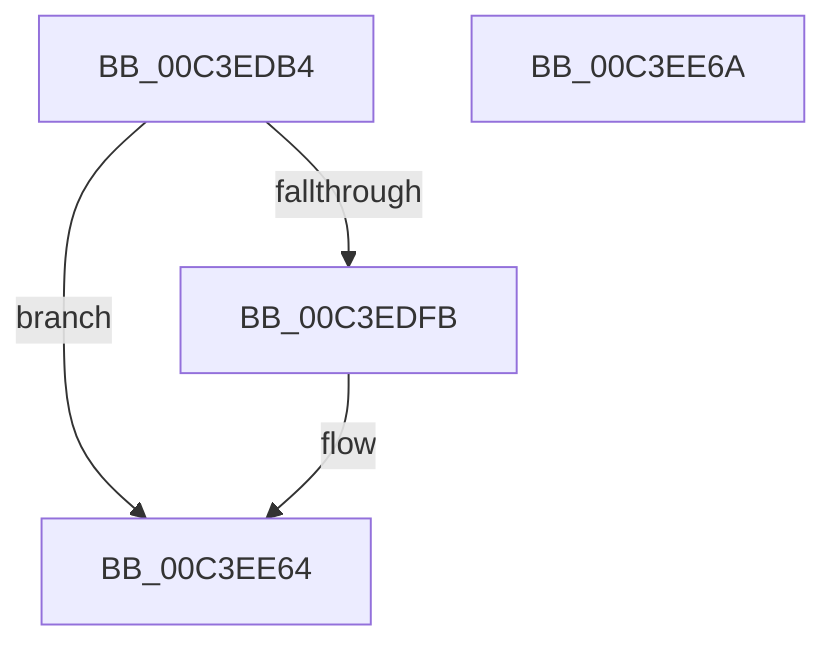

# PopCoalescingInitialize

- RVA: `0x00C3EDB4`–`0x00C3EE6B` (길이 `183` bytes)
- VA: `0x0000000140C3EDB4`
- 실행 섹션: `INIT`
- PDB 이름 있음: `예`; PDB Function 태그: `아니요`
- unwind 정보 RVA: `0x0005CF00`
- 디코드: `34`개 명령, `183/183` bytes 표시
- 미해석 바이트: `0` (있으면 어셈블리에 `.byte`로 보존)

> 이 문서는 커널 이미지의 기계어와 PDB 기호를 분석해 생성했습니다. 4번과 5번은 함수 원형과 자료형을 바이너리 사용 방식에서 추정한 C 해석이며 원본 소스 복구 결과는 아닙니다.

## 1. Dependencies

- 직접 호출 지점: **2**; 고유 호출 대상: **2**
- 직접 호출자로 확인된 함수: **1**
- RIP 상대 이미지 참조: **20**

### Outgoing calls
- `0x00C3EDF2` → [PoRegisterCoalescingCallback](../../page/75/PoRegisterCoalescingCallback_function_0075BF00.md) (function, `0x0075BF00`)
- `0x00C3EE5F` → [PopUpdateDiskIdleTimeoutSetting](../../page/91/PopUpdateDiskIdleTimeoutSetting_function_00912E30.md) (function, `0x00912E30`)

### Direct callers
- [PoInitSystem](../C7/PoInitSystem_function_00C72358.md) at `0x00C731AC`

### Static image references
- `0x00C3EDBA` → RVA `0x00F0E068` (`.data`; read/write)
- `0x00C3EDC1` → RVA `0x00A8DA40` (`PopCoalescingCallbackWorker`; read)
- `0x00C3EDCA` → RVA `0x00F0E050` (`.data`; write)
- `0x00C3EDD4` → RVA `0x00F0E058` (`.data`; write)
- `0x00C3EDDB` → RVA `0x00F0DFB8` (`.data`; read)
- `0x00C3EDE2` → RVA `0x00F0E040` (`.data`; write)
- `0x00C3EDEB` → RVA `0x0049E550` (`EmpCheckErrataList`; read)
- `0x00C3EDFB` → RVA `0x00F0E008` (`.data`; read)
- `0x00C3EE02` → RVA `0x00F0E000` (`.data`; write)
- `0x00C3EE09` → RVA `0x00F0E010` (`.data`; write)
- `0x00C3EE10` → RVA `0x00F0E008` (`.data`; write)
- `0x00C3EE17` → RVA `0x005D4680` (`PopCoalesingTimerDpcCallback`; read)
- `0x00C3EE1E` → RVA `0x00F0DFD8` (`.data`; write)
- `0x00C3EE2C` → RVA `0x00F0E018` (`.data`; write)
- `0x00C3EE33` → RVA `0x00F0E03C` (`.data`; write)
- `0x00C3EE39` → RVA `0x00F0E038` (`.data`; write)
- `0x00C3EE40` → RVA `0x00F0DFC0` (`.data`; write)
- `0x00C3EE4A` → RVA `0x00F0DFE0` (`.data`; write)
- `0x00C3EE51` → RVA `0x00F0DFF8` (`.data`; write)
- `0x00C3EE58` → RVA `0x00F0DFD0` (`.data`; write)

## 2. Other-region calls and transfers

- 다른 실행 섹션으로 향하는 call: **2**
  - `0x00C3EDF2` → [PoRegisterCoalescingCallback](../../page/75/PoRegisterCoalescingCallback_function_0075BF00.md) (`INIT` → `PAGE`)
  - `0x00C3EE5F` → [PopUpdateDiskIdleTimeoutSetting](../../page/91/PopUpdateDiskIdleTimeoutSetting_function_00912E30.md) (`INIT` → `PAGE`)
- 별도 외부 분기/꼬리 이동을 확인하지 못했습니다.

## 3. Assembly (complete function range)

```asm
00C3EDB4  40 53                           push rbx
00C3EDB6  48 83 EC 20                     sub rsp, 0x20
00C3EDBA  80 25 A7 F2 2C 00 F0            and byte ptr [rip + 0x2cf2a7], 0xf0
00C3EDC1  48 8D 05 78 EC E4 FF            lea rax, [rip - 0x1b1388]
00C3EDC8  33 DB                           xor ebx, ebx
00C3EDCA  48 89 05 7F F2 2C 00            mov qword ptr [rip + 0x2cf27f], rax
00C3EDD1  45 33 C9                        xor r9d, r9d
00C3EDD4  48 89 1D 7D F2 2C 00            mov qword ptr [rip + 0x2cf27d], rbx
00C3EDDB  4C 8D 05 D6 F1 2C 00            lea r8, [rip + 0x2cf1d6]
00C3EDE2  48 89 1D 57 F2 2C 00            mov qword ptr [rip + 0x2cf257], rbx
00C3EDE9  33 D2                           xor edx, edx
00C3EDEB  48 8D 0D 5E F7 85 FF            lea rcx, [rip - 0x7a08a2]
00C3EDF2  E8 09 D1 B1 FF                  call 0x14075bf00
00C3EDF7  85 C0                           test eax, eax
00C3EDF9  78 69                           js 0x140c3ee64
00C3EDFB  48 8D 05 06 F2 2C 00            lea rax, [rip + 0x2cf206]
00C3EE02  48 89 1D F7 F1 2C 00            mov qword ptr [rip + 0x2cf1f7], rbx
00C3EE09  48 89 05 00 F2 2C 00            mov qword ptr [rip + 0x2cf200], rax
00C3EE10  48 89 05 F1 F1 2C 00            mov qword ptr [rip + 0x2cf1f1], rax
00C3EE17  48 8D 05 62 58 99 FF            lea rax, [rip - 0x66a79e]
00C3EE1E  48 89 05 B3 F1 2C 00            mov qword ptr [rip + 0x2cf1b3], rax
00C3EE25  C6 05 D4 F1 2C 00 08            mov byte ptr [rip + 0x2cf1d4], 8
00C3EE2C  48 89 1D E5 F1 2C 00            mov qword ptr [rip + 0x2cf1e5], rbx
00C3EE33  89 1D 03 F2 2C 00               mov dword ptr [rip + 0x2cf203], ebx
00C3EE39  66 89 1D F8 F1 2C 00            mov word ptr [rip + 0x2cf1f8], bx
00C3EE40  C7 05 76 F1 2C 00 13 01 00 00   mov dword ptr [rip + 0x2cf176], 0x113
00C3EE4A  48 89 1D 8F F1 2C 00            mov qword ptr [rip + 0x2cf18f], rbx
00C3EE51  48 89 1D A0 F1 2C 00            mov qword ptr [rip + 0x2cf1a0], rbx
00C3EE58  48 89 1D 71 F1 2C 00            mov qword ptr [rip + 0x2cf171], rbx
00C3EE5F  E8 CC 3F CD FF                  call 0x140912e30
00C3EE64  48 83 C4 20                     add rsp, 0x20
00C3EE68  5B                              pop rbx
00C3EE69  C3                              ret
00C3EE6A  CC                              int3
```

## 4. C-style interpretation (structured pseudocode)

```c
__int64 __fastcall PopCoalescingInitialize(__int64 a1, int a2, __int64 a3, int a4)
{
    __int64 result;
    __int64 v_rbx;
    __int64 v_rsp;

    v_rsp = (v_rsp) - (32);
    v_rbx = 0;
    *(unsigned __int64 *)(v_rip + 2945663) = v_rip - 1774472;
    a4 = 0;
    *(unsigned __int64 *)(v_rip + 2945661) = 0;
    *(unsigned __int64 *)(v_rip + 2945623) = 0;
    a2 = 0;
    result = PoRegisterCoalescingCallback(v_rip - 7997602, a2, v_rip + 2945494, a4);
    if (!(sign_flag)) {
        result = v_rip + 2945542;
        *(unsigned __int64 *)(v_rip + 2945527) = 0;
        *(unsigned __int64 *)(v_rip + 2945536) = result;
        *(unsigned __int64 *)(v_rip + 2945521) = result;
        result = v_rip - 6727582;
        *(unsigned __int64 *)(v_rip + 2945459) = result;
        *(unsigned __int8 *)(v_rip + 2945492) = 8;
        *(unsigned __int64 *)(v_rip + 2945509) = 0;
        *(unsigned int *)(v_rip + 2945539) = 0;
        *(unsigned __int16 *)(v_rip + 2945528) = 0;
        *(unsigned int *)(v_rip + 2945398) = 275;
        *(unsigned __int64 *)(v_rip + 2945423) = 0;
        *(unsigned __int64 *)(v_rip + 2945440) = 0;
        *(unsigned __int64 *)(v_rip + 2945393) = 0;
        result = PopUpdateDiskIdleTimeoutSetting(v_rip - 7997602, a2, v_rip + 2945494, a4);
    }
    v_rsp = (v_rsp) + (32);
    return result;
}
```

## 5. (Beta) C Style

```c
int64_t PopCoalescingInitialize(int64_t Arg1, int32_t Arg2, int64_t Arg3, int32_t Arg4)
{
    int64_t result;
    int64_t local_rbx;
    int64_t local_rsp;

    local_rsp = (local_rsp) - (32);
    local_rbx = 0;
    *(uint64_t *)(v_rip + 0x2CF27F) = v_rip - 1774472;
    Arg4 = 0;
    *(uint64_t *)(v_rip + 0x2CF27D) = 0;
    *(uint64_t *)(v_rip + 0x2CF257) = 0;
    Arg2 = 0;
    result = PoRegisterCoalescingCallback(v_rip - 7997602, Arg2, v_rip + 2945494, Arg4);
    if (!(sign_flag)) {
        result = v_rip + 2945542;
        *(uint64_t *)(v_rip + 0x2CF1F7) = 0;
        *(uint64_t *)(v_rip + 0x2CF200) = result;
        *(uint64_t *)(v_rip + 0x2CF1F1) = result;
        result = v_rip - 6727582;
        *(uint64_t *)(v_rip + 0x2CF1B3) = result;
        *(uint8_t *)(v_rip + 0x2CF1D4) = 8;
        *(uint64_t *)(v_rip + 0x2CF1E5) = 0;
        *(uint32_t *)(v_rip + 0x2CF203) = 0;
        *(uint16_t *)(v_rip + 0x2CF1F8) = 0;
        *(uint32_t *)(v_rip + 0x2CF176) = 275;
        *(uint64_t *)(v_rip + 0x2CF18F) = 0;
        *(uint64_t *)(v_rip + 0x2CF1A0) = 0;
        *(uint64_t *)(v_rip + 0x2CF171) = 0;
        result = PopUpdateDiskIdleTimeoutSetting(v_rip - 7997602, Arg2, v_rip + 2945494, Arg4);
    }
    local_rsp = (local_rsp) + (32);
    return result;
}
```

## 6. Execution-region graph

[열기: 2D/3D 그래프와 함수 탐색 컨트롤 패널](../../../control-panel.html?section=init&rva=0x00C3EDB4&view=graph)

- 2D 그래프는 위에서 아래로 흐르고, 3D 그래프는 빈 공간을 드래그해 회전합니다. Shift+드래그는 이동, 휠은 확대·축소, 함수 노드 선택은 대상 보고서 이동입니다.

### Static fallback


