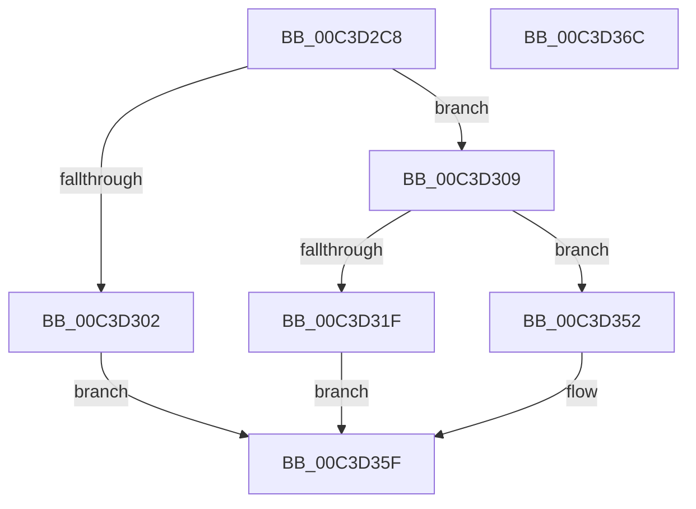

# PopCreateTimebrokerServiceSid

- RVA: `0x00C3D2C8`–`0x00C3D36D` (길이 `165` bytes)
- VA: `0x0000000140C3D2C8`
- 실행 섹션: `INIT`
- PDB 이름 있음: `예`; PDB Function 태그: `아니요`
- unwind 정보 RVA: `0x00068D5C`
- 디코드: `40`개 명령, `165/165` bytes 표시
- 미해석 바이트: `0` (있으면 어셈블리에 `.byte`로 보존)

> 이 문서는 커널 이미지의 기계어와 PDB 기호를 분석해 생성했습니다. 4번과 5번은 함수 원형과 자료형을 바이너리 사용 방식에서 추정한 C 해석이며 원본 소스 복구 결과는 아닙니다.

## 1. Dependencies

- 직접 호출 지점: **4**; 고유 호출 대상: **4**
- 직접 호출자로 확인된 함수: **1**
- RIP 상대 이미지 참조: **1**

### Outgoing calls
- `0x00C3D2E3` → [RtlLengthRequiredSid](../../page/9C/RtlLengthRequiredSid_function_009CA4D0.md) (function, `0x009CA4D0`)
- `0x00C3D2F5` → [ExAllocatePool2](../../poolcode/B8/ExAllocatePool2_function_00B820F0.md) (function, `0x00B820F0`)
- `0x00C3D314` → [RtlInitializeSid](../../page/9E/RtlInitializeSid_function_009EB720.md) (function, `0x009EB720`)
- `0x00C3D35A` → [ExFreePoolWithTag](../../poolcode/B8/ExFreePoolWithTag_function_00B82870.md) (function, `0x00B82870`)

### Direct callers
- [PoInitSystem](../C7/PoInitSystem_function_00C72358.md) at `0x00C72C49`

### Static image references
- `0x00C3D349` → RVA `0x00F0CFB0` (`.data`; write)

## 2. Other-region calls and transfers

- 다른 실행 섹션으로 향하는 call: **4**
  - `0x00C3D2E3` → [RtlLengthRequiredSid](../../page/9C/RtlLengthRequiredSid_function_009CA4D0.md) (`INIT` → `PAGE`)
  - `0x00C3D2F5` → [ExAllocatePool2](../../poolcode/B8/ExAllocatePool2_function_00B820F0.md) (`INIT` → `POOLCODE`)
  - `0x00C3D314` → [RtlInitializeSid](../../page/9E/RtlInitializeSid_function_009EB720.md) (`INIT` → `PAGE`)
  - `0x00C3D35A` → [ExFreePoolWithTag](../../poolcode/B8/ExFreePoolWithTag_function_00B82870.md) (`INIT` → `POOLCODE`)
- 별도 외부 분기/꼬리 이동을 확인하지 못했습니다.

## 3. Assembly (complete function range)

```asm
00C3D2C8  48 89 5C 24 10                  mov qword ptr [rsp + 0x10], rbx
00C3D2CD  57                              push rdi
00C3D2CE  48 83 EC 20                     sub rsp, 0x20
00C3D2D2  83 64 24 30 00                  and dword ptr [rsp + 0x30], 0
00C3D2D7  B9 06 00 00 00                  mov ecx, 6
00C3D2DC  66 C7 44 24 34 00 05            mov word ptr [rsp + 0x34], 0x500
00C3D2E3  E8 E8 D1 D8 FF                  call 0x1409ca4d0
00C3D2E8  8B D0                           mov edx, eax
00C3D2EA  B9 00 01 00 00                  mov ecx, 0x100
00C3D2EF  41 B8 50 64 69 67               mov r8d, 0x67696450
00C3D2F5  E8 F6 4D F4 FF                  call 0x140b820f0
00C3D2FA  48 8B D8                        mov rbx, rax
00C3D2FD  48 85 C0                        test rax, rax
00C3D300  75 07                           jne 0x140c3d309
00C3D302  BF 17 00 00 C0                  mov edi, 0xc0000017
00C3D307  EB 56                           jmp 0x140c3d35f
00C3D309  41 B0 06                        mov r8b, 6
00C3D30C  48 8D 54 24 30                  lea rdx, [rsp + 0x30]
00C3D311  48 8B CB                        mov rcx, rbx
00C3D314  E8 07 E4 DA FF                  call 0x1409eb720
00C3D319  8B F8                           mov edi, eax
00C3D31B  85 C0                           test eax, eax
00C3D31D  78 33                           js 0x140c3d352
00C3D31F  C7 43 08 50 00 00 00            mov dword ptr [rbx + 8], 0x50
00C3D326  C7 43 0C D7 D4 7E 18            mov dword ptr [rbx + 0xc], 0x187ed4d7
00C3D32D  C7 43 10 E7 98 0B 98            mov dword ptr [rbx + 0x10], 0x980b98e7
00C3D334  C7 43 14 6F 8D 62 66            mov dword ptr [rbx + 0x14], 0x66628d6f
00C3D33B  C7 43 18 F7 B7 5C 8A            mov dword ptr [rbx + 0x18], 0x8a5cb7f7
00C3D342  C7 43 1C BB 7E DF DF            mov dword ptr [rbx + 0x1c], 0xdfdf7ebb
00C3D349  48 89 1D 60 FC 2C 00            mov qword ptr [rip + 0x2cfc60], rbx
00C3D350  EB 0D                           jmp 0x140c3d35f
00C3D352  BA 50 64 69 67                  mov edx, 0x67696450
00C3D357  48 8B CB                        mov rcx, rbx
00C3D35A  E8 11 55 F4 FF                  call 0x140b82870
00C3D35F  48 8B 5C 24 38                  mov rbx, qword ptr [rsp + 0x38]
00C3D364  8B C7                           mov eax, edi
00C3D366  48 83 C4 20                     add rsp, 0x20
00C3D36A  5F                              pop rdi
00C3D36B  C3                              ret
00C3D36C  CC                              int3
```

## 4. C-style interpretation (structured pseudocode)

```c
__int64 __fastcall PopCreateTimebrokerServiceSid(void)
{
    __int64 result;
    __int64 v_rsp;
    unsigned __int64 v_stack_p10;
    unsigned int v_stack_p8;
    unsigned __int16 v_stack_pC;

    v_stack_p10 = v_rbx;
    v_rsp = (v_rsp) - (32);
    v_stack_pC = 0x500ULL;
    result = RtlLengthRequiredSid(6, a2, a3, a4);
    result = ExAllocatePool2(256, (unsigned int)((unsigned int)(result)), (unsigned int)(0x67696450ULL), a4);
    if (result != 0) goto loc_00C3D309;
    goto loc_00C3D35F;
loc_00C3D309:
    result = RtlInitializeSid(result, v_stack_p8, 6, a4);
    if (sign_flag) goto loc_00C3D352;
    *(unsigned int *)(result + 8) = 80;
    *(unsigned int *)(result + 12) = 0x187ED4D7ULL;
    *(unsigned int *)(result + 16) = 0x980B98E7ULL;
    *(unsigned int *)(result + 20) = 0x66628D6FULL;
    *(unsigned int *)(result + 24) = 0x8A5CB7F7ULL;
    *(unsigned int *)(result + 28) = 0xDFDF7EBBULL;
    *(unsigned __int64 *)(v_rip + 2948192) = result;
    goto loc_00C3D35F;
loc_00C3D352:
    result = ExFreePoolWithTag(result, (unsigned int)(0x67696450ULL), 6, a4);
loc_00C3D35F:
    v_rsp = (v_rsp) + (32);
    return (unsigned int)((unsigned int)((unsigned int)((unsigned int)(result))));
}
```

## 5. (Beta) C Style

```c
void PopCreateTimebrokerServiceSid(void)
{
    int64_t result;
    int64_t local_rsp;
    uint64_t v_stack_p10;
    uint32_t v_stack_p8;
    uint16_t v_stack_pC;

    v_stack_p10 = local_rbx;
    local_rsp = (local_rsp) - (32);
    v_stack_pC = 0x500ULL;
    result = RtlLengthRequiredSid(6, a2, a3, a4);
    result = ExAllocatePool2(256, (uint32_t)((uint32_t)(result)), (uint32_t)(0x67696450ULL), a4);
    if (result != 0) goto loc_00C3D309;
    goto loc_00C3D35F;
loc_00C3D309:
    result = RtlInitializeSid(result, v_stack_p8, 6, a4);
    if (sign_flag) goto loc_00C3D352;
    *(uint32_t *)(result + 0x8) = 80;
    *(uint32_t *)(result + 0xC) = 0x187ED4D7ULL;
    *(uint32_t *)(result + 0x10) = 0x980B98E7ULL;
    *(uint32_t *)(result + 0x14) = 0x66628D6FULL;
    *(uint32_t *)(result + 0x18) = 0x8A5CB7F7ULL;
    *(uint32_t *)(result + 0x1C) = 0xDFDF7EBBULL;
    *(uint64_t *)(v_rip + 0x2CFC60) = result;
    goto loc_00C3D35F;
loc_00C3D352:
    result = ExFreePoolWithTag(result, (uint32_t)(0x67696450ULL), 6, a4);
loc_00C3D35F:
    local_rsp = (local_rsp) + (32);
    return (uint32_t)((uint32_t)((uint32_t)((uint32_t)(result))));
}
```

## 6. Execution-region graph

[열기: 2D/3D 그래프와 함수 탐색 컨트롤 패널](../../../control-panel.html?section=init&rva=0x00C3D2C8&view=graph)

- 2D 그래프는 위에서 아래로 흐르고, 3D 그래프는 빈 공간을 드래그해 회전합니다. Shift+드래그는 이동, 휠은 확대·축소, 함수 노드 선택은 대상 보고서 이동입니다.

### Static fallback


