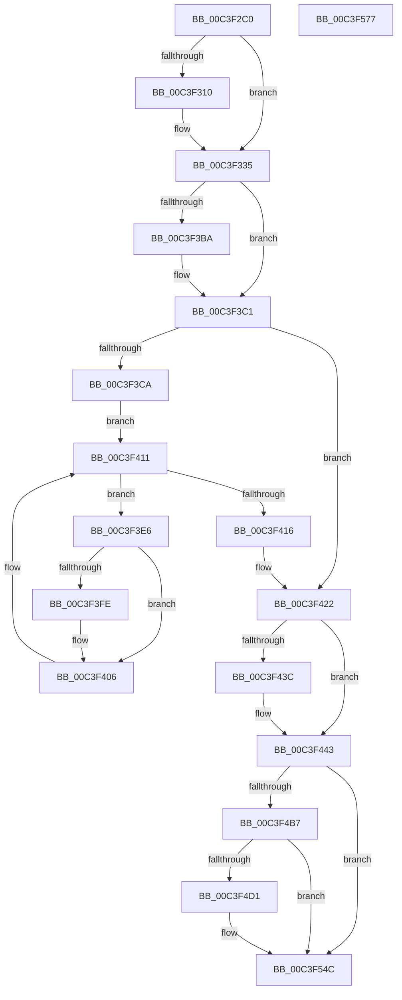

# PopDiagInitialize

- RVA: `0x00C3F2C0`–`0x00C3F578` (길이 `696` bytes)
- VA: `0x0000000140C3F2C0`
- 실행 섹션: `INIT`
- PDB 이름 있음: `예`; PDB Function 태그: `아니요`
- unwind 정보 RVA: `0x000CCC40`
- 디코드: `146`개 명령, `696/696` bytes 표시
- 미해석 바이트: `0` (있으면 어셈블리에 `.byte`로 보존)

> 이 문서는 커널 이미지의 기계어와 PDB 기호를 분석해 생성했습니다. 4번과 5번은 함수 원형과 자료형을 바이너리 사용 방식에서 추정한 C 해석이며 원본 소스 복구 결과는 아닙니다.

## 1. Dependencies

- 직접 호출 지점: **20**; 고유 호출 대상: **14**
- 직접 호출자로 확인된 함수: **1**
- RIP 상대 이미지 참조: **30**

### Outgoing calls
- `0x00C3F305` → [EtwRegister](../../page/92/EtwRegister_function_00920960.md) (function, `0x00920960`)
- `0x00C3F330` → [EtwSetInformation](../../page/7B/EtwSetInformation_function_007B9070.md) (function, `0x007B9070`)
- `0x00C3F366` → [TraceLoggingRegisterEx_EtwRegister_EtwSetInformation](../../page/92/TraceLoggingRegisterEx_EtwRegister_EtwSetInformation_function_009208A0.md) (function, `0x009208A0`)
- `0x00C3F377` → [TraceLoggingRegisterEx_EtwRegister_EtwSetInformation](../../page/92/TraceLoggingRegisterEx_EtwRegister_EtwSetInformation_function_009208A0.md) (function, `0x009208A0`)
- `0x00C3F388` → [TraceLoggingRegisterEx_EtwRegister_EtwSetInformation](../../page/92/TraceLoggingRegisterEx_EtwRegister_EtwSetInformation_function_009208A0.md) (function, `0x009208A0`)
- `0x00C3F399` → [TraceLoggingRegisterEx_EtwRegister_EtwSetInformation](../../page/92/TraceLoggingRegisterEx_EtwRegister_EtwSetInformation_function_009208A0.md) (function, `0x009208A0`)
- `0x00C3F3B1` → [EtwRegister](../../page/92/EtwRegister_function_00920960.md) (function, `0x00920960`)
- `0x00C3F3D1` → [PopAcquireRwLockShared](../../text/2D/PopAcquireRwLockShared_function_002D9A40.md) (function, `0x002D9A40`)
- `0x00C3F3F0` → [PopAcquireRwLockExclusive](../../text/43/PopAcquireRwLockExclusive_function_00430B44.md) (function, `0x00430B44`)
- `0x00C3F401` → [PopDiagTraceThermalZoneEnumeration](../../text/5D/PopDiagTraceThermalZoneEnumeration_function_005D7154.md) (function, `0x005D7154`)
- `0x00C3F409` → [PopReleaseRwLock](../../text/2D/PopReleaseRwLock_function_002DFBBC.md) (function, `0x002DFBBC`)
- `0x00C3F41D` → [PopReleaseRwLock](../../text/2D/PopReleaseRwLock_function_002DFBBC.md) (function, `0x002DFBBC`)
- `0x00C3F422` → [PopDiagSleepStudyInitialize](../../page/76/PopDiagSleepStudyInitialize_function_00760314.md) (function, `0x00760314`)
- `0x00C3F433` → [TraceLoggingRegisterEx_EtwRegister_EtwSetInformation](../../page/92/TraceLoggingRegisterEx_EtwRegister_EtwSetInformation_function_009208A0.md) (function, `0x009208A0`)
- `0x00C3F47B` → [KiQueryUnbiasedInterruptTime](../../text/42/KiQueryUnbiasedInterruptTime_function_0042D180.md) (function, `0x0042D180`)
- `0x00C3F494` → [PopTransitionTelemetryOsState](../../page/A9/PopTransitionTelemetryOsState_function_00A9DD40.md) (function, `0x00A9DD40`)
- `0x00C3F4A5` → [PdcTaskClientRegister](../../page/79/PdcTaskClientRegister_function_0079B49C.md) (function, `0x0079B49C`)
- `0x00C3F4C8` → [tlgKeywordOn](../../text/42/tlgKeywordOn_function_0042EAA0.md) (function, `0x0042EAA0`)
- `0x00C3F547` → [tlgWriteTransfer_EtwWriteTransfer](../../text/42/tlgWriteTransfer_EtwWriteTransfer_function_004260E0.md) (function, `0x004260E0`)
- `0x00C3F555` → [_security_check_cookie](../../text/6A/_security_check_cookie_function_006AC640.md) (function, `0x006AC640`)

### Direct callers
- [PoInitSystem](../C7/PoInitSystem_function_00C72358.md) at `0x00C72EC7`

### Static image references
- `0x00C3F2DF` → RVA `0x00E0A740` (`.data`; read)
- `0x00C3F2ED` → RVA `0x00F0B408` (`.data`; read)
- `0x00C3F2F7` → RVA `0x00A38CB0` (`PopDiagTraceControlCallback`; read)
- `0x00C3F2FE` → RVA `0x00022E50` (`.rdata`; read)
- `0x00C3F310` → RVA `0x0001BF90` (`.rdata`; read)
- `0x00C3F329` → RVA `0x00E67858` (`.data`; write)
- `0x00C3F335` → RVA `0x00A554A0` (`PopDiagDeviceRundownWorker`; read)
- `0x00C3F33C` → RVA `0x00F0B458` (`.data`; write)
- `0x00C3F343` → RVA `0x00E07748` (`.data`; read)
- `0x00C3F34A` → RVA `0x00F0B450` (`.data`; write)
- `0x00C3F358` → RVA `0x00F0B440` (`.data`; write)
- `0x00C3F36E` → RVA `0x00E07710` (`.data`; read)
- `0x00C3F37F` → RVA `0x00E076A0` (`.data`; read)
- `0x00C3F390` → RVA `0x00E076D8` (`.data`; read)
- `0x00C3F39E` → RVA `0x00F0B6D0` (`.data`; read)
- `0x00C3F3AA` → RVA `0x00021480` (`.rdata`; read)
- `0x00C3F3BA` → RVA `0x00E6786C` (`.data`; write)
- `0x00C3F3C1` → RVA `0x00E6786C` (`.data`; read)
- `0x00C3F3CA` → RVA `0x00F0C900` (`.data`; read)
- `0x00C3F3D6` → RVA `0x00F0CE80` (`.data`; read)
- `0x00C3F42A` → RVA `0x00E08390` (`.data`; read)
- `0x00C3F43C` → RVA `0x00F070B8` (`.data`; write)
- `0x00C3F443` → RVA `0x00F0B488` (`.data`; write)
- `0x00C3F454` → RVA `0x00F0B480` (`.data`; write)
- `0x00C3F460` → RVA `0x00F0B498` (`.data`; write)
- `0x00C3F474` → RVA `0x00F0B4A0` (`.data`; write)
- `0x00C3F485` → RVA `0x00F0B4CC` (`.data`; write)
- `0x00C3F48D` → RVA `0x00F0B4A8` (`.data`; write)
- `0x00C3F499` → RVA `0x00F0B460` (`.data`; read)
- `0x00C3F4DC` → RVA `0x0004C166` (`.rdata`; read)

## 2. Other-region calls and transfers

- 다른 실행 섹션으로 향하는 call: **20**
  - `0x00C3F305` → [EtwRegister](../../page/92/EtwRegister_function_00920960.md) (`INIT` → `PAGE`)
  - `0x00C3F330` → [EtwSetInformation](../../page/7B/EtwSetInformation_function_007B9070.md) (`INIT` → `PAGE`)
  - `0x00C3F366` → [TraceLoggingRegisterEx_EtwRegister_EtwSetInformation](../../page/92/TraceLoggingRegisterEx_EtwRegister_EtwSetInformation_function_009208A0.md) (`INIT` → `PAGE`)
  - `0x00C3F377` → [TraceLoggingRegisterEx_EtwRegister_EtwSetInformation](../../page/92/TraceLoggingRegisterEx_EtwRegister_EtwSetInformation_function_009208A0.md) (`INIT` → `PAGE`)
  - `0x00C3F388` → [TraceLoggingRegisterEx_EtwRegister_EtwSetInformation](../../page/92/TraceLoggingRegisterEx_EtwRegister_EtwSetInformation_function_009208A0.md) (`INIT` → `PAGE`)
  - `0x00C3F399` → [TraceLoggingRegisterEx_EtwRegister_EtwSetInformation](../../page/92/TraceLoggingRegisterEx_EtwRegister_EtwSetInformation_function_009208A0.md) (`INIT` → `PAGE`)
  - `0x00C3F3B1` → [EtwRegister](../../page/92/EtwRegister_function_00920960.md) (`INIT` → `PAGE`)
  - `0x00C3F3D1` → [PopAcquireRwLockShared](../../text/2D/PopAcquireRwLockShared_function_002D9A40.md) (`INIT` → `.text`)
  - `0x00C3F3F0` → [PopAcquireRwLockExclusive](../../text/43/PopAcquireRwLockExclusive_function_00430B44.md) (`INIT` → `.text`)
  - `0x00C3F401` → [PopDiagTraceThermalZoneEnumeration](../../text/5D/PopDiagTraceThermalZoneEnumeration_function_005D7154.md) (`INIT` → `.text`)
  - `0x00C3F409` → [PopReleaseRwLock](../../text/2D/PopReleaseRwLock_function_002DFBBC.md) (`INIT` → `.text`)
  - `0x00C3F41D` → [PopReleaseRwLock](../../text/2D/PopReleaseRwLock_function_002DFBBC.md) (`INIT` → `.text`)
  - `0x00C3F422` → [PopDiagSleepStudyInitialize](../../page/76/PopDiagSleepStudyInitialize_function_00760314.md) (`INIT` → `PAGE`)
  - `0x00C3F433` → [TraceLoggingRegisterEx_EtwRegister_EtwSetInformation](../../page/92/TraceLoggingRegisterEx_EtwRegister_EtwSetInformation_function_009208A0.md) (`INIT` → `PAGE`)
  - `0x00C3F47B` → [KiQueryUnbiasedInterruptTime](../../text/42/KiQueryUnbiasedInterruptTime_function_0042D180.md) (`INIT` → `.text`)
  - `0x00C3F494` → [PopTransitionTelemetryOsState](../../page/A9/PopTransitionTelemetryOsState_function_00A9DD40.md) (`INIT` → `PAGE`)
  - `0x00C3F4A5` → [PdcTaskClientRegister](../../page/79/PdcTaskClientRegister_function_0079B49C.md) (`INIT` → `PAGE`)
  - `0x00C3F4C8` → [tlgKeywordOn](../../text/42/tlgKeywordOn_function_0042EAA0.md) (`INIT` → `.text`)
  - `0x00C3F547` → [tlgWriteTransfer_EtwWriteTransfer](../../text/42/tlgWriteTransfer_EtwWriteTransfer_function_004260E0.md) (`INIT` → `.text`)
  - `0x00C3F555` → [_security_check_cookie](../../text/6A/_security_check_cookie_function_006AC640.md) (`INIT` → `.text`)
- 별도 외부 분기/꼬리 이동을 확인하지 못했습니다.

## 3. Assembly (complete function range)

```asm
00C3F2C0  48 8B C4                        mov rax, rsp
00C3F2C3  48 89 58 08                     mov qword ptr [rax + 8], rbx
00C3F2C7  48 89 70 10                     mov qword ptr [rax + 0x10], rsi
00C3F2CB  48 89 78 18                     mov qword ptr [rax + 0x18], rdi
00C3F2CF  4C 89 78 20                     mov qword ptr [rax + 0x20], r15
00C3F2D3  55                              push rbp
00C3F2D4  48 8D 68 A1                     lea rbp, [rax - 0x5f]
00C3F2D8  48 81 EC C0 00 00 00            sub rsp, 0xc0
00C3F2DF  48 8B 05 5A B4 1C 00            mov rax, qword ptr [rip + 0x1cb45a]
00C3F2E6  48 33 C4                        xor rax, rsp
00C3F2E9  48 89 45 47                     mov qword ptr [rbp + 0x47], rax
00C3F2ED  4C 8D 05 14 C1 2C 00            lea r8, [rip + 0x2cc114]
00C3F2F4  4D 8B C8                        mov r9, r8
00C3F2F7  48 8D 15 B2 99 DF FF            lea rdx, [rip - 0x20664e]
00C3F2FE  48 8D 0D 4B 3B 3E FF            lea rcx, [rip - 0xc1c4b5]
00C3F305  E8 56 16 CE FF                  call 0x140920960
00C3F30A  33 F6                           xor esi, esi
00C3F30C  85 C0                           test eax, eax
00C3F30E  78 25                           js 0x140c3f335
00C3F310  44 0F B7 0D 78 CC 3D FF         movzx r9d, word ptr [rip - 0xc23388]
00C3F318  4C 8D 05 71 CC 3D FF            lea r8, [rip - 0xc2338f]
00C3F31F  48 8B 0D E2 C0 2C 00            mov rcx, qword ptr [rip + 0x2cc0e2]
00C3F326  8D 56 02                        lea edx, [rsi + 2]
00C3F329  C6 05 28 85 22 00 01            mov byte ptr [rip + 0x228528], 1
00C3F330  E8 3B 9D B7 FF                  call 0x1407b9070
00C3F335  48 8D 05 64 61 E1 FF            lea rax, [rip - 0x1e9e9c]
00C3F33C  48 89 35 15 C1 2C 00            mov qword ptr [rip + 0x2cc115], rsi
00C3F343  4C 8D 05 FE 83 1C 00            lea r8, [rip + 0x1c83fe]
00C3F34A  48 89 05 FF C0 2C 00            mov qword ptr [rip + 0x2cc0ff], rax
00C3F351  48 8D 15 58 99 DF FF            lea rdx, [rip - 0x2066a8]
00C3F358  48 89 35 E1 C0 2C 00            mov qword ptr [rip + 0x2cc0e1], rsi
00C3F35F  48 8D 0D E2 83 1C 00            lea rcx, [rip + 0x1c83e2]
00C3F366  E8 35 15 CE FF                  call 0x1409208a0
00C3F36B  45 33 C0                        xor r8d, r8d
00C3F36E  48 8D 0D 9B 83 1C 00            lea rcx, [rip + 0x1c839b]
00C3F375  33 D2                           xor edx, edx
00C3F377  E8 24 15 CE FF                  call 0x1409208a0
00C3F37C  45 33 C0                        xor r8d, r8d
00C3F37F  48 8D 0D 1A 83 1C 00            lea rcx, [rip + 0x1c831a]
00C3F386  33 D2                           xor edx, edx
00C3F388  E8 13 15 CE FF                  call 0x1409208a0
00C3F38D  45 33 C0                        xor r8d, r8d
00C3F390  48 8D 0D 41 83 1C 00            lea rcx, [rip + 0x1c8341]
00C3F397  33 D2                           xor edx, edx
00C3F399  E8 02 15 CE FF                  call 0x1409208a0
00C3F39E  4C 8D 0D 2B C3 2C 00            lea r9, [rip + 0x2cc32b]
00C3F3A5  45 33 C0                        xor r8d, r8d
00C3F3A8  33 D2                           xor edx, edx
00C3F3AA  48 8D 0D CF 20 3E FF            lea rcx, [rip - 0xc1df31]
00C3F3B1  E8 AA 15 CE FF                  call 0x140920960
00C3F3B6  85 C0                           test eax, eax
00C3F3B8  78 07                           js 0x140c3f3c1
00C3F3BA  C6 05 AB 84 22 00 01            mov byte ptr [rip + 0x2284ab], 1
00C3F3C1  40 38 35 A4 84 22 00            cmp byte ptr [rip + 0x2284a4], sil
00C3F3C8  74 58                           je 0x140c3f422
00C3F3CA  48 8D 0D 2F D5 2C 00            lea rcx, [rip + 0x2cd52f]
00C3F3D1  E8 6A A6 69 FF                  call 0x1402d9a40
00C3F3D6  48 8B 1D A3 DA 2C 00            mov rbx, qword ptr [rip + 0x2cdaa3]
00C3F3DD  4C 8D 3D 9C DA 2C 00            lea r15, [rip + 0x2cda9c]
00C3F3E4  EB 2B                           jmp 0x140c3f411
00C3F3E6  48 8D BB B0 01 00 00            lea rdi, [rbx + 0x1b0]
00C3F3ED  48 8B CF                        mov rcx, rdi
00C3F3F0  E8 4F 17 7F FF                  call 0x140430b44
00C3F3F5  8A 43 41                        mov al, byte ptr [rbx + 0x41]
00C3F3F8  24 12                           and al, 0x12
00C3F3FA  3C 02                           cmp al, 2
00C3F3FC  75 08                           jne 0x140c3f406
00C3F3FE  48 8B CB                        mov rcx, rbx
00C3F401  E8 4E 7D 99 FF                  call 0x1405d7154
00C3F406  48 8B CF                        mov rcx, rdi
00C3F409  E8 AE 07 6A FF                  call 0x1402dfbbc
00C3F40E  48 8B 1B                        mov rbx, qword ptr [rbx]
00C3F411  49 3B DF                        cmp rbx, r15
00C3F414  75 D0                           jne 0x140c3f3e6
00C3F416  48 8D 0D E3 D4 2C 00            lea rcx, [rip + 0x2cd4e3]
00C3F41D  E8 9A 07 6A FF                  call 0x1402dfbbc
00C3F422  E8 ED 0E B2 FF                  call 0x140760314
00C3F427  45 33 C0                        xor r8d, r8d
00C3F42A  48 8D 0D 5F 8F 1C 00            lea rcx, [rip + 0x1c8f5f]
00C3F431  33 D2                           xor edx, edx
00C3F433  E8 68 14 CE FF                  call 0x1409208a0
00C3F438  85 C0                           test eax, eax
00C3F43A  78 07                           js 0x140c3f443
00C3F43C  C6 05 75 7C 2C 00 01            mov byte ptr [rip + 0x2c7c75], 1
00C3F443  48 89 35 3E C0 2C 00            mov qword ptr [rip + 0x2cc03e], rsi
00C3F44A  48 B8 14 00 00 00 80 F7 FF FF   movabs rax, 0xfffff78000000014
00C3F454  48 89 35 25 C0 2C 00            mov qword ptr [rip + 0x2cc025], rsi
00C3F45B  B1 01                           mov cl, 1
00C3F45D  48 8B 00                        mov rax, qword ptr [rax]
00C3F460  48 89 05 31 C0 2C 00            mov qword ptr [rip + 0x2cc031], rax
00C3F467  48 B8 08 00 00 00 80 F7 FF FF   movabs rax, 0xfffff78000000008
00C3F471  48 8B 00                        mov rax, qword ptr [rax]
00C3F474  48 89 05 25 C0 2C 00            mov qword ptr [rip + 0x2cc025], rax
00C3F47B  E8 00 DD 7E FF                  call 0x14042d180
00C3F480  BA 01 00 00 00                  mov edx, 1
00C3F485  88 0D 41 C0 2C 00               mov byte ptr [rip + 0x2cc041], cl
00C3F48B  8B CA                           mov ecx, edx
00C3F48D  48 89 05 14 C0 2C 00            mov qword ptr [rip + 0x2cc014], rax
00C3F494  E8 A7 E8 E5 FF                  call 0x140a9dd40
00C3F499  48 8D 15 C0 BF 2C 00            lea rdx, [rip + 0x2cbfc0]
00C3F4A0  B9 44 00 00 00                  mov ecx, 0x44
00C3F4A5  E8 F2 BF B5 FF                  call 0x14079b49c
00C3F4AA  83 3D 97 82 1C 00 05            cmp dword ptr [rip + 0x1c8297], 5
00C3F4B1  0F 86 95 00 00 00               jbe 0x140c3f54c
00C3F4B7  48 BA 00 00 00 00 00 40 00 00   movabs rdx, 0x400000000000
00C3F4C1  48 8D 0D 80 82 1C 00            lea rcx, [rip + 0x1c8280]
00C3F4C8  E8 D3 F5 7E FF                  call 0x14042eaa0
00C3F4CD  84 C0                           test al, al
00C3F4CF  74 7B                           je 0x140c3f54c
00C3F4D1  48 8D 45 C7                     lea rax, [rbp - 0x39]
00C3F4D5  89 75 C7                        mov dword ptr [rbp - 0x39], esi
00C3F4D8  48 89 45 07                     mov qword ptr [rbp + 7], rax
00C3F4DC  48 8D 15 83 CC 40 FF            lea rdx, [rip - 0xbf337d]
00C3F4E3  48 8D 45 CB                     lea rax, [rbp - 0x35]
00C3F4E7  48 C7 45 0F 04 00 00 00         mov qword ptr [rbp + 0xf], 4
00C3F4EF  48 89 45 17                     mov qword ptr [rbp + 0x17], rax
00C3F4F3  48 8D 0D 4E 82 1C 00            lea rcx, [rip + 0x1c824e]
00C3F4FA  48 8D 45 CF                     lea rax, [rbp - 0x31]
00C3F4FE  89 75 CB                        mov dword ptr [rbp - 0x35], esi
00C3F501  48 89 45 27                     mov qword ptr [rbp + 0x27], rax
00C3F505  45 33 C9                        xor r9d, r9d
00C3F508  48 8D 45 D7                     lea rax, [rbp - 0x29]
00C3F50C  48 C7 45 1F 04 00 00 00         mov qword ptr [rbp + 0x1f], 4
00C3F514  48 89 45 37                     mov qword ptr [rbp + 0x37], rax
00C3F518  45 33 C0                        xor r8d, r8d
00C3F51B  48 8D 45 E7                     lea rax, [rbp - 0x19]
00C3F51F  89 75 CF                        mov dword ptr [rbp - 0x31], esi
00C3F522  48 89 44 24 28                  mov qword ptr [rsp + 0x28], rax
00C3F527  C7 44 24 20 06 00 00 00         mov dword ptr [rsp + 0x20], 6
00C3F52F  48 C7 45 2F 04 00 00 00         mov qword ptr [rbp + 0x2f], 4
00C3F537  48 C7 45 D7 00 00 00 01         mov qword ptr [rbp - 0x29], 0x1000000
00C3F53F  48 C7 45 3F 08 00 00 00         mov qword ptr [rbp + 0x3f], 8
00C3F547  E8 94 6B 7E FF                  call 0x1404260e0
00C3F54C  33 C0                           xor eax, eax
00C3F54E  48 8B 4D 47                     mov rcx, qword ptr [rbp + 0x47]
00C3F552  48 33 CC                        xor rcx, rsp
00C3F555  E8 E6 D0 A6 FF                  call 0x1406ac640
00C3F55A  4C 8D 9C 24 C0 00 00 00         lea r11, [rsp + 0xc0]
00C3F562  49 8B 5B 10                     mov rbx, qword ptr [r11 + 0x10]
00C3F566  49 8B 73 18                     mov rsi, qword ptr [r11 + 0x18]
00C3F56A  49 8B 7B 20                     mov rdi, qword ptr [r11 + 0x20]
00C3F56E  4D 8B 7B 28                     mov r15, qword ptr [r11 + 0x28]
00C3F572  49 8B E3                        mov rsp, r11
00C3F575  5D                              pop rbp
00C3F576  C3                              ret
00C3F577  CC                              int3
```

## 4. C-style interpretation (structured pseudocode)

```c
__int64 __fastcall PopDiagInitialize(void)
{
    __int64 result;
    __int64 v_rsi;
    __int64 v_rsp;
    unsigned __int64 v_stack_m8;
    unsigned __int64 v_stack_mA0;
    unsigned int v_stack_mA8;

    *(unsigned __int64 *)(v_rsp + 8) = v_rbx;
    *(unsigned __int64 *)(v_rsp + 16) = v_rsi;
    *(unsigned __int64 *)(v_rsp + 24) = v_rdi;
    *(unsigned __int64 *)(v_rsp + 32) = v_r15;
    v_rsp = (v_rsp) - (192);
    result = (*(unsigned __int64 *)(v_rip + 1881178)) ^ (v_rsp);
    *(unsigned __int64 *)(v_rsp - 95 + 71) = result;
    result = EtwRegister(v_rip - 12698805, v_rip - 2123342, v_rip + 2933012, v_rip + 2933012);
    v_rsi = 0;
    if (!(sign_flag)) {
        a4 = *(unsigned __int16 *)(v_rip - 12727176);
        a3 = v_rip - 12727183;
        a1 = *(unsigned __int64 *)(v_rip + 2932962);
        a2 = v_rsi + 2;
        *(unsigned __int8 *)(v_rip + 2262312) = 1;
        result = EtwSetInformation(a1, a2, a3, a4);
    }
    *(unsigned __int64 *)(v_rip + 2933013) = 0;
    *(unsigned __int64 *)(v_rip + 2932991) = v_rip - 2006684;
    *(unsigned __int64 *)(v_rip + 2932961) = 0;
    result = TraceLoggingRegisterEx_EtwRegister_EtwSetInformation(v_rip + 1868770, v_rip - 2123432, v_rip + 1868798, a4);
    a3 = 0;
    a2 = 0;
    result = TraceLoggingRegisterEx_EtwRegister_EtwSetInformation(v_rip + 1868699, a2, a3, a4);
    a3 = 0;
    a2 = 0;
    result = TraceLoggingRegisterEx_EtwRegister_EtwSetInformation(v_rip + 1868570, a2, a3, a4);
    a3 = 0;
    a2 = 0;
    result = TraceLoggingRegisterEx_EtwRegister_EtwSetInformation(v_rip + 1868609, a2, a3, a4);
    a3 = 0;
    a2 = 0;
    result = EtwRegister(v_rip - 12705585, a2, a3, v_rip + 2933547);
    if (!(sign_flag)) {
        *(unsigned __int8 *)(v_rip + 2262187) = 1;
    }
    if ((*(unsigned __int8 *)(v_rip + 2262180)) == 0) goto loc_00C3F422;
    result = PopAcquireRwLockShared(v_rip + 2938159, a2, a3, v_rip + 2933547);
    goto loc_00C3F411;
loc_00C3F3E6:
    result = PopAcquireRwLockExclusive(*(unsigned __int64 *)(v_rip + 2939555) + 432, a2, a3, v_rip + 2933547);
    result = (unsigned __int8)((*(unsigned __int8 *)(*(unsigned __int64 *)(v_rip + 2939555) + 65)) & (18));
    if (((unsigned __int8)(result)) == 2) {
        a1 = *(unsigned __int64 *)(v_rip + 2939555);
        result = PopDiagTraceThermalZoneEnumeration(a1, a2, a3, v_rip + 2933547);
    }
    result = PopReleaseRwLock(*(unsigned __int64 *)(v_rip + 2939555) + 432, a2, a3, v_rip + 2933547);
loc_00C3F411:
    if ((*(unsigned __int64 *)(*(unsigned __int64 *)(v_rip + 2939555))) != (v_rip + 2939548)) goto loc_00C3F3E6;
    result = PopReleaseRwLock(v_rip + 2938083, a2, a3, v_rip + 2933547);
loc_00C3F422:
    result = PopDiagSleepStudyInitialize(v_rip + 2938083, a2, a3, v_rip + 2933547);
    a3 = 0;
    a2 = 0;
    result = TraceLoggingRegisterEx_EtwRegister_EtwSetInformation(v_rip + 1871711, a2, a3, v_rip + 2933547);
    if (!(sign_flag)) {
        *(unsigned __int8 *)(v_rip + 2915445) = 1;
    }
    *(unsigned __int64 *)(v_rip + 2932798) = 0;
    *(unsigned __int64 *)(v_rip + 2932773) = 0;
    *(unsigned __int64 *)(v_rip + 2932785) = *(unsigned __int64 *)(result);
    *(unsigned __int64 *)(v_rip + 2932773) = *(unsigned __int64 *)(*(unsigned __int64 *)(result));
    result = KiQueryUnbiasedInterruptTime(1, a2, a3, v_rip + 2933547);
    *(unsigned __int8 *)(v_rip + 2932801) = 1;
    *(unsigned __int64 *)(v_rip + 2932756) = result;
    result = PopTransitionTelemetryOsState(1, 1, a3, v_rip + 2933547);
    result = PdcTaskClientRegister(68, v_rip + 2932672, a3, v_rip + 2933547);
    if ((*(unsigned int *)(v_rip + 1868439)) <= 5) goto loc_00C3F54C;
    result = tlgKeywordOn(v_rip + 1868416, v_rip + 2932672, a3, v_rip + 2933547);
    if ((unsigned __int8)(result) != 0) {
        result = v_rsp - 95 - 57;
        *(unsigned int *)(v_rsp - 95 - 57) = 0;
        *(unsigned __int64 *)(v_rsp - 95 + 7) = result;
        a2 = v_rip - 12530557;
        result = v_rsp - 95 - 53;
        *(unsigned __int64 *)(v_rsp - 95 + 15) = 4;
        *(unsigned __int64 *)(v_rsp - 95 + 23) = result;
        a1 = v_rip + 1868366;
        result = v_rsp - 95 - 49;
        *(unsigned int *)(v_rsp - 95 - 53) = 0;
        *(unsigned __int64 *)(v_rsp - 95 + 39) = result;
        a4 = 0;
        result = v_rsp - 95 - 41;
        *(unsigned __int64 *)(v_rsp - 95 + 31) = 4;
        *(unsigned __int64 *)(v_rsp - 95 + 55) = result;
        a3 = 0;
        result = v_rsp - 95 - 25;
        *(unsigned int *)(v_rsp - 95 - 49) = 0;
        v_stack_mA0 = result;
        v_stack_mA8 = 6;
        *(unsigned __int64 *)(v_rsp - 95 + 47) = 4;
        *(unsigned __int64 *)(v_rsp - 95 - 41) = 0x1000000ULL;
        *(unsigned __int64 *)(v_rsp - 95 + 63) = 8;
        result = tlgWriteTransfer_EtwWriteTransfer(a1, a2, a3, a4);
    }
    result = 0;
    a1 = (*(unsigned __int64 *)(v_rsp - 95 + 71)) ^ (v_rsp);
    result = _security_check_cookie(a1, a2, a3, a4);
    return result;
}
```

## 5. (Beta) C Style

```c
void PopDiagInitialize(void)
{
    int64_t result;
    int64_t local_rsi;
    int64_t local_rsp;
    uint64_t v_stack_m8;
    uint64_t v_stack_mA0;
    uint32_t v_stack_mA8;

    *(uint64_t *)(local_rsp + 0x8) = local_rbx;
    *(uint64_t *)(local_rsp + 0x10) = local_rsi;
    *(uint64_t *)(local_rsp + 0x18) = local_rdi;
    *(uint64_t *)(local_rsp + 0x20) = local_r15;
    local_rsp = (local_rsp) - (192);
    result = (*(uint64_t *)(v_rip + 0x1CB45A)) ^ (local_rsp);
    *(uint64_t *)(local_rsp - 0x5F + 0x47) = result;
    result = EtwRegister(v_rip - 12698805, v_rip - 2123342, v_rip + 2933012, v_rip + 2933012);
    local_rsi = 0;
    if (!(sign_flag)) {
        a4 = *(uint16_t *)(v_rip - 0xC23388);
        a3 = v_rip - 12727183;
        a1 = *(uint64_t *)(v_rip + 0x2CC0E2);
        a2 = local_rsi + 2;
        *(uint8_t *)(v_rip + 0x228528) = 1;
        result = EtwSetInformation(a1, a2, a3, a4);
    }
    *(uint64_t *)(v_rip + 0x2CC115) = 0;
    *(uint64_t *)(v_rip + 0x2CC0FF) = v_rip - 2006684;
    *(uint64_t *)(v_rip + 0x2CC0E1) = 0;
    result = TraceLoggingRegisterEx_EtwRegister_EtwSetInformation(v_rip + 1868770, v_rip - 2123432, v_rip + 1868798, a4);
    a3 = 0;
    a2 = 0;
    result = TraceLoggingRegisterEx_EtwRegister_EtwSetInformation(v_rip + 1868699, a2, a3, a4);
    a3 = 0;
    a2 = 0;
    result = TraceLoggingRegisterEx_EtwRegister_EtwSetInformation(v_rip + 1868570, a2, a3, a4);
    a3 = 0;
    a2 = 0;
    result = TraceLoggingRegisterEx_EtwRegister_EtwSetInformation(v_rip + 1868609, a2, a3, a4);
    a3 = 0;
    a2 = 0;
    result = EtwRegister(v_rip - 12705585, a2, a3, v_rip + 2933547);
    if (!(sign_flag)) {
        *(uint8_t *)(v_rip + 0x2284AB) = 1;
    }
    if ((*(uint8_t *)(v_rip + 0x2284A4)) == 0) goto loc_00C3F422;
    result = PopAcquireRwLockShared(v_rip + 2938159, a2, a3, v_rip + 2933547);
    goto loc_00C3F411;
loc_00C3F3E6:
    result = PopAcquireRwLockExclusive(*(uint64_t *)(v_rip + 0x2CDAA3) + 432, a2, a3, v_rip + 2933547);
    result = (uint8_t)((*(uint8_t *)(*(uint64_t *)(v_rip + 0x2CDAA3) + 0x41)) & (18));
    if (((uint8_t)(result)) == 2) {
        a1 = *(uint64_t *)(v_rip + 0x2CDAA3);
        result = PopDiagTraceThermalZoneEnumeration(a1, a2, a3, v_rip + 2933547);
    }
    result = PopReleaseRwLock(*(uint64_t *)(v_rip + 0x2CDAA3) + 432, a2, a3, v_rip + 2933547);
loc_00C3F411:
    if ((*(uint64_t *)(*(uint64_t *)(v_rip + 0x2CDAA3))) != (v_rip + 2939548)) goto loc_00C3F3E6;
    result = PopReleaseRwLock(v_rip + 2938083, a2, a3, v_rip + 2933547);
loc_00C3F422:
    result = PopDiagSleepStudyInitialize(v_rip + 2938083, a2, a3, v_rip + 2933547);
    a3 = 0;
    a2 = 0;
    result = TraceLoggingRegisterEx_EtwRegister_EtwSetInformation(v_rip + 1871711, a2, a3, v_rip + 2933547);
    if (!(sign_flag)) {
        *(uint8_t *)(v_rip + 0x2C7C75) = 1;
    }
    *(uint64_t *)(v_rip + 0x2CC03E) = 0;
    *(uint64_t *)(v_rip + 0x2CC025) = 0;
    *(uint64_t *)(v_rip + 0x2CC031) = *(uint64_t *)(result);
    *(uint64_t *)(v_rip + 0x2CC025) = *(uint64_t *)(*(uint64_t *)(result));
    result = KiQueryUnbiasedInterruptTime(1, a2, a3, v_rip + 2933547);
    *(uint8_t *)(v_rip + 0x2CC041) = 1;
    *(uint64_t *)(v_rip + 0x2CC014) = result;
    result = PopTransitionTelemetryOsState(1, 1, a3, v_rip + 2933547);
    result = PdcTaskClientRegister(68, v_rip + 2932672, a3, v_rip + 2933547);
    if ((*(uint32_t *)(v_rip + 0x1C8297)) <= 5) goto loc_00C3F54C;
    result = tlgKeywordOn(v_rip + 1868416, v_rip + 2932672, a3, v_rip + 2933547);
    if ((uint8_t)(result) != 0) {
        result = local_rsp - 95 - 57;
        *(uint32_t *)(local_rsp - 0x5F - 0x39) = 0;
        *(uint64_t *)(local_rsp - 0x5F + 0x7) = result;
        a2 = v_rip - 12530557;
        result = local_rsp - 95 - 53;
        *(uint64_t *)(local_rsp - 0x5F + 0xF) = 4;
        *(uint64_t *)(local_rsp - 0x5F + 0x17) = result;
        a1 = v_rip + 1868366;
        result = local_rsp - 95 - 49;
        *(uint32_t *)(local_rsp - 0x5F - 0x35) = 0;
        *(uint64_t *)(local_rsp - 0x5F + 0x27) = result;
        a4 = 0;
        result = local_rsp - 95 - 41;
        *(uint64_t *)(local_rsp - 0x5F + 0x1F) = 4;
        *(uint64_t *)(local_rsp - 0x5F + 0x37) = result;
        a3 = 0;
        result = local_rsp - 95 - 25;
        *(uint32_t *)(local_rsp - 0x5F - 0x31) = 0;
        v_stack_mA0 = result;
        v_stack_mA8 = 6;
        *(uint64_t *)(local_rsp - 0x5F + 0x2F) = 4;
        *(uint64_t *)(local_rsp - 0x5F - 0x29) = 0x1000000ULL;
        *(uint64_t *)(local_rsp - 0x5F + 0x3F) = 8;
        result = tlgWriteTransfer_EtwWriteTransfer(a1, a2, a3, a4);
    }
    result = 0;
    a1 = (*(uint64_t *)(local_rsp - 0x5F + 0x47)) ^ (local_rsp);
    result = _security_check_cookie(a1, a2, a3, a4);
    return result;
}
```

## 6. Execution-region graph

[열기: 2D/3D 그래프와 함수 탐색 컨트롤 패널](../../../control-panel.html?section=init&rva=0x00C3F2C0&view=graph)

- 2D 그래프는 위에서 아래로 흐르고, 3D 그래프는 빈 공간을 드래그해 회전합니다. Shift+드래그는 이동, 휠은 확대·축소, 함수 노드 선택은 대상 보고서 이동입니다.

### Static fallback


