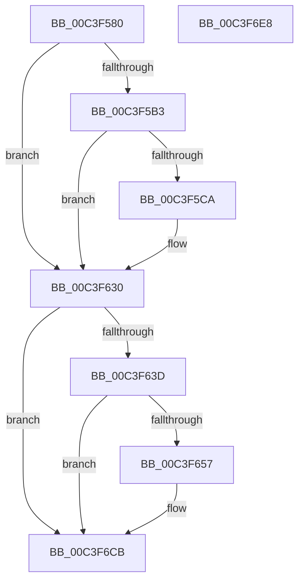

# PopDiagTraceAdaptiveBootOverride

- RVA: `0x00C3F580`–`0x00C3F6E9` (길이 `361` bytes)
- VA: `0x0000000140C3F580`
- 실행 섹션: `INIT`
- PDB 이름 있음: `예`; PDB Function 태그: `아니요`
- unwind 정보 RVA: `0x000CC8E0`
- 디코드: `78`개 명령, `361/361` bytes 표시
- 미해석 바이트: `0` (있으면 어셈블리에 `.byte`로 보존)

> 이 문서는 커널 이미지의 기계어와 PDB 기호를 분석해 생성했습니다. 4번과 5번은 함수 원형과 자료형을 바이너리 사용 방식에서 추정한 C 해석이며 원본 소스 복구 결과는 아닙니다.

## 1. Dependencies

- 직접 호출 지점: **5**; 고유 호출 대상: **5**
- 직접 호출자로 확인된 함수: **1**
- RIP 상대 이미지 참조: **6**

### Outgoing calls
- `0x00C3F5C1` → [EtwEventEnabled](../../text/39/EtwEventEnabled_function_00392450.md) (function, `0x00392450`)
- `0x00C3F62B` → [EtwWriteEx](../../text/25/EtwWriteEx_function_0025F0D0.md) (function, `0x0025F0D0`)
- `0x00C3F64E` → [tlgKeywordOn](../../text/42/tlgKeywordOn_function_0042EAA0.md) (function, `0x0042EAA0`)
- `0x00C3F6C6` → [tlgWriteTransfer_EtwWriteTransfer](../../text/42/tlgWriteTransfer_EtwWriteTransfer_function_004260E0.md) (function, `0x004260E0`)
- `0x00C3F6D2` → [_security_check_cookie](../../text/6A/_security_check_cookie_function_006AC640.md) (function, `0x006AC640`)

### Direct callers
- [PopAdaptiveInitializeBootContext](../C4/PopAdaptiveInitializeBootContext_function_00C43A84.md) at `0x00C43AB9`

### Static image references
- `0x00C3F596` → RVA `0x00E0A740` (`.data`; read)
- `0x00C3F5AA` → RVA `0x00E67858` (`.data`; read)
- `0x00C3F5B3` → RVA `0x00F0B408` (`.data`; read)
- `0x00C3F5BA` → RVA `0x00022B88` (`.rdata`; read)
- `0x00C3F630` → RVA `0x00E07748` (`.data`; read)
- `0x00C3F65A` → RVA `0x0004B58B` (`.rdata`; read)

## 2. Other-region calls and transfers

- 다른 실행 섹션으로 향하는 call: **5**
  - `0x00C3F5C1` → [EtwEventEnabled](../../text/39/EtwEventEnabled_function_00392450.md) (`INIT` → `.text`)
  - `0x00C3F62B` → [EtwWriteEx](../../text/25/EtwWriteEx_function_0025F0D0.md) (`INIT` → `.text`)
  - `0x00C3F64E` → [tlgKeywordOn](../../text/42/tlgKeywordOn_function_0042EAA0.md) (`INIT` → `.text`)
  - `0x00C3F6C6` → [tlgWriteTransfer_EtwWriteTransfer](../../text/42/tlgWriteTransfer_EtwWriteTransfer_function_004260E0.md) (`INIT` → `.text`)
  - `0x00C3F6D2` → [_security_check_cookie](../../text/6A/_security_check_cookie_function_006AC640.md) (`INIT` → `.text`)
- 별도 외부 분기/꼬리 이동을 확인하지 못했습니다.

## 3. Assembly (complete function range)

```asm
00C3F580  48 89 5C 24 10                  mov qword ptr [rsp + 0x10], rbx
00C3F585  89 4C 24 08                     mov dword ptr [rsp + 8], ecx
00C3F589  55                              push rbp
00C3F58A  48 8D 6C 24 A9                  lea rbp, [rsp - 0x57]
00C3F58F  48 81 EC E0 00 00 00            sub rsp, 0xe0
00C3F596  48 8B 05 A3 B1 1C 00            mov rax, qword ptr [rip + 0x1cb1a3]
00C3F59D  48 33 C4                        xor rax, rsp
00C3F5A0  48 89 45 47                     mov qword ptr [rbp + 0x47], rax
00C3F5A4  83 65 BB 00                     and dword ptr [rbp - 0x45], 0
00C3F5A8  8A DA                           mov bl, dl
00C3F5AA  80 3D A7 82 22 00 00            cmp byte ptr [rip + 0x2282a7], 0
00C3F5B1  74 7D                           je 0x140c3f630
00C3F5B3  48 8B 0D 4E BE 2C 00            mov rcx, qword ptr [rip + 0x2cbe4e]
00C3F5BA  48 8D 15 C7 35 3E FF            lea rdx, [rip - 0xc1ca39]
00C3F5C1  E8 8A 2E 75 FF                  call 0x140392450
00C3F5C6  84 C0                           test al, al
00C3F5C8  74 66                           je 0x140c3f630
00C3F5CA  48 8B 0D 37 BE 2C 00            mov rcx, qword ptr [rip + 0x2cbe37]
00C3F5D1  48 8D 15 B0 35 3E FF            lea rdx, [rip - 0xc1ca50]
00C3F5D8  33 C0                           xor eax, eax
00C3F5DA  C7 45 D7 04 00 00 00            mov dword ptr [rbp - 0x29], 4
00C3F5E1  84 DB                           test bl, bl
00C3F5E3  C7 45 E7 04 00 00 00            mov dword ptr [rbp - 0x19], 4
00C3F5EA  0F 95 C0                        setne al
00C3F5ED  83 65 DB 00                     and dword ptr [rbp - 0x25], 0
00C3F5F1  83 65 EB 00                     and dword ptr [rbp - 0x15], 0
00C3F5F5  45 33 C9                        xor r9d, r9d
00C3F5F8  89 45 BB                        mov dword ptr [rbp - 0x45], eax
00C3F5FB  45 33 C0                        xor r8d, r8d
00C3F5FE  48 8D 45 67                     lea rax, [rbp + 0x67]
00C3F602  48 89 45 CF                     mov qword ptr [rbp - 0x31], rax
00C3F606  48 8D 45 BB                     lea rax, [rbp - 0x45]
00C3F60A  48 89 45 DF                     mov qword ptr [rbp - 0x21], rax
00C3F60E  48 8D 45 CF                     lea rax, [rbp - 0x31]
00C3F612  48 89 44 24 38                  mov qword ptr [rsp + 0x38], rax
00C3F617  C7 44 24 30 02 00 00 00         mov dword ptr [rsp + 0x30], 2
00C3F61F  48 83 64 24 28 00               and qword ptr [rsp + 0x28], 0
00C3F625  48 83 64 24 20 00               and qword ptr [rsp + 0x20], 0
00C3F62B  E8 A0 FA 61 FF                  call 0x14025f0d0
00C3F630  83 3D 11 81 1C 00 05            cmp dword ptr [rip + 0x1c8111], 5
00C3F637  0F 86 8E 00 00 00               jbe 0x140c3f6cb
00C3F63D  48 BA 00 00 00 00 00 40 00 00   movabs rdx, 0x400000000000
00C3F647  48 8D 0D FA 80 1C 00            lea rcx, [rip + 0x1c80fa]
00C3F64E  E8 4D F4 7E FF                  call 0x14042eaa0
00C3F653  84 C0                           test al, al
00C3F655  74 74                           je 0x140c3f6cb
00C3F657  8B 45 67                        mov eax, dword ptr [rbp + 0x67]
00C3F65A  48 8D 15 2A BF 40 FF            lea rdx, [rip - 0xbf40d6]
00C3F661  83 65 23 00                     and dword ptr [rbp + 0x23], 0
00C3F665  48 8D 0D DC 80 1C 00            lea rcx, [rip + 0x1c80dc]
00C3F66C  83 65 33 00                     and dword ptr [rbp + 0x33], 0
00C3F670  45 33 C9                        xor r9d, r9d
00C3F673  83 65 43 00                     and dword ptr [rbp + 0x43], 0
00C3F677  45 33 C0                        xor r8d, r8d
00C3F67A  89 45 BF                        mov dword ptr [rbp - 0x41], eax
00C3F67D  48 8D 45 BF                     lea rax, [rbp - 0x41]
00C3F681  48 89 45 17                     mov qword ptr [rbp + 0x17], rax
00C3F685  48 8D 45 B7                     lea rax, [rbp - 0x49]
00C3F689  48 89 45 27                     mov qword ptr [rbp + 0x27], rax
00C3F68D  48 8D 45 C7                     lea rax, [rbp - 0x39]
00C3F691  48 89 45 37                     mov qword ptr [rbp + 0x37], rax
00C3F695  48 8D 45 F7                     lea rax, [rbp - 9]
00C3F699  48 89 44 24 28                  mov qword ptr [rsp + 0x28], rax
00C3F69E  C7 44 24 20 05 00 00 00         mov dword ptr [rsp + 0x20], 5
00C3F6A6  C7 45 1F 04 00 00 00            mov dword ptr [rbp + 0x1f], 4
00C3F6AD  88 5D B7                        mov byte ptr [rbp - 0x49], bl
00C3F6B0  C7 45 2F 01 00 00 00            mov dword ptr [rbp + 0x2f], 1
00C3F6B7  48 C7 45 C7 00 00 00 01         mov qword ptr [rbp - 0x39], 0x1000000
00C3F6BF  C7 45 3F 08 00 00 00            mov dword ptr [rbp + 0x3f], 8
00C3F6C6  E8 15 6A 7E FF                  call 0x1404260e0
00C3F6CB  48 8B 4D 47                     mov rcx, qword ptr [rbp + 0x47]
00C3F6CF  48 33 CC                        xor rcx, rsp
00C3F6D2  E8 69 CF A6 FF                  call 0x1406ac640
00C3F6D7  48 8B 9C 24 F8 00 00 00         mov rbx, qword ptr [rsp + 0xf8]
00C3F6DF  48 81 C4 E0 00 00 00            add rsp, 0xe0
00C3F6E6  5D                              pop rbp
00C3F6E7  C3                              ret
00C3F6E8  CC                              int3
```

## 4. C-style interpretation (structured pseudocode)

```c
__int64 __fastcall PopDiagTraceAdaptiveBootOverride(int a1, unsigned __int8 a2, int a3, int a4)
{
    __int64 result;
    __int64 v_rsp;
    unsigned __int64 v_stack_m18;
    unsigned int v_stack_m1C;
    unsigned int v_stack_m20;
    unsigned __int64 v_stack_m28;
    unsigned int v_stack_m2C;
    unsigned int v_stack_m30;
    unsigned __int64 v_stack_m38;
    unsigned int v_stack_m3C;
    unsigned int v_stack_m40;
    unsigned __int64 v_stack_m48;
    unsigned __int64 v_stack_m5F;
    unsigned __int64 v_stack_m68;
    unsigned int v_stack_m74;
    unsigned int v_stack_m78;
    unsigned __int64 v_stack_m80;
    unsigned int v_stack_m84;
    unsigned int v_stack_m88;
    unsigned __int64 v_stack_m90;
    unsigned __int64 v_stack_m98;
    unsigned int v_stack_mA0;
    unsigned int v_stack_mA4;
    unsigned __int64 v_stack_mA8;
    unsigned __int64 v_stack_mB0;
    unsigned int v_stack_mB8;
    unsigned __int64 v_stack_mC0;
    unsigned __int64 v_stack_mC8;
    unsigned __int64 v_stack_p10;
    unsigned int v_stack_p8;

    v_stack_p10 = v_rbx;
    v_stack_p8 = a1;
    v_rsp = (v_rsp) - (224);
    result = (*(unsigned __int64 *)(v_rip + 1880483)) ^ (v_rsp);
    v_stack_m18 = result;
    if ((*(unsigned __int8 *)(v_rip + 2261671)) == 0) goto loc_00C3F630;
    result = EtwEventEnabled(*(unsigned __int64 *)(v_rip + 2932302), v_rip - 12700217, a3, a4);
    if ((unsigned __int8)(result) != 0) {
        a1 = *(unsigned __int64 *)(v_rip + 2932279);
        a2 = v_rip - 12700240;
        result = 0;
        v_stack_m88 = 4;
        v_stack_m78 = 4;
        result = (a2 != 0) ? 1 : 0;
        a4 = 0;
        v_stack_mA4 = (unsigned int)(result);
        a3 = 0;
        result = v_stack_p8;
        v_stack_m90 = result;
        result = v_stack_mA4;
        v_stack_m80 = result;
        result = v_stack_m90;
        v_stack_mB0 = result;
        v_stack_mB8 = 2;
        result = EtwWriteEx(a1, a2, a3, a4);
    }
    if ((*(unsigned int *)(v_rip + 1868049)) <= 5) goto loc_00C3F6CB;
    result = tlgKeywordOn(v_rip + 1868026, a2, a3, a4);
    if ((unsigned __int8)(result) != 0) {
        result = v_stack_p8;
        a2 = v_rip - 12533974;
        a1 = v_rip + 1867996;
        a4 = 0;
        a3 = 0;
        v_stack_mA0 = (unsigned int)(result);
        result = v_stack_mA0;
        v_stack_m48 = result;
        result = v_stack_mA8;
        v_stack_m38 = result;
        result = v_stack_m98;
        v_stack_m28 = result;
        result = v_stack_m68;
        v_stack_mC0 = result;
        v_stack_mC8 = 5;
        v_stack_m40 = 4;
        v_stack_mA8 = a2;
        v_stack_m30 = 1;
        v_stack_m98 = 0x1000000ULL;
        v_stack_m20 = 8;
        result = tlgWriteTransfer_EtwWriteTransfer(a1, a2, a3, a4);
    }
    a1 = (v_stack_m18) ^ (v_rsp);
    result = _security_check_cookie(a1, a2, a3, a4);
    v_rsp = (v_rsp) + (224);
    return result;
}
```

## 5. (Beta) C Style

```c
int64_t PopDiagTraceAdaptiveBootOverride(int32_t Arg1, uint8_t Arg2, int32_t Arg3, int32_t Arg4)
{
    int64_t result;
    int64_t local_rsp;
    uint64_t v_stack_m18;
    uint32_t v_stack_m1C;
    uint32_t v_stack_m20;
    uint64_t v_stack_m28;
    uint32_t v_stack_m2C;
    uint32_t v_stack_m30;
    uint64_t v_stack_m38;
    uint32_t v_stack_m3C;
    uint32_t v_stack_m40;
    uint64_t v_stack_m48;
    uint64_t v_stack_m5F;
    uint64_t v_stack_m68;
    uint32_t v_stack_m74;
    uint32_t v_stack_m78;
    uint64_t v_stack_m80;
    uint32_t v_stack_m84;
    uint32_t v_stack_m88;
    uint64_t v_stack_m90;
    uint64_t v_stack_m98;
    uint32_t v_stack_mA0;
    uint32_t v_stack_mA4;
    uint64_t v_stack_mA8;
    uint64_t v_stack_mB0;
    uint32_t v_stack_mB8;
    uint64_t v_stack_mC0;
    uint64_t v_stack_mC8;
    uint64_t v_stack_p10;
    uint32_t v_stack_p8;

    v_stack_p10 = local_rbx;
    v_stack_p8 = Arg1;
    local_rsp = (local_rsp) - (224);
    result = (*(uint64_t *)(v_rip + 0x1CB1A3)) ^ (local_rsp);
    v_stack_m18 = result;
    if ((*(uint8_t *)(v_rip + 0x2282A7)) == 0) goto loc_00C3F630;
    result = EtwEventEnabled(*(uint64_t *)(v_rip + 0x2CBE4E), v_rip - 12700217, Arg3, Arg4);
    if ((uint8_t)(result) != 0) {
        Arg1 = *(uint64_t *)(v_rip + 0x2CBE37);
        Arg2 = v_rip - 12700240;
        result = 0;
        v_stack_m88 = 4;
        v_stack_m78 = 4;
        result = (Arg2 != 0) ? 1 : 0;
        Arg4 = 0;
        v_stack_mA4 = (uint32_t)(result);
        Arg3 = 0;
        result = v_stack_p8;
        v_stack_m90 = result;
        result = v_stack_mA4;
        v_stack_m80 = result;
        result = v_stack_m90;
        v_stack_mB0 = result;
        v_stack_mB8 = 2;
        result = EtwWriteEx(Arg1, Arg2, Arg3, Arg4);
    }
    if ((*(uint32_t *)(v_rip + 0x1C8111)) <= 5) goto loc_00C3F6CB;
    result = tlgKeywordOn(v_rip + 1868026, Arg2, Arg3, Arg4);
    if ((uint8_t)(result) != 0) {
        result = v_stack_p8;
        Arg2 = v_rip - 12533974;
        Arg1 = v_rip + 1867996;
        Arg4 = 0;
        Arg3 = 0;
        v_stack_mA0 = (uint32_t)(result);
        result = v_stack_mA0;
        v_stack_m48 = result;
        result = v_stack_mA8;
        v_stack_m38 = result;
        result = v_stack_m98;
        v_stack_m28 = result;
        result = v_stack_m68;
        v_stack_mC0 = result;
        v_stack_mC8 = 5;
        v_stack_m40 = 4;
        v_stack_mA8 = Arg2;
        v_stack_m30 = 1;
        v_stack_m98 = 0x1000000ULL;
        v_stack_m20 = 8;
        result = tlgWriteTransfer_EtwWriteTransfer(Arg1, Arg2, Arg3, Arg4);
    }
    Arg1 = (v_stack_m18) ^ (local_rsp);
    result = _security_check_cookie(Arg1, Arg2, Arg3, Arg4);
    local_rsp = (local_rsp) + (224);
    return result;
}
```

## 6. Execution-region graph

[열기: 2D/3D 그래프와 함수 탐색 컨트롤 패널](../../../control-panel.html?section=init&rva=0x00C3F580&view=graph)

- 2D 그래프는 위에서 아래로 흐르고, 3D 그래프는 빈 공간을 드래그해 회전합니다. Shift+드래그는 이동, 휠은 확대·축소, 함수 노드 선택은 대상 보고서 이동입니다.

### Static fallback


