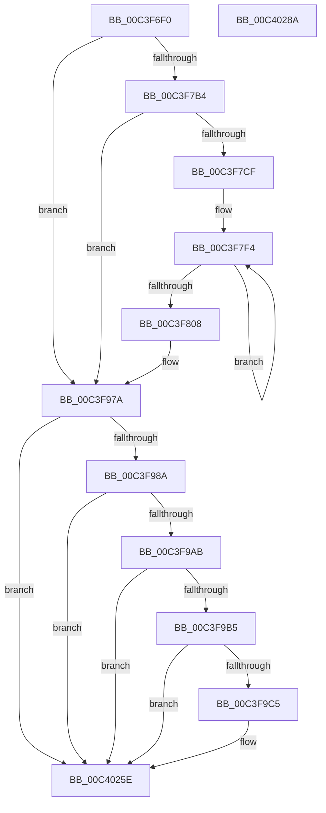

# PopDiagTraceDirtyTransition

- RVA: `0x00C3F6F0`–`0x00C4028B` (길이 `2,971` bytes)
- VA: `0x0000000140C3F6F0`
- 실행 섹션: `INIT`
- PDB 이름 있음: `예`; PDB Function 태그: `아니요`
- unwind 정보 RVA: `0x000CCC18`
- 디코드: `577`개 명령, `2,971/2,971` bytes 표시
- 미해석 바이트: `0` (있으면 어셈블리에 `.byte`로 보존)

> 이 문서는 커널 이미지의 기계어와 PDB 기호를 분석해 생성했습니다. 4번과 5번은 함수 원형과 자료형을 바이너리 사용 방식에서 추정한 C 해석이며 원본 소스 복구 결과는 아닙니다.

## 1. Dependencies

- 직접 호출 지점: **8**; 고유 호출 대상: **7**
- 직접 호출자로 확인된 함수: **1**
- RIP 상대 이미지 참조: **38**

### Outgoing calls
- `0x00C3F795` → [PopPotsLogDirtyPowerTransition](../C4/PopPotsLogDirtyPowerTransition_function_00C43EE8.md) (function, `0x00C43EE8`)
- `0x00C3F79A` → [SshSessionManagerTraceDirtyTransition](../../page/77/SshSessionManagerTraceDirtyTransition_function_00773EB0.md) (function, `0x00773EB0`)
- `0x00C3F7C2` → [EtwEventEnabled](../../text/39/EtwEventEnabled_function_00392450.md) (function, `0x00392450`)
- `0x00C3F975` → [EtwWriteEx](../../text/25/EtwWriteEx_function_0025F0D0.md) (function, `0x0025F0D0`)
- `0x00C3F99E` → [tlgKeywordOn](../../text/42/tlgKeywordOn_function_0042EAA0.md) (function, `0x0042EAA0`)
- `0x00C3F9B8` → [tlgKeywordOn](../../text/42/tlgKeywordOn_function_0042EAA0.md) (function, `0x0042EAA0`)
- `0x00C40259` → [tlgWriteTransfer_EtwWriteTransfer](../../text/42/tlgWriteTransfer_EtwWriteTransfer_function_004260E0.md) (function, `0x004260E0`)
- `0x00C40268` → [_security_check_cookie](../../text/6A/_security_check_cookie_function_006AC640.md) (function, `0x006AC640`)

### Direct callers
- [PopCheckShutdownMarker](PopCheckShutdownMarker_function_00C3DAD4.md) at `0x00C3E18E`

### Static image references
- `0x00C3F712` → RVA `0x00E0A740` (`.data`; read)
- `0x00C3F723` → RVA `0x00E674B0` (`.data`; read)
- `0x00C3F72F` → RVA `0x00E674B8` (`.data`; read)
- `0x00C3F77D` → RVA `0x00E67480` (`.data`; read)
- `0x00C3F78C` → RVA `0x00E674D4` (`.data`; read)
- `0x00C3F7A4` → RVA `0x00E67858` (`.data`; read)
- `0x00C3F7B4` → RVA `0x00F0B408` (`.data`; read)
- `0x00C3F7BB` → RVA `0x000210F8` (`.rdata`; read)
- `0x00C3F7E4` → RVA `0x00E67488` (`.data`; read)
- `0x00C3F84B` → RVA `0x00E674C0` (`.data`; read)
- `0x00C3F87C` → RVA `0x00E674A8` (`.data`; read)
- `0x00C3F8E0` → RVA `0x00E67548` (`.data`; read)
- `0x00C3F97A` → RVA `0x00E07710` (`.data`; read)
- `0x00C3F9CC` → RVA `0x00E67470` (`.data`; read)
- `0x00C3F9DF` → RVA `0x00E67478` (`.data`; read)
- `0x00C3F9F0` → RVA `0x00E6747C` (`.data`; read)
- `0x00C3FA2F` → RVA `0x00E67490` (`.data`; read)
- `0x00C3FA45` → RVA `0x00E67498` (`.data`; read)
- `0x00C3FA5B` → RVA `0x00E674A0` (`.data`; read)
- `0x00C3FDE9` → RVA `0x00E674C8` (`.data`; read)
- `0x00C3FFB3` → RVA `0x00E674D0` (`.data`; read)
- `0x00C3FFC7` → RVA `0x00E674E8` (`.data`; read)
- `0x00C3FFDD` → RVA `0x00E674F8` (`.data`; read)
- `0x00C3FFF1` → RVA `0x00E674FC` (`.data`; read)
- `0x00C40005` → RVA `0x00E67500` (`.data`; read)
- `0x00C40039` → RVA `0x00E67540` (`.data`; read)
- `0x00C40040` → RVA `0x00E67530` (`.data`; read)
- `0x00C40059` → RVA `0x00E6750C` (`.data`; read)
- `0x00C4005F` → RVA `0x00E67534` (`.data`; read)
- `0x00C40078` → RVA `0x00E67504` (`.data`; read)
- `0x00C4008C` → RVA `0x00E67508` (`.data`; read)
- `0x00C400A0` → RVA `0x00E67510` (`.data`; read)
- `0x00C400B6` → RVA `0x00E67520` (`.data`; read)
- `0x00C400CA` → RVA `0x00E67524` (`.data`; read)
- `0x00C400DE` → RVA `0x00E67528` (`.data`; read)
- `0x00C400F2` → RVA `0x00E67518` (`.data`; read)
- `0x00C4011E` → RVA `0x00E67538` (`.data`; read)
- `0x00C401F1` → RVA `0x0004B808` (`.rdata`; read)

## 2. Other-region calls and transfers

- 다른 실행 섹션으로 향하는 call: **7**
  - `0x00C3F79A` → [SshSessionManagerTraceDirtyTransition](../../page/77/SshSessionManagerTraceDirtyTransition_function_00773EB0.md) (`INIT` → `PAGE`)
  - `0x00C3F7C2` → [EtwEventEnabled](../../text/39/EtwEventEnabled_function_00392450.md) (`INIT` → `.text`)
  - `0x00C3F975` → [EtwWriteEx](../../text/25/EtwWriteEx_function_0025F0D0.md) (`INIT` → `.text`)
  - `0x00C3F99E` → [tlgKeywordOn](../../text/42/tlgKeywordOn_function_0042EAA0.md) (`INIT` → `.text`)
  - `0x00C3F9B8` → [tlgKeywordOn](../../text/42/tlgKeywordOn_function_0042EAA0.md) (`INIT` → `.text`)
  - `0x00C40259` → [tlgWriteTransfer_EtwWriteTransfer](../../text/42/tlgWriteTransfer_EtwWriteTransfer_function_004260E0.md) (`INIT` → `.text`)
  - `0x00C40268` → [_security_check_cookie](../../text/6A/_security_check_cookie_function_006AC640.md) (`INIT` → `.text`)
- 별도 외부 분기/꼬리 이동을 확인하지 못했습니다.

## 3. Assembly (complete function range)

```asm
00C3F6F0  48 8B C4                        mov rax, rsp
00C3F6F3  48 89 58 08                     mov qword ptr [rax + 8], rbx
00C3F6F7  48 89 70 10                     mov qword ptr [rax + 0x10], rsi
00C3F6FB  48 89 78 18                     mov qword ptr [rax + 0x18], rdi
00C3F6FF  4C 89 70 20                     mov qword ptr [rax + 0x20], r14
00C3F703  55                              push rbp
00C3F704  48 8D A8 48 F9 FF FF            lea rbp, [rax - 0x6b8]
00C3F70B  48 81 EC B0 07 00 00            sub rsp, 0x7b0
00C3F712  48 8B 05 27 B0 1C 00            mov rax, qword ptr [rip + 0x1cb027]
00C3F719  48 33 C4                        xor rax, rsp
00C3F71C  48 89 85 A0 06 00 00            mov qword ptr [rbp + 0x6a0], rax
00C3F723  48 8B 15 86 7D 22 00            mov rdx, qword ptr [rip + 0x227d86]
00C3F72A  BF 01 00 00 00                  mov edi, 1
00C3F72F  4C 8B 05 82 7D 22 00            mov r8, qword ptr [rip + 0x227d82]
00C3F736  41 0F B6 40 01                  movzx eax, byte ptr [r8 + 1]
00C3F73B  C1 E8 04                        shr eax, 4
00C3F73E  23 C7                           and eax, edi
00C3F740  89 45 88                        mov dword ptr [rbp - 0x78], eax
00C3F743  0F B6 42 08                     movzx eax, byte ptr [rdx + 8]
00C3F747  D1 E8                           shr eax, 1
00C3F749  23 C7                           and eax, edi
00C3F74B  89 44 24 7C                     mov dword ptr [rsp + 0x7c], eax
00C3F74F  8A 42 0B                        mov al, byte ptr [rdx + 0xb]
00C3F752  C0 E8 06                        shr al, 6
00C3F755  88 44 24 42                     mov byte ptr [rsp + 0x42], al
00C3F759  0F B6 42 0E                     movzx eax, byte ptr [rdx + 0xe]
00C3F75D  C1 E8 05                        shr eax, 5
00C3F760  23 C7                           and eax, edi
00C3F762  89 45 84                        mov dword ptr [rbp - 0x7c], eax
00C3F765  8A 42 0E                        mov al, byte ptr [rdx + 0xe]
00C3F768  24 0F                           and al, 0xf
00C3F76A  88 44 24 41                     mov byte ptr [rsp + 0x41], al
00C3F76E  0F B6 4A 08                     movzx ecx, byte ptr [rdx + 8]
00C3F772  C1 E9 04                        shr ecx, 4
00C3F775  89 4C 24 78                     mov dword ptr [rsp + 0x78], ecx
00C3F779  41 8A 40 18                     mov al, byte ptr [r8 + 0x18]
00C3F77D  44 8B 05 FC 7C 22 00            mov r8d, dword ptr [rip + 0x227cfc]
00C3F784  88 44 24 40                     mov byte ptr [rsp + 0x40], al
00C3F788  0F B7 42 0C                     movzx eax, word ptr [rdx + 0xc]
00C3F78C  8B 15 42 7D 22 00               mov edx, dword ptr [rip + 0x227d42]
00C3F792  89 45 80                        mov dword ptr [rbp - 0x80], eax
00C3F795  E8 4E 47 00 00                  call 0x140c43ee8
00C3F79A  E8 11 47 B3 FF                  call 0x140773eb0
00C3F79F  33 DB                           xor ebx, ebx
00C3F7A1  8D 77 03                        lea esi, [rdi + 3]
00C3F7A4  38 1D AE 80 22 00               cmp byte ptr [rip + 0x2280ae], bl
00C3F7AA  44 8D 77 07                     lea r14d, [rdi + 7]
00C3F7AE  0F 84 C6 01 00 00               je 0x140c3f97a
00C3F7B4  48 8B 0D 4D BC 2C 00            mov rcx, qword ptr [rip + 0x2cbc4d]
00C3F7BB  48 8D 15 36 19 3E FF            lea rdx, [rip - 0xc1e6ca]
00C3F7C2  E8 89 2C 75 FF                  call 0x140392450
00C3F7C7  84 C0                           test al, al
00C3F7C9  0F 84 AB 01 00 00               je 0x140c3f97a
00C3F7CF  48 8D 05 AA 7C 22 00            lea rax, [rip + 0x227caa]
00C3F7D6  48 89 B5 58 05 00 00            mov qword ptr [rbp + 0x558], rsi
00C3F7DD  48 89 85 50 05 00 00            mov qword ptr [rbp + 0x550], rax
00C3F7E4  48 8D 0D 9D 7C 22 00            lea rcx, [rip + 0x227c9d]
00C3F7EB  48 8D 85 6C 05 00 00            lea rax, [rbp + 0x56c]
00C3F7F2  8B D6                           mov edx, esi
00C3F7F4  48 89 48 F4                     mov qword ptr [rax - 0xc], rcx
00C3F7F8  49 03 CE                        add rcx, r14
00C3F7FB  4C 89 70 FC                     mov qword ptr [rax - 4], r14
00C3F7FF  48 8D 40 10                     lea rax, [rax + 0x10]
00C3F803  48 2B D7                        sub rdx, rdi
00C3F806  75 EC                           jne 0x140c3f7f4
00C3F808  48 8B 0D A9 7C 22 00            mov rcx, qword ptr [rip + 0x227ca9]
00C3F80F  48 8D 44 24 78                  lea rax, [rsp + 0x78]
00C3F814  48 89 85 A0 05 00 00            mov qword ptr [rbp + 0x5a0], rax
00C3F81B  48 8D 15 D6 18 3E FF            lea rdx, [rip - 0xc1e72a]
00C3F822  48 8B 05 87 7C 22 00            mov rax, qword ptr [rip + 0x227c87]
00C3F829  45 33 C9                        xor r9d, r9d
00C3F82C  48 89 85 B0 05 00 00            mov qword ptr [rbp + 0x5b0], rax
00C3F833  45 33 C0                        xor r8d, r8d
00C3F836  48 8D 05 97 7C 22 00            lea rax, [rip + 0x227c97]
00C3F83D  48 89 B5 A8 05 00 00            mov qword ptr [rbp + 0x5a8], rsi
00C3F844  48 89 85 C0 05 00 00            mov qword ptr [rbp + 0x5c0], rax
00C3F84B  48 8D 05 6E 7C 22 00            lea rax, [rip + 0x227c6e]
00C3F852  48 89 85 D0 05 00 00            mov qword ptr [rbp + 0x5d0], rax
00C3F859  48 8D 44 24 7C                  lea rax, [rsp + 0x7c]
00C3F85E  48 89 85 E0 05 00 00            mov qword ptr [rbp + 0x5e0], rax
00C3F865  48 8D 45 80                     lea rax, [rbp - 0x80]
00C3F869  48 89 85 F0 05 00 00            mov qword ptr [rbp + 0x5f0], rax
00C3F870  48 8D 44 24 40                  lea rax, [rsp + 0x40]
00C3F875  48 89 85 00 06 00 00            mov qword ptr [rbp + 0x600], rax
00C3F87C  48 8D 05 25 7C 22 00            lea rax, [rip + 0x227c25]
00C3F883  48 89 85 10 06 00 00            mov qword ptr [rbp + 0x610], rax
00C3F88A  48 8D 44 24 41                  lea rax, [rsp + 0x41]
00C3F88F  48 89 85 20 06 00 00            mov qword ptr [rbp + 0x620], rax
00C3F896  48 8D 41 18                     lea rax, [rcx + 0x18]
00C3F89A  48 89 85 30 06 00 00            mov qword ptr [rbp + 0x630], rax
00C3F8A1  48 8D 45 84                     lea rax, [rbp - 0x7c]
00C3F8A5  48 89 85 40 06 00 00            mov qword ptr [rbp + 0x640], rax
00C3F8AC  48 8D 45 88                     lea rax, [rbp - 0x78]
00C3F8B0  48 89 85 50 06 00 00            mov qword ptr [rbp + 0x650], rax
00C3F8B7  48 8D 41 03                     lea rax, [rcx + 3]
00C3F8BB  48 89 85 60 06 00 00            mov qword ptr [rbp + 0x660], rax
00C3F8C2  48 8D 41 04                     lea rax, [rcx + 4]
00C3F8C6  48 8B 0D 3B BB 2C 00            mov rcx, qword ptr [rip + 0x2cbb3b]
00C3F8CD  48 89 85 70 06 00 00            mov qword ptr [rbp + 0x670], rax
00C3F8D4  48 8D 44 24 42                  lea rax, [rsp + 0x42]
00C3F8D9  48 89 85 80 06 00 00            mov qword ptr [rbp + 0x680], rax
00C3F8E0  48 8D 05 61 7C 22 00            lea rax, [rip + 0x227c61]
00C3F8E7  48 89 85 90 06 00 00            mov qword ptr [rbp + 0x690], rax
00C3F8EE  48 8D 85 50 05 00 00            lea rax, [rbp + 0x550]
00C3F8F5  48 89 44 24 38                  mov qword ptr [rsp + 0x38], rax
00C3F8FA  C7 44 24 30 15 00 00 00         mov dword ptr [rsp + 0x30], 0x15
00C3F902  48 89 5C 24 28                  mov qword ptr [rsp + 0x28], rbx
00C3F907  48 89 5C 24 20                  mov qword ptr [rsp + 0x20], rbx
00C3F90C  4C 89 B5 B8 05 00 00            mov qword ptr [rbp + 0x5b8], r14
00C3F913  48 89 B5 C8 05 00 00            mov qword ptr [rbp + 0x5c8], rsi
00C3F91A  48 89 BD D8 05 00 00            mov qword ptr [rbp + 0x5d8], rdi
00C3F921  48 89 B5 E8 05 00 00            mov qword ptr [rbp + 0x5e8], rsi
00C3F928  48 89 B5 F8 05 00 00            mov qword ptr [rbp + 0x5f8], rsi
00C3F92F  48 89 BD 08 06 00 00            mov qword ptr [rbp + 0x608], rdi
00C3F936  48 89 B5 18 06 00 00            mov qword ptr [rbp + 0x618], rsi
00C3F93D  48 89 BD 28 06 00 00            mov qword ptr [rbp + 0x628], rdi
00C3F944  4C 89 B5 38 06 00 00            mov qword ptr [rbp + 0x638], r14
00C3F94B  48 89 B5 48 06 00 00            mov qword ptr [rbp + 0x648], rsi
00C3F952  48 89 B5 58 06 00 00            mov qword ptr [rbp + 0x658], rsi
00C3F959  48 89 BD 68 06 00 00            mov qword ptr [rbp + 0x668], rdi
00C3F960  48 89 BD 78 06 00 00            mov qword ptr [rbp + 0x678], rdi
00C3F967  48 89 BD 88 06 00 00            mov qword ptr [rbp + 0x688], rdi
00C3F96E  48 89 B5 98 06 00 00            mov qword ptr [rbp + 0x698], rsi
00C3F975  E8 56 F7 61 FF                  call 0x14025f0d0
00C3F97A  44 8B 05 8F 7D 1C 00            mov r8d, dword ptr [rip + 0x1c7d8f]
00C3F981  45 85 C0                        test r8d, r8d
00C3F984  0F 84 D4 08 00 00               je 0x140c4025e
00C3F98A  4C 8D 15 7F 7D 1C 00            lea r10, [rip + 0x1c7d7f]
00C3F991  48 BA 00 00 00 00 00 80 00 00   movabs rdx, 0x800000000000
00C3F99B  49 8B CA                        mov rcx, r10
00C3F99E  E8 FD F0 7E FF                  call 0x14042eaa0
00C3F9A3  84 C0                           test al, al
00C3F9A5  0F 84 B3 08 00 00               je 0x140c4025e
00C3F9AB  41 83 F8 05                     cmp r8d, 5
00C3F9AF  0F 86 A9 08 00 00               jbe 0x140c4025e
00C3F9B5  49 8B CA                        mov rcx, r10
00C3F9B8  E8 E3 F0 7E FF                  call 0x14042eaa0
00C3F9BD  84 C0                           test al, al
00C3F9BF  0F 84 99 08 00 00               je 0x140c4025e
00C3F9C5  48 8B 15 E4 7A 22 00            mov rdx, qword ptr [rip + 0x227ae4]
00C3F9CC  8A 05 9E 7A 22 00               mov al, byte ptr [rip + 0x227a9e]
00C3F9D2  88 44 24 43                     mov byte ptr [rsp + 0x43], al
00C3F9D6  48 8D 44 24 43                  lea rax, [rsp + 0x43]
00C3F9DB  48 89 45 60                     mov qword ptr [rbp + 0x60], rax
00C3F9DF  8B 05 93 7A 22 00               mov eax, dword ptr [rip + 0x227a93]
00C3F9E5  89 45 8C                        mov dword ptr [rbp - 0x74], eax
00C3F9E8  48 8D 45 8C                     lea rax, [rbp - 0x74]
00C3F9EC  48 89 45 70                     mov qword ptr [rbp + 0x70], rax
00C3F9F0  8B 05 86 7A 22 00               mov eax, dword ptr [rip + 0x227a86]
00C3F9F6  89 45 90                        mov dword ptr [rbp - 0x70], eax
00C3F9F9  48 8D 45 90                     lea rax, [rbp - 0x70]
00C3F9FD  48 89 85 80 00 00 00            mov qword ptr [rbp + 0x80], rax
00C3FA04  8B 05 76 7A 22 00               mov eax, dword ptr [rip + 0x227a76]
00C3FA0A  48 89 45 F8                     mov qword ptr [rbp - 8], rax
00C3FA0E  48 8D 45 F8                     lea rax, [rbp - 8]
00C3FA12  48 89 85 90 00 00 00            mov qword ptr [rbp + 0x90], rax
00C3FA19  48 8B 05 68 7A 22 00            mov rax, qword ptr [rip + 0x227a68]
00C3FA20  48 89 45 00                     mov qword ptr [rbp], rax
00C3FA24  48 8D 45 00                     lea rax, [rbp]
00C3FA28  48 89 85 A0 00 00 00            mov qword ptr [rbp + 0xa0], rax
00C3FA2F  48 8B 05 5A 7A 22 00            mov rax, qword ptr [rip + 0x227a5a]
00C3FA36  48 89 45 08                     mov qword ptr [rbp + 8], rax
00C3FA3A  48 8D 45 08                     lea rax, [rbp + 8]
00C3FA3E  48 89 85 B0 00 00 00            mov qword ptr [rbp + 0xb0], rax
00C3FA45  48 8B 05 4C 7A 22 00            mov rax, qword ptr [rip + 0x227a4c]
00C3FA4C  48 89 45 10                     mov qword ptr [rbp + 0x10], rax
00C3FA50  48 8D 45 10                     lea rax, [rbp + 0x10]
00C3FA54  48 89 85 C0 00 00 00            mov qword ptr [rbp + 0xc0], rax
00C3FA5B  48 8B 05 3E 7A 22 00            mov rax, qword ptr [rip + 0x227a3e]
00C3FA62  48 89 45 18                     mov qword ptr [rbp + 0x18], rax
00C3FA66  48 8D 45 18                     lea rax, [rbp + 0x18]
00C3FA6A  48 89 85 D0 00 00 00            mov qword ptr [rbp + 0xd0], rax
00C3FA71  8B 05 31 7A 22 00               mov eax, dword ptr [rip + 0x227a31]
00C3FA77  89 45 94                        mov dword ptr [rbp - 0x6c], eax
00C3FA7A  48 8D 45 94                     lea rax, [rbp - 0x6c]
00C3FA7E  48 89 85 E0 00 00 00            mov qword ptr [rbp + 0xe0], rax
00C3FA85  48 89 7D 68                     mov qword ptr [rbp + 0x68], rdi
00C3FA89  48 89 75 78                     mov qword ptr [rbp + 0x78], rsi
00C3FA8D  48 89 B5 88 00 00 00            mov qword ptr [rbp + 0x88], rsi
00C3FA94  4C 89 B5 98 00 00 00            mov qword ptr [rbp + 0x98], r14
00C3FA9B  4C 89 B5 A8 00 00 00            mov qword ptr [rbp + 0xa8], r14
00C3FAA2  4C 89 B5 B8 00 00 00            mov qword ptr [rbp + 0xb8], r14
00C3FAA9  4C 89 B5 C8 00 00 00            mov qword ptr [rbp + 0xc8], r14
00C3FAB0  4C 89 B5 D8 00 00 00            mov qword ptr [rbp + 0xd8], r14
00C3FAB7  48 89 B5 E8 00 00 00            mov qword ptr [rbp + 0xe8], rsi
00C3FABE  8A 42 0F                        mov al, byte ptr [rdx + 0xf]
00C3FAC1  F6 D0                           not al
00C3FAC3  48 89 BD F8 00 00 00            mov qword ptr [rbp + 0xf8], rdi
00C3FACA  C0 E8 07                        shr al, 7
00C3FACD  88 44 24 44                     mov byte ptr [rsp + 0x44], al
00C3FAD1  48 8D 44 24 44                  lea rax, [rsp + 0x44]
00C3FAD6  48 89 85 F0 00 00 00            mov qword ptr [rbp + 0xf0], rax
00C3FADD  8A 42 0B                        mov al, byte ptr [rdx + 0xb]
00C3FAE0  C0 E8 06                        shr al, 6
00C3FAE3  88 44 24 45                     mov byte ptr [rsp + 0x45], al
00C3FAE7  48 8D 44 24 45                  lea rax, [rsp + 0x45]
00C3FAEC  48 89 85 00 01 00 00            mov qword ptr [rbp + 0x100], rax
00C3FAF3  48 89 BD 08 01 00 00            mov qword ptr [rbp + 0x108], rdi
00C3FAFA  8A 42 0E                        mov al, byte ptr [rdx + 0xe]
00C3FAFD  C0 E8 06                        shr al, 6
00C3FB00  88 44 24 46                     mov byte ptr [rsp + 0x46], al
00C3FB04  48 8D 44 24 46                  lea rax, [rsp + 0x46]
00C3FB09  48 89 85 10 01 00 00            mov qword ptr [rbp + 0x110], rax
00C3FB10  48 89 BD 18 01 00 00            mov qword ptr [rbp + 0x118], rdi
00C3FB17  8A 42 0F                        mov al, byte ptr [rdx + 0xf]
00C3FB1A  24 7F                           and al, 0x7f
00C3FB1C  48 89 BD 28 01 00 00            mov qword ptr [rbp + 0x128], rdi
00C3FB23  88 44 24 47                     mov byte ptr [rsp + 0x47], al
00C3FB27  48 8D 44 24 47                  lea rax, [rsp + 0x47]
00C3FB2C  48 89 85 20 01 00 00            mov qword ptr [rbp + 0x120], rax
00C3FB33  8A 42 0A                        mov al, byte ptr [rdx + 0xa]
00C3FB36  C0 E8 06                        shr al, 6
00C3FB39  88 44 24 48                     mov byte ptr [rsp + 0x48], al
00C3FB3D  48 8D 44 24 48                  lea rax, [rsp + 0x48]
00C3FB42  48 89 85 30 01 00 00            mov qword ptr [rbp + 0x130], rax
00C3FB49  48 89 BD 38 01 00 00            mov qword ptr [rbp + 0x138], rdi
00C3FB50  8A 42 08                        mov al, byte ptr [rdx + 8]
00C3FB53  40 22 C7                        and al, dil
00C3FB56  88 44 24 49                     mov byte ptr [rsp + 0x49], al
00C3FB5A  48 8D 44 24 49                  lea rax, [rsp + 0x49]
00C3FB5F  48 89 85 40 01 00 00            mov qword ptr [rbp + 0x140], rax
00C3FB66  48 8B 0D 4B 79 22 00            mov rcx, qword ptr [rip + 0x22794b]
00C3FB6D  48 89 BD 48 01 00 00            mov qword ptr [rbp + 0x148], rdi
00C3FB74  8A 42 0E                        mov al, byte ptr [rdx + 0xe]
00C3FB77  C0 E8 04                        shr al, 4
00C3FB7A  40 22 C7                        and al, dil
00C3FB7D  48 89 BD 58 01 00 00            mov qword ptr [rbp + 0x158], rdi
00C3FB84  88 44 24 4A                     mov byte ptr [rsp + 0x4a], al
00C3FB88  48 8D 44 24 4A                  lea rax, [rsp + 0x4a]
00C3FB8D  48 89 85 50 01 00 00            mov qword ptr [rbp + 0x150], rax
00C3FB94  8A 41 01                        mov al, byte ptr [rcx + 1]
00C3FB97  40 22 C7                        and al, dil
00C3FB9A  48 89 BD 68 01 00 00            mov qword ptr [rbp + 0x168], rdi
00C3FBA1  88 44 24 4B                     mov byte ptr [rsp + 0x4b], al
00C3FBA5  48 8D 44 24 4B                  lea rax, [rsp + 0x4b]
00C3FBAA  48 89 85 60 01 00 00            mov qword ptr [rbp + 0x160], rax
00C3FBB1  8A 41 01                        mov al, byte ptr [rcx + 1]
00C3FBB4  D0 E8                           shr al, 1
00C3FBB6  40 22 C7                        and al, dil
00C3FBB9  48 89 BD 78 01 00 00            mov qword ptr [rbp + 0x178], rdi
00C3FBC0  88 44 24 4C                     mov byte ptr [rsp + 0x4c], al
00C3FBC4  48 8D 44 24 4C                  lea rax, [rsp + 0x4c]
00C3FBC9  48 89 85 70 01 00 00            mov qword ptr [rbp + 0x170], rax
00C3FBD0  8A 41 01                        mov al, byte ptr [rcx + 1]
00C3FBD3  C0 E8 04                        shr al, 4
00C3FBD6  40 22 C7                        and al, dil
00C3FBD9  48 89 BD 88 01 00 00            mov qword ptr [rbp + 0x188], rdi
00C3FBE0  88 44 24 4D                     mov byte ptr [rsp + 0x4d], al
00C3FBE4  48 8D 44 24 4D                  lea rax, [rsp + 0x4d]
00C3FBE9  48 89 85 80 01 00 00            mov qword ptr [rbp + 0x180], rax
00C3FBF0  8A 41 03                        mov al, byte ptr [rcx + 3]
00C3FBF3  88 44 24 4E                     mov byte ptr [rsp + 0x4e], al
00C3FBF7  48 8D 44 24 4E                  lea rax, [rsp + 0x4e]
00C3FBFC  48 89 85 90 01 00 00            mov qword ptr [rbp + 0x190], rax
00C3FC03  48 89 BD 98 01 00 00            mov qword ptr [rbp + 0x198], rdi
00C3FC0A  8A 41 04                        mov al, byte ptr [rcx + 4]
00C3FC0D  88 44 24 4F                     mov byte ptr [rsp + 0x4f], al
00C3FC11  48 8D 44 24 4F                  lea rax, [rsp + 0x4f]
00C3FC16  48 89 85 A0 01 00 00            mov qword ptr [rbp + 0x1a0], rax
00C3FC1D  48 89 BD A8 01 00 00            mov qword ptr [rbp + 0x1a8], rdi
00C3FC24  8B 42 1C                        mov eax, dword ptr [rdx + 0x1c]
00C3FC27  89 45 98                        mov dword ptr [rbp - 0x68], eax
00C3FC2A  48 8D 45 98                     lea rax, [rbp - 0x68]
00C3FC2E  48 89 85 B0 01 00 00            mov qword ptr [rbp + 0x1b0], rax
00C3FC35  8B 44 24 78                     mov eax, dword ptr [rsp + 0x78]
00C3FC39  89 45 9C                        mov dword ptr [rbp - 0x64], eax
00C3FC3C  48 8D 45 9C                     lea rax, [rbp - 0x64]
00C3FC40  48 89 85 C0 01 00 00            mov qword ptr [rbp + 0x1c0], rax
00C3FC47  48 89 B5 B8 01 00 00            mov qword ptr [rbp + 0x1b8], rsi
00C3FC4E  48 89 B5 C8 01 00 00            mov qword ptr [rbp + 0x1c8], rsi
00C3FC55  0F B7 42 0C                     movzx eax, word ptr [rdx + 0xc]
00C3FC59  66 89 44 24 68                  mov word ptr [rsp + 0x68], ax
00C3FC5E  48 8D 44 24 68                  lea rax, [rsp + 0x68]
00C3FC63  48 89 85 D0 01 00 00            mov qword ptr [rbp + 0x1d0], rax
00C3FC6A  48 C7 85 D8 01 00 00 02 00 00 00  mov qword ptr [rbp + 0x1d8], 2
00C3FC75  8A 42 08                        mov al, byte ptr [rdx + 8]
00C3FC78  C0 E8 02                        shr al, 2
00C3FC7B  40 22 C7                        and al, dil
00C3FC7E  48 89 BD E8 01 00 00            mov qword ptr [rbp + 0x1e8], rdi
00C3FC85  88 44 24 50                     mov byte ptr [rsp + 0x50], al
00C3FC89  48 8D 44 24 50                  lea rax, [rsp + 0x50]
00C3FC8E  48 89 85 E0 01 00 00            mov qword ptr [rbp + 0x1e0], rax
00C3FC95  8A 42 08                        mov al, byte ptr [rdx + 8]
00C3FC98  C0 E8 03                        shr al, 3
00C3FC9B  40 22 C7                        and al, dil
00C3FC9E  48 89 BD F8 01 00 00            mov qword ptr [rbp + 0x1f8], rdi
00C3FCA5  88 44 24 51                     mov byte ptr [rsp + 0x51], al
00C3FCA9  48 8D 44 24 51                  lea rax, [rsp + 0x51]
00C3FCAE  48 89 85 F0 01 00 00            mov qword ptr [rbp + 0x1f0], rax
00C3FCB5  8A 01                           mov al, byte ptr [rcx]
00C3FCB7  88 44 24 52                     mov byte ptr [rsp + 0x52], al
00C3FCBB  48 8D 44 24 52                  lea rax, [rsp + 0x52]
00C3FCC0  48 89 85 00 02 00 00            mov qword ptr [rbp + 0x200], rax
00C3FCC7  48 89 BD 08 02 00 00            mov qword ptr [rbp + 0x208], rdi
00C3FCCE  8A 42 08                        mov al, byte ptr [rdx + 8]
00C3FCD1  D0 E8                           shr al, 1
00C3FCD3  40 22 C7                        and al, dil
00C3FCD6  48 89 BD 18 02 00 00            mov qword ptr [rbp + 0x218], rdi
00C3FCDD  88 44 24 53                     mov byte ptr [rsp + 0x53], al
00C3FCE1  48 8D 44 24 53                  lea rax, [rsp + 0x53]
00C3FCE6  48 89 85 10 02 00 00            mov qword ptr [rbp + 0x210], rax
00C3FCED  48 8B 41 18                     mov rax, qword ptr [rcx + 0x18]
00C3FCF1  48 89 45 20                     mov qword ptr [rbp + 0x20], rax
00C3FCF5  48 8D 45 20                     lea rax, [rbp + 0x20]
00C3FCF9  48 89 85 20 02 00 00            mov qword ptr [rbp + 0x220], rax
00C3FD00  4C 89 B5 28 02 00 00            mov qword ptr [rbp + 0x228], r14
00C3FD07  8A 41 17                        mov al, byte ptr [rcx + 0x17]
00C3FD0A  24 0F                           and al, 0xf
00C3FD0C  48 89 BD 38 02 00 00            mov qword ptr [rbp + 0x238], rdi
00C3FD13  88 44 24 54                     mov byte ptr [rsp + 0x54], al
00C3FD17  48 8D 44 24 54                  lea rax, [rsp + 0x54]
00C3FD1C  48 89 85 30 02 00 00            mov qword ptr [rbp + 0x230], rax
00C3FD23  8A 42 0A                        mov al, byte ptr [rdx + 0xa]
00C3FD26  24 3F                           and al, 0x3f
00C3FD28  48 89 BD 48 02 00 00            mov qword ptr [rbp + 0x248], rdi
00C3FD2F  88 44 24 55                     mov byte ptr [rsp + 0x55], al
00C3FD33  48 8D 44 24 55                  lea rax, [rsp + 0x55]
00C3FD38  48 89 85 40 02 00 00            mov qword ptr [rbp + 0x240], rax
00C3FD3F  8A 41 17                        mov al, byte ptr [rcx + 0x17]
00C3FD42  C0 E8 04                        shr al, 4
00C3FD45  88 44 24 56                     mov byte ptr [rsp + 0x56], al
00C3FD49  48 8D 44 24 56                  lea rax, [rsp + 0x56]
00C3FD4E  48 89 85 50 02 00 00            mov qword ptr [rbp + 0x250], rax
00C3FD55  48 89 BD 58 02 00 00            mov qword ptr [rbp + 0x258], rdi
00C3FD5C  8A 42 0B                        mov al, byte ptr [rdx + 0xb]
00C3FD5F  24 3F                           and al, 0x3f
00C3FD61  48 89 BD 68 02 00 00            mov qword ptr [rbp + 0x268], rdi
00C3FD68  88 44 24 57                     mov byte ptr [rsp + 0x57], al
00C3FD6C  48 8D 44 24 57                  lea rax, [rsp + 0x57]
00C3FD71  48 89 85 60 02 00 00            mov qword ptr [rbp + 0x260], rax
00C3FD78  48 8D 42 10                     lea rax, [rdx + 0x10]
00C3FD7C  48 89 85 80 02 00 00            mov qword ptr [rbp + 0x280], rax
00C3FD83  48 89 95 70 02 00 00            mov qword ptr [rbp + 0x270], rdx
00C3FD8A  4C 89 B5 78 02 00 00            mov qword ptr [rbp + 0x278], r14
00C3FD91  4C 89 B5 88 02 00 00            mov qword ptr [rbp + 0x288], r14
00C3FD98  8B 42 18                        mov eax, dword ptr [rdx + 0x18]
00C3FD9B  89 45 A0                        mov dword ptr [rbp - 0x60], eax
00C3FD9E  48 8D 45 A0                     lea rax, [rbp - 0x60]
00C3FDA2  48 89 85 90 02 00 00            mov qword ptr [rbp + 0x290], rax
00C3FDA9  48 89 B5 98 02 00 00            mov qword ptr [rbp + 0x298], rsi
00C3FDB0  8A 41 02                        mov al, byte ptr [rcx + 2]
00C3FDB3  88 44 24 58                     mov byte ptr [rsp + 0x58], al
00C3FDB7  48 8D 44 24 58                  lea rax, [rsp + 0x58]
00C3FDBC  48 89 85 A0 02 00 00            mov qword ptr [rbp + 0x2a0], rax
00C3FDC3  48 89 BD A8 02 00 00            mov qword ptr [rbp + 0x2a8], rdi
00C3FDCA  8A 42 0E                        mov al, byte ptr [rdx + 0xe]
00C3FDCD  24 0F                           and al, 0xf
00C3FDCF  48 89 BD B8 02 00 00            mov qword ptr [rbp + 0x2b8], rdi
00C3FDD6  88 44 24 59                     mov byte ptr [rsp + 0x59], al
00C3FDDA  48 8D 44 24 59                  lea rax, [rsp + 0x59]
00C3FDDF  48 89 85 B0 02 00 00            mov qword ptr [rbp + 0x2b0], rax
00C3FDE6  8A 41 01                        mov al, byte ptr [rcx + 1]
00C3FDE9  48 8B 0D D8 76 22 00            mov rcx, qword ptr [rip + 0x2276d8]
00C3FDF0  C0 E8 02                        shr al, 2
00C3FDF3  24 03                           and al, 3
00C3FDF5  48 89 BD C8 02 00 00            mov qword ptr [rbp + 0x2c8], rdi
00C3FDFC  88 44 24 5A                     mov byte ptr [rsp + 0x5a], al
00C3FE00  48 8D 44 24 5A                  lea rax, [rsp + 0x5a]
00C3FE05  48 89 85 C0 02 00 00            mov qword ptr [rbp + 0x2c0], rax
00C3FE0C  0F B7 41 0C                     movzx eax, word ptr [rcx + 0xc]
00C3FE10  66 89 44 24 6C                  mov word ptr [rsp + 0x6c], ax
00C3FE15  48 8D 44 24 6C                  lea rax, [rsp + 0x6c]
00C3FE1A  48 89 85 D0 02 00 00            mov qword ptr [rbp + 0x2d0], rax
00C3FE21  48 C7 85 D8 02 00 00 02 00 00 00  mov qword ptr [rbp + 0x2d8], 2
00C3FE2C  48 89 8D E0 02 00 00            mov qword ptr [rbp + 0x2e0], rcx
00C3FE33  4C 89 B5 E8 02 00 00            mov qword ptr [rbp + 0x2e8], r14
00C3FE3A  0F B7 41 2C                     movzx eax, word ptr [rcx + 0x2c]
00C3FE3E  66 89 44 24 70                  mov word ptr [rsp + 0x70], ax
00C3FE43  48 8D 44 24 70                  lea rax, [rsp + 0x70]
00C3FE48  48 89 85 F0 02 00 00            mov qword ptr [rbp + 0x2f0], rax
00C3FE4F  48 8D 41 20                     lea rax, [rcx + 0x20]
00C3FE53  48 89 85 00 03 00 00            mov qword ptr [rbp + 0x300], rax
00C3FE5A  48 C7 85 F8 02 00 00 02 00 00 00  mov qword ptr [rbp + 0x2f8], 2
00C3FE65  4C 89 B5 08 03 00 00            mov qword ptr [rbp + 0x308], r14
00C3FE6C  8B 41 08                        mov eax, dword ptr [rcx + 8]
00C3FE6F  89 45 A4                        mov dword ptr [rbp - 0x5c], eax
00C3FE72  48 8D 45 A4                     lea rax, [rbp - 0x5c]
00C3FE76  48 89 85 10 03 00 00            mov qword ptr [rbp + 0x310], rax
00C3FE7D  48 89 B5 18 03 00 00            mov qword ptr [rbp + 0x318], rsi
00C3FE84  8B 41 28                        mov eax, dword ptr [rcx + 0x28]
00C3FE87  89 45 A8                        mov dword ptr [rbp - 0x58], eax
00C3FE8A  48 8D 45 A8                     lea rax, [rbp - 0x58]
00C3FE8E  48 89 85 20 03 00 00            mov qword ptr [rbp + 0x320], rax
00C3FE95  48 89 B5 28 03 00 00            mov qword ptr [rbp + 0x328], rsi
00C3FE9C  0F B7 41 2E                     movzx eax, word ptr [rcx + 0x2e]
00C3FEA0  66 89 44 24 74                  mov word ptr [rsp + 0x74], ax
00C3FEA5  48 8D 44 24 74                  lea rax, [rsp + 0x74]
00C3FEAA  48 89 85 30 03 00 00            mov qword ptr [rbp + 0x330], rax
00C3FEB1  48 C7 85 38 03 00 00 02 00 00 00  mov qword ptr [rbp + 0x338], 2
00C3FEBC  8A 41 0F                        mov al, byte ptr [rcx + 0xf]
00C3FEBF  D0 E8                           shr al, 1
00C3FEC1  40 22 C7                        and al, dil
00C3FEC4  48 89 BD 48 03 00 00            mov qword ptr [rbp + 0x348], rdi
00C3FECB  88 44 24 5B                     mov byte ptr [rsp + 0x5b], al
00C3FECF  48 8D 44 24 5B                  lea rax, [rsp + 0x5b]
00C3FED4  48 89 85 40 03 00 00            mov qword ptr [rbp + 0x340], rax
00C3FEDB  8A 41 0F                        mov al, byte ptr [rcx + 0xf]
00C3FEDE  40 22 C7                        and al, dil
00C3FEE1  48 89 BD 58 03 00 00            mov qword ptr [rbp + 0x358], rdi
00C3FEE8  88 44 24 5C                     mov byte ptr [rsp + 0x5c], al
00C3FEEC  48 8D 44 24 5C                  lea rax, [rsp + 0x5c]
00C3FEF1  48 89 85 50 03 00 00            mov qword ptr [rbp + 0x350], rax
00C3FEF8  8A 41 0E                        mov al, byte ptr [rcx + 0xe]
00C3FEFB  88 44 24 5D                     mov byte ptr [rsp + 0x5d], al
00C3FEFF  48 8D 44 24 5D                  lea rax, [rsp + 0x5d]
00C3FF04  48 89 85 60 03 00 00            mov qword ptr [rbp + 0x360], rax
00C3FF0B  48 89 BD 68 03 00 00            mov qword ptr [rbp + 0x368], rdi
00C3FF12  8A 41 30                        mov al, byte ptr [rcx + 0x30]
00C3FF15  88 44 24 5E                     mov byte ptr [rsp + 0x5e], al
00C3FF19  48 8D 44 24 5E                  lea rax, [rsp + 0x5e]
00C3FF1E  48 89 85 70 03 00 00            mov qword ptr [rbp + 0x370], rax
00C3FF25  48 89 BD 78 03 00 00            mov qword ptr [rbp + 0x378], rdi
00C3FF2C  8B 41 34                        mov eax, dword ptr [rcx + 0x34]
00C3FF2F  89 45 AC                        mov dword ptr [rbp - 0x54], eax
00C3FF32  48 8D 45 AC                     lea rax, [rbp - 0x54]
00C3FF36  48 89 85 80 03 00 00            mov qword ptr [rbp + 0x380], rax
00C3FF3D  48 89 B5 88 03 00 00            mov qword ptr [rbp + 0x388], rsi
00C3FF44  8B 41 38                        mov eax, dword ptr [rcx + 0x38]
00C3FF47  89 45 B0                        mov dword ptr [rbp - 0x50], eax
00C3FF4A  48 8D 45 B0                     lea rax, [rbp - 0x50]
00C3FF4E  48 89 85 90 03 00 00            mov qword ptr [rbp + 0x390], rax
00C3FF55  48 89 B5 98 03 00 00            mov qword ptr [rbp + 0x398], rsi
00C3FF5C  8B 41 3C                        mov eax, dword ptr [rcx + 0x3c]
00C3FF5F  89 45 B4                        mov dword ptr [rbp - 0x4c], eax
00C3FF62  48 8D 45 B4                     lea rax, [rbp - 0x4c]
00C3FF66  48 89 85 A0 03 00 00            mov qword ptr [rbp + 0x3a0], rax
00C3FF6D  48 89 B5 A8 03 00 00            mov qword ptr [rbp + 0x3a8], rsi
00C3FF74  8A 41 0F                        mov al, byte ptr [rcx + 0xf]
00C3FF77  C0 E8 02                        shr al, 2
00C3FF7A  40 22 C7                        and al, dil
00C3FF7D  48 89 BD B8 03 00 00            mov qword ptr [rbp + 0x3b8], rdi
00C3FF84  88 44 24 5F                     mov byte ptr [rsp + 0x5f], al
00C3FF88  48 8D 44 24 5F                  lea rax, [rsp + 0x5f]
00C3FF8D  48 89 85 B0 03 00 00            mov qword ptr [rbp + 0x3b0], rax
00C3FF94  48 8D 41 10                     lea rax, [rcx + 0x10]
00C3FF98  48 89 85 C0 03 00 00            mov qword ptr [rbp + 0x3c0], rax
00C3FF9F  8B 05 2F 75 22 00               mov eax, dword ptr [rip + 0x22752f]
00C3FFA5  89 45 B8                        mov dword ptr [rbp - 0x48], eax
00C3FFA8  48 8D 45 B8                     lea rax, [rbp - 0x48]
00C3FFAC  48 89 85 D0 03 00 00            mov qword ptr [rbp + 0x3d0], rax
00C3FFB3  8B 05 17 75 22 00               mov eax, dword ptr [rip + 0x227517]
00C3FFB9  89 45 BC                        mov dword ptr [rbp - 0x44], eax
00C3FFBC  48 8D 45 BC                     lea rax, [rbp - 0x44]
00C3FFC0  48 89 85 E0 03 00 00            mov qword ptr [rbp + 0x3e0], rax
00C3FFC7  8A 05 1B 75 22 00               mov al, byte ptr [rip + 0x22751b]
00C3FFCD  88 44 24 60                     mov byte ptr [rsp + 0x60], al
00C3FFD1  48 8D 44 24 60                  lea rax, [rsp + 0x60]
00C3FFD6  48 89 85 F0 03 00 00            mov qword ptr [rbp + 0x3f0], rax
00C3FFDD  8B 05 15 75 22 00               mov eax, dword ptr [rip + 0x227515]
00C3FFE3  89 45 C0                        mov dword ptr [rbp - 0x40], eax
00C3FFE6  48 8D 45 C0                     lea rax, [rbp - 0x40]
00C3FFEA  48 89 85 00 04 00 00            mov qword ptr [rbp + 0x400], rax
00C3FFF1  8B 05 05 75 22 00               mov eax, dword ptr [rip + 0x227505]
00C3FFF7  89 45 C4                        mov dword ptr [rbp - 0x3c], eax
00C3FFFA  48 8D 45 C4                     lea rax, [rbp - 0x3c]
00C3FFFE  48 89 85 10 04 00 00            mov qword ptr [rbp + 0x410], rax
00C40005  8B 05 F5 74 22 00               mov eax, dword ptr [rip + 0x2274f5]
00C4000B  48 C7 85 C8 03 00 00 10 00 00 00  mov qword ptr [rbp + 0x3c8], 0x10
00C40016  48 89 B5 D8 03 00 00            mov qword ptr [rbp + 0x3d8], rsi
00C4001D  48 89 B5 E8 03 00 00            mov qword ptr [rbp + 0x3e8], rsi
00C40024  48 89 BD F8 03 00 00            mov qword ptr [rbp + 0x3f8], rdi
00C4002B  48 89 B5 08 04 00 00            mov qword ptr [rbp + 0x408], rsi
00C40032  48 89 B5 18 04 00 00            mov qword ptr [rbp + 0x418], rsi
00C40039  48 8B 0D 00 75 22 00            mov rcx, qword ptr [rip + 0x227500]
00C40040  39 1D EA 74 22 00               cmp dword ptr [rip + 0x2274ea], ebx
00C40046  89 45 C8                        mov dword ptr [rbp - 0x38], eax
00C40049  48 8D 45 C8                     lea rax, [rbp - 0x38]
00C4004D  48 89 85 20 04 00 00            mov qword ptr [rbp + 0x420], rax
00C40054  0F 95 44 24 61                  setne byte ptr [rsp + 0x61]
00C40059  8B 05 AD 74 22 00               mov eax, dword ptr [rip + 0x2274ad]
00C4005F  39 1D CF 74 22 00               cmp dword ptr [rip + 0x2274cf], ebx
00C40065  89 45 CC                        mov dword ptr [rbp - 0x34], eax
00C40068  48 8D 45 CC                     lea rax, [rbp - 0x34]
00C4006C  48 89 85 30 04 00 00            mov qword ptr [rbp + 0x430], rax
00C40073  0F 95 44 24 62                  setne byte ptr [rsp + 0x62]
00C40078  8B 05 86 74 22 00               mov eax, dword ptr [rip + 0x227486]
00C4007E  89 45 D0                        mov dword ptr [rbp - 0x30], eax
00C40081  48 8D 45 D0                     lea rax, [rbp - 0x30]
00C40085  48 89 85 40 04 00 00            mov qword ptr [rbp + 0x440], rax
00C4008C  8B 05 76 74 22 00               mov eax, dword ptr [rip + 0x227476]
00C40092  89 45 D4                        mov dword ptr [rbp - 0x2c], eax
00C40095  48 8D 45 D4                     lea rax, [rbp - 0x2c]
00C40099  48 89 85 50 04 00 00            mov qword ptr [rbp + 0x450], rax
00C400A0  48 8B 05 69 74 22 00            mov rax, qword ptr [rip + 0x227469]
00C400A7  48 89 45 28                     mov qword ptr [rbp + 0x28], rax
00C400AB  48 8D 45 28                     lea rax, [rbp + 0x28]
00C400AF  48 89 85 60 04 00 00            mov qword ptr [rbp + 0x460], rax
00C400B6  8B 05 64 74 22 00               mov eax, dword ptr [rip + 0x227464]
00C400BC  89 45 D8                        mov dword ptr [rbp - 0x28], eax
00C400BF  48 8D 45 D8                     lea rax, [rbp - 0x28]
00C400C3  48 89 85 70 04 00 00            mov qword ptr [rbp + 0x470], rax
00C400CA  8B 05 54 74 22 00               mov eax, dword ptr [rip + 0x227454]
00C400D0  89 45 DC                        mov dword ptr [rbp - 0x24], eax
00C400D3  48 8D 45 DC                     lea rax, [rbp - 0x24]
00C400D7  48 89 85 80 04 00 00            mov qword ptr [rbp + 0x480], rax
00C400DE  8B 05 44 74 22 00               mov eax, dword ptr [rip + 0x227444]
00C400E4  89 45 E0                        mov dword ptr [rbp - 0x20], eax
00C400E7  48 8D 45 E0                     lea rax, [rbp - 0x20]
00C400EB  48 89 85 90 04 00 00            mov qword ptr [rbp + 0x490], rax
00C400F2  8B 05 20 74 22 00               mov eax, dword ptr [rip + 0x227420]
00C400F8  89 45 E4                        mov dword ptr [rbp - 0x1c], eax
00C400FB  48 8D 45 E4                     lea rax, [rbp - 0x1c]
00C400FF  48 89 85 A0 04 00 00            mov qword ptr [rbp + 0x4a0], rax
00C40106  48 8D 44 24 61                  lea rax, [rsp + 0x61]
00C4010B  48 89 85 B0 04 00 00            mov qword ptr [rbp + 0x4b0], rax
00C40112  48 8D 44 24 62                  lea rax, [rsp + 0x62]
00C40117  48 89 85 C0 04 00 00            mov qword ptr [rbp + 0x4c0], rax
00C4011E  8B 05 14 74 22 00               mov eax, dword ptr [rip + 0x227414]
00C40124  89 45 E8                        mov dword ptr [rbp - 0x18], eax
00C40127  48 8D 45 E8                     lea rax, [rbp - 0x18]
00C4012B  48 89 85 D0 04 00 00            mov qword ptr [rbp + 0x4d0], rax
00C40132  48 89 B5 28 04 00 00            mov qword ptr [rbp + 0x428], rsi
00C40139  48 89 B5 38 04 00 00            mov qword ptr [rbp + 0x438], rsi
00C40140  48 89 B5 48 04 00 00            mov qword ptr [rbp + 0x448], rsi
00C40147  48 89 B5 58 04 00 00            mov qword ptr [rbp + 0x458], rsi
00C4014E  4C 89 B5 68 04 00 00            mov qword ptr [rbp + 0x468], r14
00C40155  48 89 B5 78 04 00 00            mov qword ptr [rbp + 0x478], rsi
00C4015C  48 89 B5 88 04 00 00            mov qword ptr [rbp + 0x488], rsi
00C40163  48 89 B5 98 04 00 00            mov qword ptr [rbp + 0x498], rsi
00C4016A  48 89 B5 A8 04 00 00            mov qword ptr [rbp + 0x4a8], rsi
00C40171  48 89 BD B8 04 00 00            mov qword ptr [rbp + 0x4b8], rdi
00C40178  48 89 BD C8 04 00 00            mov qword ptr [rbp + 0x4c8], rdi
00C4017F  48 89 B5 D8 04 00 00            mov qword ptr [rbp + 0x4d8], rsi
00C40186  8A 01                           mov al, byte ptr [rcx]
00C40188  88 44 24 63                     mov byte ptr [rsp + 0x63], al
00C4018C  48 8D 44 24 63                  lea rax, [rsp + 0x63]
00C40191  48 89 85 E0 04 00 00            mov qword ptr [rbp + 0x4e0], rax
00C40198  48 89 BD E8 04 00 00            mov qword ptr [rbp + 0x4e8], rdi
00C4019F  8A 41 08                        mov al, byte ptr [rcx + 8]
00C401A2  88 44 24 64                     mov byte ptr [rsp + 0x64], al
00C401A6  48 8D 44 24 64                  lea rax, [rsp + 0x64]
00C401AB  48 89 85 F0 04 00 00            mov qword ptr [rbp + 0x4f0], rax
00C401B2  48 89 BD F8 04 00 00            mov qword ptr [rbp + 0x4f8], rdi
00C401B9  8B 41 10                        mov eax, dword ptr [rcx + 0x10]
00C401BC  89 45 EC                        mov dword ptr [rbp - 0x14], eax
00C401BF  48 8D 45 EC                     lea rax, [rbp - 0x14]
00C401C3  48 89 85 00 05 00 00            mov qword ptr [rbp + 0x500], rax
00C401CA  48 89 B5 08 05 00 00            mov qword ptr [rbp + 0x508], rsi
00C401D1  8A 41 09                        mov al, byte ptr [rcx + 9]
00C401D4  88 44 24 65                     mov byte ptr [rsp + 0x65], al
00C401D8  48 8D 44 24 65                  lea rax, [rsp + 0x65]
00C401DD  48 89 85 10 05 00 00            mov qword ptr [rbp + 0x510], rax
00C401E4  48 89 BD 18 05 00 00            mov qword ptr [rbp + 0x518], rdi
00C401EB  8B 41 14                        mov eax, dword ptr [rcx + 0x14]
00C401EE  89 45 F0                        mov dword ptr [rbp - 0x10], eax
00C401F1  48 8D 15 10 B6 40 FF            lea rdx, [rip - 0xbf49f0]
00C401F8  48 8D 45 F0                     lea rax, [rbp - 0x10]
00C401FC  48 89 B5 28 05 00 00            mov qword ptr [rbp + 0x528], rsi
00C40203  48 89 85 20 05 00 00            mov qword ptr [rbp + 0x520], rax
00C4020A  45 33 C9                        xor r9d, r9d
00C4020D  8B 05 35 73 22 00               mov eax, dword ptr [rip + 0x227335]
00C40213  45 33 C0                        xor r8d, r8d
00C40216  89 45 F4                        mov dword ptr [rbp - 0xc], eax
00C40219  49 8B CA                        mov rcx, r10
00C4021C  48 8D 45 F4                     lea rax, [rbp - 0xc]
00C40220  48 89 B5 38 05 00 00            mov qword ptr [rbp + 0x538], rsi
00C40227  48 89 85 30 05 00 00            mov qword ptr [rbp + 0x530], rax
00C4022E  48 8D 45 30                     lea rax, [rbp + 0x30]
00C40232  48 89 85 40 05 00 00            mov qword ptr [rbp + 0x540], rax
00C40239  48 8D 45 40                     lea rax, [rbp + 0x40]
00C4023D  48 89 44 24 28                  mov qword ptr [rsp + 0x28], rax
00C40242  C7 44 24 20 51 00 00 00         mov dword ptr [rsp + 0x20], 0x51
00C4024A  48 C7 45 30 00 00 00 01         mov qword ptr [rbp + 0x30], 0x1000000
00C40252  4C 89 B5 48 05 00 00            mov qword ptr [rbp + 0x548], r14
00C40259  E8 82 5E 7E FF                  call 0x1404260e0
00C4025E  48 8B 8D A0 06 00 00            mov rcx, qword ptr [rbp + 0x6a0]
00C40265  48 33 CC                        xor rcx, rsp
00C40268  E8 D3 C3 A6 FF                  call 0x1406ac640
00C4026D  4C 8D 9C 24 B0 07 00 00         lea r11, [rsp + 0x7b0]
00C40275  49 8B 5B 10                     mov rbx, qword ptr [r11 + 0x10]
00C40279  49 8B 73 18                     mov rsi, qword ptr [r11 + 0x18]
00C4027D  49 8B 7B 20                     mov rdi, qword ptr [r11 + 0x20]
00C40281  4D 8B 73 28                     mov r14, qword ptr [r11 + 0x28]
00C40285  49 8B E3                        mov rsp, r11
00C40288  5D                              pop rbp
00C40289  C3                              ret
00C4028A  CC                              int3
```

## 4. C-style interpretation (structured pseudocode)

```c
__int64 __fastcall PopDiagTraceDirtyTransition(__int64 a1, __int64 a2, __int64 a3, int a4)
{
    __int64 result;
    __int64 v_rbx;
    __int64 v_rsp;
    unsigned int v_stack_m73C;
    unsigned int v_stack_m740;
    unsigned __int16 v_stack_m744;
    unsigned __int16 v_stack_m748;
    unsigned __int16 v_stack_m74C;
    unsigned __int16 v_stack_m750;
    unsigned __int8 v_stack_m753;
    unsigned __int8 v_stack_m754;
    unsigned __int8 v_stack_m755;
    unsigned __int8 v_stack_m756;
    unsigned __int8 v_stack_m757;
    unsigned __int8 v_stack_m758;
    unsigned __int8 v_stack_m759;
    unsigned __int8 v_stack_m75A;
    unsigned __int8 v_stack_m75B;
    unsigned __int8 v_stack_m75C;
    unsigned __int8 v_stack_m75D;
    unsigned __int8 v_stack_m75E;
    unsigned __int8 v_stack_m75F;
    unsigned __int8 v_stack_m760;
    unsigned __int8 v_stack_m761;
    unsigned __int8 v_stack_m762;
    unsigned __int8 v_stack_m763;
    unsigned __int8 v_stack_m764;
    unsigned __int8 v_stack_m765;
    unsigned __int8 v_stack_m766;
    unsigned __int8 v_stack_m767;
    unsigned __int8 v_stack_m768;
    unsigned __int8 v_stack_m769;
    unsigned __int8 v_stack_m76A;
    unsigned __int8 v_stack_m76B;
    unsigned __int8 v_stack_m76C;
    unsigned __int8 v_stack_m76D;
    unsigned __int8 v_stack_m76E;
    unsigned __int8 v_stack_m76F;
    unsigned __int8 v_stack_m770;
    unsigned __int8 v_stack_m771;
    unsigned __int8 v_stack_m772;
    unsigned __int8 v_stack_m773;
    unsigned __int8 v_stack_m774;
    unsigned __int8 v_stack_m775;
    unsigned __int8 v_stack_m776;
    unsigned __int8 v_stack_m777;
    unsigned __int8 v_stack_m778;
    unsigned __int64 v_stack_m780;
    unsigned int v_stack_m788;
    unsigned __int64 v_stack_m790;
    unsigned __int64 v_stack_m798;
    unsigned __int64 v_stack_m8;

    *(unsigned __int64 *)(v_rsp + 8) = v_rbx;
    *(unsigned __int64 *)(v_rsp + 16) = v_rsi;
    *(unsigned __int64 *)(v_rsp + 24) = v_rdi;
    *(unsigned __int64 *)(v_rsp + 32) = v_r14;
    v_rsp = (v_rsp) - (0x7B0ULL);
    result = (*(unsigned __int64 *)(v_rip + 1880103)) ^ (v_rsp);
    *(unsigned __int64 *)(v_rsp - 1720 + 1696) = result;
    result = (unsigned int)((*(unsigned __int8 *)(*(unsigned __int64 *)(v_rip + 2260354) + 1)) >> (4));
    result = (unsigned int)((result) & (1));
    *(unsigned int *)(v_rsp - 1720 - 120) = (unsigned int)(result);
    result = (unsigned int)((*(unsigned __int8 *)(*(unsigned __int64 *)(v_rip + 2260358) + 8)) >> (1));
    result = (unsigned int)((result) & (1));
    v_stack_m73C = (unsigned int)(result);
    result = (unsigned __int8)((*(unsigned __int8 *)(*(unsigned __int64 *)(v_rip + 2260358) + 11)) >> (6));
    v_stack_m776 = (unsigned __int8)(result);
    result = (unsigned int)((*(unsigned __int8 *)(*(unsigned __int64 *)(v_rip + 2260358) + 14)) >> (5));
    result = (unsigned int)((result) & (1));
    *(unsigned int *)(v_rsp - 1720 - 124) = (unsigned int)(result);
    result = (unsigned __int8)((*(unsigned __int8 *)(*(unsigned __int64 *)(v_rip + 2260358) + 14)) & (15));
    v_stack_m777 = (unsigned __int8)(result);
    a1 = (unsigned int)((*(unsigned __int8 *)(*(unsigned __int64 *)(v_rip + 2260358) + 8)) >> (4));
    v_stack_m740 = (unsigned int)(a1);
    v_stack_m778 = (unsigned __int8)(*(unsigned __int8 *)(*(unsigned __int64 *)(v_rip + 2260354) + 24));
    *(unsigned int *)(v_rsp - 1720 - 128) = (unsigned int)(*(unsigned __int16 *)(*(unsigned __int64 *)(v_rip + 2260358) + 12));
    result = PopPotsLogDirtyPowerTransition(a1, (unsigned int)(*(unsigned int *)(v_rip + 2260290)), (unsigned int)(*(unsigned int *)(v_rip + 2260220)), a4);
    result = SshSessionManagerTraceDirtyTransition(a1, (unsigned int)(*(unsigned int *)(v_rip + 2260290)), (unsigned int)(*(unsigned int *)(v_rip + 2260220)), a4);
    v_rbx = 0;
    if ((*(unsigned __int8 *)(v_rip + 2261166)) == 0) goto loc_00C3F97A;
    result = EtwEventEnabled(*(unsigned __int64 *)(v_rip + 2931789), v_rip - 12707530, (unsigned int)(*(unsigned int *)(v_rip + 2260220)), a4);
    if ((unsigned __int8)(result) == 0) goto loc_00C3F97A;
    *(unsigned __int64 *)(v_rsp - 1720 + 1368) = 1 + 3;
    *(unsigned __int64 *)(v_rsp - 1720 + 1360) = v_rip + 2260138;
loc_00C3F7F4:
    *(unsigned __int64 *)(v_rsp - 1720 + 1388 - 12) = v_rip + 2260125;
    a1 = (v_rip + 2260125) + (1 + 7);
    *(unsigned __int64 *)(v_rsp - 1720 + 1388 - 4) = 1 + 7;
    a2 = ((unsigned int)((unsigned int)(1 + 3))) - (1);
    if (condition_is_not_equal) goto loc_00C3F7F4;
    *(unsigned __int64 *)(v_rsp - 1720 + 1440) = v_stack_m740;
    a4 = 0;
    *(unsigned __int64 *)(v_rsp - 1720 + 1456) = *(unsigned __int64 *)(v_rip + 2260103);
    a3 = 0;
    *(unsigned __int64 *)(v_rsp - 1720 + 1448) = 1 + 3;
    *(unsigned __int64 *)(v_rsp - 1720 + 1472) = v_rip + 2260119;
    *(unsigned __int64 *)(v_rsp - 1720 + 1488) = v_rip + 2260078;
    *(unsigned __int64 *)(v_rsp - 1720 + 1504) = v_stack_m73C;
    *(unsigned __int64 *)(v_rsp - 1720 + 1520) = v_rsp - 1720 - 128;
    *(unsigned __int64 *)(v_rsp - 1720 + 1536) = v_stack_m778;
    *(unsigned __int64 *)(v_rsp - 1720 + 1552) = v_rip + 2260005;
    *(unsigned __int64 *)(v_rsp - 1720 + 1568) = v_stack_m777;
    *(unsigned __int64 *)(v_rsp - 1720 + 1584) = *(unsigned __int64 *)(v_rip + 2260137) + 24;
    *(unsigned __int64 *)(v_rsp - 1720 + 1600) = v_rsp - 1720 - 124;
    *(unsigned __int64 *)(v_rsp - 1720 + 1616) = v_rsp - 1720 - 120;
    *(unsigned __int64 *)(v_rsp - 1720 + 1632) = *(unsigned __int64 *)(v_rip + 2260137) + 3;
    *(unsigned __int64 *)(v_rsp - 1720 + 1648) = *(unsigned __int64 *)(v_rip + 2260137) + 4;
    *(unsigned __int64 *)(v_rsp - 1720 + 1664) = v_stack_m776;
    *(unsigned __int64 *)(v_rsp - 1720 + 1680) = v_rip + 2260065;
    v_stack_m780 = v_rsp - 1720 + 1360;
    v_stack_m788 = 21;
    v_stack_m790 = 0;
    v_stack_m798 = 0;
    *(unsigned __int64 *)(v_rsp - 1720 + 1464) = 1 + 7;
    *(unsigned __int64 *)(v_rsp - 1720 + 1480) = 1 + 3;
    *(unsigned __int64 *)(v_rsp - 1720 + 1496) = 1;
    *(unsigned __int64 *)(v_rsp - 1720 + 1512) = 1 + 3;
    *(unsigned __int64 *)(v_rsp - 1720 + 1528) = 1 + 3;
    *(unsigned __int64 *)(v_rsp - 1720 + 1544) = 1;
    *(unsigned __int64 *)(v_rsp - 1720 + 1560) = 1 + 3;
    *(unsigned __int64 *)(v_rsp - 1720 + 1576) = 1;
    *(unsigned __int64 *)(v_rsp - 1720 + 1592) = 1 + 7;
    *(unsigned __int64 *)(v_rsp - 1720 + 1608) = 1 + 3;
    *(unsigned __int64 *)(v_rsp - 1720 + 1624) = 1 + 3;
    *(unsigned __int64 *)(v_rsp - 1720 + 1640) = 1;
    *(unsigned __int64 *)(v_rsp - 1720 + 1656) = 1;
    *(unsigned __int64 *)(v_rsp - 1720 + 1672) = 1;
    *(unsigned __int64 *)(v_rsp - 1720 + 1688) = 1 + 3;
    result = EtwWriteEx(*(unsigned __int64 *)(v_rip + 2931515), v_rip - 12707626, a3, a4);
loc_00C3F97A:
    if ((unsigned int)((unsigned int)(*(unsigned int *)(v_rip + 1867151))) == 0) goto loc_00C4025E;
    result = tlgKeywordOn(v_rip + 1867135, v_rip - 12707626, (unsigned int)(*(unsigned int *)(v_rip + 1867151)), a4);
    if ((unsigned __int8)(result) == 0) goto loc_00C4025E;
    if (((unsigned int)((unsigned int)(*(unsigned int *)(v_rip + 1867151)))) <= 5) goto loc_00C4025E;
    result = tlgKeywordOn(v_rip + 1867135, v_rip - 12707626, (unsigned int)(*(unsigned int *)(v_rip + 1867151)), a4);
    if ((unsigned __int8)(result) != 0) {
        a2 = *(unsigned __int64 *)(v_rip + 2259684);
        result = *(unsigned __int8 *)(v_rip + 2259614);
        v_stack_m775 = (unsigned __int8)(result);
        result = v_stack_m775;
        *(unsigned __int64 *)(v_rsp - 1720 + 96) = result;
        result = *(unsigned int *)(v_rip + 2259603);
        *(unsigned int *)(v_rsp - 1720 - 116) = (unsigned int)(result);
        result = v_rsp - 1720 - 116;
        *(unsigned __int64 *)(v_rsp - 1720 + 112) = result;
        result = *(unsigned int *)(v_rip + 2259590);
        *(unsigned int *)(v_rsp - 1720 - 112) = (unsigned int)(result);
        result = v_rsp - 1720 - 112;
        *(unsigned __int64 *)(v_rsp - 1720 + 128) = result;
        result = *(unsigned int *)(v_rip + 2259574);
        *(unsigned __int64 *)(v_rsp - 1720 - 8) = result;
        result = v_rsp - 1720 - 8;
        *(unsigned __int64 *)(v_rsp - 1720 + 144) = result;
        result = *(unsigned __int64 *)(v_rip + 2259560);
        *(unsigned __int64 *)(v_rsp - 1720) = result;
        result = v_rsp - 1720;
        *(unsigned __int64 *)(v_rsp - 1720 + 160) = result;
        result = *(unsigned __int64 *)(v_rip + 2259546);
        *(unsigned __int64 *)(v_rsp - 1720 + 8) = result;
        result = v_rsp - 1720 + 8;
        *(unsigned __int64 *)(v_rsp - 1720 + 176) = result;
        result = *(unsigned __int64 *)(v_rip + 2259532);
        *(unsigned __int64 *)(v_rsp - 1720 + 16) = result;
        result = v_rsp - 1720 + 16;
        *(unsigned __int64 *)(v_rsp - 1720 + 192) = result;
        result = *(unsigned __int64 *)(v_rip + 2259518);
        *(unsigned __int64 *)(v_rsp - 1720 + 24) = result;
        result = v_rsp - 1720 + 24;
        *(unsigned __int64 *)(v_rsp - 1720 + 208) = result;
        result = *(unsigned int *)(v_rip + 2259505);
        *(unsigned int *)(v_rsp - 1720 - 108) = (unsigned int)(result);
        result = v_rsp - 1720 - 108;
        *(unsigned __int64 *)(v_rsp - 1720 + 224) = result;
        *(unsigned __int64 *)(v_rsp - 1720 + 104) = 1;
        *(unsigned __int64 *)(v_rsp - 1720 + 120) = 1 + 3;
        *(unsigned __int64 *)(v_rsp - 1720 + 136) = 1 + 3;
        *(unsigned __int64 *)(v_rsp - 1720 + 152) = 1 + 7;
        *(unsigned __int64 *)(v_rsp - 1720 + 168) = 1 + 7;
        *(unsigned __int64 *)(v_rsp - 1720 + 184) = 1 + 7;
        *(unsigned __int64 *)(v_rsp - 1720 + 200) = 1 + 7;
        *(unsigned __int64 *)(v_rsp - 1720 + 216) = 1 + 7;
        *(unsigned __int64 *)(v_rsp - 1720 + 232) = 1 + 3;
        result = *(unsigned __int8 *)(a2 + 15);
        result = (unsigned __int8)(~(result));
        *(unsigned __int64 *)(v_rsp - 1720 + 248) = 1;
        result = (unsigned __int8)((result) >> (7));
        v_stack_m774 = (unsigned __int8)(result);
        result = v_stack_m774;
        *(unsigned __int64 *)(v_rsp - 1720 + 240) = result;
        result = *(unsigned __int8 *)(a2 + 11);
        result = (unsigned __int8)((result) >> (6));
        v_stack_m773 = (unsigned __int8)(result);
        result = v_stack_m773;
        *(unsigned __int64 *)(v_rsp - 1720 + 256) = result;
        *(unsigned __int64 *)(v_rsp - 1720 + 264) = 1;
        result = *(unsigned __int8 *)(a2 + 14);
        result = (unsigned __int8)((result) >> (6));
        v_stack_m772 = (unsigned __int8)(result);
        result = v_stack_m772;
        *(unsigned __int64 *)(v_rsp - 1720 + 272) = result;
        *(unsigned __int64 *)(v_rsp - 1720 + 280) = 1;
        result = *(unsigned __int8 *)(a2 + 15);
        result = (unsigned __int8)((result) & (127));
        *(unsigned __int64 *)(v_rsp - 1720 + 296) = 1;
        v_stack_m771 = (unsigned __int8)(result);
        result = v_stack_m771;
        *(unsigned __int64 *)(v_rsp - 1720 + 288) = result;
        result = *(unsigned __int8 *)(a2 + 10);
        result = (unsigned __int8)((result) >> (6));
        v_stack_m770 = (unsigned __int8)(result);
        result = v_stack_m770;
        *(unsigned __int64 *)(v_rsp - 1720 + 304) = result;
        *(unsigned __int64 *)(v_rsp - 1720 + 312) = 1;
        result = *(unsigned __int8 *)(a2 + 8);
        result = (unsigned __int8)((result) & (1));
        v_stack_m76F = (unsigned __int8)(result);
        result = v_stack_m76F;
        *(unsigned __int64 *)(v_rsp - 1720 + 320) = result;
        a1 = *(unsigned __int64 *)(v_rip + 2259275);
        *(unsigned __int64 *)(v_rsp - 1720 + 328) = 1;
        result = *(unsigned __int8 *)(a2 + 14);
        result = (unsigned __int8)((result) >> (4));
        result = (unsigned __int8)((result) & (1));
        *(unsigned __int64 *)(v_rsp - 1720 + 344) = 1;
        v_stack_m76E = (unsigned __int8)(result);
        result = v_stack_m76E;
        *(unsigned __int64 *)(v_rsp - 1720 + 336) = result;
        result = *(unsigned __int8 *)(a1 + 1);
        result = (unsigned __int8)((result) & (1));
        *(unsigned __int64 *)(v_rsp - 1720 + 360) = 1;
        v_stack_m76D = (unsigned __int8)(result);
        result = v_stack_m76D;
        *(unsigned __int64 *)(v_rsp - 1720 + 352) = result;
        result = *(unsigned __int8 *)(a1 + 1);
        result = (unsigned __int8)((result) >> (1));
        result = (unsigned __int8)((result) & (1));
        *(unsigned __int64 *)(v_rsp - 1720 + 376) = 1;
        v_stack_m76C = (unsigned __int8)(result);
        result = v_stack_m76C;
        *(unsigned __int64 *)(v_rsp - 1720 + 368) = result;
        result = *(unsigned __int8 *)(a1 + 1);
        result = (unsigned __int8)((result) >> (4));
        result = (unsigned __int8)((result) & (1));
        *(unsigned __int64 *)(v_rsp - 1720 + 392) = 1;
        v_stack_m76B = (unsigned __int8)(result);
        result = v_stack_m76B;
        *(unsigned __int64 *)(v_rsp - 1720 + 384) = result;
        result = *(unsigned __int8 *)(a1 + 3);
        v_stack_m76A = (unsigned __int8)(result);
        result = v_stack_m76A;
        *(unsigned __int64 *)(v_rsp - 1720 + 400) = result;
        *(unsigned __int64 *)(v_rsp - 1720 + 408) = 1;
        result = *(unsigned __int8 *)(a1 + 4);
        v_stack_m769 = (unsigned __int8)(result);
        result = v_stack_m769;
        *(unsigned __int64 *)(v_rsp - 1720 + 416) = result;
        *(unsigned __int64 *)(v_rsp - 1720 + 424) = 1;
        result = *(unsigned int *)(a2 + 28);
        *(unsigned int *)(v_rsp - 1720 - 104) = (unsigned int)(result);
        result = v_rsp - 1720 - 104;
        *(unsigned __int64 *)(v_rsp - 1720 + 432) = result;
        result = v_stack_m740;
        *(unsigned int *)(v_rsp - 1720 - 100) = (unsigned int)(result);
        result = v_rsp - 1720 - 100;
        *(unsigned __int64 *)(v_rsp - 1720 + 448) = result;
        *(unsigned __int64 *)(v_rsp - 1720 + 440) = 1 + 3;
        *(unsigned __int64 *)(v_rsp - 1720 + 456) = 1 + 3;
        result = *(unsigned __int16 *)(a2 + 12);
        v_stack_m750 = (unsigned __int16)(result);
        result = v_stack_m750;
        *(unsigned __int64 *)(v_rsp - 1720 + 464) = result;
        *(unsigned __int64 *)(v_rsp - 1720 + 472) = 2;
        result = *(unsigned __int8 *)(a2 + 8);
        result = (unsigned __int8)((result) >> (2));
        result = (unsigned __int8)((result) & (1));
        *(unsigned __int64 *)(v_rsp - 1720 + 488) = 1;
        v_stack_m768 = (unsigned __int8)(result);
        result = v_stack_m768;
        *(unsigned __int64 *)(v_rsp - 1720 + 480) = result;
        result = *(unsigned __int8 *)(a2 + 8);
        result = (unsigned __int8)((result) >> (3));
        result = (unsigned __int8)((result) & (1));
        *(unsigned __int64 *)(v_rsp - 1720 + 504) = 1;
        v_stack_m767 = (unsigned __int8)(result);
        result = v_stack_m767;
        *(unsigned __int64 *)(v_rsp - 1720 + 496) = result;
        result = *(unsigned __int8 *)(a1);
        v_stack_m766 = (unsigned __int8)(result);
        result = v_stack_m766;
        *(unsigned __int64 *)(v_rsp - 1720 + 512) = result;
        *(unsigned __int64 *)(v_rsp - 1720 + 520) = 1;
        result = *(unsigned __int8 *)(a2 + 8);
        result = (unsigned __int8)((result) >> (1));
        result = (unsigned __int8)((result) & (1));
        *(unsigned __int64 *)(v_rsp - 1720 + 536) = 1;
        v_stack_m765 = (unsigned __int8)(result);
        result = v_stack_m765;
        *(unsigned __int64 *)(v_rsp - 1720 + 528) = result;
        result = *(unsigned __int64 *)(a1 + 24);
        *(unsigned __int64 *)(v_rsp - 1720 + 32) = result;
        result = v_rsp - 1720 + 32;
        *(unsigned __int64 *)(v_rsp - 1720 + 544) = result;
        *(unsigned __int64 *)(v_rsp - 1720 + 552) = 1 + 7;
        result = *(unsigned __int8 *)(a1 + 23);
        result = (unsigned __int8)((result) & (15));
        *(unsigned __int64 *)(v_rsp - 1720 + 568) = 1;
        v_stack_m764 = (unsigned __int8)(result);
        result = v_stack_m764;
        *(unsigned __int64 *)(v_rsp - 1720 + 560) = result;
        result = *(unsigned __int8 *)(a2 + 10);
        result = (unsigned __int8)((result) & (63));
        *(unsigned __int64 *)(v_rsp - 1720 + 584) = 1;
        v_stack_m763 = (unsigned __int8)(result);
        result = v_stack_m763;
        *(unsigned __int64 *)(v_rsp - 1720 + 576) = result;
        result = *(unsigned __int8 *)(a1 + 23);
        result = (unsigned __int8)((result) >> (4));
        v_stack_m762 = (unsigned __int8)(result);
        result = v_stack_m762;
        *(unsigned __int64 *)(v_rsp - 1720 + 592) = result;
        *(unsigned __int64 *)(v_rsp - 1720 + 600) = 1;
        result = *(unsigned __int8 *)(a2 + 11);
        result = (unsigned __int8)((result) & (63));
        *(unsigned __int64 *)(v_rsp - 1720 + 616) = 1;
        v_stack_m761 = (unsigned __int8)(result);
        result = v_stack_m761;
        *(unsigned __int64 *)(v_rsp - 1720 + 608) = result;
        result = a2 + 16;
        *(unsigned __int64 *)(v_rsp - 1720 + 640) = result;
        *(unsigned __int64 *)(v_rsp - 1720 + 624) = a2;
        *(unsigned __int64 *)(v_rsp - 1720 + 632) = 1 + 7;
        *(unsigned __int64 *)(v_rsp - 1720 + 648) = 1 + 7;
        result = *(unsigned int *)(a2 + 24);
        *(unsigned int *)(v_rsp - 1720 - 96) = (unsigned int)(result);
        result = v_rsp - 1720 - 96;
        *(unsigned __int64 *)(v_rsp - 1720 + 656) = result;
        *(unsigned __int64 *)(v_rsp - 1720 + 664) = 1 + 3;
        result = *(unsigned __int8 *)(a1 + 2);
        v_stack_m760 = (unsigned __int8)(result);
        result = v_stack_m760;
        *(unsigned __int64 *)(v_rsp - 1720 + 672) = result;
        *(unsigned __int64 *)(v_rsp - 1720 + 680) = 1;
        result = *(unsigned __int8 *)(a2 + 14);
        result = (unsigned __int8)((result) & (15));
        *(unsigned __int64 *)(v_rsp - 1720 + 696) = 1;
        v_stack_m75F = (unsigned __int8)(result);
        result = v_stack_m75F;
        *(unsigned __int64 *)(v_rsp - 1720 + 688) = result;
        result = *(unsigned __int8 *)(a1 + 1);
        a1 = *(unsigned __int64 *)(v_rip + 2258648);
        result = (unsigned __int8)((result) >> (2));
        result = (unsigned __int8)((result) & (3));
        *(unsigned __int64 *)(v_rsp - 1720 + 712) = 1;
        v_stack_m75E = (unsigned __int8)(result);
        result = v_stack_m75E;
        *(unsigned __int64 *)(v_rsp - 1720 + 704) = result;
        result = *(unsigned __int16 *)(a1 + 12);
        v_stack_m74C = (unsigned __int16)(result);
        result = v_stack_m74C;
        *(unsigned __int64 *)(v_rsp - 1720 + 720) = result;
        *(unsigned __int64 *)(v_rsp - 1720 + 728) = 2;
        *(unsigned __int64 *)(v_rsp - 1720 + 736) = a1;
        *(unsigned __int64 *)(v_rsp - 1720 + 744) = 1 + 7;
        result = *(unsigned __int16 *)(a1 + 44);
        v_stack_m748 = (unsigned __int16)(result);
        result = v_stack_m748;
        *(unsigned __int64 *)(v_rsp - 1720 + 752) = result;
        result = a1 + 32;
        *(unsigned __int64 *)(v_rsp - 1720 + 768) = result;
        *(unsigned __int64 *)(v_rsp - 1720 + 760) = 2;
        *(unsigned __int64 *)(v_rsp - 1720 + 776) = 1 + 7;
        result = *(unsigned int *)(a1 + 8);
        *(unsigned int *)(v_rsp - 1720 - 92) = (unsigned int)(result);
        result = v_rsp - 1720 - 92;
        *(unsigned __int64 *)(v_rsp - 1720 + 784) = result;
        *(unsigned __int64 *)(v_rsp - 1720 + 792) = 1 + 3;
        result = *(unsigned int *)(a1 + 40);
        *(unsigned int *)(v_rsp - 1720 - 88) = (unsigned int)(result);
        result = v_rsp - 1720 - 88;
        *(unsigned __int64 *)(v_rsp - 1720 + 800) = result;
        *(unsigned __int64 *)(v_rsp - 1720 + 808) = 1 + 3;
        result = *(unsigned __int16 *)(a1 + 46);
        v_stack_m744 = (unsigned __int16)(result);
        result = v_stack_m744;
        *(unsigned __int64 *)(v_rsp - 1720 + 816) = result;
        *(unsigned __int64 *)(v_rsp - 1720 + 824) = 2;
        result = *(unsigned __int8 *)(a1 + 15);
        result = (unsigned __int8)((result) >> (1));
        result = (unsigned __int8)((result) & (1));
        *(unsigned __int64 *)(v_rsp - 1720 + 840) = 1;
        v_stack_m75D = (unsigned __int8)(result);
        result = v_stack_m75D;
        *(unsigned __int64 *)(v_rsp - 1720 + 832) = result;
        result = *(unsigned __int8 *)(a1 + 15);
        result = (unsigned __int8)((result) & (1));
        *(unsigned __int64 *)(v_rsp - 1720 + 856) = 1;
        v_stack_m75C = (unsigned __int8)(result);
        result = v_stack_m75C;
        *(unsigned __int64 *)(v_rsp - 1720 + 848) = result;
        result = *(unsigned __int8 *)(a1 + 14);
        v_stack_m75B = (unsigned __int8)(result);
        result = v_stack_m75B;
        *(unsigned __int64 *)(v_rsp - 1720 + 864) = result;
        *(unsigned __int64 *)(v_rsp - 1720 + 872) = 1;
        result = *(unsigned __int8 *)(a1 + 48);
        v_stack_m75A = (unsigned __int8)(result);
        result = v_stack_m75A;
        *(unsigned __int64 *)(v_rsp - 1720 + 880) = result;
        *(unsigned __int64 *)(v_rsp - 1720 + 888) = 1;
        result = *(unsigned int *)(a1 + 52);
        *(unsigned int *)(v_rsp - 1720 - 84) = (unsigned int)(result);
        result = v_rsp - 1720 - 84;
        *(unsigned __int64 *)(v_rsp - 1720 + 896) = result;
        *(unsigned __int64 *)(v_rsp - 1720 + 904) = 1 + 3;
        result = *(unsigned int *)(a1 + 56);
        *(unsigned int *)(v_rsp - 1720 - 80) = (unsigned int)(result);
        result = v_rsp - 1720 - 80;
        *(unsigned __int64 *)(v_rsp - 1720 + 912) = result;
        *(unsigned __int64 *)(v_rsp - 1720 + 920) = 1 + 3;
        result = *(unsigned int *)(a1 + 60);
        *(unsigned int *)(v_rsp - 1720 - 76) = (unsigned int)(result);
        result = v_rsp - 1720 - 76;
        *(unsigned __int64 *)(v_rsp - 1720 + 928) = result;
        *(unsigned __int64 *)(v_rsp - 1720 + 936) = 1 + 3;
        result = *(unsigned __int8 *)(a1 + 15);
        result = (unsigned __int8)((result) >> (2));
        result = (unsigned __int8)((result) & (1));
        *(unsigned __int64 *)(v_rsp - 1720 + 952) = 1;
        v_stack_m759 = (unsigned __int8)(result);
        result = v_stack_m759;
        *(unsigned __int64 *)(v_rsp - 1720 + 944) = result;
        result = a1 + 16;
        *(unsigned __int64 *)(v_rsp - 1720 + 960) = result;
        result = *(unsigned int *)(v_rip + 2258223);
        *(unsigned int *)(v_rsp - 1720 - 72) = (unsigned int)(result);
        result = v_rsp - 1720 - 72;
        *(unsigned __int64 *)(v_rsp - 1720 + 976) = result;
        result = *(unsigned int *)(v_rip + 2258199);
        *(unsigned int *)(v_rsp - 1720 - 68) = (unsigned int)(result);
        result = v_rsp - 1720 - 68;
        *(unsigned __int64 *)(v_rsp - 1720 + 992) = result;
        result = *(unsigned __int8 *)(v_rip + 2258203);
        v_stack_m758 = (unsigned __int8)(result);
        result = v_stack_m758;
        *(unsigned __int64 *)(v_rsp - 1720 + 1008) = result;
        result = *(unsigned int *)(v_rip + 2258197);
        *(unsigned int *)(v_rsp - 1720 - 64) = (unsigned int)(result);
        result = v_rsp - 1720 - 64;
        *(unsigned __int64 *)(v_rsp - 1720 + 1024) = result;
        result = *(unsigned int *)(v_rip + 2258181);
        *(unsigned int *)(v_rsp - 1720 - 60) = (unsigned int)(result);
        result = v_rsp - 1720 - 60;
        *(unsigned __int64 *)(v_rsp - 1720 + 1040) = result;
        result = *(unsigned int *)(v_rip + 2258165);
        *(unsigned __int64 *)(v_rsp - 1720 + 968) = 16;
        *(unsigned __int64 *)(v_rsp - 1720 + 984) = 1 + 3;
        *(unsigned __int64 *)(v_rsp - 1720 + 1000) = 1 + 3;
        *(unsigned __int64 *)(v_rsp - 1720 + 1016) = 1;
        *(unsigned __int64 *)(v_rsp - 1720 + 1032) = 1 + 3;
        *(unsigned __int64 *)(v_rsp - 1720 + 1048) = 1 + 3;
        a1 = *(unsigned __int64 *)(v_rip + 2258176);
        *(unsigned int *)(v_rsp - 1720 - 56) = (unsigned int)(result);
        result = v_rsp - 1720 - 56;
        *(unsigned __int64 *)(v_rsp - 1720 + 1056) = result;
        result = *(unsigned int *)(v_rip + 2258093);
        *(unsigned int *)(v_rsp - 1720 - 52) = (unsigned int)(result);
        result = v_rsp - 1720 - 52;
        *(unsigned __int64 *)(v_rsp - 1720 + 1072) = result;
        result = *(unsigned int *)(v_rip + 2258054);
        *(unsigned int *)(v_rsp - 1720 - 48) = (unsigned int)(result);
        result = v_rsp - 1720 - 48;
        *(unsigned __int64 *)(v_rsp - 1720 + 1088) = result;
        result = *(unsigned int *)(v_rip + 2258038);
        *(unsigned int *)(v_rsp - 1720 - 44) = (unsigned int)(result);
        result = v_rsp - 1720 - 44;
        *(unsigned __int64 *)(v_rsp - 1720 + 1104) = result;
        result = *(unsigned __int64 *)(v_rip + 2258025);
        *(unsigned __int64 *)(v_rsp - 1720 + 40) = result;
        result = v_rsp - 1720 + 40;
        *(unsigned __int64 *)(v_rsp - 1720 + 1120) = result;
        result = *(unsigned int *)(v_rip + 2258020);
        *(unsigned int *)(v_rsp - 1720 - 40) = (unsigned int)(result);
        result = v_rsp - 1720 - 40;
        *(unsigned __int64 *)(v_rsp - 1720 + 1136) = result;
        result = *(unsigned int *)(v_rip + 2258004);
        *(unsigned int *)(v_rsp - 1720 - 36) = (unsigned int)(result);
        result = v_rsp - 1720 - 36;
        *(unsigned __int64 *)(v_rsp - 1720 + 1152) = result;
        result = *(unsigned int *)(v_rip + 2257988);
        *(unsigned int *)(v_rsp - 1720 - 32) = (unsigned int)(result);
        result = v_rsp - 1720 - 32;
        *(unsigned __int64 *)(v_rsp - 1720 + 1168) = result;
        result = *(unsigned int *)(v_rip + 2257952);
        *(unsigned int *)(v_rsp - 1720 - 28) = (unsigned int)(result);
        result = v_rsp - 1720 - 28;
        *(unsigned __int64 *)(v_rsp - 1720 + 1184) = result;
        result = v_stack_m757;
        *(unsigned __int64 *)(v_rsp - 1720 + 1200) = result;
        result = v_stack_m756;
        *(unsigned __int64 *)(v_rsp - 1720 + 1216) = result;
        result = *(unsigned int *)(v_rip + 2257940);
        *(unsigned int *)(v_rsp - 1720 - 24) = (unsigned int)(result);
        result = v_rsp - 1720 - 24;
        *(unsigned __int64 *)(v_rsp - 1720 + 1232) = result;
        *(unsigned __int64 *)(v_rsp - 1720 + 1064) = 1 + 3;
        *(unsigned __int64 *)(v_rsp - 1720 + 1080) = 1 + 3;
        *(unsigned __int64 *)(v_rsp - 1720 + 1096) = 1 + 3;
        *(unsigned __int64 *)(v_rsp - 1720 + 1112) = 1 + 3;
        *(unsigned __int64 *)(v_rsp - 1720 + 1128) = 1 + 7;
        *(unsigned __int64 *)(v_rsp - 1720 + 1144) = 1 + 3;
        *(unsigned __int64 *)(v_rsp - 1720 + 1160) = 1 + 3;
        *(unsigned __int64 *)(v_rsp - 1720 + 1176) = 1 + 3;
        *(unsigned __int64 *)(v_rsp - 1720 + 1192) = 1 + 3;
        *(unsigned __int64 *)(v_rsp - 1720 + 1208) = 1;
        *(unsigned __int64 *)(v_rsp - 1720 + 1224) = 1;
        *(unsigned __int64 *)(v_rsp - 1720 + 1240) = 1 + 3;
        result = *(unsigned __int8 *)(a1);
        v_stack_m755 = (unsigned __int8)(result);
        result = v_stack_m755;
        *(unsigned __int64 *)(v_rsp - 1720 + 1248) = result;
        *(unsigned __int64 *)(v_rsp - 1720 + 1256) = 1;
        result = *(unsigned __int8 *)(a1 + 8);
        v_stack_m754 = (unsigned __int8)(result);
        result = v_stack_m754;
        *(unsigned __int64 *)(v_rsp - 1720 + 1264) = result;
        *(unsigned __int64 *)(v_rsp - 1720 + 1272) = 1;
        result = *(unsigned int *)(a1 + 16);
        *(unsigned int *)(v_rsp - 1720 - 20) = (unsigned int)(result);
        result = v_rsp - 1720 - 20;
        *(unsigned __int64 *)(v_rsp - 1720 + 1280) = result;
        *(unsigned __int64 *)(v_rsp - 1720 + 1288) = 1 + 3;
        result = *(unsigned __int8 *)(a1 + 9);
        v_stack_m753 = (unsigned __int8)(result);
        result = v_stack_m753;
        *(unsigned __int64 *)(v_rsp - 1720 + 1296) = result;
        *(unsigned __int64 *)(v_rsp - 1720 + 1304) = 1;
        result = *(unsigned int *)(a1 + 20);
        *(unsigned int *)(v_rsp - 1720 - 16) = (unsigned int)(result);
        a2 = v_rip - 12536304;
        result = v_rsp - 1720 - 16;
        *(unsigned __int64 *)(v_rsp - 1720 + 1320) = 1 + 3;
        *(unsigned __int64 *)(v_rsp - 1720 + 1312) = result;
        a4 = 0;
        result = *(unsigned int *)(v_rip + 2257717);
        a3 = 0;
        *(unsigned int *)(v_rsp - 1720 - 12) = (unsigned int)(result);
        a1 = v_rip + 1867135;
        result = v_rsp - 1720 - 12;
        *(unsigned __int64 *)(v_rsp - 1720 + 1336) = 1 + 3;
        *(unsigned __int64 *)(v_rsp - 1720 + 1328) = result;
        result = v_rsp - 1720 + 48;
        *(unsigned __int64 *)(v_rsp - 1720 + 1344) = result;
        result = v_rsp - 1720 + 64;
        v_stack_m790 = result;
        v_stack_m798 = 81;
        *(unsigned __int64 *)(v_rsp - 1720 + 48) = 0x1000000ULL;
        *(unsigned __int64 *)(v_rsp - 1720 + 1352) = 1 + 7;
        result = tlgWriteTransfer_EtwWriteTransfer(a1, a2, a3, a4);
    }
    a1 = (*(unsigned __int64 *)(v_rsp - 1720 + 1696)) ^ (v_rsp);
    result = _security_check_cookie(a1, a2, a3, a4);
    return result;
}
```

## 5. (Beta) C Style

```c
int64_t PopDiagTraceDirtyTransition(int64_t Arg1, int64_t Arg2, int64_t Arg3, int32_t Arg4)
{
    int64_t result;
    int64_t local_rbx;
    int64_t local_rsp;
    uint32_t v_stack_m73C;
    uint32_t v_stack_m740;
    uint16_t v_stack_m744;
    uint16_t v_stack_m748;
    uint16_t v_stack_m74C;
    uint16_t v_stack_m750;
    uint8_t v_stack_m753;
    uint8_t v_stack_m754;
    uint8_t v_stack_m755;
    uint8_t v_stack_m756;
    uint8_t v_stack_m757;
    uint8_t v_stack_m758;
    uint8_t v_stack_m759;
    uint8_t v_stack_m75A;
    uint8_t v_stack_m75B;
    uint8_t v_stack_m75C;
    uint8_t v_stack_m75D;
    uint8_t v_stack_m75E;
    uint8_t v_stack_m75F;
    uint8_t v_stack_m760;
    uint8_t v_stack_m761;
    uint8_t v_stack_m762;
    uint8_t v_stack_m763;
    uint8_t v_stack_m764;
    uint8_t v_stack_m765;
    uint8_t v_stack_m766;
    uint8_t v_stack_m767;
    uint8_t v_stack_m768;
    uint8_t v_stack_m769;
    uint8_t v_stack_m76A;
    uint8_t v_stack_m76B;
    uint8_t v_stack_m76C;
    uint8_t v_stack_m76D;
    uint8_t v_stack_m76E;
    uint8_t v_stack_m76F;
    uint8_t v_stack_m770;
    uint8_t v_stack_m771;
    uint8_t v_stack_m772;
    uint8_t v_stack_m773;
    uint8_t v_stack_m774;
    uint8_t v_stack_m775;
    uint8_t v_stack_m776;
    uint8_t v_stack_m777;
    uint8_t v_stack_m778;
    uint64_t v_stack_m780;
    uint32_t v_stack_m788;
    uint64_t v_stack_m790;
    uint64_t v_stack_m798;
    uint64_t v_stack_m8;

    *(uint64_t *)(local_rsp + 0x8) = local_rbx;
    *(uint64_t *)(local_rsp + 0x10) = local_rsi;
    *(uint64_t *)(local_rsp + 0x18) = local_rdi;
    *(uint64_t *)(local_rsp + 0x20) = local_r14;
    local_rsp = (local_rsp) - (0x7B0ULL);
    result = (*(uint64_t *)(v_rip + 0x1CB027)) ^ (local_rsp);
    *(uint64_t *)(local_rsp - 0x6B8 + 0x6A0) = result;
    result = (uint32_t)((*(uint8_t *)(*(uint64_t *)(v_rip + 0x227D82) + 0x1)) >> (4));
    result = (uint32_t)((result) & (1));
    *(uint32_t *)(local_rsp - 0x6B8 - 0x78) = (uint32_t)(result);
    result = (uint32_t)((*(uint8_t *)(*(uint64_t *)(v_rip + 0x227D86) + 0x8)) >> (1));
    result = (uint32_t)((result) & (1));
    v_stack_m73C = (uint32_t)(result);
    result = (uint8_t)((*(uint8_t *)(*(uint64_t *)(v_rip + 0x227D86) + 0xB)) >> (6));
    v_stack_m776 = (uint8_t)(result);
    result = (uint32_t)((*(uint8_t *)(*(uint64_t *)(v_rip + 0x227D86) + 0xE)) >> (5));
    result = (uint32_t)((result) & (1));
    *(uint32_t *)(local_rsp - 0x6B8 - 0x7C) = (uint32_t)(result);
    result = (uint8_t)((*(uint8_t *)(*(uint64_t *)(v_rip + 0x227D86) + 0xE)) & (15));
    v_stack_m777 = (uint8_t)(result);
    Arg1 = (uint32_t)((*(uint8_t *)(*(uint64_t *)(v_rip + 0x227D86) + 0x8)) >> (4));
    v_stack_m740 = (uint32_t)(Arg1);
    v_stack_m778 = (uint8_t)(*(uint8_t *)(*(uint64_t *)(v_rip + 0x227D82) + 0x18));
    *(uint32_t *)(local_rsp - 0x6B8 - 0x80) = (uint32_t)(*(uint16_t *)(*(uint64_t *)(v_rip + 0x227D86) + 0xC));
    result = PopPotsLogDirtyPowerTransition(Arg1, (uint32_t)(*(uint32_t *)(v_rip + 0x227D42)), (uint32_t)(*(uint32_t *)(v_rip + 0x227CFC)), Arg4);
    result = SshSessionManagerTraceDirtyTransition(Arg1, (uint32_t)(*(uint32_t *)(v_rip + 0x227D42)), (uint32_t)(*(uint32_t *)(v_rip + 0x227CFC)), Arg4);
    local_rbx = 0;
    if ((*(uint8_t *)(v_rip + 0x2280AE)) == 0) goto loc_00C3F97A;
    result = EtwEventEnabled(*(uint64_t *)(v_rip + 0x2CBC4D), v_rip - 12707530, (uint32_t)(*(uint32_t *)(v_rip + 0x227CFC)), Arg4);
    if ((uint8_t)(result) == 0) goto loc_00C3F97A;
    *(uint64_t *)(local_rsp - 0x6B8 + 0x558) = 1 + 3;
    *(uint64_t *)(local_rsp - 0x6B8 + 0x550) = v_rip + 2260138;
loc_00C3F7F4:
    *(uint64_t *)(local_rsp - 0x6B8 + 0x56C - 0xC) = v_rip + 2260125;
    Arg1 = (v_rip + 2260125) + (1 + 7);
    *(uint64_t *)(local_rsp - 0x6B8 + 0x56C - 0x4) = 1 + 7;
    Arg2 = ((uint32_t)((uint32_t)(1 + 3))) - (1);
    if (condition_is_not_equal) goto loc_00C3F7F4;
    *(uint64_t *)(local_rsp - 0x6B8 + 0x5A0) = v_stack_m740;
    Arg4 = 0;
    *(uint64_t *)(local_rsp - 0x6B8 + 0x5B0) = *(uint64_t *)(v_rip + 0x227C87);
    Arg3 = 0;
    *(uint64_t *)(local_rsp - 0x6B8 + 0x5A8) = 1 + 3;
    *(uint64_t *)(local_rsp - 0x6B8 + 0x5C0) = v_rip + 2260119;
    *(uint64_t *)(local_rsp - 0x6B8 + 0x5D0) = v_rip + 2260078;
    *(uint64_t *)(local_rsp - 0x6B8 + 0x5E0) = v_stack_m73C;
    *(uint64_t *)(local_rsp - 0x6B8 + 0x5F0) = local_rsp - 1720 - 128;
    *(uint64_t *)(local_rsp - 0x6B8 + 0x600) = v_stack_m778;
    *(uint64_t *)(local_rsp - 0x6B8 + 0x610) = v_rip + 2260005;
    *(uint64_t *)(local_rsp - 0x6B8 + 0x620) = v_stack_m777;
    *(uint64_t *)(local_rsp - 0x6B8 + 0x630) = *(uint64_t *)(v_rip + 0x227CA9) + 24;
    *(uint64_t *)(local_rsp - 0x6B8 + 0x640) = local_rsp - 1720 - 124;
    *(uint64_t *)(local_rsp - 0x6B8 + 0x650) = local_rsp - 1720 - 120;
    *(uint64_t *)(local_rsp - 0x6B8 + 0x660) = *(uint64_t *)(v_rip + 0x227CA9) + 3;
    *(uint64_t *)(local_rsp - 0x6B8 + 0x670) = *(uint64_t *)(v_rip + 0x227CA9) + 4;
    *(uint64_t *)(local_rsp - 0x6B8 + 0x680) = v_stack_m776;
    *(uint64_t *)(local_rsp - 0x6B8 + 0x690) = v_rip + 2260065;
    v_stack_m780 = local_rsp - 1720 + 1360;
    v_stack_m788 = 21;
    v_stack_m790 = 0;
    v_stack_m798 = 0;
    *(uint64_t *)(local_rsp - 0x6B8 + 0x5B8) = 1 + 7;
    *(uint64_t *)(local_rsp - 0x6B8 + 0x5C8) = 1 + 3;
    *(uint64_t *)(local_rsp - 0x6B8 + 0x5D8) = 1;
    *(uint64_t *)(local_rsp - 0x6B8 + 0x5E8) = 1 + 3;
    *(uint64_t *)(local_rsp - 0x6B8 + 0x5F8) = 1 + 3;
    *(uint64_t *)(local_rsp - 0x6B8 + 0x608) = 1;
    *(uint64_t *)(local_rsp - 0x6B8 + 0x618) = 1 + 3;
    *(uint64_t *)(local_rsp - 0x6B8 + 0x628) = 1;
    *(uint64_t *)(local_rsp - 0x6B8 + 0x638) = 1 + 7;
    *(uint64_t *)(local_rsp - 0x6B8 + 0x648) = 1 + 3;
    *(uint64_t *)(local_rsp - 0x6B8 + 0x658) = 1 + 3;
    *(uint64_t *)(local_rsp - 0x6B8 + 0x668) = 1;
    *(uint64_t *)(local_rsp - 0x6B8 + 0x678) = 1;
    *(uint64_t *)(local_rsp - 0x6B8 + 0x688) = 1;
    *(uint64_t *)(local_rsp - 0x6B8 + 0x698) = 1 + 3;
    result = EtwWriteEx(*(uint64_t *)(v_rip + 0x2CBB3B), v_rip - 12707626, Arg3, Arg4);
loc_00C3F97A:
    if ((uint32_t)((uint32_t)(*(uint32_t *)(v_rip + 0x1C7D8F))) == 0) goto loc_00C4025E;
    result = tlgKeywordOn(v_rip + 1867135, v_rip - 12707626, (uint32_t)(*(uint32_t *)(v_rip + 0x1C7D8F)), Arg4);
    if ((uint8_t)(result) == 0) goto loc_00C4025E;
    if (((uint32_t)((uint32_t)(*(uint32_t *)(v_rip + 0x1C7D8F)))) <= 5) goto loc_00C4025E;
    result = tlgKeywordOn(v_rip + 1867135, v_rip - 12707626, (uint32_t)(*(uint32_t *)(v_rip + 0x1C7D8F)), Arg4);
    if ((uint8_t)(result) != 0) {
        Arg2 = *(uint64_t *)(v_rip + 0x227AE4);
        result = *(uint8_t *)(v_rip + 0x227A9E);
        v_stack_m775 = (uint8_t)(result);
        result = v_stack_m775;
        *(uint64_t *)(local_rsp - 0x6B8 + 0x60) = result;
        result = *(uint32_t *)(v_rip + 0x227A93);
        *(uint32_t *)(local_rsp - 0x6B8 - 0x74) = (uint32_t)(result);
        result = local_rsp - 1720 - 116;
        *(uint64_t *)(local_rsp - 0x6B8 + 0x70) = result;
        result = *(uint32_t *)(v_rip + 0x227A86);
        *(uint32_t *)(local_rsp - 0x6B8 - 0x70) = (uint32_t)(result);
        result = local_rsp - 1720 - 112;
        *(uint64_t *)(local_rsp - 0x6B8 + 0x80) = result;
        result = *(uint32_t *)(v_rip + 0x227A76);
        *(uint64_t *)(local_rsp - 0x6B8 - 0x8) = result;
        result = local_rsp - 1720 - 8;
        *(uint64_t *)(local_rsp - 0x6B8 + 0x90) = result;
        result = *(uint64_t *)(v_rip + 0x227A68);
        *(uint64_t *)(local_rsp - 0x6B8) = result;
        result = local_rsp - 1720;
        *(uint64_t *)(local_rsp - 0x6B8 + 0xA0) = result;
        result = *(uint64_t *)(v_rip + 0x227A5A);
        *(uint64_t *)(local_rsp - 0x6B8 + 0x8) = result;
        result = local_rsp - 1720 + 8;
        *(uint64_t *)(local_rsp - 0x6B8 + 0xB0) = result;
        result = *(uint64_t *)(v_rip + 0x227A4C);
        *(uint64_t *)(local_rsp - 0x6B8 + 0x10) = result;
        result = local_rsp - 1720 + 16;
        *(uint64_t *)(local_rsp - 0x6B8 + 0xC0) = result;
        result = *(uint64_t *)(v_rip + 0x227A3E);
        *(uint64_t *)(local_rsp - 0x6B8 + 0x18) = result;
        result = local_rsp - 1720 + 24;
        *(uint64_t *)(local_rsp - 0x6B8 + 0xD0) = result;
        result = *(uint32_t *)(v_rip + 0x227A31);
        *(uint32_t *)(local_rsp - 0x6B8 - 0x6C) = (uint32_t)(result);
        result = local_rsp - 1720 - 108;
        *(uint64_t *)(local_rsp - 0x6B8 + 0xE0) = result;
        *(uint64_t *)(local_rsp - 0x6B8 + 0x68) = 1;
        *(uint64_t *)(local_rsp - 0x6B8 + 0x78) = 1 + 3;
        *(uint64_t *)(local_rsp - 0x6B8 + 0x88) = 1 + 3;
        *(uint64_t *)(local_rsp - 0x6B8 + 0x98) = 1 + 7;
        *(uint64_t *)(local_rsp - 0x6B8 + 0xA8) = 1 + 7;
        *(uint64_t *)(local_rsp - 0x6B8 + 0xB8) = 1 + 7;
        *(uint64_t *)(local_rsp - 0x6B8 + 0xC8) = 1 + 7;
        *(uint64_t *)(local_rsp - 0x6B8 + 0xD8) = 1 + 7;
        *(uint64_t *)(local_rsp - 0x6B8 + 0xE8) = 1 + 3;
        result = *(uint8_t *)(Arg2 + 0xF);
        result = (uint8_t)(~(result));
        *(uint64_t *)(local_rsp - 0x6B8 + 0xF8) = 1;
        result = (uint8_t)((result) >> (7));
        v_stack_m774 = (uint8_t)(result);
        result = v_stack_m774;
        *(uint64_t *)(local_rsp - 0x6B8 + 0xF0) = result;
        result = *(uint8_t *)(Arg2 + 0xB);
        result = (uint8_t)((result) >> (6));
        v_stack_m773 = (uint8_t)(result);
        result = v_stack_m773;
        *(uint64_t *)(local_rsp - 0x6B8 + 0x100) = result;
        *(uint64_t *)(local_rsp - 0x6B8 + 0x108) = 1;
        result = *(uint8_t *)(Arg2 + 0xE);
        result = (uint8_t)((result) >> (6));
        v_stack_m772 = (uint8_t)(result);
        result = v_stack_m772;
        *(uint64_t *)(local_rsp - 0x6B8 + 0x110) = result;
        *(uint64_t *)(local_rsp - 0x6B8 + 0x118) = 1;
        result = *(uint8_t *)(Arg2 + 0xF);
        result = (uint8_t)((result) & (127));
        *(uint64_t *)(local_rsp - 0x6B8 + 0x128) = 1;
        v_stack_m771 = (uint8_t)(result);
        result = v_stack_m771;
        *(uint64_t *)(local_rsp - 0x6B8 + 0x120) = result;
        result = *(uint8_t *)(Arg2 + 0xA);
        result = (uint8_t)((result) >> (6));
        v_stack_m770 = (uint8_t)(result);
        result = v_stack_m770;
        *(uint64_t *)(local_rsp - 0x6B8 + 0x130) = result;
        *(uint64_t *)(local_rsp - 0x6B8 + 0x138) = 1;
        result = *(uint8_t *)(Arg2 + 0x8);
        result = (uint8_t)((result) & (1));
        v_stack_m76F = (uint8_t)(result);
        result = v_stack_m76F;
        *(uint64_t *)(local_rsp - 0x6B8 + 0x140) = result;
        Arg1 = *(uint64_t *)(v_rip + 0x22794B);
        *(uint64_t *)(local_rsp - 0x6B8 + 0x148) = 1;
        result = *(uint8_t *)(Arg2 + 0xE);
        result = (uint8_t)((result) >> (4));
        result = (uint8_t)((result) & (1));
        *(uint64_t *)(local_rsp - 0x6B8 + 0x158) = 1;
        v_stack_m76E = (uint8_t)(result);
        result = v_stack_m76E;
        *(uint64_t *)(local_rsp - 0x6B8 + 0x150) = result;
        result = *(uint8_t *)(Arg1 + 0x1);
        result = (uint8_t)((result) & (1));
        *(uint64_t *)(local_rsp - 0x6B8 + 0x168) = 1;
        v_stack_m76D = (uint8_t)(result);
        result = v_stack_m76D;
        *(uint64_t *)(local_rsp - 0x6B8 + 0x160) = result;
        result = *(uint8_t *)(Arg1 + 0x1);
        result = (uint8_t)((result) >> (1));
        result = (uint8_t)((result) & (1));
        *(uint64_t *)(local_rsp - 0x6B8 + 0x178) = 1;
        v_stack_m76C = (uint8_t)(result);
        result = v_stack_m76C;
        *(uint64_t *)(local_rsp - 0x6B8 + 0x170) = result;
        result = *(uint8_t *)(Arg1 + 0x1);
        result = (uint8_t)((result) >> (4));
        result = (uint8_t)((result) & (1));
        *(uint64_t *)(local_rsp - 0x6B8 + 0x188) = 1;
        v_stack_m76B = (uint8_t)(result);
        result = v_stack_m76B;
        *(uint64_t *)(local_rsp - 0x6B8 + 0x180) = result;
        result = *(uint8_t *)(Arg1 + 0x3);
        v_stack_m76A = (uint8_t)(result);
        result = v_stack_m76A;
        *(uint64_t *)(local_rsp - 0x6B8 + 0x190) = result;
        *(uint64_t *)(local_rsp - 0x6B8 + 0x198) = 1;
        result = *(uint8_t *)(Arg1 + 0x4);
        v_stack_m769 = (uint8_t)(result);
        result = v_stack_m769;
        *(uint64_t *)(local_rsp - 0x6B8 + 0x1A0) = result;
        *(uint64_t *)(local_rsp - 0x6B8 + 0x1A8) = 1;
        result = *(uint32_t *)(Arg2 + 0x1C);
        *(uint32_t *)(local_rsp - 0x6B8 - 0x68) = (uint32_t)(result);
        result = local_rsp - 1720 - 104;
        *(uint64_t *)(local_rsp - 0x6B8 + 0x1B0) = result;
        result = v_stack_m740;
        *(uint32_t *)(local_rsp - 0x6B8 - 0x64) = (uint32_t)(result);
        result = local_rsp - 1720 - 100;
        *(uint64_t *)(local_rsp - 0x6B8 + 0x1C0) = result;
        *(uint64_t *)(local_rsp - 0x6B8 + 0x1B8) = 1 + 3;
        *(uint64_t *)(local_rsp - 0x6B8 + 0x1C8) = 1 + 3;
        result = *(uint16_t *)(Arg2 + 0xC);
        v_stack_m750 = (uint16_t)(result);
        result = v_stack_m750;
        *(uint64_t *)(local_rsp - 0x6B8 + 0x1D0) = result;
        *(uint64_t *)(local_rsp - 0x6B8 + 0x1D8) = 2;
        result = *(uint8_t *)(Arg2 + 0x8);
        result = (uint8_t)((result) >> (2));
        result = (uint8_t)((result) & (1));
        *(uint64_t *)(local_rsp - 0x6B8 + 0x1E8) = 1;
        v_stack_m768 = (uint8_t)(result);
        result = v_stack_m768;
        *(uint64_t *)(local_rsp - 0x6B8 + 0x1E0) = result;
        result = *(uint8_t *)(Arg2 + 0x8);
        result = (uint8_t)((result) >> (3));
        result = (uint8_t)((result) & (1));
        *(uint64_t *)(local_rsp - 0x6B8 + 0x1F8) = 1;
        v_stack_m767 = (uint8_t)(result);
        result = v_stack_m767;
        *(uint64_t *)(local_rsp - 0x6B8 + 0x1F0) = result;
        result = *(uint8_t *)(Arg1);
        v_stack_m766 = (uint8_t)(result);
        result = v_stack_m766;
        *(uint64_t *)(local_rsp - 0x6B8 + 0x200) = result;
        *(uint64_t *)(local_rsp - 0x6B8 + 0x208) = 1;
        result = *(uint8_t *)(Arg2 + 0x8);
        result = (uint8_t)((result) >> (1));
        result = (uint8_t)((result) & (1));
        *(uint64_t *)(local_rsp - 0x6B8 + 0x218) = 1;
        v_stack_m765 = (uint8_t)(result);
        result = v_stack_m765;
        *(uint64_t *)(local_rsp - 0x6B8 + 0x210) = result;
        result = *(uint64_t *)(Arg1 + 0x18);
        *(uint64_t *)(local_rsp - 0x6B8 + 0x20) = result;
        result = local_rsp - 1720 + 32;
        *(uint64_t *)(local_rsp - 0x6B8 + 0x220) = result;
        *(uint64_t *)(local_rsp - 0x6B8 + 0x228) = 1 + 7;
        result = *(uint8_t *)(Arg1 + 0x17);
        result = (uint8_t)((result) & (15));
        *(uint64_t *)(local_rsp - 0x6B8 + 0x238) = 1;
        v_stack_m764 = (uint8_t)(result);
        result = v_stack_m764;
        *(uint64_t *)(local_rsp - 0x6B8 + 0x230) = result;
        result = *(uint8_t *)(Arg2 + 0xA);
        result = (uint8_t)((result) & (63));
        *(uint64_t *)(local_rsp - 0x6B8 + 0x248) = 1;
        v_stack_m763 = (uint8_t)(result);
        result = v_stack_m763;
        *(uint64_t *)(local_rsp - 0x6B8 + 0x240) = result;
        result = *(uint8_t *)(Arg1 + 0x17);
        result = (uint8_t)((result) >> (4));
        v_stack_m762 = (uint8_t)(result);
        result = v_stack_m762;
        *(uint64_t *)(local_rsp - 0x6B8 + 0x250) = result;
        *(uint64_t *)(local_rsp - 0x6B8 + 0x258) = 1;
        result = *(uint8_t *)(Arg2 + 0xB);
        result = (uint8_t)((result) & (63));
        *(uint64_t *)(local_rsp - 0x6B8 + 0x268) = 1;
        v_stack_m761 = (uint8_t)(result);
        result = v_stack_m761;
        *(uint64_t *)(local_rsp - 0x6B8 + 0x260) = result;
        result = Arg2 + 16;
        *(uint64_t *)(local_rsp - 0x6B8 + 0x280) = result;
        *(uint64_t *)(local_rsp - 0x6B8 + 0x270) = Arg2;
        *(uint64_t *)(local_rsp - 0x6B8 + 0x278) = 1 + 7;
        *(uint64_t *)(local_rsp - 0x6B8 + 0x288) = 1 + 7;
        result = *(uint32_t *)(Arg2 + 0x18);
        *(uint32_t *)(local_rsp - 0x6B8 - 0x60) = (uint32_t)(result);
        result = local_rsp - 1720 - 96;
        *(uint64_t *)(local_rsp - 0x6B8 + 0x290) = result;
        *(uint64_t *)(local_rsp - 0x6B8 + 0x298) = 1 + 3;
        result = *(uint8_t *)(Arg1 + 0x2);
        v_stack_m760 = (uint8_t)(result);
        result = v_stack_m760;
        *(uint64_t *)(local_rsp - 0x6B8 + 0x2A0) = result;
        *(uint64_t *)(local_rsp - 0x6B8 + 0x2A8) = 1;
        result = *(uint8_t *)(Arg2 + 0xE);
        result = (uint8_t)((result) & (15));
        *(uint64_t *)(local_rsp - 0x6B8 + 0x2B8) = 1;
        v_stack_m75F = (uint8_t)(result);
        result = v_stack_m75F;
        *(uint64_t *)(local_rsp - 0x6B8 + 0x2B0) = result;
        result = *(uint8_t *)(Arg1 + 0x1);
        Arg1 = *(uint64_t *)(v_rip + 0x2276D8);
        result = (uint8_t)((result) >> (2));
        result = (uint8_t)((result) & (3));
        *(uint64_t *)(local_rsp - 0x6B8 + 0x2C8) = 1;
        v_stack_m75E = (uint8_t)(result);
        result = v_stack_m75E;
        *(uint64_t *)(local_rsp - 0x6B8 + 0x2C0) = result;
        result = *(uint16_t *)(Arg1 + 0xC);
        v_stack_m74C = (uint16_t)(result);
        result = v_stack_m74C;
        *(uint64_t *)(local_rsp - 0x6B8 + 0x2D0) = result;
        *(uint64_t *)(local_rsp - 0x6B8 + 0x2D8) = 2;
        *(uint64_t *)(local_rsp - 0x6B8 + 0x2E0) = Arg1;
        *(uint64_t *)(local_rsp - 0x6B8 + 0x2E8) = 1 + 7;
        result = *(uint16_t *)(Arg1 + 0x2C);
        v_stack_m748 = (uint16_t)(result);
        result = v_stack_m748;
        *(uint64_t *)(local_rsp - 0x6B8 + 0x2F0) = result;
        result = Arg1 + 32;
        *(uint64_t *)(local_rsp - 0x6B8 + 0x300) = result;
        *(uint64_t *)(local_rsp - 0x6B8 + 0x2F8) = 2;
        *(uint64_t *)(local_rsp - 0x6B8 + 0x308) = 1 + 7;
        result = *(uint32_t *)(Arg1 + 0x8);
        *(uint32_t *)(local_rsp - 0x6B8 - 0x5C) = (uint32_t)(result);
        result = local_rsp - 1720 - 92;
        *(uint64_t *)(local_rsp - 0x6B8 + 0x310) = result;
        *(uint64_t *)(local_rsp - 0x6B8 + 0x318) = 1 + 3;
        result = *(uint32_t *)(Arg1 + 0x28);
        *(uint32_t *)(local_rsp - 0x6B8 - 0x58) = (uint32_t)(result);
        result = local_rsp - 1720 - 88;
        *(uint64_t *)(local_rsp - 0x6B8 + 0x320) = result;
        *(uint64_t *)(local_rsp - 0x6B8 + 0x328) = 1 + 3;
        result = *(uint16_t *)(Arg1 + 0x2E);
        v_stack_m744 = (uint16_t)(result);
        result = v_stack_m744;
        *(uint64_t *)(local_rsp - 0x6B8 + 0x330) = result;
        *(uint64_t *)(local_rsp - 0x6B8 + 0x338) = 2;
        result = *(uint8_t *)(Arg1 + 0xF);
        result = (uint8_t)((result) >> (1));
        result = (uint8_t)((result) & (1));
        *(uint64_t *)(local_rsp - 0x6B8 + 0x348) = 1;
        v_stack_m75D = (uint8_t)(result);
        result = v_stack_m75D;
        *(uint64_t *)(local_rsp - 0x6B8 + 0x340) = result;
        result = *(uint8_t *)(Arg1 + 0xF);
        result = (uint8_t)((result) & (1));
        *(uint64_t *)(local_rsp - 0x6B8 + 0x358) = 1;
        v_stack_m75C = (uint8_t)(result);
        result = v_stack_m75C;
        *(uint64_t *)(local_rsp - 0x6B8 + 0x350) = result;
        result = *(uint8_t *)(Arg1 + 0xE);
        v_stack_m75B = (uint8_t)(result);
        result = v_stack_m75B;
        *(uint64_t *)(local_rsp - 0x6B8 + 0x360) = result;
        *(uint64_t *)(local_rsp - 0x6B8 + 0x368) = 1;
        result = *(uint8_t *)(Arg1 + 0x30);
        v_stack_m75A = (uint8_t)(result);
        result = v_stack_m75A;
        *(uint64_t *)(local_rsp - 0x6B8 + 0x370) = result;
        *(uint64_t *)(local_rsp - 0x6B8 + 0x378) = 1;
        result = *(uint32_t *)(Arg1 + 0x34);
        *(uint32_t *)(local_rsp - 0x6B8 - 0x54) = (uint32_t)(result);
        result = local_rsp - 1720 - 84;
        *(uint64_t *)(local_rsp - 0x6B8 + 0x380) = result;
        *(uint64_t *)(local_rsp - 0x6B8 + 0x388) = 1 + 3;
        result = *(uint32_t *)(Arg1 + 0x38);
        *(uint32_t *)(local_rsp - 0x6B8 - 0x50) = (uint32_t)(result);
        result = local_rsp - 1720 - 80;
        *(uint64_t *)(local_rsp - 0x6B8 + 0x390) = result;
        *(uint64_t *)(local_rsp - 0x6B8 + 0x398) = 1 + 3;
        result = *(uint32_t *)(Arg1 + 0x3C);
        *(uint32_t *)(local_rsp - 0x6B8 - 0x4C) = (uint32_t)(result);
        result = local_rsp - 1720 - 76;
        *(uint64_t *)(local_rsp - 0x6B8 + 0x3A0) = result;
        *(uint64_t *)(local_rsp - 0x6B8 + 0x3A8) = 1 + 3;
        result = *(uint8_t *)(Arg1 + 0xF);
        result = (uint8_t)((result) >> (2));
        result = (uint8_t)((result) & (1));
        *(uint64_t *)(local_rsp - 0x6B8 + 0x3B8) = 1;
        v_stack_m759 = (uint8_t)(result);
        result = v_stack_m759;
        *(uint64_t *)(local_rsp - 0x6B8 + 0x3B0) = result;
        result = Arg1 + 16;
        *(uint64_t *)(local_rsp - 0x6B8 + 0x3C0) = result;
        result = *(uint32_t *)(v_rip + 0x22752F);
        *(uint32_t *)(local_rsp - 0x6B8 - 0x48) = (uint32_t)(result);
        result = local_rsp - 1720 - 72;
        *(uint64_t *)(local_rsp - 0x6B8 + 0x3D0) = result;
        result = *(uint32_t *)(v_rip + 0x227517);
        *(uint32_t *)(local_rsp - 0x6B8 - 0x44) = (uint32_t)(result);
        result = local_rsp - 1720 - 68;
        *(uint64_t *)(local_rsp - 0x6B8 + 0x3E0) = result;
        result = *(uint8_t *)(v_rip + 0x22751B);
        v_stack_m758 = (uint8_t)(result);
        result = v_stack_m758;
        *(uint64_t *)(local_rsp - 0x6B8 + 0x3F0) = result;
        result = *(uint32_t *)(v_rip + 0x227515);
        *(uint32_t *)(local_rsp - 0x6B8 - 0x40) = (uint32_t)(result);
        result = local_rsp - 1720 - 64;
        *(uint64_t *)(local_rsp - 0x6B8 + 0x400) = result;
        result = *(uint32_t *)(v_rip + 0x227505);
        *(uint32_t *)(local_rsp - 0x6B8 - 0x3C) = (uint32_t)(result);
        result = local_rsp - 1720 - 60;
        *(uint64_t *)(local_rsp - 0x6B8 + 0x410) = result;
        result = *(uint32_t *)(v_rip + 0x2274F5);
        *(uint64_t *)(local_rsp - 0x6B8 + 0x3C8) = 16;
        *(uint64_t *)(local_rsp - 0x6B8 + 0x3D8) = 1 + 3;
        *(uint64_t *)(local_rsp - 0x6B8 + 0x3E8) = 1 + 3;
        *(uint64_t *)(local_rsp - 0x6B8 + 0x3F8) = 1;
        *(uint64_t *)(local_rsp - 0x6B8 + 0x408) = 1 + 3;
        *(uint64_t *)(local_rsp - 0x6B8 + 0x418) = 1 + 3;
        Arg1 = *(uint64_t *)(v_rip + 0x227500);
        *(uint32_t *)(local_rsp - 0x6B8 - 0x38) = (uint32_t)(result);
        result = local_rsp - 1720 - 56;
        *(uint64_t *)(local_rsp - 0x6B8 + 0x420) = result;
        result = *(uint32_t *)(v_rip + 0x2274AD);
        *(uint32_t *)(local_rsp - 0x6B8 - 0x34) = (uint32_t)(result);
        result = local_rsp - 1720 - 52;
        *(uint64_t *)(local_rsp - 0x6B8 + 0x430) = result;
        result = *(uint32_t *)(v_rip + 0x227486);
        *(uint32_t *)(local_rsp - 0x6B8 - 0x30) = (uint32_t)(result);
        result = local_rsp - 1720 - 48;
        *(uint64_t *)(local_rsp - 0x6B8 + 0x440) = result;
        result = *(uint32_t *)(v_rip + 0x227476);
        *(uint32_t *)(local_rsp - 0x6B8 - 0x2C) = (uint32_t)(result);
        result = local_rsp - 1720 - 44;
        *(uint64_t *)(local_rsp - 0x6B8 + 0x450) = result;
        result = *(uint64_t *)(v_rip + 0x227469);
        *(uint64_t *)(local_rsp - 0x6B8 + 0x28) = result;
        result = local_rsp - 1720 + 40;
        *(uint64_t *)(local_rsp - 0x6B8 + 0x460) = result;
        result = *(uint32_t *)(v_rip + 0x227464);
        *(uint32_t *)(local_rsp - 0x6B8 - 0x28) = (uint32_t)(result);
        result = local_rsp - 1720 - 40;
        *(uint64_t *)(local_rsp - 0x6B8 + 0x470) = result;
        result = *(uint32_t *)(v_rip + 0x227454);
        *(uint32_t *)(local_rsp - 0x6B8 - 0x24) = (uint32_t)(result);
        result = local_rsp - 1720 - 36;
        *(uint64_t *)(local_rsp - 0x6B8 + 0x480) = result;
        result = *(uint32_t *)(v_rip + 0x227444);
        *(uint32_t *)(local_rsp - 0x6B8 - 0x20) = (uint32_t)(result);
        result = local_rsp - 1720 - 32;
        *(uint64_t *)(local_rsp - 0x6B8 + 0x490) = result;
        result = *(uint32_t *)(v_rip + 0x227420);
        *(uint32_t *)(local_rsp - 0x6B8 - 0x1C) = (uint32_t)(result);
        result = local_rsp - 1720 - 28;
        *(uint64_t *)(local_rsp - 0x6B8 + 0x4A0) = result;
        result = v_stack_m757;
        *(uint64_t *)(local_rsp - 0x6B8 + 0x4B0) = result;
        result = v_stack_m756;
        *(uint64_t *)(local_rsp - 0x6B8 + 0x4C0) = result;
        result = *(uint32_t *)(v_rip + 0x227414);
        *(uint32_t *)(local_rsp - 0x6B8 - 0x18) = (uint32_t)(result);
        result = local_rsp - 1720 - 24;
        *(uint64_t *)(local_rsp - 0x6B8 + 0x4D0) = result;
        *(uint64_t *)(local_rsp - 0x6B8 + 0x428) = 1 + 3;
        *(uint64_t *)(local_rsp - 0x6B8 + 0x438) = 1 + 3;
        *(uint64_t *)(local_rsp - 0x6B8 + 0x448) = 1 + 3;
        *(uint64_t *)(local_rsp - 0x6B8 + 0x458) = 1 + 3;
        *(uint64_t *)(local_rsp - 0x6B8 + 0x468) = 1 + 7;
        *(uint64_t *)(local_rsp - 0x6B8 + 0x478) = 1 + 3;
        *(uint64_t *)(local_rsp - 0x6B8 + 0x488) = 1 + 3;
        *(uint64_t *)(local_rsp - 0x6B8 + 0x498) = 1 + 3;
        *(uint64_t *)(local_rsp - 0x6B8 + 0x4A8) = 1 + 3;
        *(uint64_t *)(local_rsp - 0x6B8 + 0x4B8) = 1;
        *(uint64_t *)(local_rsp - 0x6B8 + 0x4C8) = 1;
        *(uint64_t *)(local_rsp - 0x6B8 + 0x4D8) = 1 + 3;
        result = *(uint8_t *)(Arg1);
        v_stack_m755 = (uint8_t)(result);
        result = v_stack_m755;
        *(uint64_t *)(local_rsp - 0x6B8 + 0x4E0) = result;
        *(uint64_t *)(local_rsp - 0x6B8 + 0x4E8) = 1;
        result = *(uint8_t *)(Arg1 + 0x8);
        v_stack_m754 = (uint8_t)(result);
        result = v_stack_m754;
        *(uint64_t *)(local_rsp - 0x6B8 + 0x4F0) = result;
        *(uint64_t *)(local_rsp - 0x6B8 + 0x4F8) = 1;
        result = *(uint32_t *)(Arg1 + 0x10);
        *(uint32_t *)(local_rsp - 0x6B8 - 0x14) = (uint32_t)(result);
        result = local_rsp - 1720 - 20;
        *(uint64_t *)(local_rsp - 0x6B8 + 0x500) = result;
        *(uint64_t *)(local_rsp - 0x6B8 + 0x508) = 1 + 3;
        result = *(uint8_t *)(Arg1 + 0x9);
        v_stack_m753 = (uint8_t)(result);
        result = v_stack_m753;
        *(uint64_t *)(local_rsp - 0x6B8 + 0x510) = result;
        *(uint64_t *)(local_rsp - 0x6B8 + 0x518) = 1;
        result = *(uint32_t *)(Arg1 + 0x14);
        *(uint32_t *)(local_rsp - 0x6B8 - 0x10) = (uint32_t)(result);
        Arg2 = v_rip - 12536304;
        result = local_rsp - 1720 - 16;
        *(uint64_t *)(local_rsp - 0x6B8 + 0x528) = 1 + 3;
        *(uint64_t *)(local_rsp - 0x6B8 + 0x520) = result;
        Arg4 = 0;
        result = *(uint32_t *)(v_rip + 0x227335);
        Arg3 = 0;
        *(uint32_t *)(local_rsp - 0x6B8 - 0xC) = (uint32_t)(result);
        Arg1 = v_rip + 1867135;
        result = local_rsp - 1720 - 12;
        *(uint64_t *)(local_rsp - 0x6B8 + 0x538) = 1 + 3;
        *(uint64_t *)(local_rsp - 0x6B8 + 0x530) = result;
        result = local_rsp - 1720 + 48;
        *(uint64_t *)(local_rsp - 0x6B8 + 0x540) = result;
        result = local_rsp - 1720 + 64;
        v_stack_m790 = result;
        v_stack_m798 = 81;
        *(uint64_t *)(local_rsp - 0x6B8 + 0x30) = 0x1000000ULL;
        *(uint64_t *)(local_rsp - 0x6B8 + 0x548) = 1 + 7;
        result = tlgWriteTransfer_EtwWriteTransfer(Arg1, Arg2, Arg3, Arg4);
    }
    Arg1 = (*(uint64_t *)(local_rsp - 0x6B8 + 0x6A0)) ^ (local_rsp);
    result = _security_check_cookie(Arg1, Arg2, Arg3, Arg4);
    return result;
}
```

## 6. Execution-region graph

[열기: 2D/3D 그래프와 함수 탐색 컨트롤 패널](../../../control-panel.html?section=init&rva=0x00C3F6F0&view=graph)

- 2D 그래프는 위에서 아래로 흐르고, 3D 그래프는 빈 공간을 드래그해 회전합니다. Shift+드래그는 이동, 휠은 확대·축소, 함수 노드 선택은 대상 보고서 이동입니다.

### Static fallback


