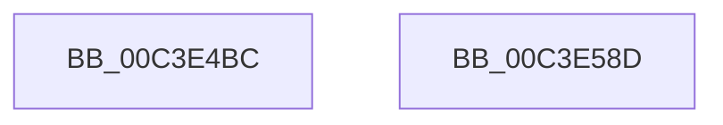

# PopDirectedDripsInitializePhase0

- RVA: `0x00C3E4BC`–`0x00C3E58E` (길이 `210` bytes)
- VA: `0x0000000140C3E4BC`
- 실행 섹션: `INIT`
- PDB 이름 있음: `예`; PDB Function 태그: `아니요`
- unwind 정보 RVA: `0x0005C788`
- 디코드: `34`개 명령, `210/210` bytes 표시
- 미해석 바이트: `0` (있으면 어셈블리에 `.byte`로 보존)

> 이 문서는 커널 이미지의 기계어와 PDB 기호를 분석해 생성했습니다. 4번과 5번은 함수 원형과 자료형을 바이너리 사용 방식에서 추정한 C 해석이며 원본 소스 복구 결과는 아닙니다.

## 1. Dependencies

- 직접 호출 지점: **5**; 고유 호출 대상: **4**
- 직접 호출자로 확인된 함수: **1**
- RIP 상대 이미지 참조: **22**

### Outgoing calls
- `0x00C3E538` → [PopInitializeWorkItem](../../page/75/PopInitializeWorkItem_function_007540C8.md) (function, `0x007540C8`)
- `0x00C3E550` → [PopDirectedDripsInitializeDisengageTimer](../../page/75/PopDirectedDripsInitializeDisengageTimer_function_007578A8.md) (function, `0x007578A8`)
- `0x00C3E568` → [PopDirectedDripsInitializeDisengageTimer](../../page/75/PopDirectedDripsInitializeDisengageTimer_function_007578A8.md) (function, `0x007578A8`)
- `0x00C3E57E` → [PopDirectedDripsDiagInitialize](../C4/PopDirectedDripsDiagInitialize_function_00C43E34.md) (function, `0x00C43E34`)
- `0x00C3E583` → [PopDirectedDripsUmInitialize](../../page/77/PopDirectedDripsUmInitialize_function_007717D8.md) (function, `0x007717D8`)

### Direct callers
- [PopInitializeDirectedDrips](PopInitializeDirectedDrips_function_00C3E6B4.md) at `0x00C3E6BC`

### Static image references
- `0x00C3E4C0` → RVA `0x00F0EB60` (`.data`; read/write)
- `0x00C3E4C8` → RVA `0x00F0EAE0` (`.data`; read)
- `0x00C3E4CF` → RVA `0x00F0EADC` (`.data`; read/write)
- `0x00C3E4D6` → RVA `0x00F0EAC0` (`.data`; read)
- `0x00C3E4DD` → RVA `0x00F0EBA0` (`.data`; read/write)
- `0x00C3E4E4` → RVA `0x004ACAE0` (`PopDirectedDripsNotifyResiliencyCompletionWorker`; read)
- `0x00C3E4EB` → RVA `0x00F0ECF8` (`.data`; read/write)
- `0x00C3E4F3` → RVA `0x00F0EB78` (`.data`; read)
- `0x00C3E4FA` → RVA `0x00F0EB68` (`.data`; read/write)
- `0x00C3E502` → RVA `0x00F0EB6C` (`.data`; read/write)
- `0x00C3E509` → RVA `0x00F0EAE8` (`.data`; write)
- `0x00C3E510` → RVA `0x00F0EAE0` (`.data`; write)
- `0x00C3E517` → RVA `0x00F0EAD8` (`.data`; write)
- `0x00C3E520` → RVA `0x00F0EADA` (`.data`; write)
- `0x00C3E527` → RVA `0x00F0EAF8` (`.data`; write)
- `0x00C3E531` → RVA `0x00F0EB70` (`.data`; write)
- `0x00C3E53D` → RVA `0x00E0B3C0` (`.data`; read)
- `0x00C3E544` → RVA `0x00F0EBA8` (`.data`; read)
- `0x00C3E555` → RVA `0x00E0B3BC` (`.data`; read)
- `0x00C3E55C` → RVA `0x00F0EC48` (`.data`; read)
- `0x00C3E56D` → RVA `0x00F0ED00` (`.data`; read/write)
- `0x00C3E577` → RVA `0x00F0ED08` (`.data`; read/write)

## 2. Other-region calls and transfers

- 다른 실행 섹션으로 향하는 call: **4**
  - `0x00C3E538` → [PopInitializeWorkItem](../../page/75/PopInitializeWorkItem_function_007540C8.md) (`INIT` → `PAGE`)
  - `0x00C3E550` → [PopDirectedDripsInitializeDisengageTimer](../../page/75/PopDirectedDripsInitializeDisengageTimer_function_007578A8.md) (`INIT` → `PAGE`)
  - `0x00C3E568` → [PopDirectedDripsInitializeDisengageTimer](../../page/75/PopDirectedDripsInitializeDisengageTimer_function_007578A8.md) (`INIT` → `PAGE`)
  - `0x00C3E583` → [PopDirectedDripsUmInitialize](../../page/77/PopDirectedDripsUmInitialize_function_007717D8.md) (`INIT` → `PAGE`)
- 별도 외부 분기/꼬리 이동을 확인하지 못했습니다.

## 3. Assembly (complete function range)

```asm
00C3E4BC  48 83 EC 28                     sub rsp, 0x28
00C3E4C0  48 83 25 98 06 2D 00 00         and qword ptr [rip + 0x2d0698], 0
00C3E4C8  48 8D 05 11 06 2D 00            lea rax, [rip + 0x2d0611]
00C3E4CF  83 25 06 06 2D 00 00            and dword ptr [rip + 0x2d0606], 0
00C3E4D6  4C 8D 05 E3 05 2D 00            lea r8, [rip + 0x2d05e3]
00C3E4DD  83 25 BC 06 2D 00 00            and dword ptr [rip + 0x2d06bc], 0
00C3E4E4  48 8D 15 F5 E5 86 FF            lea rdx, [rip - 0x791a0b]
00C3E4EB  48 83 0D 05 08 2D 00 FF         or qword ptr [rip + 0x2d0805], 0xffffffffffffffff
00C3E4F3  48 8D 0D 7E 06 2D 00            lea rcx, [rip + 0x2d067e]
00C3E4FA  66 83 25 66 06 2D 00 00         and word ptr [rip + 0x2d0666], 0
00C3E502  83 25 63 06 2D 00 00            and dword ptr [rip + 0x2d0663], 0
00C3E509  48 89 05 D8 05 2D 00            mov qword ptr [rip + 0x2d05d8], rax
00C3E510  48 89 05 C9 05 2D 00            mov qword ptr [rip + 0x2d05c9], rax
00C3E517  66 C7 05 B8 05 2D 00 01 00      mov word ptr [rip + 0x2d05b8], 1
00C3E520  C6 05 B3 05 2D 00 06            mov byte ptr [rip + 0x2d05b3], 6
00C3E527  C7 05 C7 05 2D 00 00 00 00 8C   mov dword ptr [rip + 0x2d05c7], 0x8c000000
00C3E531  C6 05 38 06 2D 00 00            mov byte ptr [rip + 0x2d0638], 0
00C3E538  E8 8B 5B B1 FF                  call 0x1407540c8
00C3E53D  44 8B 05 7C CE 1C 00            mov r8d, dword ptr [rip + 0x1cce7c]
00C3E544  48 8D 0D 5D 06 2D 00            lea rcx, [rip + 0x2d065d]
00C3E54B  BA 02 00 00 00                  mov edx, 2
00C3E550  E8 53 93 B1 FF                  call 0x1407578a8
00C3E555  44 8B 05 60 CE 1C 00            mov r8d, dword ptr [rip + 0x1cce60]
00C3E55C  48 8D 0D E5 06 2D 00            lea rcx, [rip + 0x2d06e5]
00C3E563  BA 03 00 00 00                  mov edx, 3
00C3E568  E8 3B 93 B1 FF                  call 0x1407578a8
00C3E56D  48 83 25 8B 07 2D 00 00         and qword ptr [rip + 0x2d078b], 0
00C3E575  33 C9                           xor ecx, ecx
00C3E577  83 25 8A 07 2D 00 00            and dword ptr [rip + 0x2d078a], 0
00C3E57E  E8 B1 58 00 00                  call 0x140c43e34
00C3E583  E8 50 32 B3 FF                  call 0x1407717d8
00C3E588  48 83 C4 28                     add rsp, 0x28
00C3E58C  C3                              ret
00C3E58D  CC                              int3
```

## 4. C-style interpretation (structured pseudocode)

```c
__int64 __fastcall PopDirectedDripsInitializePhase0(void)
{
    __int64 result;
    __int64 v_rsp;

    v_rsp = (v_rsp) - (40);
    *(unsigned __int64 *)(v_rip + 2950616) = v_rip + 2950673;
    *(unsigned __int64 *)(v_rip + 2950601) = v_rip + 2950673;
    *(unsigned __int16 *)(v_rip + 2950584) = 1;
    *(unsigned __int8 *)(v_rip + 2950579) = 6;
    *(unsigned int *)(v_rip + 2950599) = 0x8C000000ULL;
    *(unsigned __int8 *)(v_rip + 2950712) = 0;
    result = PopInitializeWorkItem(v_rip + 2950782, v_rip - 7936523, v_rip + 2950627, a4);
    result = PopDirectedDripsInitializeDisengageTimer(v_rip + 2950749, 2, (unsigned int)(*(unsigned int *)(v_rip + 1887868)), a4);
    result = PopDirectedDripsInitializeDisengageTimer(v_rip + 2950885, 3, (unsigned int)(*(unsigned int *)(v_rip + 1887840)), a4);
    a1 = 0;
    result = PopDirectedDripsDiagInitialize(a1, 3, (unsigned int)(*(unsigned int *)(v_rip + 1887840)), a4);
    result = PopDirectedDripsUmInitialize(a1, 3, (unsigned int)(*(unsigned int *)(v_rip + 1887840)), a4);
    v_rsp = (v_rsp) + (40);
    return result;
}
```

## 5. (Beta) C Style

```c
void PopDirectedDripsInitializePhase0(void)
{
    int64_t result;
    int64_t local_rsp;

    local_rsp = (local_rsp) - (40);
    *(uint64_t *)(v_rip + 0x2D05D8) = v_rip + 2950673;
    *(uint64_t *)(v_rip + 0x2D05C9) = v_rip + 2950673;
    *(uint16_t *)(v_rip + 0x2D05B8) = 1;
    *(uint8_t *)(v_rip + 0x2D05B3) = 6;
    *(uint32_t *)(v_rip + 0x2D05C7) = 0x8C000000ULL;
    *(uint8_t *)(v_rip + 0x2D0638) = 0;
    result = PopInitializeWorkItem(v_rip + 2950782, v_rip - 7936523, v_rip + 2950627, a4);
    result = PopDirectedDripsInitializeDisengageTimer(v_rip + 2950749, 2, (uint32_t)(*(uint32_t *)(v_rip + 0x1CCE7C)), a4);
    result = PopDirectedDripsInitializeDisengageTimer(v_rip + 2950885, 3, (uint32_t)(*(uint32_t *)(v_rip + 0x1CCE60)), a4);
    a1 = 0;
    result = PopDirectedDripsDiagInitialize(a1, 3, (uint32_t)(*(uint32_t *)(v_rip + 0x1CCE60)), a4);
    result = PopDirectedDripsUmInitialize(a1, 3, (uint32_t)(*(uint32_t *)(v_rip + 0x1CCE60)), a4);
    local_rsp = (local_rsp) + (40);
    return result;
}
```

## 6. Execution-region graph

[열기: 2D/3D 그래프와 함수 탐색 컨트롤 패널](../../../control-panel.html?section=init&rva=0x00C3E4BC&view=graph)

- 2D 그래프는 위에서 아래로 흐르고, 3D 그래프는 빈 공간을 드래그해 회전합니다. Shift+드래그는 이동, 휠은 확대·축소, 함수 노드 선택은 대상 보고서 이동입니다.

### Static fallback


