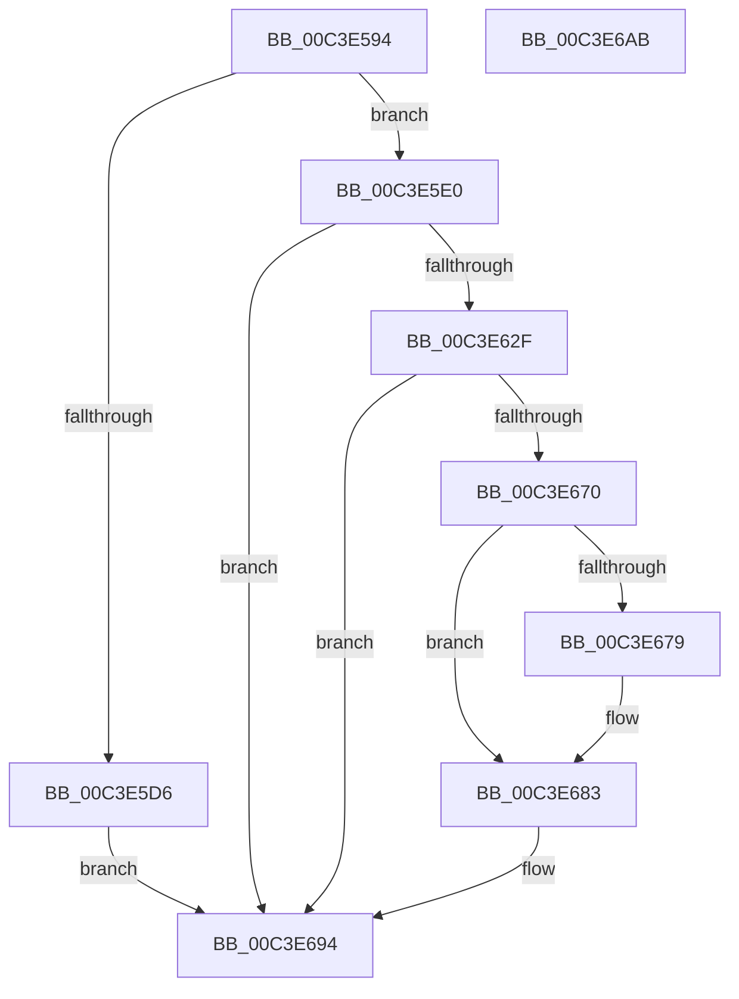

# PopDirectedDripsInitializePhase3

- RVA: `0x00C3E594`–`0x00C3E6AC` (길이 `280` bytes)
- VA: `0x0000000140C3E594`
- 실행 섹션: `INIT`
- PDB 이름 있음: `예`; PDB Function 태그: `아니요`
- unwind 정보 RVA: `0x000CC08C`
- 디코드: `67`개 명령, `280/280` bytes 표시
- 미해석 바이트: `0` (있으면 어셈블리에 `.byte`로 보존)

> 이 문서는 커널 이미지의 기계어와 PDB 기호를 분석해 생성했습니다. 4번과 5번은 함수 원형과 자료형을 바이너리 사용 방식에서 추정한 C 해석이며 원본 소스 복구 결과는 아닙니다.

## 1. Dependencies

- 직접 호출 지점: **6**; 고유 호출 대상: **6**
- 직접 호출자로 확인된 함수: **1**
- RIP 상대 이미지 참조: **8**

### Outgoing calls
- `0x00C3E5B8` → [PopDirectedDripsDiagInitialize](../C4/PopDirectedDripsDiagInitialize_function_00C43E34.md) (function, `0x00C43E34`)
- `0x00C3E5C7` → [PopDirectedDripsQueryEnabledMitigations](../../page/75/PopDirectedDripsQueryEnabledMitigations_function_00757A84.md) (function, `0x00757A84`)
- `0x00C3E624` → [PsCreateSystemThread](../../page/9E/PsCreateSystemThread_function_009ED0D0.md) (function, `0x009ED0D0`)
- `0x00C3E65C` → [ObReferenceObjectByHandleWithTag](../../page/86/ObReferenceObjectByHandleWithTag_function_00869610.md) (function, `0x00869610`)
- `0x00C3E667` → [ZwClose](../../text/6A/ZwClose_function_006AD2B0.md) (function, `0x006AD2B0`)
- `0x00C3E696` → [PopDiagTraceDirectedDripsInitialization](../../page/76/PopDiagTraceDirectedDripsInitialization_function_007610D0.md) (function, `0x007610D0`)

### Direct callers
- [PopInitializeDirectedDrips](PopInitializeDirectedDrips_function_00C3E6B4.md) at `0x00C3E6C8`

### Static image references
- `0x00C3E5BD` → RVA `0x00F0EAC0` (`.data`; read)
- `0x00C3E5CC` → RVA `0x00F0EAF0` (`.data`; read)
- `0x00C3E5E5` → RVA `0x00757DF0` (`PopDirectedDripsWorkerRoutine`; read)
- `0x00C3E635` → RVA `0x00F0EAD0` (`.data`; read)
- `0x00C3E63C` → RVA `0x00FC6AC8` (`ALMOSTRO`; read)
- `0x00C3E670` → RVA `0x00E0B3B8` (`.data`; read)
- `0x00C3E679` → RVA `0x00E0B3B8` (`.data`; write)
- `0x00C3E68C` → RVA `0x00F0EAC0` (`.data`; write)

## 2. Other-region calls and transfers

- 다른 실행 섹션으로 향하는 call: **5**
  - `0x00C3E5C7` → [PopDirectedDripsQueryEnabledMitigations](../../page/75/PopDirectedDripsQueryEnabledMitigations_function_00757A84.md) (`INIT` → `PAGE`)
  - `0x00C3E624` → [PsCreateSystemThread](../../page/9E/PsCreateSystemThread_function_009ED0D0.md) (`INIT` → `PAGE`)
  - `0x00C3E65C` → [ObReferenceObjectByHandleWithTag](../../page/86/ObReferenceObjectByHandleWithTag_function_00869610.md) (`INIT` → `PAGE`)
  - `0x00C3E667` → [ZwClose](../../text/6A/ZwClose_function_006AD2B0.md) (`INIT` → `.text`)
  - `0x00C3E696` → [PopDiagTraceDirectedDripsInitialization](../../page/76/PopDiagTraceDirectedDripsInitialization_function_007610D0.md) (`INIT` → `PAGE`)
- 별도 외부 분기/꼬리 이동을 확인하지 못했습니다.

## 3. Assembly (complete function range)

```asm
00C3E594  48 89 5C 24 10                  mov qword ptr [rsp + 0x10], rbx
00C3E599  48 89 4C 24 08                  mov qword ptr [rsp + 8], rcx
00C3E59E  55                              push rbp
00C3E59F  48 8B EC                        mov rbp, rsp
00C3E5A2  48 83 EC 70                     sub rsp, 0x70
00C3E5A6  33 C0                           xor eax, eax
00C3E5A8  21 45 EC                        and dword ptr [rbp - 0x14], eax
00C3E5AB  48 21 45 10                     and qword ptr [rbp + 0x10], rax
00C3E5AF  89 45 D4                        mov dword ptr [rbp - 0x2c], eax
00C3E5B2  21 45 D4                        and dword ptr [rbp - 0x2c], eax
00C3E5B5  8D 48 03                        lea ecx, [rax + 3]
00C3E5B8  E8 77 58 00 00                  call 0x140c43e34
00C3E5BD  48 8D 1D FC 04 2D 00            lea rbx, [rip + 0x2d04fc]
00C3E5C4  48 8B CB                        mov rcx, rbx
00C3E5C7  E8 B8 94 B1 FF                  call 0x140757a84
00C3E5CC  8B 05 1E 05 2D 00               mov eax, dword ptr [rip + 0x2d051e]
00C3E5D2  A8 03                           test al, 3
00C3E5D4  75 0A                           jne 0x140c3e5e0
00C3E5D6  BB BB 00 00 C0                  mov ebx, 0xc00000bb
00C3E5DB  E9 B4 00 00 00                  jmp 0x140c3e694
00C3E5E0  48 83 65 D8 00                  and qword ptr [rbp - 0x28], 0
00C3E5E5  48 8D 05 04 98 B1 FF            lea rax, [rip - 0x4e67fc]
00C3E5EC  48 83 65 E0 00                  and qword ptr [rbp - 0x20], 0
00C3E5F1  4C 8D 45 D0                     lea r8, [rbp - 0x30]
00C3E5F5  0F 57 C0                        xorps xmm0, xmm0
00C3E5F8  48 89 5C 24 30                  mov qword ptr [rsp + 0x30], rbx
00C3E5FD  48 89 44 24 28                  mov qword ptr [rsp + 0x28], rax
00C3E602  48 8D 4D 10                     lea rcx, [rbp + 0x10]
00C3E606  48 83 64 24 20 00               and qword ptr [rsp + 0x20], 0
00C3E60C  45 33 C9                        xor r9d, r9d
00C3E60F  33 D2                           xor edx, edx
00C3E611  C7 45 D0 30 00 00 00            mov dword ptr [rbp - 0x30], 0x30
00C3E618  C7 45 E8 00 02 00 00            mov dword ptr [rbp - 0x18], 0x200
00C3E61F  F3 0F 7F 45 F0                  movdqu xmmword ptr [rbp - 0x10], xmm0
00C3E624  E8 A7 EA DA FF                  call 0x1409ed0d0
00C3E629  8B D8                           mov ebx, eax
00C3E62B  85 C0                           test eax, eax
00C3E62D  78 65                           js 0x140c3e694
00C3E62F  48 83 64 24 30 00               and qword ptr [rsp + 0x30], 0
00C3E635  48 8D 05 94 04 2D 00            lea rax, [rip + 0x2d0494]
00C3E63C  4C 8B 05 85 84 38 00            mov r8, qword ptr [rip + 0x388485]
00C3E643  45 33 C9                        xor r9d, r9d
00C3E646  48 8B 4D 10                     mov rcx, qword ptr [rbp + 0x10]
00C3E64A  BA FF FF 1F 00                  mov edx, 0x1fffff
00C3E64F  48 89 44 24 28                  mov qword ptr [rsp + 0x28], rax
00C3E654  C7 44 24 20 50 6F 44 67         mov dword ptr [rsp + 0x20], 0x67446f50
00C3E65C  E8 AF AF C2 FF                  call 0x140869610
00C3E661  48 8B 4D 10                     mov rcx, qword ptr [rbp + 0x10]
00C3E665  8B D8                           mov ebx, eax
00C3E667  E8 44 EC A6 FF                  call 0x1406ad2b0
00C3E66C  85 DB                           test ebx, ebx
00C3E66E  78 24                           js 0x140c3e694
00C3E670  83 3D 41 CD 1C 00 03            cmp dword ptr [rip + 0x1ccd41], 3
00C3E677  72 0A                           jb 0x140c3e683
00C3E679  C7 05 35 CD 1C 00 01 00 00 00   mov dword ptr [rip + 0x1ccd35], 1
00C3E683  8B 05 37 04 2D 00               mov eax, dword ptr [rip + 0x2d0437]
00C3E689  83 C8 01                        or eax, 1
00C3E68C  89 05 2E 04 2D 00               mov dword ptr [rip + 0x2d042e], eax
00C3E692  33 DB                           xor ebx, ebx
00C3E694  8B CB                           mov ecx, ebx
00C3E696  E8 35 2A B2 FF                  call 0x1407610d0
00C3E69B  8B C3                           mov eax, ebx
00C3E69D  48 8B 9C 24 88 00 00 00         mov rbx, qword ptr [rsp + 0x88]
00C3E6A5  48 83 C4 70                     add rsp, 0x70
00C3E6A9  5D                              pop rbp
00C3E6AA  C3                              ret
00C3E6AB  CC                              int3
```

## 4. C-style interpretation (structured pseudocode)

```c
__int64 __fastcall PopDirectedDripsInitializePhase3(__int64 a1, int a2, __int64 a3, int a4)
{
    __int64 result;
    __int64 v_rbx;
    __int64 v_rsp;
    unsigned __int64 v_stack_m18;
    unsigned int v_stack_m1C;
    unsigned int v_stack_m20;
    unsigned __int64 v_stack_m28;
    unsigned __int64 v_stack_m30;
    unsigned int v_stack_m34;
    unsigned __int64 v_stack_m38;
    unsigned __int64 v_stack_m48;
    unsigned __int64 v_stack_m50;
    unsigned __int64 v_stack_m58;
    unsigned __int64 v_stack_p10;
    unsigned __int64 v_stack_p8;

    v_stack_p10 = v_rbx;
    v_stack_p8 = a1;
    v_rsp = (v_rsp) - (112);
    result = 0;
    v_stack_m34 = 0;
    result = PopDirectedDripsDiagInitialize(result + 3, a2, a3, a4);
    result = PopDirectedDripsQueryEnabledMitigations(v_rip + 2950396, a2, a3, a4);
    if ((((unsigned __int8)((unsigned int)(*(unsigned int *)(v_rip + 2950430)))) & (3)) != 0) goto loc_00C3E5E0;
    goto loc_00C3E694;
loc_00C3E5E0:
    v_stack_m48 = (unsigned int)(0xC00000BBULL);
    v_stack_m50 = v_rip - 5138428;
    a4 = 0;
    a2 = 0;
    v_stack_m38 = 48;
    v_stack_m20 = 512;
    v_stack_m18 = v_xmm0;
    result = PsCreateSystemThread(v_stack_p8, a2, v_stack_m38, a4);
    if (sign_flag) goto loc_00C3E694;
    a4 = 0;
    v_stack_m50 = v_rip + 2950292;
    v_stack_m58 = 0x67446F50ULL;
    result = ObReferenceObjectByHandleWithTag(v_stack_p8, (unsigned int)(0x1FFFFFULL), *(unsigned __int64 *)(v_rip + 3703941), a4);
    result = ZwClose(v_stack_p8, (unsigned int)(0x1FFFFFULL), *(unsigned __int64 *)(v_rip + 3703941), a4);
    if (sign_flag) goto loc_00C3E694;
    if ((*(unsigned int *)(v_rip + 1887553)) >= 3) {
        *(unsigned int *)(v_rip + 1887541) = 1;
    }
    result = (unsigned int)(((unsigned int)(*(unsigned int *)(v_rip + 2950199))) | (1));
    *(unsigned int *)(v_rip + 2950190) = (unsigned int)(result);
    v_rbx = 0;
loc_00C3E694:
    result = PopDiagTraceDirectedDripsInitialization(0, (unsigned int)(0x1FFFFFULL), *(unsigned __int64 *)(v_rip + 3703941), a4);
    v_rsp = (v_rsp) + (112);
    return 0;
}
```

## 5. (Beta) C Style

```c
int64_t PopDirectedDripsInitializePhase3(int64_t Arg1, int32_t Arg2, int64_t Arg3, int32_t Arg4)
{
    int64_t result;
    int64_t local_rbx;
    int64_t local_rsp;
    uint64_t v_stack_m18;
    uint32_t v_stack_m1C;
    uint32_t v_stack_m20;
    uint64_t v_stack_m28;
    uint64_t v_stack_m30;
    uint32_t v_stack_m34;
    uint64_t v_stack_m38;
    uint64_t v_stack_m48;
    uint64_t v_stack_m50;
    uint64_t v_stack_m58;
    uint64_t v_stack_p10;
    uint64_t v_stack_p8;

    v_stack_p10 = local_rbx;
    v_stack_p8 = Arg1;
    local_rsp = (local_rsp) - (112);
    result = 0;
    v_stack_m34 = 0;
    result = PopDirectedDripsDiagInitialize(result + 3, Arg2, Arg3, Arg4);
    result = PopDirectedDripsQueryEnabledMitigations(v_rip + 2950396, Arg2, Arg3, Arg4);
    if ((((uint8_t)((uint32_t)(*(uint32_t *)(v_rip + 0x2D051E)))) & (3)) != 0) goto loc_00C3E5E0;
    goto loc_00C3E694;
loc_00C3E5E0:
    v_stack_m48 = (uint32_t)(0xC00000BBULL);
    v_stack_m50 = v_rip - 5138428;
    Arg4 = 0;
    Arg2 = 0;
    v_stack_m38 = 48;
    v_stack_m20 = 512;
    v_stack_m18 = v_xmm0;
    result = PsCreateSystemThread(v_stack_p8, Arg2, v_stack_m38, Arg4);
    if (sign_flag) goto loc_00C3E694;
    Arg4 = 0;
    v_stack_m50 = v_rip + 2950292;
    v_stack_m58 = 0x67446F50ULL;
    result = ObReferenceObjectByHandleWithTag(v_stack_p8, (uint32_t)(0x1FFFFFULL), *(uint64_t *)(v_rip + 0x388485), Arg4);
    result = ZwClose(v_stack_p8, (uint32_t)(0x1FFFFFULL), *(uint64_t *)(v_rip + 0x388485), Arg4);
    if (sign_flag) goto loc_00C3E694;
    if ((*(uint32_t *)(v_rip + 0x1CCD41)) >= 3) {
        *(uint32_t *)(v_rip + 0x1CCD35) = 1;
    }
    result = (uint32_t)(((uint32_t)(*(uint32_t *)(v_rip + 0x2D0437))) | (1));
    *(uint32_t *)(v_rip + 0x2D042E) = (uint32_t)(result);
    local_rbx = 0;
loc_00C3E694:
    result = PopDiagTraceDirectedDripsInitialization(0, (uint32_t)(0x1FFFFFULL), *(uint64_t *)(v_rip + 0x388485), Arg4);
    local_rsp = (local_rsp) + (112);
    return 0;
}
```

## 6. Execution-region graph

[열기: 2D/3D 그래프와 함수 탐색 컨트롤 패널](../../../control-panel.html?section=init&rva=0x00C3E594&view=graph)

- 2D 그래프는 위에서 아래로 흐르고, 3D 그래프는 빈 공간을 드래그해 회전합니다. Shift+드래그는 이동, 휠은 확대·축소, 함수 노드 선택은 대상 보고서 이동입니다.

### Static fallback


