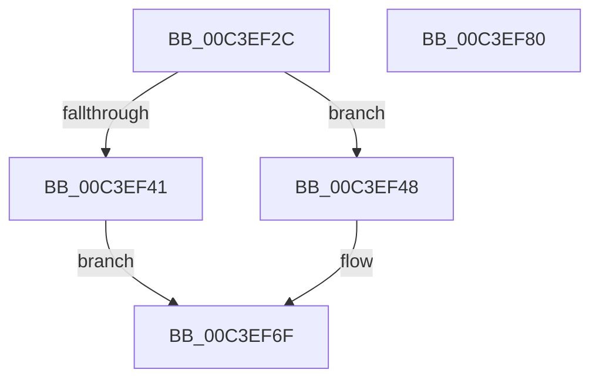

# PopHiberEvaluateSkippingMemoryMapValidation

- RVA: `0x00C3EF2C`–`0x00C3EF81` (길이 `85` bytes)
- VA: `0x0000000140C3EF2C`
- 실행 섹션: `INIT`
- PDB 이름 있음: `예`; PDB Function 태그: `아니요`
- unwind 정보 RVA: `0x00068D5C`
- 디코드: `24`개 명령, `85/85` bytes 표시
- 미해석 바이트: `0` (있으면 어셈블리에 `.byte`로 보존)

> 이 문서는 커널 이미지의 기계어와 PDB 기호를 분석해 생성했습니다. 4번과 5번은 함수 원형과 자료형을 바이너리 사용 방식에서 추정한 C 해석이며 원본 소스 복구 결과는 아닙니다.

## 1. Dependencies

- 직접 호출 지점: **1**; 고유 호출 대상: **1**
- 직접 호출자로 확인된 함수: **1**
- RIP 상대 이미지 참조: **3**

### Outgoing calls
- `0x00C3EF5F` → [EmClientQueryRuleState](../../pagelk/B7/EmClientQueryRuleState_function_00B77D70.md) (function, `0x00B77D70`)

### Direct callers
- [PoInitSystem](../C7/PoInitSystem_function_00C72358.md) at `0x00C7322C`

### Static image references
- `0x00C3EF36` → RVA `0x00FC528C` (`ALMOSTRO`; read)
- `0x00C3EF52` → RVA `0x000296B8` (`.rdata`; read)
- `0x00C3EF74` → RVA `0x00FC6B44` (`ALMOSTRO`; write)

## 2. Other-region calls and transfers

- 다른 실행 섹션으로 향하는 call: **1**
  - `0x00C3EF5F` → [EmClientQueryRuleState](../../pagelk/B7/EmClientQueryRuleState_function_00B77D70.md) (`INIT` → `PAGELK`)
- 별도 외부 분기/꼬리 이동을 확인하지 못했습니다.

## 3. Assembly (complete function range)

```asm
00C3EF2C  48 89 5C 24 10                  mov qword ptr [rsp + 0x10], rbx
00C3EF31  57                              push rdi
00C3EF32  48 83 EC 20                     sub rsp, 0x20
00C3EF36  8B 05 50 63 38 00               mov eax, dword ptr [rip + 0x386350]
00C3EF3C  83 F8 FF                        cmp eax, -1
00C3EF3F  74 07                           je 0x140c3ef48
00C3EF41  85 C0                           test eax, eax
00C3EF43  0F 95 C0                        setne al
00C3EF46  EB 27                           jmp 0x140c3ef6f
00C3EF48  BF 01 00 00 00                  mov edi, 1
00C3EF4D  48 8D 54 24 30                  lea rdx, [rsp + 0x30]
00C3EF52  48 8D 0D 5F A7 3E FF            lea rcx, [rip - 0xc158a1]
00C3EF59  89 7C 24 30                     mov dword ptr [rsp + 0x30], edi
00C3EF5D  33 DB                           xor ebx, ebx
00C3EF5F  E8 0C 8E F3 FF                  call 0x140b77d70
00C3EF64  83 7C 24 30 02                  cmp dword ptr [rsp + 0x30], 2
00C3EF69  0F B6 C3                        movzx eax, bl
00C3EF6C  0F 44 C7                        cmove eax, edi
00C3EF6F  48 8B 5C 24 38                  mov rbx, qword ptr [rsp + 0x38]
00C3EF74  88 05 CA 7B 38 00               mov byte ptr [rip + 0x387bca], al
00C3EF7A  48 83 C4 20                     add rsp, 0x20
00C3EF7E  5F                              pop rdi
00C3EF7F  C3                              ret
00C3EF80  CC                              int3
```

## 4. C-style interpretation (structured pseudocode)

```c
__int64 __fastcall PopHiberEvaluateSkippingMemoryMapValidation(void)
{
    __int64 result;
    __int64 v_rbx;
    __int64 v_rsp;
    unsigned __int64 v_stack_p10;
    unsigned __int64 v_stack_p8;

    v_stack_p10 = v_rbx;
    v_rsp = (v_rsp) - (32);
    if (((unsigned int)((unsigned int)(*(unsigned int *)(v_rip + 3695440)))) == -1) goto loc_00C3EF48;
    result = ((unsigned int)((unsigned int)(*(unsigned int *)(v_rip + 3695440))) != 0) ? 1 : 0;
    goto loc_00C3EF6F;
loc_00C3EF48:
    v_stack_p8 = 1;
    v_rbx = 0;
    result = EmClientQueryRuleState(v_rip - 12671137, v_stack_p8, a3, a4);
    result = 0;
    if (v_stack_p8 == 2) { result = 1; }
loc_00C3EF6F:
    *(unsigned __int8 *)(v_rip + 3701706) = (unsigned __int8)(result);
    v_rsp = (v_rsp) + (32);
    return result;
}
```

## 5. (Beta) C Style

```c
void PopHiberEvaluateSkippingMemoryMapValidation(void)
{
    int64_t result;
    int64_t local_rbx;
    int64_t local_rsp;
    uint64_t v_stack_p10;
    uint64_t v_stack_p8;

    v_stack_p10 = local_rbx;
    local_rsp = (local_rsp) - (32);
    if (((uint32_t)((uint32_t)(*(uint32_t *)(v_rip + 0x386350)))) == -1) goto loc_00C3EF48;
    result = ((uint32_t)((uint32_t)(*(uint32_t *)(v_rip + 0x386350))) != 0) ? 1 : 0;
    goto loc_00C3EF6F;
loc_00C3EF48:
    v_stack_p8 = 1;
    local_rbx = 0;
    result = EmClientQueryRuleState(v_rip - 12671137, v_stack_p8, a3, a4);
    result = 0;
    if (v_stack_p8 == 2) { result = 1; }
loc_00C3EF6F:
    *(uint8_t *)(v_rip + 0x387BCA) = (uint8_t)(result);
    local_rsp = (local_rsp) + (32);
    return result;
}
```

## 6. Execution-region graph

[열기: 2D/3D 그래프와 함수 탐색 컨트롤 패널](../../../control-panel.html?section=init&rva=0x00C3EF2C&view=graph)

- 2D 그래프는 위에서 아래로 흐르고, 3D 그래프는 빈 공간을 드래그해 회전합니다. Shift+드래그는 이동, 휠은 확대·축소, 함수 노드 선택은 대상 보고서 이동입니다.

### Static fallback


