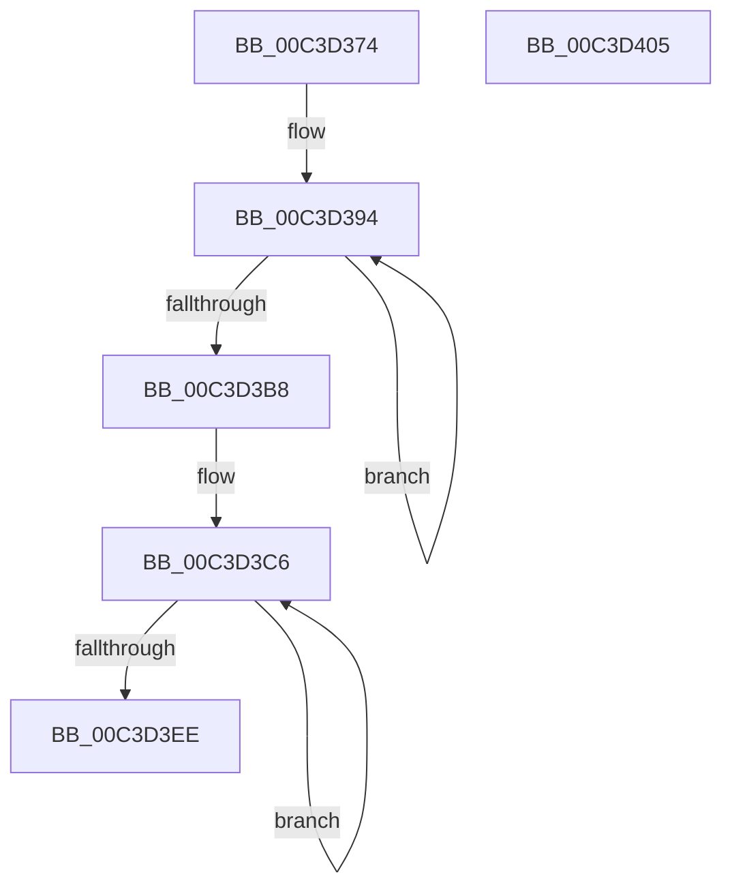

# PopInitDripsWakeAccounting

- RVA: `0x00C3D374`–`0x00C3D406` (길이 `146` bytes)
- VA: `0x0000000140C3D374`
- 실행 섹션: `INIT`
- PDB 이름 있음: `예`; PDB Function 태그: `아니요`
- unwind 정보 RVA: `0x00060BC4`
- 디코드: `32`개 명령, `146/146` bytes 표시
- 미해석 바이트: `0` (있으면 어셈블리에 `.byte`로 보존)

> 이 문서는 커널 이미지의 기계어와 PDB 기호를 분석해 생성했습니다. 4번과 5번은 함수 원형과 자료형을 바이너리 사용 방식에서 추정한 C 해석이며 원본 소스 복구 결과는 아닙니다.

## 1. Dependencies

- 직접 호출 지점: **1**; 고유 호출 대상: **1**
- 직접 호출자로 확인된 함수: **1**
- RIP 상대 이미지 참조: **3**

### Outgoing calls
- `0x00C3D3A1` → [PpmConvertTimeFrom](../../text/44/PpmConvertTimeFrom_function_00447510.md) (function, `0x00447510`)

### Direct callers
- [PoInitSystem](../C7/PoInitSystem_function_00C72358.md) at `0x00C72D5D`

### Static image references
- `0x00C3D386` → RVA `0x00000000` (`image boundary/outside`; read)
- `0x00C3D3BF` → RVA `0x00FC8098` (`ALMOSTRO`; write)
- `0x00C3D3F8` → RVA `0x00FC8318` (`ALMOSTRO`; write)

## 2. Other-region calls and transfers

- 다른 실행 섹션으로 향하는 call: **1**
  - `0x00C3D3A1` → [PpmConvertTimeFrom](../../text/44/PpmConvertTimeFrom_function_00447510.md) (`INIT` → `.text`)
- 별도 외부 분기/꼬리 이동을 확인하지 못했습니다.

## 3. Assembly (complete function range)

```asm
00C3D374  48 89 5C 24 08                  mov qword ptr [rsp + 8], rbx
00C3D379  48 89 74 24 10                  mov qword ptr [rsp + 0x10], rsi
00C3D37E  57                              push rdi
00C3D37F  48 83 EC 20                     sub rsp, 0x20
00C3D383  45 33 DB                        xor r11d, r11d
00C3D386  48 8D 35 73 2C 3C FF            lea rsi, [rip - 0xc3d38d]
00C3D38D  41 8B DB                        mov ebx, r11d
00C3D390  41 8D 7B 09                     lea edi, [r11 + 9]
00C3D394  48 8B 8C 33 30 56 FC 00         mov rcx, qword ptr [rbx + rsi + 0xfc5630]
00C3D39C  BA E8 03 00 00                  mov edx, 0x3e8
00C3D3A1  E8 6A A1 80 FF                  call 0x140447510
00C3D3A6  48 89 84 33 50 80 FC 00         mov qword ptr [rbx + rsi + 0xfc8050], rax
00C3D3AE  48 8D 5B 08                     lea rbx, [rbx + 8]
00C3D3B2  48 83 EF 01                     sub rdi, 1
00C3D3B6  75 DC                           jne 0x140c3d394
00C3D3B8  49 83 C8 FF                     or r8, 0xffffffffffffffff
00C3D3BC  8D 4F 0B                        lea ecx, [rdi + 0xb]
00C3D3BF  4C 89 05 D2 AC 38 00            mov qword ptr [rip + 0x38acd2], r8
00C3D3C6  48 B8 4B 59 86 38 D6 C5 6D 34   movabs rax, 0x346dc5d63886594b
00C3D3D0  49 F7 A4 33 A0 59 FC 00         mul qword ptr [r11 + rsi + 0xfc59a0]
00C3D3D8  4D 8D 5B 08                     lea r11, [r11 + 8]
00C3D3DC  48 C1 EA 0B                     shr rdx, 0xb
00C3D3E0  49 89 94 33 B8 82 FC 00         mov qword ptr [r11 + rsi + 0xfc82b8], rdx
00C3D3E8  48 83 E9 01                     sub rcx, 1
00C3D3EC  75 D8                           jne 0x140c3d3c6
00C3D3EE  48 8B 5C 24 30                  mov rbx, qword ptr [rsp + 0x30]
00C3D3F3  48 8B 74 24 38                  mov rsi, qword ptr [rsp + 0x38]
00C3D3F8  4C 89 05 19 AF 38 00            mov qword ptr [rip + 0x38af19], r8
00C3D3FF  48 83 C4 20                     add rsp, 0x20
00C3D403  5F                              pop rdi
00C3D404  C3                              ret
00C3D405  CC                              int3
```

## 4. C-style interpretation (structured pseudocode)

```c
__int64 __fastcall PopInitDripsWakeAccounting(__int64 a1, __int64 a2, __int64 a3)
{
    __int64 result;
    __int64 v_r11;
    __int64 v_rdi;
    __int64 v_rsp;
    unsigned __int64 v_stack_p10;
    unsigned __int64 v_stack_p8;

    v_stack_p8 = v_rbx;
    v_stack_p10 = v_rsi;
    v_rsp = (v_rsp) - (32);
    v_r11 = 0;
loc_00C3D394:
    result = PpmConvertTimeFrom(*(unsigned __int64 *)(0 + v_rip - 12833677 * 1 + 16537136), 1000, a3, a4);
    *(unsigned __int64 *)(0 + v_rip - 12833677 * 1 + 16547920) = result;
    v_rdi = (v_r11 + 9) - (1);
    if (condition_is_not_equal) goto loc_00C3D394;
    a3 = (a3) | (-1);
    *(unsigned __int64 *)(v_rip + 3714258) = a3;
loc_00C3D3C6:
    a2 = (1000) >> (11);
    *(unsigned __int64 *)(v_r11 + 8 + v_rip - 12833677 * 1 + 16548536) = a2;
    a1 = (v_rdi + 11) - (1);
    if (condition_is_not_equal) goto loc_00C3D3C6;
    *(unsigned __int64 *)(v_rip + 3714841) = a3;
    v_rsp = (v_rsp) + (32);
    return result;
}
```

## 5. (Beta) C Style

```c
int64_t PopInitDripsWakeAccounting(int64_t Arg1, int64_t Arg2, int64_t Arg3)
{
    int64_t result;
    int64_t local_r11;
    int64_t local_rdi;
    int64_t local_rsp;
    uint64_t v_stack_p10;
    uint64_t v_stack_p8;

    v_stack_p8 = local_rbx;
    v_stack_p10 = local_rsi;
    local_rsp = (local_rsp) - (32);
    local_r11 = 0;
loc_00C3D394:
    result = PpmConvertTimeFrom(*(uint64_t *)(0 + v_rip - 0xC3D38D * 1 + 0xFC5630), 1000, Arg3, a4);
    *(uint64_t *)(0 + v_rip - 0xC3D38D * 1 + 0xFC8050) = result;
    local_rdi = (local_r11 + 9) - (1);
    if (condition_is_not_equal) goto loc_00C3D394;
    Arg3 = (Arg3) | (-1);
    *(uint64_t *)(v_rip + 0x38ACD2) = Arg3;
loc_00C3D3C6:
    Arg2 = (1000) >> (11);
    *(uint64_t *)(local_r11 + 0x8 + v_rip - 0xC3D38D * 1 + 0xFC82B8) = Arg2;
    Arg1 = (local_rdi + 11) - (1);
    if (condition_is_not_equal) goto loc_00C3D3C6;
    *(uint64_t *)(v_rip + 0x38AF19) = Arg3;
    local_rsp = (local_rsp) + (32);
    return result;
}
```

## 6. Execution-region graph

[열기: 2D/3D 그래프와 함수 탐색 컨트롤 패널](../../../control-panel.html?section=init&rva=0x00C3D374&view=graph)

- 2D 그래프는 위에서 아래로 흐르고, 3D 그래프는 빈 공간을 드래그해 회전합니다. Shift+드래그는 이동, 휠은 확대·축소, 함수 노드 선택은 대상 보고서 이동입니다.

### Static fallback


