# PopInitPlatformSettings

- RVA: `0x00C3D40C`–`0x00C3D67E` (길이 `626` bytes)
- VA: `0x0000000140C3D40C`
- 실행 섹션: `INIT`
- PDB 이름 있음: `예`; PDB Function 태그: `아니요`
- unwind 정보 RVA: `0x000CBD0C`
- 디코드: `157`개 명령, `626/626` bytes 표시
- 미해석 바이트: `0` (있으면 어셈블리에 `.byte`로 보존)

> 이 문서는 커널 이미지의 기계어와 PDB 기호를 분석해 생성했습니다. 4번과 5번은 함수 원형과 자료형을 바이너리 사용 방식에서 추정한 C 해석이며 원본 소스 복구 결과는 아닙니다.

## 1. Dependencies

- 직접 호출 지점: **15**; 고유 호출 대상: **10**
- 직접 호출자로 확인된 함수: **1**
- RIP 상대 이미지 참조: **19**

### Outgoing calls
- `0x00C3D439` → [PopAcquirePolicyLock](../../pagelk/B7/PopAcquirePolicyLock_function_00B783C0.md) (function, `0x00B783C0`)
- `0x00C3D46E` → [ZwQuerySystemInformation](../../text/6A/ZwQuerySystemInformation_function_006AD790.md) (function, `0x006AD790`)
- `0x00C3D48E` → [ExAllocatePool2](../../poolcode/B8/ExAllocatePool2_function_00B820F0.md) (function, `0x00B820F0`)
- `0x00C3D4A0` → [PopReleasePolicyLock](../../pagelk/B7/PopReleasePolicyLock_function_00B78410.md) (function, `0x00B78410`)
- `0x00C3D4BA` → [KeBugCheckEx](../../text/4F/KeBugCheckEx_function_004FD660.md) (function, `0x004FD660`)
- `0x00C3D4EA` → [ZwQuerySystemInformation](../../text/6A/ZwQuerySystemInformation_function_006AD790.md) (function, `0x006AD790`)
- `0x00C3D510` → [guard_dispatch_icall](../../text/6B/guard_dispatch_icall_function_006BAAD0.md) (function, `0x006BAAD0`)
- `0x00C3D590` → [PopLogSleepDisabled](../../page/91/PopLogSleepDisabled_function_009102D8.md) (function, `0x009102D8`)
- `0x00C3D5C9` → [PopLogSleepDisabled](../../page/91/PopLogSleepDisabled_function_009102D8.md) (function, `0x009102D8`)
- `0x00C3D613` → [PopReleasePolicyLock](../../pagelk/B7/PopReleasePolicyLock_function_00B78410.md) (function, `0x00B78410`)
- `0x00C3D61A` → [PopReleasePolicyLock](../../pagelk/B7/PopReleasePolicyLock_function_00B78410.md) (function, `0x00B78410`)
- `0x00C3D639` → [guard_dispatch_icall](../../text/6B/guard_dispatch_icall_function_006BAAD0.md) (function, `0x006BAAD0`)
- `0x00C3D63E` → [PopAdaptiveStandbyInitialize](../../page/76/PopAdaptiveStandbyInitialize_function_0076DDF8.md) (function, `0x0076DDF8`)
- `0x00C3D650` → [ExFreePoolWithTag](../../poolcode/B8/ExFreePoolWithTag_function_00B82870.md) (function, `0x00B82870`)
- `0x00C3D65E` → [_security_check_cookie](../../text/6A/_security_check_cookie_function_006AC640.md) (function, `0x006AC640`)

### Direct callers
- [NtPowerInformation](../../page/95/NtPowerInformation_function_00955D80.md) at `0x009576F9`

### Static image references
- `0x00C3D427` → RVA `0x00E0A740` (`.data`; read)
- `0x00C3D503` → RVA `0x00FC6CD8` (`ALMOSTRO`; write)
- `0x00C3D509` → RVA `0x00E00AC0` (`.data`; read)
- `0x00C3D519` → RVA `0x00E6739C` (`.data`; write)
- `0x00C3D520` → RVA `0x00FC5294` (`ALMOSTRO`; read)
- `0x00C3D533` → RVA `0x00FC5108` (`ALMOSTRO`; read)
- `0x00C3D546` → RVA `0x00FC6A90` (`ALMOSTRO`; read)
- `0x00C3D550` → RVA `0x00FC6C98` (`ALMOSTRO`; read)
- `0x00C3D565` → RVA `0x00FC6AD8` (`ALMOSTRO`; read)
- `0x00C3D571` → RVA `0x00FC6AB8` (`ALMOSTRO`; read)
- `0x00C3D595` → RVA `0x00E6739C` (`.data`; read)
- `0x00C3D59F` → RVA `0x00FC41C4` (`.data`; read)
- `0x00C3D5A8` → RVA `0x00FC4148` (`.data`; read)
- `0x00C3D5B1` → RVA `0x00FC6FC0` (`ALMOSTRO`; read)
- `0x00C3D5D6` → RVA `0x00E673A0` (`.data`; write)
- `0x00C3D5E1` → RVA `0x00FC6FF0` (`ALMOSTRO`; write)
- `0x00C3D5E8` → RVA `0x00FC6CD8` (`ALMOSTRO`; read)
- `0x00C3D5FB` → RVA `0x00E67840` (`.data`; read)
- `0x00C3D60B` → RVA `0x00E67398` (`.data`; write)

## 2. Other-region calls and transfers

- 다른 실행 섹션으로 향하는 call: **15**
  - `0x00C3D439` → [PopAcquirePolicyLock](../../pagelk/B7/PopAcquirePolicyLock_function_00B783C0.md) (`INIT` → `PAGELK`)
  - `0x00C3D46E` → [ZwQuerySystemInformation](../../text/6A/ZwQuerySystemInformation_function_006AD790.md) (`INIT` → `.text`)
  - `0x00C3D48E` → [ExAllocatePool2](../../poolcode/B8/ExAllocatePool2_function_00B820F0.md) (`INIT` → `POOLCODE`)
  - `0x00C3D4A0` → [PopReleasePolicyLock](../../pagelk/B7/PopReleasePolicyLock_function_00B78410.md) (`INIT` → `PAGELK`)
  - `0x00C3D4BA` → [KeBugCheckEx](../../text/4F/KeBugCheckEx_function_004FD660.md) (`INIT` → `.text`)
  - `0x00C3D4EA` → [ZwQuerySystemInformation](../../text/6A/ZwQuerySystemInformation_function_006AD790.md) (`INIT` → `.text`)
  - `0x00C3D510` → [guard_dispatch_icall](../../text/6B/guard_dispatch_icall_function_006BAAD0.md) (`INIT` → `.text`)
  - `0x00C3D590` → [PopLogSleepDisabled](../../page/91/PopLogSleepDisabled_function_009102D8.md) (`INIT` → `PAGE`)
  - `0x00C3D5C9` → [PopLogSleepDisabled](../../page/91/PopLogSleepDisabled_function_009102D8.md) (`INIT` → `PAGE`)
  - `0x00C3D613` → [PopReleasePolicyLock](../../pagelk/B7/PopReleasePolicyLock_function_00B78410.md) (`INIT` → `PAGELK`)
  - `0x00C3D61A` → [PopReleasePolicyLock](../../pagelk/B7/PopReleasePolicyLock_function_00B78410.md) (`INIT` → `PAGELK`)
  - `0x00C3D639` → [guard_dispatch_icall](../../text/6B/guard_dispatch_icall_function_006BAAD0.md) (`INIT` → `.text`)
  - `0x00C3D63E` → [PopAdaptiveStandbyInitialize](../../page/76/PopAdaptiveStandbyInitialize_function_0076DDF8.md) (`INIT` → `PAGE`)
  - `0x00C3D650` → [ExFreePoolWithTag](../../poolcode/B8/ExFreePoolWithTag_function_00B82870.md) (`INIT` → `POOLCODE`)
  - `0x00C3D65E` → [_security_check_cookie](../../text/6A/_security_check_cookie_function_006AC640.md) (`INIT` → `.text`)
- 별도 외부 분기/꼬리 이동을 확인하지 못했습니다.

## 3. Assembly (complete function range)

```asm
00C3D40C  48 8B C4                        mov rax, rsp
00C3D40F  48 89 58 08                     mov qword ptr [rax + 8], rbx
00C3D413  48 89 70 10                     mov qword ptr [rax + 0x10], rsi
00C3D417  48 89 78 18                     mov qword ptr [rax + 0x18], rdi
00C3D41B  4C 89 78 20                     mov qword ptr [rax + 0x20], r15
00C3D41F  55                              push rbp
00C3D420  48 8B EC                        mov rbp, rsp
00C3D423  48 83 EC 60                     sub rsp, 0x60
00C3D427  48 8B 05 12 D3 1C 00            mov rax, qword ptr [rip + 0x1cd312]
00C3D42E  48 33 C4                        xor rax, rsp
00C3D431  48 89 45 F0                     mov qword ptr [rbp - 0x10], rax
00C3D435  83 65 E8 00                     and dword ptr [rbp - 0x18], 0
00C3D439  E8 82 AF F3 FF                  call 0x140b783c0
00C3D43E  33 FF                           xor edi, edi
00C3D440  C7 45 D8 49 50 43 41            mov dword ptr [rbp - 0x28], 0x41435049
00C3D447  21 7D E4                        and dword ptr [rbp - 0x1c], edi
00C3D44A  4C 8D 4D D0                     lea r9, [rbp - 0x30]
00C3D44E  21 7D D0                        and dword ptr [rbp - 0x30], edi
00C3D451  48 8D 55 D8                     lea rdx, [rbp - 0x28]
00C3D455  40 32 F6                        xor sil, sil
00C3D458  C7 45 E0 46 41 43 50            mov dword ptr [rbp - 0x20], 0x50434146
00C3D45F  44 8D 7F 01                     lea r15d, [rdi + 1]
00C3D463  44 8D 47 14                     lea r8d, [rdi + 0x14]
00C3D467  44 89 7D DC                     mov dword ptr [rbp - 0x24], r15d
00C3D46B  8D 4F 4C                        lea ecx, [rdi + 0x4c]
00C3D46E  E8 1D 03 A7 FF                  call 0x1406ad790
00C3D473  8B D8                           mov ebx, eax
00C3D475  3D 23 00 00 C0                  cmp eax, 0xc0000023
00C3D47A  0F 85 9A 01 00 00               jne 0x140c3d61a
00C3D480  8B 55 D0                        mov edx, dword ptr [rbp - 0x30]
00C3D483  B9 00 01 00 00                  mov ecx, 0x100
00C3D488  41 B8 4D 65 6D 20               mov r8d, 0x206d654d
00C3D48E  E8 5D 4C F4 FF                  call 0x140b820f0
00C3D493  48 8B F8                        mov rdi, rax
00C3D496  48 85 C0                        test rax, rax
00C3D499  75 25                           jne 0x140c3d4c0
00C3D49B  BB 9A 00 00 C0                  mov ebx, 0xc000009a
00C3D4A0  E8 6B AF F3 FF                  call 0x140b78410
00C3D4A5  48 83 64 24 20 00               and qword ptr [rsp + 0x20], 0
00C3D4AB  45 33 C9                        xor r9d, r9d
00C3D4AE  4C 63 C3                        movsxd r8, ebx
00C3D4B1  B9 A0 00 00 00                  mov ecx, 0xa0
00C3D4B6  41 8D 51 0E                     lea edx, [r9 + 0xe]
00C3D4BA  E8 A1 01 8C FF                  call 0x1404fd660
00C3D4BF  CC                              int3
00C3D4C0  C7 00 49 50 43 41               mov dword ptr [rax], 0x41435049
00C3D4C6  4C 8D 4D D0                     lea r9, [rbp - 0x30]
00C3D4CA  44 89 78 04                     mov dword ptr [rax + 4], r15d
00C3D4CE  48 8B D7                        mov rdx, rdi
00C3D4D1  C7 40 08 46 41 43 50            mov dword ptr [rax + 8], 0x50434146
00C3D4D8  B9 4C 00 00 00                  mov ecx, 0x4c
00C3D4DD  8B 45 D0                        mov eax, dword ptr [rbp - 0x30]
00C3D4E0  83 C0 F0                        add eax, -0x10
00C3D4E3  89 47 0C                        mov dword ptr [rdi + 0xc], eax
00C3D4E6  44 8B 45 D0                     mov r8d, dword ptr [rbp - 0x30]
00C3D4EA  E8 A1 02 A7 FF                  call 0x1406ad790
00C3D4EF  8B D8                           mov ebx, eax
00C3D4F1  85 C0                           test eax, eax
00C3D4F3  0F 88 21 01 00 00               js 0x140c3d61a
00C3D4F9  80 7F 18 03                     cmp byte ptr [rdi + 0x18], 3
00C3D4FD  72 0A                           jb 0x140c3d509
00C3D4FF  0F B6 47 3D                     movzx eax, byte ptr [rdi + 0x3d]
00C3D503  89 05 CF 97 38 00               mov dword ptr [rip + 0x3897cf], eax
00C3D509  48 8B 05 B0 35 1C 00            mov rax, qword ptr [rip + 0x1c35b0]
00C3D510  E8 BB D5 A7 FF                  call 0x1406baad0
00C3D515  84 C0                           test al, al
00C3D517  74 07                           je 0x140c3d520
00C3D519  44 88 3D 7C 9E 22 00            mov byte ptr [rip + 0x229e7c], r15b
00C3D520  8B 05 6E 7D 38 00               mov eax, dword ptr [rip + 0x387d6e]
00C3D526  83 C9 FF                        or ecx, 0xffffffff
00C3D529  3B C1                           cmp eax, ecx
00C3D52B  74 06                           je 0x140c3d533
00C3D52D  89 05 A5 97 38 00               mov dword ptr [rip + 0x3897a5], eax
00C3D533  8B 05 CF 7B 38 00               mov eax, dword ptr [rip + 0x387bcf]
00C3D539  3B C1                           cmp eax, ecx
00C3D53B  74 09                           je 0x140c3d546
00C3D53D  85 C0                           test eax, eax
00C3D53F  0F 95 05 56 9E 22 00            setne byte ptr [rip + 0x229e56]
00C3D546  8B 05 44 95 38 00               mov eax, dword ptr [rip + 0x389544]
00C3D54C  A8 02                           test al, 2
00C3D54E  74 45                           je 0x140c3d595
00C3D550  8B 05 42 97 38 00               mov eax, dword ptr [rip + 0x389742]
00C3D556  25 00 00 01 00                  and eax, 0x10000
00C3D55B  F7 D8                           neg eax
00C3D55D  1B D2                           sbb edx, edx
00C3D55F  83 E2 F1                        and edx, 0xfffffff1
00C3D562  83 C2 1F                        add edx, 0x1f
00C3D565  F7 05 69 95 38 00 00 04 00 00   test dword ptr [rip + 0x389569], 0x400
00C3D56F  74 15                           je 0x140c3d586
00C3D571  F7 05 3D 95 38 00 00 00 00 20   test dword ptr [rip + 0x38953d], 0x20000000
00C3D57B  BA 1F 00 00 00                  mov edx, 0x1f
00C3D580  8D 42 F8                        lea eax, [rdx - 8]
00C3D583  0F 45 D0                        cmovne edx, eax
00C3D586  45 33 C9                        xor r9d, r9d
00C3D589  45 33 C0                        xor r8d, r8d
00C3D58C  41 8D 49 12                     lea ecx, [r9 + 0x12]
00C3D590  E8 43 2D CD FF                  call 0x1409102d8
00C3D595  8A 05 01 9E 22 00               mov al, byte ptr [rip + 0x229e01]
00C3D59B  84 C0                           test al, al
00C3D59D  74 1D                           je 0x140c3d5bc
00C3D59F  83 3D 1E 6C 38 00 00            cmp dword ptr [rip + 0x386c1e], 0
00C3D5A6  75 26                           jne 0x140c3d5ce
00C3D5A8  40 38 35 99 6B 38 00            cmp byte ptr [rip + 0x386b99], sil
00C3D5AF  75 1D                           jne 0x140c3d5ce
00C3D5B1  83 3D 08 9A 38 00 00            cmp dword ptr [rip + 0x389a08], 0
00C3D5B8  74 1C                           je 0x140c3d5d6
00C3D5BA  EB 12                           jmp 0x140c3d5ce
00C3D5BC  45 33 C9                        xor r9d, r9d
00C3D5BF  45 33 C0                        xor r8d, r8d
00C3D5C2  41 8D 51 20                     lea edx, [r9 + 0x20]
00C3D5C6  8D 4A F3                        lea ecx, [rdx - 0xd]
00C3D5C9  E8 0A 2D CD FF                  call 0x1409102d8
00C3D5CE  32 C0                           xor al, al
00C3D5D0  88 05 C6 9D 22 00               mov byte ptr [rip + 0x229dc6], al
00C3D5D6  44 89 3D C3 9D 22 00            mov dword ptr [rip + 0x229dc3], r15d
00C3D5DD  84 C0                           test al, al
00C3D5DF  75 07                           jne 0x140c3d5e8
00C3D5E1  44 89 3D 08 9A 38 00            mov dword ptr [rip + 0x389a08], r15d
00C3D5E8  8B 05 EA 96 38 00               mov eax, dword ptr [rip + 0x3896ea]
00C3D5EE  83 F8 08                        cmp eax, 8
00C3D5F1  76 08                           jbe 0x140c3d5fb
00C3D5F3  33 C0                           xor eax, eax
00C3D5F5  89 05 DD 96 38 00               mov dword ptr [rip + 0x3896dd], eax
00C3D5FB  48 83 3D 3D A2 22 00 00         cmp qword ptr [rip + 0x22a23d], 0
00C3D603  40 0F B6 F6                     movzx esi, sil
00C3D607  41 0F 45 F7                     cmovne esi, r15d
00C3D60B  89 05 87 9D 22 00               mov dword ptr [rip + 0x229d87], eax
00C3D611  33 DB                           xor ebx, ebx
00C3D613  E8 F8 AD F3 FF                  call 0x140b78410
00C3D618  EB 0D                           jmp 0x140c3d627
00C3D61A  E8 F1 AD F3 FF                  call 0x140b78410
00C3D61F  85 DB                           test ebx, ebx
00C3D621  0F 88 7E FE FF FF               js 0x140c3d4a5
00C3D627  40 84 F6                        test sil, sil
00C3D62A  74 12                           je 0x140c3d63e
00C3D62C  48 8B 05 0D A2 22 00            mov rax, qword ptr [rip + 0x22a20d]
00C3D633  8A 0D 63 9D 22 00               mov cl, byte ptr [rip + 0x229d63]
00C3D639  E8 92 D4 A7 FF                  call 0x1406baad0
00C3D63E  E8 B5 07 B3 FF                  call 0x14076ddf8
00C3D643  48 85 FF                        test rdi, rdi
00C3D646  74 0D                           je 0x140c3d655
00C3D648  BA 4D 65 6D 20                  mov edx, 0x206d654d
00C3D64D  48 8B CF                        mov rcx, rdi
00C3D650  E8 1B 52 F4 FF                  call 0x140b82870
00C3D655  8B C3                           mov eax, ebx
00C3D657  48 8B 4D F0                     mov rcx, qword ptr [rbp - 0x10]
00C3D65B  48 33 CC                        xor rcx, rsp
00C3D65E  E8 DD EF A6 FF                  call 0x1406ac640
00C3D663  4C 8D 5C 24 60                  lea r11, [rsp + 0x60]
00C3D668  49 8B 5B 10                     mov rbx, qword ptr [r11 + 0x10]
00C3D66C  49 8B 73 18                     mov rsi, qword ptr [r11 + 0x18]
00C3D670  49 8B 7B 20                     mov rdi, qword ptr [r11 + 0x20]
00C3D674  4D 8B 7B 28                     mov r15, qword ptr [r11 + 0x28]
00C3D678  49 8B E3                        mov rsp, r11
00C3D67B  5D                              pop rbp
00C3D67C  C3                              ret
00C3D67D  CC                              int3
```

## 4. C-style interpretation (structured pseudocode)

```c
__int64 __fastcall PopInitPlatformSettings(void)
{
    __int64 result;
    __int64 v_rbx;
    __int64 v_rdi;
    __int64 v_rsi;
    __int64 v_rsp;
    unsigned __int64 v_stack_m18;
    unsigned int v_stack_m20;
    unsigned int v_stack_m24;
    unsigned int v_stack_m28;
    unsigned int v_stack_m2C;
    unsigned int v_stack_m30;
    unsigned __int64 v_stack_m38;
    unsigned __int64 v_stack_m48;
    unsigned __int64 v_stack_m8;

    *(unsigned __int64 *)(v_rsp + 8) = v_rbx;
    *(unsigned __int64 *)(v_rsp + 16) = v_rsi;
    *(unsigned __int64 *)(v_rsp + 24) = v_rdi;
    *(unsigned __int64 *)(v_rsp + 32) = v_r15;
    v_rsp = (v_rsp) - (96);
    result = (*(unsigned __int64 *)(v_rip + 1889042)) ^ (v_rsp);
    v_stack_m18 = result;
    result = PopAcquirePolicyLock(a1, a2, a3, a4);
    v_rdi = 0;
    v_stack_m30 = 0x41435049ULL;
    v_rsi = 0;
    v_stack_m28 = 0x50434146ULL;
    v_stack_m2C = (unsigned int)(v_rdi + 1);
    result = ZwQuerySystemInformation(v_rdi + 76, v_stack_m30, v_rdi + 20, v_stack_m38);
    if (((unsigned int)(result)) != 0xC0000023ULL) goto loc_00C3D61A;
    result = ExAllocatePool2(256, (unsigned int)(v_stack_m38), (unsigned int)(0x206D654DULL), v_stack_m38);
    if (result != 0) goto loc_00C3D4C0;
    result = PopReleasePolicyLock(256, (unsigned int)(v_stack_m38), (unsigned int)(0x206D654DULL), v_stack_m38);
loc_00C3D4A5:
    a4 = 0;
    result = KeBugCheckEx(160, a4 + 14, (int)((unsigned int)((unsigned int)(0xC000009AULL))), a4);
loc_00C3D4C0:
    *(unsigned int *)(result) = 0x41435049ULL;
    *(unsigned int *)(result + 4) = (unsigned int)(v_rdi + 1);
    *(unsigned int *)(result + 8) = 0x50434146ULL;
    result = (unsigned int)(((unsigned int)(v_stack_m38)) + (-16));
    *(unsigned int *)(result + 12) = (unsigned int)(result);
    result = ZwQuerySystemInformation(76, result, (unsigned int)(v_stack_m38), v_stack_m38);
    if (sign_flag) goto loc_00C3D61A;
    if ((*(unsigned __int8 *)(result + 24)) >= 3) {
        result = *(unsigned __int8 *)(result + 61);
        *(unsigned int *)(v_rip + 3708879) = (unsigned int)(result);
    }
    result = guard_dispatch_icall(76, result, (unsigned int)(v_stack_m38), v_stack_m38);
    if ((unsigned __int8)(result) != 0) {
        *(unsigned __int8 *)(v_rip + 2268796) = (unsigned __int8)(v_rdi + 1);
    }
    a1 = (unsigned int)((76) | (0xFFFFFFFFULL));
    if (((unsigned int)((unsigned int)(*(unsigned int *)(v_rip + 3702126)))) != ((unsigned int)(a1))) {
        *(unsigned int *)(v_rip + 3708837) = (unsigned int)((unsigned int)(*(unsigned int *)(v_rip + 3702126)));
    }
    if (((unsigned int)((unsigned int)(*(unsigned int *)(v_rip + 3701711)))) != ((unsigned int)(a1))) {
    }
    if ((((unsigned __int8)((unsigned int)(*(unsigned int *)(v_rip + 3708228)))) & (2)) == 0) goto loc_00C3D595;
    result = (unsigned int)(((unsigned int)(*(unsigned int *)(v_rip + 3708738))) & (0x10000ULL));
    result = (unsigned int)(-(result));
    a2 = (unsigned int)((result) & (0xFFFFFFF1ULL));
    a2 = (unsigned int)((a2) + (31));
    if (((*(unsigned int *)(v_rip + 3708265)) & (0x400ULL)) != 0) {
        a2 = 31;
        result = a2 - 8;
        if (((*(unsigned int *)(v_rip + 3708221)) & (0x20000000ULL)) != 0) { a2 = (unsigned int)(result); }
    }
    a4 = 0;
    a3 = 0;
    result = PopLogSleepDisabled(a4 + 18, a2, a3, a4);
loc_00C3D595:
    if ((unsigned __int8)(*(unsigned __int8 *)(v_rip + 2268673)) == 0) goto loc_00C3D5BC;
    if ((*(unsigned int *)(v_rip + 3697694)) != 0) goto loc_00C3D5CE;
    if ((*(unsigned __int8 *)(v_rip + 3697561)) != 0) goto loc_00C3D5CE;
    if ((*(unsigned int *)(v_rip + 3709448)) == 0) goto loc_00C3D5D6;
    goto loc_00C3D5CE;
loc_00C3D5BC:
    a4 = 0;
    a3 = 0;
    result = PopLogSleepDisabled(a4 + 32 - 13, a4 + 32, a3, a4);
loc_00C3D5CE:
    result = 0;
    *(unsigned __int8 *)(v_rip + 2268614) = 0;
loc_00C3D5D6:
    *(unsigned int *)(v_rip + 2268611) = (unsigned int)(v_rdi + 1);
    if (0 == 0) {
        *(unsigned int *)(v_rip + 3709448) = (unsigned int)(v_rdi + 1);
    }
    result = (unsigned int)(*(unsigned int *)(v_rip + 3708650));
    if (((unsigned int)((unsigned int)(*(unsigned int *)(v_rip + 3708650)))) >= = 8) {
        result = 0;
        *(unsigned int *)(v_rip + 3708637) = 0;
    }
    v_rsi = 0;
    if ((*(unsigned __int64 *)(v_rip + 2269757)) != 0) { v_rsi = (unsigned int)(v_rdi + 1); }
    *(unsigned int *)(v_rip + 2268551) = 0;
    v_rbx = 0;
    result = PopReleasePolicyLock(a4 + 32 - 13, a4 + 32, a3, a4);
    goto loc_00C3D627;
loc_00C3D61A:
    result = PopReleasePolicyLock(a4 + 32 - 13, a4 + 32, a3, a4);
    if (sign_flag) goto loc_00C3D4A5;
loc_00C3D627:
    if ((unsigned __int8)(v_rsi) != 0) {
        result = *(unsigned __int64 *)(v_rip + 2269709);
        a1 = *(unsigned __int8 *)(v_rip + 2268515);
        result = guard_dispatch_icall(a1, a4 + 32, a3, a4);
    }
    result = PopAdaptiveStandbyInitialize(a1, a4 + 32, a3, a4);
    if (result != 0) {
        a2 = 0x206D654DULL;
        a1 = result;
        result = ExFreePoolWithTag(a1, a2, a3, a4);
    }
    a1 = (v_stack_m18) ^ (v_rsp);
    result = _security_check_cookie(a1, a2, a3, a4);
    return result;
}
```

## 5. (Beta) C Style

```c
void PopInitPlatformSettings(void)
{
    int64_t result;
    int64_t local_rbx;
    int64_t local_rdi;
    int64_t local_rsi;
    int64_t local_rsp;
    uint64_t v_stack_m18;
    uint32_t v_stack_m20;
    uint32_t v_stack_m24;
    uint32_t v_stack_m28;
    uint32_t v_stack_m2C;
    uint32_t v_stack_m30;
    uint64_t v_stack_m38;
    uint64_t v_stack_m48;
    uint64_t v_stack_m8;

    *(uint64_t *)(local_rsp + 0x8) = local_rbx;
    *(uint64_t *)(local_rsp + 0x10) = local_rsi;
    *(uint64_t *)(local_rsp + 0x18) = local_rdi;
    *(uint64_t *)(local_rsp + 0x20) = local_r15;
    local_rsp = (local_rsp) - (96);
    result = (*(uint64_t *)(v_rip + 0x1CD312)) ^ (local_rsp);
    v_stack_m18 = result;
    result = PopAcquirePolicyLock(a1, a2, a3, a4);
    local_rdi = 0;
    v_stack_m30 = 0x41435049ULL;
    local_rsi = 0;
    v_stack_m28 = 0x50434146ULL;
    v_stack_m2C = (uint32_t)(local_rdi + 1);
    result = ZwQuerySystemInformation(local_rdi + 76, v_stack_m30, local_rdi + 20, v_stack_m38);
    if (((uint32_t)(result)) != 0xC0000023ULL) goto loc_00C3D61A;
    result = ExAllocatePool2(256, (uint32_t)(v_stack_m38), (uint32_t)(0x206D654DULL), v_stack_m38);
    if (result != 0) goto loc_00C3D4C0;
    result = PopReleasePolicyLock(256, (uint32_t)(v_stack_m38), (uint32_t)(0x206D654DULL), v_stack_m38);
loc_00C3D4A5:
    a4 = 0;
    result = KeBugCheckEx(160, a4 + 14, (int32_t)((uint32_t)((uint32_t)(0xC000009AULL))), a4);
loc_00C3D4C0:
    *(uint32_t *)(result) = 0x41435049ULL;
    *(uint32_t *)(result + 0x4) = (uint32_t)(local_rdi + 1);
    *(uint32_t *)(result + 0x8) = 0x50434146ULL;
    result = (uint32_t)(((uint32_t)(v_stack_m38)) + (-16));
    *(uint32_t *)(result + 0xC) = (uint32_t)(result);
    result = ZwQuerySystemInformation(76, result, (uint32_t)(v_stack_m38), v_stack_m38);
    if (sign_flag) goto loc_00C3D61A;
    if ((*(uint8_t *)(result + 0x18)) >= 3) {
        result = *(uint8_t *)(result + 0x3D);
        *(uint32_t *)(v_rip + 0x3897CF) = (uint32_t)(result);
    }
    result = guard_dispatch_icall(76, result, (uint32_t)(v_stack_m38), v_stack_m38);
    if ((uint8_t)(result) != 0) {
        *(uint8_t *)(v_rip + 0x229E7C) = (uint8_t)(local_rdi + 1);
    }
    a1 = (uint32_t)((76) | (0xFFFFFFFFULL));
    if (((uint32_t)((uint32_t)(*(uint32_t *)(v_rip + 0x387D6E)))) != ((uint32_t)(a1))) {
        *(uint32_t *)(v_rip + 0x3897A5) = (uint32_t)((uint32_t)(*(uint32_t *)(v_rip + 0x387D6E)));
    }
    if (((uint32_t)((uint32_t)(*(uint32_t *)(v_rip + 0x387BCF)))) != ((uint32_t)(a1))) {
    }
    if ((((uint8_t)((uint32_t)(*(uint32_t *)(v_rip + 0x389544)))) & (2)) == 0) goto loc_00C3D595;
    result = (uint32_t)(((uint32_t)(*(uint32_t *)(v_rip + 0x389742))) & (0x10000ULL));
    result = (uint32_t)(-(result));
    a2 = (uint32_t)((result) & (0xFFFFFFF1ULL));
    a2 = (uint32_t)((a2) + (31));
    if (((*(uint32_t *)(v_rip + 0x389569)) & (0x400ULL)) != 0) {
        a2 = 31;
        result = a2 - 8;
        if (((*(uint32_t *)(v_rip + 0x38953D)) & (0x20000000ULL)) != 0) { a2 = (uint32_t)(result); }
    }
    a4 = 0;
    a3 = 0;
    result = PopLogSleepDisabled(a4 + 18, a2, a3, a4);
loc_00C3D595:
    if ((uint8_t)(*(uint8_t *)(v_rip + 0x229E01)) == 0) goto loc_00C3D5BC;
    if ((*(uint32_t *)(v_rip + 0x386C1E)) != 0) goto loc_00C3D5CE;
    if ((*(uint8_t *)(v_rip + 0x386B99)) != 0) goto loc_00C3D5CE;
    if ((*(uint32_t *)(v_rip + 0x389A08)) == 0) goto loc_00C3D5D6;
    goto loc_00C3D5CE;
loc_00C3D5BC:
    a4 = 0;
    a3 = 0;
    result = PopLogSleepDisabled(a4 + 32 - 13, a4 + 32, a3, a4);
loc_00C3D5CE:
    result = 0;
    *(uint8_t *)(v_rip + 0x229DC6) = 0;
loc_00C3D5D6:
    *(uint32_t *)(v_rip + 0x229DC3) = (uint32_t)(local_rdi + 1);
    if (0 == 0) {
        *(uint32_t *)(v_rip + 0x389A08) = (uint32_t)(local_rdi + 1);
    }
    result = (uint32_t)(*(uint32_t *)(v_rip + 0x3896EA));
    if (((uint32_t)((uint32_t)(*(uint32_t *)(v_rip + 0x3896EA)))) >= = 8) {
        result = 0;
        *(uint32_t *)(v_rip + 0x3896DD) = 0;
    }
    local_rsi = 0;
    if ((*(uint64_t *)(v_rip + 0x22A23D)) != 0) { local_rsi = (uint32_t)(local_rdi + 1); }
    *(uint32_t *)(v_rip + 0x229D87) = 0;
    local_rbx = 0;
    result = PopReleasePolicyLock(a4 + 32 - 13, a4 + 32, a3, a4);
    goto loc_00C3D627;
loc_00C3D61A:
    result = PopReleasePolicyLock(a4 + 32 - 13, a4 + 32, a3, a4);
    if (sign_flag) goto loc_00C3D4A5;
loc_00C3D627:
    if ((uint8_t)(local_rsi) != 0) {
        result = *(uint64_t *)(v_rip + 0x22A20D);
        a1 = *(uint8_t *)(v_rip + 0x229D63);
        result = guard_dispatch_icall(a1, a4 + 32, a3, a4);
    }
    result = PopAdaptiveStandbyInitialize(a1, a4 + 32, a3, a4);
    if (result != 0) {
        a2 = 0x206D654DULL;
        a1 = result;
        result = ExFreePoolWithTag(a1, a2, a3, a4);
    }
    a1 = (v_stack_m18) ^ (local_rsp);
    result = _security_check_cookie(a1, a2, a3, a4);
    return result;
}
```

## 6. Execution-region graph

[열기: 2D/3D 그래프와 함수 탐색 컨트롤 패널](../../../control-panel.html?section=init&rva=0x00C3D40C&view=graph)

- 2D 그래프는 위에서 아래로 흐르고, 3D 그래프는 빈 공간을 드래그해 회전합니다. Shift+드래그는 이동, 휠은 확대·축소, 함수 노드 선택은 대상 보고서 이동입니다.

### Static fallback

```mermaid
flowchart TD
  bb_00C3D40C[BB_00C3D40C]
  bb_00C3D480[BB_00C3D480]
  bb_00C3D49B[BB_00C3D49B]
  bb_00C3D4A5[BB_00C3D4A5]
  bb_00C3D4C0[BB_00C3D4C0]
  bb_00C3D4F9[BB_00C3D4F9]
  bb_00C3D4FF[BB_00C3D4FF]
  bb_00C3D509[BB_00C3D509]
  bb_00C3D519[BB_00C3D519]
  bb_00C3D520[BB_00C3D520]
  bb_00C3D52D[BB_00C3D52D]
  bb_00C3D533[BB_00C3D533]
  bb_00C3D53D[BB_00C3D53D]
  bb_00C3D546[BB_00C3D546]
  bb_00C3D550[BB_00C3D550]
  bb_00C3D571[BB_00C3D571]
  bb_00C3D586[BB_00C3D586]
  bb_00C3D595[BB_00C3D595]
  bb_00C3D59F[BB_00C3D59F]
  bb_00C3D5A8[BB_00C3D5A8]
  bb_00C3D5B1[BB_00C3D5B1]
  bb_00C3D5BA[BB_00C3D5BA]
  bb_00C3D5BC[BB_00C3D5BC]
  bb_00C3D5CE[BB_00C3D5CE]
  bb_00C3D5D6[BB_00C3D5D6]
  bb_00C3D5E1[BB_00C3D5E1]
  bb_00C3D5E8[BB_00C3D5E8]
  bb_00C3D5F3[BB_00C3D5F3]
  bb_00C3D5FB[BB_00C3D5FB]
  bb_00C3D61A[BB_00C3D61A]
  bb_00C3D627[BB_00C3D627]
  bb_00C3D62C[BB_00C3D62C]
  bb_00C3D63E[BB_00C3D63E]
  bb_00C3D648[BB_00C3D648]
  bb_00C3D655[BB_00C3D655]
  bb_00C3D67D[BB_00C3D67D]
  bb_00C3D40C -->|branch| bb_00C3D61A
  bb_00C3D40C -->|fallthrough| bb_00C3D480
  bb_00C3D480 -->|branch| bb_00C3D4C0
  bb_00C3D480 -->|fallthrough| bb_00C3D49B
  bb_00C3D49B -->|flow| bb_00C3D4A5
  bb_00C3D4A5 -->|flow| bb_00C3D4C0
  bb_00C3D4C0 -->|branch| bb_00C3D61A
  bb_00C3D4C0 -->|fallthrough| bb_00C3D4F9
  bb_00C3D4F9 -->|branch| bb_00C3D509
  bb_00C3D4F9 -->|fallthrough| bb_00C3D4FF
  bb_00C3D4FF -->|flow| bb_00C3D509
  bb_00C3D509 -->|branch| bb_00C3D520
  bb_00C3D509 -->|fallthrough| bb_00C3D519
  bb_00C3D519 -->|flow| bb_00C3D520
  bb_00C3D520 -->|branch| bb_00C3D533
  bb_00C3D520 -->|fallthrough| bb_00C3D52D
  bb_00C3D52D -->|flow| bb_00C3D533
  bb_00C3D533 -->|branch| bb_00C3D546
  bb_00C3D533 -->|fallthrough| bb_00C3D53D
  bb_00C3D53D -->|flow| bb_00C3D546
  bb_00C3D546 -->|branch| bb_00C3D595
  bb_00C3D546 -->|fallthrough| bb_00C3D550
  bb_00C3D550 -->|branch| bb_00C3D586
  bb_00C3D550 -->|fallthrough| bb_00C3D571
  bb_00C3D571 -->|flow| bb_00C3D586
  bb_00C3D586 -->|flow| bb_00C3D595
  bb_00C3D595 -->|branch| bb_00C3D5BC
  bb_00C3D595 -->|fallthrough| bb_00C3D59F
  bb_00C3D59F -->|branch| bb_00C3D5CE
  bb_00C3D59F -->|fallthrough| bb_00C3D5A8
  bb_00C3D5A8 -->|branch| bb_00C3D5CE
  bb_00C3D5A8 -->|fallthrough| bb_00C3D5B1
  bb_00C3D5B1 -->|branch| bb_00C3D5D6
  bb_00C3D5B1 -->|fallthrough| bb_00C3D5BA
  bb_00C3D5BA -->|branch| bb_00C3D5CE
  bb_00C3D5BC -->|flow| bb_00C3D5CE
  bb_00C3D5CE -->|flow| bb_00C3D5D6
  bb_00C3D5D6 -->|branch| bb_00C3D5E8
  bb_00C3D5D6 -->|fallthrough| bb_00C3D5E1
  bb_00C3D5E1 -->|flow| bb_00C3D5E8
  bb_00C3D5E8 -->|branch| bb_00C3D5FB
  bb_00C3D5E8 -->|fallthrough| bb_00C3D5F3
  bb_00C3D5F3 -->|flow| bb_00C3D5FB
  bb_00C3D5FB -->|branch| bb_00C3D627
  bb_00C3D61A -->|branch| bb_00C3D4A5
  bb_00C3D61A -->|fallthrough| bb_00C3D627
  bb_00C3D627 -->|branch| bb_00C3D63E
  bb_00C3D627 -->|fallthrough| bb_00C3D62C
  bb_00C3D62C -->|flow| bb_00C3D63E
  bb_00C3D63E -->|branch| bb_00C3D655
  bb_00C3D63E -->|fallthrough| bb_00C3D648
  bb_00C3D648 -->|flow| bb_00C3D655
```


