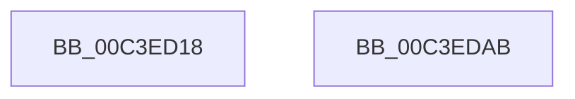

# PopInitShutdownList

- RVA: `0x00C3ED18`–`0x00C3EDAC` (길이 `148` bytes)
- VA: `0x0000000140C3ED18`
- 실행 섹션: `INIT`
- PDB 이름 있음: `예`; PDB Function 태그: `아니요`
- unwind 정보 RVA: `0x000DB714`
- 디코드: `24`개 명령, `148/148` bytes 표시
- 미해석 바이트: `0` (있으면 어셈블리에 `.byte`로 보존)

> 이 문서는 커널 이미지의 기계어와 PDB 기호를 분석해 생성했습니다. 4번과 5번은 함수 원형과 자료형을 바이너리 사용 방식에서 추정한 C 해석이며 원본 소스 복구 결과는 아닙니다.

## 1. Dependencies

- 직접 호출 지점: **0**; 고유 호출 대상: **0**
- 직접 호출자로 확인된 함수: **1**
- RIP 상대 이미지 참조: **20**

### Outgoing calls
- 직접 디코드된 call 명령이 없습니다.

### Direct callers
- [PoInitSystem](../C7/PoInitSystem_function_00C72358.md) at `0x00C7279C`

### Static image references
- `0x00C3ED1A` → RVA `0x00F0E082` (`.data`; write)
- `0x00C3ED21` → RVA `0x00F0E088` (`.data`; read)
- `0x00C3ED28` → RVA `0x00F0E080` (`.data`; write)
- `0x00C3ED2F` → RVA `0x00F0E090` (`.data`; write)
- `0x00C3ED36` → RVA `0x00F0E088` (`.data`; write)
- `0x00C3ED3D` → RVA `0x00F0E0E0` (`.data`; read)
- `0x00C3ED44` → RVA `0x00F0E0E8` (`.data`; write)
- `0x00C3ED4B` → RVA `0x00F0E0E0` (`.data`; write)
- `0x00C3ED52` → RVA `0x00F0E0C0` (`.data`; read)
- `0x00C3ED59` → RVA `0x00F0E0C8` (`.data`; write)
- `0x00C3ED60` → RVA `0x00F0E0C0` (`.data`; write)
- `0x00C3ED69` → RVA `0x00F0E084` (`.data`; write)
- `0x00C3ED6F` → RVA `0x00F0E0D8` (`.data`; write)
- `0x00C3ED76` → RVA `0x00F0E0A0` (`.data`; write)
- `0x00C3ED80` → RVA `0x00F0E0A8` (`.data`; write)
- `0x00C3ED87` → RVA `0x00F0E0B0` (`.data`; write)
- `0x00C3ED8D` → RVA `0x00F0E0B8` (`.data`; write)
- `0x00C3ED96` → RVA `0x00F0E0BA` (`.data`; write)
- `0x00C3ED9D` → RVA `0x00F0E0BC` (`.data`; write)
- `0x00C3EDA3` → RVA `0x00E676D0` (`.data`; write)

## 2. Other-region calls and transfers

- 다른 실행 섹션으로 향하는 call: **0**
- 별도 외부 분기/꼬리 이동을 확인하지 못했습니다.

## 3. Assembly (complete function range)

```asm
00C3ED18  33 C9                           xor ecx, ecx
00C3ED1A  C6 05 61 F3 2C 00 06            mov byte ptr [rip + 0x2cf361], 6
00C3ED21  48 8D 05 60 F3 2C 00            lea rax, [rip + 0x2cf360]
00C3ED28  66 89 0D 51 F3 2C 00            mov word ptr [rip + 0x2cf351], cx
00C3ED2F  48 89 05 5A F3 2C 00            mov qword ptr [rip + 0x2cf35a], rax
00C3ED36  48 89 05 4B F3 2C 00            mov qword ptr [rip + 0x2cf34b], rax
00C3ED3D  48 8D 05 9C F3 2C 00            lea rax, [rip + 0x2cf39c]
00C3ED44  48 89 05 9D F3 2C 00            mov qword ptr [rip + 0x2cf39d], rax
00C3ED4B  48 89 05 8E F3 2C 00            mov qword ptr [rip + 0x2cf38e], rax
00C3ED52  48 8D 05 67 F3 2C 00            lea rax, [rip + 0x2cf367]
00C3ED59  48 89 05 68 F3 2C 00            mov qword ptr [rip + 0x2cf368], rax
00C3ED60  48 89 05 59 F3 2C 00            mov qword ptr [rip + 0x2cf359], rax
00C3ED67  33 C0                           xor eax, eax
00C3ED69  89 0D 15 F3 2C 00               mov dword ptr [rip + 0x2cf315], ecx
00C3ED6F  48 89 0D 62 F3 2C 00            mov qword ptr [rip + 0x2cf362], rcx
00C3ED76  C7 05 20 F3 2C 00 01 00 00 00   mov dword ptr [rip + 0x2cf320], 1
00C3ED80  48 89 0D 21 F3 2C 00            mov qword ptr [rip + 0x2cf321], rcx
00C3ED87  89 0D 23 F3 2C 00               mov dword ptr [rip + 0x2cf323], ecx
00C3ED8D  66 C7 05 22 F3 2C 00 01 00      mov word ptr [rip + 0x2cf322], 1
00C3ED96  C6 05 1D F3 2C 00 06            mov byte ptr [rip + 0x2cf31d], 6
00C3ED9D  89 0D 19 F3 2C 00               mov dword ptr [rip + 0x2cf319], ecx
00C3EDA3  C6 05 26 89 22 00 01            mov byte ptr [rip + 0x228926], 1
00C3EDAA  C3                              ret
00C3EDAB  CC                              int3
```

## 4. C-style interpretation (structured pseudocode)

```c
__int64 __fastcall PopInitShutdownList(int a1)
{
    __int64 result;

    a1 = 0;
    *(unsigned __int8 *)(v_rip + 2945889) = 6;
    *(unsigned __int16 *)(v_rip + 2945873) = 0;
    *(unsigned __int64 *)(v_rip + 2945882) = v_rip + 2945888;
    *(unsigned __int64 *)(v_rip + 2945867) = v_rip + 2945888;
    *(unsigned __int64 *)(v_rip + 2945949) = v_rip + 2945948;
    *(unsigned __int64 *)(v_rip + 2945934) = v_rip + 2945948;
    *(unsigned __int64 *)(v_rip + 2945896) = v_rip + 2945895;
    *(unsigned __int64 *)(v_rip + 2945881) = v_rip + 2945895;
    result = 0;
    *(unsigned int *)(v_rip + 2945813) = 0;
    *(unsigned __int64 *)(v_rip + 2945890) = 0;
    *(unsigned int *)(v_rip + 2945824) = 1;
    *(unsigned __int64 *)(v_rip + 2945825) = 0;
    *(unsigned int *)(v_rip + 2945827) = 0;
    *(unsigned __int16 *)(v_rip + 2945826) = 1;
    *(unsigned __int8 *)(v_rip + 2945821) = 6;
    *(unsigned int *)(v_rip + 2945817) = 0;
    *(unsigned __int8 *)(v_rip + 2263334) = 1;
    return result;
}
```

## 5. (Beta) C Style

```c
int64_t PopInitShutdownList(int32_t Arg1)
{
    int64_t result;

    Arg1 = 0;
    *(uint8_t *)(v_rip + 0x2CF361) = 6;
    *(uint16_t *)(v_rip + 0x2CF351) = 0;
    *(uint64_t *)(v_rip + 0x2CF35A) = v_rip + 2945888;
    *(uint64_t *)(v_rip + 0x2CF34B) = v_rip + 2945888;
    *(uint64_t *)(v_rip + 0x2CF39D) = v_rip + 2945948;
    *(uint64_t *)(v_rip + 0x2CF38E) = v_rip + 2945948;
    *(uint64_t *)(v_rip + 0x2CF368) = v_rip + 2945895;
    *(uint64_t *)(v_rip + 0x2CF359) = v_rip + 2945895;
    result = 0;
    *(uint32_t *)(v_rip + 0x2CF315) = 0;
    *(uint64_t *)(v_rip + 0x2CF362) = 0;
    *(uint32_t *)(v_rip + 0x2CF320) = 1;
    *(uint64_t *)(v_rip + 0x2CF321) = 0;
    *(uint32_t *)(v_rip + 0x2CF323) = 0;
    *(uint16_t *)(v_rip + 0x2CF322) = 1;
    *(uint8_t *)(v_rip + 0x2CF31D) = 6;
    *(uint32_t *)(v_rip + 0x2CF319) = 0;
    *(uint8_t *)(v_rip + 0x228926) = 1;
    return result;
}
```

## 6. Execution-region graph

[열기: 2D/3D 그래프와 함수 탐색 컨트롤 패널](../../../control-panel.html?section=init&rva=0x00C3ED18&view=graph)

- 2D 그래프는 위에서 아래로 흐르고, 3D 그래프는 빈 공간을 드래그해 회전합니다. Shift+드래그는 이동, 휠은 확대·축소, 함수 노드 선택은 대상 보고서 이동입니다.

### Static fallback


