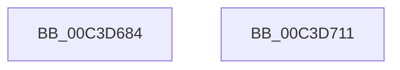

# PopInitVideoWnfState

- RVA: `0x00C3D684`–`0x00C3D712` (길이 `142` bytes)
- VA: `0x0000000140C3D684`
- 실행 섹션: `INIT`
- PDB 이름 있음: `예`; PDB Function 태그: `아니요`
- unwind 정보 RVA: `0x00063458`
- 디코드: `29`개 명령, `142/142` bytes 표시
- 미해석 바이트: `0` (있으면 어셈블리에 `.byte`로 보존)

> 이 문서는 커널 이미지의 기계어와 PDB 기호를 분석해 생성했습니다. 4번과 5번은 함수 원형과 자료형을 바이너리 사용 방식에서 추정한 C 해석이며 원본 소스 복구 결과는 아닙니다.

## 1. Dependencies

- 직접 호출 지점: **3**; 고유 호출 대상: **1**
- 직접 호출자로 확인된 함수: **1**
- RIP 상대 이미지 참조: **5**

### Outgoing calls
- `0x00C3D6AD` → [ZwUpdateWnfStateData](../../text/6B/ZwUpdateWnfStateData_function_006B0D10.md) (function, `0x006B0D10`)
- `0x00C3D6D7` → [ZwUpdateWnfStateData](../../text/6B/ZwUpdateWnfStateData_function_006B0D10.md) (function, `0x006B0D10`)
- `0x00C3D707` → [ZwUpdateWnfStateData](../../text/6B/ZwUpdateWnfStateData_function_006B0D10.md) (function, `0x006B0D10`)

### Direct callers
- [PoInitSystem](../C7/PoInitSystem_function_00C72358.md) at `0x00C72EAE`

### Static image references
- `0x00C3D68D` → RVA `0x00F0EAB9` (`.data`; read)
- `0x00C3D699` → RVA `0x00020968` (`.rdata`; read)
- `0x00C3D6B7` → RVA `0x00F0EAB8` (`.data`; read)
- `0x00C3D6C3` → RVA `0x000208E8` (`.rdata`; read)
- `0x00C3D6EB` → RVA `0x000209E0` (`.rdata`; read)

## 2. Other-region calls and transfers

- 다른 실행 섹션으로 향하는 call: **3**
  - `0x00C3D6AD` → [ZwUpdateWnfStateData](../../text/6B/ZwUpdateWnfStateData_function_006B0D10.md) (`INIT` → `.text`)
  - `0x00C3D6D7` → [ZwUpdateWnfStateData](../../text/6B/ZwUpdateWnfStateData_function_006B0D10.md) (`INIT` → `.text`)
  - `0x00C3D707` → [ZwUpdateWnfStateData](../../text/6B/ZwUpdateWnfStateData_function_006B0D10.md) (`INIT` → `.text`)
- 별도 외부 분기/꼬리 이동을 확인하지 못했습니다.

## 3. Assembly (complete function range)

```asm
00C3D684  48 83 EC 48                     sub rsp, 0x48
00C3D688  83 64 24 30 00                  and dword ptr [rsp + 0x30], 0
00C3D68D  48 8D 15 25 14 2D 00            lea rdx, [rip + 0x2d1425]
00C3D694  83 64 24 28 00                  and dword ptr [rsp + 0x28], 0
00C3D699  48 8D 0D C8 32 3E FF            lea rcx, [rip - 0xc1cd38]
00C3D6A0  48 83 64 24 20 00               and qword ptr [rsp + 0x20], 0
00C3D6A6  45 33 C9                        xor r9d, r9d
00C3D6A9  45 8D 41 01                     lea r8d, [r9 + 1]
00C3D6AD  E8 5E 36 A7 FF                  call 0x1406b0d10
00C3D6B2  83 64 24 30 00                  and dword ptr [rsp + 0x30], 0
00C3D6B7  48 8D 15 FA 13 2D 00            lea rdx, [rip + 0x2d13fa]
00C3D6BE  83 64 24 28 00                  and dword ptr [rsp + 0x28], 0
00C3D6C3  48 8D 0D 1E 32 3E FF            lea rcx, [rip - 0xc1cde2]
00C3D6CA  48 83 64 24 20 00               and qword ptr [rsp + 0x20], 0
00C3D6D0  45 33 C9                        xor r9d, r9d
00C3D6D3  45 8D 41 01                     lea r8d, [r9 + 1]
00C3D6D7  E8 34 36 A7 FF                  call 0x1406b0d10
00C3D6DC  83 64 24 30 00                  and dword ptr [rsp + 0x30], 0
00C3D6E1  48 8D 54 24 50                  lea rdx, [rsp + 0x50]
00C3D6E6  83 64 24 28 00                  and dword ptr [rsp + 0x28], 0
00C3D6EB  48 8D 0D EE 32 3E FF            lea rcx, [rip - 0xc1cd12]
00C3D6F2  48 83 64 24 20 00               and qword ptr [rsp + 0x20], 0
00C3D6F8  45 33 C9                        xor r9d, r9d
00C3D6FB  C7 44 24 50 64 00 00 00         mov dword ptr [rsp + 0x50], 0x64
00C3D703  45 8D 41 04                     lea r8d, [r9 + 4]
00C3D707  E8 04 36 A7 FF                  call 0x1406b0d10
00C3D70C  48 83 C4 48                     add rsp, 0x48
00C3D710  C3                              ret
00C3D711  CC                              int3
```

## 4. C-style interpretation (structured pseudocode)

```c
__int64 __fastcall PopInitVideoWnfState(__int64 a1, __int64 a2, __int64 a3, int a4)
{
    __int64 result;
    __int64 v_rsp;
    unsigned int v_stack_m18;
    unsigned int v_stack_m20;
    unsigned __int64 v_stack_m28;
    unsigned __int64 v_stack_p8;

    v_rsp = (v_rsp) - (72);
    a4 = 0;
    result = ZwUpdateWnfStateData(v_rip - 12700984, v_rip + 2954277, a4 + 1, a4);
    a4 = 0;
    result = ZwUpdateWnfStateData(v_rip - 12701154, v_rip + 2954234, a4 + 1, a4);
    a4 = 0;
    v_stack_p8 = 100;
    result = ZwUpdateWnfStateData(v_rip - 12700946, v_stack_p8, a4 + 4, a4);
    v_rsp = (v_rsp) + (72);
    return result;
}
```

## 5. (Beta) C Style

```c
int64_t PopInitVideoWnfState(int64_t Arg1, int64_t Arg2, int64_t Arg3, int32_t Arg4)
{
    int64_t result;
    int64_t local_rsp;
    uint32_t v_stack_m18;
    uint32_t v_stack_m20;
    uint64_t v_stack_m28;
    uint64_t v_stack_p8;

    local_rsp = (local_rsp) - (72);
    Arg4 = 0;
    result = ZwUpdateWnfStateData(v_rip - 12700984, v_rip + 2954277, Arg4 + 1, Arg4);
    Arg4 = 0;
    result = ZwUpdateWnfStateData(v_rip - 12701154, v_rip + 2954234, Arg4 + 1, Arg4);
    Arg4 = 0;
    v_stack_p8 = 100;
    result = ZwUpdateWnfStateData(v_rip - 12700946, v_stack_p8, Arg4 + 4, Arg4);
    local_rsp = (local_rsp) + (72);
    return result;
}
```

## 6. Execution-region graph

[열기: 2D/3D 그래프와 함수 탐색 컨트롤 패널](../../../control-panel.html?section=init&rva=0x00C3D684&view=graph)

- 2D 그래프는 위에서 아래로 흐르고, 3D 그래프는 빈 공간을 드래그해 회전합니다. Shift+드래그는 이동, 휠은 확대·축소, 함수 노드 선택은 대상 보고서 이동입니다.

### Static fallback


