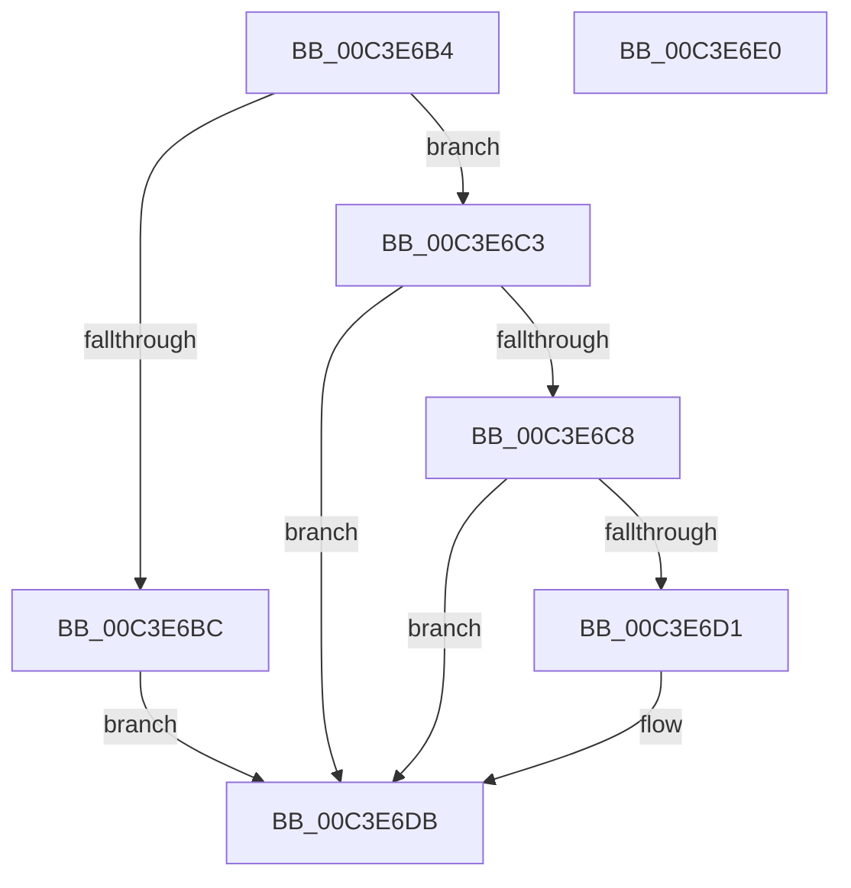

# PopInitializeDirectedDrips

- RVA: `0x00C3E6B4`–`0x00C3E6E1` (길이 `45` bytes)
- VA: `0x0000000140C3E6B4`
- 실행 섹션: `INIT`
- PDB 이름 있음: `예`; PDB Function 태그: `아니요`
- unwind 정보 RVA: `0x0005C788`
- 디코드: `15`개 명령, `45/45` bytes 표시
- 미해석 바이트: `0` (있으면 어셈블리에 `.byte`로 보존)

> 이 문서는 커널 이미지의 기계어와 PDB 기호를 분석해 생성했습니다. 4번과 5번은 함수 원형과 자료형을 바이너리 사용 방식에서 추정한 C 해석이며 원본 소스 복구 결과는 아닙니다.

## 1. Dependencies

- 직접 호출 지점: **3**; 고유 호출 대상: **3**
- 직접 호출자로 확인된 함수: **1**
- RIP 상대 이미지 참조: **0**

### Outgoing calls
- `0x00C3E6BC` → [PopDirectedDripsInitializePhase0](PopDirectedDripsInitializePhase0_function_00C3E4BC.md) (function, `0x00C3E4BC`)
- `0x00C3E6C8` → [PopDirectedDripsInitializePhase3](PopDirectedDripsInitializePhase3_function_00C3E594.md) (function, `0x00C3E594`)
- `0x00C3E6D6` → [PopQueueDirectedDripsWork](../../text/47/PopQueueDirectedDripsWork_function_00478DC4.md) (function, `0x00478DC4`)

### Direct callers
- [PoInitSystem](../C7/PoInitSystem_function_00C72358.md) at `0x00C72C58`
- [PoInitSystem](../C7/PoInitSystem_function_00C72358.md) at `0x00C731B9`

### Static image references
- 디코드된 RIP-relative 메모리 참조가 없습니다.

## 2. Other-region calls and transfers

- 다른 실행 섹션으로 향하는 call: **1**
  - `0x00C3E6D6` → [PopQueueDirectedDripsWork](../../text/47/PopQueueDirectedDripsWork_function_00478DC4.md) (`INIT` → `.text`)
- 별도 외부 분기/꼬리 이동을 확인하지 못했습니다.

## 3. Assembly (complete function range)

```asm
00C3E6B4  48 83 EC 28                     sub rsp, 0x28
00C3E6B8  85 C9                           test ecx, ecx
00C3E6BA  75 07                           jne 0x140c3e6c3
00C3E6BC  E8 FB FD FF FF                  call 0x140c3e4bc
00C3E6C1  EB 18                           jmp 0x140c3e6db
00C3E6C3  83 F9 03                        cmp ecx, 3
00C3E6C6  75 13                           jne 0x140c3e6db
00C3E6C8  E8 C7 FE FF FF                  call 0x140c3e594
00C3E6CD  85 C0                           test eax, eax
00C3E6CF  78 0A                           js 0x140c3e6db
00C3E6D1  BA 02 00 00 00                  mov edx, 2
00C3E6D6  E8 E9 A6 83 FF                  call 0x140478dc4
00C3E6DB  48 83 C4 28                     add rsp, 0x28
00C3E6DF  C3                              ret
00C3E6E0  CC                              int3
```

## 4. C-style interpretation (structured pseudocode)

```c
__int64 __fastcall PopInitializeDirectedDrips(int a1)
{
    __int64 result;
    __int64 v_rsp;

    v_rsp = (v_rsp) - (40);
    if (a1 != 0) goto loc_00C3E6C3;
    result = PopDirectedDripsInitializePhase0(a1, a2, a3, a4);
    goto loc_00C3E6DB;
loc_00C3E6C3:
    if (a1 != 3) goto loc_00C3E6DB;
    result = PopDirectedDripsInitializePhase3(a1, a2, a3, a4);
    if (!(sign_flag)) {
        a2 = 2;
        result = PopQueueDirectedDripsWork(a1, a2, a3, a4);
    }
    v_rsp = (v_rsp) + (40);
    return result;
}
```

## 5. (Beta) C Style

```c
int64_t PopInitializeDirectedDrips(int32_t Arg1)
{
    int64_t result;
    int64_t local_rsp;

    local_rsp = (local_rsp) - (40);
    if (Arg1 != 0) goto loc_00C3E6C3;
    result = PopDirectedDripsInitializePhase0(Arg1, a2, a3, a4);
    goto loc_00C3E6DB;
loc_00C3E6C3:
    if (Arg1 != 3) goto loc_00C3E6DB;
    result = PopDirectedDripsInitializePhase3(Arg1, a2, a3, a4);
    if (!(sign_flag)) {
        a2 = 2;
        result = PopQueueDirectedDripsWork(Arg1, a2, a3, a4);
    }
    local_rsp = (local_rsp) + (40);
    return result;
}
```

## 6. Execution-region graph

[열기: 2D/3D 그래프와 함수 탐색 컨트롤 패널](../../../control-panel.html?section=init&rva=0x00C3E6B4&view=graph)

- 2D 그래프는 위에서 아래로 흐르고, 3D 그래프는 빈 공간을 드래그해 회전합니다. Shift+드래그는 이동, 휠은 확대·축소, 함수 노드 선택은 대상 보고서 이동입니다.

### Static fallback


