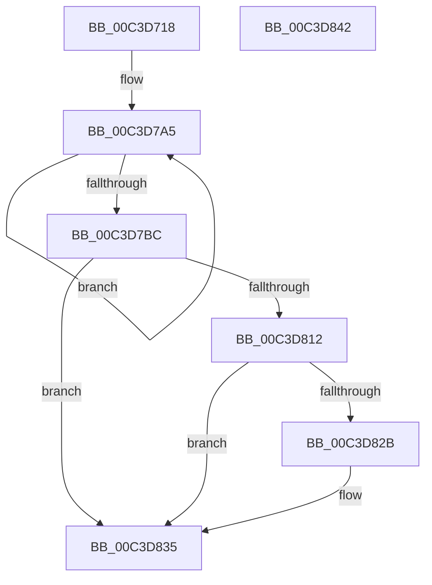

# PopInitializeHighPerfPowerRequest

- RVA: `0x00C3D718`–`0x00C3D843` (길이 `299` bytes)
- VA: `0x0000000140C3D718`
- 실행 섹션: `INIT`
- PDB 이름 있음: `예`; PDB Function 태그: `아니요`
- unwind 정보 RVA: `0x000CBCD8`
- 디코드: `66`개 명령, `299/299` bytes 표시
- 미해석 바이트: `0` (있으면 어셈블리에 `.byte`로 보존)

> 이 문서는 커널 이미지의 기계어와 PDB 기호를 분석해 생성했습니다. 4번과 5번은 함수 원형과 자료형을 바이너리 사용 방식에서 추정한 C 해석이며 원본 소스 복구 결과는 아닙니다.

## 1. Dependencies

- 직접 호출 지점: **4**; 고유 호출 대상: **4**
- 직접 호출자로 확인된 함수: **1**
- RIP 상대 이미지 참조: **17**

### Outgoing calls
- `0x00C3D7E6` → [RtlInitUnicodeString](../../text/42/RtlInitUnicodeString_function_0042A780.md) (function, `0x0042A780`)
- `0x00C3D807` → [PoCaptureReasonContext](../../text/23/PoCaptureReasonContext_function_00230A38.md) (function, `0x00230A38`)
- `0x00C3D820` → [PopPowerRequestCreateCommon](../../text/23/PopPowerRequestCreateCommon_function_00230150.md) (function, `0x00230150`)
- `0x00C3D830` → [PoDestroyReasonContext](../../text/23/PoDestroyReasonContext_function_00230944.md) (function, `0x00230944`)

### Direct callers
- [PoInitSystem](../C7/PoInitSystem_function_00C72358.md) at `0x00C72D3E`

### Static image references
- `0x00C3D724` → RVA `0x00F0CF60` (`.data`; write)
- `0x00C3D72E` → RVA `0x005D90F0` (`PpmHighPerfRequestExpiration`; read)
- `0x00C3D735` → RVA `0x00F0CF20` (`.data`; write)
- `0x00C3D73C` → RVA `0x00F0CF78` (`.data`; write)
- `0x00C3D743` → RVA `0x00FC53A0` (`ALMOSTRO`; read)
- `0x00C3D74A` → RVA `0x00F0CF28` (`.data`; read)
- `0x00C3D756` → RVA `0x00F0CF30` (`.data`; write)
- `0x00C3D761` → RVA `0x00F0CF28` (`.data`; write)
- `0x00C3D76E` → RVA `0x00F0CFA0` (`.data`; write)
- `0x00C3D775` → RVA `0x00F0CF80` (`.data`; write)
- `0x00C3D77C` → RVA `0x00F0CF98` (`.data`; write)
- `0x00C3D783` → RVA `0x00F0CF70` (`.data`; write)
- `0x00C3D791` → RVA `0x00F0CF38` (`.data`; write)
- `0x00C3D798` → RVA `0x00F0CF5C` (`.data`; write)
- `0x00C3D79E` → RVA `0x00F0CF58` (`.data`; write)
- `0x00C3D7CE` → RVA `0x00C7BFB0` (` ?? ::PBOPGDP::`string'`; read)
- `0x00C3D817` → RVA `0x00F0CFB8` (`.data`; read)

## 2. Other-region calls and transfers

- 다른 실행 섹션으로 향하는 call: **4**
  - `0x00C3D7E6` → [RtlInitUnicodeString](../../text/42/RtlInitUnicodeString_function_0042A780.md) (`INIT` → `.text`)
  - `0x00C3D807` → [PoCaptureReasonContext](../../text/23/PoCaptureReasonContext_function_00230A38.md) (`INIT` → `.text`)
  - `0x00C3D820` → [PopPowerRequestCreateCommon](../../text/23/PopPowerRequestCreateCommon_function_00230150.md) (`INIT` → `.text`)
  - `0x00C3D830` → [PoDestroyReasonContext](../../text/23/PoDestroyReasonContext_function_00230944.md) (`INIT` → `.text`)
- 별도 외부 분기/꼬리 이동을 확인하지 못했습니다.

## 3. Assembly (complete function range)

```asm
00C3D718  48 89 5C 24 10                  mov qword ptr [rsp + 0x10], rbx
00C3D71D  57                              push rdi
00C3D71E  48 83 EC 60                     sub rsp, 0x60
00C3D722  33 FF                           xor edi, edi
00C3D724  C7 05 32 F8 2C 00 13 01 00 00   mov dword ptr [rip + 0x2cf832], 0x113
00C3D72E  48 8D 05 BB B9 99 FF            lea rax, [rip - 0x664645]
00C3D735  48 89 3D E4 F7 2C 00            mov qword ptr [rip + 0x2cf7e4], rdi
00C3D73C  48 89 05 35 F8 2C 00            mov qword ptr [rip + 0x2cf835], rax
00C3D743  48 8D 15 56 7C 38 00            lea rdx, [rip + 0x387c56]
00C3D74A  48 8D 05 D7 F7 2C 00            lea rax, [rip + 0x2cf7d7]
00C3D751  48 89 7C 24 70                  mov qword ptr [rsp + 0x70], rdi
00C3D756  48 89 05 D3 F7 2C 00            mov qword ptr [rip + 0x2cf7d3], rax
00C3D75D  44 8D 47 04                     lea r8d, [rdi + 4]
00C3D761  48 89 05 C0 F7 2C 00            mov qword ptr [rip + 0x2cf7c0], rax
00C3D768  41 B9 E0 93 04 00               mov r9d, 0x493e0
00C3D76E  48 89 3D 2B F8 2C 00            mov qword ptr [rip + 0x2cf82b], rdi
00C3D775  48 89 3D 04 F8 2C 00            mov qword ptr [rip + 0x2cf804], rdi
00C3D77C  48 89 3D 15 F8 2C 00            mov qword ptr [rip + 0x2cf815], rdi
00C3D783  48 89 3D E6 F7 2C 00            mov qword ptr [rip + 0x2cf7e6], rdi
00C3D78A  C6 05 8F F7 2C 00 08            mov byte ptr [rip + 0x2cf78f], 8
00C3D791  48 89 3D A0 F7 2C 00            mov qword ptr [rip + 0x2cf7a0], rdi
00C3D798  89 3D BE F7 2C 00               mov dword ptr [rip + 0x2cf7be], edi
00C3D79E  66 89 3D B3 F7 2C 00            mov word ptr [rip + 0x2cf7b3], di
00C3D7A5  8B 02                           mov eax, dword ptr [rdx]
00C3D7A7  41 8B C9                        mov ecx, r9d
00C3D7AA  41 3B C1                        cmp eax, r9d
00C3D7AD  0F 42 C8                        cmovb ecx, eax
00C3D7B0  89 0A                           mov dword ptr [rdx], ecx
00C3D7B2  48 8D 52 04                     lea rdx, [rdx + 4]
00C3D7B6  49 83 E8 01                     sub r8, 1
00C3D7BA  75 E9                           jne 0x140c3d7a5
00C3D7BC  0F 57 C0                        xorps xmm0, xmm0
00C3D7BF  89 7C 24 30                     mov dword ptr [rsp + 0x30], edi
00C3D7C3  0F 57 C9                        xorps xmm1, xmm1
00C3D7C6  C7 44 24 34 01 00 00 00         mov dword ptr [rsp + 0x34], 1
00C3D7CE  48 8D 15 DB E7 03 00            lea rdx, [rip + 0x3e7db]
00C3D7D5  48 8D 4C 24 38                  lea rcx, [rsp + 0x38]
00C3D7DA  F3 0F 7F 44 24 38               movdqu xmmword ptr [rsp + 0x38], xmm0
00C3D7E0  F3 0F 7F 4C 24 48               movdqu xmmword ptr [rsp + 0x48], xmm1
00C3D7E6  E8 95 CF 7E FF                  call 0x14042a780
00C3D7EB  48 8D 44 24 70                  lea rax, [rsp + 0x70]
00C3D7F0  41 B1 01                        mov r9b, 1
00C3D7F3  48 89 44 24 28                  mov qword ptr [rsp + 0x28], rax
00C3D7F8  48 8D 4C 24 30                  lea rcx, [rsp + 0x30]
00C3D7FD  45 33 C0                        xor r8d, r8d
00C3D800  48 89 7C 24 20                  mov qword ptr [rsp + 0x20], rdi
00C3D805  33 D2                           xor edx, edx
00C3D807  E8 2C 32 5F FF                  call 0x140230a38
00C3D80C  8B D8                           mov ebx, eax
00C3D80E  85 C0                           test eax, eax
00C3D810  78 23                           js 0x140c3d835
00C3D812  48 8B 4C 24 70                  mov rcx, qword ptr [rsp + 0x70]
00C3D817  4C 8D 05 9A F7 2C 00            lea r8, [rip + 0x2cf79a]
00C3D81E  33 D2                           xor edx, edx
00C3D820  E8 2B 29 5F FF                  call 0x140230150
00C3D825  8B D8                           mov ebx, eax
00C3D827  85 C0                           test eax, eax
00C3D829  79 0A                           jns 0x140c3d835
00C3D82B  48 8B 4C 24 70                  mov rcx, qword ptr [rsp + 0x70]
00C3D830  E8 0F 31 5F FF                  call 0x140230944
00C3D835  8B C3                           mov eax, ebx
00C3D837  48 8B 5C 24 78                  mov rbx, qword ptr [rsp + 0x78]
00C3D83C  48 83 C4 60                     add rsp, 0x60
00C3D840  5F                              pop rdi
00C3D841  C3                              ret
00C3D842  CC                              int3
```

## 4. C-style interpretation (structured pseudocode)

```c
__int64 __fastcall PopInitializeHighPerfPowerRequest(void)
{
    __int64 result;
    __int64 v_rdi;
    __int64 v_rsp;
    unsigned __int64 v_stack_m20;
    unsigned __int64 v_stack_m30;
    unsigned int v_stack_m34;
    unsigned int v_stack_m38;
    unsigned __int64 v_stack_m40;
    unsigned __int64 v_stack_m48;
    unsigned __int64 v_stack_p10;
    unsigned __int64 v_stack_p8;

    v_stack_p10 = v_rbx;
    v_rsp = (v_rsp) - (96);
    v_rdi = 0;
    *(unsigned int *)(v_rip + 2947122) = 275;
    *(unsigned __int64 *)(v_rip + 2947044) = 0;
    *(unsigned __int64 *)(v_rip + 2947125) = v_rip - 6702661;
    v_stack_p8 = 0;
    *(unsigned __int64 *)(v_rip + 2947027) = v_rip + 2947031;
    *(unsigned __int64 *)(v_rip + 2947008) = v_rip + 2947031;
    *(unsigned __int64 *)(v_rip + 2947115) = 0;
    *(unsigned __int64 *)(v_rip + 2947076) = 0;
    *(unsigned __int64 *)(v_rip + 2947093) = 0;
    *(unsigned __int64 *)(v_rip + 2947046) = 0;
    *(unsigned __int8 *)(v_rip + 2946959) = 8;
    *(unsigned __int64 *)(v_rip + 2946976) = 0;
    *(unsigned int *)(v_rip + 2947006) = 0;
    *(unsigned __int16 *)(v_rip + 2946995) = 0;
loc_00C3D7A5:
    a1 = (unsigned int)((unsigned int)((unsigned int)(0x493E0ULL)));
    if (((unsigned int)((unsigned int)(*(unsigned int *)(v_rip + 3701846)))) < ((unsigned int)((unsigned int)(0x493E0ULL)))) { a1 = (unsigned int)((unsigned int)(*(unsigned int *)(v_rip + 3701846))); }
    *(unsigned int *)(v_rip + 3701846) = (unsigned int)(a1);
    a3 = (v_rdi + 4) - (1);
    if (condition_is_not_equal) goto loc_00C3D7A5;
    v_stack_m38 = 0;
    v_stack_m34 = 1;
    v_stack_m30 = v_xmm0;
    v_stack_m20 = v_xmm1;
    result = RtlInitUnicodeString(v_stack_m30, v_rip + 255963, a3, (unsigned int)(0x493E0ULL));
    v_stack_m40 = v_stack_p8;
    a3 = 0;
    v_stack_m48 = 0;
    a2 = 0;
    result = PoCaptureReasonContext(v_stack_m38, a2, a3, 1);
    if (sign_flag) goto loc_00C3D835;
    a2 = 0;
    result = PopPowerRequestCreateCommon(v_stack_p8, a2, v_rip + 2946970, 1);
    if (sign_flag) {
        a1 = v_stack_p8;
        result = PoDestroyReasonContext(a1, a2, v_rip + 2946970, 1);
    }
    v_rsp = (v_rsp) + (96);
    return (unsigned int)((unsigned int)((unsigned int)((unsigned int)(result))));
}
```

## 5. (Beta) C Style

```c
void PopInitializeHighPerfPowerRequest(void)
{
    int64_t result;
    int64_t local_rdi;
    int64_t local_rsp;
    uint64_t v_stack_m20;
    uint64_t v_stack_m30;
    uint32_t v_stack_m34;
    uint32_t v_stack_m38;
    uint64_t v_stack_m40;
    uint64_t v_stack_m48;
    uint64_t v_stack_p10;
    uint64_t v_stack_p8;

    v_stack_p10 = local_rbx;
    local_rsp = (local_rsp) - (96);
    local_rdi = 0;
    *(uint32_t *)(v_rip + 0x2CF832) = 275;
    *(uint64_t *)(v_rip + 0x2CF7E4) = 0;
    *(uint64_t *)(v_rip + 0x2CF835) = v_rip - 6702661;
    v_stack_p8 = 0;
    *(uint64_t *)(v_rip + 0x2CF7D3) = v_rip + 2947031;
    *(uint64_t *)(v_rip + 0x2CF7C0) = v_rip + 2947031;
    *(uint64_t *)(v_rip + 0x2CF82B) = 0;
    *(uint64_t *)(v_rip + 0x2CF804) = 0;
    *(uint64_t *)(v_rip + 0x2CF815) = 0;
    *(uint64_t *)(v_rip + 0x2CF7E6) = 0;
    *(uint8_t *)(v_rip + 0x2CF78F) = 8;
    *(uint64_t *)(v_rip + 0x2CF7A0) = 0;
    *(uint32_t *)(v_rip + 0x2CF7BE) = 0;
    *(uint16_t *)(v_rip + 0x2CF7B3) = 0;
loc_00C3D7A5:
    a1 = (uint32_t)((uint32_t)((uint32_t)(0x493E0ULL)));
    if (((uint32_t)((uint32_t)(*(uint32_t *)(v_rip + 0x387C56)))) < ((uint32_t)((uint32_t)(0x493E0ULL)))) { a1 = (uint32_t)((uint32_t)(*(uint32_t *)(v_rip + 0x387C56))); }
    *(uint32_t *)(v_rip + 0x387C56) = (uint32_t)(a1);
    a3 = (local_rdi + 4) - (1);
    if (condition_is_not_equal) goto loc_00C3D7A5;
    v_stack_m38 = 0;
    v_stack_m34 = 1;
    v_stack_m30 = v_xmm0;
    v_stack_m20 = v_xmm1;
    result = RtlInitUnicodeString(v_stack_m30, v_rip + 255963, a3, (uint32_t)(0x493E0ULL));
    v_stack_m40 = v_stack_p8;
    a3 = 0;
    v_stack_m48 = 0;
    a2 = 0;
    result = PoCaptureReasonContext(v_stack_m38, a2, a3, 1);
    if (sign_flag) goto loc_00C3D835;
    a2 = 0;
    result = PopPowerRequestCreateCommon(v_stack_p8, a2, v_rip + 2946970, 1);
    if (sign_flag) {
        a1 = v_stack_p8;
        result = PoDestroyReasonContext(a1, a2, v_rip + 2946970, 1);
    }
    local_rsp = (local_rsp) + (96);
    return (uint32_t)((uint32_t)((uint32_t)((uint32_t)(result))));
}
```

## 6. Execution-region graph

[열기: 2D/3D 그래프와 함수 탐색 컨트롤 패널](../../../control-panel.html?section=init&rva=0x00C3D718&view=graph)

- 2D 그래프는 위에서 아래로 흐르고, 3D 그래프는 빈 공간을 드래그해 회전합니다. Shift+드래그는 이동, 휠은 확대·축소, 함수 노드 선택은 대상 보고서 이동입니다.

### Static fallback


