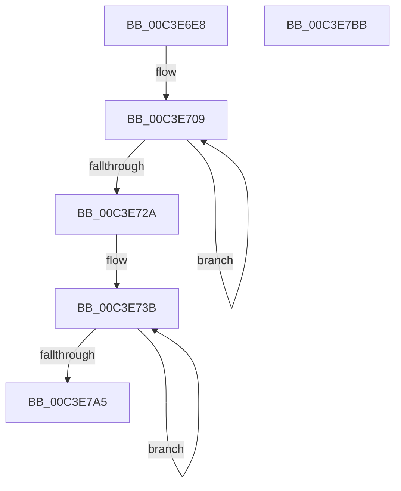

# PopInitializePowerSettingCallbacks

- RVA: `0x00C3E6E8`–`0x00C3E7BC` (길이 `212` bytes)
- VA: `0x0000000140C3E6E8`
- 실행 섹션: `INIT`
- PDB 이름 있음: `예`; PDB Function 태그: `아니요`
- unwind 정보 RVA: `0x000CC0C8`
- 디코드: `49`개 명령, `212/212` bytes 표시
- 미해석 바이트: `0` (있으면 어셈블리에 `.byte`로 보존)

> 이 문서는 커널 이미지의 기계어와 PDB 기호를 분석해 생성했습니다. 4번과 5번은 함수 원형과 자료형을 바이너리 사용 방식에서 추정한 C 해석이며 원본 소스 복구 결과는 아닙니다.

## 1. Dependencies

- 직접 호출 지점: **5**; 고유 호출 대상: **2**
- 직접 호출자로 확인된 함수: **1**
- RIP 상대 이미지 참조: **3**

### Outgoing calls
- `0x00C3E71B` → [PoRegisterPowerSettingCallback](../../page/A8/PoRegisterPowerSettingCallback_function_00A82150.md) (function, `0x00A82150`)
- `0x00C3E72A` → [PpmInfoRegisterCallbacks](../C4/PpmInfoRegisterCallbacks_function_00C40664.md) (function, `0x00C40664`)
- `0x00C3E755` → [PoRegisterPowerSettingCallback](../../page/A8/PoRegisterPowerSettingCallback_function_00A82150.md) (function, `0x00A82150`)
- `0x00C3E774` → [PoRegisterPowerSettingCallback](../../page/A8/PoRegisterPowerSettingCallback_function_00A82150.md) (function, `0x00A82150`)
- `0x00C3E793` → [PoRegisterPowerSettingCallback](../../page/A8/PoRegisterPowerSettingCallback_function_00A82150.md) (function, `0x00A82150`)

### Direct callers
- [PoInitSystem](../C7/PoInitSystem_function_00C72358.md) at `0x00C72D0F`

### Static image references
- `0x00C3E6FD` → RVA `0x00C82B80` (`PopInitialSettingCallbacks`; read)
- `0x00C3E734` → RVA `0x00000000` (`image boundary/outside`; read)
- `0x00C3E743` → RVA `0x007580A0` (`PopBatteryAlarmPowerSettingCallback`; read)

## 2. Other-region calls and transfers

- 다른 실행 섹션으로 향하는 call: **4**
  - `0x00C3E71B` → [PoRegisterPowerSettingCallback](../../page/A8/PoRegisterPowerSettingCallback_function_00A82150.md) (`INIT` → `PAGE`)
  - `0x00C3E755` → [PoRegisterPowerSettingCallback](../../page/A8/PoRegisterPowerSettingCallback_function_00A82150.md) (`INIT` → `PAGE`)
  - `0x00C3E774` → [PoRegisterPowerSettingCallback](../../page/A8/PoRegisterPowerSettingCallback_function_00A82150.md) (`INIT` → `PAGE`)
  - `0x00C3E793` → [PoRegisterPowerSettingCallback](../../page/A8/PoRegisterPowerSettingCallback_function_00A82150.md) (`INIT` → `PAGE`)
- 별도 외부 분기/꼬리 이동을 확인하지 못했습니다.

## 3. Assembly (complete function range)

```asm
00C3E6E8  48 89 5C 24 08                  mov qword ptr [rsp + 8], rbx
00C3E6ED  48 89 74 24 10                  mov qword ptr [rsp + 0x10], rsi
00C3E6F2  48 89 7C 24 18                  mov qword ptr [rsp + 0x18], rdi
00C3E6F7  41 57                           push r15
00C3E6F9  48 83 EC 30                     sub rsp, 0x30
00C3E6FD  48 8D 1D 7C 44 04 00            lea rbx, [rip + 0x4447c]
00C3E704  BF 3F 00 00 00                  mov edi, 0x3f
00C3E709  4C 8B 43 08                     mov r8, qword ptr [rbx + 8]
00C3E70D  45 33 C9                        xor r9d, r9d
00C3E710  48 8B 13                        mov rdx, qword ptr [rbx]
00C3E713  33 C9                           xor ecx, ecx
00C3E715  48 83 64 24 20 00               and qword ptr [rsp + 0x20], 0
00C3E71B  E8 30 3A E4 FF                  call 0x140a82150
00C3E720  48 8D 5B 10                     lea rbx, [rbx + 0x10]
00C3E724  48 83 EF 01                     sub rdi, 1
00C3E728  75 DF                           jne 0x140c3e709
00C3E72A  E8 35 1F 00 00                  call 0x140c40664
00C3E72F  33 DB                           xor ebx, ebx
00C3E731  8D 77 04                        lea esi, [rdi + 4]
00C3E734  4C 8D 3D C5 18 3C FF            lea r15, [rip - 0xc3e73b]
00C3E73B  4A 8B 94 3F B0 B3 00 00         mov rdx, qword ptr [rdi + r15 + 0xb3b0]
00C3E743  4C 8D 05 56 99 B1 FF            lea r8, [rip - 0x4e66aa]
00C3E74A  48 83 64 24 20 00               and qword ptr [rsp + 0x20], 0
00C3E750  4C 8B CB                        mov r9, rbx
00C3E753  33 C9                           xor ecx, ecx
00C3E755  E8 F6 39 E4 FF                  call 0x140a82150
00C3E75A  4A 8B 94 3F D0 B3 00 00         mov rdx, qword ptr [rdi + r15 + 0xb3d0]
00C3E762  4C 8D 05 37 99 B1 FF            lea r8, [rip - 0x4e66c9]
00C3E769  48 83 64 24 20 00               and qword ptr [rsp + 0x20], 0
00C3E76F  4C 8B CB                        mov r9, rbx
00C3E772  33 C9                           xor ecx, ecx
00C3E774  E8 D7 39 E4 FF                  call 0x140a82150
00C3E779  4A 8B 94 3F F0 B3 00 00         mov rdx, qword ptr [rdi + r15 + 0xb3f0]
00C3E781  4C 8D 05 18 99 B1 FF            lea r8, [rip - 0x4e66e8]
00C3E788  48 83 64 24 20 00               and qword ptr [rsp + 0x20], 0
00C3E78E  4C 8B CB                        mov r9, rbx
00C3E791  33 C9                           xor ecx, ecx
00C3E793  E8 B8 39 E4 FF                  call 0x140a82150
00C3E798  48 FF C3                        inc rbx
00C3E79B  48 8D 7F 08                     lea rdi, [rdi + 8]
00C3E79F  48 83 EE 01                     sub rsi, 1
00C3E7A3  75 96                           jne 0x140c3e73b
00C3E7A5  48 8B 5C 24 40                  mov rbx, qword ptr [rsp + 0x40]
00C3E7AA  48 8B 74 24 48                  mov rsi, qword ptr [rsp + 0x48]
00C3E7AF  48 8B 7C 24 50                  mov rdi, qword ptr [rsp + 0x50]
00C3E7B4  48 83 C4 30                     add rsp, 0x30
00C3E7B8  41 5F                           pop r15
00C3E7BA  C3                              ret
00C3E7BB  CC                              int3
```

## 4. C-style interpretation (structured pseudocode)

```c
__int64 __fastcall PopInitializePowerSettingCallbacks(int a1, __int64 a2, __int64 a3, int a4)
{
    __int64 result;
    __int64 v_rbx;
    __int64 v_rdi;
    __int64 v_rsi;
    __int64 v_rsp;
    unsigned __int64 v_stack_m18;
    unsigned __int64 v_stack_p10;
    unsigned __int64 v_stack_p18;
    unsigned __int64 v_stack_p8;

    v_stack_p8 = v_rbx;
    v_stack_p10 = v_rsi;
    v_stack_p18 = v_rdi;
    v_rsp = (v_rsp) - (48);
loc_00C3E709:
    a4 = 0;
    a1 = 0;
    result = PoRegisterPowerSettingCallback(a1, *(unsigned __int64 *)(v_rip + 279676), *(unsigned __int64 *)(v_rip + 279676 + 8), a4);
    v_rdi = (63) - (1);
    if (condition_is_not_equal) goto loc_00C3E709;
    result = PpmInfoRegisterCallbacks(a1, *(unsigned __int64 *)(v_rip + 279676), *(unsigned __int64 *)(v_rip + 279676 + 8), a4);
    v_rbx = 0;
loc_00C3E73B:
    a1 = 0;
    result = PoRegisterPowerSettingCallback(a1, *(unsigned __int64 *)(v_rdi + v_rip - 12838715 * 1 + 46000), v_rip - 5138090, 0);
    a1 = 0;
    result = PoRegisterPowerSettingCallback(a1, *(unsigned __int64 *)(v_rdi + v_rip - 12838715 * 1 + 46032), v_rip - 5138121, 0);
    a1 = 0;
    result = PoRegisterPowerSettingCallback(a1, *(unsigned __int64 *)(v_rdi + v_rip - 12838715 * 1 + 46064), v_rip - 5138152, 0);
    v_rbx = (v_rbx) + 1;
    v_rsi = (v_rdi + 4) - (1);
    if (condition_is_not_equal) goto loc_00C3E73B;
    v_rsp = (v_rsp) + (48);
    return result;
}
```

## 5. (Beta) C Style

```c
int64_t PopInitializePowerSettingCallbacks(int32_t Arg1, int64_t Arg2, int64_t Arg3, int32_t Arg4)
{
    int64_t result;
    int64_t local_rbx;
    int64_t local_rdi;
    int64_t local_rsi;
    int64_t local_rsp;
    uint64_t v_stack_m18;
    uint64_t v_stack_p10;
    uint64_t v_stack_p18;
    uint64_t v_stack_p8;

    v_stack_p8 = local_rbx;
    v_stack_p10 = local_rsi;
    v_stack_p18 = local_rdi;
    local_rsp = (local_rsp) - (48);
loc_00C3E709:
    Arg4 = 0;
    Arg1 = 0;
    result = PoRegisterPowerSettingCallback(Arg1, *(uint64_t *)(v_rip + 0x4447C), *(uint64_t *)(v_rip + 0x4447C + 0x8), Arg4);
    local_rdi = (63) - (1);
    if (condition_is_not_equal) goto loc_00C3E709;
    result = PpmInfoRegisterCallbacks(Arg1, *(uint64_t *)(v_rip + 0x4447C), *(uint64_t *)(v_rip + 0x4447C + 0x8), Arg4);
    local_rbx = 0;
loc_00C3E73B:
    Arg1 = 0;
    result = PoRegisterPowerSettingCallback(Arg1, *(uint64_t *)(local_rdi + v_rip - 0xC3E73B * 1 + 0xB3B0), v_rip - 5138090, 0);
    Arg1 = 0;
    result = PoRegisterPowerSettingCallback(Arg1, *(uint64_t *)(local_rdi + v_rip - 0xC3E73B * 1 + 0xB3D0), v_rip - 5138121, 0);
    Arg1 = 0;
    result = PoRegisterPowerSettingCallback(Arg1, *(uint64_t *)(local_rdi + v_rip - 0xC3E73B * 1 + 0xB3F0), v_rip - 5138152, 0);
    local_rbx = (local_rbx) + 1;
    local_rsi = (local_rdi + 4) - (1);
    if (condition_is_not_equal) goto loc_00C3E73B;
    local_rsp = (local_rsp) + (48);
    return result;
}
```

## 6. Execution-region graph

[열기: 2D/3D 그래프와 함수 탐색 컨트롤 패널](../../../control-panel.html?section=init&rva=0x00C3E6E8&view=graph)

- 2D 그래프는 위에서 아래로 흐르고, 3D 그래프는 빈 공간을 드래그해 회전합니다. Shift+드래그는 이동, 휠은 확대·축소, 함수 노드 선택은 대상 보고서 이동입니다.

### Static fallback


