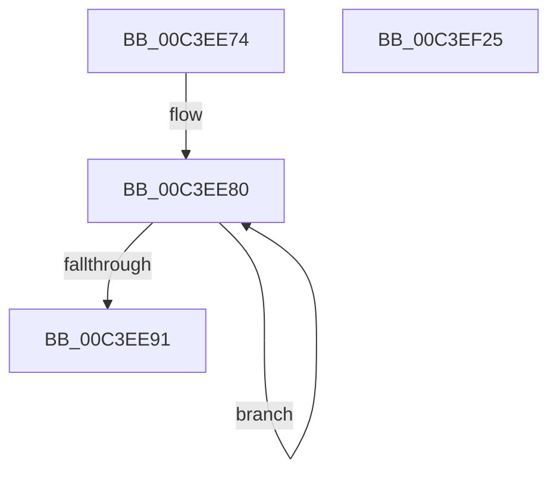

# PopInitializePowerSettings

- RVA: `0x00C3EE74`–`0x00C3EF26` (길이 `178` bytes)
- VA: `0x0000000140C3EE74`
- 실행 섹션: `INIT`
- PDB 이름 있음: `예`; PDB Function 태그: `아니요`
- unwind 정보 RVA: `0x000DB714`
- 디코드: `30`개 명령, `178/178` bytes 표시
- 미해석 바이트: `0` (있으면 어셈블리에 `.byte`로 보존)

> 이 문서는 커널 이미지의 기계어와 PDB 기호를 분석해 생성했습니다. 4번과 5번은 함수 원형과 자료형을 바이너리 사용 방식에서 추정한 C 해석이며 원본 소스 복구 결과는 아닙니다.

## 1. Dependencies

- 직접 호출 지점: **0**; 고유 호출 대상: **0**
- 직접 호출자로 확인된 함수: **1**
- RIP 상대 이미지 참조: **21**

### Outgoing calls
- 직접 디코드된 call 명령이 없습니다.

### Direct callers
- [PoInitSystem](../C7/PoInitSystem_function_00C72358.md) at `0x00C729E6`

### Static image references
- `0x00C3EE74` → RVA `0x00F0C6C0` (`.data`; read)
- `0x00C3EE91` → RVA `0x00F0DF60` (`.data`; read)
- `0x00C3EE98` → RVA `0x00F0C6B0` (`.data`; write)
- `0x00C3EE9F` → RVA `0x00F0DF68` (`.data`; write)
- `0x00C3EEA9` → RVA `0x00F0DF60` (`.data`; write)
- `0x00C3EEB0` → RVA `0x00F0C6E0` (`.data`; read)
- `0x00C3EEB7` → RVA `0x00F0C6E8` (`.data`; write)
- `0x00C3EEBE` → RVA `0x00F0C6E0` (`.data`; write)
- `0x00C3EEC5` → RVA `0x00F0C6A0` (`.data`; read)
- `0x00C3EECC` → RVA `0x00F0C6A8` (`.data`; write)
- `0x00C3EED3` → RVA `0x00F0C6A0` (`.data`; write)
- `0x00C3EEDA` → RVA `0x00020AE8` (`.rdata`; read)
- `0x00C3EEE1` → RVA `0x00F0DF80` (`.data`; write)
- `0x00C3EEE8` → RVA `0x00F0DF40` (`.data`; write)
- `0x00C3EEF2` → RVA `0x00F0DF48` (`.data`; write)
- `0x00C3EEF9` → RVA `0x00F0DF50` (`.data`; write)
- `0x00C3EEFF` → RVA `0x00F0DF58` (`.data`; write)
- `0x00C3EF08` → RVA `0x00F0DF5A` (`.data`; write)
- `0x00C3EF0F` → RVA `0x00F0DF5C` (`.data`; write)
- `0x00C3EF15` → RVA `0x00F0DF88` (`.data`; write)
- `0x00C3EF1D` → RVA `0x00F0DF98` (`.data`; write)

## 2. Other-region calls and transfers

- 다른 실행 섹션으로 향하는 call: **0**
- 별도 외부 분기/꼬리 이동을 확인하지 못했습니다.

## 3. Assembly (complete function range)

```asm
00C3EE74  48 8D 05 45 D8 2C 00            lea rax, [rip + 0x2cd845]
00C3EE7B  B9 02 00 00 00                  mov ecx, 2
00C3EE80  48 89 40 08                     mov qword ptr [rax + 8], rax
00C3EE84  48 89 00                        mov qword ptr [rax], rax
00C3EE87  48 83 C0 10                     add rax, 0x10
00C3EE8B  48 83 E9 01                     sub rcx, 1
00C3EE8F  75 EF                           jne 0x140c3ee80
00C3EE91  48 8D 05 C8 F0 2C 00            lea rax, [rip + 0x2cf0c8]
00C3EE98  48 89 0D 11 D8 2C 00            mov qword ptr [rip + 0x2cd811], rcx
00C3EE9F  48 89 05 C2 F0 2C 00            mov qword ptr [rip + 0x2cf0c2], rax
00C3EEA6  0F 57 C0                        xorps xmm0, xmm0
00C3EEA9  48 89 05 B0 F0 2C 00            mov qword ptr [rip + 0x2cf0b0], rax
00C3EEB0  48 8D 05 29 D8 2C 00            lea rax, [rip + 0x2cd829]
00C3EEB7  48 89 05 2A D8 2C 00            mov qword ptr [rip + 0x2cd82a], rax
00C3EEBE  48 89 05 1B D8 2C 00            mov qword ptr [rip + 0x2cd81b], rax
00C3EEC5  48 8D 05 D4 D7 2C 00            lea rax, [rip + 0x2cd7d4]
00C3EECC  48 89 05 D5 D7 2C 00            mov qword ptr [rip + 0x2cd7d5], rax
00C3EED3  48 89 05 C6 D7 2C 00            mov qword ptr [rip + 0x2cd7c6], rax
00C3EEDA  48 8D 05 07 1C 3E FF            lea rax, [rip - 0xc1e3f9]
00C3EEE1  48 89 05 98 F0 2C 00            mov qword ptr [rip + 0x2cf098], rax
00C3EEE8  C7 05 4E F0 2C 00 01 00 00 00   mov dword ptr [rip + 0x2cf04e], 1
00C3EEF2  48 89 0D 4F F0 2C 00            mov qword ptr [rip + 0x2cf04f], rcx
00C3EEF9  89 0D 51 F0 2C 00               mov dword ptr [rip + 0x2cf051], ecx
00C3EEFF  66 C7 05 50 F0 2C 00 01 00      mov word ptr [rip + 0x2cf050], 1
00C3EF08  C6 05 4B F0 2C 00 06            mov byte ptr [rip + 0x2cf04b], 6
00C3EF0F  89 0D 47 F0 2C 00               mov dword ptr [rip + 0x2cf047], ecx
00C3EF15  F3 0F 7F 05 6B F0 2C 00         movdqu xmmword ptr [rip + 0x2cf06b], xmm0
00C3EF1D  48 89 0D 74 F0 2C 00            mov qword ptr [rip + 0x2cf074], rcx
00C3EF24  C3                              ret
00C3EF25  CC                              int3
```

## 4. C-style interpretation (structured pseudocode)

```c
__int64 __fastcall PopInitializePowerSettings(void)
{
    __int64 result;

loc_00C3EE80:
    *(unsigned __int64 *)(v_rip + 2938949 + 8) = v_rip + 2938949;
    *(unsigned __int64 *)(v_rip + 2938949) = v_rip + 2938949;
    result = (v_rip + 2938949) + (16);
    a1 = (2) - (1);
    if (condition_is_not_equal) goto loc_00C3EE80;
    *(unsigned __int64 *)(v_rip + 2938897) = a1;
    *(unsigned __int64 *)(v_rip + 2945218) = v_rip + 2945224;
    *(unsigned __int64 *)(v_rip + 2945200) = v_rip + 2945224;
    *(unsigned __int64 *)(v_rip + 2938922) = v_rip + 2938921;
    *(unsigned __int64 *)(v_rip + 2938907) = v_rip + 2938921;
    *(unsigned __int64 *)(v_rip + 2938837) = v_rip + 2938836;
    *(unsigned __int64 *)(v_rip + 2938822) = v_rip + 2938836;
    *(unsigned __int64 *)(v_rip + 2945176) = v_rip - 12706809;
    *(unsigned int *)(v_rip + 2945102) = 1;
    *(unsigned __int64 *)(v_rip + 2945103) = a1;
    *(unsigned int *)(v_rip + 2945105) = (unsigned int)(a1);
    *(unsigned __int16 *)(v_rip + 2945104) = 1;
    *(unsigned __int8 *)(v_rip + 2945099) = 6;
    *(unsigned int *)(v_rip + 2945095) = (unsigned int)(a1);
    *(unsigned __int64 *)(v_rip + 2945131) = v_xmm0;
    *(unsigned __int64 *)(v_rip + 2945140) = a1;
    return v_rip - 12706809;
}
```

## 5. (Beta) C Style

```c
void PopInitializePowerSettings(void)
{
    int64_t result;

loc_00C3EE80:
    *(uint64_t *)(v_rip + 0x2CD845 + 0x8) = v_rip + 2938949;
    *(uint64_t *)(v_rip + 0x2CD845) = v_rip + 2938949;
    result = (v_rip + 2938949) + (16);
    a1 = (2) - (1);
    if (condition_is_not_equal) goto loc_00C3EE80;
    *(uint64_t *)(v_rip + 0x2CD811) = a1;
    *(uint64_t *)(v_rip + 0x2CF0C2) = v_rip + 2945224;
    *(uint64_t *)(v_rip + 0x2CF0B0) = v_rip + 2945224;
    *(uint64_t *)(v_rip + 0x2CD82A) = v_rip + 2938921;
    *(uint64_t *)(v_rip + 0x2CD81B) = v_rip + 2938921;
    *(uint64_t *)(v_rip + 0x2CD7D5) = v_rip + 2938836;
    *(uint64_t *)(v_rip + 0x2CD7C6) = v_rip + 2938836;
    *(uint64_t *)(v_rip + 0x2CF098) = v_rip - 12706809;
    *(uint32_t *)(v_rip + 0x2CF04E) = 1;
    *(uint64_t *)(v_rip + 0x2CF04F) = a1;
    *(uint32_t *)(v_rip + 0x2CF051) = (uint32_t)(a1);
    *(uint16_t *)(v_rip + 0x2CF050) = 1;
    *(uint8_t *)(v_rip + 0x2CF04B) = 6;
    *(uint32_t *)(v_rip + 0x2CF047) = (uint32_t)(a1);
    *(uint64_t *)(v_rip + 0x2CF06B) = v_xmm0;
    *(uint64_t *)(v_rip + 0x2CF074) = a1;
    return v_rip - 12706809;
}
```

## 6. Execution-region graph

[열기: 2D/3D 그래프와 함수 탐색 컨트롤 패널](../../../control-panel.html?section=init&rva=0x00C3EE74&view=graph)

- 2D 그래프는 위에서 아래로 흐르고, 3D 그래프는 빈 공간을 드래그해 회전합니다. Shift+드래그는 이동, 휠은 확대·축소, 함수 노드 선택은 대상 보고서 이동입니다.

### Static fallback


