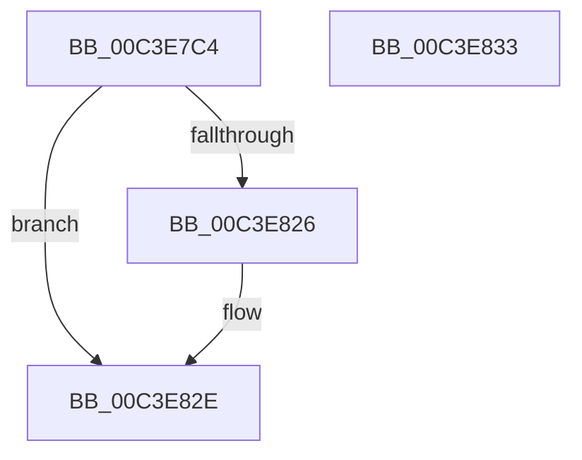

# PopInitializeWin32kActivator

- RVA: `0x00C3E7C4`–`0x00C3E834` (길이 `112` bytes)
- VA: `0x0000000140C3E7C4`
- 실행 섹션: `INIT`
- PDB 이름 있음: `예`; PDB Function 태그: `아니요`
- unwind 정보 RVA: `0x00063458`
- 디코드: `22`개 명령, `112/112` bytes 표시
- 미해석 바이트: `0` (있으면 어셈블리에 `.byte`로 보존)

> 이 문서는 커널 이미지의 기계어와 PDB 기호를 분석해 생성했습니다. 4번과 5번은 함수 원형과 자료형을 바이너리 사용 방식에서 추정한 C 해석이며 원본 소스 복구 결과는 아닙니다.

## 1. Dependencies

- 직접 호출 지점: **2**; 고유 호출 대상: **2**
- 직접 호출자로 확인된 함수: **1**
- RIP 상대 이미지 참조: **7**

### Outgoing calls
- `0x00C3E7E9` → [PopInitializeWorkItem](../../page/75/PopInitializeWorkItem_function_007540C8.md) (function, `0x007540C8`)
- `0x00C3E81D` → [Pdcv2ActivationClientRegister](../../page/79/Pdcv2ActivationClientRegister_function_0079AF28.md) (function, `0x0079AF28`)

### Direct callers
- [PoInitSystem](../C7/PoInitSystem_function_00C72358.md) at `0x00C72EFE`

### Static image references
- `0x00C3E7C8` → RVA `0x00F0E848` (`.data`; read/write)
- `0x00C3E7D0` → RVA `0x009540C0` (`PopWin32kActivatorWorker`; read)
- `0x00C3E7D7` → RVA `0x00F0E840` (`.data`; read/write)
- `0x00C3E7DF` → RVA `0x00F0E9F8` (`.data`; read)
- `0x00C3E7F3` → RVA `0x00758520` (`PopWin32kActivatorCallback`; read)
- `0x00C3E804` → RVA `0x00F0E850` (`.data`; read)
- `0x00C3E826` → RVA `0x00F0E850` (`.data`; read/write)

## 2. Other-region calls and transfers

- 다른 실행 섹션으로 향하는 call: **2**
  - `0x00C3E7E9` → [PopInitializeWorkItem](../../page/75/PopInitializeWorkItem_function_007540C8.md) (`INIT` → `PAGE`)
  - `0x00C3E81D` → [Pdcv2ActivationClientRegister](../../page/79/Pdcv2ActivationClientRegister_function_0079AF28.md) (`INIT` → `PAGE`)
- 별도 외부 분기/꼬리 이동을 확인하지 못했습니다.

## 3. Assembly (complete function range)

```asm
00C3E7C4  48 83 EC 48                     sub rsp, 0x48
00C3E7C8  48 83 25 78 00 2D 00 00         and qword ptr [rip + 0x2d0078], 0
00C3E7D0  48 8D 15 E9 58 D1 FF            lea rdx, [rip - 0x2ea717]
00C3E7D7  48 83 25 61 00 2D 00 00         and qword ptr [rip + 0x2d0061], 0
00C3E7DF  48 8D 0D 12 02 2D 00            lea rcx, [rip + 0x2d0212]
00C3E7E6  45 33 C0                        xor r8d, r8d
00C3E7E9  E8 DA 58 B1 FF                  call 0x1407540c8
00C3E7EE  44 21 44 24 24                  and dword ptr [rsp + 0x24], r8d
00C3E7F3  48 8D 05 26 9D B1 FF            lea rax, [rip - 0x4e62da]
00C3E7FA  4C 21 44 24 30                  and qword ptr [rsp + 0x30], r8
00C3E7FF  48 8D 54 24 20                  lea rdx, [rsp + 0x20]
00C3E804  4C 8D 05 45 00 2D 00            lea r8, [rip + 0x2d0045]
00C3E80B  48 89 44 24 28                  mov qword ptr [rsp + 0x28], rax
00C3E810  B9 7B 00 00 00                  mov ecx, 0x7b
00C3E815  C7 44 24 20 01 00 00 00         mov dword ptr [rsp + 0x20], 1
00C3E81D  E8 06 C7 B5 FF                  call 0x14079af28
00C3E822  85 C0                           test eax, eax
00C3E824  79 08                           jns 0x140c3e82e
00C3E826  48 83 25 22 00 2D 00 00         and qword ptr [rip + 0x2d0022], 0
00C3E82E  48 83 C4 48                     add rsp, 0x48
00C3E832  C3                              ret
00C3E833  CC                              int3
```

## 4. C-style interpretation (structured pseudocode)

```c
__int64 __fastcall PopInitializeWin32kActivator(__int64 a1, __int64 a2, int a3)
{
    __int64 result;
    __int64 v_rsp;
    unsigned __int64 v_stack_m18;
    unsigned __int64 v_stack_m20;
    unsigned int v_stack_m24;
    unsigned __int64 v_stack_m28;

    v_rsp = (v_rsp) - (72);
    a3 = 0;
    result = PopInitializeWorkItem(v_rip + 2949650, v_rip - 3057431, a3, a4);
    v_stack_m20 = v_rip - 5137114;
    v_stack_m28 = 1;
    result = Pdcv2ActivationClientRegister(123, v_stack_m28, v_rip + 2949189, a4);
    if (sign_flag) {
    }
    v_rsp = (v_rsp) + (72);
    return result;
}
```

## 5. (Beta) C Style

```c
int64_t PopInitializeWin32kActivator(int64_t Arg1, int64_t Arg2, int32_t Arg3)
{
    int64_t result;
    int64_t local_rsp;
    uint64_t v_stack_m18;
    uint64_t v_stack_m20;
    uint32_t v_stack_m24;
    uint64_t v_stack_m28;

    local_rsp = (local_rsp) - (72);
    Arg3 = 0;
    result = PopInitializeWorkItem(v_rip + 2949650, v_rip - 3057431, Arg3, a4);
    v_stack_m20 = v_rip - 5137114;
    v_stack_m28 = 1;
    result = Pdcv2ActivationClientRegister(123, v_stack_m28, v_rip + 2949189, a4);
    if (sign_flag) {
    }
    local_rsp = (local_rsp) + (72);
    return result;
}
```

## 6. Execution-region graph

[열기: 2D/3D 그래프와 함수 탐색 컨트롤 패널](../../../control-panel.html?section=init&rva=0x00C3E7C4&view=graph)

- 2D 그래프는 위에서 아래로 흐르고, 3D 그래프는 빈 공간을 드래그해 회전합니다. Shift+드래그는 이동, 휠은 확대·축소, 함수 노드 선택은 대상 보고서 이동입니다.

### Static fallback


