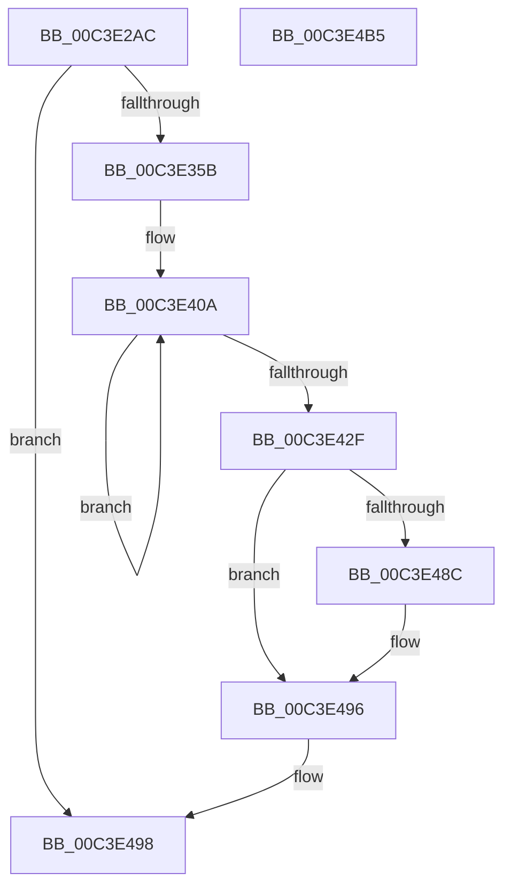

# PopPowerRequestInitialize

- RVA: `0x00C3E2AC`–`0x00C3E4B6` (길이 `522` bytes)
- VA: `0x0000000140C3E2AC`
- 실행 섹션: `INIT`
- PDB 이름 있음: `예`; PDB Function 태그: `아니요`
- unwind 정보 RVA: `0x0006FCAC`
- 디코드: `100`개 명령, `522/522` bytes 표시
- 미해석 바이트: `0` (있으면 어셈블리에 `.byte`로 보존)

> 이 문서는 커널 이미지의 기계어와 PDB 기호를 분석해 생성했습니다. 4번과 5번은 함수 원형과 자료형을 바이너리 사용 방식에서 추정한 C 해석이며 원본 소스 복구 결과는 아닙니다.

## 1. Dependencies

- 직접 호출 지점: **10**; 고유 호출 대상: **8**
- 직접 호출자로 확인된 함수: **1**
- RIP 상대 이미지 참조: **35**

### Outgoing calls
- `0x00C3E2E1` → [memset](../../text/6C/memset_function_006C6C40.md) (function, `0x006C6C40`)
- `0x00C3E2F1` → [RtlInitUnicodeString](../../text/42/RtlInitUnicodeString_function_0042A780.md) (function, `0x0042A780`)
- `0x00C3E34E` → [ObCreateObjectType](../../page/70/ObCreateObjectType_function_00705230.md) (function, `0x00705230`)
- `0x00C3E388` → [PopInitializeWorkItem](../../page/75/PopInitializeWorkItem_function_007540C8.md) (function, `0x007540C8`)
- `0x00C3E3C0` → [memset](../../text/6C/memset_function_006C6C40.md) (function, `0x006C6C40`)
- `0x00C3E456` → [PopInitializeTimer](../../page/75/PopInitializeTimer_function_00754078.md) (function, `0x00754078`)
- `0x00C3E479` → [PopInitializeTimer](../../page/75/PopInitializeTimer_function_00754078.md) (function, `0x00754078`)
- `0x00C3E47E` → [PopPowerRequestStatsInitialize](../C4/PopPowerRequestStatsInitialize_function_00C43D34.md) (function, `0x00C43D34`)
- `0x00C3E483` → [TtmIsEnabled](../../page/91/TtmIsEnabled_function_009143D8.md) (function, `0x009143D8`)
- `0x00C3E49F` → [_security_check_cookie](../../text/6A/_security_check_cookie_function_006AC640.md) (function, `0x006AC640`)

### Direct callers
- [PoInitSystem](../C7/PoInitSystem_function_00C72358.md) at `0x00C72D21`

### Static image references
- `0x00C3E2BE` → RVA `0x00E0A740` (`.data`; read)
- `0x00C3E2E6` → RVA `0x00C7C190` (` ?? ::PBOPGDP::`string'`; read)
- `0x00C3E2F6` → RVA `0x00024F68` (`.rdata`; read)
- `0x00C3E301` → RVA `0x00A9D500` (`PopPowerRequestClose`; read)
- `0x00C3E30C` → RVA `0x00FC53B8` (`ALMOSTRO`; read)
- `0x00C3E313` → RVA `0x00913030` (`PopPowerRequestDelete`; read)
- `0x00C3E35B` → RVA `0x00F0ED28` (`.data`; read/write)
- `0x00C3E363` → RVA `0x00F0ED60` (`.data`; read)
- `0x00C3E36A` → RVA `0x00F0ED20` (`.data`; read/write)
- `0x00C3E372` → RVA `0x00477AD0` (`PopPowerRequestCallbackWorker`; read)
- `0x00C3E379` → RVA `0x00F0ED30` (`.data`; read/write)
- `0x00C3E381` → RVA `0x00F0ED80` (`.data`; read)
- `0x00C3E38D` → RVA `0x00F0ED40` (`.data`; read)
- `0x00C3E394` → RVA `0x00F0ED68` (`.data`; write)
- `0x00C3E39B` → RVA `0x00F0ED60` (`.data`; write)
- `0x00C3E3A8` → RVA `0x00F0ED48` (`.data`; write)
- `0x00C3E3AF` → RVA `0x00F0ED40` (`.data`; write)
- `0x00C3E3B6` → RVA `0x00F0EDC0` (`.data`; read)
- `0x00C3E3C5` → RVA `0x00F0EE20` (`.data`; read/write)
- `0x00C3E3CD` → RVA `0x00A4CFB0` (`PopPowerRequestTableCompare`; read)
- `0x00C3E3D4` → RVA `0x00F0EE08` (`.data`; write)
- `0x00C3E3DB` → RVA `0x00E019D9` (`.data`; read)
- `0x00C3E3E2` → RVA `0x00A82120` (`PopPowerRequestTableAllocate`; read)
- `0x00C3E3E9` → RVA `0x00F0EDC0` (`.data`; write)
- `0x00C3E3F0` → RVA `0x00F0EE10` (`.data`; write)
- `0x00C3E3FC` → RVA `0x00A87610` (`PopPowerRequestTableFree`; read)
- `0x00C3E403` → RVA `0x00F0EE18` (`.data`; write)
- `0x00C3E434` → RVA `0x00754AF0` (`PopPowerRequestExecutionRequiredTimeoutWorker`; read)
- `0x00C3E43E` → RVA `0x005CF1A0` (`PopPowerRequestExecutionRequiredTimeoutCallback`; read)
- `0x00C3E448` → RVA `0x00F0EF00` (`.data`; read)
- `0x00C3E44F` → RVA `0x00F0EFC0` (`.data`; read)
- `0x00C3E461` → RVA `0x00754A40` (`PopPowerRequestDebounceTimerWorker`; read)
- `0x00C3E46B` → RVA `0x005CF170` (`PopPowerRequestDebounceTimerCallback`; read)
- `0x00C3E472` → RVA `0x00F0EE40` (`.data`; read)
- `0x00C3E48C` → RVA `0x00F0EE28` (`.data`; write)

## 2. Other-region calls and transfers

- 다른 실행 섹션으로 향하는 call: **9**
  - `0x00C3E2E1` → [memset](../../text/6C/memset_function_006C6C40.md) (`INIT` → `.text`)
  - `0x00C3E2F1` → [RtlInitUnicodeString](../../text/42/RtlInitUnicodeString_function_0042A780.md) (`INIT` → `.text`)
  - `0x00C3E34E` → [ObCreateObjectType](../../page/70/ObCreateObjectType_function_00705230.md) (`INIT` → `PAGE`)
  - `0x00C3E388` → [PopInitializeWorkItem](../../page/75/PopInitializeWorkItem_function_007540C8.md) (`INIT` → `PAGE`)
  - `0x00C3E3C0` → [memset](../../text/6C/memset_function_006C6C40.md) (`INIT` → `.text`)
  - `0x00C3E456` → [PopInitializeTimer](../../page/75/PopInitializeTimer_function_00754078.md) (`INIT` → `PAGE`)
  - `0x00C3E479` → [PopInitializeTimer](../../page/75/PopInitializeTimer_function_00754078.md) (`INIT` → `PAGE`)
  - `0x00C3E483` → [TtmIsEnabled](../../page/91/TtmIsEnabled_function_009143D8.md) (`INIT` → `PAGE`)
  - `0x00C3E49F` → [_security_check_cookie](../../text/6A/_security_check_cookie_function_006AC640.md) (`INIT` → `.text`)
- 별도 외부 분기/꼬리 이동을 확인하지 못했습니다.

## 3. Assembly (complete function range)

```asm
00C3E2AC  48 89 5C 24 08                  mov qword ptr [rsp + 8], rbx
00C3E2B1  55                              push rbp
00C3E2B2  48 8D 6C 24 A9                  lea rbp, [rsp - 0x57]
00C3E2B7  48 81 EC D0 00 00 00            sub rsp, 0xd0
00C3E2BE  48 8B 05 7B C4 1C 00            mov rax, qword ptr [rip + 0x1cc47b]
00C3E2C5  48 33 C4                        xor rax, rsp
00C3E2C8  48 89 45 47                     mov qword ptr [rbp + 0x47], rax
00C3E2CC  0F 57 C0                        xorps xmm0, xmm0
00C3E2CF  48 8D 4D C7                     lea rcx, [rbp - 0x39]
00C3E2D3  BB 78 00 00 00                  mov ebx, 0x78
00C3E2D8  33 D2                           xor edx, edx
00C3E2DA  44 8B C3                        mov r8d, ebx
00C3E2DD  0F 11 45 B7                     movups xmmword ptr [rbp - 0x49], xmm0
00C3E2E1  E8 5A 89 A8 FF                  call 0x1406c6c40
00C3E2E6  48 8D 15 A3 DE 03 00            lea rdx, [rip + 0x3dea3]
00C3E2ED  48 8D 4D B7                     lea rcx, [rbp - 0x49]
00C3E2F1  E8 8A C4 7E FF                  call 0x14042a780
00C3E2F6  0F 10 05 6B 6C 3E FF            movups xmm0, xmmword ptr [rip - 0xc19395]
00C3E2FD  80 4D C9 14                     or byte ptr [rbp - 0x37], 0x14
00C3E301  48 8D 05 F8 F1 E5 FF            lea rax, [rip - 0x1a0e08]
00C3E308  48 89 45 07                     mov qword ptr [rbp + 7], rax
00C3E30C  4C 8D 0D A5 70 38 00            lea r9, [rip + 0x3870a5]
00C3E313  48 8D 05 16 4D CD FF            lea rax, [rip - 0x32b2ea]
00C3E31A  66 89 5D C7                     mov word ptr [rbp - 0x39], bx
00C3E31E  45 33 C0                        xor r8d, r8d
00C3E321  48 89 45 0F                     mov qword ptr [rbp + 0xf], rax
00C3E325  48 8D 55 C7                     lea rdx, [rbp - 0x39]
00C3E329  C7 45 EB 00 02 00 00            mov dword ptr [rbp - 0x15], 0x200
00C3E330  48 8D 4D B7                     lea rcx, [rbp - 0x49]
00C3E334  C7 45 F3 A8 00 00 00            mov dword ptr [rbp - 0xd], 0xa8
00C3E33B  C7 45 CF 92 01 00 00            mov dword ptr [rbp - 0x31], 0x192
00C3E342  F3 0F 7F 45 D3                  movdqu xmmword ptr [rbp - 0x2d], xmm0
00C3E347  C7 45 E3 00 00 1F 00            mov dword ptr [rbp - 0x1d], 0x1f0000
00C3E34E  E8 DD 6E AC FF                  call 0x140705230
00C3E353  85 C0                           test eax, eax
00C3E355  0F 88 3D 01 00 00               js 0x140c3e498
00C3E35B  48 83 25 C5 09 2D 00 00         and qword ptr [rip + 0x2d09c5], 0
00C3E363  4C 8D 05 F6 09 2D 00            lea r8, [rip + 0x2d09f6]
00C3E36A  48 83 25 AE 09 2D 00 00         and qword ptr [rip + 0x2d09ae], 0
00C3E372  48 8D 15 57 97 83 FF            lea rdx, [rip - 0x7c68a9]
00C3E379  48 83 25 AF 09 2D 00 00         and qword ptr [rip + 0x2d09af], 0
00C3E381  48 8D 0D F8 09 2D 00            lea rcx, [rip + 0x2d09f8]
00C3E388  E8 3B 5D B1 FF                  call 0x1407540c8
00C3E38D  48 8D 0D AC 09 2D 00            lea rcx, [rip + 0x2d09ac]
00C3E394  4C 89 05 CD 09 2D 00            mov qword ptr [rip + 0x2d09cd], r8
00C3E39B  4C 89 05 BE 09 2D 00            mov qword ptr [rip + 0x2d09be], r8
00C3E3A2  33 D2                           xor edx, edx
00C3E3A4  44 8D 43 F0                     lea r8d, [rbx - 0x10]
00C3E3A8  48 89 0D 99 09 2D 00            mov qword ptr [rip + 0x2d0999], rcx
00C3E3AF  48 89 0D 8A 09 2D 00            mov qword ptr [rip + 0x2d098a], rcx
00C3E3B6  48 8D 1D 03 0A 2D 00            lea rbx, [rip + 0x2d0a03]
00C3E3BD  48 8B CB                        mov rcx, rbx
00C3E3C0  E8 7B 88 A8 FF                  call 0x1406c6c40
00C3E3C5  48 83 25 53 0A 2D 00 00         and qword ptr [rip + 0x2d0a53], 0
00C3E3CD  48 8D 05 DC EB E0 FF            lea rax, [rip - 0x1f1424]
00C3E3D4  48 89 05 2D 0A 2D 00            mov qword ptr [rip + 0x2d0a2d], rax
00C3E3DB  48 8D 0D F7 35 1C 00            lea rcx, [rip + 0x1c35f7]
00C3E3E2  48 8D 05 37 3D E4 FF            lea rax, [rip - 0x1bc2c9]
00C3E3E9  48 89 1D D0 09 2D 00            mov qword ptr [rip + 0x2d09d0], rbx
00C3E3F0  48 89 05 19 0A 2D 00            mov qword ptr [rip + 0x2d0a19], rax
00C3E3F7  BA 06 00 00 00                  mov edx, 6
00C3E3FC  48 8D 05 0D 92 E4 FF            lea rax, [rip - 0x1b6df3]
00C3E403  48 89 05 0E 0A 2D 00            mov qword ptr [rip + 0x2d0a0e], rax
00C3E40A  66 83 61 FF 00                  and word ptr [rcx - 1], 0
00C3E40F  48 8D 41 07                     lea rax, [rcx + 7]
00C3E413  C6 41 01 06                     mov byte ptr [rcx + 1], 6
00C3E417  C7 41 03 01 00 00 00            mov dword ptr [rcx + 3], 1
00C3E41E  48 89 41 0F                     mov qword ptr [rcx + 0xf], rax
00C3E422  48 8D 49 30                     lea rcx, [rcx + 0x30]
00C3E426  48 89 00                        mov qword ptr [rax], rax
00C3E429  48 83 EA 01                     sub rdx, 1
00C3E42D  75 DB                           jne 0x140c3e40a
00C3E42F  48 21 54 24 20                  and qword ptr [rsp + 0x20], rdx
00C3E434  4C 8D 0D B5 66 B1 FF            lea r9, [rip - 0x4e994b]
00C3E43B  0F 57 C0                        xorps xmm0, xmm0
00C3E43E  48 8D 15 5B 0D 99 FF            lea rdx, [rip - 0x66f2a5]
00C3E445  45 33 C0                        xor r8d, r8d
00C3E448  48 8D 0D B1 0A 2D 00            lea rcx, [rip + 0x2d0ab1]
00C3E44F  0F 11 05 6A 0B 2D 00            movups xmmword ptr [rip + 0x2d0b6a], xmm0
00C3E456  E8 1D 5C B1 FF                  call 0x140754078
00C3E45B  48 83 64 24 20 00               and qword ptr [rsp + 0x20], 0
00C3E461  4C 8D 0D D8 65 B1 FF            lea r9, [rip - 0x4e9a28]
00C3E468  45 33 C0                        xor r8d, r8d
00C3E46B  48 8D 15 FE 0C 99 FF            lea rdx, [rip - 0x66f302]
00C3E472  48 8D 0D C7 09 2D 00            lea rcx, [rip + 0x2d09c7]
00C3E479  E8 FA 5B B1 FF                  call 0x140754078
00C3E47E  E8 B1 58 00 00                  call 0x140c43d34
00C3E483  E8 50 5F CD FF                  call 0x1409143d8
00C3E488  84 C0                           test al, al
00C3E48A  74 0A                           je 0x140c3e496
00C3E48C  C7 05 92 09 2D 00 01 00 00 00   mov dword ptr [rip + 0x2d0992], 1
00C3E496  33 C0                           xor eax, eax
00C3E498  48 8B 4D 47                     mov rcx, qword ptr [rbp + 0x47]
00C3E49C  48 33 CC                        xor rcx, rsp
00C3E49F  E8 9C E1 A6 FF                  call 0x1406ac640
00C3E4A4  48 8B 9C 24 E0 00 00 00         mov rbx, qword ptr [rsp + 0xe0]
00C3E4AC  48 81 C4 D0 00 00 00            add rsp, 0xd0
00C3E4B3  5D                              pop rbp
00C3E4B4  C3                              ret
00C3E4B5  CC                              int3
```

## 4. C-style interpretation (structured pseudocode)

```c
__int64 __fastcall PopPowerRequestInitialize(__int64 a1, int a2)
{
    __int64 result;
    __int64 v_rsp;
    unsigned __int64 v_stack_m18;
    unsigned __int64 v_stack_m50;
    unsigned __int64 v_stack_m58;
    unsigned __int64 v_stack_m5F;
    unsigned int v_stack_m6C;
    unsigned int v_stack_m74;
    unsigned int v_stack_m7C;
    unsigned __int64 v_stack_m8C;
    unsigned int v_stack_m90;
    unsigned __int8 v_stack_m96;
    unsigned __int64 v_stack_m98;
    unsigned __int64 v_stack_mA8;
    unsigned __int64 v_stack_mB8;
    unsigned __int64 v_stack_p8;

    v_stack_p8 = v_rbx;
    v_rsp = (v_rsp) - (208);
    result = (*(unsigned __int64 *)(v_rip + 1885307)) ^ (v_rsp);
    v_stack_m18 = result;
    a2 = 0;
    v_stack_mA8 = v_xmm0;
    result = memset(v_stack_m98, a2, 120, a4);
    result = RtlInitUnicodeString(v_stack_mA8, v_rip + 253603, 120, a4);
    v_stack_m58 = v_rip - 1707528;
    v_stack_m98 = 120;
    a3 = 0;
    v_stack_m50 = v_rip - 3322602;
    v_stack_m74 = 512;
    v_stack_m6C = 168;
    v_stack_m90 = 402;
    v_stack_m8C = v_xmm0;
    v_stack_m7C = 0x1F0000ULL;
    result = ObCreateObjectType(v_stack_mA8, v_stack_m98, a3, v_rip + 3698853);
    if (sign_flag) goto loc_00C3E498;
    result = PopInitializeWorkItem(v_rip + 2951672, v_rip - 8153257, v_rip + 2951670, v_rip + 3698853);
    *(unsigned __int64 *)(v_rip + 2951629) = v_rip + 2951670;
    *(unsigned __int64 *)(v_rip + 2951614) = v_rip + 2951670;
    a2 = 0;
    *(unsigned __int64 *)(v_rip + 2951577) = v_rip + 2951596;
    *(unsigned __int64 *)(v_rip + 2951562) = v_rip + 2951596;
    result = memset(v_rip + 2951683, a2, 120 - 16, v_rip + 3698853);
    *(unsigned __int64 *)(v_rip + 2951725) = v_rip - 2036772;
    *(unsigned __int64 *)(v_rip + 2951632) = v_rip + 2951683;
    *(unsigned __int64 *)(v_rip + 2951705) = v_rip - 1819337;
    *(unsigned __int64 *)(v_rip + 2951694) = v_rip - 1797619;
loc_00C3E40A:
    *(unsigned __int8 *)(v_rip + 1848823 + 1) = 6;
    *(unsigned int *)(v_rip + 1848823 + 3) = 1;
    *(unsigned __int64 *)(v_rip + 1848823 + 15) = v_rip + 1848823 + 7;
    *(unsigned __int64 *)(v_rip + 1848823 + 7) = v_rip + 1848823 + 7;
    a2 = (6) - (1);
    if (condition_is_not_equal) goto loc_00C3E40A;
    a3 = 0;
    *(unsigned __int64 *)(v_rip + 2952042) = v_xmm0;
    result = PopInitializeTimer(v_rip + 2951857, v_rip - 6746789, a3, v_rip - 5151051);
    a3 = 0;
    result = PopInitializeTimer(v_rip + 2951623, v_rip - 6746882, a3, v_rip - 5151272);
    result = PopPowerRequestStatsInitialize(v_rip + 2951623, v_rip - 6746882, a3, v_rip - 5151272);
    result = TtmIsEnabled(v_rip + 2951623, v_rip - 6746882, a3, v_rip - 5151272);
    if ((unsigned __int8)(result) != 0) {
        *(unsigned int *)(v_rip + 2951570) = 1;
    }
    result = 0;
loc_00C3E498:
    a1 = (v_stack_m18) ^ (v_rsp);
    result = _security_check_cookie(a1, v_rip - 6746882, a3, v_rip - 5151272);
    v_rsp = (v_rsp) + (208);
    return result;
}
```

## 5. (Beta) C Style

```c
int64_t PopPowerRequestInitialize(int64_t Arg1, int32_t Arg2)
{
    int64_t result;
    int64_t local_rsp;
    uint64_t v_stack_m18;
    uint64_t v_stack_m50;
    uint64_t v_stack_m58;
    uint64_t v_stack_m5F;
    uint32_t v_stack_m6C;
    uint32_t v_stack_m74;
    uint32_t v_stack_m7C;
    uint64_t v_stack_m8C;
    uint32_t v_stack_m90;
    uint8_t v_stack_m96;
    uint64_t v_stack_m98;
    uint64_t v_stack_mA8;
    uint64_t v_stack_mB8;
    uint64_t v_stack_p8;

    v_stack_p8 = local_rbx;
    local_rsp = (local_rsp) - (208);
    result = (*(uint64_t *)(v_rip + 0x1CC47B)) ^ (local_rsp);
    v_stack_m18 = result;
    Arg2 = 0;
    v_stack_mA8 = v_xmm0;
    result = memset(v_stack_m98, Arg2, 120, a4);
    result = RtlInitUnicodeString(v_stack_mA8, v_rip + 253603, 120, a4);
    v_stack_m58 = v_rip - 1707528;
    v_stack_m98 = 120;
    a3 = 0;
    v_stack_m50 = v_rip - 3322602;
    v_stack_m74 = 512;
    v_stack_m6C = 168;
    v_stack_m90 = 402;
    v_stack_m8C = v_xmm0;
    v_stack_m7C = 0x1F0000ULL;
    result = ObCreateObjectType(v_stack_mA8, v_stack_m98, a3, v_rip + 3698853);
    if (sign_flag) goto loc_00C3E498;
    result = PopInitializeWorkItem(v_rip + 2951672, v_rip - 8153257, v_rip + 2951670, v_rip + 3698853);
    *(uint64_t *)(v_rip + 0x2D09CD) = v_rip + 2951670;
    *(uint64_t *)(v_rip + 0x2D09BE) = v_rip + 2951670;
    Arg2 = 0;
    *(uint64_t *)(v_rip + 0x2D0999) = v_rip + 2951596;
    *(uint64_t *)(v_rip + 0x2D098A) = v_rip + 2951596;
    result = memset(v_rip + 2951683, Arg2, 120 - 16, v_rip + 3698853);
    *(uint64_t *)(v_rip + 0x2D0A2D) = v_rip - 2036772;
    *(uint64_t *)(v_rip + 0x2D09D0) = v_rip + 2951683;
    *(uint64_t *)(v_rip + 0x2D0A19) = v_rip - 1819337;
    *(uint64_t *)(v_rip + 0x2D0A0E) = v_rip - 1797619;
loc_00C3E40A:
    *(uint8_t *)(v_rip + 0x1C35F7 + 0x1) = 6;
    *(uint32_t *)(v_rip + 0x1C35F7 + 0x3) = 1;
    *(uint64_t *)(v_rip + 0x1C35F7 + 0xF) = v_rip + 1848823 + 7;
    *(uint64_t *)(v_rip + 0x1C35F7 + 0x7) = v_rip + 1848823 + 7;
    Arg2 = (6) - (1);
    if (condition_is_not_equal) goto loc_00C3E40A;
    a3 = 0;
    *(uint64_t *)(v_rip + 0x2D0B6A) = v_xmm0;
    result = PopInitializeTimer(v_rip + 2951857, v_rip - 6746789, a3, v_rip - 5151051);
    a3 = 0;
    result = PopInitializeTimer(v_rip + 2951623, v_rip - 6746882, a3, v_rip - 5151272);
    result = PopPowerRequestStatsInitialize(v_rip + 2951623, v_rip - 6746882, a3, v_rip - 5151272);
    result = TtmIsEnabled(v_rip + 2951623, v_rip - 6746882, a3, v_rip - 5151272);
    if ((uint8_t)(result) != 0) {
        *(uint32_t *)(v_rip + 0x2D0992) = 1;
    }
    result = 0;
loc_00C3E498:
    Arg1 = (v_stack_m18) ^ (local_rsp);
    result = _security_check_cookie(Arg1, v_rip - 6746882, a3, v_rip - 5151272);
    local_rsp = (local_rsp) + (208);
    return result;
}
```

## 6. Execution-region graph

[열기: 2D/3D 그래프와 함수 탐색 컨트롤 패널](../../../control-panel.html?section=init&rva=0x00C3E2AC&view=graph)

- 2D 그래프는 위에서 아래로 흐르고, 3D 그래프는 빈 공간을 드래그해 회전합니다. Shift+드래그는 이동, 휠은 확대·축소, 함수 노드 선택은 대상 보고서 이동입니다.

### Static fallback


